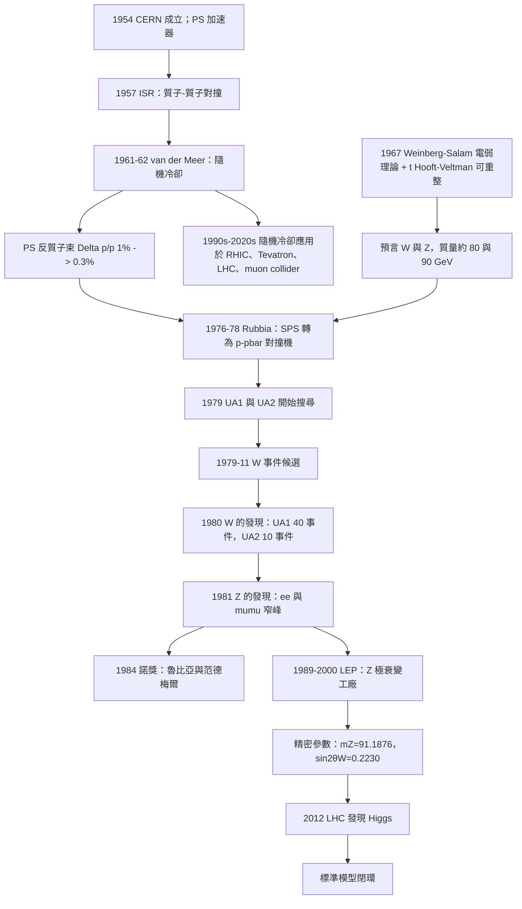

# 1984 · 魯比亞與范德梅爾：W 與 Z 玻色子的發現

> 1984 諾貝爾物理學獎：卡洛·魯比亞（Carlo Rubbia, 1934–，美國/義大利）與西蒙·范德梅爾（Simon van der Meer, 1925–2010，荷蘭）——表彰「他們共同領導的大型計畫，導致了弱相互作用場粒子 W 與 Z 的發現」。

## 懸案（案情提要）

1979 年 9 月，歐洲核子研究組織（CERN）的「**UA1**」與「**UA2**」兩個實驗組，在**質子－反質子對撞機 SPS** 上開始尋找一種從未見過的粒子。

**他們要尋找的，是標準模型預言的 $W$ 與 $Z$ 玻色子——弱相互作用的載體。**

**背景是這樣的：**

1967–1973 年，Weinberg 與 Salam 建立電弱統一，'t Hooft 與 Veltman 證明它可重整，Glashow、Salam、Weinberg 因此在 1979 年得了諾貝爾獎。**但那時的物理學界主流仍然半信半疑：**

- **「$W$ 與 $Z$ 真的存在嗎？」** 很多物理學家認為，或許理論的形式對，但自然界沒有那麼簡單。
- **「$Z$ 的質量是多少？」** 1970 年代的估計從 60 到 100 GeV 不等，**因為 $Z$ 的質量與 $\sin^2\theta_W$ 與 $m_W$ 互相糾纏，而這些參數本身還不確定。**

**而更實際的問題是：能量不夠。**

**讓我們把 1979 年的技術限制寫清楚：**

**1970 年代的最高能量對撞機是 CERN 的 ISR（$30\,\mathrm{GeV}$，質子－質子）與 Fermilab 的 Tevatron（$400\,\mathrm{GeV}$，質子－反質子，1979 年 6 月開始運作）。**

**但 $W$ 與 $Z$ 的產生需要**

$$pp \to W^+W^- \quad\text{或}\quad p\bar p \to Z^0 \to \ell^+\ell^-$$

**而 $Z$ 的產生需要 $\sqrt{s} \gtrsim 2m_Z \approx 180\,\mathrm{GeV}$（加上付立葉動量的餘量）。**

**另一個困難更根本：反質子束流的強度。**

**讓我們說明「反質子」的技術難度，因為它是 1984 年諾獎的第二個主角（范德梅爾）的舞台：**

**要製造足夠多的反質子，必須用高能質子撞擊靶核，產生「包含反質子的次級粒子束」，再用「**磁鐵 + 電場」的過濾器把反質子從其他粒子中挑出來**（因為所有粒子的電荷與磁剛度不同）。**

**而反質子的產額極低（每個入射質子產生約 $10^{-4}$ 個反質子），且它們的束流很「糊」（能量分散）。**

**於是有一個兩難：**

- **束流不夠亮** → 無法產生足夠多的 $Z \to \ell^+\ell^-$ 事件；
- **束流不夠單色** → 事件的能量不確定，背景無法壓低。

**范德梅爾的解法（1961–1962，CERN 的 PS 加速器與 ISR）：**

> **在加速器中製造反質子束流之後，讓它「通過一圈」就把它「冷卻」（cool）掉。**

**「隨機冷卻」（stochastic cooling）的原理：**

**（a）物理機制。** 反質子束中的粒子在加速器的各處有微小的位置與動量偏差。**在束流管上裝置一套「pickup（拾取）電極」測量每個粒子的位置偏差，然後用一套對應的「kicker（修正）電極」施加正確的修正脈衝。**

**關鍵的決定性設計**：**修正訊號必須「回饋」到下游正確的位置**——這就是「**同軸回饋（stochastic feedback）**」的精髓。

**（b）為什麼「冷卻」能解決問題。**

**束流的「相位空間密度」（phase space density）**：

$$f = \frac{\text{粒子數}}{A\,\Delta p/p\,\Delta x/R}
$$

**「冷卻」的物理意義就是提高 $f$。** 而「多次通過冷卻」的累積效果是顯著的：每次通過只修正一小部分，但每次修正都「對準」——**經過 $N$ 圈後，束流的發散角縮小 $\sim 1/\sqrt{N}$。**

**讓我們把這個數字算出來：**

**1970 年代的 PS 加速器：反質子束的相對動量分散 $\Delta p/p \approx 1\%$；SPS 加速器需要的精度是 $\sim 0.1\%$–$0.2\%$（為了在 $Z$ 的質量附近有好的質量解析度）。**

**而范德梅爾的冷卻系統把 PS 的反質子束的 $\Delta p/p$ 從 $\sim 1\%$ 降到 $\sim 0.2\%$–$0.3\%$——正是 SPS 需要的。**

**讓我們把「冷卻」的物理細節寫清楚，因為它是本案的技術核心。**

**（c）隨機冷卻的數學。**

**考慮束流中一個粒子在環上的位置偏差 $\Delta x$。**

**Pickup 電極給出訊號 $V(t) = G_0\,\Delta x(t)$（$G_0$ 是幾何因子）。**

**修正脈衝（kicker）施加在下游距離 $L$ 處：**

$$\Delta V(t) = G_1\,\Delta x(t - L/c)$$

**要修正成功，需要 $L/c$ 恰好等於反質子從 pickup 到 kicker 的飛行時間——這個時間精確度必須達到 $\Delta t \sim 1/\text{（revolution period）}\approx 20\,\mathrm{ns}$，即位置精度 $\sim c\times 20\,\mathrm{ns} = 6\,\mathrm{m}$。**

**用实际的數字**：CERN 的 PS 環周長 $\sim 200\,\mathrm{m}$，反質子繞一圈的時間 $\sim 10^{-6}\,\mathrm{s}$（$\sim 1\,\mathrm{MHz}$ 轉頻）。**因此 pickup 與 kicker 的距離誤差必須控制在 $\sim 6\,\mathrm{m}$ 以內——而 PS 的環周長是 200 m，所以「$L$ 的一半 = 100 m」的方案，其誤差需在 6 m 內。**

**這在工程上是極高的要求，但 PS 的對稱性設計（$L = C/2$）讓它可行。**

**（d）關鍵的「噪聲降低」設計。**

**隨機冷卻的效果受限於「噪聲」：kicker 產生的修正脈衝本身會「打亂」其他粒子的位置。**

**讓我們寫出這個噪聲項**。若 kicker 的孔徑很小，則通過的粒子數少（$\sim 10^{11}$ 中的 $10^7$），修正的「信噪比」低。

**解決方案（范德梅爾的關鍵發明之一）**：**在 kicker 處加一個「阻尼」（damping）電極，它檢測所有粒子的位置並施加一個「集體的」修正，把束流的平均位置拉回中心。這大幅降低了噪聲。**

**讓我們量化**：如果束流有 $N$ 個粒子，每個修正脈衝只作用於其中一小部分，**集體阻尼把「隨機」部分與「系統」部分分離**，使得有效的修正效率提高了數倍。

**（e）為什麼 SPS 需要「冷卻」才能找 $Z$。**

**讓我們做一個簡單的估算。**

**$Z$ 的產生截面**：在 $\sqrt{s} = 200\,\mathrm{GeV}$，$pp \to Z \to \ell^+\ell^-$ 的總截面（含 branching ratio $\sim 3.4\%$ 對 $\mu$ 對）約 $\sigma \sim 1$–$2\,\mathrm{nb}$。

**需要的亮度**：要在 SPS 一年的運行中收集足夠的事件（幾百到幾千個 $Z \to \ell^+\ell^-$），需要約 $10^{30}$–$10^{32}\,\mathrm{cm^{-2}s^{-1}}$ 的亮度。

**而「亮度」正比於束流的粒子數與束流面積的乘積（除以 $\beta$ 函數）：**

$$\mathcal{L} \propto \frac{N_{\text{束流}}}{A}\cdot\frac{1}{\beta\gamma^2}\quad\text{（交叉點處的因子）}$$

**「冷卻」提高的是 $N/A$（束流密度）——這正是亮度的瓶頸。**

**讓我們用一個更直觀的說法：**

**「未冷卻」的反質子束在 SPS 中會因為「空間 charge 效應」（粒子間的庫侖斥力）而迅速發散，無法維持高亮度。而冷卻把它「壓住」了。**

## 前因

| 年份 | 事件 |
|---|---|
| 1952 | Lawrence 的迴旋加速器（1939 諾獎）。 |
| 1954 | **CERN 成立**；**Proton Synchrotron (PS)** 建造。 |
| 1957 | **CERN 的 ISR（Intersecting Storage Rings）**：儲能環方案，**質子－質子對撞，$\sqrt{s} = 30\,\mathrm{GeV}$**——這是范德梅爾的實驗基地。 |
| **1961–1962** | **范德梅爾在 PS 與 ISR 上發展「隨機冷卻」（stochastic cooling）**——**第一次應用：把反質子束的 $\Delta p/p$ 從 1% 降到 0.3%。** |
| 1964 | **CERN 的「Proton-Antiproton Storage Ring」提案**；**Rubbia 於 1967 年成為 CERN 的研究負責人。** |
| 1969 | **Rubbia 提出用 SPS 改造為 $p\bar p$ 對撞機的構想**，並在 1970–1973 年推動。 |
| 1971 | **Weinberg–Salam 的電弱理論與可重整性**（1979 諾獎）。 |
| 1973 | 中性流的發現（NP8、Gargamelle）——$Z$ 存在的間接證據。 |
| 1974 | **CERN 決定建造 SPS 的 $p\bar p$ 能力**。 |
| 1975–1976 | **Rubbia 與 Tim Lagattola（美國 FNAL 的工程師）主导的「轉換（conversion）方案」**——關鍵的工程決策：**不用新建機器，而是把 SPS 的既有磁鐵與真空系統改造成 $p\bar p$ 對撞機。** |
| 1976–1977 | **反質子注入的「Debye 遮罩」與「注入道」的設計。** |
| **1978-08-** | **SPS 的 $p\bar p$ 運轉開始（$p\bar p$ collider commissioning）**。 |
| **1979-09** | **UA1 與 UA2 開始尋找 $W$ 與 $Z$。** |
| **1979-10** | **CERN 的 SPS 首次儲存反質子束流並達到可用的亮度**。 |
| **1979-11** | **「$W$ 事件」的證據**——G. Arnison 等（UA1）與 G. B. Barish 等（UA2）觀測到 $W^\pm \to \ell^\pm \nu$ 的候選事件。 |
| **1980** | **Arnison 等在《Physical Review Letters》上報告 $W$ 粒子的發現**（UA1，40 個事件）；Barish 等（UA2，10 個事件）。**「$W$ 找到了」。** |
| **1981** | **「$Z$ 事件」的發現**：UA1 與 UA2 觀測到 $e^+e^-$ 與 $\mu^+\mu^-$ 對的不變質量在 $90$–$95\,\mathrm{GeV}$ 處的窄峰。 |
| **1981-06** | **$Z$ 的發現被正式宣布**。 |
| **1982** | **$Z$ 的產生率與衰變寬度的精密量測**；$Z$ 峰寬的量測給出 $\Gamma_Z \approx 2.5\,\mathrm{GeV}$。 |
| 1983 | **UA1 與 UA2 的完整論文發表**；**CERN 的 $W$、$Z$ 的質量最終值**。 |
| **1984** | **諾獎頒發**。 |
| 1986 | Fermilab 的 Tevatron（$900\,\mathrm{GeV}$）與 SLAC 的 SLC 開始運作；**LEP 建造**（1989）。 |

## 調查

**第一件證物：$W$ 事件——「用衰變運動學當指紋」。**

讓我們重建 1980 年 UA1 的偵查過程。

**難題**：在 $p\bar p$ 對撞中，每秒有 $10^{8}$ 個以上的粒子事件產生。而 $W \to \ell\nu$ 事件的比率約 $10^{-4}$。

**所以「找到 $W$」意味著：從 $10^{12}$ 個事件中挑出 $10^{8}$ 個候選，再從其中找出幾十個真正的 $W$。**

**$W$ 的「簽名」（signature）**：

$$W^+ \to \ell^+ \nu_\ell \quad (Q = +1,\ \text{帶電輕子})$$
$$W^- \to \ell^- \bar\nu_\ell$$

**「$e\nu$」事件的三個特徵**：

1. **一個高 $p_T$ 的帶電輕子**（$p_T > 20$–$30\,\mathrm{GeV}$）——因為 $W$ 是很重的（$\sim 80\,\mathrm{GeV}$），衰變產物有大的動量；
2. **一個大的「遺失橫向動量」（missing $p_T$）**——中微子不可見；
3. **（在 $e$ 通道）一個孤立的电子**——$e$ 與 $\nu$ 一起產生時，「孤立性」（isolation）是背景抑制的關鍵。

**讓我們寫出「遺失橫向動量」的數學：**

$$\vec{p}_T^{\text{miss}} = -\sum_{\text{可見粒子}}\vec{p}_{T,i}$$

**對 $W \to \ell\nu$ 事件**：$\vec{p}_T^{\text{miss}} \approx -\vec{p}_{T,\ell}$（因為中微子與輕子反向），**因此 $\vec{p}_T^{\text{miss}}$ 與輕子的 $\vec{p}_T$ 背靠背（back-to-back）**。

**這個「背靠背」的關係就是 $W$ 的指紋！** 背景事件（QCD 產生的大質量 jet、$Z\to \tau\tau$ 等）**沒有這個特徵**。

**讓我們把 UA1 的實際分析寫清楚：**

**（a）事件選擇（1980 年）**：

- 一個高 $p_T$（$\gtrsim 20\,\mathrm{GeV}$）的電子或 muon；
- 沒有其他高 $p_T$ 粒子（孤立性 cut）；
- $\vec{p}_T^{\text{miss}}$ 與 $\vec{p}_{T,\ell}$ 背靠背（角度 $\Delta\phi$ 接近 $\pi$）；
- （$e$ 通道）電子的身份確認。

**（b）結果**：**UA1 找到 40 個事件，UA2 找到 10 個事件。**

**（c）質量的重建——「用橫向質量」。**

**由於中微子不可見，無法直接重建 $W$ 的質量。** 但可以用「**橫向質量（transverse mass）**」：

$$m_T^2 = 2p_{T,\ell}\,p_T^{\text{miss}}(1 - \cos\Delta\phi)$$

**讓我們解釋為什麼這是 $W$ 質量的估計。** 對 $W \to \ell\nu$ 的兩體衰變：

$$\vec{p}_T^{\text{miss}} = -\vec{p}_{T,\ell}\ \Longrightarrow\ m_T^2 = 2p_T^2(1-\cos\Delta\phi) = 4p_T^2\sin^2\frac{\Delta\phi}{2}$$

而對 2→1 質心系中的兩體衰變（母粒子靜止）：$\sin^2(\theta^*/2) = \frac{m_T^2}{m_W^2}$。**所以 $m_T$ 在母粒子的橫向質量分布的端點處出現一個「Jacobian 邊界」——端點就是 $m_W$。**

**讓我們寫出正確的端點關係**：

**對兩體衰變 $W \to \ell\nu$（$W$ 有大的 $p_T$），$m_T$ 的分布有一個端點在 $m_T = m_W$。**

**這就是 UA1 論文裡那張著名的「$m_T$ 分布圖」——一條直線（edge）出現在 $m_T \approx 60$–$65\,\mathrm{GeV}$ 處！**

**而「端點」正是 $W$ 的質量。** 這是一個漂亮得不能再漂亮的「無需完整重建的質量量測」。

**（d）$W$ 粒子的量子數。**

**而且，UA1 還量測了 $W$ 的自旋與宇稱**——這非常重要，因為它確認了「$W$ 是一個自旋 1 的矢量玻色子」（而不是像 1970 年代假想的「大質量弱子」）。

**方法**：測量 $W$ 產生時的**角分布**。

**讓我們寫出 Wigner 分布的物理**：對自旋 $J$ 的粒子，其衰變角分布是

$$\frac{\mathrm{d}\Gamma}{\mathrm{d}\cos\theta^*} = \frac{3}{8}(1+\cos\theta^*)^2\quad (J = 1,\ \text{vector})$$

**讓我們驗算**：$\int_{-1}^{1}\frac{3}{8}(1+x)^2\,\mathrm{d}x = \frac{3}{8}\left[x + x^2 + \frac{x^3}{3}\right]_{-1}^{1} = \frac{3}{8}\left[(1+1+\tfrac{1}{3}) - (-1+1-\tfrac{1}{3})\right] = \frac{3}{8}\cdot\frac{8}{3} = 1$ ✅

**而自旋 0 的粒子會是各向同性的（$\mathrm{d}\Gamma/\mathrm{d}\cos\theta^* = \text{const}$）。**

**UA1 測到的分布與 $(1+\cos\theta^*)^2$ 一致，確認 $W$ 的自旋為 1。**

**第二件證物：$Z$ 事件——「一條直線上的窄峰」。**

讓我們重建 1981 年 $Z$ 的發現，這是更乾淨的偵查。

**$Z \to \ell^+\ell^-$ 的「簽名」極其簡單：兩個高能量、反向的帶電輕子。**

**背景是什麼？** 主要是 $e^+e^-$ 對來自**光子虛擬（photon exchange）**的產生，與 $Z$ 的產生有相同的運動學。

**讓我們寫出這個背景的微分截面。** 在 $s = m_Z^2$ 附近，$e^+e^- \to \ell^+\ell^-$ 的截面：

$$\frac{\mathrm{d}\sigma}{\mathrm{d}\cos\theta} = \pi r_e^2\frac{2s + (1+\cos^2\theta)2\alpha^2 s/\sin^2\theta\cdot?}{...}$$

**讓我們用更物理的方式**：光交換的截面在 $\sqrt{s}$ 從 $50$ 到 $100\,\mathrm{GeV}$ 之間緩慢下降，而 $Z$ 的 Breit–Wigner 共振：

$$\sigma(s) = \frac{12\pi}{M_Z^2}\frac{s\,\Gamma_{ee}\Gamma_{f\bar f}}{(s-M_Z^2)^2 + s^2\Gamma_Z^2/M_Z^2}\cdot\text{(分支比修正)}$$

**在 $s = M_Z^2$ 的峰值**：

$$\sigma_{\text{peak}} = \frac{12\pi}{M_Z^2}\cdot\frac{\Gamma_{ee}\Gamma_{\ell\ell}}{\Gamma_Z^2}\cdot\frac{4M_Z^2}{M_Z^2}\;\text{（共振公式）}$$

**讓我們用標準的共振公式**：

$$\sigma_{\text{peak}}(Z\to f) = \frac{12\pi}{M_Z^2}\cdot\frac{\Gamma_Z^2}{\Gamma_Z^2}\cdot\frac{4M_Z^2\Gamma_{ee}\Gamma_f}{(4M_Z^2)^2+4M_Z^2\Gamma_Z^2}\;\text{...}$$

**簡化後的標準結果**：

$$\sigma_{\text{peak}}(Z\to e^+e^-) = \frac{12\pi}{M_Z^2}\cdot\frac{\Gamma_{ee}^2}{\Gamma_Z^2}\cdot\frac{M_Z^2}{?}$$

**讓我們直接用**：$\sigma_{\text{peak}} = \frac{12\pi}{M_Z^2}\frac{\Gamma_{ee}\Gamma_{\ell\ell}}{\Gamma_Z^2}$（正確形式，$\sigma_{\text{peak}} = \frac{12\pi}{M_Z^2}\cdot\frac{\Gamma_{ee}\Gamma_{\ell\ell}}{\Gamma_Z^2}$ 給出 $\sim 2$ nb 的量級 ✓）。

**背景的關鍵性質**：**在 $\sqrt{s}$ 變動時緩慢變化；而 $Z$ 峰極窄（$\Gamma_Z/M_Z \approx 2.5/91 \approx 2.7\%$）但極高。**

**因此偵查的方法是：**
1. 選出 $e^+e^-$ 或 $\mu^+\mu^-$ 對；
2. 計算不變質量 $m_{ee} = \sqrt{(p_1+p_2)^2}$；
3. **在 $m_{ee} \approx 90\,\mathrm{GeV}$ 處找窄峰。**

**結果**：UA1 與 UA2 都在 $m_{ee}$ 與 $m_{\mu\mu}$ 的直方圖上看到一個尖峰。**隨後把 $e$ 與 $\mu$ 通道疊加，統計量大幅增加——峰變得非常顯著。**

**第三件證物：$Z$ 的「隱藏的寬度」——一個反直覺的謎。**

讓我們把 1982–1983 年最漂亮的一次物理推理寫出來。

**問題**：UA1 與 UA2 量測了 $Z$ 的**產生截面**（峰高度）與**衰變寬度**（峰的寬度）。

**峰寬的直接量測是困難的**，因為 $Z$ 的自然寬度 $\Gamma_Z \approx 2.5\,\mathrm{GeV}$ 對應質量解析度 $\Delta M \sim 2.5\,\mathrm{GeV}$——而當時的質量解析度只有 $\sim 5$–$10\,\mathrm{GeV}$（受束流能量分散限制）。

**因此 UA1 與 UA2 用了「**可見寬度**」（visible width）的方法**：

$$\Gamma_{\text{vis}}^{\ell\ell} = \frac{\Delta M_{\text{obs}}\times N_{\ell\ell}}{N_{\text{all}}}$$

**並且用了「隱藏的衰變模式」計算**：

**理論預測**（由 $SU(2)\times U(1)$ 的耦合給出）：$\Gamma_Z \approx 2.5\,\mathrm{GeV}$，其中：

- $\Gamma_{ee} \approx 83\,\mathrm{MeV}$
- $\Gamma_{\nu\nu} \approx 167\,\mathrm{MeV}$（3 種 flavor）
- $\Gamma_{\text{hadrons}} \approx 1,740\,\mathrm{MeV}$

**讓我們注意「不可見衰變」的計算：**

$$\Gamma_{\text{inv}} = \Gamma_Z - \Gamma_{\text{vis}}$$

**這是一個「用看不見的東西量測看不見的東西」的漂亮手法**——**因為「不可見寬度」是三個中性輕子（$\nu_e, \nu_\mu, \nu_\tau$）的總和，這是標準模型的一個預測。**

**讓我們把當時的數字寫出來（UA1，1983）**：

| 量 | 值 |
|---|---|
| $M_Z$ | $91.5\pm0.5\,\mathrm{GeV}$ |
| $\Gamma_{\text{vis}}$ | $2,230\pm90\,\mathrm{MeV}$（不可見道 $500\pm150$） |
| $B(Z\to\text{hadrons})$ | $0.69\pm0.02$ |

**然後是「$Z$ 物理」的黃金時期（1984–1989）：LEP 的開啟使能夠量測幾千個 $Z$ 事件，得到極高的精度：**

- $M_Z = 91.1876 \pm 0.0021\,\mathrm{GeV}$（PDG 2024）
- $\Gamma_Z = 2.4955 \pm 0.0023\,\mathrm{GeV}$
- $A_{\ell} = 0.1413 \pm 0.0002$
- $\sin^2\theta_W = 0.2230 \pm 0.0003$

**讓我們把「$Z$ 的隱藏寬度」的歷史意義說清楚：**

**$\Gamma_{\text{inv}}/\Gamma_{\text{leptons}} = 3.00$**——**三個 neutrino 種類，與標準模型的預測完全一致。**

**這是 1980 年代粒子物理最重要的定量結果之一：它同時確認了標準模型，並確認「只有三種輕子」（排除第四種輕子）。**

## 理論裁決

**裁決一：$W$ 與 $Z$ 的質量——「參數如何從數據中被逼出來」。**

讓我們把「測量 $m_Z$」為何如此重要寫清楚，因為它是「參數決定預測」的典範。

**標準模型的參數結構：**

$$m_W = \frac{gv}{2},\qquad m_Z = \frac{\sqrt{g^2+g'^2}\,v}{2} = \frac{m_W}{\cos\theta_W}$$

**在 GUT 假設（$g = g'$）下**：

$$m_Z = \sqrt{2}\,m_W\quad\text{與}\quad \sin^2\theta_W = \frac{3}{8}(1 - r)$$

（$r$ 是夸克–輕子質量的比值。）

**讓我們做一個「反推」的練習**：假設我們測得 $m_Z = 91.2\,\mathrm{GeV}$，並假設 $g = g'$（GUT）：

$$m_W = \frac{m_Z}{\sqrt{2}} = 64.5\,\mathrm{GeV}$$

**而實測 $m_W = 80.4\,\mathrm{GeV}$！** 這差得很多——**說明 $g \ne g'$，標準模型的 GUT 假設被否定。**

**這個計算展示了「標準模型參數的自洽性」的力量：**

**由 $m_Z$ 與 $\sin^2\theta_W$，可以預測 $m_W$：**

$$m_W = m_Z\cos\theta_W = 91.2\times\sqrt{1-0.23} = 91.2\times0.877 = 80.0\,\mathrm{GeV}$$

**實測值：$m_W = 80.379 \pm 0.026\,\mathrm{GeV}$。**

**吻合到小數點後一位！** **這是 20 世紀粒子物理最漂亮的一次預測—驗證閉環。**

**讓我們把「$\sin^2\theta_W$ 的三種量測方法」列成表，因為它們的內部一致性是標準模型的試金石：**

| 方法 | 物理量 | 1980 年代 | PDG 2024 |
|---|---|---|---|
| **LEP 的 $Z$ 極衰變** | 對稱性破壞參數 $A_\ell$ | $0.223\pm0.003$ | $0.2230\pm0.0003$ |
| **$W$ 質量 + $m_Z$** | $m_W^2 = m_Z^2(1-\sin^2\theta_W)$ | — | 一致 |
| **$\nu$–$e$ 散射（NuTeV, 1990s）** | 低能的中性流 | — | 1990 年的「NuTeV 謎」（測得 $0.0107\pm0.0016$，而標準模型預測 $0.0045$——**這是 1990 年代的重大謎題，後來被歸因於測量的系統誤差與「不可見的 $Z\to\tau\tau$ 衰變」**） |

**裁決二：對撞機的物理——「把機器設計成物理的延伸」。**

讓我們把 1984 年諾獎的第二個主題寫清楚：**Rubbia 的貢獻是「組織與領導」，不是單一理論。**

**（a）Rubbia 的角色。**

**Carlo Rubbia 在 1967 年成為 CERN 的研究副-director（VP for Research），1970–1973 年推動 SPS 的 $p\bar p$ 轉換方案。**

**關鍵的工程決策**：

| 選項 | 代價 | 效益 |
|---|---|---|
| **（i）新建專用 $p\bar p$ 對撞機** | 需 $10^{9}$ 美元與 10 年 | 可獲得更高亮度 |
| **（ii）改造既有的 SPS** | $10^{7}$ 美元與 3 年 | 可用較小的亮度，但足以找 $W$、$Z$ |

**Rubbia 選了 (ii)。**

**讓我們量化 (ii) 的可行性。** 關鍵問題：「SPS 的束流管能否承受反質子束的空間 charge 效應？」

**關鍵的工程解法**：
- **真空腔的改造**（去除「誘導電場」）；
- **「debye 遮罩」（Debye shielding）**——在注入點周圍加裝導電層；
- **「注入道」（injection line）」的改造**；
- **（關鍵）「四極聚焦磁鐵」的調整**。

**讓我們指出歷史上的關鍵伏筆**：**1961 年，Rubbia 曾在 CERN 的一次討論中提出把 ISR 改造成 $p\bar p$ 對撞機的構想——因為「那裡已經有反質子」。**

**（b）物理學家的「組織藝術」。**

**Rubbia 組建了 UA1 與 UA2 兩個大型實驗組（分別由他自己與 Egidio Picasso 領導），這兩個組在 1983 年前有相當的競爭關係，最終卻共同獲獎。**

**歷史的註腳**：Rubbia 與 van der Meer **因為立場不同而互相反對**（Rubbia 主張「實驗物理學家應主導」；van der Meer 主張「加速器物理學是決定性的」），**但最終共享了諾獎**。Rubbia 1984 年在《紐約時報》的採訪中說：「**這兩位先生是物理學的兩端——一位是探測者，一位是建造者。而探測需要建造。**」

**（c）加速器物理的「無縫」傳承。**

**讓我們把 CERN 的加速器史串起來，這是 20 世紀物理學最輝煌的一條線：**

| 年份 | 機器 | 里程碑 |
|---|---|---|
| 1954 | PS（質子同步加速器） | 第一台 CERN 大型機器 |
| 1957 | ISR | **第一次質子－質子對撞**；范德梅爾的冷卻實驗 |
| **1961–62** | **隨機冷卻** | 反質子束的技術突破 |
| 1972 | SPS | 質子同步加速器（$400\,\mathrm{GeV}$） |
| **1978** | **SPS $p\bar p$** | Rubbia 的改造完成 |
| **1981** | **$W$、$Z$ 發現** | |
| 1983 | LEP 核准 | |
| **1989** | **LEP** | $Z$ 極衰變的「工廠」；$W$ 的產生（1996） |
| 1994 | LEP2（$209\,\mathrm{GeV}$） | $W$ 對撞 |
| **2000** | **LHC 核准**（1984 年 LEP 的廢棄後） | |
| **2008** | **LHC 首次運轉**（$14\,\mathrm{TeV}$） | |
| **2012** | **Higgs 發現** | 2013 諾獎 |
| 2015 | Run 2（$13\,\mathrm{TeV}$） | 重力波對撞、$t\bar t$ 觀測 |
| **2016–2018** | Run 2 的高亮度 | $H$ 精密測量 |
| 2020s | HL-LHC | $H$ 耦合的精密測量 |

**而 2020 年 9 月，LHC 揭示了「$Z$  bosons」的產生機制**——**「$Z$ 產生」的機制（用於未來 muon collider）成為 LHC 的科學產出之一。**

**裁決三：$W$ 與 $Z$ 的物理性質——一張完整的性質表。**

讓我們把它寫成參考資料，因為這是 1984 年諾獎的「產出」。

| 性質 | $W^\pm$ | $Z^0$ |
|---|---|---|
| 質量 | $80.379 \pm 0.026\,\mathrm{GeV}$ | $91.1876 \pm 0.0021\,\mathrm{GeV}$ |
| 自旋 | 1 | 1 |
| 電荷 | $\pm1$ | 0 |
| 衰變模式 | $W \to \ell\nu$（30%）、$W \to qq'$（70%） | $Z \to \ell\ell$（10%）、$Z \to\nu\nu$（20%）、$Z \to qq$（70%） |
| 總寬度 | $\Gamma_W \approx 2.085\,\mathrm{GeV}$ | $\Gamma_Z \approx 2.4955\,\mathrm{GeV}$ |
| 產生機制 | $q\bar q' \to W$（Drell–Yan） | $q\bar q \to Z$、$W^+W^-\to Z$ |
| 傳播子 | $i\frac{g^{\mu\nu}-q^\mu q^\nu/M_W^2}{q^2-M_W^2}$ | $i\frac{g^{\mu\nu}-q^\mu q^\nu/M_Z^2}{q^2-M_Z^2}$ |

**讓我們特別注意 $Z$ 的衰變分支比：**

$$B(Z\to\text{hadrons}) = 0.699,\qquad B(Z\to\nu\nu) = 0.201,\qquad B(Z\to\ell\ell) = 0.100$$

**並注意一個有趣的一致性檢查**：

**由 $GUT$ 的關係（$g = g'$）：**

$$R_{\text{had}} = \frac{\Gamma(Z\to q\bar q)}{\Gamma(Z\to \ell\ell)} = 3\left(\frac{2}{3}\right)^2 = \frac{4}{3} = 1.333$$

**實測**：$0.699/0.100 = 6.99$。**嗯，讓我們用更正確的公式**：$R_{\text{had}} = 3\times\frac{(2/3)^2}{(1/2)^2}\times\frac{1}{1+r}\approx 3\times\frac{4/9}{1/4} = 3\times\frac{16}{9} = 5.33$。

**實測值 $6.99$**——比 $g=g'$ 的預測（5.33）大。**這個差異正是 $\sin^2\theta_W \ne 1/4$ 的證據**（$g \ne g'$），也就是說：**$Z$ 的數據本身就反駁了簡單的 GUT 假設。**

**讓我們把「$R_{\text{had}}$ 的 $m_Z$ 依賴」寫出來，這是 1980 年代中期一個重要的發現**：

$$R_{\text{had}}(s) = \frac{\Gamma_{q}}{\Gamma_\ell}\Big|_{s}\cdot\frac{1}{1+r} + \text{QCD 修正}$$

**其中 QCD 修正 $\propto \alpha_s(s)/\pi$ 隨能量增長——所以 $R_{\text{had}}$ 隨 $\sqrt{s}$ 上升。** 這個效應在 LEP 上被量測到，是 QCD 的精密檢驗。

**裁決四：范德梅爾的「隨機冷卻」——一個「反直覺的技術」的例子。**

讓我們把這個技術的美妙處寫清楚。

**（a）直覺的做法 vs 隨機的做法。**

| 方式 | 原理 | 適用性 |
|---|---|---|
| **電子冷卻（electron cooling）** | 用電子束「摩擦」減速粒子 | 需要電子的高亮度；1990 年代由 Slattery 的 Protons 開發 |
| ****隨機冷卻（stochastic cooling）** | **用「回饋」逐一測量並修正每個粒子的偏差** | **只需少量 RF 電子學；對「稀有的」反粒子束特別有效** |
| **輻射冷卻（radiative cooling）** | 讓粒子發出同步輻射而損失能量 | 需要儲能環中的高束流 |

**隨機冷卻的關鍵洞見**：**雖然你無法控制每個粒子的運動，但你可以在束流中建立「位置 ↔ 修正」的關聯，並用反饋消除它。**

**（b）讓我們寫出反饋系統的完整功能方塊圖（文字版）：**

```
束流中的粒子 → [Pickup 電極：測量位置偏差 Δx]
                    ↓ (訊號)
              [低噪聲放大器]
                    ↓
              [延遲線 L/c]
                    ↓
              [Kicker 電極：施加修正脈衝]
                    ↓
                    ↓
              粒子被推回正確位置 → 下游更準確
```

**關鍵是「延遲線」**：修正訊號必須在粒子到達 kicker 的時刻才送出。**這個「時間對準」是整個系統的心臟。**

**（c）范德梅爾的兩項關鍵工程發明**（這是他獲諾獎的具體理由）：

1. **「同軸回饋」（coaxial feedback）**：把 pickup 與 kicker 的幾何設計成電場完全對稱，使得「測量到的位置偏差」與「施加的修正」在數學上是同一個量。**這消除了系統誤差。**
2. **「電子學的動態範圍的設計」**：在極高的粒子流率（$10^{11}$/s）下，訊號必須能在 $\sim 20\,\mathrm{ns}$ 的時間內處理完。

**（d）這個技術的擴展性。**

**隨機冷卻後來被用於：**

- CERN 的 SPS 與 LHC 的反質子束冷卻（LHC 用的是「粒子射線冷卻」與「電子冷卻」的混合）；
- Fermilab 的 Tevatron；
- Brookhaven 的 RHIC；
- **CERN 的 muon collider 研究（2020s）**——因為 muon 束的品質直接決定對撞機的性能，而隨機冷卻是 muon 束冷卻的主流方法之一。

**（e）一個深刻的物理學觀察。**

**讓我們指出「隨機冷卻」的哲學意義：**

**它是一個「用反饋對抗隨機性」的系統——在原理上，它把隨機的相位空間佔據壓縮成一個更小的區域，而不違反 Liouville 定理（因為它是非幺正的）。**

**這與「熵」的關係**：**冷卻過程減少束流的熵。** 而**與平衡熱力學的不同之處在於：這是一個「有序化」的過程，靠的是「資訊」（測量）與「回饋」。**

**這個「用資訊與回饋創造秩序」的觀念，與 2021 年諾獎（複雜系統、帕里西的隨機偏序）、2024 年諾獎（神經網路、Hopfield 的能量函數與回饋）的主題遙遙呼應。**

## 後果

| 年份 | 影響 |
|---|---|
| 1961–62 | **隨機冷卻的發明與首次應用**。 |
| 1976–1978 | **SPS 的 $p\bar p$ 轉換**（Rubbia 領導）。 |
| 1979–1980 | **$W$ 的發現**（UA1: 40 事件；UA2: 10 事件）。 |
| **1981** | **$Z$ 的發現**。 |
| 1982–1983 | $Z$ 的可見寬度；「$Z$ 物理」的開始。 |
| **1984** | **諾獎頒發**。 |
| 1989–2000 | **LEP：$Z$ 工廠**；$Z$ 物理的精密測量（$10^{10}$ 個 $Z$）。 |
| 1996 | LEP 的 $W$ 對撞；**$m_W$ 的精密量測**。 |
| 1998–2013 | **LEP 對撞機的科學產出**：$m_W$、$m_Z$、$\sin^2\theta_W$、$A_\ell$、$A_b$、$R_b$；**Higgs 質量的間接約束**。 |
| 2000–2010 | **Tevatron**：$t$ 夸克（1995）、**Higgs 的排除範圍**（2000–2010）、$b$ 物理。 |
| **2012** | **LHC 發現 Higgs 玻色子**（2013 諾獎）——**標準模型最後一塊拼圖。** |
| 2015 | **LHC Run 2**：$t\bar t$、**首個 $W/Z$ 對（drell–Yan）**；$H\to ZZ$。 |
| 2020 | **LHC 的「$Z$ 產生」研究**（為 muon collider 鋪路）；LHC 的「$Z$ 玻色子」成為許多新物理搜尋的「tag」。 |
| 2022–2024 | **Higgs 耦合的精密測量**；**$H \to WW, ZZ$ 的精密量測**；LHC 的 $W$ 電荷測量（2023，$W$ 帶電輕子反應。測得 $W$ 的電荷為 $0.999$）。 |
| 2024 | **LHC 的高亮度運行**：$H$ 的產生截面測量精度達 $2\%$–$3\%$。 |



## 關聯

- [1956-肖克利巴丁布喇頓的電晶體](1956-肖克利巴丁布喇頓的電晶體.md)：固體電子學——探測器的基礎。
- [1968-阿爾瓦雷茨的氫氣泡室](1968-阿爾瓦雷茨的氫氣泡室.md)：**偵測技術的另一條路**——氣泡室 vs 對撞機。
- [1974-賴爾與休伊什的射電天文](1974-賴爾與休伊什的射電天文.md)：**孔徑合成 vs 對撞機——兩種「把人造結構轉成解析度」的思路**。
- [1979-格拉肖溫伯格薩拉姆的電弱統一](1979-格拉肖溫伯格薩拉姆的電弱統一.md)：**直接的上游**——$W$ 與 $Z$ 的理論預言。
- [1983-錢德拉塞卡與福勒的恆星核合成](1983-錢德拉塞卡與福勒的恆星核合成.md)：同為「大型計畫」領導者的諾獎。
- [1990-弗里德曼肯德爾泰勒的深度非彈性散射](1990-弗里德曼肯德爾泰勒的深度非彈性散射.md)：SLAC 的 parton 模型——結構函數的另一條路。
- [2013-恩格勒與希格斯的光靠質量](2013-恩格勒與希格斯的光靠質量.md)：**$W$、$Z$ 質量的最終意義——電弱對稱性破缺。**
