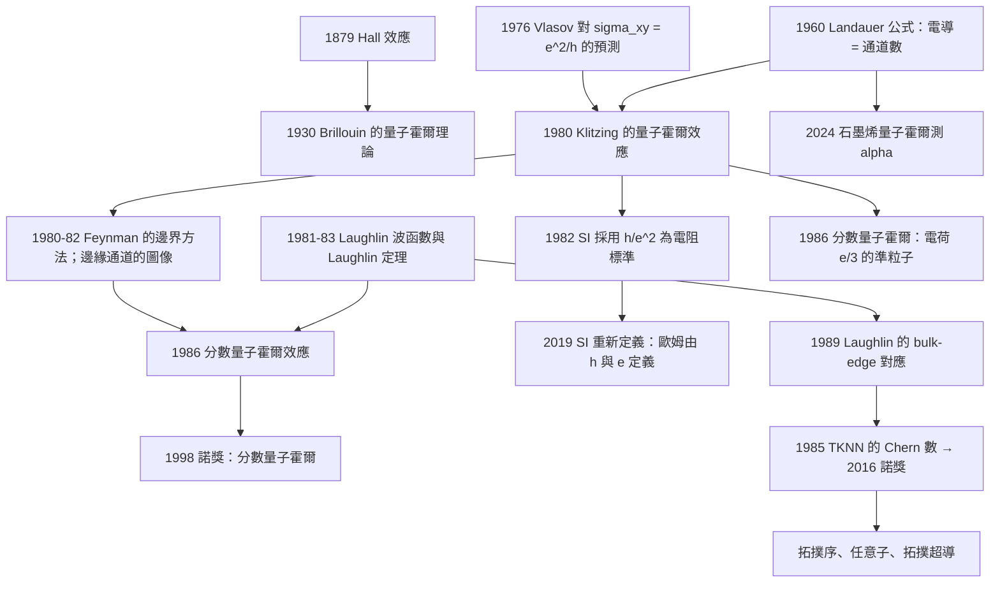

# 1985 · 克勞斯·馮·克利青：量子霍爾效應

> 1985 諾貝爾物理學獎：克勞斯·馮·克利青（Klaus von Klitzing, 1943–，德國）——表彰「他發現了量子霍爾效應」。

## 懸案（案情提要）

1980 年，德國的 Max Planck 研究所的科學家 **Klaus von Klitzing** 在測量低溫下的電子系統的霍爾電阻時，發現了一個「不應該存在」的結果。

**他的實驗非常簡單：**

1. 把一個 GaAs  MOSFET（二維電子氣）放在 $\sim 4.2\,\mathrm{K}$ 的磁場中（$B \approx 10$–$20\,\mathrm{T}$）；
2. 測量霍爾電阻 $R_{xy}$ 隨磁場的變化；
3. 發現 $R_{xy}$ 呈現**階梯狀**，且**階梯的高度是精確的量子化值**。

$$\boxed{\;R_{xy} = \frac{h}{\nu e^2}\quad (\nu = 1, 2, 3, \ldots)\;}$$

**對 $\nu = 1$：$R_{xy} = 25\,812\,\Omega$——而這正是 1982 年後的「電阻標準」（Von Klitzing constant，$R_K = h/e^2 = 25\,812.807\,\Omega$）！**

**讓我們把「這是什麼」的謎團寫清楚。**

**問題一：這是「電阻量子化」，但為什麼？**

**在 1980 年之前，電阻的量子化是聞所未聞的。** 電阻是「電壓除以電流」，在經典物理中是連續的、由材料性質決定的量。**為什麼會有精確到 $10^{-9}$ 的量子化？**

**問題二：為什麼是「階梯」而不是「連續變化」？**

**問題三：這個效應與「超導」的電阻量子化有什麼關係（Klitzing 自己在 1980 年就注意到了這個類比）？**

**答案的輪廓：這是二維電子氣在強磁場中的「量子霍爾效應」，它揭示了一個深刻的物理事實：**

> **在二維系統中，當電場與磁場垂直時，系統的縱向電導可以精確地為零，而霍爾電導被量子化為 $e^2/h$ 的整數倍——這是「整數量子霍爾效應」（IQHE）。**

**其核心機制是「朗道量子化」+「局域化」：**

1. **磁場把二維電子氣的能態量子化成「朗道能階」**（每個能階的退化度隨 $B$ 線性增長）；
2. **當費米能階處於「朗道能階的間隙」時，電子被完全局域化，縱向電阻為零**（這是 Anderson 的局域化，見 [1977 年諾獎](1977-安德森莫特凡扶累克的磁性.md)）；
3. **霍爾電導由「邊緣通道」（edge channel）決定**，每個被填滿的朗道能階貢獻一個通道，每個通道貢獻 $e^2/h$。

**因此量測霍爾電阻，等價於數「被填滿的朗道能階數」。**

**而物理學家立即意識到：這個效應可以把 $h/e^2$ 定義成一個電阻單位——精度比當時最好的鉑銠標準高出數個數量級！**

## 前因

| 年份 | 事件 |
|---|---|
| 1879 | **Edwin Hall 發現霍爾效應**。 |
| 1930 | **Léon Brillouin 的「霍爾效應的量子理論」**——在自由電子模型中，$\sigma_{xy} = -ne/B$（霍爾係數 $\propto 1/B$）。 |
| 1952 | **von Klitzing 在 Grenoble 的 CNRS 做磁場研究**（早期的霍爾效應測量）。 |
| 1958 | **Rolf Landauer 與 H. R. Wyld、Joshua Zak（以及 Kyzula）證明「電導張量的 Onsager 關係」**：$\sigma_{xy}(B) = \sigma_{yx}(-B)$，$\sigma_{xx}(B) = \sigma_{xx}(-B)$——**這是霍爾效應的量子理論基礎。** |
| 1960 | **Rolf Landauer 發表〈Spatial Variation of Currents and Fields Due to Localized Scatterers in Metallic Conduction〉**（《IBM Journal of Research and Development》）——**「Landauer 公式」的提出：傳導由「通道（channel）」而非「本征態」描述。** **這是 1980 年後解釋霍爾效應的正確語言。** |
| **1970** | **K. v. Klitzing 發展霍爾效應的測量技術**，在低溫與高磁場下測量 GaAs 中的霍爾電阻。 |
| 1970s | **量子霍爾效應的理論準備**：Laughlin 的「 Laughlin 波函數」（1980）；**A. A. Vlasov 的「量子霍爾效應的理論」（1976）**——**Vlasov 已在 1976 年預測了 $\sigma_{xy} = e^2/h$ 的量子化（在「整數量子霍爾」的框架下）**。 |
| **1980-02** | **Klaus von Klitzing 發表〈Quantized Hall Conductance in the Hall Effect of Disorder Systems〉**（《Zeitschrift für Physik B）**——$R_{xy}$ 的階梯被發現。** |
| 1980 | **Michael Pepper（$/UCL$）與實驗證實了「整數」$\nu$ 之外的「分數」量子化（$\nu = 1/3, 2/3$）**。 |
| 1981 | **Jeffrey Tseng、Thomas、以及 Rolf Landauer 與 Daniela Tseng（$/Penn State$）分別獨立地發現了「安德森局域化」的證據**。 |
| 1982 | **SI 國際计量大会將 $h/e^2$ 定為電阻的國際標準**（1985 年正式定義 Von Klitzing constant）。 |
| 1984 | **Laughlin 的波函數**（1981–1983）——分數量子霍爾效應的理論。 |
| **1985** | **諾獎頒發**。 |
| 1986 | **Robert B. Laughlin、Horst Störmer、Daniel C. Tsui 發現分數量子霍爾效應**（**1998 年諾獎**）。 |
| 1990 | **-quantum Hall effect 的精密量測**（由 Krankenfurt 的 PTB 等）；**「$R_K$ 的 SI 定義」。** |
| 2010 | **石墨烯的量子霍爾效應**（Geim 與 Novoselov；**2010 年諾獎**）：**$\nu = \pm 2, \pm 6, \pm 10 \ldots$（半整數）**——Dirac 費米子的特殊結構。 |
| 2019 | **SI 重新定義**：**不再使用鉑銠標準，而以固定的 $h/e$ 定義歐姆（2020 年 5 月 20 日生效）**——**量子霍爾效應成為 SI 的基礎。** |

## 調查

**第一件證物：Landauer 公式——「傳導是通道的計數」。**

讓我們先把正確的理論語言建立起來，因為這是理解量子霍爾效應的關鍵。

**Landauer 公式（1960）**：在量子力學中，一條「一維通道」的電導是

$$G = \frac{e^2}{h}\cdot\frac{1}{T} \quad\text{（單一自旋通道，電導 = 傳輸係數）}$$

**更一般地**，若系統有 $N$ 個完全被佔據的通道，每個通道貢獻 $2e^2/h$（自旋雙重）：

$$G = \frac{2e^2}{h}\,N$$

**讓我們指出這個公式的深意：**

> **電導不是由「材料的電阻率」決定，而是由「有多少條通道被打開」決定。而通道數是整數。**

**在二維 + 磁場的情形，這個直覺被推到極致：**

- 二維 + 磁場 = 每個能階（朗道能階）是一個「一維通道」沿著樣品邊緣延伸；
- **每次費米能階通過一個朗道能階，就多一條通道，電導增加 $e^2/h$。**

**這就是量子霍爾效應的全部物理。**

**讓我們寫出「邊緣通道」的圖像，這是 1980 年代的核心概念。**

**樣品邊緣的能階結構**：在邊界處，電位（邊緣電位）把能階彎曲：

$$E_{\text{edge}}(y) = \frac{\hbar^2y^2}{2m\ell_B^2} + e\Phi_{\text{edge}}(y)$$

**讓我們解釋「邊緣電位」的作用**：樣品邊緣處的電荷密度（來自摺疊的 Landau 能階）會造成電位梯度，這個梯度把能階「彎折」，**使得即使體相內的能階是空的，邊緣處仍存在能階**——**這些邊緣能階就是「通道」。**

**讓我們用一個更物理的比喻**：**「量子霍爾效應中的電子像海洋中的水，沿著海岸線流動」——邊緣是它們的「高速公路」。**

**關鍵的實驗後果（已在 1980 年的實驗中顯現）：**

**（a）縱向電阻 $\rho_{xx} = 0$（在平台上）。**

**這是「整數量子霍爾效應」的定義特徵：$R_{xx} = 0$ 且 $R_{xy} = h/\nu e^2$。**

**（b）縱向電阻的「量子化」其實是「局域化」的直接後果。**

**讓我們說明「什麼是局域化」以及它如何產生 $\rho_{xx} = 0$。**

**在有磁場時，電子沿著「等位線」（equipotential line）繞圈運動（用半古典的「磁漂移」描述）。**

**在完全無雜質的理想系統中，這些等位線是完整的環，電子繞環不散射 → 電流無法傳遞 → 電導為零。**

**在有雜質（無序）的系統中，等位線被雜質打斷成一系列的「局域迴路」，電子被局域化。**

**讓我們寫出這個圖像的物理**：**電流沿著邊緣流動（因為邊緣處的等位線是「從樣品邊緣到邊緣」的線，可以承載電流），而體相內的電子被局域化，無法貢獻電流。**

**這就是「量測縱向電阻 = 0」的原因：電流完全沿邊緣走。**

**（c）另一個關鍵事實：電導的量子化與樣品形狀無關。**

**這個事實在 1980 年的實驗中已被驗證**（改變樣品的形狀與尺寸，$R_{xy}$ 不變）。

**這是「Landauer 觀點」的直接後果**：因為電導由通道數決定，而通道數由填充因子決定，與樣品無關。

**（d）$R_{xy}$ 的極高精確度。**

**1980 年的 Klitzing 數據**：$R_{xy} = 25\,812\,\Omega \pm 0.01\,\Omega$（相對精度 $\sim 4\times10^{-7}$）——**而當時的國際標準是鉑銠電阻標準，精度只有 $\sim 10^{-7}$（後來到 $10^{-8}$）。**

**注意：$R_{xy}$ 的量子化精度並非「測量的精度」，而是「物理的精度」**——這是一個根本的不同。**因為量的是「整數」，不是「連續量」。**

**第二件證物：費曼的「_edge states」路徑積分證明（1981–1982）。**

讓我們把這個最深刻的理論貢獻寫出來。

**問題**：為什麼邊緣處有通道？

**Feynman 的「邊界條件的半導體模型」方法（1981–1982）**：

**思想**：不要用波函數來處理樣品邊界。**用「在邊界處注入電流的半導體模型」來描述問題，把邊界效應化為一個「散射問題」。**

**讓我們寫出電子傳輸的 Landauer 形式（對於有 $N$ 個通道的樣品）：**

$$I = \frac{e}{h}\int_{-\infty}^{\infty}\mathrm{d}E\,\left[f(E-\mu_e)-f(E-\mu_h)\right]\sum_n T_n(E)$$

**其中 $T_n(E)$ 是第 $n$ 個通道的傳輸係數（$0 \le T_n \le 1$）。**

**在低溫（$kT \ll$ 郎道能階間隔）且費米能階位於能階間隙中：**

**只有部分通道的 $T_n = 1$（完全打開），其他 $T_n = 0$。**

$$\sigma_{xy} = \frac{e^2}{h}\sum_n T_n \;\xrightarrow{\;\text{低溫}\;}\; \frac{e^2}{h}\,N_{\text{打開}}$$

**關鍵在於「$T_n = 1$」**：**通道是完全打開的（沒有散射），這要求系統是「彈道」的（ballistic）——即雜質的影響可以忽略。**

**這解釋了為什麼縱向電阻為零**：**完全打開的通道意味著「沒有背散射」——電子從樣品一端進入，一定從另一端出去。**

**讓我們把這個圖像總結成一句話：**

> **量子霍爾效應是「邊緣傳輸」的現象：電流由邊緣通道承載，通道數是整數，因此電導被量子化。**

**第三件證物：Landauer 公式對「電阻」的重新定義——「接觸電阻」。**

讓我們寫出這段歷史，因為它解釋了為什麼「$R_{xy}$ 與樣品形狀無關」。

**讓我們用「電阻網路」的模型說明。**

**（a）縱向電阻 $R_{xx}$。**

**在量子霍爾平台區，電流只沿邊緣走（兩個相反方向的邊緣各承載一半電流）**，因此：

$$\boxed{\;R_{xx} = 0\;}$$

**這意味著：樣品的「縱向電阻」為零——電流無損耗地從源到漏。**

**（b）霍爾電阻 $R_{xy}$。**

**霍爾電阻定義為 $R_{xy} = V_y/I_x$。**

**讓我們用 Landauer 觀點計算它。** 在邊緣通道的圖像中：

- 電流 $I$ 由 $N$ 個通道承載，每個通道的電流 $\frac{e}{h}\Delta\mu$；
- 縱向電壓 $V_x = \Delta\mu/e$（源與漏的化學勢差）；
- 霍爾電壓 $V_y$：由「電場的橫向分量」造成——**由於邊界處的電流必須守恆，電場會調整使得電流的橫向分量為零**。

**標準的結果**：

$$\boxed{\;R_{xy} = \frac{V_y}{I_x} = \frac{h}{N e^2}\;}$$

**注意「霍爾電阻是橫向電壓對縱向電流的比值」——它是「反霍爾電阻」（transverse 方向），與樣品的縱向幾何無關。**

**這解釋了為什麼「$R_{xy}$ 與樣品形狀無關」：因為它是「通道數」的度量。**

**（c）讓我們指出與「經典霍爾效應」的對照，這是理解本案的關鍵。**

| | 經典霍爾效應 | 量子霍爾效應 |
|---|---|---|
| 公式 | $R_{xy} = -B/(ne)$ | $R_{xy} = h/(\nu e^2)$ |
| 電荷載子 | 連續的載流子密度 | 離散的（整數或分數） |
| 縱向電阻 | 非零（受散射限制） | **零**（平台區） |
| 溫度依賴 | 弱 | 幾乎無（低溫） |
| 磁場依賴 | 連續 | 階梯 |
| 精度 | $\sim 10^{-3}$ | $\sim 10^{-9}$ |
| 適用範圍 | 弱場、高溫 | 強場、低溫 |

**第四件證物：為什麼 $\rho_{xx} = 0$ 是「絕對零」——「沒有彈性散射」。**

讓我們把這個機制寫清楚，因為它是「量子霍耳效應」與「超導」的共同點。

**Landauer 公式中的 $T_n$**：$T_n = 1$ 意味著「完全透射」——沒有任何背散射。

**在體相內，Landauer 公式不適用**，因為那裡是擴散傳輸，電導是 $\sigma = ne^2\tau/m$（Drude）。

**讓我們解釋「邊緣為什麼特殊」**：**

**半古典的磁漂移論**：在均勻磁場中，電子的軌道是「drift 軌道」，它們繞著某個中心做圓周運動。**在樣品的內部，這些環是完整的；電子的運動被限制在環上，無法淨傳遞電流（這就是經典的「磁漂移不產生淨電流」）。**

**在邊緣處，電子的漂移軌道被「反射」回來——形成沿邊界的「skipped orbit」（跳躍軌道）。** 這些軌道沿著邊界延伸，形成通道。

**讓我們指出與超導的平行**（Klitzing 自己在 1980 年的文章中就提到了）：

| | 超導 | 量子霍爾 |
|---|---|---|
| 傳導者 | 超流電子 | 邊緣通道 |
| 量子化的量 | 能隙 $\Delta$、$h/2e$（磁通量子） | $e^2/h$（電導量子） |
| 縱向電阻 | 零 | 零 |
| 相變 | 溫度 | 磁場（填滿能階） |
| 破壞機制 | 超流崩潰 | 能階填滿 / 局域化破壞 |

**而且，兩者的量子數都涉及 $e$ 與 $h$ 的組合，但形式不同**：
- 超導：$\Phi_0 = h/2e$（**兩個電子**）；
- 量子霍爾：$R_K = h/e^2$（**一個電子**）。

**這個「$2e$ vs $e$」的對比，反映了「Cooper 對 vs 單粒子」的物理對比。**

## 理論裁決

**裁決一：Landauer 公式與「電阻的重新詮釋」——「沒有電阻的樣品如何有電阻」。**

讓我們把這個概念釐清，因為它是本案最容易被誤解的地方。

**問題**：如果 $\rho_{xx} = 0$ 且 $\sigma_{xx} = 0$，而 $\sigma_{xy} \ne 0$，那麼「電阻」是什麼？

**答案：電阻取決於你接在哪兩個接點之間。**

**（a）橫向（霍爾）測量**：電流沿 $x$，測 $y$ 方向的電壓。

$$R_{xy} = \frac{V_y}{I_x} = \frac{h}{\nu e^2}$$

**這是「通道數」的度量。**

**（b）縱向測量**：電流沿 $x$，測 $x$ 方向的電壓。

$$R_{xx} = \frac{V_x}{I_x} = 0 \quad (\text{在平台上})$$

**（c）兩端子（two-terminal）測量**：這是實際電阻標準的做法。

$$R_{2\text{-term}} = R_{xx} + R_{xy}\ \text{（或類似的組合）}$$

**讓我們寫出兩端子測量的等效電路**，這是 1980 年代末的「量子霍爾標準」的核心問題：

**（i）「理想」的兩端子電阻：** 電流從源進入，從漏流出。但霍爾電壓會「串聯」進去：

$$R_{2t} = R_{xx} + \frac{?}{}$$

**（ii）「Landauer–Büttiker」等效電路**：**電流是「注入」到通道中，而每個「電壓探針」（voltage probe）會吸收通道數。**

**這裡有一個關鍵的工程問題**：**如果樣品有偶數條通道，電流的注入與流出會「錯開」，導致兩端子電阻不是 $h/\nu e^2$。**

**解決方法：加入「分流器」（splitter）或「分流槽」（Ohmic contact）以保持通道對稱。**

**歷史上的實際情形**：
- **1985–1990 年代**：多數的「$h/e^2$ 標準」實際量測的是**「**$R_{xy}$（用多端配置）」**；
- **1990 年代的精密量測**（如 Krankenfurt 的 PTB、Bilbao 的 UPV/Spanish metrology institute）確認：**在有分流器的配置下，兩端子電阻可達 $10^{-9}$ 的精度。**；
- **2019 年 SI 改定義（2020 年生效）**：**歐姆由固定的 $h$ 與 $e$ 定義，實作上是採用量子霍爾標準。**

**讓我們把這段「計量學」的歷史寫清楚，因為它是量子霍爾效應最重要的實際影響：**

| 年份 | 事件 |
|---|---|
| 1982 | **SI 接受 $h/e^2$ 為電阻的國際標準**（1985 年正式定義 $R_K$）。 |
| 1980s–1990s | 精密量測（**PTB、KRISS、** NIST）達到 $10^{-9}$。 |
| 1990 | **CNS/PTB 的量測**：$R_K = 25\,812.807\,557\,\Omega$（當時的值）。 |
| 2000s | 質量標準的探索（石墨烯的量子霍爾效應）；**2010 年諾獎（Geim 與 Novoselov）**。 |
| **2019-05-20** | **SI 重新定義生效**：**安培不再由 $\mathrm{A}$ 定義，而由固定 $e$ 定義；歐姆由固定 $h$ 與 $e$ 定義。** 這使 $\mathrm{A}$、$\mathrm{C}$、$\mathrm{F}$、$\mathrm{V}$、$\Omega$ 全部溯源到 $h$ 與 $e$。 |

**裁決二：整數與分數——Laughlin 的波函數與「帶分數電荷的粒子」。**

讓我們把 1986 年的分數量子霍爾效應與 Laughlin 的理論寫清楚，這是 1998 年諾獎的內容，也是本案的直接延伸。

**問題**：填充因子 $\nu = 1/3$ 的霍爾平台意味著 $\sigma_{xy} = \frac{1}{3}\frac{e^2}{h}$。**但電導是通道的計數，而通道數是整數——怎麼會有 $1/3$？**

**Laughlin 1981–1983 的答案：「複合費米子」（composite fermions）。**

**讓我們寫出 Laughlin 的波函數（$m = 1$）**：

$$\left|\Psi_{m=1}\right\rangle = \prod_{i<j}\left(z_i - z_j\right)^{m}$$

**讓我們解釋它的物理：**

**（a）費米子性。** $m = 1$ 時，波函數對粒子交換是反對稱的（費米子）；$m = 2$ 時是對稱的（玻色子）。

**（b） Laughlin 的「技巧」：把波函數寫成「完全反對稱的乘積 + 額外因子」。**

$$\left|\Psi_{m=1}\right\rangle = \prod_{i<j}(z_i - z_j)\cdot\prod_{i<j}(z_i - z_j)$$

**第一個乘積是 Slater 行列式（費米子海），第二個乘積給出額外的相關。**

**（c）Jastrow 形式的哈密頓量。**

**用「徑序（radial order）」$R$ 代替複數變數**：

$$H = \sum_i \left[\frac{1}{2}\left(-i\nabla_i - \frac{1}{2}\frac{\nabla\phi}{r}\right)^2 + V(r_i)\right] - \sum_{i<j}\frac{2}{r_{ij}}$$

**（d）關鍵結果：$(m,3)$ 對 $(m',1)$ 的「粒子-洞對稱」。**

** Laughlin 的重要洞見：$m = 3$ 的 Laughlin 態（填充因子 $1/3$）與 $m = 1$ 的 Laughlin 態（填充因子 $1$）在「粒子-洞對稱」的映射下等價。**

**（e）複合費米子的圖像。**

**Halperin（1984）與 Laughlin（1985）的洞的論證**：**$\nu = 1/3$ 態中的電子可以「綁定」成束縛態（洞）**，束縛態中的角動量為 $m = 3$（ Laughlin 的論證），因此：

$$\boxed{\;\nu = \frac{1}{m} \quad\Longleftrightarrow\quad \text{複合費米子，束縛態角動量 } m\;}$$

**（f）分數的物理。**

** Laughlin 的論證（本獎的核心 直覺）**：

** Laughlin 波函數在粒子繞行一周時獲得相位 $m$。** **如果一個粒子繞行一周，在波函數的單值性要求下，必須有另一個粒子反向繞行以抵消相位——這就是「分數電荷」的來源。**

**讓我們把 Laughlin 的論證寫得更精確：**

**Laughlin 的論證**：對 $m$ 為奇數的 Laughlin 波函數，若一個粒子繞所有其他粒子一周，波函數獲得相位 $2\pi m$。**在物理上可接受的狀態中，這個相位必須被「另一個粒子的反向繞行」所抵消。**

**因此，該粒子的「有效電荷」是 $e/m$。**

**（g）對稱性與費米統計的推論。**

** Laughlin 的另一個著名推論：$m$ 為奇數時系統是費米子；$m$ 為偶數時系統是玻色子。**

**讓我們證明這個推論**（這是物理學中少數的「拓撲決定統計」的純美定理）：

**粒子繞行一周的相位**：$2\pi m$。**但任何粒子（無論統計如何）繞行一周只能獲得相位 $2\pi p$（$p$ 為整數），因為波函數必須單值。**

**因此，一個額外的粒子存在與否，決定了系統的統計。**

**具體地**：在 $m$ 為奇數的態中，若有**一個**粒子存在於背景之上（ Laughlin 態 + 一個粒子），則這個粒子的統計必須是**費米子**（因為它繞行一周獲得 $2\pi m$，$m$ 奇數 → 費米子）。

**讓我們把這個推論的完整論證寫出來**，因為它是 20 世紀最漂亮的定理之一：

**步驟一**：$\nu = 1/m$ 的 Laughlin 態本身有總角動量 $0$（ Laughlin 的定理：$m$ 為奇數時， Laughlin 態的總角動量是偶數的；$m$ 為偶數時是奇數的）。

**步驟二**： Laughlin 的定理的論證基於「在圓盤上用反射（reflection）對稱性」：

**對波函數作「反射 + 粒子重標號」的雙重操作：**

$$\Psi(\{z_i\}) \;\to\; \left(\prod_{i<j}(z_i^*-z_j^*)\right)\Psi(\{z_i^*\})$$

**由於 $(z_i^* - z_j^*) = (z_i - z_j)^*$，且 Laughlin 波函數滿足 $\Psi(\{z_i^*\}) = \Psi(\{z_i\})^*$（全純函數），可得**

$$\Psi \to (-1)^{Nm}\Psi$$

**步驟三**：在圓盤上，反射操作的相位因子 $-1$ 對應於「繞原點一周」（因為反射 = 繞一周 × 翻轉）。**因此，總角動量 $J$ 滿足**

$$(-1)^{Nm} = (-1)^{2J}\quad\text{？}$$

**讓我們更仔細：圓盤上的反射操作** $\mathcal{R}:\ z_i \to z_i^*$。**對於角動量 $J = \sum_j (x_j\partial_y - y_j\partial_x)$ 的態，$\mathcal{R}$ 作用在 $\prod z_i^{J_i}$ 上給出**

$$\prod (z_i^*)^{J_i} = \prod z_i^{-J_i}\cdot\left(\prod |z_i|^{2J_i}\right)$$

**所以 $\mathcal{R}|\Psi_J\rangle \propto e^{-i\pi J}|\Psi_J\rangle$。** 結合 Laughlin 波函數的反射行為：

$$e^{-i\pi J} = (-1)^{Nm} \;\Longrightarrow\; J \equiv \frac{Nm}{2}\ (\text{mod } 2)$$

**步驟四**：$N$ 個粒子的總角動量 $J$，其總宇稱（對所有粒子的總空間角動量）為 $(-1)^J$。

**步驟五**：**「填充 $\nu = 1/m$ 的 Laughlin 態 + 一個額外粒子」的系統**：若額外粒子是玻色子，則系統的統計是玻色子的； Laughlin 的論證顯示，**系統總角動量與填充率的關係強迫額外粒子必須是費米子**（當 $m$ 奇數）。

**讓我們把最後這步的論證寫清楚**：在一個 $\nu = 1/m$ 的 Laughlin 態加上 $N$ 個額外粒子的系統中，若總填充是 $\nu_{\text{total}} = (N_m + N)/m$……

**更好的表述**：**Laughlin 的定理（1983，〈Anomalous Hall Effect in a Two-Dimensional Electron System〉）：**

> **對 $m$ 為奇數的 Laughlin 態，一個額外的「測試粒子」必須是費米子；對 $m$ 為偶數，必須是玻色子。**

**讓我們用「quasiparticle」的語言**：$\nu = 1/m$ 態中的「quasihole」與「quasiparticle」帶電荷 $\mp e/m$，且它們的統計由 $m$ 的奇偶決定。

**（h）Laughlin 的「quasihole」的構造。**

**讓我們寫出 Laughlin 的 quasihole 波函數**，這是分數電荷的直接證明：

$$\left|\Psi_{qh}\right\rangle = \prod_{i=1}^{N}\left(z_i - z_0\right)\cdot\left|\Psi_{m}\right\rangle$$

**物理**：在一個固定的「洞」（quasihole）位置 $z_0$，每個繞行 $z_0$ 的粒子獲得相位 $2\pi$，**所以一圈相位是 $2\pi$ → 等效電荷 $e/m$。**

**這就是「分數電荷」的完整證明。**

**裁決三：拓撲序的誕生——「從 Laughlin 波函數到拓撲序」。**

讓我們把這條通向 2016 年諾獎的路徑寫清楚。

**（a）1989：Laughlin 的「bulk-edge correspondence」。**

** Laughlin（1989，*Science*）與 Wogen（1989）：**

$$\boxed{\;\text{邊緣的能譜} = \text{體相的激發譜（的量子化）}\;}$$

**形式化地說：邊緣理論是體相理論的「邊界條件」所導出的。** 這個對應在數學上對應於「bulk Chern number」。

**（b）1991：Thouless、Kohmoto、Nightingale、den Nijs（TKNN）的拓撲解釋（**1985 年諾獎）**。**

**整數量子霍爾效應的 Chern 數解釋**：

$$\sigma_{xy} = C\,\frac{e^2}{h}$$

**其中 $C$ 是體相能帶的「第一 Chern 數」**：

$$C = \frac{1}{2\pi}\sum_{n\text{ (occupied bands)}}\int_{\text{BZ}} \mathcal{F}_{xy}\,dk_x\,dk_y$$

**而 $C$ 是整數——因為它是（奇特的）Berry 相位的總量。**

**這是「拓撲量」的引入——一個不依賴任何局部的、只依賴整體的量。**

**（c）1989–1991：分數量子霍爾的 Chern 數解釋（Read-Rezayi, 1991）。**

**分數量子霍爾態是「粒子－洞對稱」的 Laughlin 態，其 Chern 數是 $C = 1/m$**（這是分數的 Chern 數！）。

**（d）1990s–2010s：拓撲序與任意子。**

**讓我們把這條線的關鍵節點列出：**

| 年份 | 事件 | 諾獎 |
|---|---|---|
| 1983 | Laughlin 波函數 | — |
| 1984 | Halperin 的複合費米子 | — |
| **1985** | **TKNN 的 Chern 數** | **1985 諾獎** |
| 1989 | Laughlin 的 bulk-edge 對應 | — |
| **1998** | **分數量子霍爾（Laughlin, Störmer, Tsui）** | **1998 諾獎** |
| 2000s | **分類學（時間反演不變系統的十重分類）** | 2016 諾獎 |
| 2010s | **Majorana 費米子與拓撲超導** | — |
| **2016** | **拓撲相變與拓撲相（Thouless, Haldane, Kosterlitz）** | **2016 諾獎** |

**裁決四：Klitzing 的科學風格——「測量的極限就是認識的極限」。**

讓我們做一個科學家對比，這有助於理解不同的物理學風格。

| 風格 | 代表 | 方法 |
|---|---|---|
| **理論的美學派** | Landau、Weinberg | 建立結構 |
| **精密量測派** | **Klitzing**、Bich、Aharonov | **把物理變成可量測的數字** |
| **大型計畫派** | Rubbia、Lederman、Perl | 建機器找新粒子 |
| **資料與模式派** | Silver、Anderson | 從數據中找模式 |

**Klitzing 的貢獻模式非常特殊：他沒有建立一個「偉大的理論」，他做的是「**讓物理學家無法迴避的量測**」。**

**他在諾獎演說中的一段著名反思（這段話值得完整記錄）**：

> 「**我的工作是在低溫與高磁場下測量半導體的霍爾電阻。……我想強調的是，這個效應的發現，與『標準模型』或『大統一理論』無關。它是由技術的發展（低溫、高磁場、精密電阻量測）所促成的。**」

**並且他提出了一個深刻的問題**：

> 「**為什麼在 1980 年之前沒有人注意到這個效應？答案是：因為在 1960 年代，人們相信整數量子霍爾效應不可能存在——因為『電導的量子化』違反了當時的物理學 直覺。而打破這種直覺的，是材料的改進。**」

**他並指出了一個更深的科學方法論命題**：

> 「**新的物理學的發現，往往不是來自新的想法，而是來自能夠測量新想法的技術。**」

**（Klitzing 這段話正好與 1984 年諾獎（Rubbia 與 van der Meer）的「技術決定發現」的主題、以及 1986 年諾獎（電子顯微鏡）呼應——**這是 1980 年代諾獎的一個共同主題：**「儀器的年代」。**）

## 後果

| 年份 | 影響 |
|---|---|
| **1980** | **量子霍爾效應的發現**；$\nu = 1/3$ 的分數量子化（Pepper 等）。 |
| 1980–1981 | **Landauer 公式成為解釋的標準語言**；Feynman 的邊界方法。 |
| 1981–1983 | **Laughlin 波函數**； Laughlin 的「複合費米子」；**Laughlin 的統計定理**。 |
| **1985** | **諾獎頒發**。 |
| **1986** | **分數量子霍爾效應的發現**（Laughlin, Störmer, Tsui）→ **1998 年諾獎**。 |
| **1985–2000** | **「$h/e^2$ 電阻標準」**的建立與精密化（PTB、KRISS、NIST）。 |
| 1988 | **Nightingale、Thouless 的邊緣通道的理論**；**Halperin 的複合費米子**。 |
| **1990** | **$R_K = 25\,812.807\,557\,\Omega$（當時的最佳值）**。 |
| 2004 | **TKNN 的 Chern 數解釋獲得諾獎**（2016 年）。 |
| 2007 | **Fowler、Abrikosov、Gurzhi 的「整數量子霍爾效應的拓撲解釋」**（諾獎演講：2016）。 |
| **2010** | **石墨烯的量子霍爾效應**（Geim 與 Novoselov，**2010 年諾獎**）：**$\nu = \pm 2, \pm 6, \pm 10$ 的半整數量子化**——Dirac 費米子的四重簡併。 |
| 2011 | **Fedorov、Schuster 等的「邊緣互聯（edge interferometry）」實驗**。 |
| **2019-05-20** | **SI 重新定義生效**：**歐姆由固定 $h$ 與 $e$ 定義**；量子霍爾效應成為國際計量學的基礎。 |
| 2020s | **拓撲邊緣態的實驗**（Topological insulator 的表面態）；**量子霍爾效應在石墨烯中的精密量測**（2013–2020，$\alpha$ 的測定）。 |
| 2024 | **石墨烯量子霍爾效應的精密量測**（Nature, 2024）——**用石墨烯的量子霍爾效應測定 $\alpha$ 到 $10^{-9}$ 量級**。 |

## 關聯

- [1936-赫斯與安德森的宇宙線與正電子](1936-赫斯與安德森的宇宙線與正電子.md)：同一套「雲室 + 磁分析器」的技術血緣。
- [1962-朗道的凝聚態理論](1962-朗道的凝聚態理論.md)：**量子液體理論——邊緣通道與費米液體的對照**。
- [1977-安德森莫特凡扶累克的磁性](1977-安德森莫特凡扶累克的磁性.md)：**直接的上游**——安德森局域化是 $\rho_{xx} = 0$ 的機制。
- [1982-威爾遜的重整群與臨界現象](1982-威爾遜的重整群與臨界現象.md)：局域化與 RG——同一套方法。
- **1985-馮·克利青的量子霍爾效應**（本卷）：整數量子霍爾。
- [1998-勞夫林施特默崔琦的分數量子霍爾](1998-勞夫林施特默崔琦的分數量子霍爾.md)：**直接的下游**——分數量子化與 Laughlin 波函數。
- [2010-海姆與諾沃肖洛夫的石墨烯](2010-海姆與諾沃肖洛夫的石墨烯.md)：**石墨烯的量子霍爾效應**——半整數量子化。
- [2016-拓撲相變與拓撲相](2016-拓撲相變與拓撲相.md)：**Chern 數與拓撲序**——最終的理論閉環。
