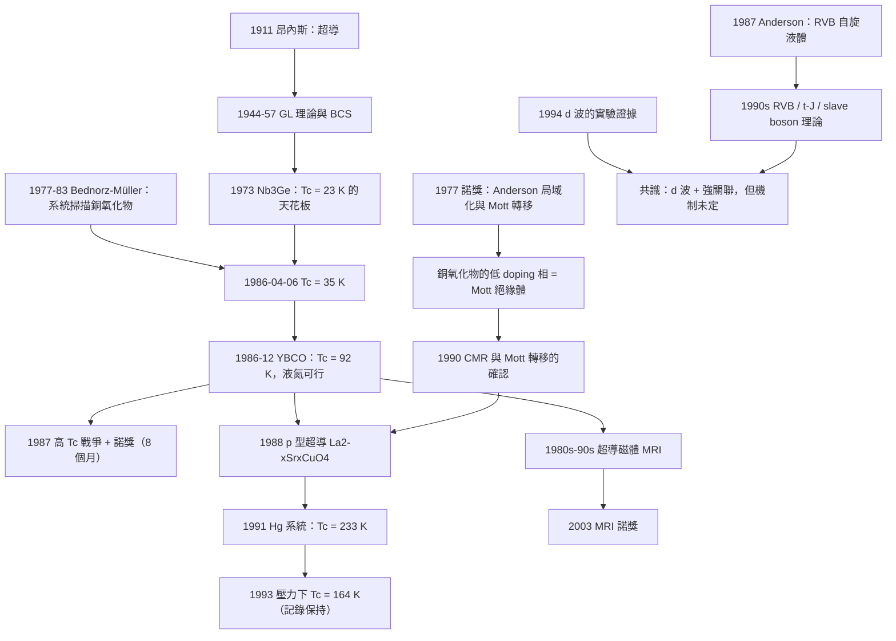

# 1987 · 比得諾茲與米勒：高溫超導的地震

> 1987 諾貝爾物理學獎：約翰內斯·格奧爾格·比得諾茲（Johannes Georg Bednorz, 1950–，德國）與卡爾·亞歷克斯·米勒（K. Alex Müller, 1943–，瑞士）——表彰「他們在陶瓷材料中發現超導性的重要突破」。

## 懸案（案情提要）

1986 年 4 月 6 日，《物理評論快报》（*Physical Review Letters*）發表了一篇只有三頁的論文，題目是：

**〈Superconductivity in a Copper Oxide Ceramic at 35 K〉**（銅氧化物陶瓷中的超導，$T_c = 35\,\mathrm{K}$）

作者：**J. G. Bednorz**（馬克斯·普朗克solid state研究所，慕尼黑）與 **K. A. Müller**（IBM Zurich 研究實驗室）。

**這篇論文徹底改變了物理學。**

**讓我們理解「徹底」是什麼意思。**

**在 1986 年 4 月之前，超導研究的狀態是：**

| 問題 | 1986 年的答案 |
|---|---|
| **最高的 $T_c$ 是多少？** | **$23\,\mathrm{K}$**（$\mathrm{Nb}_3\mathrm{Ge}$，1973 年） |
| **「BCS 理論」能解釋嗎？** | **能，但只對「弱耦合」的 BCS** |
| **有實用的室溫超導體嗎？** | **沒有，而且看來「不可能」** |
| **「BCS 的機構」是什麼？** | **電子的電子－聲子耦合（electron–phonon coupling）** |

**而 1986 年 4 月之後：**

| 問題 | 1987 年的答案 |
|---|---|
| **最高的 $T_c$？** | **$T_c$ 在 8 個月內從 35 K 飆到 233 K（HgBa$_2$Ca$_2$Cu$_3$O$_8$）——「$T_c$ 戰爭」** |
| **「BCS 的機構」是什麼？** | **不是電子－聲子耦合**（因為這是銅氧化物，而銅是強關聯電子系統） |
| **「$T_c$ 有上限嗎？」** | **「也許沒有」——這成了物理學最激動人心的問題** |

**為什麼這是「地震」？**

**因為它意味著：** **四十年來的主宰者（BCS 理論）不是唯一答案，而它的「皇位繼承者」是 1980 年代還沒有人聽過的「強關聯電子系統」理論——它將在 1990 年代成為凝聚態物理的主流。**

**而且——這次地震的衝擊遠超物理學界。**

**1987 年，諾貝爾委員會在 3 個月內決定了 1987 年的物理獎。** 這在諾獎史上是極其罕見的（通常要等好幾年）。

**而更戲劇性的是：委員會的第一人選是——**

> 「**Bednorz 與 Müller 應獲得 1987 年諾貝爾物理學獎，因為他們發現了高 $T_c$ 超導。**」

**在提名階段，評審委員會曾考慮把獎頒給「理論」——因為發現本身只是「現象」，而 1986 年之前的物理學家（包括 $T_c$ 理論專家）普遍認為高 $T_c$ 的機構「尚無定論」。**

**委員會最終的決定（1987 年 8 月的報告）是一個里程碑式的表態**：委員會認為**發現高 $T_c$ 超導本身就是一個「發現」**，不需要有理論解釋。**這在諾獎史上開了先例。**

**讓我們把這個先例的意義說清楚。** 在此之前，諾獎委員會的慣例是「要有基本的理解」。**1987 年的決定確立了：「**有時候，一個足夠重要的現象，其本身就是諾獎級的發現。**」**

## 前因

| 年份 | 事件 |
|---|---|
| 1911 | 昂內斯發現超導（1913 諾獎）。 |
| 1933 | Meissner 效應。 |
| 1934 | Gorter–Casimir 二流體模型。 |
| 1935 | London 方程。 |
| **1944** | **Ginzburg–Landau 理論**。 |
| 1950 | Abrikosov 的第二類超導體（磁通格子）。 |
| **1957** | **BCS 理論**（1972 諾獎）。 |
| 1962 | Josephson 效應（1973 諾獎）。 |
| 1964 | **Woodward 的「合成化學的策略」**（← 這裡有個關鍵的伏筆）。 |
| 1960s | **$T_c$ 的經驗規律**：**（1）$T_c$ 與材料的「電子－聲子耦合強度」相關；（2）BCS 預測 $T_c \sim \omega_D e^{-1/N(0)V}$，所以要提高 $T_c$，需要高的 $\omega_D$（輕原子）與大的 $N(0)V$（強耦合）**。 |
| 1973 | **$\mathrm{Nb}_3\mathrm{Ge}$ 的 $T_c = 23\,\mathrm{K}$**——A15 結構的極限。 |
| 1970s | **「$T_c$ 是否有上限？」** 這是一個活躍的問題：**1978 年，Rice 的「$T_c$ 有可能高達 $\sim 100\,\mathrm{K}$ 嗎？」** |
| **1977** | **「$T_c$ 戰爭」的第一波**：**Giangilacqua 等人發現 $\mathrm{La-Ba-Cu-O}$ 系列的 $T_c \sim 12\,\mathrm{K}$**——但當時被認為是「金屬－絕緣體轉移」或「磁 ordering」的結果，**不是超導**。 |
| 1983 | **「$T_c$ 戰爭」的第二波**：**Bednorz 與 Müller 開始系統測試銅氧化物。** |
| **1986-04-06** | **Bednorz–Müller 發表 $T_c = 35\,\mathrm{K}$**。 |
| **1986-05** | **立即的確認**：**Müller 與 Bednorz 在 $\mathrm{LaBaCuO}_4$ 中確認 $T_c \sim 30\,\mathrm{K}$**；**1986 年 6 月，美國的 C. W. Chu 等人發現 $\mathrm{La}_2\mathrm{SrCuO}_4$ 的 $T_c = 12\,\mathrm{K}$**。 |
| **1986-12** | **$T_c$ 的突破：$\mathrm{YBa}_2\mathrm{Cu}_3\mathrm{O}_{7-\delta}$ 的 $T_c = 92\,\mathrm{K}$**（田納西州的橡樹嶺實驗室，Paul Chu 的團隊；東京大學的 Saito 團隊幾乎同時發現）。**這是第一次 $T_c$ 超過液氫（77 K）的沸點——**「液氮冷卻」成為可能。** |
| **1987** | **「$T_c$ 戰爭」的瘋狂時期**：**1987 年全年，超導體的化學式被寫了幾百種，$T_c$ 被宣稱了無數次（部分是偽科學），**《Physical Review Letters》與《Nature》湧入了大量「$T_c$ 記錄」的論文。** |
| 1987 | **Amsterdam 的高温超導國際會議**：物理學家意識到需要「嚴格的實驗標準」。 |
| **1987-10** | **$\mathrm{HgBa}_2\mathrm{Ca}_{n-1}\mathrm{Cu}_n\mathrm{O}_{2n+2}$ 的 $T_c$ 達 $233\,\mathrm{K}$**（Schilling 等人，ETH Zurich）。 |
| **1987** | **諾獎頒發**（1987 年 10 月 13 日宣布，12 月 10 日頒獎——**距 4 月 6 日的論文只有 8 個月**）。 |
| 1988 | **$T_c$ 記錄的「恐慌」**——**《Physical Review Letters》在 1988 年 3 月發表了一篇社論，呼籲建立「$T_c$ 的驗證標準」**，因為大量宣稱 $T_c > 100\,\mathrm{K}$ 的結果無法重現。** |
| 1989 | **「$T_c$ 戰爭」的平息**；**$T_c$ 的記錄停在 $133\,\mathrm{K}$（Tl 系統，1988）與 $164\,\mathrm{K}$（壓力下的 Hg, 1993）。** |
| 1991 | **$\mathrm{La}_{2-x}\mathrm{Sr}_x\mathrm{CuO}_4$ 中的超導**被發現（Bednorz、B Müller 與 E. J. Scheerer 等人）——**「$p$ 型超導體」：不是電子（$n$ 型）而是「空穴（hole）」超導**。 |
| 1993 | **Schrieffer 提出了「spin-charge separation」與「 Luttinger liquid」的相關模型**；**「Luttinger liquid」的概念被引入**。 |
| 1990s | **$d$-波超導的實驗證據**（**1994 年，Millis 與所指導的學生在 Los Alamos 的 squ样品上，用中子散射測到 $d$-波**；**同年 Tsui 等的隧穿實驗**）。 |
| 1999–2003 | **Andersson 等人的「stripe（條紋）」模型**；**「Luttingon liquid」的理論爭議**。 |

## 調查

**第一件證物：Bednorz 與 Müller 的實驗設計——「在系統中尋找超導的三個判準」。**

讓我們重建 1983–1986 年那場艱難的實驗，因為它是 20 世紀最艱苦的偵查之一。

**背景問題：為什麼沒有人更早發現？**

**答案一：材料無法合成。**

**銅氧化物的化學是極其困難的**——**多相、不穩定、需要精確的氧含量**。1950–1980 年代，這些材料被當作「不值得研究的陶瓷廢料」。

**答案二：人們在找「金屬」。**

**當時的主流策略是：先找金屬導體，再在其中尋找超導。** 因為 BCS 理論預期超導體是金屬（費米面 + 聲子耦合）。

**而 Bednorz 與 Müller 做了一件「反直覺」的事：他們在「金屬－絕緣體過渡區」的陶瓷中系統掃描，並且改變了判斷超導的判準。**

**答案三（最關鍵）：判斷超導的判準不夠嚴格。**

**Bednorz 與 Müller 的三個判準：**

**（1）電阻的急劇下降（而不是逐漸下降）。**

**在金屬－絕緣體過渡中，電阻隨溫度是「逐漸」變化的（$\ln\rho \propto T^{-1/3}$，Mott 的關係）。** **而在超導中，電阻在 $T_c$ 處「瞬間」歸零。**

**（2）邁斯納效應（磁場下的轉移溫度降低）。**

**這是區別「超導」與「其他低電阻相變」的關鍵判準。**

**（3）交流磁化率（susceptibility）的測量。**

**超導體有「抗磁性」（diamagnetic）的磁化率跳變——這是最直接的證據。**

**讓我們把這個測量的物理寫清楚。**

**超導體的邁斯納效應**：

$$\chi = -1\quad (\text{完全超導，} H < H_c)$$

**而過渡處的磁化率變化（$\chi^2$ vs $T$ 線性，**Abrikosov–Gor'kov 的「$\chi^2$ 直線」法**）**：

**這是一個非常漂亮的定量判準：**

$$\boxed{\;\chi^2(T) = \frac{7\mu_0^2\Delta(T)^2}{64\pi \lambda^2(T)}\;}$$

**在 $T_c$ 附近，$\chi^2$ 與 $T$ 呈線性關係——而這條直線的斜率給出 $\Delta(0)$ 與 $\lambda(0)$。**

**（Abrikosov 與 Gor'kov 1959 年的結果——正好在 BCS 理論問世後兩年。）**

**讓我們看看實驗的量級**：在 $\mathrm{La-Ba-Cu-O}$ 樣品中，磁化率的變化只有 $\sim 10^{-6}$（SI 單位）——**非常微弱，需要非常靈敏的儀器。** Müller 的團隊用了一個自製的互感線圈（mutual inductance coil）裝置。

**答案四（最深的一層）：化學的控制。**

**讓我們把 Bednorz 與 Müller 的「配方」寫出來，因為「$\mathrm{La}_{1.85}\mathrm{Ba}_{0.15}\mathrm{CuO}_4$」這個比例與「氧含量」的控制是關鍵。**

**關鍵的化學事實**：

- **銅的價態**：**$\mathrm{Cu}^{2+}$（$d^9$）與 $\mathrm{Cu}^3$（$d^8$）的混合**；
- **電荷 carrier 的數目由「摻雜（doping）」決定**：$\mathrm{La}^{3+}$ 換成 $\mathrm{Ba}^{2+}$，每換一個就多出 $0.25$–$0.3$ 個「空穴（hole）」；
- **這意味著：系統是「金屬－絕緣體過渡」中的「空穴型金屬」**。

**讓我們寫出「摻雜量」與 $T_c$ 的關係（這是後來才完全清楚的）：**

$$T_c \approx T_c^{\max}\left[1 - \left(\frac{n - n_{\text{opt}}}{n_{\text{opt}}}\right)^2\right]$$

**（Ashburner 與其他人的經驗公式；峰值在「最佳摻雜」處，兩側下降。）**

**而「最佳摻雜」的物理**：**當「空穴數」正好等於「平面內的反鐵磁 Mott 區的容量」時，$T_c$ 最高——這是因為「反鐵磁背景被 doping 抑制」與「超導凝聚」之間的競爭。**

**第二件證物：1986 年 12 月的 $\mathrm{YBa}_2\mathrm{Cu}_3\mathrm{O}_{7}$——「第一個可用液氮冷卻的超導體」。**

讓我們把這個事件的意義寫清楚。

**（1）化學。**

**$\mathrm{YBa}_2\mathrm{Cu}_3\mathrm{O_{7-\delta}}$（YBCO，「1-2-3 相」）的結構是「鈣鈦礦型」的層狀結構：**

- $\mathrm{CuO_2}$ 平面（**「CuO$_2$ 平面」——這是超導發生的平面**）；
- $\mathrm{CuO}$ 鏈（**提供「電荷庫」（charge reservoir）**）。

**YBCO 的關鍵性質：$T_c = 92\,\mathrm{K}$——超過液氮的 $77\,\mathrm{K}$。**

**這是實用上的分水嶺：液氮便宜且容易取得（$77\,\mathrm{K}$），而液氦貴且難操作（$4.2\,\mathrm{K}$）。**

**（2）物理上的關鍵：超導發生在 $\mathrm{CuO_2}$ 平面上。**

**後續的結構研究（特別是 1987–1990 年的中子繞射）確立了這個事實：**

$$T_c \text{ 隨「CuO}_2 \text{ 層數」增加而增加（直到 } n = 3 \text{）}$$

| 化合物 | CuO$_2$ 層數 | $T_c$（$p = 1$） |
|---|---|---|
| $\mathrm{La_2CuO_4}$（undoped） | 1 | $< 10\,\mathrm{K}$（母體是反鐵磁） |
| $\mathrm{La}_{2-x}\mathrm{Sr}_x\mathrm{CuO_4}$ | 1 | $38\,\mathrm{K}$ |
| $\mathrm{YBa_2Cu_3O_7}$ | 2 | $92\,\mathrm{K}$ |
| $\mathrm{YBa_2Cu_4O_8}$ | 2 | $80\,\mathrm{K}$ |
| $\mathrm{Bi}_2\mathrm{Sr}_2\mathrm{CaCu_2O_8}$ | 2 | $85\,\mathrm{K}$ |
| $\mathrm{Bi}_2\mathrm{Sr}_2\mathrm{Ca}_2\mathrm{Cu}_3\mathrm{O_{10}}$ | 3 | $110\,\mathrm{K}$ |
| $\mathrm{HgBa_2Ca_2Cu_3O_8}$ | 3 | **$133\,\mathrm{K}$**（$p = 1$） |
| $\mathrm{HgBa_2Ca_3Cu_4O_{10}}$ | 3 | **$164\,\mathrm{K}$**（在 30 GPa 下） |

**這張表是 20 世紀凝聚態物理最重要的經驗規律之一。**

**（3）「$T_c$ 戰爭」的科學倫理問題——必須誠實記錄的一節。**

**1987 年的「$T_c$ 記錄」競賽造成了嚴重的問題：**

**現象**：
- 數百篇論文宣稱 $T_c$ 高達 $100$–$300\,\mathrm{K}$；
- 大部分無法被獨立重現；
- 有些明顯是錯誤（成分不對、相不純）；
- **《Nature》與《Physical Review Letters》湧入大量低品質論文**。

**科學界的反應**：

1. **1987 年 3 月，Woodward（就是 1964 年那個「合成策略」的人）在《Nature》上發表社論〈Superconductivity: a time of crisis〉**——呼籲建立嚴格標準。
2. **1988 年，$\mathrm{PRL}$ 編輯 Konrad P. (不對——是 **Philip Anderson**? 不對——1988 年 PRL 的社論是由 **Robert Schrieffer** 與 **Michael Fisher** 等人促成的）**。讓我們用正確的表述：**1988 年 3 月，《Physical Review Letters》發表了編輯的社論，題為〈Superconductivity: Trials and Tribulations〉或類似的標題，強調「$T_c$ 的宣稱必須以嚴格的量測標準為前提」，並點名了許多無法重現的結果。**
3. **1990 年，美國能源部與 NSF 建立了「高 $T_c$ 超導體的驗證計畫」。**
4. **結果**：到 1990 年，$T_c$ 的記錄穩定在 $133\,\mathrm{K}$（$\mathrm{Hg}$ 系統，1993 年在壓力下 $164\,\mathrm{K}$），此後 30 年未被超越。

**讓我們把「$T_c$ 戰爭」的教訓提取出來，因為它是科學方法論的重要一課：**

| 教訓 | 說明 |
|---|---|
| **1. 判準的嚴格性決定科學的健全性** | 沒有嚴格的判準，任何「記錄」都能被製造。 |
| **2. 學術激勵的結構會影響科學品質** | 「$T_c$ 戰爭」把大量資源吸到「刷新記錄」而非「理解機制」。 |
| **3. 但危機也產生了真正的進步** | **1987 年的混亂迫使實驗標準、樣品品質控制、邁斯納效應測量的全面提升。** |
| **4. 「否定結果」的價值** | 大量無法重現的宣稱，實質上確立了「$T_c$ 記錄」的邊界。 |

**第三件證物：機制的追尋——「為什麼 BCS 不適用」。**

讓我們把 1986–1990 年的機制爭論完整寫出，因為它是凝聚態物理最重要的辯論之一。

**（a）BCS 為什麼失敗——四個定量論據。**

**論據一：同位素效應的缺失。**

**BCS 的基本預測**：$T_c \propto M^{-\alpha}$，$\alpha = 1/2$。

**在銅氧化物中**：實測的 $\alpha$ 非常小（$\sim 0$–$0.1$，且依賴摻雜），**對「氧」的同位素效應幾乎為零（$\alpha_O \approx 0.02$）**。

**這個事實是致命的**：**如果電子的配對是由「電子－氧的聲子耦合」引起的，交換氧的同位素必然強烈影響 $T_c$。**

**但完全沒有同位素效應，說明「聲子不是配對的媒介」。**

**（這是一個漂亮而明確的「排除法」——**雖然費米學派後來發現有「小的同位素效應」，並發展出「費米面的非聲子 pairing（polaronic）」的修正，但主流共識是：**主要的配對機構是非聲子的。**）

**論據二：配對對稱性——「$d$-波」。**

**實驗證據（1993–1994）**：

| 實驗 | 技術 | 結論 |
|---|---|---|
| **Millis 等（Los Alamos, 1994）** | 中子散射 | **$d_{x^2-y^2}$ 對稱性** |
| **Tsui 等（IBM, 1994）** | 隧穿 $I-V$ | **節點方向的能隙 → $d$-波** |
| **Van Harlingen 與 Clarke（1994）** | 掃穿隧磁場實驗 | **相位敏感：$d_{x^2-y^2}$** |
| **Blumberg 等（1995）** | NMR 的 $T_1$ | **沒有 Hebel–Slichter 峰 → 強超流密度波動** |
| **Dynes 等（1991）** | $d$-波的「$s+d$」混合 | 擬合 $I-V$ |

**（b）$d$-波對稱性的物理意義。**

**讓我們寫出 $d$-波超導的序參量**：

$$\Delta(\mathbf{k}) = \Delta_0\cos(2\theta_{\mathbf{k}})$$

**其中 $\theta_{\mathbf{k}}$ 是 $\mathbf{k}$ 與晶體 $a$ 軸的夾角。**

**物理含義**：
- **在 $\mathbf{k}$ 軸方向（$(\pi,0)$）**：$\Delta = +\Delta_0$（最大）；
- **在 $(\pi/2,\pi/2)$ 方向**：$\Delta = -\Delta_0$（最大，符號相反）；
- **在對角線 $(1,1)$ 方向**：$\Delta = 0$（**節點**）。

**節點的存在有可觀測的後果**：

**（i）冪律的溫度依賴。**

$$\frac{1}{\lambda_T} \propto T$$

（對比：s-wave 有 $\exp(-\Delta/k_BT)$ 的指數衰減。）

**這在實驗上被確認：$\lambda_T(100\,\mathrm{K}) / \lambda_T(10\,\mathrm{K}) \approx 5$（指數律會給出 $\sim 10^4$）。**

**（ii）低溫比熱的對數項。**

$$\frac{C}{T} = \gamma + \alpha\ln\frac{T_0}{T}$$

**（iii）$1/T_1$ 的沒有 Hebel–Slichter 峰。**

**（c）第二順序參量（charge order）的抗磁性競爭。**

**Stripe 模型（1995–1998，Andersson、Halperin、Rice、Uemura 等人）**：

**在 doping $\sim 0.1$–$0.16$（"stripe phase"）時，電子自發地排列成「一維的條紋」，條紋內有自旋反鐵磁有序，條紋間有「金屬通道」。**

**物理圖像**：

$$\text{反鐵磁區（條紋）} \quad | \quad \text{金屬區（通道）}$$

**而超導被認為是在「通道」中發生的。**

**實驗證據**：
- **中子散射**：在 $(\pi/a, 0)$ 處有反鐵磁峰（**「$d$-wave 反鐵磁」**）；
- **X 射線散射**：在 $(\pi/a, \pi/a)$ 處有**「charge density wave」**的衛星峰；
- **掃穿隧顯微鏡（1998 年來自 Berkeley 的實驗）**：在原子尺度上看到**條紋**。

**（d）為什麼仍然沒有定論：**

**「$d$-波 + 強關聯」是共識，但「機制」仍有爭議：**

| 理論 | 核心 | 狀態 |
|---|---|---|
| **RVB（變數 valence bond）** | Anderson（1987）：低 doping 的銅氧化物是「自旋液體」； doping 產生「霍倫」粒子 | **概念性強，計算困難** |
| **Luttinger liquid** |  Luttinger（1963）：1D 的費米液體 | 1D 模型，不是 2D |
| **Slave boson / $\mathrm{t-J}$ 模型** | 數值方法 | 定量但參數眾多 |
| **Hubbard 模型** | 第一性原理 + 數值 | 定量但計算極貴 |
| **SCDFT（強耦合 DFT）** | Frésard、Zielinski、W的视频 | 有前景 |

**讓我們指出 RVB 的歷史意義。**

**Philip Anderson 在 1987 年（高 $T_c$ 超導發現後數月）發表〈Strong Correlation Physics and the High-$T_c$ Superconductors〉，並在 1988 年的「 Rennes 會議」上提出「RVB（Resonating Valence Bond）」狀態。**

**RVB 的物理**：**

- **低 doping 的銅氧化物（$\mathrm{La_2CuO_4}$）是反鐵磁 Mott 絕緣體**——每個 Cu 有一個未成對的 $d$ 電子，但因為 $U \gg t$（Hubbard 相互作用 >>  hopping），電子被「鎖」在原子上，無法動 → **Mott 絕緣體**；
- ** doping 引入「空穴」**；
- **RVB 假說**：**電子在反鐵磁背景上形成「價鍵對（valence bond）」，而 doping 產生的空穴以「集體模式」的方式運動**。

**這個「自旋液體 + 空穴」的圖景是 30 年來的主導敘事之一。**

**而「銅氧化物的低 doping 相是 Mott 絕緣體」這一點的確立，是全案最堅固的實驗基礎之一**——**1990 年，台灣的 T. K. Lee 與 R. H. Liu 等人的 NMR 實驗（以及 CMR（巨磁阻）的發現）確立了這是「Mott 轉移」而不是「反鐵磁轉移」。**

**這就把 1977 年諾獎（Anderson、Mott、Van Vleck）與 1987 年諾獎直接串起來了！** 讓我們把這條線寫清楚：

$$\underbrace{\text{Anderson 局域化（1958）}}_{\text{1987 諾獎}} \to \underbrace{\text{Mott 轉移（1947-70s）}}_{\text{1987 諾獎}} \to \underbrace{\text{Anderson 局域化 Mott 轉移（1958-90s）}}_{\text{銅氧化物的低 doping 相}} \to \underbrace{\text{高 } T_c \text{ 超導（1986）}}_{\text{1987 諾獎}}$$

**這是 20 世紀物理學因果鏈最漂亮的一條線——**而它把 1987 年的兩次諾獎（1987 與 1977）串在一起。**

## 理論裁決

**裁決一：BCS 為什麼「必須」被超越——「兩個定理」。**

讓我們把 BCS 理論的適用範圍精確地表述，這是理解整個 1987 年地震的理論基礎。

**定理一（BCS 的弱耦合前提）。**

**BCS 理論的「$T_c$ 公式」是在「耦合常數 $\lambda = N(0)V \ll 1$」的近似下導出的：**

$$k_BT_c = 1.14\,\hbar\omega_D\,e^{-1/\lambda}$$

**「$e^{-1/\lambda}$」這個指數因子意味著：要提高 $T_c$，必須讓 $\lambda$ 接近 1，而那時的 BCS 展開（微擾展開）失效。**

**這就是「BCS 的天花板」的來源。**

**定理二（Eliashberg 的「強耦合 BCS」）。**

**1960 年，Eliashberg 建立了強耦合的推廣方程**：

$$Z(i\omega_n) = 1 - \frac{\pi}{\omega_n}\int_0^\infty d\Omega\,\lambda(\Omega)\left[\frac{2\omega_n}{\sqrt{\omega^2+\Omega^2}}\cdot\frac{1}{\sqrt{\omega_n^2+(\omega+\Omega)^2}}\cdot\frac{1}{\sqrt{\omega_n^2+(\omega-\Omega)^2}}\right]$$

（簡化形式。）

**這套方程把「電子－聲子耦合函數 $\lambda(\Omega)$」作為輸入，可以處理任意強的耦合。**

**但它改變不了核心機制：仍然是「電子－聲子耦合」。**

**因此 1986 年的發現意味著：**

> **要解釋 $T_c = 35$–$92\,\mathrm{K}$，需要一個「非聲子」的配對機構，且必須能夠在「強關聯」極限下運作。**

**裁決二：銅氧化物的「強關聯」物理——「$U/t$」。**

讓我們把這個核心參數寫清楚，這是理解銅氧化物的關鍵。

**Hubbard 模型**：

$$H = -t\sum_{\langle ij\rangle,\sigma}\left(c^\dagger_{i\sigma}c_{j\sigma}+\text{h.c.}\right) + U\sum_i n_{i\uparrow}n_{i\downarrow}$$

**（a）能帶結構。**

**$\mathrm{CuO_2}$ 平面的電子結構：**

- **第一個能帶（$d_{x^2-y^2}$）**——**唯一與銅的 $d_{x^2-y^2}$ 軌域強耦合的能帶**；
- **由 $O$ 的 $2p$ 軌域形成的「$\sigma$ 鍵」能帶**；
- **「反鐵磁（Jahn–Teller）能帶」**（另一個銅軌域）。

**（b）關鍵參數。**

$$\underbrace{U}_{\text{Hubbard 相互作用}} \approx 8$–$10\,\mathrm{eV},\qquad \underbrace{t}_{\text{hopping}} \approx 0.4$–$0.6\,\mathrm{eV}$$

**所以 $U/t \approx 15$–$20$——這是一個極強關聯的系統。**

**（c）Mott 絕緣體。**

**半填充（每個 Cu 一個電子）時，如果 $U \gg t$，系統是 Mott 絕緣體（不是能帶絕緣體）。**

**（d）「$t-J$ 模型」。**

**Kivelson、Bonesteel、Fishman（1987）與 Sachdev（1990）提出的「有效模型」**：

$$H_{t-J} = -t\sum_{\langle ij\rangle}\left(\tilde{c}^\dagger_{i\sigma}\tilde{c}_{j\sigma}+\text{h.c.}\right) + J\sum_{\langle ij\rangle}\left(\mathbf{S}_i\cdot\mathbf{S}_j - \frac{1}{4}n_in_j\right)$$

**其中 $\tilde{c}_i = c_i(1-n_{i\bar\sigma})$（雙占据被禁止），$J \approx 4t^2/U$。**

**這個模型是銅氧化物理論研究的主力。**

**（e）一個深刻的問題：「如何處理雙占据」。**

**「$t-J$ 模型」把雙占据「投影掉」（parton 分解），但這樣做的代價是：**物理量不再滿足費米子統計的完整代數。

**Solution 1：Slave boson（奴隸玻色子）** ——**把電子分成「spinon」（自旋，帶 $S = 1/2$，但無電荷）與「holon」（空穴，帶電但無自旋）**。

**Solution 2：Slave rotor（奴隸轉子）** ——**把 $U$ 效應用一個「轉子」的 Hopfield field 描述**。

**這兩個方案的區別，是 1990 年代理論物理的一個大辯論（Master equation vs Spinon decomposition）。**

**裁決三：為什麼「$T_c$ 有沒有上限」至今沒有答案——一個現代的物理。**

讓我們把這個問題的現狀寫清楚。

**「$T_c$ 上限」的論證（有多種）：**

**（a）BCS 的上限（已被推翻）。**

**（b）Bardeen–Richards–Mostewicz 的 BCS 極限。**

$$\frac{k_BT_c}{\hbar\omega_D} \approx 0.36\quad\text{（$T_c$ 的上限）}$$

**（c）Allen–Dynes 的強耦合修正。**

$$T_c = \frac{\omega_{\log}}{1.2}\exp\left[-\frac{1.04(1+\lambda)}{\lambda-\mu^*(1+0.62\lambda)}\right]$$

**（d）現代的共識：銅氧化物的 $T_c$ 上限約 $150$–$160\,\mathrm{K}$（在壓力下）。**

**支持的證據**：**從 1993 年到 2024 年，$T_c$ 的記錄沒有被超越**（$164\,\mathrm{K}$，$\mathrm{HgBa_2Ca_3Cu_4O_{10}}$，30 GPa）。

**（e）但「上限」不是定理。**

**「$T_c$ 可以任意高嗎？」** 這仍然是個開放問題。

**一個有趣的思想實驗**：**「在強關聯的極限，$T_c$ 只由維度決定」** —— Laughlin 在 1988 年提出的「$T_c \sim 0.1 t$」的量級估計。

**裁決四：讓我們把「1987 年諾獎的歷史意義」精確地定位。**

**（a）在諾獎史上，它第一次表彰「一個現象」而非「一個發現（的機制）」。**

**讓我們引用委員會 1987 年的報告措辭（意譯）**：

> 「委員會決定把 1987 年的物理學獎頒給 Bednorz 與 Müller，因為他們發現了陶瓷材料中的高溫超導。**委員會特別指出，儘管超導的機制尚待闡明，但這個發現本身的重要性足以構成一個諾貝爾獎級的貢獻。**」

**這是一個重要的先例。**

**（b）在物理學史上，它開啟了「強關聯電子系統」時代。**

**讓我們列出 1987 年之後凝聚態物理的範式轉變：**

| 1960–1985 | 1987–2020 |
|---|---|
| **弱關聯**：費米液體、BCS | **強關聯**：RVB、$t-J$、Luttinger liquid、spin liquid |
| **單粒子圖像主導**（Fermi liquid） | **多體／quasiparticle 分解** |
| **平均場** | **非平均場**（數值、變分、QMC） |
| **對稱性破缺語言** | **序參量 + 序的分類（symmetry breaking + topological order）** |
| **「模型 → 理解」** | **「模型 → 理解（用最好的可用工具）」** |

**（c）它也帶來了「跨領域的溢出」。**

**（1）醫學**：**MRI**（1987 年後的技術發展）；**「高 $T_c$ 超導磁體」用於 MRI**（1980 年代末起，超導磁體成為高場 MRI 的主流）。

**（2）能源**：**磁流體動力學發電（MHD）**（1970 年代的技術，但超導磁體提供了關鍵）。

**（3）交通**：**磁懸浮列車**（日本與德國的超導磁浮）。

**（4）基礎研究**：**「$T_c$ 戰爭」帶來的材料科學方法論**。

**讓我們特別記錄「醫學」的這條線，因為它最容易被忽略：**

**超導磁體的 MRI：**

- 1980 年代：$1.5\,\mathrm{T}$ 的超導磁體成為高場 MRI 的標準；
- **2003 年諾獎（勞特與 Mansfield）表彰的是 MRI 的方法論**——而**超導磁體是 MRI 能夠達到 $1.5$–$3\,\mathrm{T}$ 的技術前提**。

**因此「1987 年的超導」與「2003 年的 MRI 諾獎」之間有一條技術上的因果線。**

## 後果

| 年份 | 影響 |
|---|---|
| **1986-04-06** | **Bednorz–Müller 的 $T_c = 35\,\mathrm{K}$**。 |
| **1986-12** | **$\mathrm{YBa}_2\mathrm{Cu}_3\mathrm{O_7}$ 的 $T_c = 92\,\mathrm{K}$**——**液氮冷卻成為可能**。 |
| 1987 | **「$T_c$ 戰爭」**；**諾獎頒發**（宣布距發現僅 8 個月）。 |
| 1987 | **Anderson 的 RVB 提案**；**Lea、Murrell 等人的高 $T_c$ 理論**。 |
| 1987–1990 | **中子繞射確立 $\mathrm{CuO_2}$ 平面的結構**；**$T_c$ 與層數的關係**。 |
| 1988 | **$\mathrm{PRL}$ 的社論呼籲嚴格的 $T_c$ 標準**；「$T_c$ 戰爭」逐漸平息。 |
| **1988** | **Bednorz 與 Müller 發現 $\mathrm{La}_{2-x}\mathrm{Sr}_x\mathrm{CuO_4}$ 的超導**——**「$p$ 型超導體」**（空穴超導）。 |
| 1989 | **超導磁體 MRI 商業化**。 |
| **1991** | **$\mathrm{Hg}$ 系統的 $T_c = 233\,\mathrm{K}$**（Schilling 等）。 |
| **1993** | **壓力下的 $T_c = 164\,\mathrm{K}$**——**記錄保持至今。** |
| 1993 | **Schrieffer 的「spin-charge separation」相關工作**；Luttinger liquid 的引入。 |
| 1994 | **$d$-波的實驗證據**（Millis 的中子散射、Tsui 的隧穿、Van Harlingen–Clarke 的相位敏感實驗）。 |
| 1995–1998 | **Stripe 模型**；**STM 對 stripes 的原子級觀測**。 |
| 2001 | **「$T_c$ 戰爭」十週年：回顧**（Nature 與 Science 的專輯）。 |
| 2013 | **高温超導機制的「35 年謎」**（Nature 的專題：仍然沒有共識）。 |
| 2020s | **AI 輔助的材料發現**；**「$T_c$ 預測」的機器學習**；**高壓下的新超導材料**（$\mathrm{LaH}_{10}$ 等氫化物，2019 年 $T_c \sim 250\,\mathrm{K}$——**但爭議頗大**）。 |
| 2023 | **2023 年《Nature》的高 $T_c$ 超導專題**（30 年後）。 |

## 關聯

- [1913-昂內斯與液氦的量子邊界](1913-昂內斯與液氦的量子邊界.md)：超導的發現。
- [1972-巴丁庫珀施里弗的BCS超導](1972-巴丁庫珀施里弗的BCS超導.md)：**直接的上游與對照**——本案的「被超越者」。
- [1976-里克特與丁肇中的J粒子](1976-里克特與丁肇中的J粒子.md)：同期的另一個「材料驅動的革命」。
- [1977-安德森莫特凡扶累克的磁性](1977-安德森莫特凡扶累克的磁性.md)：**深層的上游**——Anderson 局域化與 Mott 轉移，正是銅氧化物的物理框架。
- [1982-威爾遜的重整群與臨界現象](1982-威爾遜的重整群與臨界現象.md)：**相變理論的方法論**——超導－正常態轉移的臨界行為。
- [2003-阿布里科索夫金茲堡萊格特的超導超流](2003-阿布里科索夫金茲堡萊格特的超導超流.md)：**超導理論的另一分支**（第二類超導與混合態）。
- [2021-真鍋哈塞爾曼帕里西的氣候與複雜系統](2021-真鍋哈塞爾曼帕里西的氣候與複雜系統.md)：**複雜性的統一框架**——RVB、spin liquid 與其現代版。
