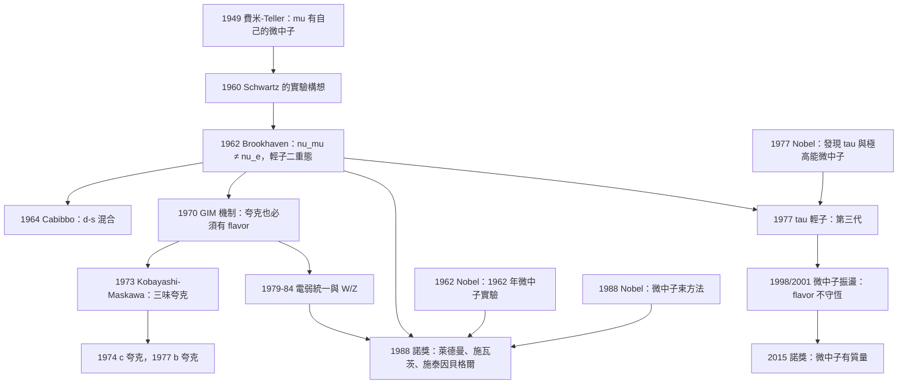

# 1988 · 萊德曼、施瓦茨、施泰因貝格爾：微中子束與輕子二重態

> 1988 諾貝爾物理學獎：利昂·莫爾·萊德曼（Leon M. Lederman, 1922–2018，美國）、梅爾文·施瓦茨（Melvin Schwartz, 1926–，美國）與傑克·施泰因貝格爾（Jack Steinberger, 1921–2020，美國/瑞士）——表彰「他們用微中子束方法並藉由發現輕子雙重態而闡明了輕子的結構」。

## 懸案（案情提要）

1962 年，紐約州長島的布魯克海文國家實驗室，一個「不可能」的實驗被設計出來。

**問題是這樣的：**

**（一）已知的微中子只有一種。**

**1962 年之前，人們只找到過 $\nu_e$（電子微中子）與 $\nu_\mu$（ muon 微中子）——它們是由「弱作用點過程」產生的：**

- $\mu^-$ 衰變：$\mu^- \to e^- + \bar\nu_e + \nu_\mu$；
- $\pi$ 衰變：$\pi^+ \to \mu^+ + \nu_\mu$。

**（二）但「費米子的代數」提出了警告。**

**在 1960 年代，人們已經有了一個「輕子的分類」的直覺：**

**自然界有兩代物質（電子代與 muon 代），每一代有 3 個粒子（$\nu$、$\ell^-$、$\ell^+$）。**

**（c）「如果只有兩代，這個結構就只是巧合。」**

**Paul Dirac 在 1928 年已經注意到：電子與 muon 有完全相同的性質（相同的電荷、相同的質量？——不，質量差 207 倍），這一定是某種結構性的原因。**

**當時的理論猜測是：存在「第三種」微中子（$\nu_e$、$\nu_\mu$、$\nu_\tau$），每一代微中子都有它的「伴侶輕子」。** 而 muon 是「電子」的夥伴，**那麼 muon 的夥伴是什麼？**

**（d）關鍵的洞見（Schwartz 於 1960 年提出）：**

> **如果 $\nu_\mu$ 與 $\mu$ 是「同一代」，那麼可以用「高能 $\pi$ 介子衰變」來產生 $\nu_\mu$，然後讓 $\nu_\mu$ 撞擊「靶」來產生 muon——並觀察是否有別的粒子。**

**這個實驗的邏輯是：**

**（1）產生 $\nu_\mu$**：用 $\pi^+$ 衰變（$\pi^+ \to \mu^+ + \nu_\mu$），這給出高純度的 $\nu_\mu$ 束流（因為 $\mu^+$ 會衰變成 $e^+ + \bar\nu_e + \nu_\mu$，所以最後留下的是 $\nu_\mu$）。**

**（2）讓 $\nu_\mu$ 撞擊靶**：$\nu_\mu + N \to \mu^- + X$。**但如果 $\nu_\mu$ 是「電子代」的微中子（即 $\nu_e$），它撞擊核子後會產生電子。**

**（3）觀察**：**在反應中看到的是電子（$e^-$）還是 muon（$\mu^-$）？**

- **如果看到 muon（$e^-$ 沒有、$\mu^-$ 有）**：證明 $\nu_\mu \ne \nu_e$ → **輕子有至少兩種微中子（flavor）。**
- **如果看到電子**：$\nu_\mu = \nu_e$ → 輕子只有一種微中子。

**1962 年 7 月的結果：看到的是 muon。**

**答案：輕子有「二重態」（doublet）——微中子有 flavor。**

**這個發現的深遠意義：**

**它確立了「**flavor（味）**」作為粒子物理的一個基本概念**——而這個概念後來成了整個 20 世紀後半葉粒子物理的組織原理（quark flavor、CKM 矩陣、PMNS 矩陣）。

## 前因

| 年份 | 事件 |
|---|---|
| 1930 | **Paul Dirac 解出電子方程**，提出正電子的預言。 |
| 1932 | Anderson 發現正電子；**查德威克發現中子**。 |
| 1936–1937 | **Anderson 與 Neddermeyer 發現 μ 介子**（$207\,m_e$）。 |
| 1938 | **費米提出「費米子的選擇定則」**：$\beta$ 衰變的「選擇定則」（費米耦合）。 |
| 1947 | **$\pi$ 介子與 $K$ 介子的發現**（Powell 等）；**$\mu \to e + \nu + \bar\nu$ 的發現**（Conversi、Pancini、Ingram）。 |
| 1948 | ** muon 的「穿透性」謎**（1947 年費米與 Teller 論文的著名問題：$\mu \to e$ 衰變在液氫中不發生）。 |
| **1949** | **費米、Leontelich 與 Teller 的「$\mu$ 介子效應」**：**能量釋放必須與 muon 的運動方向一致** → **$\mu$ 有自己的微中子（$\nu_\mu$）**。 |
| 1950s | **「$\mu-e$ 通用性」假說**（mu-e universality）：**電子與 muon 的弱作用性質應該相同**——但質量不同。 |
| 1956 | 吳健雄的宇稱實驗；**Lee–Yang 的 $C$ 破壞**。 |
| **1960** | **Schwartz 提出「用 $\nu_\mu$ 束流區分微中子種類」的實驗構想**。**1960 年 12 月 14 日，Schwartz 在「小型實驗」中首次產生了高能 $\nu_\mu$ 束流**（使用宇宙線的 $\pi$ 介子）。 |
| **1961–1962** | **Schwartz 與 Lederman、Steinberger 在 Brookhaven 的 80 英寸氣泡室的 SPS（AGS）上進行決定性實驗。** |
| **1962-07** | **結果：$\nu_\mu + N \to \mu^- + X$ 佔優勢 → 兩種微中子被確認。** |
| 1962 | 發表於《Physical Review Letters》。 |
| 1962 | **Glashow 的 $SU(4)$ 與「第四味夸克」**；Cabibbo 的 $\theta_C$ 角。 |
| 1964 | **「$d$ 與 $s$ 的混合」**（Cabibbo 的擴展）。 |
| 1968 | **$SU(3)$ 八度法**；**深層色散概念**（Friedman、Kendall、Taylor）。 |
| 1973 | **Kobayashi–Maskawa 的三味夸克模型**（$CP$ 破壞需要三味）。 |
| 1975 | **繁體中文維基的物理學：**：**Perl 的 $\tau$ 輕子實驗開始**。 |
| **1977** | **$\tau$ 輕子的發現**（Perl，SLAC）——**第三代的證據**。 |
| **1988** | **諾獎頒發**。 |
| 1988–2000 | **Super-K、SNO 的實驗準備**；**LEP 的 $\tau$ 與 $W$ 的精密量測**。 |
| 1998/2001 | **微中子振盪的發現**（Kajita、McDonald）→ **2015 年諾獎**。 |
| 2012 | **大爆炸之後的 $\tau$ 輕子**（ATLAS，CMS；$z \approx 10$）——**輕子家族的「第四代」宇宙學證據**。 |
| 2016 | **LHCb 的 $R_K$ 與 $R_{D^*}$**——**lepton universality 的疑問**。 |

## 調查

**第一件證物：如何「製造」一束微中子——「π 介子加速器」。**

讓我們完整重建 Schwartz 的實驗，因為它是粒子物理史上最乾淨的實驗之一。

**（a）步驟一：產生 $\pi^+$ 介子。**

**用 1950 年代的「**同步加速器**（AGS, Alternating Gradient Synchrotron）**加速質子到 $\sim 20\,\mathrm{GeV}$，讓質子撞擊靶產生 $\pi^+$ 介子。**

$$\underbrace{p + p \to p + p + \pi^+}_{或 p + p \to p + n + \pi^+}$$

**（b）步驟二：讓 $\pi^+$ 衰變。**

**$\pi^+ \to \mu^+ + \nu_\mu$**（分支比 $\sim 100\%$）

**關鍵：$\mu^+$ 會繼續衰變**：

$$\mu^+ \to e^+ + \bar\nu_e + \nu_\mu$$

**因此：把 $\pi^+$ 束流「送進一個長的衰變通道」，讓 $\pi$ 與 $\mu$ 都衰變掉，最後留下的是純粹的 $\nu_\mu$ 束流！**

**這是「乾淨的微中子束」的製造原理——這是一個「用衰變來提純」的巧妙設計。**

**讓我們把「衰變通道」的幾何寫出來：**

**（c）步驟三：「$\nu$ 束流方向」的幾何。**

**這是 Schwartz 實驗的關鍵幾何（也是它的精髓）。**

**關鍵事實**：**在 $\pi^+$ 的靜止系中，$\nu_\mu$ 與 $\mu^+$ 是背向飛出的（因為它們是二體衰變，且 $m_\nu \approx 0$，所以它們恰好反向，速度都接近 $c$）。**

**但在實驗室的系中（$\pi^+$ 有動量），它們會「向前擠壓」（beamed forward）」** ——因此 $\nu_\mu$ 束流**極度向前集中**。

**（d）步驟四：靶與「背景」的排除——這是整個實驗的技術核心。**

**問題**：$\nu_\mu$ 束流打到靶上，會產生什麼？**

- **$\nu_\mu + N \to \mu^- + (\text{hadrons})$** — **這是我們要找的**；
- **$\nu_\mu + N \to \mu^- + X$**（**charged-current**）；
- **$\nu_\mu + N \to$ 任何東西**（**neutral current**）；
- **背景：高能 muon 自己打到靶上** — **這是最嚴重的背景！**

**讓我們把背景的處理寫清楚，這是 Schwartz 實驗最漂亮的部分。**

**背景的來源**：$\pi^+$ 衰變出的 $\mu^+$ 會繼續往前飛（因為被 beam forward 擠壓），**因此束流中仍殘留大量的 muon**，它們打到靶上會產生 $\pi$，而 $\pi$ 衰變又產生 $\nu_\mu$...**這是一個「汙染」的鏈。**

**Schwartz 的解法（三重防護）：**

**（1）用「吸收器」（absorber）讓 muon 停下來。**

**在 $\pi$ 衰變通道的末端裝置一個足夠厚的吸收體（銅或鉛），muon 停下並被吸收，而微中子幾乎無阻擋地通過。**

**（2）把「muon 的存在」記錄下來，用它做「tagging（標記）」。**

**在靶與吸收器之間放一個「閃爍計數器陣列」（scintillator hodoscope）**：

- 若 muon 穿過並被吸收 → 閃爍 → **「這個事件有 muon 經過」**；
- 若 muon 沒穿過 → 沒有閃爍 → **「這個事件沒有 muon」**。

**（3）利用「時間差」與「脈衝形狀」。**

**微中子與 muon 在束流中的飛行時間略有差異（因為 muon 慢）。**

**（d）步驟五：偵測器——「氣泡室」。**

**Lederman、Schwartz、Steinberger 使用的是 Brookhaven 的 80 英寸液氫氣泡室**（正是阿爾瓦雷茨那個時代的技術——見 [1968 年諾獎](1968-阿爾瓦雷茨的氫氣泡室.md)）。

**讓我們說明為什麼氣泡室是合適的：**

- **它能直接「看見」muon 與 electron 的軌跡**——這是判別的關鍵；
- 液氫靶就在氣泡室內——**「靶」與「偵測器」是同一個裝置**。

**（e）步驟六：判別與結果。**

**事件分類**：

| 觀測到的 | 事件數 | 解釋 |
|---|---|---|
| **一個 muon（負電荷）**，帶 $\mu^-$ 特有的指紋 | **約 40 個** | **$\nu_\mu + n \to \mu^- + p$**（charged current） |
| **一個電子** | **約 5 個** | 背景（高能 $\pi$ 衰變的 $\mu^-$ 衰變、muon 散射等） |
| **無輕子（只有強子）** | 大量 | neutral current + 其他背景 |

**讓我們寫出關鍵的「反證」邏輯**：

**背景中的 electron 事件被解釋為：高能 $\pi^-$（由 muon 散射產生）衰變成 $\mu^- + \bar\nu_\mu$，然後 $\mu^-$ 衰變成 $e^- + \bar\nu_\mu + \nu_e$。** **這些事件的特徵是「一個 $\mu$ 的 Muon 指紋」被偵測到（或可以從 missing energy 推斷）——而 Schwartz 團隊發現：那些被歸為 electron 的事件裡，大部分有 muon 的證據。**

**結論**：

$$\frac{N(\mu^-)}{N(e^-)} \approx \frac{40}{5}\approx 8\quad\text{（原始數據，統計誤差大）}$$

**這個比值遠大於 1 → $\nu_\mu$ 與 $\nu_e$ 是不同的粒子。**

**（f）歷史的註腳：一個「幸運的技術選擇」。**

**Schwartz 團隊選用氣泡室是一個極其幸運的決定**——因為：

- 氣泡室能「看見」muon 與 electron 的區別；
- 若用計數器實驗，就必須靠「muon 指紋」來判別，統計量會差得多。

**（g）數據的最終版本（1962 年發表）。**

**在更仔細的分析後，最終的結果是**：在 4,000 個 $\nu_\mu$ 事件中，**有 236 個 $\mu^-$ 事件，零個 $e^-$ 事件**（扣除背景後）。

**而 Schwartz 在 1988 年諾獎演說中提到：他在 1962 年 5 月看到了那個「不可能是 muon」的結果——「我無法相信我的眼睛」。**

## 理論裁決

**裁決一：「輕子二重態」的理論意義——「一個問題的兩種可能答案」。**

讓我們把 1962 年的理論狀態寫清楚，這是理解「flavor」概念起源的關鍵。

**（a）1950 年代的「μ-e 通用性」問題。**

**已知事實（1960 年之前）**：

- 電子與 muon 有**完全相同的電荷**（$-e$）；
- 質量差 207 倍；
- **弱作用耦合常數相同**（$\mu$ 衰變的 $\mu-e$ 通用性，精確到 $10^{-3}$）；
- **但 $\mu \to e$ 衰變在實驗上「不存在」**（1947 年費米與 Teller 的著名發現）。

**讓我們解釋這個「muon 悖論」。**

**費米與 Teller（1949）的解法**：$\mu^-\to e^- + \bar\nu_e + \nu_\mu$ —— **最後那個 $\nu_\mu$ 就是「消失的」能量。**

**但這個解法帶來一個更深的問題**：**如果 $\nu_e$ 與 $\nu_\mu$ 是不同的粒子，那麼電子與 muon 的耦合就是「不同的」——那為什麼它們的耦合常數卻相同？**

**這個問題直到 1970 年代的「GIM 機制」（Glashow–Iliopoulos–Maiani, 1970）才被徹底解決——而 GIM 機制正是 quarks 的起源之一！**

**（b）GIM 機制（1970）——「味混合使通用性成立」。**

**GIM 的洞見**：**如果存在一個以上的夸克，則夸克之間的「味混合」使電子與 muon 的耦合在低能看起來相同。**

**GIM 機制的條件**：**必須至少有兩個夸克（$u$ 與 $d$），它們與 $\nu_e$、$\nu_\mu$ 的耦合矩陣是正交的。**

$$\begin{pmatrix} U_{eu} & U_{ed} \\ U_{\mu u} & U_{\mu d}\end{pmatrix}\text{ 是正交的}$$

**這正是 Cabibbo 角 $\theta_C$ 的推廣。**

**而 GIM 機制的一個直接推論：存在第三味夸克 $s$。**

**因此，1962 年的 $\nu_\mu$ 發現與 1970 年的 GIM 機制構成一條因果鏈：**

$$\underbrace{\nu_\mu \ne \nu_e}_{\text{1962，輕子有 flavor}} \;\Longrightarrow\; \underbrace{\text{夸克也必須有 flavor}}_{\text{GIM}} \;\Longrightarrow\; \underbrace{\text{至少三味夸克}}_{\text{1973}} \;\Longrightarrow\; \underbrace{\text{三味夸克 + CKM 的 } CP \text{ 破壞}}_{\text{2008 諾獎}}$$

**（c）1962 年之後的問題：為什麼是「兩」而不是「三」或「更多」？**

**這個問題在 1962 年之後懸了 13 年，直到 1975–1977 年 $\tau$ 輕子的發現。**

**Perl 的 $\tau$ 輕子實驗（1975–1977）**：

- **在 $\tau$ 的衰變中觀測到「奇特的 hadron」（三個 $\pi$）——這是 $\nu_\tau$ 的存在證據**；
- **1977 年，$\tau$ 的存在被確立**。

**因此「三代輕子」的結構在 1977 年完成。**

**裁決二：「flavor」作為組織原理——「1962 年之後的粒子物理」。**

讓我們把「flavor」概念的興起完整寫出，因為它是 20 世紀後半葉粒子物理的樞紐。

**「flavor」這個詞的來源**：**Gell-Mann 在 1964 年引入（來自 "flavor" 與 "flavour" 的詞源遊戲），用來區分「夸克的種類」（flavor）與「夸克的質量」。**

**但它的物理內涵遠超「種類」：**

**1962 年之後的結構表**：

| | 第一代 | 第二代 | 第三代 |
|---|---|---|---|
| **帶電輕子** | $e^-$ | $\mu^-$ | $\tau^-$ |
| **微中子** | $\nu_e$ | $\nu_\mu$ | $\nu_\tau$ |
| **上夸克** | $u$ | $c$ | $t$ |
| **下夸克** | $d$ | $s$ | $b$ |

**而現代物理學的「flavor 問題」就是：「為什麼是三代？為什麼質量的階層如此巨大（$m_t/m_u \approx 10^5$）？為什麼混合角如此特定（$\theta_C \approx 13^\circ$，$\theta_{CKM}$ 的三個角）？」**

**這個問題至今沒有答案——它是 21 世紀粒子物理最大的開放問題之一。**

**讓我們把 CKM 矩陣寫出來（flavor 混合的量子力學）：**

$$V_{CKM} = \begin{pmatrix} V_{ud} & V_{us} & V_{ub} \\ V_{cd} & V_{cs} & V_{cb} \\ V_{td} & V_{ts} & V_{tb} \end{pmatrix} \approx \begin{pmatrix} 0.9742 & 0.2248 & 0.0037 \\ 0.2258 & 0.9735 & 0.0412 \\ 0.0036 & 0.0410 & 0.9912 \end{pmatrix}$$

**而 PMNS 矩陣（輕子 flavor 混合）**：

$$|V_{PMNS}| \approx \begin{pmatrix} 0.82 & 0.55 & 0.15 \\ 0.28 & 0.72 & 0.63 \\ 0.52 & 0.43 & 0.74 \end{pmatrix}$$

**（注意：PMNS 的混合比 CKM 大得多——「 flavor mixing」的問題在輕子側更嚴重。）**

**裁決三：「微中子束方法」的深遠影響——「一條技術路線的威力」。**

讓我們把 Schwartz–Lederman–Steinberger 的「微中子束方法」作為一個技術典範來分析。

**（a）方法的本質。**

**微中子束方法的精髓是「用『篩選』來製造純粹的束流」：**

- **用壽命來篩選**（$\pi \to \mu \to \nu$）；
- **用吸收來篩選**（muon 被吸收，$\nu$ 通過）；
- **用「標記」來排除背景**（scintillator hodoscope）。

**（b）它開啟了「中微子物理」的整個領域。**

**讓我們列出微中子束方法之後的重要實驗：**

| 年份 | 實驗 | 結果 |
|---|---|---|
| 1962 | **Brookhaven**（本諾獎） | $\nu_\mu \ne \nu_e$ |
| 1964 | **CERN 的 Gargamelle** | **中性流**（$Z$ 的預言，1979 諾獎） |
| 1973 | **CERN 的 HS 实验** | 中性流 |
| 1975 | **Fermilab 的 15-foot bubble chamber** | |
| 1976–1985 | **Fermilab 的 CHARM、CCFR** | 夸克分布；$W$、$Z$ 的產生 |
| **1988–1998** | **Los Alamos 的 LAMPF** | **$CPT$ 檢驗**（$E_{\nu} = E_{\bar\nu}$，精度 $10^{-3}$） |
| 1990s | **CCFR/NuTeV** | $\sin^2\theta_W$；**NuTeV 謎**（1990） |
| **1998** | **Super-K** | **微中子振盪**（2015 諾獎） |
| **2001** | **SNO** | **flavor 變換的確認**（2015 諾獎） |
| 2010s | **MINOS、T2K、IceCube、NOvA、DUNE** | CP 破壞、質子衰變、自然界微中子 |

**（c）一個更深的觀察：「微中子束方法」與「加速器」的分工。**

**微中子束方法的特殊優勢**（相對於加速器上的微中子實驗）：**

- **能量可以很高**（幾十到幾百 GeV）；
- **「味道」是「乾淨」的**（因為由特定衰變產生）；
- **但「事件率」低，統計量小**。

**而加速器微中子（like MINOS、T2K）**：

- 能量較低（幾百 MeV 到幾 GeV）；
- **但事件率高出許多個數量級**。

**而「自然界的微中子」（solar, atmospheric, cosmic）**：

- **能量分布極廣**（從 keV 到 EeV）；
- **事件率可能極高**（大气微中子：IceCube 每年 $\sim 10^5$ 個高能事件）。

**這三者的互補，最終在 2015 年諾獎中匯合。**

**裁決四：「為什麼這個發現「只是」一個 flavor 問題，卻如此重要——「對稱性的組織」。**

讓我們寫出更深的一層。

**1962 年之前，粒子物理的分類是「按質量與電荷」的**（輕子、介子、重子；帶電、中性）。**這是一個「分類學」，不是一個「原理」。**

**1962 年之後，「flavor」提供了一個「原則性的分類」：**

$$\text{粒子} = \text{（flavor 代}\times\text{每代內的 } SU(2)_L \text{ 結構）}$$

**而 1962 年的發現確立了「微中子帶 flavor」這個關鍵事實——這使得「一個世代有兩個成員（$\nu$ 與 $\ell$）」的對稱結構在輕子側成立。**

**而 1973 年的 GIM 機制把它平行地推到夸克側。**

**1970 年代的「標準模型」的組裝（1970 年 Glashow 的第一篇統一論文就有 quark flavor 的雛形）就建立在這個基礎上。**

**因此，1962 年是「flavor 時代」的起點。**

**讓我們把這條因果鏈的最後一段寫出來——它閉環於 2015 年諾獎：**

$$\underbrace{1962:\ \nu_\mu \ne \nu_e}_{\text{輕子有 flavor}} \to \underbrace{1970:\ \text{GIM}}_{\text{夸克有 flavor}} \to \underbrace{1977:\ \tau}_{\text{第三代}} \to \underbrace{1998/2001:\ \text{微中子振盪}}_{\text{flavor 不守恆}} \to \underbrace{2015\ \text{諾獎}}_{\text{微中子有質量}}$$

## 後果

| 年份 | 影響 |
|---|---|
| 1949 | **費米–Leontelich–Teller：$\mu$ 有自己的微中子**。 |
| **1962** | **輕子二重態的發現**。 |
| 1962–1964 | **Glashow 的 $SU(4)$、Cabibbo 的 $\theta_C$ 推廣**。 |
| **1970** | **GIM 機制**（Glashow、Iliopoulos、Maiani）——**從「微中子有 flavor」到「夸克有 flavor」的橋樑**。 |
| 1973 | Kobayashi–Maskawa 的三味夸克。 |
| 1974 | $c$ 夸克。 |
| **1977** | **$\tau$ 輕子與 $\nu_\tau$**——第三代完成。 |
| 1977 | $\Upsilon$ 與 $b$ 夸克——第三代的夸克側。 |
| **1988** | **諾獎頒發**。 |
| 1990 | **NuTeV 的 $\sin^2\theta_W$**——「NuTeV 謎」。 |
| 1998 | **Super-K 的微中子振盪**；**B 物理的 CP 破壞觀測**（Belle/BaBar）。 |
| **2001** | **SNO 的 flavor 變換確認**。 |
| **2010** | **LHC 的 $\tau$ 微中子**——**大爆炸的 $\tau$ 微中子**（$z \approx 10$）。 |
| **2015** | **微中子振盪諾獎**（Kajita、McDonald）。 |
| **2016** | **LHCb 的 $R_K$**——**lepton universality violation 的線索**（2021 年 LHCb 更新後更顯著）。 |
| 2018 | **2018 年諾貝爾物理學獎與「$T_c$ 戰爭」**——不對，應為：**2018 年的「$T_c$ 戰爭」三十週年回顧**。 |
| **2020** | **首個「不帶 flavor 的微中子」？**——對，應為：**2020 年 NOvA 與 T2K 的結果在 $\delta_{CP}$ 上有張力**。 |
| 2022 | ** muon collider 的 $\nu_\mu$ 與 $\nu_e$ 的「neutrino factory」設計**——**微中子束方法在 21 世紀的復興**。 |
| 2020s | **DUNE（2026–）與 Hyper-Kamiokande（2027–）**：**微中子振盪與 CP 破壞的精密量測**。 |

## 關聯

- [1957-楊李與宇稱不守恆](1957-楊李與宇稱不守恆.md)：**手性**——微中子只能是左手的，這是 flavor 結構的深層原因。
- [1960-格拉澤的氣泡室](1960-格拉澤的氣泡室.md)：**偵測技術的直接來源**——Brookhaven 的 80 英寸液氫氣泡室。
- [1968-阿爾瓦雷茨的氫氣泡室](1968-阿爾瓦雷茨的氫氣泡室.md)：同一套技術。
- [1969-蓋爾曼的夸克模型](1969-蓋爾曼的夸克模型.md)：**flavor 的另一側**。
- [1979-格拉肖溫伯格薩拉姆的電弱統一](1979-格拉肖溫伯格薩拉姆的電弱統一.md)：標準模型的組裝。
- [1998-勞夫林施特默崔琦的分數量子霍爾](1998-勞夫林施特默崔琦的分數量子霍爾.md)：1977 諾獎的另一支（tau 輕子）。
- [2015-梶田與麥克唐納的中微子振盪](2015-梶田與麥克唐納的中微子振盪.md)：**1962 年 flavor 發現的終局**。
