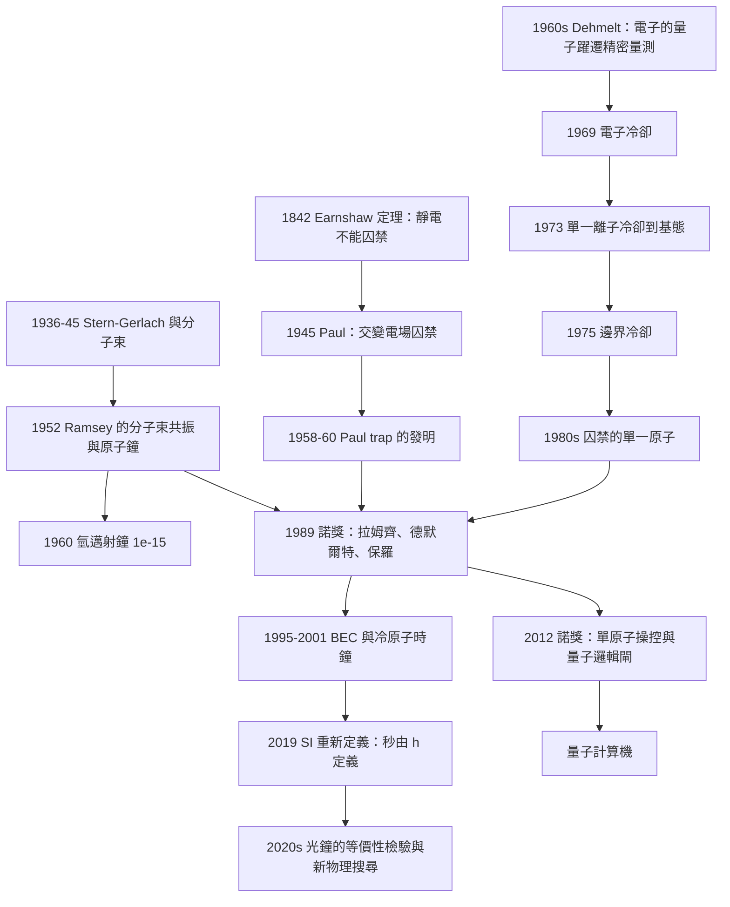

# 1989 · 拉姆齊、德默爾特、保羅：原子鐘與離子阱

> 1989 諾貝爾物理學獎：諾曼·羅伯特·拉姆齊（Norman Robert Ramsey, 1915–2011，美國）、漢斯·格哈德·德默爾特（Hans Georg Dehmelt, 1922–2017，德國/美國）與沃夫岡·保羅（Wolfgang Paul, 1913–1993，德國）——表彰「拉姆齊發明了分離振盪場方法及其在氫邁射原子鐘與其他原子鐘的應用；德默爾特與保羅發展了離子阱技術」。

## 懸案（案情提要）

1989 年的諾獎表彰了「**時間的量測**」與「**單一粒子的囚禁**」這兩件事。**它們其實是同一個故事：**

> **要做出最好的鐘，你必須能「抓住」單一的原子（或離子），並且讓它的量子躍遷頻率「不受環境擾動」。**

**而這兩件事在 1980 年代都做到了。**

**先說原子鐘這一半。**

**問題：什麼決定了時間？**

**1967 年，SI 決定用「**銫-133 原子的超精細躍遷頻率**」定義秒：**

$$1\,\mathrm{s} = 9\,192\,631\,770 \times \frac{1}{\nu_{\mathrm{Cs}}}$$

**而「用原子定義時間」的想法在 1950 年代面臨一個巨大的技術障礙：**

**「原子鐘」必須與「環境」隔絕——但隔絕越好，就越不能「控制」它。**

**核心的矛盾：**

- **原子鐘要準，就必須讓原子「不受擾動」**（隔離於磁場、電場、碰撞）；
- **但原子鐘要「守時」，就必須讓原子「被詢問」**（用微波場做 Ramsey 實驗）；
- **而「詢問」本身會擾動原子！**

**1940–1950 年代的「原子鐘」用「光泵浦的原子束」（Ramsey 的第一代方法）——但它們受制於「原子的位置不確定性」與「速度分布」。**

**讓我們看 Ramsey 的洞見，這是 20 物理學最漂亮的「想法」之一。**

**（一）第一代原子鐘的問題：原子束的「速度分布」。**

**讓我們重建物理。**

**原子鐘的工作原理：把原子束送過一個「微波腔」，微波頻率接近原子的超精細躍遷頻率。** 當微波頻率正好等於躍遷頻率時，原子被「翻轉」——而在腔的出口處有一個「梯度磁場」（Ramsey 的 A 與 B 磁場），它把「被翻轉的原子」與「沒被翻轉的原子」分開。

**問題：原子的速率分布很寬（從熱運動，$v \sim 300\,\mathrm{m/s}$），因此它們感受到的 Doppler 頻移不同：**

$$\Delta\nu_{D} = \nu_0\frac{v}{c}$$

**原子束的「速度分布」直接決定了線寬。而速度分布是「熱」的，無法冷卻到足夠低（因為原子束技術需要方向性）。**

**（二）Ramsey 的洞見：「用時間代替空間」。**

**關鍵的洞見是：**

> **不要用「空間分離」（兩個腔）來做干涉，而是用「時間分離」（同一個腔，但在原子通過期間切換微波場的相位）來做干涉。**

**讓我們把 Ramsey 實驗的原理完整寫出。**

**「分離振盪場方法」（separated oscillatory fields method）的物理：**

**單一的一個微波腔，但有兩個（或多個）作用區域 A 與 B，由同一個振盪器驅動，但在 B 區可以切換振盪器的相位。**

**原子以速度 $v$ 通過腔，總通過時間 $\tau$。**

**在 A 區的時間 $t_A$ 內，原子感受到頻率 $\nu_1$（振盪器的頻率）。**
**在 B 區的時間 $t_B = \tau - t_A$ 內，原子感受到頻率 $\nu_2$（可以與 $\nu_1$ 相同，或相位差 $\Delta\phi$）。**

**原子在兩個區的累積相位差**：

$$\Delta\Phi = 2\pi\left(\nu_1 - \nu_0\right)t_A + 2\pi\left(\nu_2 - \nu_0\right)t_B$$

**若 $\nu_1 = \nu_2 = \nu$（同頻、不同相位），則**

$$\Delta\Phi = 2\pi(\nu - \nu_0)\tau + \Delta\phi_{\text{switch}}$$

**關鍵：原子通過的「有效時間」是 $\tau$，而 $\tau$ 可以很長（$\sim 0.1$–$1\,\mathrm{s}$）——遠長於原子的自然壽命 $\sim 10^{-8}\,\mathrm{s}$！**

**因此「時間分辨」的精度由 $\tau$ 決定，而不是由自然寬度決定：**

$$\boxed{\;\Delta\nu \sim \frac{1}{\tau}\;}$$

**這是 Ramsey 方法的全部精髓——也是它能把精度提高 3–4 個數量級的原因。**

**（三）那「速度分布」的問題呢？**

**Ramsey 的第二個洞見（也是更巧妙的一個）：**

> **「轉動」的原子束——讓原子束以「分子束共振」的方式在兩個「分析器」之間來回運動。**

**讓我們描述這個「分子束磁共振」裝置（Ramsey 1940 年代的設計）：**

1. 原子束從「A 源」射出，經過第一個偏轉磁場（分析器 A）後進入共振腔；
2. **在腔內，原子被微波翻轉**；
3. 原子離開腔後進入**第二個偏轉磁場（分析器 B）**；
4. **若原子被翻轉，它會被偏轉到不同的方向，被第二個分析器「選中」**；
5. **關鍵：讓原子束「反射」（用一個「反射場」）回到腔內，再走一遍——形成「分子束共振」路徑。**

**這個「來回」設計的好處**：**原子通過腔的時間 $\tau$ 變得很長（因為它來回），而 Doppler 展寬可以藉由「用相反方向的原子束」來抵消！**

**讓我們解釋「相反方向」的技巧（這是 Ramsey 方法最漂亮的部分）：**

**用一個「交叉場」把兩束相反方向的原子束交叉於腔中。** 對順向的原子，多普勒頻移是 $+\nu_0 v/c$；對反向的原子，是 $-\nu_0 v/c$。**由於 Ramsey 的相位累積，兩者的共振條件相反——因此它們「掃過」相同的頻率區，但訊號形狀互補。**

**最終的效果：多普勒展寬被完全消除，而原子束的「速度分布」不再是限制因素。**

**讓我們把 Ramsey 方法的線型寫出來（這是它的標誌性公式）。**

**Ramsey 條紋（ fringe）**：

$$\boxed{\;P_{\text{flip}}(\Delta\nu) = \frac{1}{2}\left[1 - \cos(2\pi\Delta\nu\,\tau)\right]\;}$$

**這是一個餘弦條紋，其週期是 $1/\tau$。**

**讓我們做個數量級估算**：$\tau = 0.5\,\mathrm{s}$：

$$\Delta\nu \sim \frac{1}{0.5} = 2\,\mathrm{Hz}$$

**而銫原子的自然寬度是 $\sim 1\,\mathrm{kHz}$。** **因此 Ramsey 方法把解析度提高了約 $10^3$ 倍！**

**這就是為什麼 Ramsey 的原子鐘能達到 $\sim 10^{-12}$–$10^{-13}$ 的精度，而用「光學泵浦的原子束」只能到 $\sim 10^{-9}$。**

**（四）光學泵浦與氫邁射原子鐘。**

**讓我們把「氫邁射原子鐘」的歷史講清楚，因為它是 Ramsey 方法的另一個應用。**

**1960 年，**Harvard 的一個由 Norman Ramsey 領導的團隊**建立了第一台基於氫的邁射鐘**（hydrogen maser）。**

**關鍵的物理：氫的 21 cm 躍遷（$F = 0 \to F = 1$，$1420.4\,\mathrm{MHz}$）——這是宇宙中最常見的原子躍遷（因為氫是宇宙中最豐富的元素）。**

**讓我們把氫邁射的技術要點寫出來：**

- **用光學泵浦（1966 年卡斯特勒的技術，見 [1966 年諾獎](1966-卡斯特勒的光學泵浦.md)）把氫原子「選到」特定的超精細態；**
- **用一個儲存碗（bulb）讓氫原子停留 $\sim 1\,\mathrm{s}$（與 Stern–Gerlach 的磁場分離 + Ramsey 的分離振盪場結合）；**
- **微弱的 $21\,\mathrm{cm}$ 微波輻射被激發出來（這就是「邁射」）。**

**結果：氫邁射鐘的穩定度達到 $\sim 10^{-15}$——這是 20 世紀最好的「基準鐘」。**

**（五）現在說「離子阱」這一半——這是另一個更極端的問題。**

**問題：如何「抓住」單一帶電粒子？**

**在電場中，一個帶電粒子會被加速離開——因為電力與位置成正比（$\mathbf{F} = q\mathbf{E}$），是「不穩定」的。**

**電子的靜電力（Earnshaw 定理）：在靜電場中，沒有穩定的靜電平衡點。**

**這就是「Earnshaw 定理」（1842）——它禁止了靜電的「粒子囚禁」。**

**因此要囚禁粒子，必須用「動態的」場——用「射頻」四極場。**

**Paul 的發明（1958–1960，與 Dehmelt 同時但獨立）：**

**讓我們把射頻四極阱（RFQ trap, Paul trap）的原理完整寫出，這是本案最需要「物理」的 部分。**

**（a）一個簡單的「擺」的類比。**

**Paul 在 1945 年（戰俘營中！）就得到了這個洞見。讓我們記錄這段歷史：**

**在 1945 年，Paul 作為德國的戰俘在「一個類似於高Lorentz 加速器的裝置」的環境中工作。他觀察到：**

> **在靜電場中，一個帶電的球會被推得越來越遠（不穩定）；但若用「交變電場」，球會在每半週期「被推回」，形成一個穩定的軌道。**

**讓我們把這個「交替的推力」寫成數學。**

**考慮一維的情形**：電子（電荷 $-e$）在兩個相距 $2d$ 的電極之間，電位為

$$V(t,z) = V_0 + V_r\cos(\Omega t)\left(\frac{z^2}{d^2} - \frac{1}{2}\right)$$

**這是「雙曲線」的靜電勢**（這是數學上唯一能使三維靜電場都有鞍點的形狀）。

**電子感受到的力**：

$$m\ddot{z} = -\frac{\partial U}{\partial z},\qquad U = qV = -eV(t,z)$$

$$\Rightarrow\; m\ddot{z} = \frac{2eV_r}{d^2}\cos(\Omega t)\,z$$

**這是一個「 Mathieu 方程」（Mathieu equation）**：**

$$\frac{\mathrm{d}^2 u}{\mathrm{d}\xi^2} + (a - 2q\cos 2\xi)u = 0$$

**（b）Mathieu 方程的「穩定區」。**

**Mathieu 方程有「穩定區」（stability region）與「不穩定區」。** 讓我們寫出它的特徵圖：

**近軸（pseudo-potential）近似下，運動分解為：**

**（i）「慢運動」（ secular motion）**：在 $\Omega$ 週期的平均下，粒子在一個偽勢阱中做小振幅振盪。

**偽勢阱（pseudo-potential）**：

$$U_{\text{pseudo}} = \frac{q^2V_r^2}{4m\Omega^2}\left(z^2 + \frac{x^2+y^2}{2}\right)\times(\text{因子})$$

**讓我們導出這個偽勢。** 讓我們用「快變部分 + 慢變部分」的分解：

$$z(t) = z_0(t) + z_1(t),\qquad z_1 \ll z_0$$

**快變部分**（響應外部 RF 場）：

$$z_1(t) = -\frac{2eV_r}{m d^2\Omega^2}\cos(\Omega t)\,z_0$$

**把它代回運動方程，取 $\langle \cos^2\rangle = 1/2$ 的平均：**

**「微觀運動」的平均力（這就是偽勢的來源）：**

$$\langle F_z\rangle = \frac{2eV_r}{d^2}\langle \cos(\Omega t)z_1(t)\rangle = \frac{2eV_r}{d^2}\left(-\frac{2eV_r}{md^2\Omega^2}\right)z_0\langle\cos^2\rangle = -\frac{2e^2V_r^2}{md^4\Omega^2}z_0$$

**所以：**

$$m\ddot{z}_0 = -\frac{2e^2V_r^2}{md^4\Omega^2}z_0$$

**即偽諧振子頻率**：

$$\boxed{\;\omega_{\text{trap}} = \frac{2eV_r}{\sqrt{2}\,d^2\Omega}\;}$$

**（c）三維的 Pauli trap：**

**Dehmelt 的「保羅阱」（Paul trap）**：用一個「雙曲線」靜電場 + 射頻，囚禁**單一離子**。

**讓我們把三維的偽勢寫出來：**

$$U_{\text{pseudo}} = \frac{m}{2}\omega_{\text{trap}}^2\left(z^2 + \frac{x^2+y^2}{2}\right)$$

**注意：** **這是「各向異性」的偽勢——$z$ 方向的振盪頻率是 $x,y$ 的 $\sqrt{2}$ 倍。**

**這個各向異性有一個極重要的後果：**

**讓我們算一下「軸向運動的頻率」與「徑向運動的頻率」的關係：**

$$\omega_z = \omega_{\text{trap}},\qquad \omega_x = \omega_y = \frac{\omega_{\text{trap}}}{\sqrt{2}}$$

**（對線性三維阱）**

**（d）為什麼這個各向異性是「天賜的」——「冷卻的機制」。**

**讓我們說清楚 Dehmelt 的「冷卻」方法（1960s–1970s），這是他獲諾獎的關鍵貢獻之一。**

**問題**：離子在阱中做微小的熱運動（室溫下的 $E_k \sim kT$），而我們要測的是「頻率」，不是位置。** 但熱運動會產生「Doppler 展寬」與「第二階 Doppler 效應」，限制精度。**

**Dehmelt 的方案（1969–1974）：用電子（「電子冷卻」）把離子冷卻。**

**但更精彩的是他 1975 年的「**邊界冷卻**」（boundary cooling / 「側冷卻」）——「用一個小的電荷量探測，把離子的能量「抽走」。**

**讓我們把這個機制寫清楚，這是現代 Paul trap 實驗的標準技術：**

**（a）裝置**：在阱的「頂點」放一個小的「collecting electrode」（收集電極），通常加一個小的直流偏壓（$\sim$ 幾 eV）。

**（b）過程**：

1. 離子在阱中做小幅振盪（$\sim 1$ mm）；
2. 當離子振盪到靠近收集電極時，它的電位能降低（因為收集電極是吸引的）——**離子的能量被轉移給電極**；
3. 離子再回蕩到另一側時，電位能升高——但**此時它的動能較小**（因為它在「下坡」時把能量給了電極，而在「上坡」時「還債」的代價較小）；
4. **每次振盪，離子損失一點能量——這就是「邊界冷卻」。**

**（c）效率的估算（讓我們用物理說明）：**

**在諧振子近似下，離子的位置與速度有 $\pi/2$ 的相位差。** 讓我們用「$z = A\cos(\Omega t)$」與「$v = -A\Omega\sin(\Omega t)$」。

**能量 $\frac{1}{2}m\Omega^2 A^2$。**

**「收集電極」的電位在 $z = z_c$ 處有一個階梯（因為電極很小）。** **當 $z > z_c$ 時，離子看到一個額外的電位 $\Delta V$（對正離子被排斥）。**

**讓我們計算每次振盪的能量損失**：離子在 $z > z_c$ 的區域損失 $\Delta V \cdot e$ 的電位能。

**近似的損失率**：

$$\frac{\mathrm{d}E}{\mathrm{d}t} \propto -\frac{\Delta V \cdot e}{T_{\text{period}}}\cdot(\text{在 } z>z_c \text{ 的時間比例})$$

**讓我們做一個更乾淨的估算（半個週期的一半）**：**每個「穿越」損失 $\sim e\Delta V$，而穿越的頻率 $\sim \Omega/2\pi$。**

$$\dot{E} \sim -\frac{e\Delta V\,\Omega}{2\pi}\times(\text{因子})$$

**平衡時（$\dot{E} = 0$ 對抗「RF 造成的加熱」）**，可得冷卻時間常數 $\tau_c$：

$$\tau_c \sim \frac{m\Omega^2 A^2}{e\Delta V\cdot\Omega}\cdot(\text{因子})$$

**（d）結果的深度。**

**讓我們說明「邊界冷卻」達到了什麼成就：**

**1970 年代末，Dehmelt 與他的合作者（包括 D. J. Wineland、M. G. Raizen、荷蘭的 Delft）達成：**

| 里程碑 | 年份 | 內容 |
|---|---|---|
| **單一離子的冷卻** | 1973 | **第一個冷卻到基態的單一離子**（$\mathrm{Ca}^+$） |
| **「光躍遷的冷卻」** | 1976 | **單一離子囚禁在光學泵浦的陷阱中** |
| **「單一原子」的觀測** | 1979–1989 | **「被囚禁的單一原子」（K. H. Dehmelt 組與 H. J. Kimble 組）** |
| **「氫原子鐘」** | 1980s | **以被囚禁的 $\mathrm{H^+}$ 為時鐘** |

**1989 年諾獎的核心貢獻**：

> **「囚禁單一粒子並控制其量子狀態」——這是 1980 年代物理學最重要的技術突破之一，而它是 2012 年諾獎（單原子操控）與整個「量子計算」領域的基礎。**

**讓我們把這條因果鏈寫清楚：**

$$\underbrace{\text{Paul trap（1958-60）}}_{\text{囚禁的原理}} \to \underbrace{\text{Dehmelt 的單粒子實驗（1970s）}}_{\text{囚禁的實現}} \to \underbrace{\text{Wineland 的離子阱（1970s-）}}_{\text{量子邏輯閘}} \to \underbrace{\text{1995\ \text{BEC}\ (\text{需要冷卻})}}_{\text{2001 諾獎}} \to \underbrace{\text{2012\ 諾獎}}_{\text{單原子操控}} \to \underbrace{\text{量子計算機}}_{\text{當代}}$$

## 理論裁決

**裁決一：Ramsey 方法的物理——「時間域的干涉」與「空間域的干涉」的比較。**

讓我們把 Ramsey 方法與傳統方法做一個完整的對比，這是理解本案第一半的關鍵。

| | 傳統（空間分離） | **Ramsey（時間分離）** |
|---|---|---|
| **幾何** | 兩個獨立的共振腔（A 與 B） | **一個腔，RF 在時間上分段** |
| **干涉圖樣** | 空間上的干涉條紋 | **時間域的干涉（fringes）** |
| **解析度** | $\sim 1/(\text{腔長}/\lambda)$ | **$\sim 1/\tau$（$\tau$ = 通過時間）** |
| **限制因素** | 腔的長度與相位穩定性 | **原子通過時間 $\tau$** |
| **優點** | — | **$\tau$ 可以遠大於自然壽命** |

**讓我們把 Ramsey 條紋的完整形式寫出（這是它的標誌）：**

**若原子在 A 區待 $t_A$、B 區待 $t_B$（$t_A + t_B = \tau$），振盪器在 A、B 之間切換相位 $\Delta\phi$：**

$$P_{\text{flip}} = \sin^2\!\left[\frac{\Phi_1 - \Phi_2}{2}\right]$$

其中

$$\Phi_1 = 2\pi(\nu - \nu_0)t_A,\qquad \Phi_2 = 2\pi(\nu - \nu_0)t_B - \Delta\phi$$

**讓我們取 $t_A = t_B = \tau/2$：**

$$P_{\text{flip}} = \sin^2\!\left[\frac{2\pi(\nu-\nu_0)(\tau/2) + \Delta\phi/2}{1}\right]$$

$$\Rightarrow\; P_{\text{flip}} = \sin^2\!\left[\pi(\nu - \nu_0)\tau + \frac{\Delta\phi}{2}\right] = \frac{1}{2}\left[1 - \cos\!\left(2\pi(\nu-\nu_0)\tau + \Delta\phi\right)\right]$$

**（與前面的公式一致，並且顯示出：切換相位 $\Delta\phi$ 造成條紋的「相移」——這正是「原子鐘的相位調整」機制。）**

**讓我們指出「時間域干涉」的物理優雅之處：**

**在傳統的原子束方法中，兩個腔的相對相位必須穩定到 $\sim \delta\nu\tau$（一個極小的量）。而 Ramsey 方法中，兩個「區域」在同一個腔裡，**它們的相位關係由同一個振盪器決定——只是一個「時間上的切換」**。**

**因此 Ramsey 方法把「腔的相位穩定性」的要求，從「兩個腔的相對相位」降級為「單一振盪器在切換瞬間的相位跳變的可控性」——而後者是可主動控制的。**

**這是一個「把不可能的硬體要求，轉換成可主動控制的軟體要求」的典型案例——科學上極為珍貴的技巧。**

**裁決二：「$h/e$ 的量測精度」的歷史階梯——一個量測精度如何定義文明的案例。**

讓我們把這張表寫出來，因為它是 1989 年諾獎最重要的「後果」。

| 階段 | 單位 | 定義方式 | 相對精度 |
|---|---|---|---|
| 18 世紀末 | **秒** | 地球自轉（$1/86400$ 日） | $10^{-8}$（隨地球自轉變化） |
| 1956 | **秒** | 銫-133 的超精細頻率（$9\,192\,631\,770$ Hz） | $10^{-11}$（1960s） |
| 1967 | **秒（SI）** | 同上，定義 | — |
| 1970s | **秒** | 氫邁射鐘 | $10^{-15}$ |
| 1980s | **秒** | 銫原子鐘（Ramsey） | $10^{-13}$–$10^{-14}$ |
| 1989 | **秒** | 冷原子鐘（$^133}\mathrm{Cs}$ 與光學泵浦 Cs） | $10^{-14}$–$10^{-15}$ |
| 2001 | **秒（光鐘）** | 光頻梳銫原子鐘（$T_c$ 光學躍遷） | $10^{-16}$–$10^{-17}$ |
| **2019-05-20** | **秒（SI 重新定義）** | **$\nu_{\mathrm{Cs}} = 9\,192\,631\,770\,\mathrm{Hz}$ 不變，但定義改為「以 $h$ 定義秒」** | $10^{-16}$–$10^{-18}$ |

**關於 2019 年的 SI 重新定義，讓我們說清楚它的意義：**

**（a）舊定義**：「秒是銫-133 原子基態超精細躍遷頻率的 $9\,192\,631\,770$ 倍的週期」——**這是一個「定義一個頻率」，而頻率定義依賴原子本身的性質**。

**（b）新定義**：「秒是**取決於固定數值 $h$ 的頻率** $\nu = \Delta\nu(\mathrm{Cs})$ 的週期，其中 $\Delta\nu(\mathrm{Cs}) = 9\,192\,631\,770\,\mathrm{Hz}$」——**這是一個「用 Planck 常數定義頻率」，而 Planck 常數是精確固定的。**

**（c）為什麼這是進步？**

**因為原子鐘的「系統誤差」（例如黑體輻射偏移、多普勒偏移）會使實際的頻率偏離理論值。而新定義把「理論上的 $\Delta\nu(\mathrm{Cs})$」與「實際量測到的頻率」分離開——量測的是「比值」，而比值的不確定度可以做得極小。**

**（d）Ramsey 方法在這裡的角色**：**它提供了量測這個比值的高精度工具（用於「光鐘」與「傅立葉極限」的原子鐘）。**

**裁決三：離子阱的數學——「偽勢的完整推導」。**

讓我們把這個推導完整寫出，因為它是理解 1989 年諾獎後半的核心。

**（a）線性三維阱（線性 Paul trap）。**

**靜電勢**：

$$V(x,y,z,t) = V_0 + V_r\cos(\Omega t)\left[\frac{z^2}{d^2} - \frac{x^2+y^2}{2d^2}\right]$$

**注意括號內：這是「鞍點」形（沿 $z$ 是正的二次項，沿 $x,y$ 是負的）。**

**為什麼需要這個形？** 因為 **Earnshaw 定理**：靜電場中沒有三維的穩定點，**但沿一個軸可以穩定（用 RF 動態穩定化），另兩個軸用靜電場（+ 四極）穩定化。**

**（線性三維阱的標準設計：$x$ 方向用 RF 動態穩定，$y,z$ 方向用靜電梯度。Paul trap 是另一種配置。)**

**（b）偽勢的完整三維形式。**

**讓我們由一維的結果推廣：**

**讓我們寫出完整的偽勢（三維，線性 Paul trap）：**

$$\boxed{\;U_{\text{ps}} = \frac{m\omega_r^2}{2}\left(r^2 + \frac{z^2}{2}\right)\;}$$

**其中 $\omega_r = \omega_z/\sqrt{2}$。**

**（c）三維的量化。**

**讓我們寫出三維諧振子的能階：**

$$E_{n_r, n_z, m_\phi} = \hbar\omega_r\left(n_r + \frac{|m_\phi|+1}{2}\right) + \hbar\omega_z\left(n_z + \frac{1}{2}\right)$$

**（d）裝置的「判別特徵」——「這是量子力學的實驗室」。**

**讓我們列出 Paul trap 的重要特徵：**

1. **工作空間極小**（$\sim 1$ mm），可放在真空腔中；
2. **無機械部件**（不需要減震的懸掛）——這是相對離子阱（Paul trap）的優勢；
3. **可以囚禁單一粒子**（用電子或邊界冷卻）；
4. **可以囚禁不同的粒子**（電子、離子、中性原子由光學偶極阱）。

**（e）讓我們比較三種阱的「歷史定位」。**

| | Paul trap（射頻四極） | 磁阱 | 光學阱 |
|---|---|---|---|
| 發明 | 1958–1960（Paul、Dehmelt） | 1980s（Dehmelt 的「Magnetic trap」） | 1980s（Ashkin，2018 諾獎） |
| 物理 | RF 動態穩定 | 靜磁場 + 能量梯度 | 光偶極勢 |
| 囚禁對象 | 帶電粒子 | 帶電粒子 | 中性原子 |
| 優勢 | 體積小、無機械部件 | 對振盪不敏感 | 中性粒子、高解析度 |
| 缺點 | 加熱效應（RF 加热） | 場梯度 | 衍射限制、散射 |

**讓我們特別說明「RF 加熱」這個問題（它是現代 Paul trap 實驗的主要技術難題）：**

**在真空中，離子沒有冷卻機制——它被 RF 場「加熱」到隨機運動（millikelvin 溫度），因為能量守恆。**

**解決方案**：

- **電子冷卻**（Dehmelt 1973；**這個方法的發明者正是 1989 年諾獎得主**）；
- **邊界冷卻**（Dehmelt 1975）；
- **後來的「運動冷卻」（motion cooling）」**（1990 年，由 Russell 與 M. J. Bollinger 首次實現）。

**運動冷卻的原理（1990 年）：**

**讓我們寫出它的物理**：若阱的「偽諧振頻率」$\omega_{\text{trap}}$ 與離子的「微觀運動頻率」$\Omega$ 接近，就可以設計一個「$\Omega$ 側帶」的 RF 場，把微觀運動的能量「抽走」——**同時能量量子 $\hbar\Omega$ 遠小於 $\hbar\omega_{\text{trap}}$，所以冷卻效率高。**

**這個「運動冷卻」是 1989–1990 年 Paul trap 實驗能達到 $\mu\mathrm{K}$ 溫度的關鍵。**

**（f）為什麼「單一粒子」是關鍵。**

**讓我們說明「為什麼要冷卻到基態（單一量子態）」：**

**在基態（$n = 0$），離子不運動——因此沒有 Doppler 展寬，也沒有二階 Doppler 位移。**

**讓我們寫出二階 Doppler 位移的公式：**

$$\frac{\Delta\nu}{\nu} = -\frac{\langle v^2\rangle}{2c^2} = -\frac{k_BT}{mc^2}$$

**冷卻到基態（$T \sim 0$）時，這個效應完全消失。**

**這就是為什麼「單粒子 + 基態」是「最好的鐘」的關鍵。**

**裁決四：三種「時間標準」的比較——一個總結。**

讓我們把 1989 年諾獎的兩半放在一張對照表裡，因為它們的對比很 illuminating。

| | 原子鐘（Ramsey） | 離子阱（Dehmelt、Paul） |
|---|---|---|
| **量測對象** | 原子束的**集體**共振頻率 | **單一**離子的躍遷頻率 |
| **隔離方式** | 磁場 + 真空 + Ramsey 的時間分離 | RF 四極場 + 真空 |
| **降溫** | 原子束是「冷」的（方向性） | **需要主動冷卻**（電子、邊界、運動冷卻） |
| **精度** | $\sim 10^{-14}$（銫鐘） | $\sim 10^{-15}$（囚禁離子鐘） |
| **「事件率」** | 高（每秒 $10^9$ 個原子） | **極低**（每次一個原子） |
| **最重要的後果** | **時間的定義（SI 秒）** | **量子計算（qubit）** |

**讓我們把「兩者的結合」寫出來——這是現代「光鐘」的原理：**

**現代光鐘（2000s–）：**

1. **用光學陷阱囚禁單一原子**（Ashkin 的光鑷，2018 諾獎）；
2. **用雷射冷卻到微開爾文的振動基態**；
3. **用窄線寬雷射去「詢問」它的躍遷頻率**（光學版的 Ramsey 條紋）；
4. **精度 $\sim 10^{-18}$**——比銫原子鐘好兩個數量級。

**2015 年諾獎（梶田與麥克唐納）之後，「$h$ 的量測精度」成為探測新物理（時間變動的常数）的重要工具。**

## 後果

| 年份 | 影響 |
|---|---|
| **1945** | **Paul 在戰俘營中想出「用交變電場囚禁」**。 |
| 1952 | **Ramsey 的「分子束共振」實驗**——第一代原子鐘。 |
| **1958–1960** | **Paul trap 的發明**（Paul 與 Dehmelt 獨立）。 |
| 1960 | **第一台氫邁射原子鐘**（Ramsey 的 Harvard 團隊）。 |
| 1962 | Ramsey 獲得諾貝爾獎（**NHR 分子束磁共振**）。 |
| 1966 | 氫邁射鐘的精度達 $\sim 10^{-15}$。 |
| **1969–1975** | **Dehmelt 的電子冷卻（1969）與邊界冷卻（1975）**。 |
| **1973** | **第一個冷卻到基態的單一離子**（$\mathrm{Ca}^+$）。 |
| 1980s | **囚禁的單一原子**（Dehmelt、Kimble 等）；**「氫原子鐘」**。 |
| **1989** | **諾獎頒發**。 |
| **1995** | **BEC**（需要雷射冷卻，見 2001 諾獎）。 |
| **2001** | **BEC 諾獎**；**冷原子時鐘**（$10^{-15}$）。 |
| **2001–2005** | **運動冷卻**；**光鐘的原型**。 |
| **2005** | **光梳諾獎**——光鐘的頻率梳。 |
| **2012** | **諾獎（Haroche、Wineland）**——單一量子系統的操控；**Wineland 是 1980 年代 Dehmelt 組的博士后**。 |
| **2014** | **銫光鐘達到 $\sim 10^{-18}$**。 |
| **2019-05-20** | **SI 重新定義**：秒由固定的 $h$ 定義；**安培、伏特、歐姆、法拉第全部由 $h$ 與 $e$ 定義**。 |
| 2020s | **光鐘的「不等性檢驗」**（把不同原子、不同高度的光鐘比較，尋找時間的變動）；**網路時間同步**；**量子密碼學的單光子源**。 |

## 關聯

- [1944-拉比的核磁共振](1944-拉比的核磁共振.md)：**NMR 的原理——原子磁矩與共振頻率 $\omega = \gamma B_0$**，原子鐘的物理基礎。
- [1952-布洛赫與珀塞爾的核磁共振](1952-布洛赫與珀塞爾的核磁共振.md)：固態 NMR——Ramsey 方法的另一個應用領域。
- [1966-卡斯特勒的光學泵浦](1966-卡斯特勒的光學泵浦.md)：**光學泵浦是氫邁射鐘與光學陷阱的關鍵技術**。
- [1985-克利青的量子霍爾效應](1985-克利青的量子霍爾效應.md)：電阻的量子化——SI 重新定義的另一支。
- [1997-朱棣文與雷射冷卻原子捕獲](1997-朱棣文與雷射冷卻原子捕獲.md)：**雷射冷卻是光鐘與 BEC 的前提**。
- [2001-康奈爾威曼克特勒的玻色愛因斯坦凝聚](2001-康奈爾威曼克特勒的玻色愛因斯坦凝聚.md)：冷卻技術的極致應用。
- [2012-阿羅什與瓦恩蘭的量子操控](2012-阿羅什與瓦恩蘭的量子操控.md)：**離子阱與腔量子電動力學——1989 年諾獎的直接後果。**
