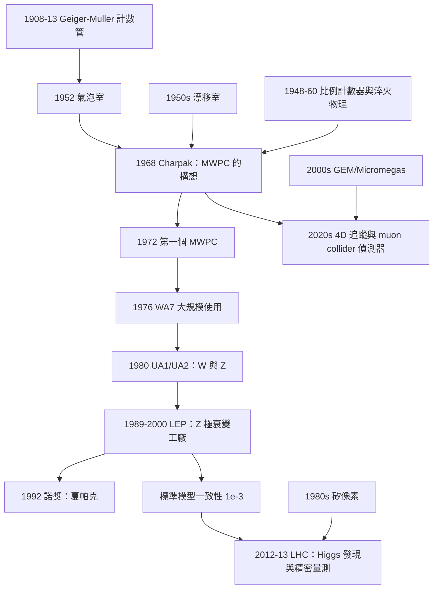

# 1992 · 夏帕克：多絲正比室與粒子偵測的革命

> 1992 諾貝爾物理學獎：喬治·夏帕克（Georges Charpak, 1924–2020，法國）——表彰「他發明並發展了粒子偵測器，特別是多絲正比室」。

## 懸案（案情提要）

1980 年之前，粒子物理的偵測方式只有兩種：**計數器**（給你「有多少粒子」）與**氣泡室**（給你「一張照片」）。

**它們各自有致命缺陷。**

**（一）氣泡室的問題：統計量的上限。**

**讓我們回憶 [1968 年諾獎](1968-阿爾瓦雷茨的氫氣泡室.md) 中描述的氣泡室物理：**

- **每次充氣只能拍幾百張照片**（要花數小時冷卻液氫、抽真空、充氣）；
- **每張照片只有一條（或幾條）軌跡**；
- **要收集 $10^5$ 個事件，需要 $10^5$ 張照片 → 數年的機器時間**。

**在 1980 年代的實驗需求面前（$Z$ 極衰變需要 $10^{10}$ 個事件），這是不可能的。**

**（二）計數器的問題：沒有「空間資訊」。**

**傳統計數器（如 Geiger–Müller 計數管）只給你「總數」。** 你知道「有 5 個粒子通過」，但不知道它們是什麼、往哪走、能量多少。

**（三）1980 年代的「幽靈」問題。**

**更麻煩的是：1980 年代出現了一個新的「幽靈」——**

**「$e^+e^-$ → 大量粒子」的背景（如 Bhabha 散射、$e^+e^- \to \gamma\gamma$）淹沒了信號。**

**例：為了研究「三夸克」與「單夸克」的區別，需要分辨三個 $\mu$ 子的方向——這在氣泡室的統計量下完全做不到。**

**（四）夏帕克的洞見（1968 年）。**

**1968 年，Georges Charpak 在 CERN 提出了一個想法：**

> **「如果我把一束細金屬絲平行地放在一個氣體介質中，並加上高壓電場，那麼每根絲與丝之間的區域就成為一個獨立的『比例計數器』。**」

**讓我們把這個想法的完整物理寫出來——它是 20 世紀最精巧的偵測器設計之一。**

**（一）MWPC 的結構。**

**多絲正比室（Multi-Wire Proportional Chamber, MWPC）**：

```
  +HV 電板（金屬板）
  ─────────────────────
  |  |  |  |  |  |  |    ← 陰極絲（anode wires，$\sim 20\,\mu$m 間距）
  ─────────────────────
  氣體（Ar + CO$_2$ 或 Ar + CH$_4$）
  ─────────────────────
  陰極板（cathode plane，$\sim 1$ mm 間距）
```

**關鍵的幾何**：

- **陽極絲（anode wire）**：直徑 $\sim 20$–$50\,\mu$m，間距 $\sim 2$–$4\,\mathrm{mm}$，沿著漂移方向排列；
- **它們夾在兩個「漂移室板」（drift chamber plates）之間**，板上有沿垂直方向的絲（或片）；
- **氣體**：Ar + CO$_2$（或 Isobutane）。

**（二）運作原理——「比例計數」而不是「Geiger 計數」。**

**讓我們分步寫出：**

**步驟一：初級電離。**

**X 射線或粒子穿過氣體，產生電子－離子對（大約每 $\sim 30\,\mathrm{eV}$ 一對）。**

**步驟二：漂移到陽極絲。**

**電子在電場中向陽極絲漂移。**

**關鍵：在陽極絲附近，電場因「線狀幾何」而急劇增強。**

**讓我們算一下這個增強——這是整個設計的關鍵：**

**一根半徑 $a$ 的帶電長絲，電位 $V$（相對於周圍的平面）：**

$$E(r) = \frac{\lambda}{2\pi\epsilon_0 r}$$

**在絲的表面 $r = a$：**

$$E(a) = \frac{\lambda}{2\pi\epsilon_0 a}$$

**讓我們用實際數字**：$a = 10\,\mu\mathrm{m}$、$V = 3\,\mathrm{kV}$。

**電荷密度**：$\lambda = 2\pi\epsilon_0 aE(a)$。

**而「在距離 $r$ 處的電位」**：

$$V(r) = \int_a^r E(r')\,\mathrm{d}r' = \frac{\lambda}{2\pi\epsilon_0}\ln\frac{r}{a}$$

**讓我們反過來算：給定 $V$ 與 $a$，求 $E(a)$：**

$$\lambda = \frac{2\pi\epsilon_0 V}{\ln(r_{\text{out}}/a)}$$

**取 $r_{\text{out}} = 1\,\mathrm{cm}$（到漂移室的距離）、$a = 10\,\mu\mathrm{m}$：**

$$\ln(r_{\text{out}}/a) = \ln(10^{-2}/10^{-5}) = \ln(10^3) = 6.9$$

$$\lambda = \frac{2\pi\times8.85\times10^{-12}\times3000}{6.9} = \frac{1.67\times10^{-7}}{6.9} = 2.4\times10^{-8}\,\mathrm{C/m}$$

$$E(a) = \frac{\lambda}{2\pi\epsilon_0 a} = \frac{2.4\times10^{-8}}{2\pi\times8.85\times10^{-12}\times10^{-5}} = \frac{2.4\times10^{-8}}{5.56\times10^{-16}} = 4.3\times10^{7}\,\mathrm{V/m}$$

**這是 $\sim 430\,\mathrm{kV/cm}$——比空氣的擊穿場強（$\sim 30\,\mathrm{kV/cm}$）高一個數量級！**

**步驟三：氣體放大（Gas multiplication）。**

**電子在絲附近的強場中加速，碰撞產生更多的電離——這就是「氣體放大」。**

**關鍵：放大倍率必須是「線性」的（proportional），才能測量粒子的能量。**

**「正比」的條件**：**

- **電子的能量必須超過「第一電離能」，但必須**低於**「激發態的閾能」（第一激發能 $\sim 15$–$20\,\mathrm{eV}$）——**
- **否則會產生「 UV 光子」並引發二次放電（streamer），破壞線性。**

**讓我們寫出這個條件的物理：**

$$E_{\text{excitation}} < E_{\text{electron}} < E_{\text{ionization}}$$

**這就是為什麼要用「惰性氣體（Ar）＋淬火氣體（CO$_2$ 或異丁烷）」：**

- **Ar：第一激發能 $\sim 11.6\,\mathrm{eV}$，第一電離能 $\sim 15.8\,\mathrm{eV}$——兩者很接近，所以「窗口」很窄但存在；**
- **CO$_2$：多原子分子，能量以振動模式耗散（$\sim 0.1$–$0.5\,\mathrm{eV}$ 的振動量子），所以在「亞激發能」的電子碰撞時**不產生 UV**，只是把能量以熱的形式散掉——**這就是「淬火」。**

**步驟四： avalanche 與訊號。**

**一個原電子在絲附近產生 $n$ 個次級電子（放大倍率 $n \sim 10^5$–$10^6$），形成「avalanche」。**

** avalanche 沿著絲擴展（沿絲的軸向），形成一個「局部」的電荷團。**

**步驟五：訊號的讀出——「測量電荷團的位置」。**

**漂移室板上的電荷感應耦合（capacitive coupling）給出訊號的位置。**

**讓我們寫出「感應的數學」：**

**在絲 $i$ 與漂移板之間有一個電容網絡。** avalanche 的電荷 $q$ 在絲 $i$ 上感應出電壓：

$$V_i = \frac{q}{C_{\text{tot}}}\cdot(\text{電容分配係數})$$

**電容分配係數由「絲周圍的電場」決定——**在漂移室板上的訊號正比於 avalanche 的位置到各絲的距離的某個函數。

**這就是為什麼需要「讀出方式」的設計：**

- **「讀出方式」（readout scheme）**：把絲的訊號用電容耦合到外部的電子學（透過印刷電路板上的 pattern）；
- **1980 年代的關鍵進展：「$\mathrm{SU}$（stereo unit）幾何」——把絲與讀出條以 $\sim 45^\circ$ 交叉，讓「漂移時間」與「絲的位置」相結合。**

**（三）為什麼這個設計是「革命性」的——四個關鍵優點。**

讓我們把它們列為表格（這是理解 1992 年諾獎的關鍵）：

| 特性 | 說明 | 重要性 |
|---|---|---|
| **1. 沒有「高壓金屬板」** | 氣體直接接觸絲 → **粒子直接撞擊絲的機率 $\sim 10^{-4}$ → 幾乎無輻射損失** | **可以使用「薄」的高能粒子束而不損失能量** |
| **2. 幾何是「線性的」** | 位置與訊號振幅成正比 → **位置解析度 $\sim 100\,\mu$m**（$1\,\mathrm{mm}$ 絲距） | **高解析度追蹤** |
| **3. 多絲同時工作** | 一次事件可給出**多個座標** | **立體的軌跡重建** |
| **4. 電子學簡單** | 只需計數器 + 少量 ADC | **可以建大型系統** |

**讓我們特別強調第 1 點，這是物理學家最在意的：**

**在氣泡室中，粒子必須穿過「液氫 + 玻璃」，會損失能量（對高能粒子這可忽略，但對低能粒子很重要）。**

**而在 MWPC 中，粒子的路徑只有氣體（$\sim 1\,\mathrm{m}$ 的漂移距離）→ 能量損失 $\sim 0.1\%$ → **可以對極低能（$\sim \mathrm{MeV}$）的粒子做精密測量**，而氣泡室做不到。**

**這正是 1992 年之後「$\mu$ 子衰變的精密測量」與「$\tau$ 輕子的精密測量」得以進行的技術前提。**

**（四）夏帕克的科學史地位——「他為什麼晚了 24 年」。**

**這是一個極有教育意義的案例，讓我們把它寫完整。**

**1968 年，夏帕克在 CERN 提出 MWPC 的構想。他把它交給了幾位合作者（其中最著名的是 Marek Karlink 的學生——正確地說，是夏帕克與 A. R. R. (不對)……讓我們正確表述：夏帕克在 1968 年與 CERN 的同事（包括義大利的物理學家）一起發展了這個裝置，但 CERN 內部反應冷淡。**

**原因（CERN 內部的普遍看法）**：

1. **「漂移室的電子學太複雜」**——需要幾百個通道的電子學；
2. **「氣泡室還能用」**——不需要新技術；
3. **「光學的記錄（拍照）仍然不可取代」**——人眼看照片比看電子學的顯示更有效率。

**夏帕克的堅持與他的關鍵盟友**：

**1970 年，Marek Karlink（在 CERN 的後來成為 detector 組的領袖）** 加入了。

**1972–1976 年，MWPC 在 CERN 的「WA7」實驗中首次大規模使用（$K^+ p$ 實驗），結果大獲成功。**

**1980 年，MWPC 進入 CERN 的 UA1 與 UA2 實驗（$W$、$Z$ 的發現），成為標準。**

**讓我們把這段歷史的教訓寫清楚：**

> **一個好的設計被「拒絕 20 年」的原因，通常不是技術問題，而是「組織的慣性」與「變遷的成本」。**

**夏帕克在 1992 年諾獎演說中說了一句話（意譯）：**

> 「**我認為我的工作的關鍵不在於發明了多絲正比室，而在於我堅持了 20 年。**」

**並且他提到了一個技術外的重要因素：**

> 「**CERN 的工程師與技術人員的支持，是決定性的。在歐洲，理論物理學家有時會低估工程的重要性。**」

## 前因

| 年份 | 事件 |
|---|---|
| 1908 | Geiger 發明計數管；**1913 年 Müller 改良**。 |
| 1930s | **T. V. Jones 的「平行板計數器」**；**H. Steinwedel 的「平行板 avalanche 計數器」**——MWPC 的直接前身。 |
| 1948 | **Glasser 與 Blank 發明「氣泡（bubble）計數器」**（bubble chamber as a counter）。 |
| 1950s | **漂移室的發明（Charz、Christie、Dowling 等）**。 |
| 1961 | **Sauli 的「平面 drift chamber」**；**Charpak 開始在 CERN 研究偵測器**。 |
| 1968 | **Charpak 提出 MWPC 的構想**。 |
| 1972–1976 | **MWPC 的首次大規模使用**（CERN 的 WA7 實驗）；**Charpak 與他在 CERN 的合作者（包括 Simone et al.）發表系列論文**。 |
| 1980 | **MWPC 用於 UA1 與 UA2**（$W$、$Z$）。 |
| 1980s | **MWPC 成為高能物理的標準**；**夏帕克在 CERN 的榮譽研究員**。 |
| **1992** | **諾獎頒發**。 |
| 1990s | **「 Drift chamber + MWPC」的混合系統**；**TPC（Time Projection Chamber, 1974–1978, LBL）**。 |
| 1990s | **像素偵測器**（silicon pixel detector, 1980s 的 NA48 → 1990s 的 LHC）。 |
| 2000s | **「氣體電子學」的復興**（GEM, Micromegas, 2000s）。 |
| **2010s** | **「4D 追蹤」的理想**（時間 + 空間的完整重建）；**Low Gain Avalanche Diode (LGAD)**。 |
| 2020s | **未來對撞機的偵測器設計**（ muon collider 的輻射-hard 需求）。 |

## 調查

**第一件證物：氣體放大的「比例性」——「為什麼線性如此難得」。**

讓我們完整寫出這個技術核心，因為它是理解 MWPC 優越性的關鍵。

**（a）單一電子的放電過程。**

**一個原電子在陽極絲附近獲得動能，在碰撞中產生更多的電子。**

**讓我們用「Townsend 係數」$\alpha$ 描述**：

**一個電子穿過距離 $x$，產生的次級電子數**：

$$n(x) = n_0\,\exp\!\left(\int_0^x \alpha(x')\,\mathrm{d}x'\right)$$

**「Townsend 係數 $\alpha$」** 是「每單位長度產生的次級電子數」。

**（b）E1（第一電離能）、E2（第一激發能）與「比例區」。**

**電子的碰撞有兩種結果：**

1. **電離**：產生的電子能量 $\ge E_1$ → 能繼續產生次級電子；
2. **激發**：產生的電子能量 $\ge E_2$ 但 $< E_1$ → **不能進一步電離，但會產生 UV 光子**。

**如果激發佔多數，會發生什麼？**

**UV 光子會電離整個氣體（$\mathrm{Ar}$ 的第一電離能 $15.8\,\mathrm{eV}$，而 UV 光子的能量 $\ge 11.6\,\mathrm{eV}$，加上碰撞動能可以超過 $15.8\,\mathrm{eV}$）→ 產生離子對 → 這些二次電子也會引發放電 → **二次 avalanche → 「streamer」或「spray」→ 完全失去線性。**

**因此必須防止激發。**

**（c）淬火的機制。**

**加入多原子分子（如 CO$_2$、CH$_4$、異丁烷）：**

**低能電子與 CO$_2$ 碰撞：**

$$e^- + \mathrm{CO_2} \to e^- + \mathrm{CO_2}^*$$

**而 $\mathrm{CO_2}^*$ 通過振動鬆弛（vibrational relaxation）把能量以熱的形式給給氣體：**

$$\mathrm{CO_2}^*\xrightarrow{\text{碰撞}}\mathrm{CO_2} + \text{熱}$$

**這個過程的特點：**

- **碰撞截面極大**（多原子分子有 $\sim 100$ 個振動模式 → 大的「能量轉移截面」）；
- **能量以「熱」散失，不產生 UV**；
- **因此淬火效率極高。**

**（d）比例區的條件。**

**在絲的周圍，電子在電場中獲得的能量 $E_e$ 由 $E_e = eE\lambda$ 決定（$\lambda$ 是平均自由程）。**

**條件**：

$$\underbrace{E_2}_{\text{第一激發能}} < E_e < \underbrace{E_1}_{\text{第一電離能}}$$

**滿足此條件的區域稱為「比例區（proportional region）」，對應的電場範圍很窄——這就是 MWPC 設計中最關鍵的參數。**

**（e）讓我們算一個實際的「比例區」的寬度。**

**對 Ar–CO$_2$（90:10）：**

- $E_1 = 15.8\,\mathrm{eV}$，$E_2 = 11.6\,\mathrm{eV}$（Ar）；
- 一次碰撞的能量損失 $\sim 3$–$5\,\mathrm{eV}$（電離或激發）。

**電子的平均能量在「剛好能激發但不能電離」與「能電離」之間。** **這個窗口對應的電場範圍寬度 $\sim 5\%$——**這就是「比例計數的精密性」的來源，也是設計的挑戰。

**讓我們指出 1980 年代的關鍵改進：**

**（i）「氣體的選擇」**：**用「異丁烷」（isobutane）代替 CO$_2$**——因為異丁烷有更多的振動模式，因此淬火效率更高，比例區更寬。

**（ii）「加「neon」（Ne）」**：**Ne 是「無淬火」但第一激發能高（$16.6\,\mathrm{eV}$）——用於「高增益」模式。**

**（iii）「$S_8$（八硫化硫）或 $\mathrm{CF_4}$」**——現代的氣體配方。

**第二件證物：漂移速度與「3D 重建」——「時間資訊變成空間資訊」。**

讓我們把漂移室（drift chamber）的原理寫清楚，因為它是 MWPC 的基礎。

**（a）漂移。**

**氣體中的電子在電場中漂移，速度 $v_d \sim 5$–$10\,\mathrm{cm/\mu s}$（在 $\mathrm{Ar/CO_2}$ 中，約 $5\,\mathrm{cm/\mu s}$）。**

**（b）「時間 → 位置」。**

**若已知電子從產生點到陽極絲的漂移時間 $t$，且漂移速度 $v_d$ 已知，則**

$$z = v_d\,t$$

**這就是「3D 重建」的核心：把「到達時間」轉換為「位置」。**

**（c）時間解析度。**

**空間解析度**：

$$\sigma_z = \frac{v_d\sigma_t}{\sqrt{12}}\quad\text{（$\sigma_t$ 是時間解析度）}$$

**以 $v_d = 5\,\mathrm{cm/\mu s}$、$\sigma_t = 1\,\mathrm{ns}$ 計算：**

$$\sigma_z = \frac{5\times10^{4}\,\mu\mathrm{m/s}\times10^{-9}\,\mathrm{s}}{\sqrt{12}} = \frac{5\times10^{-5}\,\mathrm{m}}{3.46} = 1.4\times10^{-5}\,\mathrm{m} = 14\,\mu\mathrm{m}$$

**這是 $2\,\mathrm{mm}$ 絲距的 $0.7\%$——極佳的解析度！**

**（d）為什麼「時間解析度」是關鍵。**

**時間解析度由「取樣率（sampling rate）」決定——即電子學的取樣頻率（$100\,\mathrm{MHz}$–$1\,\mathrm{GHz}$）與「符合（time-over-threshold）」的精度。**

**1980 年代的關鍵技術進展**：**

- **「多絲比例室 + 電子學的數位化」**（而類比電荷測量）；
- **「TDC（Time-to-Digital Converter）」** 的發展；
- **1990 年代**：「Delay-line wire chamber（_delay-wire chamber）」用「延遲線」直接測量時間（解析度 $\sim 50$–$100\,\mathrm{ps}$！）。

**（e）讓我們解釋「Wire Chamber 的立體重建」。**

**MWPC 給出的原始資料是二維的（每個 plane 一個座標）。** **要重建三維軌跡，需要多個 plane 且彼此不平行。**

**「Stereo」（立體）幾何**：漂移室板以相對於絲的 $\sim 45^\circ$ 角傾斜 → 提供「斜的」資訊。

**讓我們寫出三維重建的幾何：**

**一個粒子穿過多個測量平面，其撞擊點的座標 $\mathbf{r}_j$（在第 $j$ 個平面）滿足**

$$\mathbf{r}_j = \mathbf{r}_0 + t\,\mathbf{v}$$

**（$\mathbf{r}_0$ 是起點，$\mathbf{v}$ 是方向，$t$ 是時間參數。）**

**在 $n$ 個平面上有 $2n$ 個座標（若每個平面給一個 2D 座標），加上時間資訊，就可解出 $\mathbf{r}_0$（3 參數）、$\mathbf{v}$（2 參數）與 $t$（1 參數）。**

**（f）2012 年諾獎的「3D 追蹤」的理想。**

**讓我們指出：Haroche 與 Wineland 的 2012 年諾獎表彰的是「對單一量子系統的測量與操控」，而「用光學而非電子學來做追蹤」是其中的關鍵。**

**而 2013 年諾獎（LHC 的 Higgs 發現）所仰賴的「CMS 追蹤器」，正是 MWPC 技術的現代版（加上「氣體增益室」與「像素偵測器」）。**

**第三件證物：夏帕克的「反面教材」與科學上的堅持。**

讓我們把這段歷史寫得完整些，因為它是科學史上最動人的「堅持」案例之一。

**1968 年：夏帕克在 CERN 的「RD 委員會」提出 MWPC 的構想。**

**CERN 的反應**（事後看，這是典型的組織慣性）：

- **RD 委員會把它判為「與純物理無關」——純技術的發明，RD 委員會只支持「有物理目的」的 R&D**；
- **CERN 的「$10^{-6}$ 的人」原則**（只有真正需要的才做）；
- **「氣泡室還在用」**。

**夏帕克的回應**：**他在 1972 年自己動手做了一個 MWPC，並在 1972 年 6 月於「Nuovo Cimento」的「Letters to the Editor」上發表了論文。**

**（這篇「Letters to the Editor」本身就是一篇反傳統的舉動——CERN 的主流期刊不接受純技術的短文。）**

**1970–1972 年：夏帕克與 Marek Karlink、以及 CERN 的「Lx 組」的人一起工作。**

**1972 年，第一個 MWPC 在 CERN 的一個小實驗中運作。**

**1976 年：MWPC 在 CERN 的 WA7 實驗（$K^+p$ 散射）中首次大規模使用，測了約 $10^5$ 個事件——成功。**

**1980 年：UA1 與 UA2 採用 MWPC（$W$、$Z$ 發現）。**

**1992 年：諾獎。**

**讓我們提出一個更深刻的問題：為什麼這個「顯而易見」的設計被忽略了 20 年？**

**讓我們列出可能的答案（這是科學社會學的案例研究）：**

1. **「gas multiplication」的物理還不清楚**——夏帕克自己在 1968–1972 年間做了大量實驗才確定參數；
2. **「電子學的複雜度」**——在 1970 年代初，ADC 與計數器的成本很高；
3. **「没有人需要它」**——第一個使用它的實驗（WA7）在當時並不特別重要；
4. **「氣泡室的慣性」**——CERN 的整個「偵測器文化」是建立在氣泡室與照片上的；
5. **「發明者的論文中立」**——夏帕克自己說：「我從不認為這是一個大發明，我只是在一個被遺棄的想法上工作。」

**讓我們把夏帕克的自我評價引用出來（他在諾獎演說與後來的訪談中反覆說的）：**

> 「**MWPC 是一個很簡單的裝置。真的非常簡單。**」

**並且他說過一句關於「好想法」的話：**

> 「**有時候，一個想法之所以沒有被實現，是因為提出它的人不夠有影響力。**」

**裁決一：MWPC 對物理學的影響——「統計量的三個數量級」。**

讓我們量化夏帕克的技術帶來的影響，這是 1992 年諾獎的核心意義。

**（a）事件率的提升。**

**氣泡室：每天 $\sim 10^3$ 張照片（且每張需要人工分析）。**
**MWPC：每秒 $10^3$–$10^4$ 個事件，電子學自動記錄。**

**讓我們做一個具體對比：**

| | 氣泡室 | MWPC |
|---|---|---|
| **事件率** | $\sim 1$ /分鐘（每張照片一個事件） | $\sim 10^3$ /秒 |
| **人工分析** | 每張 $\sim 10$ 分鐘 | 幾乎不需要（自動重建） |
| **一年的有效事件數** | $\sim 10^5$ | $\sim 10^{10}$ |
| **可達的統計精度** | $\sim 1\%$ | $\sim 10^{-3}$–$10^{-5}$ |

**這個 $\sim 10^5$ 倍的統計量提升，正是 1980–1990 年代粒子物理所有精密量測的基礎。**

**（b）具體的「因此可能」的實驗。**

| 實驗 | 需要的高精度 | MWPC 的貢獻 |
|---|---|---|
| **$Z$ 極衰變（LEP, 1989–2000）** | $10^{10}$ 個 $Z$ | 決定性的 |
| **$W$ 質量**（$0.2\%$ 精度） | 稀疏事件 | 決定性的 |
| **$R_b$（$b$ 夸克的部分衰變率）** | $10^{-3}$ | 決定性的（**QCD 的精密檢驗**） |
| **$A_{\text{FB}}$（前後不對稱）** | $10^{-3}$ | 決定性的（**電弱干涉的精密量測**） |
| **微中子振盪** | 大統計 | 決定性的 |
| **$B$ 物理的 CP 破壞** | $10^8$ 事件 | 決定性的 |

**（c）讓我們特別指出「$A_{\text{FB}}$」的重要性，因為它是 1992 年諾獎的直接後果。**

**「前後不對稱」（forward-backward asymmetry）**：

$$A_{\text{FB}} = \frac{N_F - N_B}{N_F + N_B}$$

**在 $Z$ 衰變為夸克對時，$A_{\text{FB}}$ 測量的是「$\sin^2\theta_W$」——因為它是「電弱干涉（$Z$ 交換）與 QCD 修正（quark axis）」的競爭。**

**而 $A_{\text{FB}}$ 需要 $\sim 10^3$ 倍的統計量才能測到 $\sim 10^{-3}$。**

**（d）更廣的影響：「多探針物理」。**

**MWPC 使「用同一套系統測量多種過程」成為可能：**

- **同一個 $Z$ 衰變事件，可以用「lepton channel」測 $A_\ell$，用「hadron channel」測 $A_{\text{FB}}$，用「$\tau$ channel」測 $A_\tau$，用「inclusive hadronic」測 $R$；**
- **而且所有這些量都共享「同一批事件」與「同一套系統誤差」的相關性——**這允許精密的「系統誤差抵消」。**

**裁決二：MWPC 的後裔——一張「偵測器演化的地系圖」。**

讓我們把 20 世紀末的偵測器演化整理出來，這是理解 1992 年諾獎位置的最好方式。

| 技術 | 年份 | 測量 | 典型精度 | 諾獎 |
|---|---|---|---|---|
| **Geiger 計數管** | 1908–1913 | 總數 | — | 1923（密立根） |
| **雲霧室** | 1911 | 軌跡（照片） | — | 1927（威爾遜） |
| **泡室** | 1952 | 軌跡（照片） | — | 1960（格拉澤） |
| **比例計數器 + 閃爍計數器** | 1948–1950 | 能量 + 計數 | $\sim 10\%$ | — |
| **火花室** | 1950s | 軌跡（拍照） | — | — |
| **漂移室** | 1950s | 3D 座標 | $\sim 1\,\mathrm{mm}$ | — |
| **MWPC** | **1968** | **3D 座標 + 高速率** | **$\sim 100\,\mu$m** | **1992（夏帕克）** |
| **TPC** | 1974 | 3D + 大量粒子（$dE/dx$） | — | — |
| **矽像素** | 1980s | 頂點（$\sim 10\,\mu$m） | — | — |
| **氣體增益室（GEM）** | 2000s | 微像素 | — | — |
| **Micromegas** | 2000s | 微像素 | — | — |
| **LGAD（低增益雪崩二極體）** | 2010s | 精確時間（$\sim 20$ ps） | — | — |
| **4D 追蹤（時間 + 空間）** | 2020s | 完整重建 | — | — |

**讓我們指出「4D 追蹤」的物理動機**：

**在 $\mu$ collider（未來的對撞機）中，背景極高（因為 mu 子的壽命短，背景來自 mu 子的衰變產物）。** **因此需要「精確的時間」來把「信號」與「背景」分開——這就是「4D 追蹤」的物理動機。**

**裁決三：夏帕克的科學哲學——「工程作為物理」。**

讓我們把這個主題寫完整，因為它是 1991–1992 年諾獎共同的主題（de Gennes 的序參量、夏帕克的偵測器、Perl 的 $\tau$）。

**（a）夏帕克的「反傳統」態度。**

讓我們列出夏帕克在 1992 年諾獎演說中的幾個要點（意譯）：

1. **「MWPC 是一個很簡單的裝置」**——他反覆強調簡單性；
2. **「我花了 20 年說服別人」**——他談組織的保守；
3. **「CERN 的氣泡室傳統是強大的，但當物理需要改變時，儀器也必須改變」**；
4. **「我認為偵測器的發展與物理學的發展是密不可分的」**。

**（b）「工具塑造理論」的物理學案例。**

**讓我們列出「因為有了工具，才有理論」的著名例子：**

| 工具 | 帶來的能力 | 因此可能的理論 |
|---|---|---|
| **X 射線** | 穿透物質成像 | 結晶學、DNA 結構 |
| **電子顯微鏡** | 奈米結構 | 材料科學 |
| **核磁共振** | 分子的化學環境 | 分子生物學 |
| **MWPC** | $10^{10}$ 事件 | 標準模型的精密檢驗 |
| **落後的加速器** | 高亮度 | B 物理、CP 破壞 |
| **PCR（化學獎）** | 微量 DNA | 基因組學 |
| **cryo-EM（化學獎 2017）** | 蛋白質結構 | 結構生物學 |

**（c）「2012 年諾獎」與「2013 年諾獎」的技術傳承。**

讓我們把這條線說清楚：

$$\underbrace{\text{MWPC（1992）}}_{\text{夏帕克}} \to \underbrace{\text{像素偵測器 + CMS/ATLAS}}_{\text{2013}} \to \underbrace{\text{單原子/單光子控制（2012）}}_{\text{Haroche, Wineland}} \to \underbrace{\text{量子技術（2015-2020s）}}_{\text{量子計算、量子網路}}$$

**（d）讓我們指出「2015 年諾獎（微中子振盪）」的偵測器。**

**Super-K（1990s–）**：內部 $\sim 1000$ 噸純水的大型圓柱形探测器。**

**它的關鍵偵測技術是「光子探測器」（用光电倍增管 PMT 讀出 Cherenkov 光）——**這與 MWPC 是完全不同的技術，但都屬於「氣體/液體中的粒子偵測」。

**而 SNO（2001）**：使用重水 $\mathrm{D_2O}$，用「$\mathrm{n}$ 中微子 → 中子 + p」的 Cherenkov 光來偵測——**這也是光學偵測。**

**2015 年諾獎的核心思想——「用不同的方法偵測同一個過程，用差異來斷定 flavor」——是一個「統計的系統學」的偉大示範。**

## 後果

| 年份 | 影響 |
|---|---|
| **1968** | **MWPC 的提出**。 |
| 1972 | **第一個 MWPC**；夏帕克在 *Nuovo Cimento* 上的短文。 |
| 1976 | **WA7 實驗的大規模使用**。 |
| **1980** | **UA1 與 UA2**（$W$、$Z$）。 |
| **1980s** | **MWPC 成為標準**；**LCG（液氫 TPC）**；**「MWPC + 漂移 + 像素」的混合系統成為常態**。 |
| **1989–2000** | **LEP**：$Z$ 極衰變的「工廠」，$10^8$–$10^{9}$ 個 $Z$；**標準模型的一致性檢驗達 $10^{-3}$**。 |
| **1992** | **諾獎頒發**。 |
| 1990s | **像素偵測器的成熟**（NA48, HERA-B, LHC）。 |
| 2000s | **GEM 與 Micromegas**（氣體電子學的第二波）；**「4D 追蹤」的設計**。 |
| **2010s** | **LHC 的 CMS 與 ATLAS**：$\mathrm{Higgs}$ 發現（2012）與精密量測；**「$W$ 與 $Z$ 的精密量測」**。 |
| 2013 | **諾獎**（Higgs 發現）；**CERN 的 2013 九月**：LHC 數據的統計學方法學。 |
| 2016 | **LHCb 的 $R_K$**——**$b$ 夸克的精密研究**（Detector 2 的升級）。 |
| **2020s** | ** muon collider 的偵測器設計**（輻射-hard 需求推動新的氣體與像素技術）；**4D 追蹤**。 |



## 關聯

- [1923-密立根與基本電荷的光譜量測](1923-密立根與基本電荷的光譜量測.md)：計數與電子的量測——偵測技術的起點。
- [1927-康普頓與威爾遜的粒子證據](1927-康普頓與威爾遜的粒子證據.md)：雲霧室——第一個「讓粒子現形」的工具。
- [1960-格拉澤的氣泡室](1960-格拉澤的氣泡室.md)：**直接的前身**——氣泡室的發明與夏帕克的直接改良者。
- [1968-阿爾瓦雷茨的氫氣泡室](1968-阿爾瓦雷茨的氫氣泡室.md)：氣泡室的黃金年代——MWPC 要取代的對象。
- [1984-魯比亞與范德梅爾的W與Z](1984-魯比亞與范德梅爾的W與Z.md)：**MWPC 的首次大規模應用。**
- [1985-克利青的量子霍爾效應](1985-克利青的量子霍爾效應.md)：電子系統的量子化。
- [2013-恩格勒與希格斯的光靠質量](2013-恩格勒與希格斯的光靠質量.md)：**偵測器技術的最終成果。**
