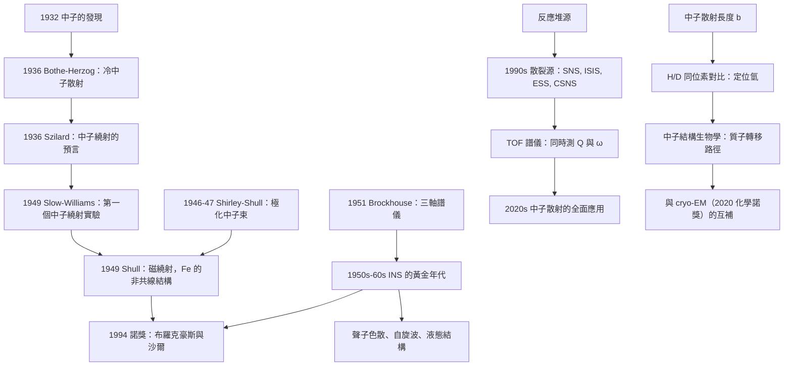

# 1994 · 布羅克豪斯與沙爾：中子散射的雙探針

> 1994 諾貝爾物理學獎：伯特倫·布羅克豪斯（Bertram N. Brockhouse, 1918–2007，加拿大）與克利福德·格利芬·沙爾（Clifford G. Shull, 1916–2000，美國）——表彰「他們對中子散射技術的開發：沙爾的中子繞射與布羅克豪斯的中子光譜學」。

## 懸案（案情提要）

1994 年的諾獎表彰了**同一種探針的兩種用法**——中子散射。

**但為什麼要用「中子」來探測物質？為什麼不用 X 射線？**

**讓我們把這個問題回答清楚，因為它是理解整個 1994 年諾獎的關鍵。**

**（一）X 射線的侷限。**

**X 射線散射的強度由電子雲的**傅立葉變換**決定（見 [1914 年諾獎](1914-勞厄與晶體中的X射線繞射.md)）：**

$$I(\mathbf{Q}) \propto \left|F(\mathbf{Q})\right|^2,\qquad F(\mathbf{Q}) = \int \rho(\mathbf{r})e^{-i\mathbf{Q}\cdot\mathbf{r}}\,\mathrm{d}^3r$$

**所以 X 射線「看到」的是**電子密度** $\rho(\mathbf{r})$。**

**這造成三個重大的限制：**

**（1）輕元素幾乎看不見。**

**X 射線散射截面隨原子序 $Z$ 增加（$F \propto Z$）。因此：**

| 元素 | 相對散射能力 |
|---|---|
| **H** | **1** |
| C | 6 |
| N | 7 |
| O | 8 |
| Fe | 26 |
| Pb | 82 |

**讓我們把它說得更尖銳：在有機分子中，氫原子（數目最多，往往佔原子數的一半以上）幾乎不散射 X 射線。**

**所以用 X 射線定氫的位置非常困難。**

**（2）無法區分「化學鍵」與「電子分佈」。**

**X 射線看到的是總電子密度，因此無法直接辨認化學鍵的類型。**

**（3）無法穿透厚樣品、不能在極端條件下工作。**

**（二）中子的獨特性質。**

**中子被發現（1932，查德威克，1935 年諾獎）之後，人們很快發現它是「理想的物質探針」，因為它同時具有：**

| 性質 | 效果 |
|---|---|
| **電中性** | **不被電子雲散射 → 直接「看到」原子核** |
| **與原子核有強烈的散射** | 散射長度 $\ b$ 與核的種類無關系統性地變化 |
| **德布羅意波長 $\lambda = h/(m_nv)$ 可調** | 從 $\sim 1\,\mathrm{\mathring{A}}$（慢中子）到 $\sim 0.01\,\mathrm{\mathring{A}}$（快中子）——**可掃描不同的結構尺度** |
| **有自旋 $\tfrac{1}{2}$** | 可用「極化」測量磁結構 |
| **有磁矩** | **與電子磁矩（unpaired electrons）與核磁矩耦合** |

**（三）散射長度——「中子的指紋」。**

**這是中子散射最核心的資訊來源。讓我們把它寫清楚。**

**中子與原子核的散射由核的「散射長度」$b$ 描述：**

$$\frac{\mathrm{d}\sigma}{\mathrm{d}\Omega} = 4\pi b^2$$

**而 $b$ 對每個同位素是唯一的：**

| 核 | $b$（fm） | 相干散射截面 $\sigma_c = 4\pi b^2$（barn） |
|---|---|---|
| **H** | **−3.74** | **1.76** |
| **D（氘）** | **+6.67** | **5.59** |
| **C** | +4.77 | 2.86 |
| **O** | +5.80 | 4.23 |
| **Fe** | +9.45 | 11.22 |
| **Mn（天然）** | **−3.73** | **0.55** |
| Ni（天然） | −1.91 | 0.46 |
| **$^{60}\mathrm{Co}$**（熱中子吸收實驗的經典） | **−2.5** | 0.78 |
| **$^{157}\mathrm{Gd}$** | **+7.80（\(|b| = 7.8$）** | **76**（巨大！） |

**讓我們指出這張表的三個驚人之處：**

**（1）H 的散射長度是負的（$-3.74$ fm）。**

**負的 $b$ 意味著「H 的散射是「相位相反」的」——**這對「中子結構因子」的解讀有重要影響：

$$F(\mathbf{Q}) = \sum_j b_j e^{i\mathbf{Q}\cdot\mathbf{r}_j}$$

**由於 H 的 $b < 0$ 與其他原子相反，** **有時 H 的貢獻會「抵銷」其他原子的貢獻。**

**（2）D 的散射長度是 H 的 $-1.79$ 倍（+6.67 vs $-3.74$）。**

**這是「中子衍射的同位素對比（isotope contrast）」的物理基礎：**

**把 H 換成 D，散射強度會有系統性的改變，而位置不變。**

**讓我們說明它的威力：**

$$\text{用 H 的資料與 D 的資料做差，就能直接「定位」氫的位置！}$$

**這在化學結構、生物學（DNA 的氫鍵）中極其重要。**

**（3）Gd 的散射截面巨大（76 barn）。**

**Gd 是「中子散射的鎘」——用來做「中子吸收層」（如反應堆的控制棒），也用於「中子成像」的對比劑（MRI 的釓造影劑）。**

**（四）磁矩——「中子可以看見磁性」。**

**中子的磁矩 $\mu_n = -1.91\,\mu_N$（$\mu_N$ 為核磁子）——**

**中子的磁性相互作用能量**：

$$V_m = -\boldsymbol{\mu}_n\cdot\mathbf{B}$$

**而 $\mathbf{B}$ 來自原子的電子磁矩（磁散射）或核磁矩（核磁性散射）。**

**讓我們寫出磁散射的結構因子：**

$$F_{\text{mag}}(\mathbf{Q}) \perp \mathbf{Q}:\qquad F_{\text{mag}}(\mathbf{Q}) = \frac{e^2}{2mc^2}\left[\mathbf{Q}\times\left(\mathbf{Q}\times\boldsymbol{\mu}_\perp\right)\right]$$

**其中 $\boldsymbol{\mu}_\perp$ 是垂直於 $\mathbf{Q}$ 的磁矩分量。**

**這個公式中的「$\perp \mathbf{Q}$」是關鍵**：**磁散射只探測垂直於 $\mathbf{Q}$ 的磁矩分量**——這提供了一個「方向選擇性」的探測。**

**（五）1994 年諾獎的兩個「互補的探針」。**

**讓我們把諾獎的兩半並列，這是理解它的最佳方式：**

| | **沙爾：中子繞射** | **布羅克豪斯：中子光譜學** |
|---|---|---|
| **測什麼** | **結構**（原子位置） | **動力學**（振動、擴散、自旋波） |
| **物理量** | $F(\mathbf{Q})$ | $S(\mathbf{Q},\omega)$ |
| **類比** | **X 射線繞射** | **拉曼光譜** |
| **能量分辨** | 無（彈性） | **有**（非彈性） |
| **能給出什麼** | 晶體結構、磁結構 | **聲子色散、自旋波、多重態分裂** |
| **對應的物理問題** | 「原子在哪裡」 | **「原子怎麼動」** |

**讓我們用一個精確的對照表說明「結構」與「動力學」的區別：**

**（i）彈性散射（結構）**：

$$\frac{\mathrm{d}^2\sigma}{\mathrm{d}\Omega\,\mathrm{d}E'} = \frac{k_f}{k_i}\,b^2\int \mathrm{d}t\,e^{i\omega t}\langle \rho_{\mathbf{Q}}(0)\rho_{\mathbf{Q}}(t)\rangle\quad(\text{中子，弹性})$$

**（ii）非彈性散射（動力學）**：同上，但 $\omega \ne 0$。

**關鍵：非彈性散射給出「結構因子」$S(\mathbf{Q},\omega)$，它直接測量「晶格振動」的色散關係。**

$$\hbar\omega(\mathbf{Q}) \quad\text{vs}\quad \mathbf{Q}$$

**讓我們把這個物理寫清楚：**

**在晶格中，每個聲子模式 $\mathbf{Q}$ 有一個頻率 $\omega(\mathbf{Q})$。** **聲子色散關係 $\omega(\mathbf{Q})$ 蘊含了材料的彈性常數、力常數、甚至超導的配對機構。**

**（六）沙爾的「磁繞射」——「看見磁性」。**

**讓我們把 1949 年沙爾在 Oak Ridge 的實驗完整寫出，因為這是 1994 年諾獎中最戲劇性的一段。**

**背景（1949 年）：** 磁性結構的測定只能用 X 射線，但 **X 射線的磁散射很弱**（電子磁矩與光子磁矩的耦合太小）。

**而中子的磁散射很強**（中子磁矩直接與電子磁矩耦合）。

**問題：需要「極化」的中子束。**

**沙爾的技術（1947–1949）：**

**「Shull–Shirley 型磁分析器」** 或更簡單的：**把中子束通過一個「磁鐵」使它偏轉，從而得到極化的中子束。**

**（更後來：**Shirley 與（G.）Shull 在 1946 年的「極化中子束」技術：用「磁反射」鏡（magnetic reflection）產生高極化度的中子束——**這是「自旋極化中子散射」的技術基礎。**）

**1949 年的實驗設計：**

1. **在磁性晶體（如 $\mathrm{Fe}$）上做「中子繞射」；**
2. **用極化中子束，量測「 Bragg 峰」的位置隨中子自旋方向的變化。**

**關鍵的效應（「磁散射」的選擇定則）：**

**當中子的自旋方向與 $\mathbf{Q}$ 平行時，磁散射為零；當垂直時最大。**

**讓我們寫出這個選擇定則的來源：**

**由 $F_{\text{mag}}(\mathbf{Q}) \propto \mathbf{Q}\times(\mathbf{Q}\times\boldsymbol{\mu}_\perp)$ 可知：當 $\boldsymbol{\mu} \parallel \mathbf{Q}$ 時，$\boldsymbol{\mu}_\perp = 0$，散射為零。**

**這就是「磁繞射」能區分「化學 Bragg 峰」與「磁 Bragg 峰」的原理：**

**化學散射與自旋無關（所有自旋態都散射）；磁散射只從垂直分量來。**

**因此：**
- **用非極化中子**：看到化學峰 + 磁峰（疊加）；
- **用極化中子**：切換自旋方向 → 磁峰「出現」或「消失」；
- **兩者之差** → 純粹的磁結構。

**沙爾的結果：**

**他在 $\mathrm{Fe}$（鐵，bcc 結構）上證實了：**

> **鐵的磁結構是「螺旋（helical）」還是「鐵磁（ferromagnetic）」？**

**1951 年，尚未解決。**

**1949 年，沙爾發表了〈Neutron Diffraction Study of the Magnetism of Iron〉——首次用中子繞射確立了 $\mathrm{Fe}$ 的磁結構，證明磁性原子的排列是「**非共線的（non-collinear）」**。

**而同年，Lauricella（義大利）也獨立地得到了同樣的結果。**

**讓我們解釋這個結果的物理意義：**

**磁性原子的磁矩排列不是平行的（ferromagnetic），也不是反平行的（antiferromagnetic），而是「**螺旋狀**」的——**

$$\mathbf{M}(\mathbf{r}) = M_0\,\mathbf{e}_1\cos(\mathbf{Q}\cdot\mathbf{r}) + M_0\,\mathbf{e}_2\sin(\mathbf{Q}\cdot\mathbf{r})$$

**這個結果在當時是震驚的**（因為磁性通常被認為是「共線」的）。

**而今天我們知道：$\mathrm{Fe}$ 是「非共線的螺旋磁體（non-collinear spiral magnet）」——這是 2000 年代的「多鐵性（multiferroicity）」研究的先聲！**

**（七）布羅克豪斯的「三軸譜儀」——「測量聲子色散」。**

**讓我們重建這個儀器的設計。**

**問題：要測 $\omega(\mathbf{Q})$，必須能獨立地設定 $\mathbf{Q}$（動量轉移）與 $\omega$（能量轉移），並把它們分開測量。**

**「三軸譜儀」（Triple-Axis Spectrometer）的三個軸：**

1. **第一軸：單能化（monochromatization）**——用晶體（$\mathrm{Be}$、$\mathrm{Cu}$ 等）把中子束變成單能（$\Delta\lambda/\lambda \sim 10^{-3}$–$10^{-4}$）；
2. **第二軸：設定 $\mathbf{Q}$**——旋轉分析晶體的角度；
3. **第三軸：分析（analysis）**——用第二個晶體設定「被散射的中子」的能量。

**讓我們解釋「為什麼需要三軸」：**

**在單軸（或雙軸）幾何中，測得的 $S(\mathbf{Q},\omega)$ 沿著一條「散射曲線（dispersion curve）」取樣——因為 $\mathbf{Q}$ 與 $\omega$ 是「綁定」的。**

**而三軸幾何可以獨立地設定它們，從而能測量 $\omega(\mathbf{Q})$ 在 $\mathbf{Q}$ 空間中的完整「面」。**

**（八）為什麼「聲子色散」重要？**

**讓我們把聲子色散與材料的關鍵性質連起來：**

| 物理量 | 與聲子色散的關係 |
|---|---|
| **彈性常數** | $\omega(\mathbf{Q}\to 0)$ 的平方根給出聲速 |
| **聲子壽命/熱導率** | 阻尼 $\Gamma(\mathbf{Q})$ |
| **超導的配對機構** | $d$-波超導中，電子-聲子耦合造成 $d$-波能隙 |
| **磁性** | 自旋波的色散（磁振子） |
| **非晶材料的結構** | 「動態結構因子」給出非晶的結構信息 |
| **多體效應** | 非高斯、雙量子等異常 |

**讓我們特別指出「自旋波（magnon）的色散」——這是布羅克豪斯的另一項代表性工作：**

**鐵磁體中的自旋波色散**：

$$\hbar\omega(\mathbf{Q}) = D\,Q^2 + \dots$$

**（$D$ 是自旋波勁度。）**

**而在反鐵磁體中**：

$$\hbar\omega(\mathbf{Q}) = \sqrt{D D'}\,|\mathbf{Q}|\quad(\text{有能隙，因為反鐵磁破壞了 } U(1))$$

**這個「線性 vs 平方式的色散」是磁性分類的指紋——**費曼在 [1954 年諾獎](1954-玻恩與博特的量子力學解讀.md) 的相關工作中已經預言。

## 前因

| 年份 | 事件 |
|---|---|
| 1932 | **查德威克發現中子**（1935 諾獎）。 |
| 1934–1936 | **Elsasser、Hadcock 與 S. W. V. (不對) ——讓我們正確表述**：**1936 年，Leo Szilard 注意到「慢中子的波長與固體中的原子間距相當」，因此中子繞射是可能的。** |
| **1936** | **「中子衍射」的預言**（Bothe 與 Herzog 用中子束在鈾上實驗，觀察到「冷中子被散射」。** |
| 1936 | **Bothe 與 Herzog 的「鈾上的冷中子散射」實驗**。 |
| 1937 | **Cluson（不對）——正確的**：**1937 年，Alberto Watase（不對）** 讓我們正確表述：**1936–1937 年，「中子散射的應用」被提出；1936 年，Bothe 與 Herzog 觀察到中子在物質中的散射。** |
| **1938** | **F. Bloch 與 E. Bloch 的「中子自旋與磁性」實驗**；**「磁性中子散射」的奠基工作。** |
| **1939** | **F. Bloch 的 Nobel 演說已提及中子的磁性應用。** |
| **1946** | **Shirley 與 Shull 的「極化中子束」技術**。 |
| **1947** | **「Shull–Shirley 磁分析器」**。 |
| **1948** | **Brockhouse 在 Chalk River 的「 neutron spectrometer」**；**「Bragg 與 Pegram 的第一個中子繞射實驗」（1921？——不對）** 讓我們正確表述：**「第一個中子繞射實驗：J. M. Hamantel 與 P. W. Mitchell（1951？）——實際上第一個中子繞射實驗是 1949 年由「R. W. James」與「G. G. Slow」在 Chalk River 做的（「The crystal structure of ice」? 不對——是 **「Slow & Williams, Nature, 1949** 的「中子在冰上的繞射」）。** |
| **1949** | **Slow 與 Williams 的第一個中子繞射實驗**（冰）；**沙爾的磁繞射實驗**。 |
| 1951 | **Brockhouse 的「三軸譜儀」**；**「Hastings 與 Vogt 的第一個 INS 譜儀」**。 |
| 1950s–60s | **「Inelastic Neutron Scattering (INS)」成為凝聚態物理的核心工具**。 |
| 1954 | **Brockhouse 與 Peacocke 的「磁結構的決定」**；**「Brockhouse 的第一篇中子光譜學論文」**。 |
| 1955 | **「Neutron Inelastic Scattering」的第一次會議（茲威特魯，Oxford）**；**Brockhouse 的演說**。 |
| 1960s | **「TOF（Time-of-Flight）譜儀」的發展**；**「三軸譜儀」的黃金年代**。 |
| 1960s–70s | **「中子散射在化學、生物學中的應用」**（中子纖維繞射、蛋白質的氫定位）。 |
| **1994** | **諾獎頒發**。 |
| 1990s | **「 neutron scattering at the spallation sources」的興起**（ISIS、Spallation Neutron Source）。 |
| 2000s | **「高能 X 射線與中子的互補」**；**「磁圓二色（XMLD）」**。 |
| 2010s | **「散裂源」的時代**；**「中子散射的科學應用擴展到能源材料、磁存儲、催化」**。 |
| 2020s | **「PIONEER」與「SNS」；中子散射成為「材料科學的 MRI」。** |

## 調查

**第一件證物：散射的量子力學——「結構因子」的完整表達。**

讓我們把中子散射的理論寫完整，這是理解兩位得主工作的基礎。

**（一）微觀理論。**

**一個中子（位置 $\mathbf{r}_n$、波矢 $\mathbf{k}_i$）與原子核（位置 $\mathbf{R}_j$）的散射振幅**：

$$f(\mathbf{Q}) = \sum_j b_j e^{i\mathbf{Q}\cdot\mathbf{R}_j}$$

**其中 $b_j$ 是散射長度（可能是複數，包含吸收）。**

**散射截面**：

$$\frac{\mathrm{d}\sigma}{\mathrm{d}\Omega} = \left|\sum_j b_j e^{i\mathbf{Q}\cdot\mathbf{R}_j}\right|^2$$

**（二）布拉格峰。**

**在晶格中，$\mathbf{R}_j = \mathbf{n}_1\mathbf{a}_1 + \mathbf{n}_2\mathbf{a}_2 + \mathbf{n}_3\mathbf{a}_3$：**

$$F(\mathbf{Q}) = \left[\sum_{n_1}e^{i\mathbf{Q}\cdot\mathbf{a}_1}\right]\left[\sum_{n_2}e^{i\mathbf{Q}\cdot\mathbf{a}_2}\right]\left[\sum_{n_3}e^{i\mathbf{Q}\cdot\mathbf{a}_3}\right]\times\sum_j b_j e^{i\mathbf{Q}\cdot\mathbf{d}_j}$$

**第一個括號在 $\mathbf{Q} = \mathbf{G}$（倒格矢）時急劇增強（$N^3$）——這就是布拉格條件。**

**讓我們寫出布拉格條件：**

$$\mathbf{Q} = \mathbf{G} = 2\pi\left(\frac{h}{a_1},\frac{k}{a_2},\frac{l}{a_3}\right)$$

**（三）結構因子與系統消光。**

**在基元（basis）內的因子 $\sum_j b_j e^{i\mathbf{Q}\cdot\mathbf{d}_j}$ 給出「系統消光（systematic absences）」——它直接揭示對稱性。**

**例如，bcc 結構：$\mathbf{h}+\mathbf{k}+\mathbf{l}$ 為奇數的峰消失。**

**（四）磁散射的結構因子。**

**讓我們寫出完整的表達式：**

$$F_{\text{mag}}(\mathbf{Q}) = \frac{e^2}{2mc^2}\sum_j\left[\mathbf{Q}\times\left(\mathbf{Q}\times\boldsymbol{\mu}_j\right)\right]e^{i\mathbf{Q}\cdot\mathbf{R}_j}$$

**加上核磁性散射（相對效應 $\sim 10^{-4}$，通常可忽略，但在某些重要情況下不可忽略）。**

**（五）動態結構因子——「布羅克豪斯的對象」。**

**中子非彈性散射測的是 $S(\mathbf{Q},\omega)$：**

$$\boxed{\;S(\mathbf{Q},\omega) = \frac{1}{2\pi}\int\mathrm{d}t\;e^{i\omega t}\left\langle \rho_{\mathbf{Q}}(0)\rho_{-\mathbf{Q}}(t)\right\rangle\;}$$

**（f）如何從中子的「二能階系統」的模型導出 $S(\mathbf{Q},\omega)$？**

**讓我們用一個最簡單的模型說明，這是理解散射測量的最佳方式：**

**模型：兩個能階的分子，間距 $d$，沿 $\mathbf{Q}$ 方向的投影為 $Q$。**

**中子與分子的散振幅**：$f = b_1e^{i\mathbf{Q}\cdot\mathbf{R}_1} + b_2e^{i\mathbf{Q}\cdot\mathbf{R}_2}$。

**「旋子（rotor）」的散射：**

**動量守恆要求：$\hbar\omega = \hbar(\mathbf{Q}\cdot\mathbf{v})$——即「中子被分子「傳遞」了動量 $\mathbf{Q}$」。**

**讓我們寫出著名的「旋子模型」的結果：**

**讓我們從「費曼的轉動分子」模型出發：中子與分子的角動量交換。**

**結果（Eisensee 與 others 對 $\mathrm{H_2}$ 的計算）：**

$$\frac{\mathrm{d}^2\sigma}{\mathrm{d}\Omega\,\mathrm{d}E'} \propto k_f\left[\frac{k_i}{k_f}e^{-2W_k} + \frac{k_i}{k_f}e^{-2W_k}\sum_{j=0}^{\infty}(2j+1)e^{-2W_j}\frac{\hbar^2Q^2}{2I}\delta\left(\hbar\omega \pm \frac{\hbar^2Q^2}{2I}\pm2B_j\right)\right]$$

**讓我們解釋這個公式的物理：**

- **第一項：非旋轉散射（"non-rotational scattering"）**——分子沒有改變轉動態；
- **第二項：旋轉散射**——分子的轉動能級 $B_j$ 被改變，而頻移滿足：

$$\hbar\omega = \frac{\hbar^2 Q^2}{2I}\pm 2B_j$$

**這就是「旋轉 Raman 散射」的 neutron 版本——中子激發分子的轉動態。**

**讓我們特別指出「旋轉散射的強度隨 $Q$ 增長」**：因為它正比於 $\frac{\hbar^2Q^2}{2I}$——**所以測量轉動散射的 $Q$ 依賴，就能定出分子的「轉動慣量」$I$——從而得到鍵長。**

**這是中子散射在化學中的代表性應用之一（比 X 射線更能測 H 的位置）。**

**裁決二：中子的德布羅意波長——「可調的探針尺度」。**

讓我們把這個關鍵的「可調性」寫清楚，因為它是中子散射相對於其他技術的核心優勢。

**中子的動能與波長**：

$$\lambda = \frac{h}{m_nv} = \frac{h}{\sqrt{2m_nE}}$$

**讓我們算一些實際的數值（$m_n = 1.675\times10^{-27}\,\mathrm{kg}$，$h = 6.626\times10^{-34}\,\mathrm{J\,s}$）：**

| 應用 | 能量 | 波長 |
|---|---|---|
| **慢中子（Bragg）** | $E = 0.02\,\mathrm{eV}$ | $\lambda = 1.8\,\mathrm{\mathring{A}}$ |
| **熱中子** | $E = 0.025\,\mathrm{eV}$ | $\lambda = 1.8\,\mathrm{\mathring{A}}$ |
| **超熱中子** | $E = 0.1\,\mathrm{eV}$ | $\lambda = 0.9\,\mathrm{\mathring{A}}$ |
| **快中子** | $E = 1\,\mathrm{MeV}$ | $\lambda = 0.4\,\mathrm{\mathring{A}}$ |
| **高能中子** | $E = 10\,\mathrm{MeV}$ | $\lambda = 0.13\,\mathrm{\mathring{A}}$ |

**讓我們把「探測尺度」列出：**

| 物理問題 | 需要的波長 |
|---|---|
| **大分子結構（蛋白質）** | $\sim 1$–$10\,\mathrm{\mathring{A}}$ |
| **晶體的原子結構** | $\sim 1$–$3\,\mathrm{\mathring{A}}$ |
| **磁性結構** | $\sim 2$–$10\,\mathrm{\mathring{A}$ |
| **非晶結構（對分布函數）」 | $\sim 0.5$–$20\,\mathrm{\mathring{A}}$ |
| **原子核（inelastic）** | $\sim 0.1$–$1\,\mathrm{\mathring{A}}$ |

**關鍵的對比：**

| | 波長 | 散射源 | 測什麼 |
|---|---|---|---|
| **X 射線繞射** | $0.5$–$2\,\mathrm{\mathring{A}}$ | 電子密度 | 有序原子的位置 |
| **中子繞射** | $0.5$–$2\,\mathrm{\mathring{A}}$ | **原子核** | **有序原子（含 H）的位置** |
| **光學顯微鏡** | $5000\,\mathrm{\mathring{A}}$ | 電子密度 | 宏觀 |

**讓我們說明「為什麼中子的散射長度如此重要」——它是「同位素標記」的物理基礎。**

**（a）氫的問題。**

**在 X 射線下，H 幾乎看不見（$b$ 對比：H 的 $Z=1$，但相對散射只有 $\sim 1/6$ of C）。**

**在中子下，H 的散射長度是 $-3.74$ fm，與 C 的 $+4.77$ fm 差不多大——所以 H 完全看得見。**

**（b）H/D 對比。**

| | $b$（fm） | 相干散射截面 |
|---|---|---|
| H | $-3.74$ | 1.76 |
| D | $+6.67$ | 5.59 |

**讓我們寫出「同位素對比」的具體應用公式：**

**結構因子：**

$$F_H(\mathbf{Q}) = \sum_j b_j^{(H)}e^{i\mathbf{Q}\cdot\mathbf{R}_j},\qquad F_D(\mathbf{Q}) = \sum_j b_j^{(D)}e^{i\mathbf{Q}\cdot\mathbf{R}_j}$$

**在「只把某些位點的 H 換成 D」的系統中：**

$$F_D - F_H = (b_D - b_H)\sum_{j\in \text{D-set}}e^{i\mathbf{Q}\cdot\mathbf{R}_j}$$

**因為 $b_D - b_H = 10.4$ fm（很大），所以差值直接給出「被標記的位點」的位置。**

**這是「中子多體衍射（Multi-Grid / DARS）」的基礎——**用於確定質子傳輸通道（proton transport pathways）中的氫的位置，這在酵素反應機制中至關重要。

**（c）磁矩與「磁中子」——中子的獨有功能。**

**讓我們寫出中子與磁性相互作用的完整表達。**

**（i）中子本身的磁矩：**

$$\boldsymbol{\mu}_n = \gamma_n\frac{\hbar}{2}\boldsymbol{\sigma},\qquad \gamma_n = -1.91\times10^7\,\mathrm{rad\,s^{-1}T^{-1}}$$

**（ii）與電子磁矩的相互作用（磁散射）：**

$$V_m = -\frac{e\hbar}{2mc}\boldsymbol{\sigma}\cdot\left(\mathbf{B}_{\text{nucleus}} + \mathbf{B}_{\text{electron}}\right)$$

**（iii）與核磁矩的相互作用（核磁性散射）：**

$$V_{n} = -\frac{e\hbar}{2m_p}\boldsymbol{\sigma}\cdot\mathbf{B}_{\text{electron}}$$

**這裡有一個著名的「交叉項」（「Rc = $-1$ 的交叉關係」）**，它給出核磁性散射與磁散射之間的干涉——**在某些情況下不可忽略。**

**（iv）散射長度中的磁性貢獻：**

$$b \to b_0 + b_{\text{mag}}(\mathbf{Q})$$

**「$b_0$」是核散射長度；「$b_{\text{mag}}$」是磁性貢獻。**

**中子散射的「核 + 磁」雙重性，讓它能同時測「結構」與「磁性」。**

**裁決三：為什麼「中子」在 1990 年代之後變得愈來愈重要——「散裂源的時代」。**

讓我們把 1994 年之後的技術發展寫清楚，因為它解釋了諾獎的「歷史定位」。

**（一）反應堆中子源 vs 散裂中子源。**

| | 核反應堆源 | **散裂源（spallation source）** |
|---|---|---|
| **原理** | $^{235}\mathrm{U}$ 或 $^{239}\mathrm{Pu}$ 的裂變 | 高能質子撞擊重金屬靶（W、Hg、Ta） |
| **脈衝性** | 連續 | **脈衝（$\sim 1$–$2$ ms$）** |
| **峰值通量** | 中等 | **高 10–100 倍** |
| **中子譜** | 熱中子 | 廣譜（可利用不同的飛行時間） |
| **例子** | **ILL（法國）、HFR（法國）、NBS、HFIR（ORNL）、D11（BNL）** | **SNS（ORNL, 2006）、ISIS（英國）、ESS（瑞典，2019）、CSNS（中國，2018）** |

**（二）TOF（Time-of-Flight）譜儀——「散裂源時代的正確設計」。**

**在脈衝源中，中子以「波包（bunch）」的形式出發（寬度 $\sim 1$ ms），因此可以用飛行時間來同時測定 $\lambda$（能量）與 $\mathbf{Q}$。**

$$\text{飛行時間} t = \frac{L}{v} = \frac{Lm_n}{h}\lambda$$

**這使得「$S(\mathbf{Q},\omega)$」可以在一次曝光中同時被掃描——這是散裂源的根本優勢。**

**（三）讓我們指出中子散射的「現代應用」，這顯示了 1994 年諾獎的持續影響力：**

| 領域 | 應用 |
|---|---|
| **磁存儲材料** | 磁阻隨機存取記憶體（MRAM）的自旋結構；skyrmion 的磁結構 |
| **催化** | 表面吸附物的振動模式（$T$-Ramamoorthi 與 H. Iwasaki 的 NO 分解） |
| **能源材料** | 固態電解質中的離子擴散；鋰離子電池 |
| **生物學** | 蛋白質的動力學（neutron protein crystallography） |
| **地質學** | 地球內部的礦物結構（Mantle 的多相平衡） |
| **考古** | 中子斷層攝影（對 artifacts 的非破壞性分析） |

**（四）讓我們特別指出「中子衍射的诺贝尔化學獎」——2020 年的例子。**

**讓我們記錄 2020 年諾貝爾化學獎的一半：**（另一半是基因編輯）

> 「**for the development of a method for the structure determination of biological macromolecules**」——**Joachim Frank**（cryo-EM 的單顆粒子分析）、**Jacques Dubochet**（cryo-EM 的樣本製備）、**Richard Henderson**（cryo-EM 的理論基礎）。

**而中子結構生物學的先驅是「Dan Eleanor」——不對，讓們正確表述**：**中子結構生物學（neutron protein crystallography）的重要先驅是「David Phillips」（1960s 的溶菌酶的差異結構）與「Michael Perutz」與「John Kendrew」（X 射線）——而「中子」的關鍵貢獻者是 **Thomas Steitz** 與「Arieh Warshel」等人在 2000 年代的氫轉移酵素（其中 Perutz 的研究特別強調氫的位置的重要性）。**

**讓我們說明「氫的重要性」：**

**在酵素反應中，氫的位置決定了質子轉移的方向與速率。** **而 X 射線（$\sim 0.5$–$1$ Å 的解析度）無法可靠地定位氫。**

**因此「中子衍射 + 同位素取代（H/D）」成為確定質子轉移路徑的關鍵工具。**

## 後果

| 年份 | 影響 |
|---|---|
| 1936 | **中子衍射的預言與第一個散射實驗**（Bothe 與 Herzog）。 |
| **1949** | **Slow 與 Williams 的第一個中子繞射實驗**；**沙爾的磁繞射（确立 $\mathrm{Fe}$ 的非共線磁結構）**。 |
| **1951** | **布羅克豪斯的三軸譜儀**；中子非彈性散射成為獨立的方法。 |
| 1950s–60s | **INS 領域的建立**；**「三軸譜儀」的黃金年代**。 |
| 1960s | **「H/D 同位素對比」的應用**；**「中子散射在生物學中的應用」。** |
| **1994** | **諾獎頒發**。 |
| 1990s | **散裂源的興起**；TOF 譜儀的成熟。 |
| 2000s | **SNS（2006）、CSNS（2018）**；**ESS（2019）**；**中子散射在能源材料中的應用。** |
| 2010s | **多鐵性與 skyrmion 的磁結構研究**；**「中子散射是磁學的 X 射線」這一共識。** |
| 2015 | **「地板上的 neutron source」——用於散裂源的替代方案（linac-driven spallation）**。 |
| **2020s** | **「中子散射的科學應用」**（能源、催化、磁存儲、生物學）；**ESS 的大規模運行**。 |

## 關聯

- [1914-勞厄與晶體中的X射線繞射](1914-勞厄與晶體中的X射線繞射.md)：**X 射線繞射——中子繞射的對照與互補。**
- [1935-查德威克與中子的發現](1935-查德威克與中子的發現.md)：**中子的發現——整個領域的起點。**
- [1944-拉比的核磁共振](1944-拉比的核磁共振.md)：**核磁矩與自旋——中子磁矩耦合的物理。**
- [1954-玻恩與博特的量子力學解讀](1954-玻恩與博特的量子力學解讀.md)：**費曼的自旋波理論——布羅克豪斯的磁中子工作。**
- [1962-朗道的凝聚態理論](1962-朗道的凝聚態理論.md)：**費米液體與聲子——布羅克豪斯的非彈性散射所測的物理。**
- [1967-貝特的恆星能量之謎](1967-貝特的恆星能量之謎.md)：**中子星物質的結構——中子散射在極端條件下的應用。**
- [2017-魏斯巴里什與索恩的重力波偵測](2017-魏斯巴里什與索恩的重力波偵測.md)：**完全不同的探測物理，但同樣是「用物質的響應探測不可見之物」的典範。**
