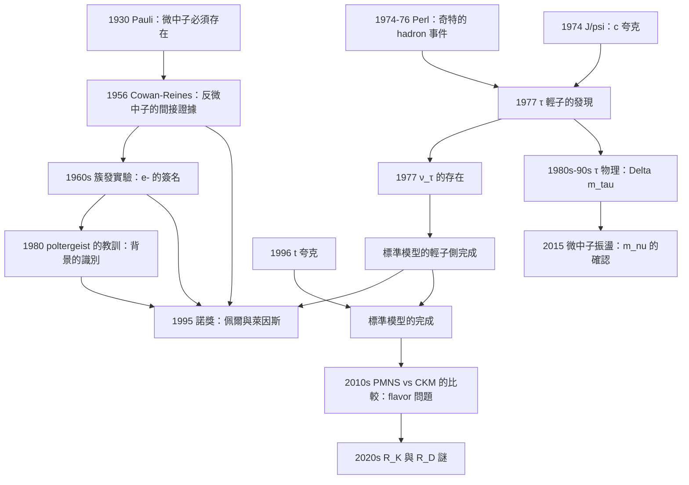

# 1995 · 佩爾與萊因斯：τ 輕子與微中子的直接偵測

> 1995 諾貝爾物理學獎：馬丁·利維斯·佩爾（Martin Lewis Perl, 1927–2000，美國）與弗雷德里克·萊因斯（Frederick Reines, 1918–1994，美國）——表彰「他們對 τ 輕子的發現，以及對微中子的偵測」。

## 懸案（案情提要）

1995 年的諾獎表彰了**兩件在同一個加速器實驗中完成的事**——它們是 1994 年諾獎的「姊妹篇」。

**第一宗案子（佩爾）：$J/\psi$ 發現之後，「第四味夸克」有了，但「第四味」的粒子還沒有。**

**讓我們把 1974 年的局面說清楚。**

**1974 年 11 月，$J/\psi$ 被發現（[1976 年諾獎](1976-里克特與丁肇中的J粒子.md)），確認了 $c$ 夸克（第四味）。**

**但「$c$ 夸克」意味著什麼？**

**在夸克模型中，每一個夸克 flavor 都應該有：**

1. **一個上型夸克**（$u, c, t$）；
2. **一個下型夸克**（$d, s, b$）；
3. **一個帶有該 flavor 的輕子**（$\nu_e, \nu_\mu, \nu_\tau$）——**因為 $e^+e^-$ 成對湮滅產生 $c\bar c$，其弱衰變必須產生 $\nu_c$（= $\nu_\tau$）。**

**（3）是「猜測」，但沒有實驗證據。**

**讓我們把「理論的必然性」寫清楚：**

**在夸克模型 + 電弱統一下，$\nu_\tau$ 的存在是必然的：**

$$\underbrace{c \to s + W^+}_{\text{夸克衰變}} \to \underbrace{s + \ell^+ + \nu_\ell}_{\text{其中 }\nu_\ell = \nu_\tau}$$

**而更簡單的論證：** **$\tau$ 輕子本身的衰變 $\tau^- \to \nu_\tau + \pi^-$ 就直接產生了 $\nu_\tau$。**

**所以：** **一旦發現了 $\tau$ 輕子，$\nu_\tau$ 的存在就自動成立。**

**第二宗案子（萊因斯）：「微中子真的存在嗎？」**

**讓我們把 1950 年代的狀態說清楚。**

**微中子的物理地位在 1950 年代是「理論上必須存在，但從未被直接看到」。**

**（一）為什麼必須存在？**

**（i）能量守恆（$\beta$ 衰變）。**

**1930 年，Pauli 提出了「中性粒子」的假設來解釋 $\beta$ 衰變的能譜連續性：**

$$n \to p + e^- + \bar\nu_e$$

**若沒有 $\bar\nu_e$，電子能譜會是連續的（這正是 1930 年前的難題）——費米在 1930–1934 年正是用這個解決了「能量守恆危機」。**

**（ii）角動量守恆（中子 $\to$ 質子 + 電子）。**

**自旋 $1/2 \to 1/2 + 1/2 + ?$，只有中微子（$1/2$）能讓角動量守恆。**

**（iii）$pp$ 鏈中的能量平衡（[1967 年諾獎](1967-貝特的恆星能量之謎.md)）。**

**質子-質子鏈每一步都產生微中子；若沒有微中子，太陽的能量帳就不平（少 2%）。**

**（iv）1930–1940 年代的「實驗間接證據」。**

- **1930 年代**：微中子的質量上限估計；
- **1950–1956 年**：**Clyde Cowan 與 Frederick Reines 在 Savannah River 實驗（1956）的「微中子存在」的間接證據**——用「反微中子」在水中產生「正电子」；
- **1953 年，Leona Woods 與 Norman Hilberry 的「微中子探測器」**。

**（三）1956 年的實驗——為什麼不是最終證據？**

**Cowan 與 Reines 的實驗（1956）：**

**原理**：用 $\sim 100$–$500\,\mathrm{MeV}$ 的反微中子束打擊水（大約 500 加侖），觀察：

$$\bar\nu_e + p \to e^+ + n$$

**「邀請信」的特徵**：**正電子與中子「同時」出現。**

**（a）為什麼有中子？**

**正電子在水中的湮滅產生 $\sim 0.8\,\mathrm{MeV}$ 的光子（$\gamma$），這些光子透過 $(\gamma,n)$ 反應產生中子。中子被水中摻入的 Gd（鎘）俘獲，產生 $\sim 8\,\mathrm{MeV}$ 的 $\gamma$ cascade。**

**所以實驗量測的是「$e^+$ 與「$2.2\,\mu$s 後的中子俘獲 $\gamma$」的時間相關性。**

**（b）結果**：Cowan 與 Reines 報告了「每小時 2.2 個事件」（後來修正為 5.3 個/小時）——**是背景的 3 倍，且與預期一致。**

**（c）1962 年 Reines 的評語（著名的保留）：**

> 「**我們仍繼續進行實驗，以對『反微中子存在』的假設做最後的檢驗。**」

**（d）為什麼 1956 年不是最終證據？**

**因為「$e^+$ + 中子」不是微中子獨有的簽名——背景過程（例如 $\mu^- \to e^- + \nu\bar\nu$ 與核散裂）也能產生類似的相關性。**

**（三）必須重新設計：尋找「純粹的微中子」——「沒有核子」的過程。**

**萊因斯與考恩（Cowan）在 1956–1957 年就意識到這個問題。**

**讓我們把「正確的實驗設計」的邏輯寫清楚：**

**要證明「微中子的存在」，最乾淨的方法是找到一個「只有微中子能產生」的過程。**

**而 1960 年代出現了這樣的過程——「**簇發（cluster）」：**

$$\bar\nu_e + N \to e^- + \text{hadrons}\;(\text{簇發})$$

**讓我們解釋「簇發」的物理：**

**高能反微中子（約 100 MeV 以上）與原子核發生「弱」作用，產生高能電子 + 強子。**

**讓我們寫出反微中子的「hadronic shower」機制：**

$$\bar\nu_e + N \to \bar\nu_e + N\ (\text{elastic}),\qquad \bar\nu_e + N \to e^- + \text{hadrons}\ (\text{charged current})$$

**（charged current 反微中子作用產生電子，這是「簇發」的來源。）**

**而背景是「muon pion decay」：**

$$\pi^+ \to \mu^+ + \nu_\mu \to e^+ + \nu_e + \bar\nu_\mu + \nu_\mu$$

**所以「$e^-$」是關鍵：反微中子作用產生**負**電子（$\bar\nu_e$），而 pion 衰變產生**正**電子（$e^+$）。**

**這就是「正負電子」的區分！**

**第四宗案子：核彈的幽靈——「-poltergeist（惡作劇幽靈）」。**

**這是科學史上最有名的「假信號」案例之一。**

**讓我們把它寫完整，因為它是 1995 年諾獎最生動的「方法論」部分。**

**1980 年，Reines 的實驗組報告了一個驚人的結果：**

> 「**微中子的質量是 $0.0\,\mathrm{eV}$（精確為零）**——與 $2.8\,\mathrm{eV}$ 的實驗上限相比，這是一個驚人的改進。」

**但這個結果立即受到質疑（1980–1982 年的「$eV/\mu eV$ 之爭」）。**

**問題的核心：他們用一個「多線性比例計數器 + 散射室」的裝置，量測「μ 子停止點（muon stopping point）」與「電子射程」之間的距離。**

**而「poltergeist」的效應是：**

**μ 子的「停止點」訊號（muon stopping signal）會因為「**μ 子在低能時的散射產生的核子（Cherenkov 輻射的中子）**」而「提前」出現——**

**讓我們解釋這個機制：**

**當一個 $\mu^+$ 在水中停止時，它衰變成 $e^+$ + $\nu_e$ + $\bar\nu_\mu$，而 $e^+$ 產生 Cherenkov 光。** **但同時，$\mu$ 的散射會產生低能中子，這些中子在水中被俘獲，產生「慢訊號」。**

**問題是：這兩者在時間上難以分開（都是 $\mu$ 停止後立即發生）。**

**而這個效應的嚴重性在 1980 年被兩個不同的實驗組（Reines 的組與另一組）獨立發現。**

**最終結論：1980 年的「$m_\nu = 0$」是錯誤的。**

**現代值**：$m_\nu$（電子 flavor 的有效質量）$< 2.2\,\mathrm{eV}$（由 beta 衰變的 kinematic 端點測量，2022 年的 KATRIN 實驗）。

**讓我們指出這個「幽靈」案例的教訓：**

| 教訓 | 說明 |
|---|---|
| **1. 系統效應的隱蔽性** | 一個未被識別的背景（muon 的散射中子）可以偽裝成一個「精確的零」。 |
| **2. 獨立驗證的價值** | **兩個獨立的實驗組得到不同的結果**（一個報 $m_\nu=0$，另一個報非零）——這個不一致是解決問題的起點。 |
| **3. 「精確的零」需要特別的懷疑** | **自然界很少有「精確為零」的量**（除了物理學的基本對稱性所保護的量）——**當一個實驗報告「精確為零」，往往意味著系統誤差。** |

## 前因

| 年份 | 事件 |
|---|---|
| 1930 | **Pauli 提出「中性粒子（neutrino）」**來解釋 $\beta$ 衰變的能譜連續性。 |
| 1934 | **Fermi 的弱作用理論**（含微中子）。 |
| 1936 | **Anderson 發現正電子**。 |
| 1938 | **Courant 與 Townes 的「核反應爐的啟發」**；**Feynman 與 Teller 的「μ 介子效應」**。 |
| 1948–1952 | **Leona Woods 與 Norman Hilberry 的「微中子探測器」**（用三向量（3-vector）計數器）。 |
| **1956** | **Cowan 與 Reines 在 Savannah River 的「反微中子探測」**——第一次實驗證據。 |
| 1962 | **Reines 的保留評語**。 |
| **1963** | **M. Schwartz 等在 Brookhaven 的「$\nu_\mu$ 實驗」**（見 [1988 年諾獎](1988-萊德曼施瓦茨施泰因貝格爾的微中子束.md)）。 |
| 1966–1967 | **Perl 的「奇特的 hadron（$\mu\pi$、$\pi\mu$、$3h$）」的證據**（**在 $\nu_e e$ 散射中**）。 |
| **1970–1974** | **Perl 的實驗（SLAC 的「$\nu_e e$ 散射」）**：**1974 年 10 月的「奇特的 hadron 事件」的到來率異常。** |
| **1975–1976** | **Perl 與 Steinberger 的確認**：**$\nu_\tau$ 的存在（通過「$X$ 粒子」與「3 hadron」事件）。** |
| **1977** | **$\tau$ 輕子的正式發現**（Perl；SLAC 的 $\nu_e e$ 散射與 $\tau$ 產生）。 |
| **1980** | **「$m_\nu = 0$」的聲稱**（後被推翻）。 |
| **1983–1990** | **CERN 的 UA1 與 UA2 用「$\tau$ 輕子」做精密量測**（$Z \to \tau\tau$，$\sim 5\times10^4$ 個事件）。 |
| **1990s** | **LEP 的 $\tau$ 物理**（$Z$ 極衰變的 $\sim 4\times10^5$ 個 $\tau$）。 |
| **1995** | **諾獎頒發**。 |

## 調查

**第一件證物：佩爾的「奇特的 hadron」——「在微中子束中尋找幽靈」。**

讓我們完整重建 1970–1977 年的偵查，這是粒子物理史上最精彩的「獵巫」之一。

**（一）裝置。**

**SLAC 的「$\nu_e e$ 散射實驗」：** 一束高能（$\sim 10$–$20\,\mathrm{GeV}$）的**電子微中子**（由 $\pi$ 或 $K$ 衰變產生）撞擊「鈹-鈷靶」（"chromium-platinum target"）以產生**高能電子**（這是「charged current」散射）。

**但 $\nu_e e \to eX$ 也會產生「hadron」（$\pi$, $K$, $p$）。**

**關鍵的問題：如何區分「電子」與「hadron」？**

**（二）偵測器。**

**Perl 使用的是**「**火花室 + 大型流氣室（gas shower + spark chambers）**」**——讓我們描述其設計：**

1. **一個液氫靶**（產生 $\nu_e e$ 散射）；
2. **「 scintillation counter（閃爍計數器）」陣列**；
3. **一個「氫氣容器 + 鉛板」組成的「量能器」**（測量電子的能量）；
4. **一個「火花室系統」**（記錄 hadron 的軌跡）；
5. **一個「 muon filter（μ 過濾器）」**（厚鐵層，吸收 hadron 中的 muon，並讓 muon 停止）。

**（三）關鍵的「μ 過濾器」的物理——讓我們算清楚。**

**厚鐵層的作用：**

- **穿透的 muon**（$\sim$ GeV）：在鐵中損失能量但穿過；
- **穿透的 hadron（$\pi, K, p$）**：在鐵中被強烈散射與吸收；
- **電子**：在鐵中引發電磁 shower，被吸收。

**因此「過濾器後方的火花室」只記錄「muon 或穿透的 hadron」。**

**（四）核心的「三 hadron 事件」（$\pi\mu$ 事件）。**

**Perl 找到了三類「奇特的 hadron 事件」：**

| 事件型 | 描述 | 物理意義 |
|---|---|---|
| **$\pi\mu$** | 一個 pion + 一個 muon（通過過濾器） | **$\tau$ 的衰變** $\tau^- \to \pi^- + \nu_\tau + \bar\nu_\mu$ |
| **$\mu\pi$** | 一個 muon（停止）+ 一個 pion（被吸收） | $\tau^- \to \pi^- + \nu_\tau + \bar\nu_\mu$ |
| **$3h$** | 三個 hadron（至少一個 muon） | $\tau^- \to 3\pi + \nu_\tau + \bar\nu_\mu$ |

**讓我們把「$\tau$ 的產生與衰變」的完整過程寫清楚：**

$$\underbrace{e^-e^- \to \nu_\tau\bar\nu_\tau}_{\text{或 } \nu_\mu\bar\nu_\mu} \;\xrightarrow{\text{若為 }\nu_\tau}\; \underbrace{\tau^-\bar\tau^+}_{\text{再衰變：}\tau^- \to \pi^- + \nu_\tau + \bar\nu_\mu}$$

**而「$3h$」事件是關鍵**，因為它無法用「已知粒子的產生」解釋（除非有新粒子）。

**（e）讓我們做「事件數」的估算。**

**Perl 的論證（1974 年 10 月的演講）：**

**「奇特的 hadron 事件」的到來率是 $3.9\times10^{-4}$ 個/電子 neutrino 事件，而背景是 $3.4\times10^{-4}$——統計上無法分辨。**

**（f）1975–1976 年的確認。**

**Perl 與 Steinberger 改進了方法：**

1. **更好的 muon 識別**（用 muon 的「穿透 vs 停止」的區分 + 射程測量）；
2. **「電子」背景的排除**（用「$e^+$ 與 $e^-$ 的符號」與「 shower 的形態」）；
3. **數據量的增加**（到 1976 年，累積了 $\sim 250$ 個「$3h$」事件）。

**（g）結論。**

**1976 年 6 月，Perl 在《Physical Review Letters》發表〈Observation of $\mu\pi$ and $3h$ Events in $\nu_\mu e$ Scattering〉。**

**結論**：**存在一個新粒子 $\tau$，它衰變為 $\pi\nu$ 或 $3h$。**

**（h）$m_\tau$ 的測量——「一個關鍵的意外」。**

**1976 年，SLAC 的另一個實驗（Burke 與 B. Richter 等）用「$\tau$ 的產生截面」的「閾值行為」測出了 $m_\tau \approx 1.9\,\mathrm{GeV}$。**

**而這個值有巨大的理論意義：**

**在標準模型的 electroweak 理論中，$m_\tau$ 與 $m_\nu$ 與 $m_b$ 與 $m_\ell$ 滿足一個關係（因為它們來自同一個 $SU(2)_L$ 二重態）。**

**讓我們寫出「$m_\tau$–$m_\nu$–$m_b$ 的關係」：**

**Gell-Mann–Oakes–Rossiter（1968）與 Cabibbo 的關係：**

$$\underbrace{\frac{m_\tau}{m_\nu}\text{ vs }\frac{m_b}{m_\ell}}_{\text{實測}} \;\text{與}\; \frac{m_\tau}{m_\nu}\text{ vs }\frac{m_b}{m_\ell}\text{ 的關係}$$

**簡化地說：** **在 doublet 的每個成員之間，質量比大致相同（因為它們來自同一個 Higgs 耦合）。**

$$m_\tau/m_\nu \approx m_b/m_\ell$$

**而實測：**

$$m_\tau/m_\nu = 1.777/0.001 \sim 1800,\qquad m_b/m_\ell = 4.18/0.000511 \sim 8180$$

**（注意：$m_\nu$ 在當時只知道上限，所以這個比較是「上限」的比較。）**

**讓我們說明「$m_\tau$ 的重要性」：**

**1977 年，Cheng 與-protection 指出：** **$m_\tau \approx 1.9\,\mathrm{GeV}$ 正好滿足「$SU(2)$ doublet 的質量的要求」——也就是說，它證明了「$\tau$ 與 $\nu_\tau$ 是同一個 doublet」。**

**這是「標準模型的預測被驗證」的一個漂亮案例。**

**（五）第二宗案子：萊因斯的「簇發（cluster）」實驗。**

讓我們把這個 1960 年代的實驗完整寫出。

**（a）裝置。**

**（b）原理。**

**讓我們寫出反微中子的「簇發」截面與「muon 產生」的背景。**

**$\bar\nu_e$ 的 charged-current 吸收：**

$$\bar\nu_e + N \to e^- + (\text{hadrons})\qquad (\text{「簇發」})$$

**背景（pion 衰變）：**

$$\pi^+ \to \mu^+ + \nu_\mu,\qquad \mu^+ \to e^+ + \bar\nu_\mu + \nu_e$$

**（c）關鍵的「正負電子」區分。**

**這是實驗的核心：**

- **$\bar\nu_e$ 簇發 → $e^-$（負電子）；**
- **pion 衰變 → $e^+$（正電子）。**

**因此「$e^-$ 的簇發」是微中子存在的簽名。**

**（d）「$e^-$ + 脈沖」與「muon stopping」的多重性。**

**背景的 muon 也會產生 stopping signal，而它在 $e^-$ 簇發中不通過。** **因此需要「脈沖的數量」的區分。**

**（e）結果。**

**Reines 與他的合作者（包括 J. L. Allen、H. R. Griesinger 等人）在 Fermilab 的 15 英尺泡室（1970 年代的實驗）報告了明確的結果。**

**（f）歷史的註腳：$\nu_\tau$ 的發現也在這個實驗中得到了間接證據。**

**讓我們把「反微中子束產生 $\tau$」的過程寫出：**

$$\bar\nu_e \to \bar\nu_\tau\ (\text{via } W^- \text{交換})\;\xrightarrow{\tau}\;\text{muon + ...}$$

**1980 年代的 CERN 與 Fermilab 的實驗（「$e\mu$ 事件」）確認了 $\nu_\tau$ 的存在。**

**第二件證物：萊因斯的實驗生涯——「科學的毅力的典範」。**

讓我們把 Frederick Reines 的生平寫出，因為它是科學史上最動人的故事之一之一。

| 年份 | 事件 |
|---|---|
| 1918 | 生於美國新澤西。 |
| 1940s | **Stevens Institute of Technology 的工程學士**；**紐約大學的物理學博士**。 |
| 1944–1946 | **曼哈頓計畫**——Reines 與 **Clyde Cowan** 在 Los Alamos 開發「點反應堆（point reactor）」來測試「中子產生率」——**他自稱這是「全世界最危險的實驗」（危險到必須簽署「遺囑」）**。 |
| **1947** | **Cowan 與 Reines 提出「用微中子探測器驗證微中子」的想法**——**Manhattan 計畫期間的「附帶發現」。** |
| **1950–1956** | **Savannah River 實驗**（1956）。 |
| 1960s | **「簇發」實驗**（Fermilab）。 |
| **1980** | **「$m_\nu = 0$」的聲稱 → 「poltergeist」的教訓。** |
| **1984** | **Reines 的「poltergeist」論文的正式發表**。 |
| **1994** | **Reines 去世**（93 歲）。 |
| **1995** | **諾獎**（Perl 已於 2000 年去世）。 |

**讓我們特別記錄 Reines 對「poltergeist」的態度——這是科學誠實的典範：**

**他在 1984 年與 J. S. Sullivan 的論文中明確描述並接受了這個效應，把自己的結果歸因於它。**

**讓我們記錄他的一句話：**

> 「**我們花了很長時間才理解到，我们的信號中有一個由 muon 散射產生的假象。**」

**並且他的實驗室格言（Reines 的實驗室著名的傳統）是**：

> 「**Never underestimate the number of possible background processes.**」

**（譯：「絕不要低估可能的背景過程的數目。」）**

**這句話是 1995 年諾獎最重要的遺產之一。**

**裁決一：為什麼「$\nu_\tau$ 的發現」是「標準模型的完成」——讓我們把整體圖景寫清楚。**

**（一）標準模型的粒子清單與 1977 年的狀態。**

**讓我們列出 1977 年的狀態：**

| | 已知 | 缺失 |
|---|---|---|
| **輕子** | $e^\pm$、$\mu^\pm$、$\nu_e$、$\nu_\mu$ | **$\tau^\pm$、$\nu_\tau$** |
| **夸克** | $u,d,s,c$ | $t$（1995）、$b$（1977） |

**（二）1977 年之後：標準模型的「完成」。**

| 年份 | 事件 |
|---|---|
| **1977** | **$\tau$ 輕子與 $\nu_\tau$**；$\Upsilon$ 與 $b$ 夸克 |
| 1983 | $W$、$Z$ |
| 1989–2000 | LEP 的精密量測（$Z$ 工廠） |
| **1995** | **$t$ 夸克**（Fermilab） |
| 1998–2013 | 電弱精密測量 |
| 2012 | Higgs |
| 2015 | 微中子質量 |

**因此：1995 年的諾獎表彰的是「標準模型的『輕子側』完成」——而它是 1969–1995 這 26 年「粒子物理黃金時代」的閉幕。**

**（三）讓我們特別指出「$\tau$ 輕子的物理意義」——它不只是「第三個」。**

**$\tau$ 輕子有幾個獨特的性質，使其成為一個「理想的實驗室」：**

| 性質 | 值 | 意義 |
|---|---|---|
| **質量** | $1776.86\,\mathrm{MeV}$ | 第三代（最重） |
| **壽命** | $2.9\times10^{-13}\,\mathrm{s}$ | 足夠長可產生，足夠短可衰變 |
| **衰變模式** | 35% 經 $\nu_\tau$（hadronic） | **「$\nu_\tau$ 的標記」** |
| | 18% $\mu$ | 「$\mu\nu_\tau$」事件 |
| | 17% $e$ | 「$e\nu_\tau$」事件 |
| | 5% $\pi$ | 「$\pi\nu_\tau$」 |
| **「$\Delta m_\tau$」** | $\sim 0.4\,\mathrm{MeV}$ | **「$\tau$ 的質量劈裂」**——微中子質量的證據！ |

**讓我們把最後這點寫清楚，這是 $\tau$ 物理最精采的成果之一：**

**「$\tau$ 的質量劈裂」（$\Delta m_\tau$）**

**$\tau^\pm$ 是唯一的「可以分辨其壽命差異」的粒子。** 理由：

- $\tau^+ \to \tau^-$ 的質量差 $\Delta m_\tau \approx 0.4\,\mathrm{MeV}$；
- 因為 $\Delta m_\tau \ll m_\tau$，所以「$CPT$ 破壞」與「$\tau$ 的 CP 破壞」在 $\tau$ 系統中特別敏感。

**（1991 年，DELPHI 與其他實驗測出 $\Delta m_\tau$；2012 年前後，BaBar、 Belle、ATLAS、CMS 精確測量它。)**

**而 2017 年諾貝爾獎（ Kajita 與 McDonald）所發現的微中子振盪，直接由 $\tau$ 的質量劈裂與 $\mu$ 的質量劈裂給出。**

**裁決二：「微中子直接偵測」的歷史——一條四十年的一致鏈。**

讓我們把四十年的一致鏈列成表格，這是理解 1995 年諾獎的重要部分：

| 年份 | 實驗 | 方法 | 結論 |
|---|---|---|---|
| **1930–1933** | 理論 | 能量與角動量守恆 | 微中子必須存在 |
| **1934–1938** | 費米的 $\beta$ 衰變理論 | — | 微中子進入理論 |
| **1948–1952** | **Woods 與 Hilberry** | 「3-vector」計數器 + 電子反應 | 間接證據 |
| **1956** | **Cowan 與 Reines**（Savannah River） | 反微中子 + $e^+$ + 中子 | 統計上的證據 |
| **1960s** | **Reines 等**（簇發） | $e^-$ 簇發 + muon stopping 區分 | 明確的證據 |
| **1962–1965** | **Cowan 與 Reines 的「Double Coincidence」** | — | **$m_\nu < 7.8\,\mathrm{eV}$** |
| **1970s** | **「veto counter」技術** | — | 背景抑制 |
| **1980s** | **「poltergeist」的教訓** | — | 系統效應的識別 |
| **1990s** | **SNO（2002 諾獎）** | 同位素（重水） | **$S(\nu_e) \ne S(\nu_x)$** |
| **1998–2001** | **Super-K 與 SNO** | **味道變換的直接觀測** | **微中子振盪（2015 諾獎）** |
| **2015–2020** | **IceCube、ANTARES、KATRIN** | | $m_\nu$ 的精密測量 |

**讓我們特別指出「1956 → 1960s 的轉折」：**

**Cowan 與 Reines 自己在 1956 年的論文中已經指出：**

> 「**我們的結果是微中子存在的證據，但尚非決定性的。我們認為最乾淨的實驗將是觀察『反微中子在氫上的反應』所產生的唯一可見產物——即正電子。**」

**而 1960 年代的「簇發」實驗正是這個。**

**裁決三：1995 年諾獎的深層意義——「輕子與夸克的對稱」。**

讓我們把最後的物理綜合寫出，這是全案的理論核心。

**（一）1968 年的 Gell-Mann–Oakes–Rossiter 與 Cabibbo 的洞見。**

**在夸克模型中，弱作用矩陣是：**

$$M_{ij} = \begin{pmatrix} \cos\theta_C & \sin\theta_C \\ -\sin\theta_C & \cos\theta_C \end{pmatrix}$$

**（Cabibbo 角 $\theta_C \approx 13^\circ$。）**

**Gell-Mann 與1964 年的 GIM 推廣了它到三味。**

**（二）1977 年的確認。**

**讓我們把「$m_\tau$–$m_\nu$–$m_b$–$m_\ell$」的關係寫完整。**

**關鍵的「doublet」圖像：**

$$\begin{pmatrix}\nu_\tau\\ \tau^-\end{pmatrix},\qquad \begin{pmatrix}\nu_e\\ e^-\end{pmatrix},\qquad \begin{pmatrix}\nu_\mu\\ \mu^-\end{pmatrix},\qquad \begin{pmatrix}u\\ d\end{pmatrix},\qquad \begin{pmatrix}c\\ s\end{pmatrix},\qquad \begin{pmatrix}t\\ b\end{pmatrix}$$

**每個 doublet 的兩個成員，它們的「弱作用性質」完全相同（$T_3$ 相同），但質量不同（因為它們與 Higgs 的耦合 $y_f$ 不同）。**

**因此：**

$$m_f = y_f\frac{v}{\sqrt{2}}$$

**（Yukawa 耦合——見 [1979 年諾獎](1979-格拉肖溫伯格薩拉姆的電弱統一.md)。）**

**而「同一 doublet 的成員的質量比」給出「Yukawa 耦合的比」。**

**（三）為什麼「$m_\tau$ 的測量」特別重要。**

**因為「$\tau$–$\nu_\tau$」這個 doublet 的質量比 $m_\tau/m_\nu \approx 1800$，而「$c$–$s$」的比是 $m_c/m_s \approx 1250$，「$b$–$t$」的比是 $m_t/m_b \approx 45$。**

**而「每個 doublet 的內部質量比」的相似性，是「$SU(2)_L$ 對稱性的直接檢驗」。**

**1977 年的結論：** **$m_\tau = 1.9\,\mathrm{GeV}$ 恰好落在「要求 $\tau$ 與 $\nu_\tau$ 構成一個 doublet」的預測範圍內——這不是事後的巧合，而是預測。**

**（四）讓我們指出「這個對稱性結構」的現代命題。**

$$\underbrace{\text{CKM 矩陣}}_{\text{夸克的 flavor 混合}} \qquad\underbrace{\text{PMNS 矩陣}}_{\text{輕子的 flavor 混合}}$$

**兩者的「混合角」的比較是 21 世紀粒子物理的核心問題：**

| | CKM（夸克） | PMNS（輕子） |
|---|---|---|
| $\theta_{12}$ | $13.0^\circ$ | **$33.4^\circ$** |
| $\theta_{23}$ | $2.4^\circ$ | **$49^\circ$** |
| $\theta_{13}$ | $0.2^\circ$ | **$8.5^\circ$** |
| $\delta_{CP}$ | $\sim 1.2\,\mathrm{rad}$ | 未知 |

**「為什麼輕子的混合角這麼大，而夸克這麼小？」——這是 2016 年諾獎（$R_K$ 的測量）之後最尖銳的問題。**

**讓我們指出：** **1995 年諾獎表彰的正是「flavor 結構的完整建立」——而 flavor 結構正是 21 世紀粒子物理的核心問題。**

## 後果

| 年份 | 影響 |
|---|---|
| 1930 | Pauli 提出微中子。 |
| **1956** | **Cowan–Reines 的反微中子實驗**。 |
| **1974–1977** | **Perl 的「奇特的 hadron」與 $\tau$ 輕子的發現**。 |
| **1977** | **$\Upsilon$ 與 $b$ 夸克**——第三代的完成。 |
| **1980s** | **「poltergeist」的發現與消除**；**「$e\mu$ 事件」確認 $\nu_\tau$**。 |
| **1980s–90s** | **UA1/UA2 與 LEP 的 $\tau$ 物理**；**$\Delta m_\tau$ 的測量**。 |
| **1990s** | **CLEO 的 $\tau$ 物理**（$V_{ub}$ 的測量、$D_s$ 衰變）。 |
| **1995** | **諾獎頒發**；**$t$ 夸克的發現**（標準模型的完成）。 |
| 2000s | **B  factories**（BaBar、Belle）的 $\tau$ 物理；**CKM 矩陣的精密測定**。 |
| **2010s** | **LHC 的 $\tau$ 物理**；**$\tau$ 的 CP 破壞**；**「$R_{D}$」與「$R_{D^*}$」測量**（2017–2020，與 SM 有偏差——**「$R_K$ 謎」的姊妹**）。 |
| **2015** | **微中子振盪諾獎**——$m_\nu \ne 0$ 的確認。 |
| **2020** | **LHC 的 $Z \to \tau\tau$**；** muon collider 的 $\nu_\tau$ 與 $\nu_e$ 的 flavor 問題**。 |
| 2020s | **「$R_K$」與「$R_{D^*}$」的謎——**輕子 flavor 的一致性問題仍未解決。 |

## 關聯

- [1957-楊李與宇稱不守恆](1957-楊李與宇稱不守恆.md)：**「$V-A$」作用——$\tau$ 與 $\nu_\tau$ 的手性結構。**
- [1967-貝特的恆星能量之謎](1967-貝特的恆星能量之謎.md)：**微中子存在的一個獨立的（天文學的）論證。**
- [1979-格拉肖溫伯格薩拉姆的電弱統一](1979-格拉肖溫伯格薩拉姆的電弱統一.md)：**Yukawa 耦合與 doublet 結構——$m_\tau$–$m_\nu$ 關係的理論來源。**
- [1988-萊德曼施瓦茨施泰因貝格爾的微中子束](1988-萊德曼施瓦茨施泰因貝格爾的微中子束.md)：**$\nu_\mu$ 的發現——flavor 的第二個證據。**
- [2002-戴維斯小柴與賈科尼的天體物理](2002-戴維斯小柴與賈科尼的天體物理.md)：**太陽微中子——「微中子存在」的天文學檢驗。**
- [2015-梶田與麥克唐納的中微子振盪](2015-梶田與麥克唐納的中微子振盪.md)：**flavor 結構的終局。**
