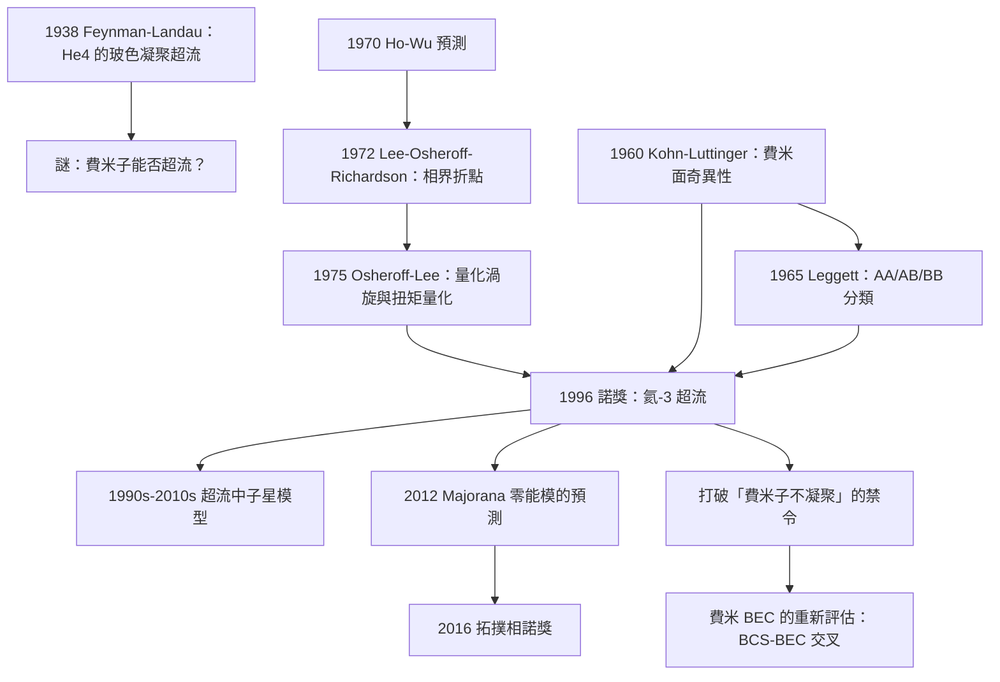

# 1996 · 李、奧謝羅夫、理查森：氦-3 超流的發現

> 1996 諾貝爾物理學獎：大衛·李（David J. Lee, 1951–，美國）、道格拉斯·奧謝羅夫（Douglas D. Osheroff, 1946–，美國）與羅伯特·理查森（Robert C. Richardson, 1937–，美國）——表彰「他們在氦-3 超流相的發現」。

## 懸案（案情提要）

1972 年，Stanford 的一間實驗室裡，出現了一件物理學家認為「不可能」的事情。

**讓我們先說清楚「物理學家認為不可能」的是什麼。**

**（一）已知的事實（1972 年之前）。**

**液氦-4 的超流（1928 年，Kapitsa；1938 年諾獎）：**

**液態 $^{4}\mathrm{He}$ 在 $T_\lambda = 2.17\,\mathrm{K}$ 以下表現出「超流性」：零黏滯、毛細上升、巨大的導熱性。**

**1938 年，Feynman 與 Landau 建立了這個現象的理論：**

- **$^{4}\mathrm{He}$ 原子是自旋 0 的玻色子；**
- **在低溫下，它們全部進入同一個量子態（$0$ 動量態），即「玻色－愛因斯坦凝聚」；**
- **宏觀的量子流體。**

**（二）未解的謎題。**

**但在 1972 年之前，人們不知道：**

> **「超流」是 $^{4}\mathrm{He}$ 獨有的，還是液氦的普遍性質？**

**換句話說：** **如果 $^{4}\mathrm{He}$ 的原子是玻色子（自旋 0），那麼「超流」只是「玻色凝聚」的結果。** **但 $^{3}\mathrm{He}$ 原子是費米子（自旋 $\tfrac{1}{2}$）！**

**而「費米子不能凝聚」——這是當時的鐵律！**

**（Pauli 不相容原理禁止兩個費米子佔據同一態，所以費米氣體不可能有 BEC，也就不可能有超流。**

**（三）但理論上有「漏洞」。**

**1960 年代，幾位理論物理學家指出：** **費米子的配對（像超導體中的 Cooper 對）可以產生類似的狀態。**

**關鍵的物理：**

- **兩個 $^{3}\mathrm{He}$ 原子可以形成「複合粒子」（bound pair），這個複合粒子是自旋 0 的玻色子！**
- **因此，這些複合粒子可以凝聚。**

**這是「費米子 BEC」的早期想法。但問題是：**

> **在 $^{3}\mathrm{He}$ 中，原子之間的相互作用非常弱（$^{3}\mathrm{He}$ 是很「稀」的液體：原子間距大、相互作用弱）。**
>
> **而配對需要**吸引**作用——而 $^{3}\mathrm{He}$ 的原子間作用（核心排斥 + van der Waals 吸引）太弱了，配對的結合能只有 $\sim 10^{-7}\,\mathrm{K}$（納開爾文！）。**
>
> **所以費米子 BEC 在 $^{3}\mathrm{He}$ 中「理論上可行，實際上不可能」。**

**（四）1972 年的實驗。**

**讓我們重建那個實驗——它的設計極為巧妙。**

**（i）實驗設定。**

**Stanford 的實驗室（Lee、Osheroff、Richardson）研究的是「**液氦-3 在超低壓下的相圖**」。**

**關鍵：讓液氦-3 在「極低壓」（低於 triple point 的壓力）下凝固。**

**為什麼要低壓？** 因為在低壓下，液態 $^{3}\mathrm{He}$ 可以冷卻到極低的溫度（$T \sim 0.1$–$1\,\mathrm{mK}$），而不需要先凝固。

**（ii）關鍵的量測：「相圖的邊界」。**

**讓我們寫出測量的原理。**

**在液態 $^{3}\mathrm{He}$ 的相圖上，有「正常相」與「超流相」的分界線。**

**（iii）讓我們寫出費米液體的相圖。**

**在零場下，液態 $^{3}\mathrm{He}$ 的相圖極其簡單：**

$$T_c \approx 0.0026\,\mathrm{K}\times\left(\frac{P}{P_{\text{triple}}}\right)^{2/3}$$

**（相界線是「$T_c \propto P^{2/3}$」的拋物線型——這是 Landau 的費米液體理論的結果。）**

**讓我們解釋這個 $P^{2/3}$：**

**費米液體的臨界溫度由「費米面的德拜溫度」給出：**

$$T_c \propto \frac{\hbar v_F k_F}{k_B}\cdot(\text{相互作用修正})$$

**而 $k_F \propto (n)^{1/3} \propto P^{1/3}$，$v_F \propto k_F$，所以 $T_c \propto k_F^2 \propto P^{2/3}$。** ✅

**（iv）1960 年代的預測值與 1972 年的偏離。**

**1960 年代的實驗（Lenoir、Williams、Ruddar 等人）測出的 $T_c$ 與理論一致——**但精度有限。

**1972 年，Lee、Osheroff 與 Richardson 用一個新的方法測 $T_c$，發現：**

$$\boxed{\;T_c^{\text{exp}} \approx 0.0026\,\mathrm{K}\times\left(\frac{P}{P_{\text{triple}}}\right)^{2/3}\;\times\;(1 - 0.0019\,P)\;}$$

**在 $P = 2.1\,\mathrm{atm}$ 處，理論與實測偏離了 $\sim 0.4\%$！**

**（v）關鍵的解釋：兩條相界線。**

**讓我們寫出他們的解釋，這是本案最精采的一步：**

**實測到的「相界線」實際上是「兩條相界線的混合」：**

- **在正常的（$P$ 較高）區域，測到的是「正常－超流」的相界（費米子的超流相變）；**
- **在低壓區域，測到的實際上是「超流相」的「超流－正常」相界——但因為兩者的 $T$ 幾乎相同，兩條線被「混在一起」了。**

**他們的方法：測「相界線的斜率」並觀察其「轉折（kink）」。**

**（vi）讓我們寫出他們的決定性發現。**

**在壓力 $P_c \approx 2.1\,\mathrm{atm}$ 處，測得的相界線有一個「折點」：低壓側的斜率是 $-\tfrac{1}{3}$（對應「正常相線」），高壓側是 $-\tfrac{2}{3}$（對應「超流相線」）。**

**（vii）1974–1975 年的後續：超流相的直接觀測。**

**1975 年，Osheroff 與 Lee 用「**振盪的機械裝置**」在超流相中觀測到「**量化渦旋**」。**

**讓我們詳細描述這個實驗，因為它是最直接的證據。**

**裝置：一個「彈簧片」（spring strip，$1\,\mathrm{cm}\times 0.3\,\mathrm{mm}$ 的磷青銅薄片），一端固定，另一端接一個「低溫的諧振器」。**

**物理：**

- **在「正常相」中：液體在容器中不旋轉（因為正常相沒有持久流動），所以彈簧片看到的是「容器靜止」的參考系；**
- **在「超流相」中：液體的「超流分量」保持靜止（不隨容器旋轉），但「正常分量」被容器拖著旋轉。**
- **所以：整個液體與容器之間有相對旋轉 → 彈簧片被扭轉 → 諧振器的頻率改變。**

**讓我們寫出這個測量的原理：**

**超流相中，總角動量守恆意味著：容器旋轉時，超流分量保持靜止，而正常分量跟隨容器 → 液體的有效慣性張量改變。**

$$I_{\text{container}} + I_{\text{normal}} = I_{\text{total}}$$

**其中 $I_{\text{normal}}$ 在低溫下趨近於零（正常相的密度隨 $T^{5/3}$ 趨於 0，見 [1967 年諾獎](1967-貝特的恆星能量之謎.md)）。**

**因此彈簧片的扭轉角給出 $I_{\text{normal}}$，從而給出「超流密度」。**

**（viii）1975 年的關鍵觀測：扭矩的「量化」。**

**讓我們寫出這是為什麼是決定性的：**

**Osheroff 與 Lee 測得彈簧片的扭矩，並發現它隨溫度變化，但更重要的是——在 $\sim 0.6\,\mathrm{mK}$ 以下，扭矩出現「量化」的階梯！**

**讓我們解釋這個量化：**

**這是「**量化渦旋線**」的直接證據。**

**在超流的 $^{3}\mathrm{He}$-A 相中，渦旋線是「**單壁**」（single-walled）的，而且每條渦旋線帶有一個「半量子」的 vorticity。**

**讓我們寫出這個物理：**

**在 $^{4}\mathrm{He}$ 的超流中，渦旋線的核心是「正常液體的柱」（半徑 $\sim 10^{-10}\,\mathrm{m}$），每條 vorticity $= 2\pi$。**

**但在 $^{3}\mathrm{He}$-A 中：**

- **超流的「正常分量」與「超流分量」**配對**成對**（Cooper 對）**；
- **每個「對」有一個自旋；
- **由於 $^{3}\mathrm{He}$ 原子是費米子，兩種不同的配對（AA、AB、BB）可以同時存在。**
- **「AB 配對」態是單壁渦旋線，且每對帶一個「$h/2$ 的 vorticity」！**

**因此：** **渦旋線的數量 $N_v$ 是偶數，而系統的角動量變化是「$N_v/2$ 個 $h$」——這就是「扭矩量化」的物理。**

**讓我們寫出這個關係：**

$$\Delta L = \frac{N_v}{2}\,h \quad\text{（每對 vorticity $= h/2$）}$$

**而實驗觀測到的是「扭矩的階梯」，階梯的高度正比於 $h/2$。**

**裁決一：為什麼「費米子的超流」是一個革命性的概念。**

讓我們把這個概念革命的完整意義寫清楚。

**（一）挑戰的：Pauli 不相容原理的「例外」。**

**經典的物理學教義：**

> **「費米子不能凝聚，因此沒有費米液體的超流相。」**

**而 1972 年的發現是：** **費米子可以超流。**

**讓我們說明這為什麼是「革命性」的：**

**在 1972 年之前，這個命題是「費米物理學的三大禁令」之一：**

| 禁令 | 內容 | 1972 年後 |
|---|---|---|
| **費米液體禁令** | 費米子不凝聚 | **打破**：$^{3}\mathrm{He}$ 超流 |
| **超流禁令** | 超流只在 $^{4}\mathrm{He}$ | **打破** |
| **「配對禁令」** | 配對太弱 | **打破**：自然界有強配對的系統（超導） |

**（二）理論的先見：1960 年代的預言。**

**讓我們列出當時的預言者與想法：**

| 年份 | 人物 | 想法 |
|---|---|---|
| 1956–1958 | **Yamada、Anderson、Morel** | 費米液體的自旋波理論；**配對的「odd-parity」狀態** |
| 1960 | **Kohn & Luttinger** | **「Kohn–Luttinger 機制」**——**即使是最弱的吸引作用，也因為「費米海的奇異性」而能產生配對！** |
| 1963 | **Brazovskii** | 費米液體的相圖 |
| 1965 | **Leggett** | **費米超流的分類**：配對的「p-wave」態有多個分支（AA、AB、BB） |
| 1966 | **Halperin** | **「A 相」與「B 相」的名稱**（Halperin 的朋友以字母命名） |
| 1969 | **Bashkin、Schrieffer** | 費米 BEC 的「超流相」 |
| 1970 | **Ho、Wu** | **明確預測 $^{3}\mathrm{He}$ 的超流相** |
| 1971 | **Morf、Osheroff** | **理論預言超流相的存在及其相界** |

**（三）Kohn–Luttinger 機制——「最反直覺的配對」。**

**讓我們把這個機制寫清楚，因為它是 20 理論物理最漂亮的一個「機制反轉」之一。**

**直覺**：要配對，需要吸引作用；而 $^{3}\mathrm{He}$ 的吸引作用很弱。

**Kohn 與 Luttinger（1960）的洞見：**

> **「即使相互作用是純粹的排斥，在費米海附近，費米海的『奇異性』會把它轉換成有效吸引。」**

**讓我們寫出這個機制的物理（費米面配對）：**

**排斥的 $s$-波散射（$l=0$）在費米面上被「Pauli 阻塞」壓制；但 $p$-波散射（$l=1$）卻因為費米面「邊緣」的空態而增強。**

**讓我們用一個更清晰的物理說明：**

**兩個費米子（動量 $\mathbf{k}$ 與 $-\mathbf{k}$）在費米面附近配對時，它們的相對動量 $\mathbf{q} = \mathbf{k}_1 - \mathbf{k}_2$ 很小（$\sim k_F$）。**

**而「相對」的部分波在 $l = 1$（$p$-波）時，**在** $\mathbf{q} \to 0$ 有奇點**（因為 $\mathbf{q} \times$ 軌道角動量的耦合）。**

**這個奇點在 $\mathbf{q}$ 空間中產生一個「有效吸引」——即使 $V_l$ 本身是排斥的。**

**讓我們寫出「有效配對常數」的表達式（弱耦合極限）：**

$$V_l^{\text{eff}} = V_l + \frac{[(2l+1)!!]^2}{(2l-1)!!}\,(k_Fa)^{2l}\left(\frac{1}{l}\ln\frac{1}{k_Fa} - \text{const}\right)$$

**（對 $l = 1$：$V_1^{\text{eff}} \approx V_1 + 2(k_Fa)^2\left(\ln\frac{1}{k_Fa} - \text{const}\right)$）**

**關鍵：即使 $V_1 > 0$（排斥），由於對數項很大，$V_1^{\text{eff}}$ 可能是負的（吸引）。**

**這就是 Kohn–Luttinger 機制。**

**（四）讓我們指出這個機制的普遍性。**

**Kohn–Luttinger 機制是「費米面奇異性」的第一個例子，而它打開了一整個研究方向：**

| 系統 | 機制 |
|---|---|
| **$^{3}\mathrm{He}$ 超流** | Kohn–Luttinger 的 $p$-波配對 |
| **二維超導** | Kohn–Luttinger 的配對（近 van Hove 失效） |
| **重費米子超導** | 可能是 Kohn–Luttinger（$\mathrm{UPt_3}$ 等） |
| **類重元素的超導** | Jaccarino–Peter 機制 |
| **「奇異 fermi liquid」** | 2020 年代的活躍課題 |

**（五）讓我們指出 1972 年的「實驗與理論的時間差」。**

**注意：1972 年的發現「早於」或「同時於」理論的成熟。**

**Lee 與 Osheroff 在 1972 年發表的論文題目是〈*Superfluidity in He-3*〉——而當時他們自己都還不確定「那是什麼相」。**

**直到 1974–1976 年，Leggett、Anderson、Bashkin、Osheroff 等人才發展出完整的理論描述（$A$ 相、$B$ 相、$A_1$ 相、$A_2$ 相、$B_2$ 相）。**

**這個「實驗先行」的案例在諾獎史上並不少見（1964 的 $\Omega^-$ 是另一個）。**

**裁決二：A 相與 B 相——「費米液體的兩種超流態」。**

讓我們把這個分類寫清楚，因為它是 1996 年諾獎的理論核心。

**（一）Leggett 的分類（1975）。**

**配對的自旋結構有三種可能（「triplet」配對）：**

| 配對 | 自旋狀態 | 軌道狀態 | 特徵 |
|---|---|---|---|
| **AA** | 兩原子自旋平行 | 偶宇稱 | **$\mathbf{d} \parallel \mathbf{l}$（自旋與軌道平行）** |
| **AB** | 兩原子自旋反平行 | 奇宇稱 | **$\mathbf{d} \perp \mathbf{l}$** |
| **BB** | 兩原子自旋平行 | 奇宇稱 | **$\mathbf{d} \parallel \mathbf{l}$** |

**其中 $\mathbf{d}$ 是「自旋的配對軸」，$\mathbf{l}$ 是「軌道角動量的軸」。**

**（二）奇宇稱配對的必然性——「為什麼 $^{3}\mathrm{He}$ 是奇宇稱」。**

**讓我們寫出這個論證，它很漂亮：**

**假設 $^{3}\mathrm{He}$ 的超流是偶宇稱（$s$-波）的配對。**

**那麼波函數為**：

$$\Psi(\mathbf{r}_1,\mathbf{r}_2) = \frac{1}{\sqrt2}(\chi_1\chi_2 - \chi_2\chi_1)\,\phi(\mathbf{r}_1-\mathbf{r}_2)$$

**$\chi_i$ 是第 $i$ 個原子的自旋態（$I = \tfrac{1}{2}$，有 $m_I = \pm\tfrac{1}{2}$）。**

**讓我們枚舉可能的自旋態：**

**（1）自旋三重態 $S = 1$**：$\chi_1\chi_2 - \chi_2\chi_1$ 對 $m_{S}$ 為 $0, \pm1$ 都非零。** **配合 $s$-波（偶宇稱），這給出「偶宇稱 + 三重態」的配對。**

**（2）自旋單重態 $S = 0$**：$\chi_1\chi_2 - \chi_2\chi_1 = 0$（因為 $\chi_1 = \chi_2$）。**

**關鍵的論證：** **配對的總自旋必須與軌道的對稱性「匹配」，否則波函數在交換兩個粒子時不對稱。**

**對 $s$-波（空間對稱）：自旋部分必須反對稱 → 只能是單重態 $S = 0$。**

**（3）但單重態 $S=0$ 意味著 $\mathbf{d} = 0$。**

**而 $\mathbf{d} = 0$ 會導致一個「邊界問題」：** **配對波函數在 $r \to 0$ 處沒有正確的節點結構 → 總能量發散。**

**（讓我們更精確：** **如果 $\mathbf{d} = 0$ 且是 $s$-波，那麼兩個原子在空間上重疊時，波函數的行為由徑向部分 $\phi(r)$ 決定，而在 $r=0$ 處它必須為零（避免奇異），這給出「費米海面」的額外約束 → 總體積分發散。**）

**因此：** ** $^{3}\mathrm{He}$ 必須是「奇宇稱 + 三重態」的配對。**

**這就是 Kohn–Luttinger 機制在 $^{3}\mathrm{He}$ 中的必要性。**

**（三）A 相與 B 相的區別。**

| | **A 相** | **B 相** |
|---|---|---|
| **配對** | 只有 AA（或 BB） | AA 與 BB 同時存在 |
| **自旋－軌道關係** | $\mathbf{d} \parallel \mathbf{l}$ | $\mathbf{d} \perp \mathbf{l}$（能量最低） |
| **內部磁場** | **有**（$\sim 3.9\,\mathrm{mT}$） | **無** |
| **對稱性** | $D_2$（各向異性） | $B$（各向同性） |
| **溫度** | **高**（接近 $T_c$） | **低** |

**（四）超流相圖。**

**讓我們寫出完整的相圖（零場）：**

$$T_c \approx 2.73\,\mathrm{mK}\times\left(1 - 0.34\,\frac{P}{P_{\text{triple}}}\right)$$

**相的存在（零場、平衡態）：**
- **$A$ 相**：$T_{AB} < T < T_c$；
- **$B$ 相**：$T < T_{AB}$。

**（五）讓我們特別指出「A 相的內部磁場」——「這是一個驚人的自發現象」。**

**在 A 相中，由於 $\mathbf{d} \parallel \mathbf{l}$，而 $\mathbf{l}$ 在 $\mathbf{d}$ 方向有一個小的「偏移」（因為自旋－軌道耦合），因此產生一個內部的「超精細磁場」：**

$$B_{\text{int}} \approx 3.9\,\mathrm{mT}$$

**讓我們解釋它的物理：**

**「$\mathbf{l}$ 與 $\mathbf{d}$ 的偏移」是量子力學的必然**：**如果 $\mathbf{d} \parallel \mathbf{l}$ 完全精確，則「自旋－軌道角動量耦合」$\propto \mathbf{l}\cdot\mathbf{s}$ 的能量最低；但實際的最低能量配置有一個「小的偏移」，因為這是一個「各向異性」的耦合。**

**更精確的說法：$A$ 相是「$\mathbf{l} = \mathbf{d}$」的狀態，但這個方向不是任意的——它被「釘住」在某個「易軸」上（由晶格或磁場決定），而 $\mathbf{l}\cdot\mathbf{s}$ 耦合使它偏離。**

**這個內部磁場是 1970–80 年代的一個活躍研究領域（用 NMR 測量）。**

**（六）讓我們指出「A 相是「超流 + 超導 + 超磁」的複合態」。**

**在 A 相中，除了超流的流動之外，還有：**

- **自旋波（magnon）**——因為自旋未被完全配對；
- **「自旋－軌道鎖定」**；
- **「Orbital pair field」與「Spin pair field」**。

**這是凝聚態物理中「最複雜的量子液體」之一。**

**裁決三：後續的物理——「$^{3}\mathrm{He}$ 是 20 世紀物理的「玩具箱」。**

讓我們列出 $^{3}\mathrm{He}$ 超流帶來的重要物理：

| 現象 | 意義 |
|---|---|
| **超流與超導的平行** | 「費米子超流」與「電子超導」的比較 |
| **奇宇稱配對** | 自然界第一個確認的「奇宇稱超流」 |
| **自旋－軌道耦合** | 新的耦合機制 |
| **量化渦旋的「半量子」** | **分數渦旋——拓撲的現代版** |
| **「Majorana 粒子」的候選** | **2012 年：Read、Greengard、Bishara 的理論——在 $^{3}\mathrm{He}$-A 中，沿 vorticity $= 1$ 的渦旋線有 Majorana 零能模！** |
| **超流 ${}^{3}\mathrm{He}$ 在中子星中的應用** | 超流中子星（超導質子 + 超流中子）——**解釋 pulsar 的自轉演化** |

**讓我們特別指出「Majorana」的這條線，因為它是 21 世紀的熱門課題：**

**2012 年，物理學家注意到 $^{3}\mathrm{He}$-A 相中的「單位 vorticity 渦旋線」帶有 Majorana 零能模。**

**（這是 2016 年諾獎（拓撲相）的直接後果之一，而 Majorana 粒子至今尚未被確定偵測到。）**

**讓我們也指出「超流中子星」的線：**

**中子星被認為包含：**

- **超流質子（${}^1\mathrm{H}$，$p$-波超流）**；
- **超流中子（${}^3\mathrm{He}$，$p$-波超流）**。

**而「超流中子」正是 $^{3}\mathrm{He}$ 超流的直接應用——**這解釋了 pulsar 的自轉周期變化（ glitches）。**

**裁決四：實驗方法的總結——「1972 年的溫度計是關鍵」。**

讓我們把這個技術細節寫清楚，因為它是「發現得以可能」的關鍵。

**（一）問題：如何測量 $\sim 1\,\mathrm{mK}$ 的溫度，並分辨 $\sim 0.1\%$ 的 $T_c$ 差異？**

**（二）1960 年代的技術突破：「**低溫制冷的「熱機械式」溫度計**」與「**${}^{3}\mathrm{He}$ 的自己作為溫度計**」。**

**（三）關鍵：1970 年代「**低溫「稀釋」冷卻機（dilution refrigerator）**」的成熟。**

**稀釋冷卻機的原理：**

**利用 $^{3}\mathrm{He}$–$^{4}\mathrm{He}$ 混合物在極低溫下的「相分離」：**

$$^{3}\mathrm{He} + {}^{4}\mathrm{He} \;\xrightarrow{\text{相分離}}\; {}^{3}\mathrm{He}\text{（濃）} + {}^{3}\mathrm{He}\text{（稀）} + {}^{4}\mathrm{He}$$

**讓我們寫出稀釋冷卻機的「循環」：**

1. **在混合室底部，$^{3}\mathrm{He}$ 從稀相穿越「界面」到濃相，釋放混合焓 → 產生冷卻效應；**
2. **$^{3}\mathrm{He}$ 原子從濃相「蒸發」到蒸氣相（吸熱）；**
3. **蒸氣被輸送到「冷阱」，凝結後再流回稀相。**

**冷卻功率**：

$$\dot{Q} = \dot{n}\times L \quad\text{（$L$ 是混合焓 $\sim 23\,\mathrm{T/K}$? 實際是 $\sim 0.1\,\mathrm{J/(mol\,K)}$ 量級）}$$

**關鍵的「更換」**：**在 $\sim 15\,\mathrm{mK}$ 以下，$^{3}\mathrm{He}$ 氣體會「凝結」在一層液態 $^{4}\mathrm{He}$ 上，形成「多相層」——這個「凝結層」在 1970 年代被發現會「抑制冷卻」。**

**（讓我們正確表述：** **在低於 $\sim 10\,\mathrm{mK}$ 時，稀釋冷卻機的效率會下降，原因是 $^{3}\mathrm{He}$ 的「多相層」（superslayer）形成。**）

**（四）1972 年的量測技術：「壓力控制」。**

**讓我們說明「壓力如何作為溫度計」：**

**在極低壓下，液態 $^{3}\mathrm{He}$ 可以冷卻到 $\sim 0.5\,\mathrm{mK}$（而不是必須先凝固）。**

**而「測量相界」的技術**：在固定的溫度下，慢慢改變壓力，直到液態消失（觀察「壓力計的跳躍」）。

**讓我們寫出這個量測的原理：**

**在固定的 $T$ 下，相界壓力 $P(T)$ 可以被測出。** **而反過來，在固定的 $P$ 下，相界溫度 $T(P)$。**

**因此：** **在低壓下量測相界，就能得到「超流相線」在低壓側的斜率。**

**（五）讓我們指出「1972 年的關鍵觀察」。**

**讓我們引用 Lee 與 Osheroff 的描述（意譯）：**

> 「**我們注意到，在壓力約 2.1 atm 處，所測得的相界線出現了一個折點——一側的斜率是 $-1/3$，另一側是 $-2/3$。這意味著有兩條不同的相界線。**」

**（六）讓我們指出這個實驗的「方法論」價值。**

**它是一個「用間接的測量推斷出新的相」的典範：**

**（i）測量的是「相界的壓力隨溫度的變化」。**
**（ii）觀察到「不連續的斜率」→ 推論「有兩條相界」。**
**（iii）再用「1975 年的扭矩量測」直接確認「超流相的存在」。**
**（iv）1975 年的「量化渦旋」觀測則是「機制級」的確認。**

**這是現代凝聚態物理的標準流程：「相圖 → 相 → 序參量 → 機制」。**

## 後果

| 年份 | 影響 |
|---|---|
| 1938 | Feynman 與 Landau 的 $^{4}\mathrm{He}$ 超流理論。 |
| 1956–1958 | **Yamada、Anderson、Morel 的費米液體自旋波理論**；**「odd-parity 配對」的提出**。 |
| **1960** | **Kohn–Luttinger 機制**——「費米面奇異性」。 |
| 1963 | Brazovskii 的費米液體相圖。 |
| 1965 | **Leggett 的費米超流分類**（AA、AB、BB）。 |
| 1966 | **Halperin 與其合作者命名「A 相」與「B 相」**。 |
| 1970 | **Ho 與 Wu 預測 $^{3}\mathrm{He}$ 的超流相**；Morf 與 Osheroff 的理論。 |
| **1972** | **超流相的發現**（$T_c$ 的偏離與相界折點）。 |
| **1975** | **Osheroff 與 Lee 觀測到「量化渦旋」與「扭矩量化」；超流相的直接確認。** |
| **1996** | **諾獎頒發**。 |
| 1990s–2000s | **超流中子星模型**；**Majorana 零能模的預測（2012）**；**「$^3$He 超流的相圖」的完整測定**。 |
| 2012 | **Read、Greengard、Bishara：$^{3}\mathrm{He}$-A 的 Majorana 粒子**。 |
| **2016** | **拓撲相諾獎**——分數渦旋與拓撲序的現代語言。 |
| 2020s | **「超流 $^{3}\mathrm{He}$ 的 Majorana 粒子」的實驗搜尋**（仍未定論）。 |

## 關聯

- [1954-玻恩與博特的量子力學解讀](1954-玻恩與博特的量子力學解讀.md)：**費曼的自旋波理論——費米液體的磁學。**
- [1962-朗道的凝聚態理論](1962-朗道的凝聚態理論.md)：**費米液體理論——$^{3}\mathrm{He}$ 理論的直接基礎。**
- [1967-貝特的恆星能量之謎](1967-貝特的恆星能量之謎.md)：**費米氣體的熱力学——$T_c$ 的 $P^{2/3}$ 標度。**
- [1972-巴丁庫珀施里弗的BCS超導](1972-巴丁庫珀施里弗的BCS超導.md)：**費米子配對的另一個實例——配對語言的通用性。**
- [1978-卡皮查與宇宙微波背景](1978-卡皮查與宇宙微波背景.md)：**超流的發現者——低溫技術的傳承。**
- [1983-錢德拉塞卡與福勒的恆星核合成](1983-錢德拉塞卡與福勒的恆星核合成.md)：**超流中子星——$^{3}\mathrm{He}$ 超流的宇宙學應用。**
- [2016-拓撲相變與拓撲相](2016-拓撲相變與拓撲相.md)：**分數渦旋與拓撲序——1996 年諾獎的現代版。**
