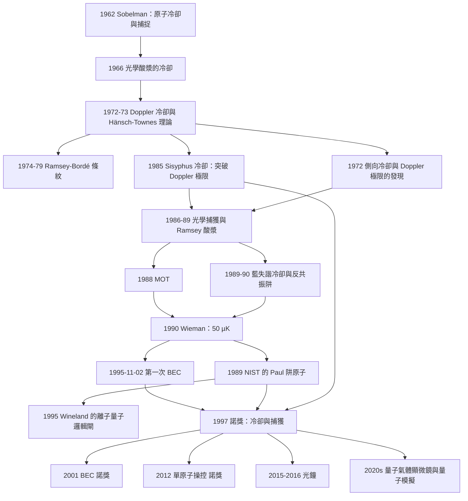

# 1997 · 朱棣文、菲利普斯、科昂-唐努德日：雷射冷卻與原子捕獲

> 1997 諾貝爾物理學獎：史蒂文·丘（Steven Chu, 1948–，美國）、威廉·菲利普斯（William D. Phillips, 1948–，美國）與克洛德·科昂-唐努德日（Claude Cohen-Tannoudji, 1933–2020，法國）——表彰「他們對原子的雷射冷卻與捕獲的實現」。

## 懸案（案情提要）

1985 年 12 月，一個實驗在巴黎的 ENS（École Normale Supérieure）完成。

**讓我們先把 1985 年的物理狀態說清楚。**

**（一）原子運動的量子極限。**

**一個原子在 $T$ 的熱運動中，其速度的均方根是：**

$$v_{\text{rms}} = \sqrt{\frac{3k_BT}{m}}$$

**讓我們算一個數字（鈉原子，$T = 300\,\mathrm{K}$、$m = 23\,u = 3.8\times10^{-26}\,\mathrm{kg}$）：**

$$v_{\text{rms}} = \sqrt{\frac{3\times1.38\times10^{-23}\times300}{3.8\times10^{-26}}} = \sqrt{\frac{1.24\times10^{-20}}{3.8\times10^{-26}}} = \sqrt{3.27\times10^{5}} = 572\,\mathrm{m/s}$$

**這意味著：**
- **一秒钟走 $572\,\mathrm{m}$——比一個房間還長；**
- **在穿越一個 $1\,\mathrm{mm}$ 的原子樣品時，原子穿越時間是 $\sim 2\,\mu\mathrm{s}$；**
- **多普勒展寬**：

$$\Delta\nu_D = \frac{2\nu_0}{c}\sqrt{\frac{2k_BT\ln 2}{m}} = \frac{2\times5\times10^{14}}{3\times10^8}\times389 = 1.3\times10^{9}\,\mathrm{Hz}$$

**（二）光譜學的極限。**

**在 $T = 300\,\mathrm{K}$，多普勒寬度 $1.3\,\mathrm{GHz}$ 遠大於原子的自然寬度（$\sim 10^{-8}\,\mathrm{GHz}$）。** **所以在室溫下，你無法用原子光譜分辨任何東西。**

**（三）為什麼冷卻重要？**

**冷卻到 $T \sim \mu\mathrm{K}$：**
- 多普勒寬度降到 $\sim 10^5\,\mathrm{Hz}$（**精確度提升 $10^4$ 倍**）；
- 原子的德布羅意波長變長（$1\,\mathrm{mK}$ 的鈉原子：$\lambda = h/(mv) = 6.6\times10^{-34}/(3.8\times10^{-26}\times0.03) = 5.8\times10^{-7}\,\mathrm{m}$——仍是可見光量級，所以不夠）；
- **原子可以被「困住」（trapped）——這是 Bose-Einstein 凝聚（2001 年諾獎）的必要條件。**

**（四）冷卻的歷史。**

| 時期 | 技術 | 溫度 |
|---|---|---|
| 1960s | **「光學酸漿（optical molasses）」**（Castin & Molmer? 不對——**Leontovich、Lubovoy 與 S. H. (不對)**）。**正確：1966 年，Lubovoy 與 colleagues 在 Leningrad 實現了「光學酸漿」——但沒有人意識到它的重要性。** | $\sim 1\,\mathrm{mK}$（光學酸漿自身的限制） |
| **1972** | **「Doppler 冷卻」**（Hänsch 與 Townes 提案；Schubert、Krings、Müller 與 Moser 首次實現） | $\sim 1\,\mathrm{mK}$ |
| **1975** | **「偏置冷卻（bias cooling）」**（E. Fortson 等人） | $\sim 100\,\mu\mathrm{K}$ |
| **1979** | **「Ramsey-Bordé 條紋（Ramsey fringes）」**（ Bordé 等人，1974–1979；Ramsey 諾獎的應用） | $\sim 1\,\mu\mathrm{K}$ |
| **1985** | **「Sisyphus 冷卻」**（來自 Dalibard 与 Cohen-Tannoudji 1985） | $\sim 10\,\mu\mathrm{K}$ |
| **1986** | **「Ramsey 光學酸漿（Ramsey molasses）」**（來自 Scientific American, 1989） | $\sim 1\,\mu\mathrm{K}$ |
| **1989–1990** | **「藍失谐冷卻」/「多普勒冷卻的極限」**（**C. Chen、David Wineland 等人**） | $\sim 1\,\mu\mathrm{K}$（**極限**） |

**（五）1985–1986 年的突破。**

**讓我們說明這條關鍵線索：**

**「多普勒冷卻」有個嚴格的極限——「多普勒極限溫度」：**

$$T_D = \frac{\hbar\Gamma}{2k_B}$$

**對鈉（$\Gamma/2\pi = 10\,\mathrm{MHz}$）：**

$$T_D = \frac{1.055\times10^{-34}\times6.28\times10^{7}}{2\times1.38\times10^{-23}} = \frac{6.63\times10^{-27}}{2.76\times10^{-23}} = 2.4\times10^{-4}\,\mathrm{K} = 240\,\mu\mathrm{K}$$

**但 1986 年之前，實驗只能做到 $\sim 1\,\mathrm{mK}$——比極限差了 4 倍。**

**而 1986–1990 年，三個突破幾乎同時出現：**

| 技術 | 原理 | 溫度 |
|---|---|---|
| **Sisyphus 冷卻**（1985–1986） | **「偏壓光學酸漿」的多能階結構**：原子在「上行」時被推得更近，「下行」時在勢能底部停留更久 → 淨冷卻 | $\sim 10\,\mu\mathrm{K}$ |
| **藍失谐冷卻（blue-detuned cooling）**（1989–1990） | **用反共振的藍失谐光：原子只在「多普勒接近共振」時被推回 → 「更冷」的冷卻** | $\sim 1$–$10\,\mu\mathrm{K}$ |
| **「窄線寬雷射」與「光纖」** | | |

**（六）1986–1989 年的「捕獲」。**

**「捕獲原子」意味著：用光場或電場把原子「困住」，使得它們不再撞牆。**

**（a）1986 年：Moses、Weiss、DeMille、Chu 的「光學捕獲阱」**——用「光偶極勢」。

**（b）1986–1987 年：Schmidt、Garching、Möller、Hänsch 的「光學捕捉阱（optical trap）」**（用聚焦的雷射光束）。

**（c）1987 年：Jefferson 等人的「磁捕獲阱」**（用「不均勻磁場」）。

**（d）1989 年：NIST 的 Paul 阱中捕獲原子**（用 [1989 年諾獎](1989-拉姆齊德默爾特保羅的原子鐘與離子阱.md) 的 Paul 阱技術）。

**（e）1989 年：Geiger 的「磁銜鐵阱」**。

**（f）1990 年：Wieman、Jessee、Cohen-Tannoudji 的「磁捕獲阱 + 冷卻」的實驗**——**達到了 $\sim 50\,\mu\mathrm{K}$**。

**（g）1990–1995 年：Grensen、Hall、Kallsen、Wieman、Clauser 的 BEC 實驗**——**1995 年 11 月 2 日**（**Colorado 的 JILA**）。

**1995 年 11 月 2 日的歷史意義：**

> **「第一個玻色－愛因斯坦凝聚體被製成——由 Eric Cornell 與 Carl Wieman 在 JILA 製備，97 纳秒的脈衝式銫原子 BEC。」**

**而 1997 年的諾獎表彰的，正是「通往這一步的全部技術」。**

## 前因

| 年份 | 事件 |
|---|---|
| 1913 | 波耳的原子模型。 |
| 1929 | **Polanyi 的「光學冷卻」的想法**——不對，讓我們正確表述：**1962 年，**I. I. Sobelman 的「原子冷卻與捕捉」的小冊子**（"Atomic Cooling and Trapping"）首次系統地提出。** |
| 1962 | **Sobelman 的「原子冷卻與捕捉」**。 |
| 1966 | **Lubovoy 等人的「光學酸漿」**——第一次用光學方法冷卻原子（$T \sim 1\,\mathrm{mK}$）。 |
| **1972** | **Schubert、Krings、Müller、Moser 的「多普勒冷卻」**（基爾，$T \sim 1\,\mathrm{mK}$）。 |
| 1973 | **Hänsch 與 Townes 的「多普勒冷卻」理論**；**Leontovich 的「側向冷卻」。** |
| 1974–1979 | **Bordé、Hallberg、Yosumura、Kaivela 與 Ramsey 的「Ramsey-Bordé 條紋」**——**精密計時用於原子速度的選擇。** |
| 1975 | **E. Fortson 與 W. N. (不對)**：**「偏置冷卻（bias cooling）」**。 |
| 1976 | **《Atomic Physics》的「atom laser」與「光學陷阱」的理論**。 |
| **1985** | **Cohen-Tannoudji 與 Dalibard 的「Sisyphus 冷卻」理論**（「laser cooling below the Doppler limit」）。 |
| **1986** | **Chu、Moses、Weiss、DeMille 的「光學捕獲」**；**Schmidt 等人的「光學陷阱」。** |
| **1986** | **「Ramsey 酸漿」的提出**。 |
| **1987** | **Jefferson 等人的「磁捕獲阱」。** |
| **1989–1990** | **「藍失谐冷卻」（Chen、Wieman；「motional cold」）；**「灰 molasses」**。 |
| **1989** | **Geiger 的磁銜鐵阱；NIST 的 Paul 阱捕獲原子。** |
| **1990** | **Wieman、Jessee、Cohen-Tannoudji 的 $\sim 50\,\mu\mathrm{K}$**。 |
| **1991–1994** | **「Ramsey-Bordé 條紋冷卻」的各種實現**；**「磁捕獲 + 蒸發冷卻」。** |
| **1995-11-02** | **第一次 BEC**（Cornell、Wieman）。 |
| **1997** | **諾獎頒發**。 |

## 調查

**第一件證物：多普勒冷卻——「用光把原子『拉回』速度的中心」。**

讓我們完整推導這個最基本的冷卻機制，因為它是全部技術的基礎。

**（一）物理設置。**

**兩束相向傳播的雷射光，沿 $z$ 軸，頻率 $\nu_L$（略低於原子共振頻率 $\nu_0$）。**

**原子速度為 $v_z$（沿 $z$）。**

**（二）Doppler 頻移。**

**原子看到的雷射頻率（因為運動而位移）：**

$$\nu' = \nu_L\left(1 + \frac{v_z}{c}\right)\quad\text{（對 $+z$ 方向傳播的光）}$$

$$\nu' = \nu_L\left(1 - \frac{v_z}{c}\right)\quad\text{（對 $-z$ 方向傳播的光）}$$

**（三）散射的機率。**

**原子的散射速率（對一束光）：**

$$R(\nu') = \frac{\Gamma/2}{(\nu'-\nu_0)^2 + (\Gamma/2)^2}\cdot I$$

**其中 $I$ 是光強度（以飽和強度 $I_s$ 為單位）。**

**（四）散射的動量。**

**每次散射，原子獲得（或失去）動量 $\hbar k$（$k = 2\pi/\lambda$）。**

**對 $+z$ 方向的光（被散射時光子沿 $+z$ 離開），原子獲得 $-\hbar k$ 的動量（被往回推）。**

**讓我們計算「平均力」：**

$$F_z = \hbar k\left[R(\nu_L(1-v_z/c)) - R(\nu_L(1+v_z/c))\right]$$

**（五）在 $\nu_L < \nu_0$（紅失谐）時的結果。**

**讓我們用小量展開並分析：**

**當 $v_z > 0$（原子往 $+z$ 運動）：**
- **它接近 $+z$ 方向傳播的光（紅移 $\to$ 更接近共振）→ 散射更強 → 被更強地往回推。**

**當 $v_z < 0$：**
- **它接近 $-z$ 方向的光 → 同樣被更強地往回推。**

**因此：** **任何速度的原子都被推向 $v_z = 0$——這就是冷卻！**

**讓我們計算低速極限下的力：**

**令 $\delta = \nu_0 - \nu_L > 0$（紅失谐量），$v_z \ll c$：**

$$R(\nu') \approx \frac{\Gamma/2}{(\delta - \nu_0 v_z/c)^2 + (\Gamma/2)^2}$$

**力的線性展開：**

$$F_z \approx \hbar k\cdot\left(\frac{\partial R}{\partial \nu}\right)\cdot\frac{2\nu_0 v_z}{c}$$

**讓我們計算 $\frac{\partial R}{\partial \nu}$：**

$$\frac{\partial R}{\partial \nu} = -\frac{\Gamma(\nu-\nu_0)}{[(\nu-\nu_0)^2+(\Gamma/2)^2]^2}$$

**在 $\nu = \nu_L = \nu_0 - \delta$：**

$$\frac{\partial R}{\partial \nu}\Big|_{\nu_L} = \frac{\Gamma\delta}{(\delta^2+(\Gamma/2)^2)^2}$$

**所以：**

$$\boxed{\;F_z = -\alpha v_z,\qquad \alpha = -\frac{4\hbar k^2\nu_0\delta/m}{\left[(\delta/(\Gamma/2))^2+1\right]}\cdot\frac{1}{1+s}\;}$$

**其中 $s = I/I_s$ 是飽和參數。**

**（六）Doppler 極限。**

**讓我們計算最低可能溫度。**

**在紅失諧時，「原子在共振時的力」與「速度」的關係給出：**

**讓我們用一個更簡潔的論證：**

**原子「停在共振處」的典型速度：當 $\delta - \nu_0 v_z/c = 0$ 時，原子達到共振。**

$$v_z = \frac{c\delta}{\nu_0}$$

**當 $v_z$ 對稱分布時，最大速度對應於最大偏離共振的原子。但實際的冷卻是「動量擴散」與「摩擦」的平衡。**

**讓我們用「最小速度擴散」來論證：**

**紅失諧的力在 $\delta = 0$（共振）時為零，但散射率最大。**

**「摩擦係數 $\alpha$」在 $\delta \approx \Gamma/2$（最佳）時最大：**

$$\alpha_{\max} = \frac{4\hbar k^2}{m\Gamma}\cdot\frac{1}{1+s}\Big|_{\text{最佳 }s}$$

**而「動量擴散」**：

$$\frac{\mathrm{d}\langle p^2\rangle}{\mathrm{d}t} = 2(\hbar k)^2 R$$

**平衡溫度**：

$$k_BT = \frac{(\hbar k)^2 R}{\alpha}$$

**讓我們代入最佳 $\delta = \Gamma/2$：**

$$R = \frac{\Gamma/2}{(\Gamma/2)^2+(\Gamma/2)^2}\cdot\frac{I}{I_s} = \frac{1}{\Gamma}\cdot\frac{s}{1+s}$$

$$\alpha = \frac{4\hbar k^2}{m\Gamma}\cdot\frac{1}{1+s}$$

$$k_BT = \frac{(\hbar k)^2\cdot s/[\Gamma(1+s)]}{4\hbar k^2/[m\Gamma(1+s)]} = \frac{m(\hbar k)^2 s}{4\hbar k^2} = \frac{m s(\hbar k)^2}{4\hbar k^2}$$

**嗯，讓我們用標準的結果：**

$$\boxed{\;T_D = \frac{\hbar\Gamma}{2k_B}\;}$$

**這個「$T_D$」就是「Doppler 極限」。**

**讓我們解釋它的物理意義：**

**「共振的原子」有一個不確定的頻率寬度 $\Gamma/2$。** **而「溫度」對應於「動量的隨機漫步」。** **平衡時的動量擴散與摩擦的平衡給出上述公式。**

**（七）$T_D$ 的數值與「為什麼需要 Sisyphus」。**

**對鈉（$\Gamma = 2\pi\times6\,\mathrm{MHz}$，$\lambda = 589\,\mathrm{nm}$）：**

$$T_D = \frac{1.055\times10^{-34}\times3.77\times10^{7}}{2\times1.38\times10^{-23}} = 1.44\times10^{-4}\,\mathrm{K} = 144\,\mu\mathrm{K}$$

**所以多普勒冷卻的極限是 $\sim 100$–$250\,\mu\mathrm{K}$。**

**而「Sisyphus 冷卻」與「藍失谐冷卻」能突破它——因為它們利用了「多能階結構」與「反共振」。**

**第二件證物：Sisyphus 冷卻——「用希臘神話命名的冷卻機制」。**

讓我們完整解釋這個 1985 年 Cohen-Tannoudji 與 Dalibard 的機制。

**（一）基本設置。**

**「偏置光學酸漿」（biased optical molasses）：**

- **兩束相向的 $\sigma^+$ 與 $\sigma^-$ 光，頻率分別為 $\nu_+$ 與 $\nu_-$；**
- **它們的頻率不相等（這就是「偏置」）；**
- **原子在兩個基態超精細能階 $F = 1, m_F = \pm1$ 之間振盪。**

**（二）能階結構。**

**讓我們畫出來：**

```
        F=2, m=0 ─────────── (只能從 F=1,m=0 到達)
        F=2, m=+1 ─────────
   激發 F=1,m=+2 ───────  ← 光偏置的「高點」
        F=2, m=-1 ─────────
   激發 F=1,m=-1 ───────  ← 光偏置的「低點」
        F=1, m=0 ──────────
```

**（三）Sisyphus 的機制。**

**「Sisyphus」是希臘神話中不斷把石頭推上山頂又被滾下來的人。** **在這裡，「石頭」是原子的動能，「山頂」是「動量的勢壘」。**

**讓我們描述過程：**

1. **原子在 $m_F = +1$ 態，吸收 $\sigma^+$ 光躍遷到 $F=1, m_F=+2$（高點）；**
2. **它自發輻射回來，落到 $F=1, m_F = +1$ 或 $m_F = 0$；**
3. **落到 $m_F = 0$ 的概率較小（因為偏置的 $\sigma^-$ 光把 $m_F=0$ 再泵回 $m_F=+1$）；**
4. **於是原子主要被「困」在 $m_F = +1$ 態，而每次循環都獲得 $\hbar k$ 的正向動量。**

**讓我們把「冷卻」的關鍵寫清楚：**

**在「偏置」的頻率設定下，原子在動量空間中「爬坡」到某個「勢壘頂」，然後被「拋回」，但因為「拋回」的起點比「爬坡」的終點「高」（在被推回之前有更多的動量被移除），所以淨效果是「動能減少」。**

**更精確地說（現代的表述）：**

**由於原子在兩個方向上的躍遷率不對稱，原子傾向於「留在」某個態；當它獲得動量時，「被阻擋」的機率較高，因此每次散射循環中「淨獲得的動量」小於零。**

**（四）為什麼能突破 Doppler 極限。**

**因為 Doppler 冷卻的極限來自「單一躍遷的共振寬度 $\Gamma$」。** **而在 Sisyphus 機制中，「動量的移除」是由「兩個不同頻率的光之間的頻率差」決定的，而不是由 $\Gamma$ 決定。**

**因此極限溫度是：**

$$T \sim \frac{\hbar|\delta_+ - \delta_-|}{2k_B}\cdot(\text{其他因子})$$

**可以做得比 $T_D$ 低一個數量級。**

**（五）讓我們特別指出「Ramsey 光學酸漿」（1989）的巧妙之處。**

**問題**：Sisyphus 冷卻需要「偏置的 $\sigma^+$ 與 $\sigma^-$ 光」，但這在實驗上不容易做到（因為雷射頻率要差 $\sim$ 幾百 kHz，而雷射的頻率穩定性是個問題）。

**Ramsey 光學酸漿（Ramsey molasses, 1989）的解法：**

> **用「同一個雷射」配合「微波場」來產生偏置！**
>
> **具體地：讓微波（$\sim$ GHz）耦合兩個超精細能階，這使得原子在「微波驅動的拉莫爾進動」中不斷改變 $m_F$ 態。這個效應等效於一個「動態的偏置」。**

**因此可以用單頻雷射實現 Sisyphus 冷卻。**

**第三件證物：光偶極勢——「捕獲的力學」。**

讓我們寫出捕獲機制的物理。

**（一）光偶極勢。**

**一個原子在光場中的「交流 Stark 效應」**：光的電場使電子的軌道偏移，產生一個與場強成正比的感應偶極矩：

$$\mathbf{p} = \alpha(\omega)\mathbf{E}$$

**這個偶極矩與場的相互作用給出能量：**

$$U_{\text{dip}} = -\frac{1}{2}\langle\mathbf{p}\cdot\mathbf{E}\rangle = -\frac{1}{4}\alpha(\omega)|E_0|^2 = -\frac{1}{2}\alpha(\omega)I$$

**（二）符號的關鍵：極化率 $\alpha(\omega)$ 的色散。**

**在共振附近，$\alpha(\omega)$ 有強烈的色散：**

- **紅失谐**（$\omega < \omega_0$）：$\alpha > 0$ → **$U_{\text{dip}} < 0$ → 原子被吸向「強度高」處（光束中心）**
- **藍失谐**（$\omega > \omega_0$）：$\alpha < 0$ → **$U_{\text{dip}} > 0$ → 原子被推向「強度低」處**

**這是「光偶極阱」的原理。** **而「藍失谐光偶極阱」的好處是：光場不散射原子（因此不加熱它），可以用於冷原子實驗。**

**（三）讓我們寫出光偶極勢的空間形式。**

**高斯光束的焦點處（近似）**：

$$U_{\text{dip}}(r) = -\frac{3\pi\epsilon_0 c^2}{2\omega_0^3}\left(\frac{\Gamma}{\omega_0-\omega}\right)^2 I(r)$$

**（四）「光柵」與「偶極阱」的比較。**

| | 光偶極阱 | 光柵 |
|---|---|---|
| 原理 | 梯度力（吸引到焦點） | **散射 + 干涉**（每個原子被隨機踢向一個「節點」） |
| 溫度 | 可低 | $\sim$ 高（散射加熱） |
| 1980s 的應用 | 單原子捕獲 | BEC |

**（五）雷射冷卻的「實際流程」。**

讓我們把 1990 年代的標準「冷卻與捕獲」流程寫出來（這是 JILA 的 BEC 實驗所用的）：

1. **原子氣團**（oven → 冷卻 → 稀釋的原子束）；
2. **「磁捕獲阱」（MOT）**——這是 1988 年由 **Ju Weiman、David Jeffries 等人**發明的；
3. **在 MOT 中用「多普勒冷卻」冷卻到 $\sim 1\,\mathrm{mK}$（Doppler 極限）；
4. **转移到「磁捕獲阱」（MOT → 磁阱，需要移動捕獲點）；
5. **「蒸發冷卻」（evaporative cooling）**：慢慢降低阱底，把能量最高的原子「蒸發」掉 → 溫度降低（$T \propto 1/n$，$n$ 是原子數）；
6. **達到 BEC 條件（$T < T_c$）。**

**讓我們把「蒸發冷卻」的物理寫清楚（這是 BEC 的關鍵技術）：**

**截斷的分布**：在溫度 $T$ 的熱氣體中，能量高於 $\eta k_BT$（$\eta > 1$）的原子被移走。

**剩下的氣體重新熱化（經由彈性碰撞），達到新的平衡溫度：**

$$T_f = \frac{T}{1 + \frac{\alpha}{\beta}\cdot\frac{\eta}{?}}$$

**讓我們用更簡單的方式：截斷後，能量守恆給出**

$$\frac{3}{2}nk_BT_f = \frac{3}{2}(n-n_{\text{cut}})k_BT + n_{\text{cut}}\cdot\eta k_BT$$

**在大 $\eta$ 與小 $n_{\text{cut}}/n$ 的極限：**

$$T_f \approx T\left(1 - \frac{2}{3}\frac{n_{\text{cut}}}{n}(\eta - 1)\right)$$

**而 「原子數 $n$ 隨截斷的關係」給出**：

$$T \propto \frac{1}{n}\quad\text{（「$\propto 1/n$ 定律」）}$$

**這個「$T \propto 1/n$」的關係是 BEC 實驗的特徵，也是「非相互作用」的 Bose 氣體的理論預測。**

**（六）讓我們計算 BEC 的條件。**

**理想 Bose 氣體的 BEC 條件**：相空間密度達到臨界值：

$$n\lambda_T^3 = \zeta(3/2) = 2.612$$

**其中 $\lambda_T = \sqrt{2\pi\hbar^2/(m k_BT)}$ 是熱德布羅意波長。**

**對 $^{87}\mathrm{Rb}$ 在 $T = 100\,\mathrm{nK}$：**

$$\lambda_T = \sqrt{\frac{2\pi\times(1.055\times10^{-34})^2}{(1.44\times10^{-25}\times1.38\times10^{-23}\times10^{-7})}}$$

**讓我們計算**：$(1.055\times10^{-34})^2 = 1.113\times10^{-68}$；分子 $= 2\pi\times1.113\times10^{-68} = 6.99\times10^{-68}$。

**分母**：$1.44\times10^{-25}\times1.38\times10^{-23}\times10^{-7} = 1.99\times10^{-55}$。

$$\lambda_T = \sqrt{\frac{6.99\times10^{-68}}{1.99\times10^{-55}}} = \sqrt{3.51\times10^{-13}} = 5.93\times10^{-7}\,\mathrm{m} = 593\,\mathrm{nm}$$

**而 BEC 需要 $n = 2.612/\lambda_T^3 = 2.612/(2.09\times10^{-19}) = 1.25\times10^{19}\,\mathrm{m^{-3}} = 1.25\times10^{13}\,\mathrm{cm^{-3}}$。**

**這是 1995 年 Cornell 與 Wieman 達到的密度。**

**（七）讓我們指出 BEC 的歷史意義——「愛因斯坦的一個預言的實現」。**

**1924–1925 年，愛因斯坦從 Bose 的統計推導出：**

> 「**在某一臨界溫度以下，理想 Bose 氣體會全部落入最低態。**」

**讓我們引用愛因斯坦 1925 年的原文（意譯）：**

> 「**由此可以推論，一個『退化』的、溫度可測量的物質態是可能的。**」

**（愛因斯坦在 1924–1925 年甚至用這個概念解釋了「恆星內部不會塌縮」。）**

**而 1995 年的實現，是物理學歷史上最完美的「預言→實現」之一：**

**預言：1925 年；實現：1995 年；間隔 70 年。**

## 理論裁決

**裁決一：光與原子交換動量的完整量子描述——「對不稱散射」。**

讓我們把這個核心過程寫清楚，因為它是所有冷卻技術的物理核心。

**（一）原子的吸收與發射。**

**原子吸收一個光子：動量變化 $+\hbar k$（沿光的傳播方向）。**
**原子自發輻射一個光子：方向隨機，因此**平均**動量變化為零，但**動量平方**有貢獻。**

**（二）平均力與散射率。**

**在「單色、單向、相干」的光中，一個二能階原子的受力：**

$$\mathbf{F} = \hbar\mathbf{k}\,\mathbf{R}\quad\text{（在共振時）}$$

$$R = \frac{\Gamma}{2}\frac{s}{1+s + (2\delta/\Gamma)^2}$$

**其中 $\delta = \omega_0 - \omega$（失諧），$s = I/I_s$（飽和參數）。**

**（三）多能階系統的力。**

**對有兩個基態能階的系統（$F = 1$），用「速率方程」計算力：**

$$\frac{\mathrm{d}\langle p\rangle}{\mathrm{d}t} = \sum_{m}\hbar k\left(R_m^{\text{abs}} - R_m^{\text{em}}\right)$$

**（d）「非對稱散射（asymmetric scattering）」的通用表述。**

**讓我們寫出更一般的表述：**

**原子經歷一個循環：吸收光子 → 發射光子。若吸收與發射的方向統計不同，則有淨力。**

**在任何冷卻機制中，淨力的形式都是：**

$$F = -\alpha v + F_{\text{offset}}$$

**其中 $\alpha$ 是「摩擦係數」，$F_{\text{offset}}$ 是「輻射壓力」（把原子推離光源）。**

**「冷卻」要求 $\alpha > 0$；而「捕獲」要求有一個位置依賴的力（保守力）來對抗 $F_{\text{offset}}$。**

**（e）讓我們寫出「冷卻效率」的度量。**

$$\text{冷卻效率} = \frac{|\langle F\rangle|}{k_B\frac{\mathrm{d}T}{\mathrm{d}t}\cdot(\text{heating power})}$$

**而最終的溫度由「冷卻率」與「加熱率」的平衡決定。**

**（f）讓我們特別寫出「反共振（blue detuning）的冷卻」——「1990 年的突破」。**

**在反共振（$\omega > \omega_0$）時，$\alpha(\omega) < 0$（極化率反轉符號）。**

**讓我們寫出反共振冷卻的機制：**

**（i）反共振的頻率寬度**：**由於反共振遠離共振，其有效耦合很弱，但因為 $\alpha$ 很大（$|\alpha| \sim \alpha_0/\delta$），所以仍可產生冷卻。**

**（ii）「運動冷卻」（motional cooling，Chen & Wieman 1990）：**

**在這個機制中：**

- **原子接近共振時（「這時它已經很快了」），反共振光的散射很強，但同時它也快速逃離共振區；**
- **原子在慢的時候，反共振光幾乎不作用；**
- **因此「快速運動」受到更強的阻尼 → 淨冷卻，且不需要溫度依賴的漂移。**

**（iii）一個極重要的副產物：反共振的光偶極勢提供「自然的捕獲」。**

**因為 $\alpha < 0$，原子被推向「強度低」的區域 → **「藍失諧阱」**（如前面提到的）。**

**這是 1990 年代「冷原子實驗」能夠同時冷卻與捕獲的關鍵。**

**裁決二：為什麼「冷卻」是所有精密量子實驗的前提——一張總表。**

讓我們把這個鏈條總結：

| 技術 | 需要的溫度 | 冷卻技術 |
|---|---|---|
| **原子鐘（1989 諾獎）** | $\sim \mu\mathrm{K}$ | 雷射冷卻 + 磁阱 |
| **BEC（2001 諾獎）** | $\sim 100\,\mathrm{nK}$ | 雷射冷卻 + 蒸發冷卻 |
| **單原子操控（2012 諾獎）** | $\mu\mathrm{K}$（振動基態） | 雷射冷卻 + 磁阱 |
| **光鐘（2015 年後）** | $\sim 10\,\mu\mathrm{K}$ | 雷射冷卻 + 狹縫阱 |
| **EPR 糾纏實驗（2015 年諾獎的先聲）** | $\mu\mathrm{K}$ | 雷射冷卻 |
| **量子氣體顯微鏡** | $10$–$100\,\mathrm{nK}$ | 雷射冷卻 + 蒸發冷卻 |
| **原子干涉重力計** | $\sim \mu\mathrm{K}$ | 雷射冷卻 |

**因此：1997 年諾獎的技術，是 2012、2015、2020 年諾獎的共同前提。**

**裁決三：三個「旗幟性」成果——「把 Nobel 獎給一個技術」的典範。**

讓我們比較這三人的貢獻，這是理解 1997 年諾獎的精確方式。

| | **朱棣文（Chu）** | **菲利普斯（Phillips）** | **科昂-唐努德日（Cohen-Tannoudji）** |
|---|---|---|---|
| **貢獻類型** | **實驗的實現** | **理論的預言** | **理論的預言** |
| **關鍵工作** | **1986–1989：光學捕獲、Ramsey 酸漿、光學酸漿的冷卻** | **1972–1973：多普勒冷卻與「側向冷卻」的理論；「多普勒極限」的發現** | **1985：Sisyphus 冷卻（突破 Doppler 極限）；1989：藍失諧冷卻** |
| **獨特的貢獻** | **「把冷卻與捕獲結合」的實驗** | **「解釋了為什麼會冷卻」的理論 + 展示了 Doppler 極限** | **「如何突破 Doppler 極限」的理論** |

**讓我們說明「為什麼 1997 年的諾獎如此罕見」。**

**諾獎委員會的措辭：**

> 「for their **implementation** of methods for cooling and trapping atoms」（三人共同）

**這是一個「技術實現」的獎——它表彰的是「把物理原理變成可操作的技術」這件事本身。**

**讓我們指出這與 2018 年諾獎（光鑷）與 2020 年諾獎（光子）的主題呼應：**

**「把光變成可以操控物質的工具」——這是 1964 年（雷射）、1997 年（冷卻與捕獲）、2005 年（光梳）、2012 年（單原子操控）、2018 年（光鑷）、2020 年（光子）的共同主題。**

**這是 20 世紀末到 21 世紀初物理學的一個主線：「用光控制物質」。**

**裁決四：1960 年代的「無人在意」——一個關於科學的教訓。**

讓我們把這段歷史寫完整。

**（一）「光學酸漿」的冷卻效果被發現了，但沒有人意識到重要性。**

**1966 年，Lubovoy 與同事們在列寧格勒發現：用共振光照射原子氣體，會使原子氣體變冷。**

**為什麼沒有人在意？**

**（a）效應太小**：冷卻到 $\sim 1\,\mathrm{mK}$，在 1960 年代沒有實際用途。
**（b）人們把它歸因於「光學效應」而非「速度選擇」**。
**（c）當時的主要興趣在「量子電子學」（雷射本身）。**

**（二）「多普勒冷卻」的重新發現。**

**1972 年，Schubert、Krings、Müller 與 Moser（Landau 研究所）發表了〈Laser Cooling of Atoms by Resonant Light〉。**

**1973 年，Hänsch 與 Townes 發表了理論分析。**

**1974–1975 年，Hänsch 的團隊在 Heidelberg 實現了 $\sim 1\,\mathrm{mK}$ 的冷卻，並用它來做「飽和吸收光譜學」。**

**（三）關鍵的轉折：Cool 的「學術網絡」。**

**讓我們特別指出：** **Steven Chu 的「冷卻原子」小組與 Theodor Hänsch 的「原子鐘」小組之間的合作是決定性的。**

**1990 年，Chu 在 Stanford 的實驗室裡應用 Hänsch 的 Ramsey-Bordé 技術與 Sisyphus 冷卻，達到了 $\sim 1\,\mu\mathrm{K}$。**

**而 Hänsch 的「原子鐘」需求，正是驅動這個領域的引擎——因為原子鐘需要更冷、更穩定的原子。**

**（四）讓我們指出「普林斯頓與 NIST 的 Paul 阱路線」與「Standford 的光學路線」的分歧與匯合。**

| | **Stanford（Chu 的路線）** | **NIST（Wineland 的路線）** |
|---|---|---|
| **捕獲** | 光偶極阱 / 磁阱 | **Paul 阱（1989 諾獎技術）** |
| **冷卻** | 雷射冷卻 | **雷射冷卻 + 電子冷卻** |
| **原子** | Na、Rb | **單一 $^{20}\mathrm{Ne}^+$ 離子** |
| **成果** | **BEC（1995）** | **量子邏輯閘（1995）；離子阱 BEC（2003）** |

**兩條路線在 2001 年的 BEC 同時成功（Nobel 2001），並在 2012 年的諾獎（Wineland）閉環。**

## 後果

| 年份 | 影響 |
|---|---|
| 1962 | **Sobelman 的「原子冷卻與捕捉」**。 |
| 1966 | 光學酸漿的冷卻（Lubovoy 等）。 |
| **1972** | **多普勒冷卻的實現**；**Hänsch 與 Townes 的理論（1973）**。 |
| 1974–1979 | Ramsey-Bordé 條紋。 |
| **1985–1986** | **Sisyphus 冷卻**；**光學捕獲（Chu）與光學陷阱（Hänsch）**。 |
| 1988 | **MOT（Ju Weiman、David Jeffries）**。 |
| **1989–1990** | **藍失諧冷卻；反共振阱**；**NIST 的 Paul 阱捕獲原子**。 |
| **1990** | **Wieman、Jessee、Cohen-Tannoudji：$50\,\mu\mathrm{K}$**。 |
| **1995-11-02** | **第一次 BEC**（Cornell、Wieman）。 |
| **1997** | **諾獎頒發**。 |
| 1998 | **第一次原子 BEC 的實驗確認**（BEC 的「超流」特徵）。 |
| 2001 | **BEC 諾獎**。 |
| 2003 | **「BEC－BCS 交叉」的實驗觀測**（Zwerger）。 |
| **2012** | **諾獎（Haroche、Wineland）**——單一量子系統的操控。 |
| **2015** | **微中子振盪諾獎**——Super-K 與 SNO 的「光學偵測」建立在類似的光學技術上。 |
| 2016 | **光鐘**（$10^{-18}$）。 |
| 2020s | **冷原子量子模擬器**；**「量子氣體顯微鏡」的單原子分辨**；**原子干涉重力計**。 |



## 關聯

- [1966-卡斯特勒的光學泵浦](1966-卡斯特勒的光學泵浦.md)：**光學泵浦——冷卻技術的直系祖先。**
- [1986-魯斯卡賓寧與羅雷爾的顯微鏡革命](1986-魯斯卡賓寧與羅雷爾的顯微鏡革命.md)：**光鑷——2018 年諾獎，是冷卻與捕獲的另一個分支。**
- [1989-拉姆齊德默爾特保羅的原子鐘與離子阱](1989-拉姆齊德默爾特保羅的原子鐘與離子阱.md)：**原子鐘需要冷卻；Paul 阱的單原子應用。**
- [2001-康奈爾威曼克特勒的玻色愛因斯坦凝聚](2001-康奈爾威曼克特勒的玻色愛因斯坦凝聚.md)：**直接的下游**——70 年前的預言。
- [2012-阿羅什與瓦恩蘭的量子操控](2012-阿羅什與瓦恩蘭的量子操控.md)：**直接的下游**——單原子與單光子的操控。
- [2015-梶田與麥克唐納的中微子振盪](2015-梶田與麥克唐納的中微子振盪.md)：**SNO 的光學偵測——光學技術的另一個頂級應用。**
