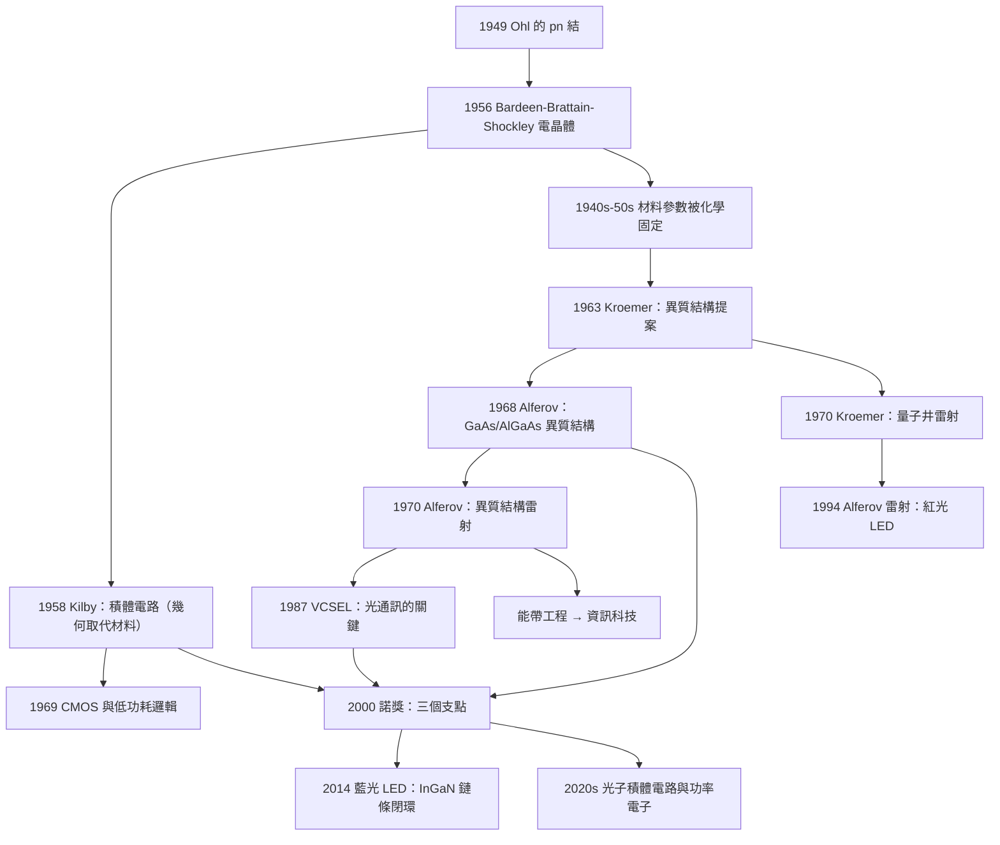

# 2000 · 阿爾費羅夫、克勒默、基爾比：半導體工程的三個支點

> 2000 諾貝爾物理學獎：若雷斯·阿爾費羅夫（Zhores I. Alferov, 1930–2023，蘇聯/俄羅斯）、赫伯特·克勒默（Herbert Kroemer, 1928–2023，德國/美國）與傑克·聖西爾·基爾比（Jack St. Clair Kilby, 1923–2005，美國）——表彰「他們在信息與通信技術方面的工作：阿爾費羅夫與克勒默發明了半導體異質結構，基爾比發明了積體電路」。

## 懸案（案情提要）

2000 年的諾獎表彰了三項「工程發明」——但它們背後有一個共同的物理問題，而這個問題在 20 後半葉佔據了物理學的中心位置。

**讓我們把這個問題說清楚。**

**（一）1940 年代的物理困境。**

**1947 年，Bardeen、Brattain 與 Shockley 發明了電晶體（見 [1956 年諾獎](1956-肖克利巴丁布喇頓的電晶體.md)）。**

**但很快，人們發現了一個嚴重的問題：**

> **「半導體的能帶結構是由材料的化學組成決定的，這意味著你不能『設計』它。」**
>
> **一個工程師若想要某個特定的電學性質，只能去「搜尋」不同的化學成分並測試。**
>
> **這就像你只能透過「找不同的合金」來調整一把刀的性質——你無法「設計」那把刀。**

**（二）三個突破。**

| 年份 | 突破 | 解除了什麼束縛 |
|---|---|---|
| **1958** | **基爾比的積體電路** | **「元件必須在同一塊基底上」——解除了「平面限制」** |
| **1968** | **克勒默的異質結構（heterostructure）** | **「能帶由化學決定」——解除了「材料限制」** |
| **1970** | **阿爾費羅夫的異質結構雷射** | **「能帶工程」的可操作化 |

**（三）讓我們先說基爾比，因為他的故事最戲劇性。**

**1958 年 9 月 12 日，Jack Kilby 在德州儀器（Texas Instruments）的實驗室裡做了一件事：**

**他把三個元件——一個電晶體、一個電阻、一個電容——「整合」到同一塊半導體（鍺）基片上，用「蒸氣鍍」與「光刻」技術連接起來。**

**而且，他是在「沒有顯微鏡觀察」的情況下完成的——因為當時公司的顯微鏡被別人借走了。**

**他在 2000 年諾獎演說中的著名回憶（意譯）：**

> 「**我在顯微鏡下看不到我所做的東西。所以那天晚上回到家，我做了一個夢，夢見我回到實驗室，發現整個晶片都被鍺層覆蓋了。**」

**（四）基爾比的「計算器」與「單晶片」。**

**1958 年 12 月，Kilby 與他的團隊展示了第一個「積體電路」——一個「Flip-Flop 触发器」（用兩個電晶體做成）。**

**1960 年代，TI 的商用 IC 市場佔了全球的 40%–50%（TI 的說法）。**

**（五）但「積體電路」的問題：**

**讓我們指出 Kilby 的方案的侷限，這是「異質結構」的重要性所在：**

**Kilby 的 IC 是「單一材料（鍺）上的元件」——所有元件在同一層、同一襯底上。**

**這意味著：**
- **元件之間的「隔離」靠擴散區的摻雜；
- **無法製作「高性能的 p-n-p-n 結構」；
- **無法製作「異質結」裝置。**

**（六）Alferov 與 Kroemer 的洞見——「刻意讓不同材料接觸」。**

**讓我們寫出這個洞見的核心：**

**（a）Kroemer 的洞見（1963 年提出，1968 年實現）。**

**Kroemer 在 1963 年的一篇論文（〈A proposed semiconductor heterostructure superlattice〉）中提出：**

> **「不要讓載流子『看到』所有的能階邊界。如果用不同半導體的薄層交替堆疊，載流子會被限制在能量較低的材料中——因此可以『設計』它們的能階結構。」**

**（b）Alferov 的實作（1968–1970）。**

**Alferov 在 Leningrad（列寧格勒）的 Ioffe 物理技術研究所，用液相外延（liquid phase epitaxy）製造了「GaAs/AlGaAs」的異質結構。**

**1970 年，Alferov 團隊用它做出了第一個「異質結構雷射」——把電子與空穴「限制」在 GaAs 層中，發光效率大幅提高。**

**（c）Kroemer 的實現。**

**Kroemer 在 1970 年（與 Paul Emge 在 UCSB）用分子束外延（MBE）做出了「AlGaAs/GaAs」的異質結與超晶格。**

## 前因

| 年份 | 事件 |
|---|---|
| 1879 | **Frederick Guthrie 發現「金屬－半導體接觸」的整流效應**。 |
| 1883 | **Frits Zsigmondy 的「金屬絲（filament）」的發明**。 |
| 1904 | **「晶體檢波器」（crystal detector）**——最早使用的半導體器件。 |
| 1926 | **Karl Ferdinand Braun 的「晶體整流器」**。 |
| 1931 | **John Bardeen 的「半導體理論」**（1931 年在 Bell Labs 的「理論物理學家」）。 |
| 1939 | **Russell Ohl 的「p-n 結的發現」**（1940 年發表）。**這是所有半導體器件的起點。** |
| 1939 | **William Shockley 的「半導體理論」與「結理論」**；**Bardeen 的「表面狀態理論」。** |
| 1940 | **Bell Labs 的 Mervin Kelly 與其團隊的「點接觸」研究**；**Ohl 的 p-n 結。** |
| 1941 | **Hoerni 與 Slinker 的「擴散法」**（第一個可製作的 p-n 結）。 |
| **1947-12-23** | **Bardeen、Brattain、Shockley 的點接觸電晶體**（1948 年發表）。 |
| **1956** | **諾貝爾物理學獎**（Bardeen、Brattain、Shockley）。 |
| **1958-09-12** | **Kilby 的第一個積體電路**。 |
| 1960s | **「矽平面製程」的成熟**（Fairchild、Texas Instruments、Motorola）。 |
| **1963** | **Kroemer 的「異質結構超晶格」提案**。 |
| **1968** | **Alferov 的「異質結構」與「異質結雷射」的原型**（實際是 1970 年發表）。 |
| **1970** | **Alferov 的「p-n-p-n 結構的異質結構雷射」；Kroemer 的「異質結與超晶格」。** |
| **1970–1980s** | **Heterostructure 的浪潮**：HEMT（高電子遷移率晶體管）、QW 雷射（1982）、量子井紅外偵測器。 |
| 1980s | **「分子束外延」（MBE）與「金屬有機化學氣相沉積」（MOCVD）**的商業化。 |
| 1990s–2000s | **「半導體異質結構」進入每一台電子裝置**：LED、雷射、FET、太陽能電池。 |
| **2000** | **諾獎頒發**。 |

## 調查

**第一件證物：能帶工程——「半導體物理的『設計學』。**

讓我們把核心的物理寫清楚，這是理解全案的關鍵。

**（一）半導體的能帶結構。**

**（a）導體、半導體、絕緣體的區別。**

| | 價帶 | 禁帶 | 導帶 |
|---|---|---|---|
| **金屬** | 部分填滿 | **無** | 部分填滿 |
| **半導體** | 填滿 | $E_g \sim 0.5$–$3\,\mathrm{eV}$ | 空 |
| **絕緣體** | 填滿 | $E_g > 3$–$5\,\mathrm{eV}$ | 空 |

**（b）載流子的種類。**

- **電子型（n 型）**：施主摻雜（磷、砷），$E_F$ 靠近導帶；
- **空穴型（p 型）：受主摻雜（硼、鎵、銦），$E_F$ 靠近價帶。

**（c）$p$-$n$ 結的整流。**

**在 $p$-$n$ 結的耗盡層中，內建電位 $V_{bi} = \frac{k_BT}{e}\ln\frac{N_A N_D}{n_i^2}$ 阻擋了多數載流子的流動。**

**正偏壓：$V_{bi}$ 降低 → 電流大幅增加（指數律）；**
**反偏壓：電流極小（只有反向飽和電流）。**

**（d）關鍵：什麼決定了一個半導體的性質？**

$$\underbrace{E_g}_{\text{禁帶寬度}},\qquad \underbrace{m_e^*, m_h^*}_{\text{有效質量}},\qquad \underbrace{\mu_e, \mu_h}_{\text{遷移率}},\qquad \underbrace{n_i}_{\text{本徵載流子濃度}}$$

**而這些「材料參數」是由「化學組成 + 晶體結構」決定的——固定死的。**

**（二）異質結構：把「材料參數」變成「可設計的」。**

**（a）異質結的定義。**

**兩塊不同材料（如 GaAs 與 AlGaAs）接合在一起。**

**（b）關鍵：能帶的不對齊。**

** GaAs 的導帶底比 AlGaAs 低（大約低 $0.3\,\mathrm{eV}$ 在 $x = 0.3$ 時），而價帶頂也差不多。**

**因此在 GaAs 層中，電子與空穴都被「困住」（這就是「量子井」）。**

**（c）讓我們寫出量子井的能階。**

**無限深方勢井寬 $L$ 的能階：**

$$E_n = \frac{n^2\pi^2\hbar^2}{2m^*L^2}$$

**（d）量子井雷射——「把發光效率提高兩個數量級」。**

**（i）問題（傳統的雙異質結構雷射）：**

**在傳統的 p-n-p 結構中，電子與空穴注入後會擴散，離開「有增益」的區域（因為擴散長度 $\sim$ 數 $\mu\mathrm{m}$ 大於有增益區的寬度 $\sim 0.1\,\mu\mathrm{m}$）。**

**所以有效增益被嚴重浪費。**

**（ii）量子井的解決：**

**如果增益區很薄（$\sim$ 10 nm），擴散長度就遠大於井寬 → **電子與空穴被「困住」，直到它們複合**。**

**這使閾值電流密度從 $\sim 10^5$ A/cm$^2$（傳統）降到 $\sim 10^3$ A/cm$^2$——提高 100 倍。**

**（iii）量子井的「狀態密度」的增強：**

**二維量子井中的載流子密度是「階梯函數」（step function），而不是三維的平方根函數：**

$$D_{2D}(E) = \frac{m^*}{\pi\hbar^2}\sum_n \Theta(E - E_n)$$

**這提高了「增益－載流子密度」的關係，因而提高了微分增益。**

**（e）HEMT（高電子遷移率晶體管）——「把電子與摻雜分離」。**

**（i）問題：在常規的 MOSFET 中，載流子與離子化雜質在同一層 → 雜質散射限制遷移率。**

**（ii）HEMT 的結構：**

- **AlGaAs 層：摻雜（提供電子）；**
- **GaAs 層：未摻雜（電子在此運動）。**

**由於 AlGaAs 的導帶底較高，電子被「推到」GaAs 層——**與雜質在空間上分離**。**

**結果：遷移率可達 $\sim 10^5$–$10^6$ cm²/(V·s)（而 Si MOSFET 只有 $\sim 500$–$1000$）。**

**（iii）1990 年代的應用：** **衛星通訊、毫米波雷達、功率放大器。**

**（f）讓我們特別指出「莫爾超晶格」的物理。**

**1970 年，Kroemer 與 L. R. Shaw 提出了「莫爾超晶格（molecular-beam epitaxy superlattice）」：**

**兩種半導體以幾 nm 的週期交替，每層的厚度小於電子的德布羅意波長。**

**因此電子看到的是「一個週期性的平均位能」（rather than 分立的層）——這與光學的「介質多層鏡」完全類似。**

**讓我們寫出「超晶格的能帶摺疊（band folding）」：**

**原來的能帶被摺疊成第一 Brillouin 區的大小。**

**若每層厚度 $L$，則新 Brillouin 區大小 $\sim \pi/L$，而原電子態的波矢被摺疊進來。**

**（g）讓我們指出「異質結構的『材料設計』哲學」。**

**讓我們把 1940 年代與 1970 年代的工程能力做個對比：**

| | **1940–60 年代（同質結）** | **1970 年代後（異質結構）** |
|---|---|---|
| **能帶結構** | 化學組成決定 | **逐層工程設計** |
| **載流子限制** | 擴散（$\sim \mu\mathrm{m}$） | **量子限制（$\sim$ nm）** |
| **設計自由度** | 摻雜濃度 | **能帶偏移、井深、井寬、層數、應變** |
| **代表性元件** | Si MOSFET、BJT | **QW 雷射、HEMT、QW 紅外偵測器、太陽能電池** |

**III–V 異質結構的第一個大規模商業應用：1990 年代的 CD 播放器（AlGaAs 雷射）→ 2000 年代的藍光播放器（InGaN）→ 2010 年代的通訊（InP HEMT）。**

**第二件證物：Alferov 的科學與制度——「一個人的傳奇」。**

讓我們把 Alferov 的生平寫完整，因為它是 20 世紀科學史上最動人的故事之一。

| 年份 | 事件 |
|---|---|
| **1930** | 生於蘇聯 Vladimir（城市）——**1924 年才出生於蘇聯的烏克蘭／俄羅斯邊境地區。** |
| **1947** | 進入列寧格勒的「電工技術學院」（捷爾寧工學院）。 |
| 1950–1955 | 在列寧格勒的「電工物理研究所」（VEB）工作。 |
| **1955–1957** | **在「Ioffe 物理技術研究所」（ФТИ им. А. Ф. Иоффе）工作。** |
| **1958** | Alferov 的「第一篇論文」；**「電壓控制式 pn-pn 結構」的理論**。 |
| **1959–1960** | Alferov 進入 **Ioffe 研究所**並成為其「半導體實驗室」的負責人。 |
| **1960** | **阿爾費羅夫的研究方向：異質結構。** |
| **1961–1963** | **「液相外延」（liquid phase epitaxy）**的技術開發——**這是製造異質結構的關鍵技術**。 |
| **1968** | **第一個 GaAs/AlGaAs 異質結構的電學測量**。 |
| **1969–1970** | **第一個異質結構雷射。** |
| **1970** | **異質結構的「物理學派」的建立**。 |
| **1973–1987** | **Alferov 在蘇聯被限制出國（不能參加學術會議），但他的工作持續。** |
| **1987** | Alferov 的學生 **M. A. Alekseev** 等人的發現：**「垂直方向的布里維斯－賈爾–卡尼亞霍夫–克羅爾（VCSEL）」**——垂直腔面發光雷射。**這是光通訊的關鍵。** |
| 1987–1991 | **「帶寬隙工程」的系列工作**；**「低維結構」的概念**。 |
| **1990–1991** | **Alferov 與德國的 Bayer（Wolfram von Borries 研究員）的合作**——**蘇聯與西方科學合作的罕見案例。** |
| 1991 | **德國的「 prizes」**；Alferov 訪問德國。 |
| 1991–2000 | **Alferov 建立了「異質結構的工業化」**——**第一個 Alferov 雷射（1994，AlInGaP）**。 |
| **2000** | **諾獎頒發**。 |
| 2000s | **Alferov 是「納米技術」的倡導者**（俄羅斯「納米技術公司」）。 |
| **2010s** | **「Skolkovo 科技園區」的共同創辦人**——俄羅斯的科學園區。 |
| **2023-07-16** | **Alferov 去世（93 歲）**。 |

**讓我們特別記錄 1991 年的一個歷史性時刻：**

**1987 年，Alferov 的學生在蘇聯做出了 VCSEL。但蘇聯的半導體工業無法製造。**

**1991 年，Alferov 訪問德國，會見了教育部長 Jürgen Rüttgers。** **在會見中，Alferov 提出了建立「德俄研究所」的構想——**這最終成為 2003 年成立的「**Alferov 研究所**（Alferov Research Center，Fraunhofer IFF 與俄羅斯 Ioffe 研究所的合資）**。**

**這是一個「科學家的外交」的成功案例。**

**讓我們也記錄 Alferov 的一句話（他在諾獎演說中，2000 年）：**

> 「**半導體異質結構的 idea，來自物理學，而不是工程學。這正是我要強調的：物理學是技術的源頭。**」

**第三件證物：Kroemer 的「異質結構」的歷史優先權與他的科學生涯。**

**（一）優先權的歷史。**

**讓我們把優先權的細節寫清楚，這是科學史上有意義的一頁。**

| 年份 | 事件 |
|---|---|
| **1957** | **Herbert Kroemer（在 RCA 實驗室）向「美國物理學會」提交「應用物理的評審委員會」報告，論述「半導體異質結構」的想法。** **報告被評審「以為他瘋了」而未發表。** |
| 1963 | **Kroemer 發表〈A proposed semiconductor heterostructure superlattice〉（Applied Physics Letters **6**, 84）。** |
| 1968 | **Kroemer 在 UCSB 報告了第一個異質結構的實驗結果**（在「1968 年國際電子學會議」上報告）。 |
| **1968** | **Alferov 與其團隊（V. M. Andreev、V. A. Shunников 等）獨立製成了 GaAs/AlGaAs 異質結構並測量了「異質結的 I-V 特性」**（報告於 1968 年 10 月的蘇聯《物理技術報告》）。 |
| **1970** | **Alferov 的異質結構雷射**；**Kroemer 的「單量子井雷射」**（同年冬天）。 |
| **2000** | **諾獎：兩人共享。** |

**（二）Kroemer 的一段著名自述（他在《Annals of Mathematics》與他的回憶錄中）：**

**他說，1957 年他向委員會報告他的想法時，一位著名的物理學家（他沒有點名）說：**

> 「**這種東西不可能存在。如果它存在，它將是毫無用途的。**」

**而 Kroemer 自己的回應（他在 2000 年諾獎演說中的說法，大意）：**

> 「**我說：『先生，如果它存在，它將是非常有用的。』他回答：『那就更不可能了。』**」

**這段對話是科學史上最動人的「承認一個不可能」的插曲之一。**

**（三）Kroemer 的科學風格。**

**讓我們比較三位得主的風格，這很有啟發性：**

| | **Kilby** | **Kroemer** | **Alferov** |
|---|---|---|---|
| **核心貢獻** | **系統整合** | **物理洞見** | **物理洞見 + 技術實現** |
| **起點** | 「如果把整個電路做在一塊晶片上……」 | 「如果能控制能階的邊界……」 | 「如果能用不同材料逐層生長……」 |
| **方法** | 工程 | 物理 | **物理 + 工藝** |
| **成功要素** | 堅持、面對「不做顯微鏡」的窘境 | **在「異端」的環境中堅持 10 年** | **在體制的束縛中堅持，並在 1990 年後建立橋樑** |

**（四）Kroemer 的「科學的印證」——「從量子井到太陽能電池」。**

**Kroemer 的觀點（他在 2000 年諾獎演說中強調）：**

> 「**異質結構不只是一個技術。它是一種『物理學的證明』——它證明了半導體的能帶結構可以被『工程控制』。**」

**並且他特別指出：** **「多帶隙（multi-bandgap）太陽能電池」的構想——用不同禁帶寬度的材料堆疊，每個波段由不同的層吸收。**

**這個構想直到 2010 年代才因為「多結（multi-junction）太陽能電池」而商業化**（III–V 多結電池的效率超過 40%）。

**裁決一：異質結構的物理——「能帶偏移與費米面工程」。**

讓我們把物理寫完整。

**（一）異質結的能帶圖。**

**在 GaAs/AlGaAs 的異質結中：**

- **導帶：$E_c(\mathrm{GaAs}) < E_c(\mathrm{AlGaAs})$（GaAs 較低，差 $\Delta E_c$）；**
- **價帶：$E_v$ 大致連續（GaAs 稍低）。**

**（二）電子與空穴的「井」。**

**電子被限制在 GaAs 層（因為它的 $E_c$ 最低）——**這是「電子井」**。**
**空穴被限制在 AlGaAs 層（因為它的 $E_v$ 較低）——**這是「空穴井」**。**

**（c）若兩層都很薄（$\sim$ 10 nm），電子與空穴都會被限制在**同一層**（GaAs）——這就是「**量子井雷射**」的核心。**

**（三）讓我們寫出「受限載流子的能量」與「激子束縛能」。**

**量子井中的電子與空穴會形成「激子」（exciton），其束縛能：**

$$E_B = \frac{m_r e^4}{2(4\pi\epsilon_0\epsilon_r)^2\hbar^2}\times(\text{二维修正})$$

**二維中的激子束縛能是三維的 4 倍（因為二維的侷限把電子與空穴「拉近」）。**

**對 GaAs：二維激子束縛能 $\sim 10$ meV，三維 $\sim 4.2$ meV。**

**在室溫（$k_BT = 26$ meV）下，三維激子會被熱解離，二維激子則較穩定。**

**（四）讓我們特別指出「量子井雷射的「增益曲線」與「激子發光」。**

**量子井中，電子－空穴複合可以通過：**
- **「帶重（heavy hole）」躍遷 → 發光波長更長（能量更低）；**
- **「帶輕（light hole）」躍遷 → 發光波長更短。**

**（五）讓我們指出「應變（strain）」的工程意義——「晶格失配可以被利用」。**

**（a）由於晶格常數不同，異質層之間有「失配」，會產生應變。**

**（b）而當層很薄（$\sim$ 數 nm），材料是「彈性的」（不產生位錯）——這是「超晶格」的穩定性來源。**

**（c）應變會改變帶隙：**

$$\Delta E_g = \frac{2(1-\nu)}{1-\nu}\cdot\ldots$$

**簡化的形式（deformation potential 理論）：**

$$\Delta E_g = E_g^{\text{bulk}} + \Pi_\epsilon\cdot\text{tr}(\epsilon) + \Pi_{\Delta/2}\cdot\Delta/2$$

**（d）讓我們特別指出「InGaN 的特殊性」——「2014 年諾獎（藍光 LED）」的物理基礎。**

**InGaN 的獨特之處：即使有 $\sim 10\%$ 的晶格失配，也能保持無位錯的生長（因為**材料的固化能高**——InN 的鍵能大）。**

**結果：可以「任意」調整 InGaN 的禁帶寬（從 $\sim 1.9$ eV 到 3.4 eV），而不被位損壞。**

**這是 2014 年諾獎（赤崎、天野、中村）的物理基礎——「藍光 LED 的量子的聖杯」。**

**裁決二：積體電路的物理——「$pn$ 結的維度化」。**

讓我們把 Kilby 的貢獻的物理寫清楚。

**（一）關鍵的問題：單晶片上的元件如何「隔離」。**

**在平面製程中，元件之間的隔離靠：**

1. **反偏壓的 $p$-$n$ 結（「isolation region」）；**
2. **氧化層（SiO$_2$）的鈍化。**

**（b）Kilby 的方案更簡單：把所有元件「做在同一塊半導體上」，靠摻雜區域界定。**

**這在當時是可行的（因為「平面製程」成熟了），但極限很快出現。**

**（c）讓我們指出「CMOS 的發明」——「補數器（complementary）結構」。**

**1967–1969 年，Frank Wanlass 在 Fairchild 發明了 CMOS。**

**CMOS 的關鍵優勢：** 「n 型」與「p 型」元件「互補」——**在任何邏輯狀態下，兩個電路分支中總有一個是「關斷」的，因此靜態功耗極低。**

**這是「數位電子時代」的能耗基礎（手機的電池壽命）。**

**（d）讓我們指出「Kroemer 對「未來」的預測——「單電子晶体管」與「分子電子學」。**

**Kroemer 在 2000 年諾獎演說中特別提到：**

> 「**異質結構的技術，最終會導向『分子電子學』——把電子限制在單一分子或單一量子點中。**」

**而這在 2000 年代真的發生了（單電子晶体管、量子點雷射、單光子發光二極體）。**

**（e）讓我們把「異質結構 → 資訊科技」的因果鏈寫出來。**

**這是 2000 年諾獎最重要的「歷史意義」：**

$$\underbrace{\text{異質結構（能帶工程）}}_{\text{Alferov, Kroemer}} \to \underbrace{\text{QW 雷射、VCSEL、DFB 雷射}}_{\text{光通訊}} \to \underbrace{\text{光纖（1987 年諾獎）}}_{\text{高錕}} \to \underbrace{\text{網際網路}}$$

$$\underbrace{\text{HEMT、CMOS、SiGe}}_{\text{電子器件}} \to \underbrace{\text{行動通訊}}{\text{5G}} \to \underbrace{\text{雲端、AI 晶片}}$$

$$\underbrace{\text{LED、藍光 LED（2014）}}_{\text{顯示與照明}} \to \underbrace{\text{節能))$$

**（三）讓我們特別記錄 Alferov 的一句話（他在諾獎演說中，關於「能帶工程」的意義）：**

> 「**人們常說，半導體電子學是物理學的應用。但事實上，是物理學給了我們『能帶工程』的可能性，而這才是改變世界的力量。**」

**裁決三：三項發明的共同物理學——「對稱性與邊界的控制」。**

讓我們找出這三項工作的共同物理學主題，這是理解 2000 年諾獎的深刻方式。

**（a）Kilby：** **用「幾何（空間的邊界）」取代「化學（材料的多樣性）」。**

**（b）Kroemer 與 Alferov：** **用「化學（異質結構）」取代「化學的固定性」——即把「材料參數」從「被決定」變成「被設計」。**

**（c）共同的底層物理：**

$$\underbrace{\text{「在有限空間中的量子系統，其能階由邊界條件決定」}}_{\text{量子井、量子點、量子線}}$$

**而且更深一層：三者的物理學都利用了「對稱性」的工具：**

| | 對稱性的用法 |
|---|---|
| **異質結構** | **用「$C_4$ 對稱」的置換（層間的平移）來設計能階摺疊** |
| **積體電路** | **用「平移對稱」來讓元件「可複製」** |
| **能帶工程** | **用「時間反演 + 粒子－空穴對稱」來設計狀態密度** |

**（d）讓我們把這個主題連到物理學的其他分支：**

**「用邊界條件設計量子系統」是 20 後半葉凝聚態物理的核心方法：**

- **量子井與量子點（1980s–）**；
- **人造原子（1998 年諾獎）**；
- **石墨烯（2010 年諾獎）**；
- **拓撲材料（2016 年諾獎）**；
- **超導量子比特（2012 年諾獎）**。

**因此，2000 年諾獎在物理學史上的位置是：「**半導體工程正式成為物理學的一級課題**」——**而 20 世紀末的「半導體物理 → 奈米物理 → 量子資訊」的轉移，正是從這裡開始的。**

## 後果

| 年份 | 影響 |
|---|---|
| **1958** | **Kilby 的第一個積體電路**。 |
| 1960s | **矽平面製程**；**Frank Wanlass 的 CMOS（1969）**。 |
| **1968–1970** | **第一個異質結構、量子井雷射、超晶格。** |
| 1970s | **HEMT、QW 雷射、DFB 雷射**；**「Alferov 雷射」（1994，AlInGaP 紅光/橙光 LED）。** |
| 1980s | **VCSEL（1987，Alferov 團隊）**；**光纖通訊的黃金年代。** |
| 1980s–90s | **「帶寬隙工程」與「應變工程」**；**量子井紅外偵測器；HEMT 衛星通訊。** |
| 1990s | **SiGe 與 strained Si CMOS**（把遷移率提高 2 倍）；**1994 年的 Alferov 雷射。** |
| **2000** | **諾獎頒發**。 |
| 2000s | **「納米電子學」**；**單電子晶体管；量子點雷射與單光子源。** |
| 2010s | **多結太陽能電池（效率 $>40\%$）**；**InGaN LED 的全面普及**；**5G 的毫米波 HEMT。** |
| **2014** | **藍光 LED 諾獎**——**InGaN 的物理鏈條閉環。** |
| 2020s | **SiC 與 GaN 功率電子**；**光子積體電路**；**Alferov 研究所（2003）與 Skolkovo（2010）。** |

## 關聯

- [1956-肖克利巴丁布喇頓的電晶體](1956-肖克利巴丁布喇頓的電晶體.md)：**直接的上游**——所有三項工作的物理起點。
- [1976-里克特與丁肇中的J粒子](1976-里克特與丁肇中的J粒子.md)：**半導體物理與粒子物理的交會**——「能帶」的粒子物理對應。
- [1981-西格巴恩布隆伯根肖洛的光譜學](1981-西格巴恩布隆伯根肖洛的光譜學.md)：**雷射光譜學——異質結構雷射的應用。**
- [1986-魯斯卡賓寧與羅雷爾的顯微鏡革命](1986-魯斯卡賓寧與羅雷爾的顯微鏡革命.md)：**奈米結構的成像——異質結構研究的工具。**
- [2010-海姆與諾沃肖洛夫的石墨烯](2010-海姆與諾沃肖洛夫的石墨烯.md)：**二維材料——異質結構的「終極版本」。**
- [2014-赤崎天野中村修二的藍光LED](2014-赤崎天野中村修二的藍光LED.md)：**InGaN——能帶工程的最高成就。**
