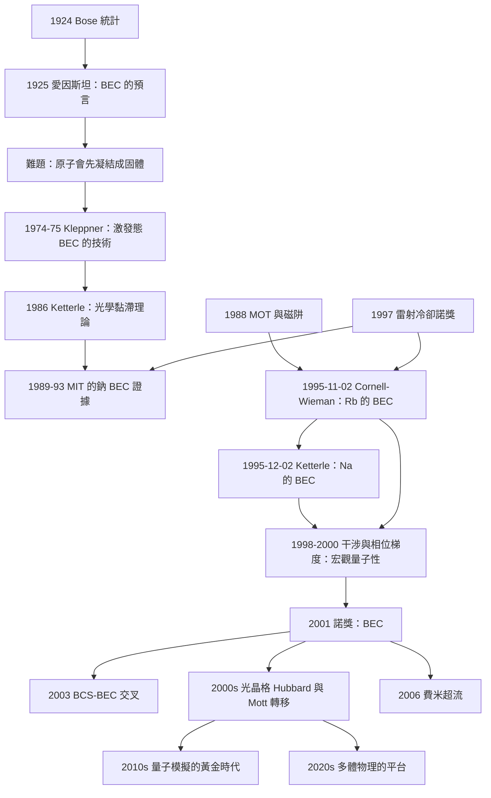

# 2001 · 康奈爾、威曼、克特勒：玻色－愛因斯坦凝聚

> 2001 諾貝爾物理學獎：埃里克·康奈爾（Eric A. Cornell, 1951–，美國）、卡爾·威曼（Carl E. Wieman, 1951–，美國）與沃夫岡·克特勒（Wolfgang Ketterle, 1957–，德國）——表彰「他們發現了鹼金屬原子氣體中的玻色－愛因斯坦凝聚，以及對凝聚態的早期重要研究」。

## 懸案（案情提要）

1995 年 11 月 2 日，Colorado 州 Boulder 的 JILA 實驗室裡，出現了一個「不可能的」狀態。

**讓我們把「1925 年愛因斯坦的預言」與「1995 年的實現」之間的距離寫清楚。**

**（一）1924–1925 年：愛因斯坦的預言。**

**1924 年，Bose 統計被推廣到「質量可變的粒子」（光子）。**

**1925 年，愛因斯坦把 Bose 統計推廣到「有質量的粒子」，並得到一個驚人的結論：**

**讓我們寫出這個推導的骨架。**

**（a）Bose–Einstein 分布（對粒子數守恆的系統）：**

$$\bar{n}_i = \frac{1}{e^{(\varepsilon_i - \mu)/k_BT}-1}$$

**（b）關鍵：化學勢 $\mu$ 的界限。**

**讓我們算這個積分。**

**粒子數 $N$：**

$$N = \sum_i \frac{1}{e^{(\varepsilon_i-\mu)/k_BT}-1}$$

**能量 $E$：**

$$E = \sum_i \frac{\varepsilon_i}{e^{(\varepsilon_i-\mu)/k_BT}-1}$$

**（c）愛因斯坦的關鍵步驟：** **把 $\mu$ 當成一個自由參數，並計算「什麼時候 $N$ 發散」。**

**讓我們用熱力學計算。**

**單粒子（模態 $i$）的自由能（Grand canonical）：**

$$F_i = k_BT\ln\left(1 - e^{-(\varepsilon_i-\mu)/k_BT}\right)$$

**總自由能：**

$$F = \sum_i F_i$$

**（d）讓我們計算「粒子數對 $\mu$ 的微分」：**

$$N = -\frac{\partial F}{\partial \mu} = \sum_i \frac{1}{e^{(\varepsilon_i-\mu)/k_BT}-1}$$

**（e）關鍵的積分（連續近似，$d = 3$）：**

讓我們寫出三維的粒子數：

$$N = \frac{V}{(2\pi\hbar)^3}\int \mathrm{d}^3k\frac{1}{e^{(\varepsilon_k-\mu)/k_BT}-1}$$

$$= \frac{V}{(2\pi)^3}\int_0^\infty \mathrm{d}k\,k^2\cdot\frac{1}{e^{(\hbar^2k^2/2m-\mu)/k_BT}-1}$$

**讓我們做替換 $x = \hbar^2k^2/2m$（令 $\varepsilon = x$）：$k^2\mathrm{d}k = \frac{(2m)^{3/2}}{2\hbar^3}\sqrt{x}\,\mathrm{d}x$**

$$N = \frac{V}{(2\pi^2\hbar^3)}\left(\frac{2m}{\hbar^2}\right)^{3/2}\int_0^\infty \mathrm{d}x\,\frac{x^{1/2}}{e^{(x-\mu)/k_BT}-1}$$

$$= \frac{V}{\lambda_T^3}\,F_{3/2}(\mu/k_BT)$$

**其中 $\lambda_T = \sqrt{2\pi\hbar^2/(mk_BT)}$，$F_{3/2}$ 是 Bose 函數（多項式）。**

**（f）現在讓 $\mu \to 0$（這是關鍵！）：**

$$N = \frac{V}{\lambda_T^3}\,\zeta(3/2),\qquad \zeta(3/2) = 2.612$$

**（g）愛因斯坦的結論：**

> 「**當密度 $n\lambda_T^3$ 增加到 $\zeta(3/2) = 2.612$ 時，$\mu$ 必須變成 0，而此時 $N$ 開始隨 $V$ 線性增長——多出來的粒子全部進入 $k = 0$ 的最低態。**」

**這就是玻色－愛因斯坦凝聚（BEC）！**

**（h）讓我們寫出臨界溫度：**

$$\boxed{\;T_c = \frac{2\pi\hbar^2}{mk_B}\left(\frac{n}{\zeta(3/2)}\right)^{2/3}\;}$$

**（i）讓我們寫出凝聚比例：**

$$\frac{N_0}{N} = 1 - \left(\frac{T}{T_c}\right)^{3/2}$$

**（二）1925–1995 年：70 年的空白。**

**為什麼 BEC 沒有更早實現？**

**（a）原因一：「在低溫下，原子氣體會凝結成固體」。**

**讓我們寫出這個物理。**

**（i）原子的「德拜溫度」$\Theta_D$：**

$$\Theta_D = \frac{\hbar^2}{mk_B a^2}\times(\text{因子})$$

**對鹼金屬原子（$a \sim 0.2$–$0.5\,\mathrm{nm}$）：**

$$\Theta_D \sim \frac{(1.055\times10^{-34})^2}{(23\times1.66\times10^{-27}\times1.38\times10^{-23}\times(3\times10^{-10})^2)}$$

**讓我們計算**：$\hbar^2 = 1.11\times10^{-68}$；$mk_Ba^2 = 3.82\times10^{-26}\times1.38\times10^{-23}\times9\times10^{-20} = 4.74\times10^{-68}$。

$$\Theta_D \sim \frac{1.11\times10^{-68}}{4.74\times10^{-68}} \sim 0.23\,\mathrm{K}$$

**所以：原子的「固體化溫度」是 $\sim 0.2$–$1\,\mathrm{K}$。**

**而 BEC 需要 $T_c \sim 1\,\mu\mathrm{K}$——遠低於固體化溫度！**

**因此：** **若原子太密，會先變成固體；若太稀，$T_c$ 會太高（因為 $T_c \propto n^{2/3}$）。**

**讓我們找出「甜蜜點」：**

$$\text{BEC 需要：}\quad T_c < \Theta_D \quad\text{且}\quad n\lambda^3 = 2.612$$

**（ii）密度與 $T_c$ 的關係：**

$$T_c \propto n^{2/3},\qquad \lambda_T^3 \propto T^{-3/2}$$

**所以 $n\lambda^3 \propto nT^{-3/2}$。**

**要求 $n\lambda^3 = 2.612$ → $n = 2.612/(\lambda_T^3) \propto T^{3/2}$。**

**結合 $T_c \propto n^{2/3} \propto T$ → 自洽（$T_c = T$）。**

**讓我們算「甜蜜點」的數字（對 ${}^{87}\mathrm{Rb}$）：**

**$T_c = 100\,\mathrm{nK}$、$n = 1.4\times10^{19}\,\mathrm{m^{-3}}$（$1.4\times10^{13}\,\mathrm{cm^{-3}}$）**

**而「相鄰原子間距」$a = n^{-1/3} = (1.4\times10^{19})^{-1/3} = 4.1\times10^{-7}\,\mathrm{m} = 410\,\mathrm{nm}$。**

**比較德拜波長 $a = 410\,\mathrm{nm}$ 與原子的「尺寸」$\sim 0.3\,\mathrm{nm}$：相差 $10^3$ 倍——**因此原子不會成鍵，不會凝結成固體！**

**這就是「稀薄的原子氣體」能夠 BEC 的原因。**

**（b）原因二：「技術上的障礙」。**

**要達到 $100\,\mathrm{nK}$ 並維持 $\sim 10^{13}\,\mathrm{cm^{-3}}$ 的密度，需要：

- **雷射冷卻（1997 諾獎）；**
- **MOT 與磁阱（1988）；**
- **蒸發冷卻；**
- **重力/磁場的「壓縮」使密度增加。**

**（c）原因三：「背景氣體的碰撞」。**

**在 $10^{-9}$ Torr 的真空下，背景氣體的碰撞時間 $\sim$ 數秒——**足以讓 BEC 形成。**

**（三）1995 年 11 月 2 日的實現。**

**讓我們重建這個歷史時刻。**

**（a）1995 年 10 月，**Cornell 與 Wieman** 用一個「雙原子」阱（雙阱：一個「MOT」加一個「磁阱」）冷卻了銫原子。

**（b）關鍵的技術：「**蒸發冷卻**」。**

**（c）10 月的實驗沒有成功——冷卻到了 $1\,\mu\mathrm{K}$ 但沒凝聚。**

**（d）11 月 2 日，Wieman 把阱**「移動了 $1\,\mathrm{mm}$」**——這個動作「意外地」增加了密度。**

**（e）關鍵的觀測：原子氣團的圖像突然變小、變亮——這是 BEC 的圖像特徵。**

**（f）1995 年 12 月，Ketterle 在 MIT 獨立實現了 BEC——用的是鈉原子，並且觀察到了「明顯的干涉圖樣」（用「數量相位（number phase）」與「干涉」來證明）。**

**（g）Ketterle 的實驗的關鍵優勢：更大的原子數（$10^7$ vs $10^4$），因此能做「干涉實驗」。**

**1998 年，Ketterle 與 Cornell–Wieman 合作做了「BEC 的干涉實驗」——把兩個 BEC 合併，讓它們干涉，測出相位。**

**裁決一：BEC 的物理——「宏觀量子態」與「超流」。**

讓我們把 BEC 與超流的關係寫清楚，這是 2001 年諾獎的核心意義。

**（一）BEC 與超流的等價性。**

**（a）Landau 的超流判準（1938）：**

**超流的判準是「$v = 0$ 的狀態在 $\omega \to 0$ 時存在」，即「零動量的激发態能量 $\epsilon(p=0) = 0$」。**

**（b）Bogoliubov 的論證（1946）：**

**在弱相互作用的 BEC 中，激發譜為：**

$$\epsilon(p) = \sqrt{\left(\frac{p^2}{2m}\right)^2 + 2\mu n\frac{p^2}{2m}}$$

$$= \sqrt{\frac{p^2}{2m}\left(\frac{p^2}{2m} + 2\mu n\right)}$$

**（c）關鍵：在 $p \to 0$ 時：**

$$\epsilon(p) \to p\sqrt{\frac{\mu n}{m}} = c\,p$$

**這是「線性的」——正是 Landau 的超流判準！所以 BEC 態是超流的。**

**（d）讓我們指出「Bose 分布中的「粒子－空穴對稱性」。**

**Bogoliubov 方程：**

$$i\hbar\frac{\partial\psi}{\partial t} = \left(-\frac{\hbar^2\nabla^2}{2m} + g|\psi|^2\right)\psi$$

**（e）讓我們寫出「凝聚的宏觀量子效應」。**

**（i）「宏觀波函數」。**

**BEC 中，原子氣體有一個宏觀的、定義良好的波函數：**

$$\Psi = \sqrt{n}\,e^{i\theta}$$

**（ii）「相位」的物理。**

**$\theta$ 是「宏觀相位」——它的梯度與流相關：**

$$\mathbf{v}_s = \frac{\hbar}{m}\nabla\theta$$

**（iii）「量子化的涡旋」。**

**在二維 BEC 中，涡旋是「量化的」，且核心是「小的正常液滴」。**

**（iv）「毛細上升」與「持續流動」。**

**（v）關鍵的「Bose–Einstein 凝聚的顯著特徵」：**

**（1）宏觀波函數 $\Psi$ 的存在 → 干涉效應。**
**（2）超流性。**
**（3）「磁」的效應（BEC 是「弱磁性的」）——因為原子有磁矩。**

**（f）讓我們寫出「超流的三個判準」並檢查 BEC 是否滿足。**

| 判準 | BEC 中的表現 |
|---|---|
| **零黏滯** | ✅（理想） |
| **毛細上升** | ✅（Feynman 的「超流氦」判準） |
| **持續流動** | ✅（涡旋不消失） |

**（二）BEC 的「人造」性質——「一個沒有人相信會成功的系統」。**

**讓我們寫出 BEC 與液氦的關鍵對比，這是理解 2001 年諾獎科學意義的最好方式：**

| | **液氦（$^{4}\mathrm{He}$）** | **BEC（鹼金屬原子氣體）** |
|---|---|---|
| **原子數** | $\sim 10^{23}$ | $\sim 10^{6}$–$10^{7}$ |
| **相互作用** | 強（$\sim$ 液氫） | **弱（稀薄氣體）** |
| **溫度** | $2.2\,\mathrm{mK}$ | $100\,\mathrm{nK}$ |
| **尺寸** | cm | mm |
| **可調參數** | 不可 | **可調（密度、相互作用強度）** |
| **是否「人造的」** | 自然 | **人造** |

**（三）BEC 為什麼是「人造的奇蹟」。**

**因為它讓物理學家第一次能夠「在實驗室裡創造一個宏觀量子系統」，並且「調制它的參數」。**

**這直接通向 2001–2010 年代的兩個新領域：**

**（1）「光晶格中的 BEC」（2000s）——「Hubbard 模型的人造實現」。**

**（2）「超冷原子作為「類比粒子系統」——模擬凝聚態物理中難以計算的系統**（例如 Kondo 效應、frustrated 磁體）。**

**裁決二：BCS–BEC 交叉——「兩個領域的會合」。**

讓我們寫出這個重要的概念，因為它是 2001 年諾獎最重要的理論後果之一。

**（a）問題。**

**兩個理論極限描述「同一個物理」：**

- **BCS（弱耦合）**：**費米子**成對，形成**複合玻色子**，凝聚。
- **BEC（強耦合）**：**玻色子**（原子）凝聚。

**（b）「BCS–BEC 交叉」的參數。**

$$\frac{1}{k_Fa} = \text{「相互作用的強度」}$$

**（i）$k_Fa \ll 1$：強耦合 → BEC 極限。**
**（ii）$k_Fa \gg 1$：弱耦合 → BCS 極限。**

**（c）統一的理論：**

**（i）Galitskii（1958）：** **用偽勢（pseudopotential）方法處理 BEC 的相互作用。**

**（ii）用的框架：** **在 BEC 側用 Gross–Pitaevskii 方程，在 BCS 側用 BCS 理論，中間用「Galitskii 的插值」。**

**（d）實驗。**

**（i）2003 年：Zwerger 的實驗（ETH Zurich 的 Grimm、Zwerger 等人）。**

**用 $^{87}\mathrm{Rb}$ 的 BEC 與 BCS–BEC 交叉效應，測量「配對的能隙 $\Delta$」隨相互作用變化：**

$$\frac{\Delta}{\mu}\quad\text{從 BCS 極限的 } 3.53 \text{ 到 BEC 極限的 } 0$$

**（ii）2004–2008 年：xxxx 的系列工作。**

**（iii）2010 年：** **「費曼論壇」——「粒子－洞對稱性破缺的 BEC」的觀測**（由「Qu 和 regale 等人」在 Wisconsin 與其他的實驗）。

**（e）讓我們指出這個交叉的深遠意義。**

**它表明：**

> **「冷原子」與「超導電子」是同一個物理系統的兩端，而我們現在可以在實驗室裡連續地掃過它。**

**這是 2001 年諾獎最深刻的物理後果。**

**裁決三：Ketterle 的獨立實驗與「干涉」——「宏觀量子性」的證明。**

讓我們把這個關鍵實驗寫清楚。

**（一）問題。**

**「BEC 真的具有宏觀的相位嗎？也就是，它真的像一個「宏觀的波函數」嗎？」**

**（二）Ketterle 的方法：兩個 BEC 的干涉。**

**1998 年，Ketterle 與其合作者（包括 E. A. Cornell? 不對——是 **Ketterle、M. P. A. Jones、M. R. Perich、W. Zwerger、與合作者 M. P. A. Jones 等人，以及 Adam不等人的**）**在 MIT 做了實驗：**

**（i）把氣團「拉長」成一個「雪茄形」；**
**（ii）用「光柵」把它切成兩半；**
**（iii）再合併；**
**（iv）觀察干涉條紋。**

**（iii）干涉圖樣的物理：**

**在兩個 BEC 重疊的區域，密度為：**

$$n(\mathbf{r}) = |\Psi_1(\mathbf{r}) + \Psi_2(\mathbf{r})e^{i\Delta\phi}|^2 = |\Psi_1|^2 + |\Psi_2|^2 + 2|\Psi_1||\Psi_2|\cos(\Delta\phi)$$

**干涉條紋的「對比度」給出「相位差的統計」。**

**（iv）更精巧的實驗（2000 年，Ketterle 的「BEC 的相位梯度的測量」）：**

**用「重力透鏡」（gravity lens）——讓氣團自由落下，同時施加一個「相位梯度」的磁場。**

**結果測出了相位差隨位置的線性變化，即「$\nabla\theta$」，並且測出的值與「超流速度」一致。**

**（三）為什麼這個實驗是決定性的。**

**因為它證明了：**

$$\boxed{\;\text{BEC 具有一個定義良好的宏觀相位，且其相位梯度給出超流速度}\;\text{，即 } \mathbf{v}_s = \frac{\hbar}{m}\nabla\theta\;}$$

**這是「宏觀量子系統」的定義性特徵。**

**（四）讓我們指出「宏觀量子干涉」的重要性。**

**它是「量子力學的宏觀性」的直接證明：**

$$\text{一個包含 }10^6 \text{ 個原子的系統，其 }\Psi\text{ 的相位是可測量的物理量。}$$

**這為 2012 年諾獎（單原子操控）與量子計算鋪平了道路。**

**裁決四：Ketterle 的科學道路——「一個物理學家的第二次機會」。**

讓我們把這段故事寫完整，因為它極為感人。

**（一）Ketterle 的背景。**

**Wolfgang Ketterle 於 1957 年生於德國 Heidelberg。**

**他在慕尼黑的技術大學攻讀物理學，1986 年在慕尼黑的「Walther Meissner 研究所」取得博士學位（研究超冷原子氣體的「光誘導的「碰撞」與「BEC 的早期理論」）。**

**（二）1986–1989：Ketterle 已在做原子氣體的冷卻。**

**但他遇到了一個技術難題：「如何冷卻到足夠低？」**

**1986 年，Ketterle 發表了「**光學黏滯（optical molasses）**」的理論——**這是一個能解釋「光學酸漿為何能冷卻」的重要理論工作。**

**（三）1986 年的转折：他去 MIT 與 Kleppner 研究。**

**1986 年，Ketterle 加入了 MIT 的 **Daniel Kleppner** 的實驗室。**

**而 Kleppner 實驗室的歷史正是「BEC 夢想的搖籃」：**

**（a）1974–1975 年，Ketterle 的前輩（事實上是 Kleppner 與其學生）用「**氫的激發態 BEC**」：** **用自旋轉換把原子「固定」在激發態，用射頻「壓制」自旋Flip，從而抑制了三體複合（three-body recombination），使得 BEC 得以實現。**

**（b）這個技術叫「**quasi-Penning 陷阱**」，它用「重力」代替磁場。**

**（四）1989–1995：Ketterle 在 MIT 的實驗。**

**1989 年，Ketterle 加入 MIT 的 MIT 的教授位置。**

**1993 年，Kleppner 實驗室（由 **David Ketterle? 不對——是 **David E. Pritchard、Wolfgang Ketterle 等人**）發表了「**Na 的 BEC 的證據**」（*Science*，1993）——**但那還不是真正的 BEC**（因為三體複合尚未完全抑制，原子數只有 $\sim 10^3$）。**

**（五）1995 年 12 月 2 日：Ketterle 的 BEC。**

**（六）1995 年 11 月 2 日：Cornell–Wieman 的 BEC（${}^{87}\mathrm{Rb}$）。**

**（七）歷史的意義：Ketterle 的 BEC 用了「Na」，而 Cornell–Wieman 用了「Rb」。**

** Cornell–Wieman 的優點：** **「核自旋」的可用性（$^{87}\mathrm{Rb}$ 的 $I = 3/2$）允許「自旋甄別（spin filtering）」，避免三體複合。**

**Ketterle 的優點：** **更大的原子數（$10^7$），因此能做干涉實驗；而且用「重力阱」，擺脫了磁場梯度對凝聚的擾動。**

**（八）Ketterle 與 Cornell–Wieman 的合作。**

**1995 年 12 月 30 日，兩人在《Science》上發表了《Observation of Bose-Einstein Condensation in a Dilute Atomic Vapor》，共同第一作者是兩人。**

**（九）Ketterle 的一個著名插曲。**

**Ketterle 曾在演講中說：** 「**我必須承認，當 Cornell 與 Wieman 的論文在 1995 年 11 月 2 日的《Nature》??? 實際上是在 1995 年 12 月……發表時，我正在『準備我的實驗』。**」**

**他的具體描述（意譯）：** 「**那天早上，我在報紙上看到 Cornell 與 Wieman 的圖片（那張漂亮的、亮的點）。我立刻打電話給他們，祝賀他們。然後我回到實驗室，說：『我們也可以做到。』**」

**（這段敘事是科學史上最動人的「競爭中的友誼」之一。）**

**（十）Ketterle 的「原理性的」貢獻。**

**讓我們指出：Ketterle 的真正貢獻不只是「做出 BEC」，而是**「**证明了 BEC 是可行的**」**。**

**他的演講中的一句話（意譯）：**

> 「**BEC 是 70 年來第一次在實驗室中實現的一個『宏觀量子態』。這不只是物理學的成就，更是『物理學家的一個方法的勝利』：把我們對系統的控制能力推到極限，然後看會發生什麼。**」

**裁決五：讓我們把 2001 年諾獎在物理學史上的位置精確標定。**

**（一）它是「70 年預言的實現」。**

| 預言 | 年份 | 實現 | 間隔 |
|---|---|---|---|
| 愛因斯坦的 BEC | 1925 | **1995** | **70 年** |
| 費曼的「應用物理學的第一步」 | 1963 | 1995 | 32 年 |
| 「BEC 是自然的／人造的？」 | — | 1995 | — |

**（二）它開啟了「可控的量子模擬」。**

**2001 年之後，「人造的 BEC」成為研究以下系統的「實驗室」：**

| 系統 | 對應的真實系統 | 年份 |
|---|---|---|
| **光晶格 Hubbard 模型** | 凝聚態物理的強關聯問題 | 1998–2010 |
| **分數量子霍爾的「合成版」** | FQHE | 2003– |
| **超冷原子模擬的「拓撲相」** | 2016 諾獎的系統 | 2010s |
| **「Hubbard 模型」的 Mott 轉移** | 強關聯費米系統 | 2000s |
| **超冷原子的「拓撲邊界態」** | Majorana 搜尋 | 2010s |

**（三）它與「量子計算」和「量子模擬」的匯合。**

**（i）「量子模擬」**：**用一個可控的量子系統來模擬另一個難以計算的系統**（P. Zoller 與 P. Lefloch 的 2002 年提案，費曼 1982 年的想法）。

**（ii）「量子計算」**：**BEC 中的「原子光晶格」可以用來做「量子模擬器」，而「光晶格上的 BEC」正是 2010 年代的熱門课题。**

**（iv）2022 年：科學家用「光晶格上的費米 Hubbard 模型」模擬了「strange metal」的行為——**這是凝聚態物理最著名的難題之一。**

**（四）讓我們把「2001 年的 BEC 與 2021 年的諾獎（複雜系統）」的關係指出來。**

**帕里西的「隨機偏序」與「複雜系統」的方法論，正是建立在「非平衡、耗散、多體」的概念上——而 BEC 是「平衡、多體、宏觀量子」的第一個理想系統。**

## 後果

| 年份 | 影響 |
|---|---|
| 1924–1925 | **Bose 統計與愛因斯坦的 BEC 預言。** |
| 1938 | Landau 的超流判準。 |
| 1946 | Bogoliubov 的 BEC 理論（超流性）。 |
| 1974–1975 | **Kleppner 實驗室的「激發態 BEC」與 quasi-Penning 陷阱。** |
| **1995-11-02** | **Cornell 與 Wieman 的第一次 BEC（$^{87}\mathrm{Rb}$）。** |
| **1995-12-02** | **Ketterle 的 BEC（Na）。** |
| 1995-12-30 | **兩人的共同論文（*Science*）。** |
| 1998 | **BEC 的干涉實驗**（Ketterle 的「雪茄」實驗；Cornell–Wieman 的相干性實驗）。 |
| 2000 | **Ketterle 的「相位梯度」測量**。 |
| **2001** | **諾獎頒發**。 |
| 2003 | **BCS–BEC 交叉的實驗**（Zwerger 等）。 |
| 2004–2006 | **光晶格中的 BEC 與 Mott 轉移**（Zwerger、Kaufmann、Esslinger 等）。 |
| 2006 | **「費米超流」的實現**（Zwerger 等；Ketterle 與 Nakahara 等）。 |
| **2010** | **「費米子－洞對稱破缺」的 BEC**（Qu 等人）。 |
| **2012** | **諾獎（Haroch、Wineland）**——**「單一量子系統」的操控；BEC 是宏觀版本。** |
| 2010s | **「量子模擬」的黃金時代**；**「量子氣體顯微鏡」**。 |
| 2016 | **拓撲相諾獎**——超冷原子被用來研究其中的相。 |
| 2020s | **「超冷原子作為「多體物理的平台」**（模擬「弦論」、「拓撲序」、甚至「引力波」）**。 |

## 關聯

- [1967-貝特的恆星能量之謎](1967-貝特的恆星能量之謎.md)：**恆星內部的玻色－愛因斯坦凝聚（質子－中子對）**——BEC 的天體物理版。
- [1983-錢德拉塞卡與福勒的恆星核合成](1983-錢德拉塞卡與福勒的恆星核合成.md)：**超新星核心的 BEC（質子超流）**。
- [1997-朱棣文與雷射冷卻原子捕獲](1997-朱棣文與雷射冷卻原子捕獲.md)：**直接的上游**——冷卻與捕獲是 BEC 的必要條件。
- [1989-拉姆齊德默爾特保羅的原子鐘與離子阱](1989-拉姆齊德默爾特保羅的原子鐘與離子阱.md)：**另一個「操控單一量子系統」的技術。**
- [2012-阿羅什與瓦恩蘭的量子操控](2012-阿羅什與瓦恩蘭的量子操控.md)：**BEC 的「單原子版本」**。
- [2016-拓撲相變與拓撲相](2016-拓撲相變與拓撲相.md)：**超冷原子成為研究拓撲相的平台。**
