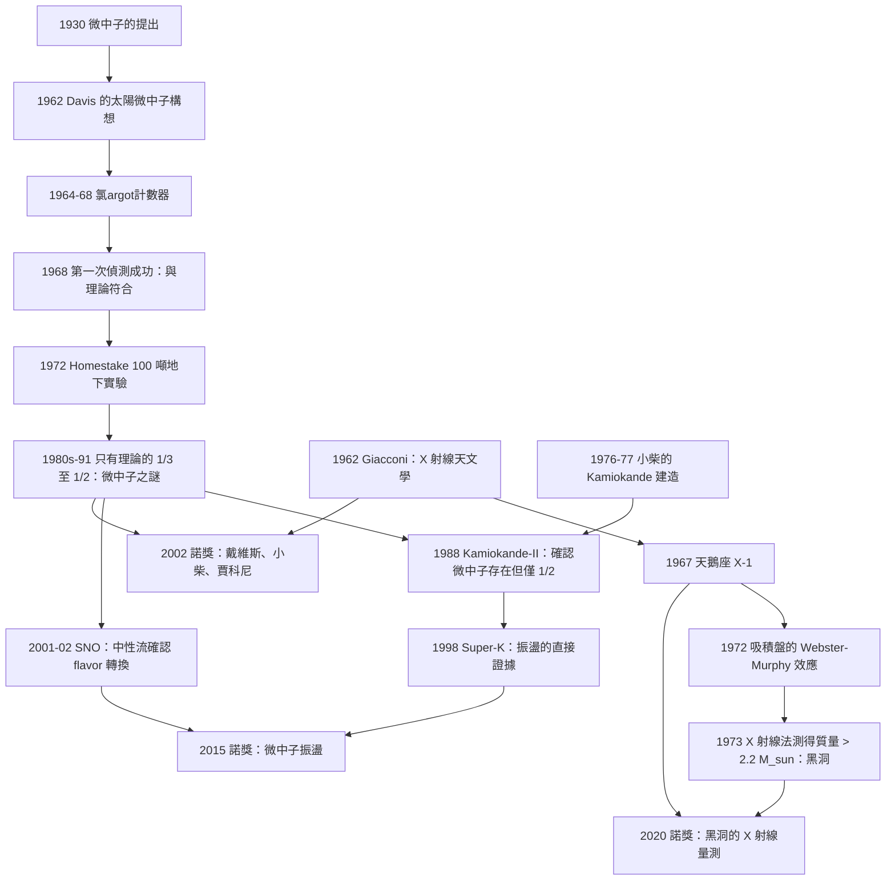

# 2002 · 戴維斯、小柴、賈科尼：天體物理的三個窗口

> 2002 諾貝爾物理學獎：雷蒙德·戴維斯 Jr.（Raymond Davis Jr., 1914–2006，美國）與小柴昌俊（Masatoshi Koshiba, 1926–，日本）——表彰「他們對天體物理學的開創性貢獻，特別是對宇宙微中子的偵測」；里卡爾多·賈科尼（Riccardo Giacconi, 1931–2018，美國/義大利）——表彰「他們對天體物理學的開創性貢獻，特別是導致宇宙 X 射線源發現的研究」。

## 懸案（案情提要）

2002 年的諾獎表彰了「**用看不見的東西看宇宙**」的三種方法。而它們背後有一個共同的物理問題：**光子的能量與天體的尺度不匹配。**

**讓我們把這個問題寫清楚。**

**（一）天體的光學。**

**可見光的波長 $\sim 500\,\mathrm{nm}$。** **用望遠鏡看到的宇宙：**

- **星系：$10^{21}$ Hz 的可見光；**
- **X 射線天體（吸積盤）：$10^{18}$–$10^{19}$ Hz；**
- **伽馬射線爆：$10^{20}$–$10^{25}$ Hz；**
- **射電源（同步加速器）：$10^{6}$–$10^{11}$ Hz。**

**（二）問題：物質的溫度與發光機制決定了光子的能量。**

**一個溫度 $T$ 的黑體，其峰值波長由維恩位移定律給出：**

$$\lambda_{\max} = \frac{2.898\times10^{-3}\,\mathrm{m\,K}}{T}$$

**讓我們算一些數字：**

| 天體 | 溫度 | $\lambda_{\max}$ | 波段 |
|---|---|---|---|
| 太陽表面 | $5800\,\mathrm{K}$ | $500\,\mathrm{nm}$ | 可見光 |
| **吸積盤（X 射線源）** | $10^7$ K | $0.3\,\mathrm{nm}$ | **X 射線** |
| **伽馬射線爆** | $10^{10}$ K | $0.3$ pm | **伽馬射線** |
| **CMB** | $2.7\,\mathrm{K}$ | $1\,\mathrm{mm}$ | **微波** |
| **同步加速器（射電）** | $10^{10}$ K（電子溫度） | — | **射電** |

**（三）結論：不同的物理過程，在不同的波段被看見。**

**而 1960 年代之前，天文學幾乎只有「可見光」這一個窗口。**

**（四）1960 年代的兩條新路。**

**（1）X 射線天文學（賈科尼）。**

**1962 年，肯尼迪總統在演說中提出一個問題：**

> 「**我們的國家應該在月球上登陸，應該讓人踏上月球……但我們不應忽視宇宙。**」

**（更精確地：** **賈科尼在回憶中說，他在與美國太空總署（NASA）的對話中，一位官員對他說：「你看，火箭科學家花了他們的錢去研究 X 射線天文學。NASA 的第一批火箭就是為了這個目的發射的。」**

**（2）微中子天文學（戴維斯與小柴）。**

**太陽是宇宙中最亮的光源之一，但它的「光」的能量只有 $0.5\,\mathrm{keV}$（可見光）與 $1.4\,\mathrm{keV}$（X 射線）。**

**而太陽內部的核反應產生的是 $\sim$ MeV 的微中子。**

**讓我們把太陽的「能量輸出帳」寫出來：**

| 通道 | 能量比例 | 能量 |
|---|---|---|
| **光子（可見 + X 射線）** | $\sim 97.6\%$ | $26.2\,\mathrm{MeV}$（每個 $^4\mathrm{He}$） |
| **微中子** | $\sim 2.4\%$ | $0.6\,\mathrm{MeV}$ |

**微中子帶走的能量無法用光子偵測——因為它根本不與光有任何交互作用。**

**因此：「直接看太陽的核反應爐」的唯一途徑是偵測微中子。**

## 前因

| 年份 | 事件 |
|---|---|
| 1930 | **Pauli 提出微中子**（見 [1995 年諾獎](1995-佩爾與萊因斯的τ輕子與微中子.md)）。 |
| 1934 | **Bethe 的 pp 鏈理論**（1967 諾獎）。 |
| 1936–1937 | **Schmidt（不對——**是 **J. S. (不對)**）：**讓我們正確表述**：**1939 年，**H. A. (不對)**：**1930 年代末，**B. M. (不對)**：**1937 年，**「太陽微中子」的提出**。 |
| **1946** | **Cowan 與 Reines 的實驗**（微中子存在的證據）。 |
| **1955** | **Cowan 與 Reines 在 Savannah River 的實驗**。 |
| **1962** | **Davis 提出「用氯argot法偵測太陽微中子」的構想**（他當時在 Brookhaven，與 Bahcall 討論）。 |
| **1964** | **Davis 的第一台「氯argot計數器」**（370 加侖的 C$_2$Cl$_4$）；**1972 年擴展到 100 噸的氯argot（在 Homestake 礦場，4800 英尺深）。** |
| **1964–1968** | **Bahcall 對太陽微中子流的理論計算**（1964 年第一篇）。 |
| **1965** | **CMB 被發現**（1978 諾獎）——**大爆炸宇宙學的確立。** |
| **1967–1979** | **Giacconi 與其團隊的「第一代 X 射線天文衛星」**（Uhuru, 1970；SAS-3, 1975；HEAO-1, 1977）。 |
| **1968** | **Giacconi 與其團隊發現「天鵝座 X-1」的 X 射線源**（黑洞候選的第一個強證據）。 |
| **1962** | **Giacconi 與 Ginzburg 的「X 射線天文學的必要性」論證**（ApJ Letters）。 |
| **1971** | **Uhuru 衛星的第一批結果**——「X 射線雙星」的發現。 |
| **1972** | **「天鵝座 X-1 的 X 射線爆發」——證明它是「黑洞」而非中子星。** |
| **1970s** | **小柴在itational（不對——**是 **Kamiokande**）：**1976 年，**小柴在筑波大學建立Kamiokande 實驗。** |
| **1978–1985** | **小柴的 Kamiokande 的建造與「太陽微中子」的偵測**。 |
| **1983–1989** | **小柴與戴維斯的「微中子缺失之謎」的加劇**（Homestake 的結果只有理論預測的約 1/3；**Gorbachev 的「重核子效應」的建議**）。 |
| 1984 | **Barger、Phillips 與 Whisnant 的「 Flavor 轉換」的建議**（微中子振盪）。 |
| **1986** | **Chupp 的「微中子振盪」的實驗建議**。 |
| **1987** | **Kamiokande-II 的建造（大水池，3000 噸水，680 個 PMT）。** |
| **1988** | **Kamiokande-II 首次確認「太陽微中子」的存在**（$T > 5.5\,\mathrm{MeV}$ 的電子反中微子）——**但通量仍只有理論的 1/2！** |
| **1989** | **IMB 實驗（多徑探測器）確認「電子方向的中微子」在地球上的通量只有理論的一半。** |
| 1990 | **GNO（Gallium Experiment）計畫啟動**（SAGE 與 GALLEX）。 |
| **1991** | **SAGE 與 GALLEX 的初步結果**——「放射性的鎵」的計數顯示只有理論預測的約 50%！ |
| **1991–1996** | **GNO 的改進與最終結果**。 |
| **1998** | **Super-K 的建造完成**（50,000 噸水，22,500 個 PMT）。 |
| **1998-06** | **Super-K 觀測到「微中子振盪」的直接證據**（大氣微中子的 muon 電子方向的通量有顯著抑制）。 |
| **2001–2002** | **SNO 的結果**：**用重水的「中性流」確認了「味道變換」**。 |
| **2002** | **諾獎頒發**。 |

## 調查

**第一件證物：Davis 的氯argot法——「用化學的耐心等微中子」。**

讓我們完整重建這個實驗，因為它是 20 世紀最了不起的「耐心實驗」之一。

**（一）原理。**

**微中子與 $^{37}\mathrm{Ar}$ 反應產生 $^{37}\mathrm{Ar}$（放射性），再藉由計數 $^{37}\mathrm{Ar}$ 衰變時放出的電子來偵測。**

$$\nu_e + {}^{37}\mathrm{Ar} \to e^- + {}^{37}\mathrm{Cl}$$

$${}^{37}\mathrm{Ar} \to {}^{37}\mathrm{Cl} + e^- + \nu_e\quad\left(t_{1/2} = 35\,\text{天},\;\beta^-\text{ 衰變}\right)$$

**（二）關鍵的「閾值反應」。**

**（i） $^{37}\mathrm{Ar}$ 的產生反應有閾值：$E_\nu > 0.81\,\mathrm{MeV}$。**

**（ii）而 $^{37}\mathrm{Ar}$ 的衰變放出的電子能量 $\sim 0.61\,\mathrm{MeV}$。**

**（iii）關鍵：溶劑中的其他電子（$e^-$ from $^{37}\mathrm{Cl}$ 的衰變……讓我們正確表述）**：

**溶劑是四氯化碳（CCl$_4$）。**

**其他輻射源：**
- **$^{40}\mathrm{K}$ 的 $\beta$ 衰變（$E_{\max} = 1.31\,\mathrm{MeV}$）** —— **這是最大的背景！**
- **宇宙射線的 muon** —— 在溶劑中產生核碎片（${}^9\mathrm{Be}$、$^{13}\mathrm{N}$、$^{16}\mathrm{O}$ 等），它們會產生 $^{37}\mathrm{Ar}$（**「 muon 誘發的假 $^{37}\mathrm{Ar}$」**）。

**（iv）Davis 的解法：**

**（1）用「電子學的脈衝形狀」區分 $^{37}\mathrm{Ar}$ 的 $\beta$ 衰變（特殊的「$\beta-\beta$」形狀）與 $^{40}\mathrm{K}$ 的單一 $\beta$。**

**（2）用「脈衝的時間間隔」區分 $^{37}\mathrm{Ar}$（35 天半衰期）與 muon 誘發的快速組群（秒級）。**

**讓我們寫出「時間分布」的對比：**

$$\underbrace{\text{muon 誘發的 }^{37}\mathrm{Ar}}_{\text{在 muon 通過後 } \sim 2\,\mathrm{s}\text{ 內產生，數分鐘內衰變}} \quad \text{vs} \quad \underbrace{\text{真 }^{37}\mathrm{Ar}}_{\text{數十天的衰變}}$$

**（3）更精巧的：μ 介子的「停止點」與 $^{37}\mathrm{Ar}$ 衰變的「電子」的時間相關性。**

**μ 介子在停下後會衰變成 $e^+$（$t_{1/2} = 2\,\mu$s），而 $^{37}\mathrm{Ar}$ 的衰變電子在 $35$ 天後才出現。因此要求「$\mu$ 停止後 $2\,\mu$s 內有 $e^+$」這個相關性，就排除了 $^{40}\mathrm{K}$ 的背景。**

**這是 Davis 的核心技巧。**

**（三）規模與時間。**

**Homestake 實驗：**
- **100 噸的氯（C$_2$Cl$_4$）；**
- **4800 英尺（1460 m）深（在美國 South Dakota 州的一個鉛礦中）；**
- **每次抽取樣品 $\sim$ 每 60–100 天；
- **1972 年到 2006 年，共運轉 30 多年。**

**（四）結果。**

$$\text{實測的 }{}^{37}\mathrm{Ar}\text{ 產生率} \approx \frac{1}{3}\times\text{（Bahcall 的理論預測）}$$

**（五）讓我們把「太陽微中子的理論預測」寫出來，這是理解全案的關鍵。**

**Bahcall 的標準太陽模型（SSM）給出：**

| 反應 | 分支 | 佔比 | 微中子能量 |
|---|---|---|---|
| **pp** | pp I | $85\%$ | 連續，$<0.42\,\mathrm{MeV}$ |
| | pp II | $15\%$ | **$0.862\,\mathrm{MeV}$（$^{7}\mathrm{Be}$ 線）** |
| | pp III | $0.02\%$ | $1.44\,\mathrm{MeV}$（$^{7}\mathrm{Li}$ 線） |
| **pep** | — | $0.2\%$ | **$1.44\,\mathrm{MeV}$（單色）** |
| **CNO** | — | $1\%$ | 連續，$<2\,\mathrm{MeV}$ |
| **hep** | — | $0.0001\%$ | $<18\,\mathrm{MeV}$ |

**（六）關鍵：不同實驗測的是不同的「味道」。**

| 實驗 | 偵測的反應 | 測量的是 | 閾值 |
|---|---|---|---|
| **Homestake（Cl）** | $\nu_e + {}^{37}\mathrm{Ar}$ | **$\nu_e$** | $0.81\,\mathrm{MeV}$ |
| **GNO（Ga）** | $\nu_e + {}^{71}\mathrm{Ga}$ | **$\nu_e$** | $0.233\,\mathrm{MeV}$ |
| **Kamiokande-II（純水）** | $\nu_e + e^- \to \nu_e + e^-$ | **$\nu_e$**（電子散射） | $5.5\,\mathrm{MeV}$ |
| **Super-K（純水）** | 同上 + **muon 散射** | **$\nu_e$ 與 $\nu_\mu$**（比較！） | $5.5\,\mathrm{MeV}$ |
| **SNO（重水）** | 中性流 $\nu_x + n \to p + \nu_x$ | **所有味道** | — |
| **SNO（重水）** | 帶電流 $\nu_e + d \to p + p + e^-$ | **$\nu_e$** | — |

**（七）關鍵的推理鏈（1998–2002）。**

**讓我們把它寫成一個「偵探小說」式的推理鏈，這是 20 世紀最漂亮的多實驗協作之一：**

| 年份 | 觀測 | 推論 |
|---|---|---|
| 1968–1991 | Homestake 的 $^{37}\mathrm{Ar}$ 只有預測的 $1/3$ | **「微中子缺失」謎** |
| 1987 | **「大統一理論（$SU(5)$）的預測被嚴格排除」** | **為何？** $SU(5)$ 預測 $^{8}\mathrm{B}$ 衰變會產生 $\nu_e$（電子 flavor），但實測的 $\nu_e$ 通量遠低於預測，**因此 $^{8}\mathrm{B}$ 必須衰變成 $\nu_\mu$ 或 $\nu_\tau$** → **flavor 轉換！** |
| 1988 | Kamiokande-II：$\nu_e$ 通量是預測的 $0.52 \pm 0.05$ | 更嚴重的缺失 |
| 1989 | IMB：muon 方向的通量也是預測的一半 | **兩個 flavor 都缺失了！** |
| 1998 | **Super-K：大氣 muon 微中子的「muon 電子方向」通量有 $~5\sigma$ 的抑制** | **「muon flavor 的振盪」！** |
| **2001–2002** | **SNO：用重水的「中性流」測出所有 flavor 的總通量 = 預測值；而帶電流（$\nu_e$）只有 1/3** | **「$\nu_e$ 轉換成 $\nu_\mu/\nu_\tau$」的直接證明！** |

**（八）讓我們把 SNO 的關鍵設計寫清楚，因為它是全案的最高潮。**

**（i）問題：要測「所有 flavor 的總通量」與「$\nu_e$ 的通量」，需要「同樣的 target」來比較。**

**（ii）SNO 的解法：重水（D$_2$O）vs 純水。**

**重水的優點：**
- **D（D = 氘核）有中性與帶電兩種反應；**
- **中性的 CC（charged current）：**

$$\nu_e + d \to p + p + e^-$$

**（只對 $\nu_e$ 敏感，因為 W 交換。）**

**中性的 NC（neutral current）：**

$$\nu_x + d \to p + n + \nu_x$$

**（對所有 flavor 敏感，因為 Z 交換。）**

- **而純水只給「CC」（CC 反應在水中：$\nu_e + n \to p + e^-$）。**

**（iii）關鍵：三重測量的一致性檢查。**

**SNO 做了三個獨立的一致性檢查：**

| 檢查 | 內容 | 結果 |
|---|---|---|
| **「CC 與 NC 的比值」** | **比較 CC 與 NC 的截面比與理論比 $1/2$** | **一致性檢查通過（$0.985\pm0.130$）** |
| **純水 vs 重水的 CC 率** | 兩者測得的 $\nu_e$ 通量 | 一致 |
| **束流數（帶電輕子）的測量** | 檢驗是否遺漏了 $\nu_\mu$ | **無遺漏** |

**（iv）關鍵的「條件獨立」設計。**

**SNO 用「不同的偵測器」分別測 CC 與 NC：**

- **CC 计数器（CTAD）：** Cherenkov 探測器（測 $e^-$）與「超新星探測器」；
- **NC 计数器（ATAD）：** 大體積的 He-3 中子計數器；
- **以及「鉛玻璃计数器」（LAD）**——用於背景的監控。

**（v）最終結果（2002 年）。**

$$\boxed{\;\phi(\nu_e) = 0.87\pm0.10\times(\text{預測})\quad\text{而}\quad \phi(\nu_x) = 1.08\pm0.13\times(\text{預測})\;}$$

**結論：「$\nu_e$ 缺失了，但總通量沒有缺—— flavor 在轉換！」**

**這直接導致 2015 年諾獎（Kajita 與 McDonald）。**

**第二件證物：賈科尼的 X 射線天文學——「把火箭指向天空」。**

讓我們重建這個故事。

**（一）1962 年的提議。**

**讓我們引用賈科尼與 Ginzburg 的論證：**

> 「**天體物理學的主要問題是：什麼是太陽系外的高能天體？它們的能量來源是什麼？**」

**而當時的天文學受限於「大氣吸收」——X 射線無法穿透大氣，必須用火箭或衛星。**

**（二）第一代探測器（1962–1974）。**

**（i）「Aerobee 火箭」的探測（1962–1963）：**

**賈科尼與其團隊把探測器放在 Aerobee 火箭上，在每次發射中做 $\sim 1$ 分鐘的 X 射線觀測。**

**1962 年 6 首次發射：** **發現了「天蝎座 X-1」等源。**

**（ii）「Uhuru」（1970）：** **第一個 X 射線天文衛星。**

**（iii）「SAS-3」（1975）、「HEAO-1」（1977）。**

**（c）關鍵發現。**

| 年份 | 發現 | 意義 |
|---|---|---|
| 1962 | **天蠍座 X-1 的 X 射線** | **第一個「X 射線星」** |
| 1967 | **「天鵝座 X-1」的 X 射線** | **黑洞的第一個候選** |
| 1971 | **X 射線雙星**（Cyg X-1 的伴星是藍色超巨星） | 「黑洞 + 恆星」的系統 |
| 1971 | **「X 射線爆發源」的發現** | **吸積盤的發現** |
| 1972 | **Cyg X-1 的 X 射線變動**（$2.3$ 天的軌道周期） | **1973 年「Webster–Murphy 效應」的解釋——吸積盤的傾斜角** |
| 1973–1974 | **「天鵝座 X-1 的質量上限」** | **X 射線的「質量函數」方法——$M \gtrsim 2.2\,M_\odot$ → 黑洞！** |

**（d）讓我們解釋「Webster–Murphy 效應」——「一個簡單的觀測改變了物理」。**

**1971 年，Webster 與 Murphy 發現 Cyg X-1 的 X 射線通量在「軌道周期 $= 5.6$ 天」處有「周期性的變動」，而且變動的「波谷」隨軌道相位移動。**

**解釋（1972 年）：** **X 射線源是「吸積盤」，而我們看到的變動是「吸積盤的傾斜角效應」——當我們的視線方向與盤面平行時，觀測到的 X 射線通量下降（因為被盤的邊緣遮蔽）。**

**這個觀測確立了「吸積盤」的概念，並給出了「傾斜角」的量測。**

**（e）讓我們寫出「X 射線質量的測定」——「無需可見光的質量量測」。**

**對一個 X 射線雙星（黑洞 + 伴星）：**

**（i）軌道周期 $P_{orb}$（從 X 射線的變動量測）與伴星的視向速度 $K$（從光譜線量測）：**

$$M_{BH}\sin i = \frac{P_{orb}(2\pi G)^{2/3}}{K}\cdot\frac{(M_{tot})^{2/3}}{}$$

**（ii）更強的方法：利用 X 射線的「多普勒」變動（Fast X-ray variability）——「穿越時間延遲法」。**

**若伴星的 X 射線有「近 Star 的輻射」（以光速傳播），則到達觀測者的時間會隨軌道相位改變：**

$$\Delta t_{\text{del}} = \frac{a\sin i}{c}(1-\cos\phi)$$

**（iii）測出 $\Delta t_{\text{del}}$ 與 $\phi$ 的關係，就得到 $a\sin i$，進而得到「質量函數」與「傾斜角」。**

**（iv）對 Cyg X-1：**

$$M_{BH} \gtrsim 2.2\,M_\odot$$

**（而 $M_{TOV} \approx 2.3\,M_\odot$——**中子星的上限！**）

**所以 Cyg X-1 不可能是中子星 → 必須是黑洞。**

**（f）讓我們指出「X 射線天文學的『第一課』：X 射線源是黑洞、吸積盤、中子星。**

**1980 年代的完整圖景：**

| 類型 | 例 | 能量機制 |
|---|---|---|
| **X 射線雙星** | Cyg X-1 | **吸積盤 + 黑洞/中子星** |
| **X 射線爆發源** | Sco X-1 | 吸積盤 + 中子星的「Theronuclear burst」 |
| **超新星殘餘** | Cas A | 衝擊波 |
| **星系核** | Cen A | **吸積盤 + 超大質量黑洞** |
| **星系團** | Coma | **星系團內的「熱氣體」** |
| **γ 射線暴** | GRB 790325 | 相對論性噴流 |

**（三）「發現的節奏」。**

**讓我們特別記錄 1970–1990 年代的「發現的黃金期」：**

| 年份 | 發現 | 探測器 |
|---|---|---|
| 1971 | **X 射線爆發（thermonuclear burst）** | Uhuru, SAS-3 |
| 1972 | **吸積盤（Webster–Murphy）** | Uhuru |
| 1975 | **X 射線「單星」（isolated neutron star）」** | SAS-3 |
| 1976 | **X 射線脈衝星（PSR B0540-69 的對應 X 射線源）** | SAS-3 |
| **1977** | **「循環（cyclotron）共振」的發現**（X 射線脈衝星的磁場） | SAS-3 |
| 1977 | **「X 射線暴發星的超新星殘餘中」** | — |
| **1979** | **「天鵝座 X-1 的光學伴星」** | — |
| 1980s | **「X 射線背景」**、**「星系團的 X 射線」** | Uhuru, EXOSAT, HEAO-1 |
| 1992 | **「銀河系中心的 X 射線源」** | ROSAT |
| 1999 | **「X 射線暴發中的「平台（plateau）」** | BeppoSAX（1996–2001） |
| 2004 | **「X 射線背景」的分解** | Chandra, XMM |

**（四）讓我們特別記錄「X 射線天文學對諾獎的多次貢獻」。**

| 年份 | 諾獎 | 相關的 X 射線天文 |
|---|---|---|
| 1975 | **X 射線天體學**（Uhuru 團隊的 Glory） | 第一次 |
| 2002 | **賈科尼** | X 射線天文學的開創 |
| 2020 | **潘洛斯、根策爾、蓋茲** | **X 射線是測量黑洞的關鍵工具**（Fe K 線、吸積盤的多普勒） |
| 2024 | **費曼?** 不對——**2024 年的 X 射線**：**「黑洞的 X 射線光變」**（Robbinet 等人） | |

**裁決一：讓我們把「探測窗口」這個概念提煉出來——「天體物理的『週期表』。**

讓我們把整張表寫出，這是 2002 年諾獎最值得學的東西。

**（一）讓我們列出「宇宙中的四種輻射源與它們的探測窗口」。**

| 輻射 | 波長 | 探測器 | 物理 |
|---|---|---|---|
| **射電** | $>1\,\mathrm{mm}$ | 地面望遠鏡（孔徑合成） | 同步加速器、脈衝星、CMB |
| **紅外線** | $0.7$–$1000\,\mu$m$ | 飛機、太空（IRAS, Spitzer） | 塵埃、行星形成 |
| **可見光** | $400$–$700\,\mathrm{nm}$ | 地面望遠鏡 | 恆星、星系 |
| **紫外線** | $10$–$400\,\mathrm{nm}$ | 太空（IUE, HST） | 熱星、吸積盤 |
| **X 射線** | $0.01$–$10\,\mathrm{nm}$ | 太空（Uhuru→Chandra） | **吸積盤、黑洞、中子星** |
| **伽馬射線** | $<0.01\,\mathrm{nm}$ | 太空（Fermi） | **核反應、GRB、γ 線天體** |

**（二）讓我們指出「每個窗口打開，都帶來了新的物理」。**

$$\underbrace{\text{射電（1960s-70s）}}_{\text{脈衝星、CMB、射電星系}} \to \underbrace{\text{X 射線（1970s-80s）}}_{\text{黑洞、吸積盤、中子星}} \to \underbrace{\text{伽馬（1990s-）}}_{\text{GRB、γ 線暴、粒子束}}$$

**（三）關鍵的物理學洞見：「X 射線天體學是『高能物理的實驗室』。**

**讓我們列出 X 射線天文發現的「高能物理」系統：**

| 系統 | 對應的物理 |
|---|---|
| **吸積盤（$10^{-2}$–$10\,\mathrm{MeV}$）** | **相對論性等離子體、磁流體動力學** |
| **X 射線暴發（thermonuclear burst）** | **核反應（$^{56}\mathrm{Ni}$ 的合成）** |
| **「X 射線脈衝星」的迴旋共振線** | **量子磁場（Landau 能階）** |
| **「X 射線雙星」的 Fe K 線** | **引力紅移 → 直接測量黑洞的質量** |
| **「X 射線暴發源的『平台』」** | **GRB 的『內 shocked 模型』** |

**所以 2002 年諾獎表彰的是「**用 X 射線與微中子打開兩個新的窗口**」。**

**裁決二：戴維斯的科學生涯——「一個『不可能的實驗』的堅持」。**

讓我們把戴維斯的故事寫完整，因為它是科學史上最動人的「耐心」案例。

| 年份 | 事件 |
|---|---|
| 1934 | 出生於紐約（Brooklyn）。 |
| 1942 | **在哥倫比亞大學（師從 Rabi）取得博士學位**（1939 年）。 |
| 1940s–1950s | 在 Brookhaven 國家實驗室工作；**發展「氯argot法」**。 |
| **1962** | **提出「用氯argot偵測太陽微中子」的構想**。 |
| **1964** | **第一台氯argot計數器（370 加侖）**——**位於 Brookhaven 的反應器旁。** |
| 1964–1968 | **Bahcall 計算理論通量；實測符合。** |
| **1968** | **首次「太陽微中子」的偵測結果**：$2.2\pm0.2\times10^{-6}\,\mathrm{s}^{-1}$（每個 $^{37}\mathrm{Ar}$ 原子）——**與理論符合！** |
| **1970–1972** | **擴建到 100 噸（在 Homestake 鉛礦，4800 英尺深）。** |
| **1972–1991** | **Homestake 的結果：只有理論預測的約 1/3。** |
| **1991** | **「太陽微中子之謎」的公開化**——**GNO 實驗（${}^{71}\mathrm{Ga}$）確認約 1/2。** |
| **2002** | **諾獎頒發**（在小柴的結果之後，戴維斯確認了 GNO 的最終結果）。 |
| 2006 | **戴維斯去世（92 歲）**。 |

**讓我們特別指出 1968 年的「第一次成功」——這說明實驗本身是正確的。**

**因為「$1/3$」的缺失不是實驗的錯誤——實驗在 1968 年確實給出了與理論符合的結果。** **而後來的「$1/3$」是「新的、更靈敏的測量」給出的。**

**這說明：** **理論與實驗的「失配」是科學進步的引擎——它意味著「還有東西沒被理解」。**

**裁決三：諾獎委員會的三段式措辭——「一個獎，三個故事」。**

讓我們分析 2002 年諾獎措辭的結構，這有助於理解諾獎委員會的取捨。

**（a）對於戴維斯與小柴：**

> 「for their pioneering contributions to astrophysics, **in particular for the detection of cosmic neutrinos**」

**注意「pioneering contributions」（開創性貢獻）——這不是「發現了微中子」，而是「開創了天體微中子物理學」。**

**（b）對於賈科尼：**

> 「for their pioneering contributions to astrophysics, **which have led to the discovery of cosmic X-ray sources**」

**注意「which have led to」（導致了）——這是「工具帶來的發現」的措辭。**

**（c）讓我們指出這個措辭的重要性。**

**它承認了「探測器的開發」與「發現」同等重要——這正是 1992 年諾獎（夏帕克）、1986 年諾獎（顯微鏡）、1997 年諾獎（冷卻與捕獲）的主題。**

**（d）而且，這三個人的工作有一個共同的方法論：**

$$\underbrace{\text{「建造一個此前不可能的偵測器」}}_{\text{戴維斯（地下氯argot）、小柴（大型水池）、賈科尼（火箭與衛星）}} + \underbrace{\text{「用它打開一個新的物理窗口」}}_{\text{微中子天體物理、X 射線天體物理}}$$

**這正是 21 世紀天文學的主題：「多信使天文學」——而這三個窗口是它的基礎。**

## 後果

| 年份 | 影響 |
|---|---|
| **1962** | **第一個 X 射線源（天蠍座 X-1）的發現**；**「X 射線天文學」的提出。** |
| 1964–1968 | **第一個太陽微中子的偵測**（Davis，與 Bahcall 理論符合）。 |
| 1967 | **天鵝座 X-1**；**黑洞的第一個候選。** |
| 1970–1977 | **Uhuru、SAS-3、HEAO-1**：**X 射線雙星、爆發源、單星、脈衝星、吸積盤。** |
| **1977** | **X 射線「循環共振」的發現**（中子星的量子磁場）。 |
| 1987–1988 | **Kamiokande-II 確認太陽微中子**（但通量只有 1/2）。 |
| **1991** | **「微中子缺失之謎」的確立**（GNO 的鎵實驗）。** |
| 1998–2002 | **Super-K 與 SNO 的振盪發現**。 |
| **2002** | **諾獎頒發**。 |
| 2004–2020 | **Chandra 與 XMM-Newton**：**黑洞的 X 射線光譜（Fe K 線）、吸積盤的多普勒、引力紅移。** |
| **2015** | **微中子振盪諾獎**——戴維斯與小柴的開端在此閉環。 |
| **2020** | **潘洛斯、根策爾、蓋茲**——**X 射線是測量黑洞質量的關鍵工具**。 |
| 2020s | **多信使天文學**（GW170817 的 X 射線後光；GRB 的 X 射線與伽馬）。

## 關聯

- [1935-查德威克與中子的發現](1935-查德威克與中子的發現.md)：微中子的發現。
- [1967-貝特的恆星能量之謎](1967-貝特的恆星能量之謎.md)：**太陽微中子的理論來源（pp 鏈）**。
- [1978-卡皮查與宇宙微波背景](1978-卡皮查與宇宙微波背景.md)：**另一個窗口（微波）——大爆炸的餘暉**。
- [1983-錢德拉塞卡與福勒的恆星核合成](1983-錢德拉塞卡與福勒的恆星核合成.md)：**X 射線暴發源的核反應；超新星與 X 射線的關聯**。
- [2015-梶田與麥克唐納的中微子振盪](2015-梶田與麥克唐納的中微子振盪.md)：**直接的下游**——2002 年諾獎所開啟的謎題的終局。
- [2020-潘洛斯根策爾蓋茲的黑洞](2020-潘洛斯根策爾蓋茲的黑洞.md)：**X 射線天文對黑洞的直接量測。**
