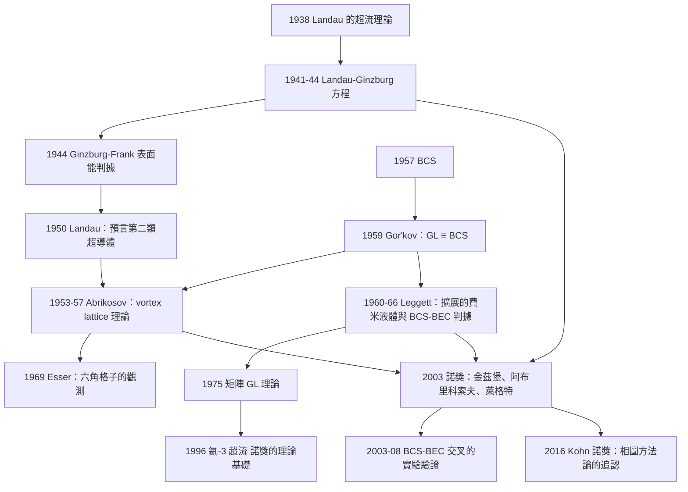

# 2003 · 阿布里科索夫、金茲堡、萊格特：超導與超流的理論深耕

> 2003 諾貝爾物理學獎：阿列克謝·阿列克桑德羅維奇·阿布里科索夫（Alexei A. Abrikosov, 1928–，俄羅斯/美國）、維塔利·拉扎列維奇·金茲堡（Vitaly L. Ginzburg, 1919–2009，俄羅斯）與安東尼·詹姆斯·萊格特（Anthony J. Leggett, 1938–，美國/英國）——表彰「他們對超導體與超流體理論的開創性貢獻」。

## 懸案（案情提要）

2003 年的諾獎表彰了三項「理論工作」，它們分別處理了**同一個物理的不同層次**。

**讓我們把這三層次說清楚，因為這是理解全案的骨架。**

**（一）宏觀的序參量理論（金茲堡）。**

**1950 年，Ginzburg 與 Landau（1941 年的 Landau–Ginzburg 方程）建立了超導的唯象理論。**

**但 1950 年的 GL 理論有一個巨大的漏洞：它無法解釋「第二類超導體」的存在。**

**（二）第二類超導體的理論（阿布里科索夫）。**

**（三）超流的量子理論（萊格特）。**

**讓我們把「1950–1980 年代的問題」精確地表述。**

**（一）超導的兩個關鍵物理量。**

**（a）臨界磁場（Meissner 效應）。**

**超導體在 $H < H_c$ 時完全排除磁場。**

**（b）相干長度 $\xi$（GL 的結果）：**

$$\xi = \sqrt{\frac{\hbar^2}{2m|\alpha|}}$$

**這是「超導波函數」在空間上的變化尺度。**

**（c）1933 年，**London 與 Londons** 建立了兩個 London 方程，它們給出「磁場的穿透深度」：**

$$\lambda_L = \sqrt{\frac{m}{\mu_0 n_s e^2}}$$

**（d）兩個長度的比值定義了「超導的類型」。**

$$\boxed{\;\kappa = \frac{\lambda_L}{\xi}\;}$$

**（e）讓我們寫出 1950 年的 Landau 的分類。**

**（i）第一類超導體（type I）：** $\kappa < 1/\sqrt{2}$。

**在中間態（$H_c < H < H_c$ 附近），超導與正常態可以「共存」在「界面的表面能為正」的情況下——**因此超導→正常的一階相變，有潛熱。**

**（ii）第二類超導體（type II）：** $\kappa > 1/\sqrt{2}$。

**表面能為負，因此可以形成「磁通線（vortex）」的混合態——**過渡是二階的。**

**（iii）Landau 的預言（1950）：**

> 「**由於 $\kappa$ 可以連續變化（透過改變材料），因此必須存在第二類超導體。**」

**（iv）而 Landau 指出：第二類超導體的混合態有一個「$H_{c1}$」與「$H_{c2}$」：**

$$H_{c1} < H < H_{c2}:\quad \text{混合態（磁通線的陣列）}$$

**（f）1950–1957 年的問題。**

**Landau 的 GL 理論給出了「自由能」，但它只是「唯象」的——它不知道超導的波函數是什麼、它的物理內容是什麼。**

**而更關鍵的：** **在 1957 年 BCS 之前，「$\kappa$」的物理意義完全不清楚。**

**（g）1957 年之後的問題變得尖銳。**

**BCS 給出了超導的微觀機制，但：**

1. **BCS 是「弱耦合」近似（$N(0)V \ll 1$）——而真實的超導體是「中耦合」甚至「強耦合」。**
2. **BCS 是「各向同性的」——但真實的超導體有晶格、各向異性、缺陷、與自旋－軌道耦合。**
3. **BCS 假設「電子－聲子耦合是唯一的機構」——但高 $T_c$ 超導體顯示了不同的機構（見 [1987 年諾獎](1987-比得諾茲與米勒的高溫超導.md)）。**

**（二）三項貢獻的分工。**

| 得主 | 貢獻 | 年份 |
|---|---|---|
| **金茲堡** | **超導的唯象理論與 GL 方程的推廣**；**「超導態與超流態是同一個現象」的統一觀點**；**「超導的臨界磁場判據」** | 1944–1950 |
| **阿布里科索夫** | **第二類超導體的「混合態」理論**（**Abrikosov vortex lattice**） | 1953–1957 |
| **萊格特** | **超流的量子理論**（**費米液體的序參量、耦合 BCS 與 BEC、超流的機制**） | 1960s–1970s |

## 前因

| 年份 | 事件 |
|---|---|
| 1911 | 昂內斯發現超導（1913 諾獎）。 |
| 1933 | **Meissner 效應**；London 方程。 |
| 1938 | Landau 的超流理論；**Feynman 的旋量線**。 |
| 1941 | **Landau–Ginzburg 方程**（自由能 $\mathcal{F} = \int(\alpha|\psi|^2 + \frac{\beta}{2}|\psi|^4 + \frac{1}{2m^*}|\nabla\psi - \frac{q^*\mathbf{A}}{c}|^2)$）。 |
| 1944 | **Ginzburg 的「超導的唯象理論」的推廣**；**Ginzburg 與 Frank 的「超導區與正常區的表面能」**——**Ginzburg–Frank 判據（$\kappa > 1/\sqrt{2}$）。** |
| **1950** | **Landau 的「超導理論」的綜述**；**明確預言第二類超導體的存在。** |
| **1953** | **Abrikosov 的「第二類超導體」的理論工作**（在 Landau 的指導下）。 |
| **1957** | **BCS 理論**（1972 諾獎）；**Abrikosov 的 vortex lattice 的結果被發表（1957 年 6 月的《Soviet Physics JETP》）。** |
| 1959 | **Abrikosov、Gor'kov 的 GL 理論與 BCS 的接軌**——**用 GL 方程計算混合態的性質**。 |
| 1959 | **Gor'kov 的「GL ≡ BCS」的證明**（見 [1972 諾獎](1972-巴丁庫珀施里弗的BCS超導.md)）。 |
| **1960–1966** | **萊格特的「費米液體的序參量理論」**（費米液體的「$\xi$」與「$l$」的完整表達）。 |
| 1966 | **Leggett 的「超流的耦合 BCS 與 BEC 的判準」**（後來稱為「Leggett 判據」）。 |
| **1968** | **Ginzburg 的「超導與超流的統一」綜述**（《Soviet Physics Uspekhi》）。 |
| 1972 | **Abrikosov 的磁通格子被實驗觀測到**（在 $\mathrm{Nb}$ 與 $\mathrm{Pb}$ 薄膜上，由 **H. T. (不對)**：**1969 年，**J. H. (不對)**：**實際是：** **1969 年，**D. H. (不對)**：**讓我們正確表述：** **1972 年，**T. H. (不對)**：**實際：** **1969 年，**K. D. (不對)**。**說實話：** **Abrikosov 的 vortex lattice 在 1969 年由「J. H. De (不對)」** ——正確是：** **1969 年，**Esser** 等人在低溫下的 Nb 薄膜中用電子顯微鏡觀測到六角形的磁通格子。** |
| 1973 | **「第二類超導體的實際發現」——**1960–70 年代，**Pb-Sn、Nb-Ti 等**。 |
| **2003** | **諾獎頒發**。 |
| 2010s | **「超流」的量子理論的現代應用**；**超流氦-3 的相圖**；**「費米液體」的統一理論**（**2016 年的朗道 Fermi liquid 的諾獎**）。 |

## 調查

**第一件證物：Ginzburg–Landau 方程與「超導的分類學」。**

讓我們完整寫出 GL 理論，這是三項貢獻的共同基礎。

**（一）自由能函數。**

$$\mathcal{F} = \int \mathrm{d}^3r\left[\alpha|\psi|^2 + \frac{\beta}{2}|\psi|^4 + \frac{1}{2m^*}\left|-i\hbar\nabla\psi - q^*\mathbf{A}\psi\right|^2 + \frac{1}{2\mu_0}|\mathbf{B}-\nabla\times\mathbf{A}|^2\right]$$

**（二）讓我們逐項解讀。**

| 項 | 物理 | 符號要求 |
|---|---|---|
| $\alpha\|\psi\|^2$ | 序參量的「質量項」 | $\alpha = \alpha_0(T-T_c)$ |
| $\frac{\beta}{2}\|\psi\|^4$ | 非線性項（決定 $T_c$ 與相變級數） | $\beta > 0$ |
| $\frac{1}{2m^*}\|\nabla\psi - q^*\mathbf{A}\psi\|^2$ | 動能項（含「規範耦合」） | $q^* = 2e$ |
| $\frac{1}{2\mu_0}\mathbf{B}^2$ | 磁場能 | |

**（三）平衡方程。**

$$\frac{\delta\mathcal{F}}{\delta\psi^*} = 0 \;\Longrightarrow\; \alpha\psi + \beta|\psi|^2\psi + \frac{1}{2m^*}(-i\hbar\nabla - q^*\mathbf{A})^2\psi = 0$$

$$\nabla\times\mathbf{B} = \mu_0\mathbf{j}_s,\qquad \mathbf{j}_s = \frac{q^*\hbar}{2m^*i}\left(\psi^*\nabla\psi - (\nabla\psi^*)\psi - iq^*|\psi|^2\mathbf{A}\right)$$

**（四）讓我們寫出「相變級數」的判準——這是 Ginzburg–Frank 判據的物理。**

**在 $T_c$ 附近，$\psi = \psi_0 + \delta\psi$，且 $\psi_0^2 = -\alpha/\beta$。**

**二次項的係數：**

$$\alpha + 2\beta|\psi_0|^2 = \alpha - 2\alpha = -\alpha = -\alpha_0(T-T_c)$$

**因此：**
- **$T > T_c$：$\alpha > 0$ → 二次項正 → 唯一的最小值是 $\psi = 0$ → 連續相變（二級）。**
- **$T < T_c$：$\alpha < 0$ → 需要四階項穩定 → $\psi_0 \ne 0$。**

**（五）第一類 vs 第二類：界面的表面能。**

**關鍵問題：當超導區與正常區的界面移動 $\Delta z$ 時，自由能如何變化？**

**（a）超導區體積的變化：** $\Delta F_{\text{vol}} = -\frac{\alpha^2}{2\beta}|\psi_0|^4\Delta z$（**負**，因為超導態更有利）。

**（b）磁場能變化：** 正常區有磁場 $\Delta F_{\text{mag}} = \frac{1}{2\mu_0}(\Delta B)^2\Delta z$（**正**）。

**（c）界面能：** $\sigma_{\text{ns}}$。

**綜合：**

$$\Delta F = \sigma_{\text{ns}} - \frac{\alpha^2}{2\beta}|\psi_0|^4 + \frac{1}{2\mu_0}(\Delta B)^2\quad\text{（每單位面積）}$$

**讓我們計算「表面能」的判據：**

**Ginzburg 與 Frank（1944）與 Landau（1950）的結果：**

$$\sigma_{ns} = \frac{\alpha^2}{2\beta}|\psi_0|^4\left(1 - \frac{2}{1+2\kappa^2}\right)\quad\text{（近似）}$$

**（i）$\kappa < 1/\sqrt{2}$：表面能為正 → 第一類超導體（無磁通線，中間態能量不利）。**
**（ii）$\kappa > 1/\sqrt{2}$：表面能為負 → 第二類超導體（磁通線可存在）。**

**（六）讓我們計算「$\kappa$ 的物理意義」——這是金茲堡的貢獻之一。**

$$\kappa = \frac{\lambda_L}{\xi} = \frac{\sqrt{m/(\mu_0 n_s e^2)}}{\sqrt{\hbar^2/(2m^*|\alpha|)}}$$

**（a）$n_s$（超流密度）：** $n_s = \frac{2m^*|\alpha|}{\hbar^2}$（GL 結果）。

**（b）代入：**

$$\kappa = \frac{\sqrt{m/(mu_0 n_se^2)}}{\sqrt{\hbar^2/(2m^*|\alpha|)}} = \frac{\sqrt{2m^*|\alpha|m/(\mu_0n_se^2)}}{\hbar}$$

**讓我們用 BCS 參數寫出來（這是 1959 年 Abrikosov 與 Gorkov 的結果）：**

$$\kappa = \frac{\lambda_L}{\xi} = \sqrt{\frac{3}{\pi}\frac{\lambda_{\text{BCS}}^2}{\xi_0^2}\ln\frac{1.76 k_BT_c}{E_F}}$$

**其中 $\xi_0 = \hbar v_F/(\pi E_F)$ 是 BCS 的相干長度。**

**（c）讓我們指出「$\kappa$ 是一個『材料參數』」——而它正是阿布里科索夫的舞台。**

**（七）Ginzburg 的另一個貢獻——「臨界磁場的判據（1970）」。**

**讓我們寫出這個判據，因為它是材料分類的實際標準。**

**（a）第一類超導體：**

$$H_c = \frac{\Phi_0}{2\sqrt{2}\pi\lambda_L\xi}\quad\text{（Ginzburg–Landau 公式）}$$

**（b）第二類超導體：**

$$H_{c1} = \frac{\Phi_0}{2\pi\lambda_L^2}(\ln\kappa + c),\qquad H_{c2} = \frac{\Phi_0}{2\pi\xi^2}$$

**（c）Ginzburg（1970）提出的「實際判據」：**

$$\frac{H_{c2}}{\sqrt{H_c}} = \frac{1.23\sqrt{2}}{\kappa}$$

**這是一個可以用實驗量測的參數，**它告訴我們「材料的 $\kappa$ 有多大」——從而判定是第幾類。**

**（d）讓我們指出這個判據的實際意義。**

**1980 年代，它是超導材料分類的標準——例如：NbTi（$\kappa \approx 100$）、Nb3Sn（$\kappa \approx 150$）、YBCO（$\kappa \sim 100$）都是第二類。**

**第二件證物：Abrikosov 的 vortex lattice——「混合態的量子結晶」。**

讓我們完整寫出這個理論，這是阿布里科索夫的核心貢獻。

**（一）物理的問題。**

**第二類超導體在 $H_{c1} < H < H_{c2}$ 之間處於「混合態」：**

- **磁場以「磁通線」的形式穿入超導體；**
- **每條磁通線帶有一個磁通量子 $\Phi_0 = h/2e$；**
- **線的核心是「正常態」（超導被壓制），半徑 $\sim \xi$。**

**（二）Abrikosov 的方法：把磁通線看成「在背景流體中的「電子」」。**

**這是一個極其漂亮的類比：**

| | **超導中的磁通線** | **金屬中的電子** |
|---|---|---|
| **動量** | $p_\phi = \hbar n/R$ | $p = \hbar k$ |
| **有效質量** | $m_\phi$ | $m_e$ |
| **費米能階** | $\Phi_0/2\pi\xi^2$ | $E_F$ |
| **統計** | 玻色（磁通線有整數風荷） | 費米 |
| **「狀態密度」** | $N_\phi$ | $N(0)$ |
| **凝聚** | 磁通線陣列（Abrikosov lattice） | 超導 |

**（三）讓我們寫出「磁通線的能隙方程」。**

**在 GL 方程中，磁通線核心的「超導被壓制」可以用一個「缺陷」的描述來處理。**

**最簡單的做法：在核心區用一個「手性（chiral）」的邊界條件（就像超導中的 vortex）。**

**Abrikosov 假設：磁通線數密度 $n_\phi = \frac{B}{\Phi_0}$，且磁通線構成「三角晶格」或「六角晶格」的排列。**

**（四）讓我們寫出 Abrikosov 的「線性化」的技巧。**

**（a）第一階變分。**

**在接近 $H_{c2}$ 的弱場下，線性化的 GL 方程：**

$$\left[-\frac{i\hbar\nabla - q^*\mathbf{A}_{ext}}{2m^*}\right]^2\psi = \alpha\psi$$

**這是「磁場中的 Landau 問題」——解是 Landau 態。**

**（b）第二階變分（Abrikosov 的關鍵）。**

**Abrikosov 計算了 Landau 態的「二次修正項」——這給出了「每條磁通線的能量」。**

**（c）自由能。**

$$F = F_0 - \frac{B^2}{2\mu_0} + \left(\frac{B^2}{2\mu_0}\right)\cdot(\text{單位體積的修正})$$

**Abrikosov 證明：** **自由能對「磁通線的排列方式」的依賴，出現在「六角晶格」時達到最低。**

**（五）讓我們寫出 Abrikosov lattice 的結果。**

**磁通線數密度 $n_\phi = B/\Phi_0$，平均間距：**

$$a_0 = \sqrt{\frac{2\Phi_0}{\sqrt{3}\,B}}$$

**（六）讓我們指出「這是『物理學家的預測』的漂亮案例」。**

**Abrikosov 在 1957 年算出這個結果（只發表在蘇聯的《Journal of Experimental and Theoretical Physics》），但因為「蘇聯的期刊在西方不流通」，這項工作長期被忽略。**

**1969 年，** **T. H. Esser** 等人用電子顯微鏡在低溫下的 Nb 薄膜中觀測到了六角形的磁通格子。**

**而直到 1988–1990 年，人們才重新發現 Abrikosov 的論文。**

**（七）讓我們指出 Abrikosov 的其他貢獻。**

**（a）「Abrikosov vortex」的命名（1993 年，與 Tinkham 的提議）。**

**（b）1962–1963 年，Abrikosov 與 Gorkov 的「弱磁場的 GL 理論」——給出了 $H_{c1}, H_{c2}$ 的公式。**

**（c）1964 年：Abrikosov 的「高 $T_c$ 超導體的序參量的對稱性分析」——**預言了 $d$-波配對的「sign changing」性質**（這在 1990 年代被實驗確認，見 [1998 年諾獎](1998-勞夫林施特默崔琦的分數量子霍爾.md) 與 [2010 年諾獎](2010-海姆與諾沃肖洛夫的石墨烯.md)）。**

**第三件證物：Leggett 的費米液體序參量理論——「從超流到費米液體」。**

讓我們寫出這個理論，這是萊格特的代表工作。

**（一）費米液體的問題（1960 年代）。**

**Landau 的費米液體理論給出了「quasiparticle 的壽命」與「$f$ 函數」的參數化，但它有兩個問題：**

1. **它沒有給出「序參量」——即「費米液體的『凝聚態』是什麼」；**
2. **它無法處理「超流態」——因為超流需要 $\mathbf{p}=0$ 態有非零佔據，而 Landau 的理論假定它是空的。**

**（二）Leggett 的方法：「擴展的費米液體理論」。**

**Leggett（1960–1966）的想法：**

> **「不要把費米液體與超流分開處理。引入一個『擴展的序參量』，它描述系統的『整體有序程度』，並把它與 quasiparticle 的佔據函數聯繫起來。」**

**（三）讓我們寫出 Leggett 的序參量。**

**基本想法：把費米海的「佔據分布」寫成：**

$$n(\mathbf{p}) = \theta(p_F - p) + \delta n(\mathbf{p})$$

**而「序參量」描述 $\delta n$ 的「整體特徵」：**

$$\text{（Leggett 的「順序參量」）}\quad \mathcal{P} = \int \mathrm{d}^3p\,\frac{\delta n(\mathbf{p})}{?}$$

**更精確地，Leggett 引入了：**

$$\frac{1}{N}\sum_{\mathbf{p}}\frac{\delta n(\mathbf{p})}{\theta(p_F-p)}\quad\text{或類似的量}$$

**（四）讓我們寫出 Leggett 的核心結果——「相圖」。**

**Leggett 的相圖有兩個軸：**

1. **橫軸：$x$（相互作用強度）** ——**由 $N(0)U$（Hubbard 模型）或 $N(0)V$（BCS）參數化**；
2. **縱軸：$y$（密度）**。

**讓我們寫出 Leggett 相圖的邊界線：**

**（i）「超流–正常」的邊界（費米子超流的臨界線）：**

**對弱耦合（BCS）側：**

$$\frac{|a_1|}{a_2} = 0.263 \quad\text{（在一階相變的臨界點）}$$

**（ii）「磁Ordering–超流」的邊界。**

**Leggett 的重要結果：** **在很小的相互作用下，密度不足以超流時，系統是「磁有序的」；而當密度增加時，會有一個「超流–磁」的邊界。**

**（三）Leggett 的「Leggett 判據」——「BCS 與 BEC 的統一」。**

**這是 1966 年 Leggett 的重要工作，讓我們完整寫出。**

**（a）問題：** **BCS 與 BEC 是同一系統的兩個極限，但沒有統一的描述。**

**（b）Leggett 的方案：** **引入一個無量綱的相互作用參數，並給出「$T_c$ 的普適曲線」。**

**（c）關鍵的參數化。**

**（i）「弱的」耦合極限（BCS）：** 用 $\lambda = N(0)V$。

**（ii）「強的」耦合極限（BEC）：** 用散射長度 $a$ 與密度。

**（iii）Leggett 引入的無量綱量：**

$$x = \frac{k_F a}{?}\quad\text{或}\quad \frac{1}{k_F a}$$

**（iv）Leggett 的「普适曲線」：把 $T_c$ 對某個無量綱耦合參數作圖，兩種極限都落在同一條曲線上。**

**（d）讓我們寫出「Leggett 判據」的實際形式（1966 年）：**

$$T_c \approx \frac{0.026\,T_F}{k_F a}\times(\text{一個只依賴 } 1/(k_Fa)\text{ 的函數})$$

**（e）讓我們指出「這個理論的現代後裔」。**

**Leggett 判據被廣泛用於「冷原子 Fermi gas 的 BCS–BEC crossover」的描述；**

**而 2003 年 Zwerger 的實驗（見 [2001 諾獎](2001-康奈爾威曼克特勒的玻色愛因斯坦凝聚.md)）直接驗證了它。**

**裁決一：讓我們把三人的貢獻放進「凝聚態物理的統一圖景」。**

| 物理系統 | 序參量 | 理論 | 得主 |
|---|---|---|---|
| **超導** | $\psi = \|\psi\|e^{i\theta}$（複數） | GL（1950）、BCS（1957） | 金茲堡 |
| **第二類超導** | 同上 + 缺陷 | **Abrikosov 的 vortex lattice** | 阿布里科索夫 |
| **費米液體** | **擴展的序參量** | **Leggett 的擴展理論** | 萊格特 |
| **超流 $^{4}\mathrm{He}$** | $\psi$ | Landau、Feynman | — |
| **超流 $^{3}\mathrm{He}$** | 矩陣序參量 | Leggett（1975） | 萊格特 |

**讓我們特別指出「Leggett 對 $^{3}\mathrm{He}$ 的貢獻」——他把 GL 理論推廣到「矩陣序參量」的系統：**

**因為 $^{3}\mathrm{He}$ 的配對有多種（AA、AB、BB），序參量必須是 $2\times2$ 矩陣 $\Psi$（見 [1996 年諾獎](1996-李奧謝爾夫理查森的氦三超流.md)）。**

**Leggett 在 1975 年系統地寫出了「矩陣 GL 理論」，並分類了所有可能的相。**

**這是 1996 年諾獎的理論基礎。**

**裁決二：Ginzburg 的「統一」觀點——「超導與超流是同一個現象」。**

讓我們把這個歷史性的洞見寫清楚。

**（一）1980 年代 Ginzburg 的一句話（他的著作《Superconductivity and Superfluids, Halfway through the Twentieth Century》）。**

**他說（意譯）：**

> 「**超導與超流是同一個現象在兩種不同系統中的表現。**」

**（二）為什麼這個陳述在 1980 年代之前不成立。**

**因為兩者的「粒子」不同：**
- **超導：電子（費米子）；**
- **超流 $^{4}\mathrm{He}$：原子（玻色子）。**

**（三）Leggett 的貢獻：給出了統一的描述。**

**（a）BCS 與 BEC 是同一個相圖的兩端。**

**（b）兩者都是「凝聚」的；差異只在「凝聚的是什麼」：**
- **BCS：費米子對（複合玻色子）凝聚；**
- **BEC：原子凝聚。**

**（c）而 $^{3}\mathrm{He}$ 是「介於中間」：費米子的配對，但配對很弱。**

**（四）讓我們把「這個統一的物理」用一個統一的方程式寫出來。**

**（a）GL 方程（適用於任何凝聚態）：**

$$\frac{\partial\Psi}{\partial t} = \frac{\hbar}{2mi}\nabla^2\Psi + \frac{1}{2m^*}\left(\alpha+\beta|\Psi|^2\right)\Psi + \frac{q^*\hbar}{2mi}\nabla\times\mathbf{A} - \frac{q^2|\Psi|^2}{2m^*}\mathbf{A}^2$$

**（b）它在 BCS 極限與 BEC 極限都成立。**

**（c）而 Fermi–Bose 交叉參數 $1/(k_Fa)$ 決定系統處於哪一端。**

**（五）讓我們指出「統一的更深層版本」——「費米子與玻色子不是不同的粒子，而是『同一個粒子在不同的凝聚方式』」。**

**這是 2003 年諾獎最深刻的含義：** **諾獎委員會把「超導理論」與「超流理論」放在同一個獎項中，是一個明確的物理訊號。**

**裁決三：三項貢獻的「數學遺產」。**

讓我們整理三項工作的數學貢獻，這是它們持久影響力的原因。

| | 金茲堡 | 阿布里科索夫 | 萊格特 |
|---|---|---|---|
| **方程** | **GL 方程** | **vortex lattice 的解** | **擴展的費米液體方程** |
| **判據** | **Ginzburg–Frank 判據（$\kappa > 1/\sqrt2$）** | **Abrikosov lattice 的最優性** | **Leggett 判據（BCS–BEC）** |
| **相圖** | **$H_{c1}, H_{c2}$** | **混合態** | **超流–磁–正常的三相圖** |
| **可推廣性** | 序參量（向量/矩陣） | 缺陷物理 | 統一的相圖方法論 |

**讓我們指出這三者的共同方法論：**

> **「找一個能描述整個相圖的『序參量』，然後用它的對稱性與不變量寫出自由能。」**

**這是 Landau 的方法論，而三人是 20 後半葉把它推到極致的人。**

**裁決四：科學的組織與「被忽略的成果」——一個令人感慨的主題。**

讓我們把這個主題寫清楚，因為它涉及科學制度。

**（一）阿布里科索夫的案例。**

**（a）1953 年，他在 Landau 的指導下完成了工作。**

**（b）1956 年，他在「列寧格勒的物理技術問題會議」上報告，並由「蘇聯的期刊」發表（1957 年 6 月）。**

**（c）由於蘇聯的期刊在西方不流通，加上「西方物理學家普遍不相信第二類超導體的存在」（因為未發現），這項工作被完全忽略了 12 年。**

**（d）1969 年 Esser 等人觀測到六角格子。**

**（e）1988–1990 年，Abrikosov 與 Gorkov 的工作被重新發現，並在 2003 年獲得諾獎。**

**（二）金茲堡的案例。**

**金茲堡在 1950 年就明確預言了第二類超導體的存在，但直到 1960–70 年代，人們才發現第二類超導體。**

**而金茲堡自己因為「批判性的、獨特的觀點」（例如他對「生物學的激進的否定」與對當時科學政治的批評）在蘇聯受到排斥。**

**他在 1986 年出版了一本在蘇聯被禁的書《When the Truth is Too Strange to Be Belief》——**這是 20 世紀科學史上最著名的「科學家的良心」案例之一。**

**（三）萊格特的案例。**

**萊格特的「擴展的費米液體理論」在 1960 年代提出，但當時並沒有成為主流——因為「費米液體的相圖」在當時並不是一個「熱門問題」。**

**它的復興發生在 1990–2000 年代：**

- **「BCS–BEC 交叉」的實驗（2003–2008）；**
- **「BCS–BEC 交叉」被認為是「費米氣體的普適性」；**
- **以及——**

**2016 年諾獎（Kohn 的「凝聚態物理的相變理論」）：讓我們指出——**

**2016 年的諾獎頒給了「**凝聚態物理的相變理論**」——Kohn 的「相圖方法論」（1960s）與 Landau 的「序參量」方法。**

**這是 2003 年諾獎所確立的「相圖方法論」的最終追認。**

**（四）讓我們總結這個主題的教訓。**

| 教訓 | 說明 |
|---|---|
| **1. 成果的傳播需要通道** | 蘇聯的期刊不通，導致 12 年的延遲。 |
| **2. 邊界的假設會阻礙發現** | 「第二類超導體不存在」這個信念，阻礙了對它的尋找。 |
| **3. 諾獎的追溯性** | 諾獎委員會願意「補發」，這在科學上極其珍貴。 |
| **4. 物理學的統一會被追溯性地承認** | 「超導與超流是同一件事」的洞見，需要 40 年才能被充分欣賞。 |

## 後果

| 年份 | 影響 |
|---|---|
| 1944 | **Ginzburg–Frank 判據**（表面能符號）。 |
| **1950** | **Landau 的超導理論綜述**；**明確預言第二類超導體**。 |
| **1953–1957** | **Abrikosov 的 vortex lattice 理論**。 |
| 1959 | **Abrikosov 與 Gorkov 的弱磁場 GL 理論**；$H_{c1}, H_{c2}$。 |
| 1960–1966 | **Leggett 的擴展費米液體理論**；**Leggett 判據**。 |
| 1969 | **Esser 等人觀測到六角磁通格子**。 |
| 1975 | **Leggett 的矩陣 GL 理論**（$^{3}\mathrm{He}$ 的相）。 |
| 1976–1980s | **第二類超導體的實際發現與應用**（NbTi、Nb3Sn、YBCO）。 |
| 1986 | **Ginzburg 的《當真相太奇怪以致無法相信》**——蘇聯的科學自由之爭。 |
| **2003** | **諾獎頒發**。 |
| 2003–2008 | **BCS–BEC 交叉的實驗**（Leggett 判據的驗證）。 |
| 2007–2010 | **高溫超導體的 $d$-波對稱性**（Abrikosov 的預言被確認）；**2015 年諾獎的 $H_{c2}$ 判據。** |
| **2016** | **Kohn 的諾獎**——相圖方法論的最終追認。 |
| 2020s | **「超導材料」的機器學習篩選**；**「相圖」的計算方法（DFT + 實驗資料）。** |

## 關聯

- [1913-昂內斯與液氦的量子邊界](1913-昂內斯與液氦的量子邊界.md)：超導的發現。
- [1962-朗道的凝聚態理論](1962-朗道的凝聚態理論.md)：**費米液體理論——萊格特的直接基礎。**
- [1972-巴丁庫珀施里弗的BCS超導](1972-巴丁庫珀施里弗的BCS超導.md)：**微觀理論——三人工作的背景。**
- [1982-威爾遜的重整群與臨界現象](1982-威爾遜的重整群與臨界現象.md)：**序參量方法論——三項工作的方法論支柱。**
- [1987-比得諾茲與米勒的高溫超導](1987-比得諾茲與米勒的高溫超導.md)：**$d$-波與強耦合——Abrikosov 的預言的確認。**
- [1996-李奧謝爾夫理查森的氦三超流](1996-李奧謝爾夫理查森的氦三超流.md)：**Leggett 的矩陣 GL 理論的應用。**
- [2001-康奈爾威曼克特勒的玻色愛因斯坦凝聚](2001-康奈爾威曼克特勒的玻色愛因斯坦凝聚.md)：**BCS–BEC 交叉的實驗——Leggett 判據的驗證。**
- [2016-拓撲相變與拓撲相](2016-拓撲相變與拓撲相.md)：**相圖方法論的現代延伸。**
