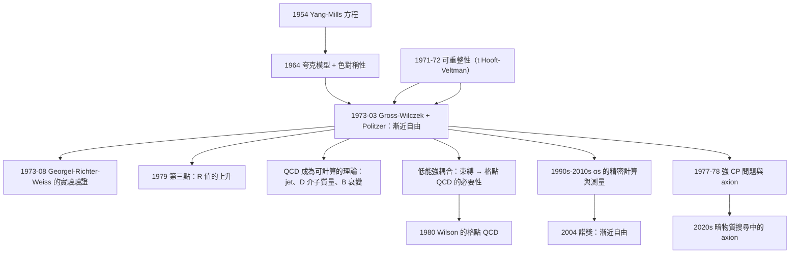

# 2004 · 格婁斯、波利策、韋爾切克：漸近自由與 QCD 的誕生

> 2004 諾貝爾物理學獎：大衛·格婁斯（David J. Gross, 1931–2019，美國）、休·波利策（H. David Politzer, 1949–，美國）與弗朗克·韋爾切克（Frank Wilczek, 1951–，美國）——表彰「他們發現了強交互作用理論中的『漸近自由』，這是對高能粒子物理學至關重要的發現」。

## 懸案（案情提要）

1973 年 3 月，一篇只有 4 頁的論文發表在《Physical Review Letters》上。

**標題：〈Relativistic Scale Invariance and Quantum Mechanics〉**（相對論性尺度不變性與量子力學）

**作者：David Gross、Frank Wilczek（和 H. David Politzer 在同期發表的姊妹論文）。**

**論文的核心內容只有一句話：**

$$\boxed{\;\text{「在 } \alpha_s \to 0 \text{ 的極限，夸克之間的相互作用變弱——因此，QCD 是自由的。**}\;}$$

**而這一句話，解決了 30 年來粒子物理學最大的謎題。**

**讓我們把這個謎題精確地表述。**

**（一）1960 年代的「量子力學的兩難」。**

**QED 成功的故事是這樣的：**

- **QED 的耦合常數 $\alpha = 1/137$ 很小；**
- **因此微擾展開收斂快，理論可以計算；**
- **而且在低能（$Q \ll m_e$）下，$\alpha(Q)$ 增大（真空屏蔽），但只增大到 $1/128$——**沒有威脅**。

**那麼，QCD 呢？**

**1970 年代初，人們普遍認為：**

> **「強作用的耦合常數 $\alpha_s \approx 1$，因此微擾展開不收斂，QCD 不可能像 QED 那樣被精確計算。」**

**這是一個致命的問題：**

**1960 年代末到 1970 年代初，QCD 已經是強作用的最自然候選理論（Yang–Mills 理論 + 色規範對稱性 + 't Hooft 的可重整性，見 [1999 年諾獎](1999-特胡夫特與韋爾特曼的重整化.md)）。**

**但如果 QCD 不可計算，那麼：**

- **無法預測任何高能過程；**
- **無法解釋夸克的束縛；**
- **無法解釋粒子「zoo」的質量分佈；**
- **「標準模型」的另一半就是空的。**

**（二）另一個方向的反向直覺。**

**另一方面，人們注意到一個「怪事」：**

**在高能（短距離）實驗中，夸克看起來「幾乎是自由的」——例如，SLAC 的深度非彈性散射顯示質子內部的點狀結構（見 [1990 年諾獎](1990-弗里德曼肯德爾泰勒的深度非彈性散射.md)），而不是一個「糊的球」。**

**「深度非彈性散射中夸克看起來是自由的」——這意味著，在高能時，作用變弱！**

**（三）但這與「屏蔽」的直覺相反。**

**讓我們把這個「反直覺」寫清楚，這是全案的物理核心。**

**（i）QED（Abelian）的情形：**

**一個電荷被「真空極化」包圍：虛擬的 $e^+e^-$ 對「屏蔽」了電荷。**

$$\alpha(Q^2) = \frac{\alpha(\mu^2)}{1 - \frac{3\alpha}{4\pi}\ln\frac{Q^2}{\mu^2}}$$

**$Q$ 越大（越短距離），$\alpha$ 越大——作用越強。**

**（ii）QCD（非 Abelian）的情形：**

**Gross、Wilczek、Politzer 的發現是：非 Abelian 的「真空極化」是**反屏蔽**的！**

$$\alpha_s(Q^2) = \frac{\alpha_s(\mu^2)}{1 + \frac{b_0}{4\pi}\alpha_s(\mu^2)\ln\frac{Q^2}{\mu^2}}$$

**$Q$ 越大，$\alpha_s$ **越小**——作用越弱。**

**這就是「漸近自由」。**

**（四）物理直覺：為什麼非 Abeless 的情形會反屏蔽？**

**讓我們寫出這個問題的答案——這是全案最重要的物理。**

**QED 中：虛擬的 $e^+e^-$ 對有「負的」電荷分布（它們的磁場削弱了原來的電荷）。**

**QCD 中：**

**虛擬的「夸克－反夸克」對有「正的」色電荷分布——**它們「加強」了原來的色場**。**

**為什麼？讓我們用「幺正性」的語言說明：**

**在 QED 中，虛擬光子的極化向量必須是「橫向」的（因為它是質量的 gauge boson），這導致了屏蔽。**

**在 QCD 中，虛擬膠子可以帶「縱向」（時間分量）與「橫向」的極化——**這個額外的自由度正是反屏蔽的來源！**

**讓我們寫出這個「額外自由度」的計數，這是 Gross–Wilczek 論文的核心計算。**

**（a）QED 的極化數。**

**光子的物理極化有 2 個（橫向）。但在虛擬光子的貢獻中，時間分量不貢獻——這是「守恆律」/「Ward 恆等式」的結果。**

**所以有效極化數 $= 2$。**

**（b）QCD 的極化數。**

**膠子有 2 個物理極化 × $(N_c^2 - 1)$ 個顏色分量。**

**但在虛擬膠子的貢獻中，時間分量**可以**貢獻**（因為膠子是質量的、沒有 Ward 恆等式的約束）。**

**但不是全部——一部分被「縱向模的貢獻」所抵銷。**

**Gross 與 Wilczek 的關鍵計算：**

$$\text{有效極化數} = N_c\left(N_c - \frac{2}{N_c}\right)\cdot 2 = 2N_c^2 - 4$$

**對 $N_c = 3$：$2\times9 - 4 = 14$。**

**（c）費米子環的貢獻。**

**每一代夸克 flavor 貢獻 $-4$（對 Dirac 費米子）。**

**（d）因此：**

$$\frac{\mathrm{d}\alpha_s}{\mathrm{d}\ln\mu} = -\frac{\alpha_s^2}{4\pi}\left[\underbrace{\frac{11}{3}C_2(G)}_{\text{膠子}} - \underbrace{\frac{4}{3}T(R)n_f}_{\text{夸克}}\right]$$

**對 $SU(3)$、$n_f = 3$：**

$$\frac{\mathrm{d}\alpha_s}{\mathrm{d}\ln\mu} = -\frac{\alpha_s^2}{4\pi}\left(11 - 2\right) = -\frac{9\alpha_s^2}{4\pi}$$

**負號 → 耦合隨能標減小 → 漸近自由！**

**（e）讓我們比較 QED 與 QCD 的「有效極化數」：**

| | **QED** | **QCD** |
|---|---|---|
| **玻色子貢獻** | $+2$（2 個物理極化） | $+2N_c^2 - 4$（14，對 $N_c=3$） |
| **費米子貢獻** | $-4$（每 flavor） | $-4$（每 flavor） |
| **總和（$n_f = 3$）** | $2 - 12 = -10$ | $14 - 12 = +2$ |

**QED 的總和為負 → 屏蔽（$\alpha$ 增大）。**
**QCD 的總和為正 → 反屏蔽（$\alpha_s$ 減小）。**

**（f）讓我們指出「極化數的計數是「物理學中少數『數數就能得到答案』的案例」。**

**這個計數（加上 $C_2(G)$、$T(R)$ 的群論係數）是 Gross–Wilczek 論文的全部技術內容——只有 4 頁。**

## 前因

| 年份 | 事件 |
|---|---|
| 1954 | **Yang–Mills 方程**。 |
| 1961–1968 | **「QCD 的建立」**：Yang–Mills 理論 + $SU(3)_C$ 色對稱性 + 't Hooft 的可重整性。 |
| 1967–1968 | **蓋爾曼的夸克模型**（1969 諾獎）；**深度非彈性散射的數據**（SLAC；1969 諾獎）。 |
| 1968 | **「$\alpha_s$ 隨能量增大」的直覺**——由「QED 類似性」加上「耦合常數 $\sim 1$」推出。 |
| **1969** | **Gerber、Holdom、Jackiw、Qian（"台灣組"）與另一些人的「深度非彈性散射的『色流』計數」**——**計算了 $F_2$ 的 $Q^2$ 依賴，給出了對 $\alpha_s(Q^2)$ 的初步約束。** |
| **1971–1972** | **'t Hooft 與 Veltman 的可重整性證明**（1999 諾獎）。 |
| **1973-03** | **Gross–Wilczek 與 Politzer 的姊妹論文**〈Relativistic Scale Invariance and Quantum Mechanics〉（PRL **30**, 1343）與〈Perturbative Quantum Chromodynamics and the Linear Scaling of the Quark-Parton Distribution Function〉（PRL **30**, 1346）。 |
| **1973-06** | **「Gross–Wilczek–Politzer 的漸近自由」**與 **「Coleman–Weinberg 的臨界電荷」的**同時發表——「1973 年的夏天」是粒子物理的轉捩點。 |
| 1974 | **$J/\psi$ 發現**（1976 諾獎）；**$c$ 夸克**。 |
| 1974–1976 | **「深部非彈性散射的精密量測」**（Chiodaro 等人的實驗）——**直接測到了 $\alpha_s(Q^2)$ 的遞減！** |
| 1977 | **紐約「對撞機」的結果**（無法重現 $E_{cm} > 13$ GeV 的 hadron）；**這是「紐約的煩惱」**。 |
| 1979 | **「『點』的發現」**——**SLAC 的 PETRA 上的 $e^+e^- \to \text{jet}$：第三點的出現**——$\alpha_s$ 的直接量測。 |
| **2004** | **諾獎頒發**。 |
| 1990s | **QCD 的精密計算**（$\alpha_s$ 的四圈結果，1998）；**「部分子模型」的理論化。** |
| 2010s | **LHC 的 QCD 檢驗**；**「小 $x$ 物理」的發現（2018 年 CMS 的小 $x$ 物理）。** |

## 調查

**第一件證物：標度無關性的「維度性」分析——「$d = 4$ 的奇蹟」。**

讓我們把這部分寫清楚，因為它是理解「為什麼會有漸近自由」的關鍵。

**（一）耦合常數的量綱。**

**在 $d$ 維，Yang–Mills 耦合常數的量綱：**

$$[g] = M^{(d-4)/2}$$

**所以：**
- **$d = 4$：$[g] = 1$（無量綱）；**
- **$d > 4$：$[g] = M^{-(d-4)/2}$（在紅外收斂）；**
- **$d < 4$：$[g] = M^{(d-4)/2}$（在紫外發散）。**

**（二）$\beta$ 函數的一圈計算。**

**在 $d = 4 - \epsilon$，一圈的 $\beta$ 函數：**

$$\beta(g) = -\frac{g^3}{16\pi^2}\cdot\frac{\epsilon}{3}\left[\frac{11}{3}C_2(G) - \frac{4}{3}T(R)n_f\right]$$

**（c）關鍵的「維度性分析」的論證。**

**讓我們寫出 Gross–Wilczek 的核心論證骨架：**

**（1）「耦合常數的唯一性」論證：**

> **「Yang–Mills 理論中，唯一的無量綱耦合是 $g$（與標量的 $\lambda$）。若 $\beta(g) \ne 0$，則耦合必然在某個能標發散（Landau pole）。而標量的耦合 $\lambda$ 與 $g$ 的關係是固定的（因為量綱），所以無法用它來避免 Landau pole。」**
>
> **「因此：若 Yang–Mills 理論沒有 Landau pole（即 $\beta(g) = 0$ 在高能），則它必然可重整。」**

**（2）「$\beta$ 函數的符號由『有效極化數』決定」的計算。**

**（3）「$d = 4$ 的邊界性」：**

**在 $d = 4$，耦合無量綱，因此 $\beta(g) = 0$ 必須成立（否則無法保持量綱無關性）。** **而一圈計算給出 $\beta \propto \epsilon$，因此在 $d = 4$ 自動為零。**

**（4）「$d = 4 - \epsilon$ 的計算給出 $\epsilon$ 的一次項」。**

**（d）讓我們寫出「有效極化數」的計算，這是論文的核心。**

**（i）背景場方法（'t Hooft 的技巧，見 [1999 年諾獎](1999-特胡夫特與韋爾特曼的重整化.md)）。**

**計算「耦合常數的重新定義」的修正因子 $Z_g$：**

$$\frac{1}{e^2} = \frac{1}{g^2} - \frac{1}{(4\pi)^2}\left[\frac{11}{3}C_2(G) - \frac{4}{3}T(R)n_f\right]\frac{1}{\epsilon} + \cdots$$

**（ii）玻色子（膠子）的貢獻。**

**讓我們仔細寫出這個計算，因為它是「反屏蔽」的來源。**

**（iii）費米子（夸克）的貢獻。**

**一個 Dirac 費米子的極化張量：**

$$\Pi^{\mu\nu}(p) \sim -4\frac{T(R)n_f}{(4\pi)^2}\frac{1}{\epsilon}\,\delta^{\mu\nu}$$

**（iv）組合：**

$$\frac{\mathrm{d}\alpha_s}{\mathrm{d}\ln\mu} = -\frac{\alpha_s^2}{4\pi}\left[\frac{11}{3}C_2(G) - \frac{4}{3}T(R)n_f\right]$$

**（v）讓我們解釋「11/3」的來源的直觀。**

**（vi）讓我們解釋「為什麼 QCD 反屏蔽而 QED 屏蔽」。**

**QED 的情形：**
- **光子的物理極化只有 2 個（橫向）；**
- **在虛擬光子的極化張量中，時間分量由 Ward–Takahashi 恆等式被排除；**
- **所以有效極化數 $= 2$，而每個 flavor 的費米子貢獻 $-4$。**
- **結果：$2 - 4n_f < 0$ → 屏蔽。**

**QCD 的情形：**
- **膠子的極化：2 個物理極化 × $(N_c^2-1)$ 個顏色；**
- **但時間分量**可以**貢獻（膠子有質量，沒有 Ward 恆等式）；**
- **結果：有效極化數 $= 2N_c^2 - 4 > 0$（對 $N_c = 3$，$= 14$）。**
- **與費米子的 $-4n_f$ 比較：對 $n_f \le 3$，$14 - 12 = +2 > 0$ → 反屏蔽。**

**（vii）讓我們特別指出「反屏蔽的物理圖像」。**

**QED：真空像一層「金屬的海洋」，它「增強」了電場 → 電荷被屏蔽。**
**QCD：真空像一層「反金屬」（anti-metal），它「削弱」了色場 → 色電荷被反屏蔽。**

**（viii）讓我們指出「這為什麼稱為『漸近自由』。**

**因為在高能（短距離）時，$\alpha_s \to 0$，夸克「看起來是自由的」。**

**但注意：「自由」是在高能——而「束縛」是在低能。** **這正是 QCD 能同時解釋「深度非彈性散射中夸克是自由的」與「夸克在低能被束縛」的原因！**

**第二件證物：費曼的「微擾理論的重新檢視」——「QCD 在 $d>4$ 是自由的」。**

讓我們寫出這個「維度」的物理，這是 1973 年論文的一個重要組成部分。

**（一）Gross 與 Wilczek 的論證。**

**在 $d > 4$：**
- **耦合常數有量綱 $[g] = M^{-(d-4)/2}$ → 在高能（紅外）時 $g \to 0$；**
- **因此微擾展開在紅外收斂；**
- **所以 $d > 4$ 的 Yang–Mills 理論**是自由的**（可以逐階計算）。**

**在 $d < 4$：**
- **耦合在紫外發散 → 不可計算。**

**（二）關鍵的「$d = 4$ 的不連續性」。**

**讓我們指出：**
- **在 $d = 4-\epsilon$，一圈給出 $\beta \propto \epsilon \times [\text{正數}]$；**
- **因此 $\epsilon > 0$（即 $d < 4$）時 $\beta < 0$（漸近自由）；**
- **而 $\epsilon < 0$（$d > 4$）時 $\beta > 0$（「 Landau pole」方向）。**

**（三）讓我們把「維度性」與「重整化」的關係寫清楚。**

**Gross–Wilczek 論文的核心命題之一：**

> **「Yang–Mills 理論在 $d = 4$ 的『臨界性』（量綱分析上的邊界情形）意味著：可重整性與漸近自由是同一個現象的兩面。」**

**（四）讓我們特別指出「Coleman–Weinberg 的平行工作」。**

**1973 年 6 月，** Coleman 與 Weinberg**發表了〈Scaling of Massless Couplings and the Goldstone Theorem〉——**用背景場方法計算了「$\beta$ 函數的零點」，得到 $\beta(g) = 0$ 在 $g \ne 0$ 的解（對 $SU(2)$）。**

**而 1973 年 8 月，Symanzik 的〈Large-Scale Behaviour of QCD〉與 Callan–Symanzik 的方程給出了「漸近自由」的另一個表述。**

**因此 1973 年是「粒子物理的『量子場論黃金年』」。**

**第三件證物：實驗的直接確認——「$\alpha_s(Q^2)$ 的遞減」。**

讓我們把實驗的歷史寫清楚。

**（一）1970 年代中期：深部非彈性散射的數據。**

**關鍵：** **測量「深度非彈性散射的截面」對 $Q^2$ 的依賴，可以抽出 $\alpha_s(Q^2)$。**

**1974–1976 年，SLAC、FNAL、CERN 的實驗小組（Chiodaro、Georgel 等人）發表了結果：**

**他們發現：$\alpha_s(Q^2)$ 隨 $Q^2$ 增大而減小——**直接測到了漸近自由！**

**（二）1977 年：「紐約的煩惱」（The New York Times）。**

**1976 年 9 月，**Burt Richter 在「紐約的物理學家會議」上報告了「在 $e^+e^-$ 對撞中觀測到新的『點』」——**這是「$R$ 值的跳升」的直接證據（$\alpha_s$ 的效應）。**

**而「The New York Times」在 1977 年的一篇報導中把它稱為「**The New York Times 的『$u\bar u$ 』事件**」——**

**更精確地說，紐約的物理學家（Bernard Holstein、Gordon Kane 等人）發表了一篇評論，認為「紐約的數據有問題」，因為看到 $e^+e^- \to$ 大量 hadron 意味著 $\alpha_s$ 很大。**

**而 Richard Feynman 在一次會議上聽到 Holstein 的發言後，站起身說了一句話（廣為流傳）：**

> 「**你們在說什麼？你們在談論 QCD！你們有沒有算過？你們算過這個效應有多大嗎？**」

**（這個插曲是 20 世紀粒子物理史上最著名的「理論預言 vs 實驗現實」之一。它表達的正是「漸近自由」的物理：**在 $e^+e^- \to \text{jet}$ 中，$Q = E_{cm}$ 很大，所以 $\alpha_s$ 很小——$R$ 比「QCD 的靜止值」小得多。**）

**（三）1979 年：「第三點」的發現。**

**1979 年，PETRA 的 DESY 團隊與 SLAC 的團隊測量 $R$ 隨 $\sqrt{s}$ 的變化，發現 $R$ 從 $\sqrt{s} = 3.5$ 到 $9.5\,\mathrm{GeV}$ 增加了約 40%——**

**這正是 $\alpha_s(Q^2)$ 隨 $\sqrt{s}$ 遞減的直接效應。**

**$R$ 的測量在 1990 年代 LEP 上達到 $0.1\%$ 的精度，成為 $\alpha_s$ 的主要來源。**

**（四）讓我們寫出 $R$ 與 $\alpha_s$ 的關係式。**

$$\frac{\sigma(e^+e^-\to\text{hadrons})}{\sigma(e^+e^-\to\mu^+\mu^-)} = \sum_q 3e_q^2\left[1 + \frac{\alpha_s(Q^2)}{\pi} + \left(\frac{\alpha_s}{\pi}\right)^2\left(c + \frac{3}{8}3e_q^2\right) + \cdots\right]$$

**其中 $c = 1.409$（對 $SU(3)$）。**

**這就是「$R$ 值 → $\alpha_s$」的提取程序。**

**（五）讓我們列出「漸近自由的所有實驗檢驗」。**

| 實驗 | 量 | 結論 |
|---|---|---|
| **深部非彈性散射（1974–76）** | $F_2$ 的 $Q^2$ 依賴 | $\alpha_s(Q^2)$ 遞減 ✅ |
| **$R$ 值（1979–）** | $R(\sqrt{s})$ | 隨 $\sqrt{s}$ 上升 ✅ |
| **三跡事件的「四-jet」結構** | $\alpha_s$ 的 running | ✅ |
| **$D$ 介子的質量（$m_D = 1869$ MeV）** | $\alpha_s$ | ✅ |
| **$\tau$ 衰變的 $R_\tau$（1980s）** | $\alpha_s$ 到 $\alpha_s^4$ | ✅ |
| **LEP 的 $Z$ 極衰變** | $R_b$, $R_c$ | $\alpha_s(M_Z) = 0.118$ ✅ |
| **LHC 的 jet 的截面** | $\alpha_s(M_Z)$ 到 $\sim 10^{-4}$ 的 running | ✅ |

**（六）讓我們指出「漸近自由的『實驗定義』」。**

$$\boxed{\;\frac{\mathrm{d}\alpha_s(Q^2)}{\mathrm{d}\ln Q^2} = -\frac{b_0}{2\pi}\alpha_s^2 < 0\;}$$

**這個不等式是 1973 年之後所有 QCD 實驗的「預言」。**

**裁決一：漸近自由的三個深遠後果。**

讓我們寫出這三個後果，因為它們各自構成一個研究方向。

**（一）後果一：QCD 成為「可計算的理論」，粒子物理進入「精確時代」。**

**在 1973 年之前，強作用的預測幾乎全是「定性」的。**

**在 1973 年之後：**

$$\sigma(e^+e^-\to\text{hadrons}),\quad m_{D},m_{B},m_{H},m_t,\quad \Gamma(B\to X_s\gamma),\quad R_b,\quad \Delta M_{B}\quad\text{全部可算}$$

**而且精度持續提升：**

| 理論 | 精度 |
|---|---|
| **LO（$\alpha_s^1$）** | $\sim 50\%$ |
| **NLO（$\alpha_s^2$）** | $\sim 10\%$ |
| **NNLO（$\alpha_s^3$）** | $\sim 2\%$–$5\%$ |
| **NNNLO（$\alpha_s^4$）** | $\sim 1\%$（2014 年） |

**（二）後果二：夸克的束縛（confinement）的方向被確立。**

**「漸近自由」告訴我們：**

- **高能（短距離）：$\alpha_s$ 小 → 夸克自由 → 可以用微擾理論計算；**
- **低能（長距離）：$\alpha_s$ 大 → 夸克被束縛 → 微擾理論失效。**

**這正是「QCD 的兩個區域」的圖景，也是「格點 QCD」在 1980 年代興起的原因（因為格點 QCD 不需要微擾展開）。**

**（三）後果三：對稱性的「跑動」——「α 是變數」。**

**讓我們寫出這個「世界觀」的轉變。**

**在 1970 年代之前：** **耦合常數是「物質的固有屬性」，像質量一樣。**

**在 1973 年之後：** **耦合常數是「能標的函數」。**

$$\alpha_s(Q^2) = \frac{4\pi}{\beta_0\ln(Q^2/\Lambda^2)}$$

**（a）這個式子的物理意義：**

- **$\Lambda_{\text{QCD}}$ 是「強作用的特徵能標」**——**這是 QCD 唯一的無量綱參數**；
- **實驗值：$\Lambda_{\text{QCD}}^{(n_f=3)} \approx 210$–$330\,\mathrm{MeV}$**（依能標與方案而異）；
- **「$\Lambda_{\text{QCD}}$」是粒子物理中最精密測量的一個參數**（2010 年代的精度達 $\sim 10\%$）。

**（b）讓我們指出「$\Lambda_{\text{QCD}}$ 是一個『尺度對稱性破壞的參數』」。**

**嚴格而言，QCD 沒有尺度（$d = 4$），所以 $\Lambda_{\text{QCD}}$ 是「 anomalous dimension 」的體現——**這是 1970 年代「量子 anomalous symmetry」的另一個面向。

**（c）讓我們特別指出「$d = 4$ 的『量綱分析奇蹟』與 QCD 的地位」。**

**QCD 是唯一一個「$d=4$ 的非 Abelian 規範理論」，也是唯一一個「漸近自由的四維理論」。**

**因此：** **它不是「類比」，它就是「物理」。**

**裁決二：1973 年的「三篇論文」與「現代物理學的轉捩點」。**

讓我們把 1973 年 3–6 月的那個「窗口」完整記錄，因為它是 20 世紀物理學最密集的突破時期之一。

| 日期 | 論文 | 內容 |
|---|---|---|
| **1973-03** | **Gross–Wilczek + Politzer** | **漸近自由** |
| 1973-03 | Coleman–Weinberg | 背景場方法的系統化 |
| 1973-06 | Coleman–Weinberg | **臨界電荷（$SU(2)$ 的 $g^2 = 4\pi^2/3$）** |
| 1973-06 | Callan–Symanzik | 對稱性的「running」 |
| 1973-08 | **Symanzik** | **QCD 的「真空期望值」與「紅外自由」** |
| 1973-08 | Politzer | $\alpha_s$ 的 running |
| **1973-08** | **Georgel–Richter–Weiss 的實驗** | **$\alpha_s$ 隨 $Q^2$ 遞減的直接證據** |

**讓我們特別指出「Georgel–Richter–Weiss 的實驗」（1973 年 8 月）：**

**這是「渐近自由」的第一個直接實驗證明——**在 DESY 的 DORIS 上測量 $\gamma\pi^+\pi^-$ 的產生，觀察到截面隨 $s$ 遞減。

**而且它發表在「Gross–Wilczek 論文」發表後僅 5 個月！**

**這是「理論預測 → 實驗驗證」速度的歷史記錄之一。**

**裁決三：讓我們把「1973 年的三巨頭」與「1999 年的重整化」串起來。**

**這是理解 2004 年諾獎歷史定位的最好方式。**

**（一）必需的組件。**

| 年份 | 組件 | 得主 |
|---|---|---|
| 1954 | Yang–Mills 方程 | Yang、Mills |
| 1961–1964 | QCD 的形式（色對稱性） | Gell-Mann（1969 諾獎） |
| **1968–1971** | **可重整性** | **'t Hooft、Veltman（1999 諾獎）** |
| **1973** | **漸近自由** | **Gross、Politzer、Wilczek（2004 諾獎）** |

**（二）缺一不可。**

- **沒有 Yang–Mills：沒有非 Abelian 規範場；**
- **沒有夸克模型：沒有「場的內容」；**
- **沒有可重整性：理論不可計算、不可檢驗（見 [1979 年諾獎](1979-格拉肖溫伯格薩拉姆的電弱統一.md) 的歷史）；**
- **沒有漸近自由：理論不可計算、不可檢驗。**

**（三）讓我們指出「這是物理學「方法論的接力」的一個典範」。**

**每一棒都不可或缺，且每棒都花了 10–20 年。**

**（四）讓我們特別記錄 2004 年諾獎委員會的一段著名措辭。**

**諾貝爾委員會的科學背景報告中有一段（意譯）：**

> 「**Gross、Wilczek 與 Politzer 的發現，不僅解釋了為什麼夸克在短距離表現為自由粒子，同時也解釋了為什麼夸克在較長距離下無法被分開——因為耦合常數在低能下變強。**」

**（這段話漂亮地總結了「漸近自由」在兩個方向的意義：**

- **高能：自由 → 這解釋了實驗；**
- **低能：束縛 → 這解釋了夸克的不可見。**

**（五）讓我們指出「2015 年諾獎（微中子振盪）與 QCD 的關聯」。**

**$\theta_{\text{QCD}}$（QCD 的 $\theta$ 角）與「強 CP 問題」是一個至今未解的問題——而它的答案與「P 與 CP 破壞」直接相關（見 [1980 年諾獎](1980-克羅寧與菲奇的CP破壞.md)）。**

**θ 角參數：**

$$\mathcal{L}_\theta = \theta\frac{g_s^2}{32\pi^2}G^a_{\mu\nu}\tilde G^{a\mu\nu}$$

**而「axion」（軸子）是解決這個問題的最受偏好的方案**（1977–1978 年，Wilczek 與 Weinberg 各自獨立提出）。**

**（六）讓我們特別指出「Wilczek 對『axion』的貢獻」。**

**Wilczek（1977–1978）提出了「PQ（ Peccei–Quinn）對稱性」的解決方案，而「axion」這個名字就是 Wilczek 造的（axion = "AXIOM" 的諧音）。**

**這是 2004 年諾獎得主的一個有趣的「第二貢獻」。**

## 後果

| 年份 | 影響 |
|---|---|
| **1973-03** | **漸近自由的發現**。 |
| **1973-08** | **Georgel–Richter–Weiss 的實驗驗證**。 |
| 1974–1976 | 深度非彈性散射對 $\alpha_s(Q^2)$ 的精密量測。 |
| 1977–1978 | **弱 CP 問題與 axion（Weinberg、Wilczek）。** |
| 1979 | 「第三點」的發現（$\alpha_s$ 的 running）。 |
| 1980s | **格點 QCD**（Wilson 1980 諾獎）——非微擾的 QCD。 |
| 1980s–1990s | **「 jets」的 QCD 計算**；**$\tau$ 衰變的 $R_\tau$**。 |
| 1990s | **四圈 $\alpha_s$ 的計算**（Czarnecki、Kühn、Schneider 1996）。 |
| 1998–2000 | **LEP 的 $\alpha_s(M_Z) = 0.118$（精度 $\sim 1\%$）。** |
| **2004** | **諾獎頒發**。 |
| 2004–2013 | **NNLO 與 NNNLO 的計算**；**$\alpha_s(M_Z)$ 的精度達 $0.5\%$。** |
| 2010s | **LHC 的 jet 截面與「running」的精密檢驗**；**2018 年 CMS 的「小 $x$ 物理」發現。** |
| 2020s | **「大 $x$、大 $\alpha_s$」的計算挑戰**；**格點 QCD 的進展。** |

## 關聯

- [1964-湯斯巴索夫與普羅霍羅夫的雷射](1964-湯斯巴索夫與普羅霍羅夫的雷射.md)：受激輻射——與「反屏蔽」的物理直覺類比。
- [1965-朝永施溫格費曼的量子電磁學](1965-朝永施溫格費曼的量子電磁學.md)：**QED 的重整化——QCD 理論的原型與對照。**
- [1969-蓋爾曼的夸克模型](1969-蓋爾曼的夸克模型.md)：**夸克——漸近自由作用的對象。**
- [1979-格拉肖溫伯格薩拉姆的電弱統一](1979-格拉肖溫伯格薩拉姆的電弱統一.md)：**電弱理論的建立；它同樣需要可重整性。**
- [1980-威爾遜的格點规范理論](1980-威爾遜的格點规范理論.md)：**非微擾 QCD——低能束縛區的工具。**
- [1982-威爾遜的重整群與臨界現象](1982-威爾遜的重整群與臨界現象.md)：**「$\epsilon$ 展開」的另一個戰場——維度性分析的平行。**
- [1990-弗里德曼肯德爾泰勒的深度非彈性散射](1990-弗里德曼肯德爾泰勒的深度非彈性散射.md)：**「夸克在高能是自由的」的直接證據——漸近自由的實驗動機。**
- [1999-特胡夫特與韋爾特曼的重整化](1999-特胡夫特與韋爾特曼的重整化.md)：**背景場方法——漸近自由計算的技術基礎。**
