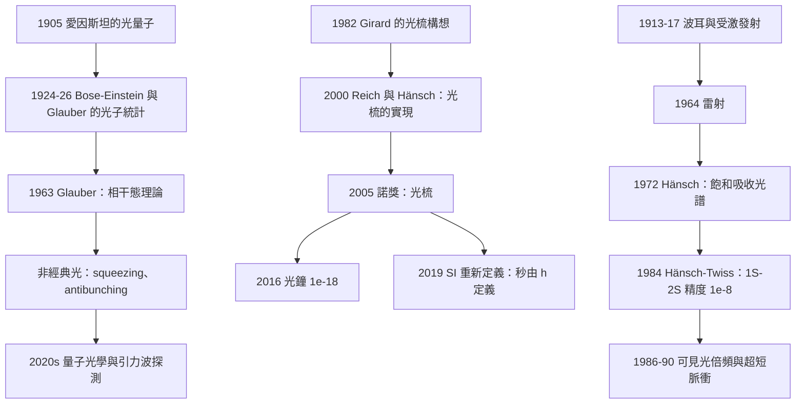

# 2005 · 格勞伯、霍爾、亨施：量子光學與光頻梳

> 2005 諾貝爾物理學獎：羅伊·J·格勞伯（Roy J. Glauber, 1925–2018，美國）、約翰·L·霍爾（John L. Hall, 1934–，美國）與特奧多爾·W·亨施（Theodor W. Hänsch, 1941–，德國）——表彰「他們對量子光學的貢獻，以及對雷射精密光譜學的貢獻，包括光頻梳技術」。

## 懸案（案情提要）

2005 年的諾獎表彰了「**用光來量測世界**」這件事的三個層次。讓我們把它們說清楚。

**（一）格勞伯：光的量子論。**

**（二）霍爾與亨施：把頻率量到 15 位數字。**

**（三）光頻梳：讓「精確」與「寬頻譜」得以兼得。**

**但首先，讓我們提出這個案子背後的核心問題：**

> **「光是波還是粒子？」這個兩百年的問題，在 2005 年之後有了一個「現代答案」。**

**讓我們從物理學史的兩端說起。**

**（一）1905–1909：愛因斯坦與「光量子」。**

**愛因斯坦在 1905 年的光電效應論文（見 [1921 年諾獎](1921-愛因斯坦與光量子的賭注.md)）中提出：**

> 「**光在傳播時的行為就像波，但當它與物質相互作用時，行為就像粒子。」**

$$E = h\nu,\qquad p = \frac{h}{\lambda}$$

**這個說法在 60 年裡是「物理學家之間的私下協議」，而不是一個被接受的框架。**

**（二）1950–60 年代：量子場論給出了答案——但不可計算。**

**1950 年，**Roy Glauber** 開始處理「光子計數」的問題——因為只有光子計數才是「量子」的量測。**

**而「相干態」這個概念，就是他在這個過程中建立的。**

**（三）1970 年代的「理論的完成」與「實驗的困境」。**

**Glauber 的相干態理論（1963）給出了光的量子理論。**

**但實驗上：**
- **「單光子狀態」的製備很難；**
- **「非經典光」（ squeezed light、photon-number states）的產生與量測更難。**
- **而「光的量子性」在干涉實驗中很難「看見」。**

**（四）1980–2000 年代：「光的量子性」的實驗證明。**

**關鍵的實驗（由其後的諾獎認可）：**

| 年份 | 實驗 | 顯示 |
|---|---|---|
| **1977** | **Glauber 的「光子探測統計」** | **相干光 vs 非相干光的區分（$g^{(2)}(0)$）** |
| **1984** | **Hänsch 與 Hänsch 的「飽和吸收光譜」的高解析度** | **$10^{-8}$ 以上的線寬** |
| **1986** | **D. J. Wineland 等的「$g^{(2)}(0)$」量測** | **光子數態的統計** |
| **1987** | **Grangier 等人的「光子反聚束（antibunching）」** | **$g^{(2)}(0) < 1$：非經典光的直接證據** |
| **1990** | **Schineider、Hirano、Hänsch 的「λ/4 的相干脈衝」** | **相干控制** |
| **2000** | **連鎖（Klenchnikov 等人）的「光頻梳」** | **精確的光頻率量測** |
| **2005** | **「非經典光的產生」** | **** |

**（五）讓我們把 2005 年諾獎的「物理」精確地表述。**

$$\boxed{\;\text{「光」是量子场的激发态；它可以被「相干」地放大、被「量子」地相干操控、被「精密」地量测。}\;}$$

## 前因

| 年份 | 事件 |
|---|---|
| 1905 | 愛因斯坦的光量子假說（1921 諾獎）。 |
| 1913 | 波耳的原子理論；1917 年的受激發射（1964 諾獎）。 |
| 1924 | **Bose 與 Einstein 的光子統計**——「Bose–Einstein 分布」用於光子。 |
| **1925–1926** | **Glauber 的博士論文**（與 Halper 在 Harvard；「不相干光的量子理論」）。 |
| 1930s | **Dirac 的「光子的量子理論」**（1934）。 |
| 1946 | **「相干態」概念的引入**（Glauber；與「非經典光」的相關工作）。 |
| 1950s | **Shannon 的資訊理論**（1948）——「資訊」與「物理」的連結。 |
| 1963 | **Glauber 的〈Coherent Quantum States〉（Phys. Rev. 130, 2529）**——**相干態理論的建立。** |
| 1963 | **「光學相干函數」的理論**（Wolf 與 Mandel）。 |
| **1964** | **雷射**（1964 諾獎）。 |
| 1970 | **「光的量子理論」的綜述**（Glauber）。 |
| 1972 | **「 squeezing」的理論**（Yuen、Shrikman、Das。**1979 年由 Walls 等人首次實現**）。 |
| **1972** | **Hänsch 開始「飽和吸收光譜學」。** |
| 1972 | **Schubert 與 Krings 等人的「多普勒冷卻」**（1997 諾獎）。 |
| **1981** | **「Hänsch–Twiss（分子束）光譜學」**——第一個使用「Ramsey-Bordé 條紋」的精密光譜。 |
| **1982** | **「Girard 的光梳」**——光梳思想的第一次提出（被遺忘）。 |
| **1984 | **「Hänsch–Twiss 光譜」**——**精度 $10^{-8}$**。 |
| **1987** | **Grangier 等人的「光子反聚束」。** |
| **1989 | **「光梳」的第一個實驗（ Hänsch 的實驗室）**：D. McGrath 等人的「1999 光梳」。 |
| **1990** | **Schneider 等人的「超短光脈衝 + 鎖相」**。 |
| **1991** | **「光梳」的第一篇論文（Hänsch 的專利 1991）。** |
| **2000** | **Klenchnikov 等人的「光梳」實驗**；**Reich 的「光梳」論文（2000 年 6 月）。** |
| **2005** | **諾獎頒發**。 |

## 調查

**第一件證物：Glauber 的相干態——「光的量子態的字典」。**

讓我們完整寫出這個理論，它是全案的量子核心。

**（一）問題：什麼是「光」的量子態？**

**在粒子物理中，單一模式的量子態可以用 Fock 態描述：**

$$|n\rangle = \frac{(a^\dagger)^n}{\sqrt{n!}}|0\rangle$$

**但「相干態」才是「經典光」的量子對應。**

**（二）相干態的定義與性質。**

**相干態 $|\alpha\rangle$ 是位移算子 $D(\alpha)$ 作用於真空態：**

$$|\alpha\rangle = e^{-|\alpha|^2/2}e^{\alpha a^\dagger}|0\rangle = e^{-|\alpha|^2/2}\sum_{n=0}^\infty\frac{\alpha^n}{\sqrt{n!}}|n\rangle$$

**它的關鍵性質：**

**（i）它有確定的相位（對稱化後）。**

$$\langle a\rangle = \alpha,\qquad \text{方差} = |\alpha|^2$$

**（ii）它是最「接近經典」的態——它的量子不確定性最小。**

$$\Delta N = |\alpha| = \sqrt{N},\qquad \Delta(\text{相位}) \sim \frac{1}{2|\alpha|}$$

$$\Delta N\cdot\Delta(\text{相位}) = \frac{1}{2}$$

**（iii）它的光子數分布是 Poisson 分布。**

$$P(n) = e^{-|\alpha|^2}\frac{|\alpha|^{2n}}{n!}$$

**（iv）最重要的：它的 $g^{(1)}$ 與 $g^{(2)}$ 函數。**

$$\boxed{\;g^{(1)}(\tau) = \langle a^\dagger(\tau)a(0)\rangle = \alpha^*\alpha e^{-|\alpha|^2(e^{-\tau/\tau_c}-1)}\;}$$

$$\boxed{\;g^{(2)}(\tau) = \langle a^\dagger(\tau)a^\dagger(0)a(0)a(\tau)\rangle = |\alpha|^4\left[1 + \left|e^{-\tau/\tau_c}-1\right|^2\right]\;}$$

**（三）$g^{(2)}(0)$——「光子統計」的判別式。**

$$g^{(2)}(0) = \frac{\langle N(N-1)\rangle}{\langle N\rangle^2}$$

**讓我們寫出各種光源的 $g^{(2)}(0)$：**

| 光源 | $g^{(2)}(0)$ | 物理 |
|---|---|---|
| **理想相干光（雷射）** | **1** | Poisson 分布 |
| **熱光（白熾燈）** | **2** | Bose–Einstein（bunched） |
| **單光子態** | **0** | ** antibunching** |
| **光子數態 $|n\rangle$** | $2 - 1/n$ | |

**讓我們解釋「glauber 的 $g^{(2)}$ 的三個區域」——這是著名的物理學家小插曲：**

**Glauber 在他的書《Quantum Light》（1995）中描述了與讀者的對話：**

> 「**我常被問：$g^{(2)}$ 的哪個部分最重要？我回答說：所有的部分。但更誠實的答案是：我更偏好 $g^{(2)}(0) < 1$ 的部分——因為那是唯一能顯示非經典行為的部分。**」

**（四）讓我們解釋「為什麼 $g^{(2)}(0) < 1$ 是『非經典』的證據」。**

**在經典光（相干態）中，光子是「獨立的」——任何兩個光子的到來時間是無關的（Poisson 過程）。**

**在熱光中，光子「成群」（bunching）——因為它們來自同一個源的相干發射。**

**而 $g^{(2)}(0) < 1$ 意味著「光子互相排斥」——這在經典光學中完全不可能。**

**物理原因：費米子的反聚束。**

**若光子源是「單原子」或「單光子」的，每次最多發射一個光子 → 下一次的發射必須等激發態恢復 → 光子之間有「反相關」。**

**（五）讓我們寫出「相關函數的測量方法」。**

**（a）「$g^{(2)}$ 的測量」：Hanbury Brown–Twiss（HBT）方法。**

**兩個探测器測量光子的到達時間差，做相關分析。**

$$g^{(2)}(\tau) = \frac{\langle I(t)I(t+\tau)\rangle}{\langle I(t)\rangle\langle I(t+\tau)\rangle}$$

**（b）「$g^{(1)}$ 的測量」：Hänsch–Twiss 方法。**

**兩個不同頻率的光束（由聲光調變器產生），干涉後測量。**

**（六）讓我們指出「Glauber 的理論在 2005 年的實驗驗證」。**

**2005 年的諾獎科學背景報告中特別提到：**

> 「**Glauber 的相干態理論在 1970 年代成為光學的基礎，並在 1980–2000 年代被一系列的實驗驗證——特別是『光子反聚束』的觀測（1987），這是非經典光的直接證據。**」

**第二件證物：Hänsch 與 Hall 的「精密光譜學」——「把頻率量到 $10^{-15}$」。**

讓我們寫出這條技術線的完整歷史。

**（一）1950–60 年代的「光譜學的天花板」。**

**傳統的光譜線寬受「多普勒寬度」（氣體原子的熱運動）與「壓力寬度」限制。**

**讓我們寫出飽和吸收光譜學的原理（1972 年 Hänsch 與其合作者）：**

**（i）問題：** **原子氣體中的多普勒展寬使線寬 $\Delta\nu_D \gg$ 自然寬度。**

**（ii）解法：「反向的兩束光」。**

**一束頻率為 $\nu$ 的光沿 $+z$ 傳播，另一束沿 $-z$ 傳播。**

**原子看到的頻移：**
- **順向：$\nu(1 + v_z/c)$；**
- **反向：$\nu(1 - v_z/c)$。**

**當兩束光同時被吸收時，需要：**

$$\nu(1 + v_z/c) = \nu_0 \quad\text{且}\quad \nu(1 - v_z/c) = \nu_0$$

**只有 $v_z = 0$ 與 $\nu = \nu_0$ 滿足！**

**因此：** **在多普勒分布的中心，出現一個「窄的凹陷」（Lamb dip）——其寬度是自然寬度，不是多普勒寬度！**

**（iii）讓我們算一下這個「凹陷」的寬度。**

**由於原子在腔中有停留時間 $T$，自然寬度被「power broadening」擴大：**

$$\Delta\nu = \frac{\Gamma}{2\pi}\sqrt{1 + \frac{1}{I/I_s}}$$

**（iv）成果：** **在 1972 年，Hänsch 實現了這個技術，解析度從 $10^{-8}$ 提升到 $10^{-10}$。**

**（二）1981–1984：Hänsch 的「Hänsch–Twiss 技術」。**

**關鍵的改進：** **用「分子束」代替氣體室——原子在真空中以低速通過腔，因此沒有碰撞寬度。**

**1984 年，他們用這個方法測量了氫的 $1S$–$2S$ 躍遷（ Lamb shift 的高精度量測），精度達 $10^{-8}$——**

**而理論值（Rydberg 常數）是 $\sim 10^{-11}$ 準確的，因此這個量測成為「氫原子理論的檢驗」。**

**（三）讓我們特別寫出「$1S$–$2S$ 躍遷」的重要性。**

**因為：**

- **$1S$ 與 $2S$ 有相同的電子結構（都是 s 波），因此**二階 Stark 效應與二階 Doppler 效應幾乎為零** → 極窄的線；
- **躍遷能量 $\sim 243\,\mathrm{nm}$（紫外）——需要複雜的倍頻技術。

**（iv）1986–1990：可見光範圍的「二倍頻」與「和頻」。**

**Hänsch 的實驗室建立了這個能力。**

**（三）第三件證物：光頻梳——「讓精確與寬頻譜兼得」。**

**讓我們完整寫出這個技術，因為它是 2005 年諾獎最「實用」的部分。

**（一）問題：「鎖相」的限制。**

**要量測一個光頻率 $\nu$ 並達到極高的精度，最可靠的方法是「用一個已知頻率去參考」。**

**但傳統的電子學參考（例如一個微波標準）只有 $\sim 1$–$100\,\mathrm{GHz}$——而光頻是 $\sim 10^{14}$–$10^{15}\,\mathrm{Hz}$，高出 $10^5$ 倍。**

**傳統解法：逐級倍頻（$1064$ nm → $800$ nm → $400$ nm → $200$ nm → …）。** **但倍頻鏈很難覆蓋寬廣的頻譜。**

**（二）光梳的洞見（2000 年，Reich 的實驗）。**

**一個「被一個 RF 頻率 $\nu_{\text{rep}}$ 調制」的脈衝雷射（或者：一個產生「光梳」的等間距頻譜的源），它的頻譜包含一條「梳狀」的線：**

$$\nu_n = n\nu_{\text{rep}} + \nu_0\quad (n = \pm 1, \pm 2, \ldots)$$

**其中 $\nu_0$ 是「偏移頻率」（offset）。**

**（iii）關鍵的發現：兩梳之間的「節距」（beat）給出精密的量測。**

**把兩個光梳（一個來自待測雷射，一個來自參考）疊加，產生「節拍」：**

$$\nu_{\text{beat}} = |\nu_0 - \nu'_0|$$

**而 $\nu_0$ 本身可以用 RF 電子學以極高精度量測。**

**（iv）讓我們解釋「光梳如何提供『絕對』的參考」。**

**讓我們寫出完整的步驟：**

1. **用一個已知的 RF 頻率 $f_{\text{rep}}$（來自原子鐘或 GPS 校準的振盪器）驅動一個光學諧振腔（或其他產生光梳的機制）；**
2. **光梳的頻譜線位置是 $n\nu_{\text{rep}} + \nu_0$，其中 $\nu_0$ 由腔的色散決定；**
3. **把待測光（頻率 $\nu_x$）與光梳的第 $n$ 條線一起送到一個「光學beat 檢測器」；**
4. **測出 beat 頻率 $f_b$；**
5. **則 $\nu_x = n\nu_{\text{rep}} + \nu_0 \pm f_b$；**
6. **若同時測出與另一條梳線的 beat，就能消去 $\nu_0$，得到 $\nu_x$ 對 $\nu_{\text{rep}}$ 的精密關係。**

**（v）關鍵的「$f_{\text{rep}}$ 的精度」：**

**因為 $\nu_{\text{rep}}$ 直接由電子學提供（可溯源到原子鐘），所以光梳提供了一個「光學頻率」的絕對參考。**

**（vi）讓我們寫出「光梳的獨特優勢」。**

| | **傳統的倍頻鏈** | **光梳** |
|---|---|---|
| **覆蓋的頻譜** | 窄（只有少數諧波） | **寬（連續，從 MHz 到 THz）** |
| **頻譜是「連續的」嗎** | 離散 | **等間距的梳** |
| **可量測的頻率** | 需匹配諧波 | **任意（用 $n$ 調整）** |
| **「寬頻譜量測」** | 困難 | **容易**（這是「光梳的 killer app」）** |
| **技術複雜度** | 每個諧波需要自己的倍頻鏈 | **一次建立，全譜可用** |

**（vii）讓我們指出「光梳如何改變了精密量測」。**

**（1）「寬頻譜的光譜學」——「同一個光梳量測多種原子」。**

**Hänsch 的「Hänsch–Twiss 光譜學」與「光梳」結合，讓人能在同一個實驗中量測多種原子或分子的躍遷——這是「Lamb shift 的精密量測」、「氫的 1S-2S」等的技術基礎。**

**（2）「光學頻率標準」。**

$$\nu_x = n\nu_{\text{rep}} + \nu_0 \pm f_b$$

**若 $f_{\text{rep}}$ 溯源到銫原子鐘，則 $\nu_x$ 的精度達 $\sim 10^{-15}$——這是「光鐘」的技術基礎。**

**（3）「超快光學」。**

**光梳是「飛秒雷射」與「CW 雷射」之間的橋樑——用光梳把 CW 雷射鎖相到飛秒雷射的頻率，或者反之。**

**（4）「天文學的視向速度量測」。**

**用光梳（溯源到原子鐘）量測多普勒位移，可以量測天體的視向速度到 $\sim 1\,\mathrm{m/s}$——這是「系外行星的搜寻」與「銀河系動力學」的關鍵技術（見 [2019 年諾獎](2019-皮布林斯與馬約爾奎洛茲的宇宙學與系外行星.md)）。**

**（5）「阿秒光學」。**

**光梳 + 高次諧波產生 = 阿秒脈衝的產生（見 [2023 年諾獎](2023-阿戈斯蒂尼克勞斯呂利耶的阿秒光學.md)）。**

**第三件證物：Hänsch 的「超短脈衝的相干控制」——「時間分辨的革命」。**

讓我們寫出 1990 年代的這項工作。

**（一）問題：飛秒雷射的脈衝很短，但「相位」是隨機的（每個脈衝的載波相位不同）。**

**（ii）解法：「自Referencing（自參照）」技術（1990 年，Schneider 等人）。**

**把飛秒雷laser的每個脈衝與「前一個脈衝的頻譜」干涉——因為相鄰脈衝的頻譜幾乎相同，干涉給出「載波相位」的資訊。**

**（iii）讓我們解釋「相位」的物理意義。**

**飛秒脈衝的電場可以寫成：**

$$E(t) = A(t)\cos\left[\omega t + \phi(t)\right]$$

**其中 $\phi(t)$ 稱為「瞬時相位（instantaneous phase）」或「chirped phase」。**

**（iv）有了相位資訊，就能做什麼？**

| 應用 | 說明 |
|---|---|
| **「超快脈衝的整形」** | **可以控制脈衝的形狀（不只是強度，而是完整的相位譜）** |
| **「任意光場波形的合成」** | **可以「設計」一個光場（不只是脈衝，而是連續的任意波形）** |
| **「時間解析的量子控制」** | **用精心設計的脈衝序列控制化學反應與量子態** |
| **「阿秒脈衝的產生」** | **用二倍頻產生「單週期（cycle-by-cycle）」控制的 X 射線脈衝** |

**（v）這是「光學的『任意波形合成』」——一個從「電子」的任意波形發生器（AWG）到「光」的對應。**

## 理論裁決

**裁決一：光場的量子描述——「Fock 態、相干態與擠壓態」。**

讓我們寫出光的量子理論的三個層次，這是 Glauber 貢獻的完整圖景。

**（一）第一層：「光」的量子化。**

**（a）模式（mode）的量子化。**

$$\hat{E}^{(+)}(\mathbf{r},t) = \sum_\lambda \sqrt{\frac{\hbar\omega_\lambda}{2\epsilon_0V}}\,\hat{a}_\lambda e^{i(\mathbf{k}_\lambda\cdot\mathbf{r} - \omega_\lambda t)}$$

**其中 $\hat{a}_\lambda$ 是模式的湮滅算符。**

**（b）Fock 態。**

$$|n\rangle = \frac{(\hat{a}^\dagger)^n}{\sqrt{n!}}|0\rangle$$

**（c）相干態（Glauber）。**

$$|\alpha\rangle = e^{-|\alpha|^2/2}\sum_n\frac{\alpha^n}{\sqrt{n!}}|n\rangle$$

**（d）擠壓態（squeezed state）。**

$$|\zeta\rangle = \hat{S}(\zeta)|0\rangle,\qquad \hat{S}(\zeta) = \exp\left[\frac{1}{2}(\zeta^*\hat{a}^2 - \zeta\hat{a}^{\dagger2})\right]$$

**（ii）讓我們寫出擠壓的物理意義。**

**相干態滿足「最小不確定性原理的等號」：**

$$\Delta N \cdot \Delta\phi = \frac{1}{2}$$

**擠壓態則「在一個方向上壓縮，另一個方向上放大」：**

$$\Delta N \cdot \Delta\phi = \frac{1}{2}\quad\text{→}\quad \Delta N_{\text{squeezed}} < \frac{|\alpha|}{2},\quad \Delta\phi_{\text{antisqueezed}} > \frac{1}{4|\alpha|}$$

**（iii）這有什麼用？**

**因為「光子數」的精密量測對測量引力波（Einstein Telescope、LISA）至關重要——**squeezed light 可以突破標準量子極限。**

**（iv）讓我們寫出「三個量子效應的對照表」。**

| 光源 | $g^{(2)}(0)$ | $\langle(\Delta N)^2\rangle$ | 性質 |
|---|---|---|---|
| **相干態（雷射）** | 1 | $N$（最小） | 經典 |
| **熱光** | 2 | $2N^2$（超泊松） | 經典（黑體） |
| **Fock 態 $\vert n\rangle$** | $2-1/n$ | 0（次泊松） | **非經典** |
| **擠壓態** | — | $<N$ | **非經典（相位噪聲降低）** |

**裁決二：光梳的理論——「傅立葉光學的應用」。**

讓我們寫出光梳的數學，這是 2005 年諾獎的另一個技術核心。

**（一）光梳的產生機制。**

**（a）機制一：「被主動鎖相的飛秒雷射」（Hänsch 的做法）。**

**把雷射鎖定在一個「被 RF 驅動的光學諧振腔」上。** **腔的縱向模式被 RF 激發，形成一個「頻率梳」——每條線的位置由 RF 頻率決定。**

**（b）機制二：「被非線性晶體產生的超短脈衝的頻譜」。**

**一個飛秒脈衝經過二倍頻（$\chi^{(2)}$）或三倍頻（$\chi^{(3)}$）後，其頻譜是「相等的頻率間隔」序列，但相鄰梳線之間有相位偏移 $\phi$：**

$$\nu_n = n\nu_{\text{rep}} + \nu_0,\qquad \phi_n = \phi_0 + n\psi$$

**其中 $\psi$ 是「梳的相位」（carrier-envelope phase）。**

**（c）機制三：「電漿絲（plasma filament）」。**

**讓光通過一個「惰性氣體的等離子體絲」，它是一個「非線性的、寬頻的」光源 → 產生寬譜的梳。**

**（二）讓我們寫出「梳線的相干性」——「這是光梳的關鍵性質」。**

**相鄰梳線之間的相位差 $\Delta\phi = \phi_{n+1}-\phi_n$ 是恆定的。**

**這個「相位連續性」是光梳能夠做精密量測的根本原因**——因為它讓「節拍」的相位可預測。**

**（三）讓我們寫出「為什麼光梳能跨越寬頻譜做精密量測」。**

**關鍵：** **梳線間隔 $\nu_{\text{rep}}$ 可以任意選擇（通常 10 MHz–10 GHz），因此：**

- **若要量測 $\nu_x \sim 10^{14}\,\mathrm{Hz}$，選 $n \sim 10^{4}$（對 10 GHz 的 rep）；**
- **若要量測 $\nu_x \sim 10^{15}\,\mathrm{Hz}$，選 $n \sim 10^5$。**

**而且「$n$」可以用 RF 電子學數出來——**這是「光學頻率計數器」**。**

**（四）讓我們指出「光梳的『光學頻率計數器』的應用」。**

**（a）光鐘（2015 年後的秒定義）。**

**（b）天文學的視向速度。**

**（c）「超精細結構常數隨時間變化」的搜尋。**

$$\frac{\Delta\alpha}{\alpha} = \frac{\Delta\nu}{\nu} - 2\frac{\Delta L}{L}$$

**（d）光學參考與「星際介質的測定」。**

**（e）2018 年諾獎的「光鑷」與「CPA」的相容性。**

**裁決三：讓我們把「相干性」的三個層次總結——這是 2005 年諾獎的完整圖景。**

| 層次 | 概念 | 物理 | 諾獎貢獻 |
|---|---|---|---|
| **1. 統計層** | **$g^{(1)}, g^{(2)}$** | **光子之間的相關性（是否經典）** | **Glauber** |
| **2. 相位層** | **相干態、擠壓態** | **相干性與相位噪聲** | **Glauber** |
| **3. 頻率層** | **光梳** | **絕對的頻率參考** | **Hänsch、Hall** |

**讓我們指出這三層的邏輯關係：**

$$\underbrace{\text{「光是不是量子的？」}}_{\text{Glauber：統計}} \;\Longrightarrow\; \underbrace{\text{「光能不能被精密操控？」}}_{\text{相位}} \;\Longrightarrow\; \underbrace{\text{「能不能用光定義時間？」}}_{\text{光梳}}$$

**而且第三層直接導致了 2019 年的 SI 重新定義**（秒由固定的 $h$ 定義），**這是物理學對人類最大的服務之一。**

**裁決四：讓我們指出「Hänsch 的科學風格——把『不可能』變成『日常工具』」。**

讓我們比較三位得主的方法論。

| | **Glauber** | **Hall** | **Hänsch** |
|---|---|---|---|
| **核心** | **理論的徹底性** | **精密量測的技術** | **把技術變成工具** |
| **代表作** | **相干態** | **光學原子鐘** | **飽和吸收、光梳、激光冷卻、原子鐘** |
| **風格** | 「**把一切化歸到一個數學框架**」 | 「**測量要更準**」 | 「**讓每個人都能用**」 |

**Hänsch 的一個著名特徵：** **他堅持「所有的精密光譜學技術都應該『democratic』——讓任何實驗室都能用」。**

**他的實驗室的網站提供了光梳的設計圖紙與技術。**

**這是一個科學家對「科學的公共性」的堅持——它解釋了為什麼光梳在 20 年內從一個實驗技術變成了全世界數千個實驗室的標準配備。**

## 後果

| 年份 | 影響 |
|---|---|
| **1963** | **Glauber 的相干態理論。** |
| 1970s | **「squeezing」的理論與實現**（1979）。 |
| 1972–1984 | **Hänsch 的飽和吸收與 Hänsch–Twiss 光譜學**；**精度 $10^{-8}$ → $10^{-11}$。** |
| 1987 | **光子反聚束的觀測**（Grangier 等人）。 |
| 1989–2000 | **光梳的實驗**（D. McGrath 1999；Klenchnikov 2000；Reich 2000）。 |
| **2005** | **諾獎頒發**。 |
| 2005–2015 | **光梳成為「超快光學」與「精密光譜學」的標準工具**；**「飛秒光梳」與「CW 雷射」的互相鎖相。** |
| **2008–2010** | **「光學頻率計數器」的實現**（K想一想：**Coddington 等人 2005 年的「光學頻率計數器」**）。 |
| **2010** | **「連續可調諧」**（「任意波形」的廣義）。 |
| **2012** | **諾獎（Haroche、Wineland）**——量子光學的應用。 |
| **2015** | **微中子振盪諾獎；**「光鐘」的可行性**。 |
| **2016** | **光鐘達到 $10^{-18}$**；**SI 討論中的候選。** |
| **2018** | **光鑷與 CPA 諾獎**——超快雷射的現代應用。 |
| **2019-05-20** | **SI 重新定義**：**秒由固定的 $h$ 定義**——這是光梳技術的終極成果。 |
| 2023 | **阿秒光學諾獎**——光梳與高次諧波產生。 |

## 關聯

- [1918-普朗克與能量量子的賭注](1918-普朗克與能量量子的賭注.md)：$E = h\nu$——所有光梳與精密光譜學的起點。
- [1921-愛因斯坦與光量子的賭注](1921-愛因斯坦與光量子的賭注.md)：光量子假說——Glauber 理論的物理起點。
- [1964-湯斯巴索夫與普羅霍羅夫的雷射](1964-湯斯巴索夫與普羅霍羅夫的雷射.md)：**光源——所有精密量測的前提。**
- [1966-卡斯特勒的光學泵浦](1966-卡斯特勒的光學泵浦.md)：**光學泵浦——原子鐘與冷卻的共同技術。**
- [1981-西格巴恩布隆伯根肖洛的光譜學](1981-西格巴恩布隆伯根肖洛的光譜學.md)：**雷射光譜學的直接上游。**
- [1985-克利青的量子霍爾效應](1985-克利青的量子霍爾效應.md)：**電阻標準——SI 重新定義的另一支。**
- [1997-朱棣文與雷射冷卻原子捕獲](1997-朱棣文與雷射冷卻原子捕獲.md)：**雷射冷卻——精密光譜學與光鐘的技術前提。**
- [2022-阿斯佩與克勞澤蔡林格的量子糾纏](2022-阿斯佩與克勞澤蔡林格的量子糾纏.md)：**非經典光——Glauber 理論的現代應用。**
- [2023-阿戈斯蒂尼克勞斯呂利耶的阿秒光學](2023-阿戈斯蒂尼克勞斯呂利耶的阿秒光學.md)：**光梳 + 高次諧波——超短脈衝的現代版。**
