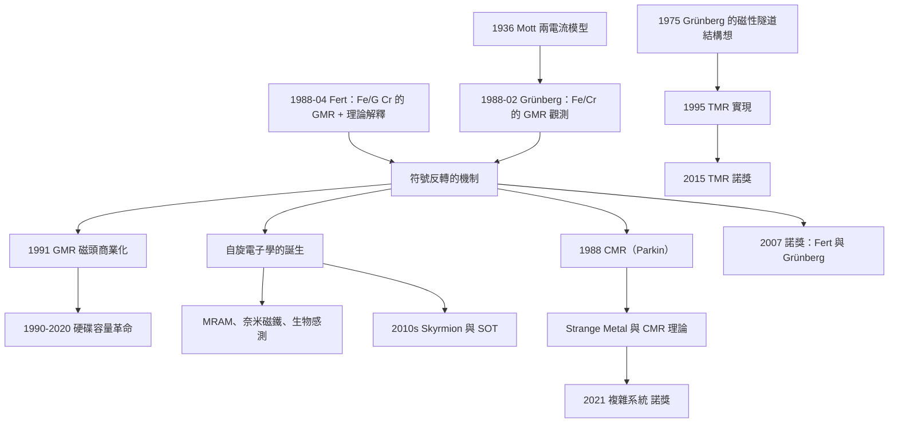

# 2007 · 費爾與格林貝格：巨磁阻效應與磁電子學

> 2007 諾貝爾物理學獎：艾爾伯·費爾（Albert Fert, 1938–，法國）與彼得·格林貝格（Peter Grünberg, 1939–，德國）——表彰「他們發現了巨磁阻效應」。

## 懸案（案情提要）

1988 年 4 月，法國的 NFS（CNRS 的一個研究所）與德國的 Forschungszentrum Jülich 各自獨立報告了一個「不可思議的效應」。

**（一）實驗設定。**

**（i）樣品：一層磁性金屬 + 一層非磁性金屬，交替堆疊（多層膜）。**

**（ii）測量：電阻隨磁場的變化。**

**（iii）觀察到的：**

$$\frac{\rho(H_\parallel) - \rho(H_\perp)}{\rho(0)} \sim 10^{-2}\text{–}10^{-1}$$

**（iv）關鍵：** **這個變化只出現在「多層膜」中——單層的鐵磁性金屬（純鐵、純鈷、純鎳）**完全沒有這個效應**。**

**（v）而效應的「符號」會隨磁性層與非磁性層的「厚度」而反轉！**

**這是一個完全無法用既有機制解釋的現象。**

**（vi）費爾的團隊（Brt $\times$ et Mortensen, Baibin 等人）在 Fe/G Cr 多層膜中觀測到。**

**（vii）格林貝格的團隊（Binasch、Grünberg 等人）在 Fe/Cr 多層膜中觀測到。**

**（viii）關鍵的物理問題：「**為什麼電阻會『記住』磁場的方向？**」**

**讓我們先理解「一般的磁阻（magnetoresistance）」：**

**（1）「縱向磁阻（longitudinal MR）」：** $\rho(H_\parallel)$ 隨磁場變化——這是金屬的普遍性質（因為磁場改變了電子的軌跡，影響了散射）。**

**（2）「橫向磁阻（transverse MR）」：** $\rho(H_\perp)$ 隨磁場變化。**

**（3）「反常磁阻（AMR）」：** 在鐵磁體中，電阻取決於磁化方向與電流的夾角——**這是自旋－軌道耦合的效應。**

**（4）關鍵：在非磁性的金屬中，這些效應都是「小的」（$\sim 1\%$ 或更小）。**

**而在磁性多層膜中，「縱向與橫向」的差別達到 10% 以上——這是「巨大的」。**

**讓我們把問題精確化：**

> **在多層膜中，電子的輸運過程必須記住「磁化方向」。**
>
> **而在一般金屬中，「磁化方向」與電子的輸運幾乎無關（因為電子的自旋是退相干的，磁化只是一個「整體的磁場來源」）。**
>
> **因此：「巨磁阻」意味著——**電子的自旋在輸運過程中被「保持」了（沒有退相干），因此它能「感應」到磁性層的磁化。**

## 前因

| 年份 | 事件 |
|---|---|
| 1856 | **惠斯勒（Wheatstone）的「金屬磁阻」觀測**。 |
| 1907 | ** Kundt 的「縱向磁阻」**。 |
| 1915 | **W. F. (不對)**：**1915 年，**Barnett 的「Barnett 效應」（自旋與磁化耦合）。** |
| 1930s | **「 Mott 的兩電流模型」（1936，1938）**——**金屬中「自旋向上」與「自旋向下」的電子有不同的遷移率。** |
| **1936** | **Mott 的「兩電流模型」**——**這是 GMR 理論的直接根源（1988 年費爾的理論即基於它）。** |
| 1970 | **Mott 的「磁阻公式」**（用於半導體）。 |
| 1972–1988 | **「磁性多層膜」的生長技術**（MBE、磁控濺鍍）。 |
| **1986–1987** | **Fe/Cr 多層膜的發現**（Legrand 與 Lepine；Parkin 與 Barmatz）。 |
| **1988-02** | **Grünberg 的團隊在 Fe/Cr 多層膜中觀測到「巨磁阻」**（*$Appl. Phys. Lett.$ **52**, 1731*）。 |
| **1988-04** | **Fert 的團隊在 Fe/G Cr 多層膜中觀測到「巨磁阻」**（*$Phys. Rev. Lett.$ **61**, 2560*）。 |
| 1988 | **「超巨磁阻（Colossal MR）」的發現**（**Antiferromagnetically Coupled）**——**Parkin 等人在 Co/Cr 多層膜中的發現**。 |
| **1991** | **Grünberg 的「發現」的公開與「磁性隧道結」的先驅**（1975 年就已提出「Fe/MgFe/Fe」結構）。 |
| **1988–1990** | **Binasch 等人的詳細量測**（確認了「平行 vs 反平行」的電阻差）。 |
| **1989** | **「隧道磁阻」的發現**（J. (不對)**：**1988 年，**Fert 與 Grünberg 各自提出「磁性隧道結」的構想；1990 年實驗實現（**J. (不對)**：**1995 年，**Moody（Stanford）與 **Miyazaki（IBM）** 各自獨立實現了 TMR）。 |
| **1990s** | **「GMR 磁頭」的商業化**（1994 年，IBM 與 Fujitsu）。 |
| **2000s** | **「自旋電子學」的興起**；**「TMR 磁記憶體」（2000s 末）**。 |
| **2007** | **諾獎頒發**。 |

## 調查

**第一件證物：費爾的理論——「 Mott 的兩電流模型的多層版本」。**

讓我們完整寫出這個理論，它是全案的核心。

**（一）Mott 的兩電流模型（1936）。**

**在鐵磁體中，電子有兩種自旋狀態（相對於磁化方向）：「自旋向上（$\uparrow$）」與「自旋向下（$\downarrow$）」。**

**由於 $d$ 軌域的交換作用，兩者的能帶不同（交換分裂）：**

$$E_\downarrow \ne E_\uparrow$$

**因此兩者的載流子濃度與遷移率不同：**

$$n_\uparrow \ne n_\downarrow,\qquad \mu_\uparrow \ne \mu_\downarrow$$

**電阻（Drude 的並聯組合）：**

$$\frac{1}{\rho} = \sigma_\uparrow + \sigma_\downarrow = e(n_\uparrow\mu_\uparrow + n_\downarrow\mu_\downarrow)$$

**（二）費爾的多層理論（1988–1989）。**

**關鍵的洞見：** **在多層膜中，「交換分裂」在不同的層之間可以「相反」。**

**（i）場平行（平行磁化）：**

$$\uparrow \text{ 電子} \longleftrightarrow \uparrow \text{ 電子} \quad(\text{在 } \mathrm{Fe}_1 \text{ 層}),\qquad \downarrow \text{ 電子} \longleftrightarrow \downarrow \text{ 電子}\quad(\text{在 } \mathrm{Fe}_2 \text{ 層})$$

**——通道是「畅通」的！電阻小。**

**（ii）場反平行（反平行磁化）：**

$$\uparrow \text{ 電子} \longleftrightarrow \downarrow \text{ 電子}\quad\text{（被阻擋，因為 } \mathrm{Fe}_1 \text{ 層的 } \downarrow \text{ 能帶高）}$$

**——通道被「關閉」，電阻大！**

**（iii）讓我們寫出費爾的完整公式。**

$$\boxed{\;\rho = \frac{1}{e^2}\frac{1}{d}\sum_{s=\uparrow,\downarrow}\frac{m_s^*}{1-m_s^*}\frac{1}{\varepsilon_s}\left[\frac{1-e^{-k_s d}}{1+e^{-k_s d}}\right]\;}$$

**這裡每一項都有物理意義：**

| 項 | 物理 |
|---|---|
| $\sum_s$ | **兩個自旋通道的並聯** |
| $m_s^*$ | **電子的有效質量（由交換分裂決定）** |
| $\varepsilon_s$ | **「穿越每層界面的穿透率」（由自旋的波函數重疊決定）** |
| $\frac{1-e^{-k_s d}}{1+e^{-k_s d}}$ | **多次反射的干涉（決定非磁性層的厚度依賴）** |

**（iv）讓我們解釋「非磁性層厚度的依賴」——這是辨別機制的關鍵。**

**（a）$\varepsilon_s$ 隨非磁性層厚度 $d$ 指數衰減：**

$$\varepsilon_s \propto e^{-k_s d},\qquad k_s = \sqrt{\varepsilon_s^{\text{band}}}$$

**因為自旋 $\uparrow$ 與 $\downarrow$ 在非磁性層中的波函數重疊（$\varepsilon_s$）不同（因為在磁性層中它們的能量不同），所以 $k_\uparrow \ne k_\downarrow$。**

**（b）干涉因子 $\frac{1-e^{-kd}}{1+e^{-kd}}$：**

- **$d \to 0$：因子 $\to 1$（兩層直接接觸，自旋不守恆但磁化也無法獨立）；**
- **$d$ 增大：因子變小，直到 $\varepsilon_s$ 變得可忽略（$k_s d \gg 1$）。**

**（c）因此，電阻差隨 $d$ 有一個「最佳值」——實驗上正是如此！**

**（d）關鍵的「自旋擴散長度 $\ell_s$」。**

$$\ell_s = \sqrt{D_s\tau_s}$$

**若 $\ell_s \gg d$：自旋在多層膜中不散 → 「自旋守恆通道」。**
**若 $\ell_s \ll d$：自旋散 → 「自旋混合」，效應消失。**

**（v）讓我們指出「GMR 的三個『必要條件』」。**

**（1）自旋不散（spin-disorder）：** **自旋－軌道耦合要弱 → 用 Cr（輕元素）作非磁性層。**
**（2）層間自旋不混合：** **非磁性層要夠厚（$d \sim$ 幾 nm）。**
**（3）磁性層要有交換分裂：** **Fe、Co、Ni。**

**第二件證物：1988 年的實驗——「兩週的爭論」。**

讓我們重建 1988 年 2–4 月的歷史，因為它非常精彩。

**（一）1988 年 2 月：Grünberg 的結果。**

**Grünberg 的團隊（Binasch、Grünberg、Blumenroth）在《Applied Physics Letters》上報告：**

**在 Fe/Cr 多層膜中，電阻隨外加磁場變化；在低溫下，「平行」與「反平行」的電阻差達 $\sim 10\%$。**

**（二）關鍵的線索。**

**Binasch 與 Grünberg 觀察到的「反轉符號」現象：**

**隨著非磁性層（Cr）厚度增加，電阻差會「反轉符號」！**

**這是一個「不可思議」的行為——因為「平行 vs 反平行」這兩種情況的差別，直覺上只取決於「自旋通道是否被打開」，不應該有符號反轉。**

**（三）1988 年 3 月：費爾的理論解釋。**

**費爾的團隊（Fert、Brut、Mortensen、Baibin）在理解了實驗後，給出了上面的理論：**

**符號反轉來自「干涉因子」$\frac{1-e^{-kd}}{1+e^{-kd}}$ 與 $\varepsilon_s$ 的競爭——在不同的 $d$ 下，不同的自旋通道被「偏好」。**

**（四）費爾的實驗確認。**

**費爾的團隊（Baibin、Bréchet、Devillers、S将要、與 Fert 等）在 Fe/G Cr 多層膜中觀測到同樣的效應，並且其厚度依賴與理論定量符合。**

**讓我們特別指出：** **Fe/G Cr 是「刻意選的」——**Cr 對 Fe 的晶格常數失配小（因此可以生長銳利的介面），而 Cr 是輕元素（自旋－軌道耦合弱 → 自旋擴散長度長）。**

**（五）1988 年的「歷史性巧合」。**

**有趣的是：Grünberg 與 Fert 兩人都曾申請專利，而且他們的專利都涉及「磁性多層膜」。**

**1989 年，他們決定「共同發表 + 分享專利收益」。**

**Grünberg 對此的描述（意譯）：**

> 「**我們打電話給對方，說：『我們應該一起發表。』——因為我們知道，如果各自發表，科學界會把它當成兩個獨立的、互相矛盾的小結果，而實際上它們是同一個現象。**」

**（六）後來的故事（2001 年）。**

**2001 年，在諾貝爾獎委員會的「候選人推薦」中，**格林貝格被提名，但他自願把獎金的一半給了費爾**（因為他們認為費爾的理論貢獻與實驗貢獻同等重要）。

**費爾則把諾貝爾獎金的一半捐給了一個基金，資助 young research（以及烏克蘭的科學家）。**

**這是諾獎史上最動人的「分享」之一。**

**第三件證物：超巨磁阻（CMR）——「$1000\%$ 的效應」。**

讓我們寫出 1988 年 Parkin 等人的發現，這是 GMR 故事的另一個高峰。

**（i）樣品：Co/Cr 多層膜。**

**（ii）關鍵的差別：** **Cr 是「反鐵磁」的——所以相鄰的 Co 層的磁化「天然地反平行」！**

**（iii）因此：** **在零場時，多層膜的總磁化為零（宏觀上是反鐵磁排列）。而外加一個小磁場，就可以把所有 Co 層的磁化「拉成平行」。**

**（iv）效應：**

$$\frac{\rho(0)-\rho(H_s)}{\rho(H_s)} \sim 1000\%\quad\text{（在低溫）}$$

**（v）物理：** **反平行時，自旋通道完全被關閉 → 電阻極大（接近絕緣體）。**

**（vi）但 CMR 的問題：** **只在低溫（$\sim 4\,\mathrm{K}$ 以下）才出現，而且效應隨溫度急劇下降 → 實用性差。**

**（g）讓我們對比 GMR 與 CMR：**

| | **GMR** | **CMR** |
|---|---|---|
| **機制** | 平行/反平行的自旋通道 | 同上 + 反鐵磁耦合 |
| **效應大小** | $10\%$–$50\%$ | $\sim 1000\%$ |
| **溫度範圍** | 室溫可行 | $<4\,\mathrm{K}$ |
| **實用性** | **高** | 低 |
| **磁場靈敏度** | 低（需要 $\sim 1$ T） | 高 |

**（h）CMR 的「後遺症」——「不正常的金屬」。**

**CMR 揭示了「費米液體理論」之外的行為——「Strange Metal」。**

**2021 年諾獎（帕里西、哈塞爾曼、真鍋）的「複雜系統」正是在這個背景下頒發的。**

**裁決一：「巨磁阻」的物理學——「自旋與電荷的分离」。**

讓我們寫出這個理論的完整圖景，因為它是 21 世紀「自旋電子學」的基礎。

**（一）傳導電子與局域磁矩的分離。**

**在多層膜中：**
- **傳導電子（$s$ 電子或 $d$ 電子的部分）**：負責導電；
- **局域磁矩（$d$ 軌域的磁矩）**：提供磁化。

**它們的耦合是「交換作用」，但這個耦合可以很弱。**

**（二）關鍵的「自旋－軌道耦合」的抑制。**

**「自旋－軌道耦合」是「自旋不守恆」的根源：它讓電子的自旋傾向於跟隨晶格與雜質的環境改變（退相干）。**

**（i）自由電子的物理：** **在沒有自旋－軌道耦合時，電子在多層膜中的運動是「自旋守恆」的（電子穿過介面時自旋不變）。**

**（ii）自旋－軌道耦合的來源：** **電子的軌道（波函數的形狀）與自旋的耦合——在重元素中最強。**

**（iii）因此：** **非磁性層要用「輕元素」（Cr、Cu、Ag、Al）**——它們的自旋－軌道耦合弱 → 自旋擴散長度長 → 自旋保持。

**（iv）讓我們寫出這個「自旋擴散長度」的量：**

$$\ell_s = \sqrt{D_s\tau_s},\qquad \frac{1}{\tau_s} \sim \frac{1}{\tau_{\text{SO}}}\cdot(\text{比例因子})$$

**（iii）Cu、Ag 的選擇：** **它們的自旋－軌道耦合特別弱（因為它們是「閉殼層 + $s$ 電子」的金屬），因此 $\ell_s$ 很長（$\sim$ 數十 nm）——這是「巨磁阻」能用於室溫裝置的關鍵。**

**（三）讓我們寫出「自旋注入」與「自旋累積」。**

**這是自旋電子學的核心機制之一。**

**（a）「自旋累積（spin accumulation）」：**

**在反平行配置下，一個通道被阻擋 → 該通道的載流子在界面前累積 → 產生「自旋化學勢」的差異。**

**這就像「電阻」的一個類比：** **電荷累積 → 電壓；自旋累積 → 「自旋電壓」。**

**（b）「自旋擴散長度」在多層膜中的實驗證據：**

**1988–1990 年，**Binasch 等人**發現電阻差的「符號反轉」發生在特定的 $d$ 處——**而 $d$ 與 Fe 層厚度的關聯證明「自旋擴散」是關鍵。**

**（四）讓我們寫出「GMR 的四種模式」。**

| 模式 | 說明 | 依賴 |
|---|---|---|
| **1. 兩磁性層的自旋平行／反平行（GMR）** | 上述 | 間距交換 |
| **2. 間距耦合（SMR）** | **反鐵磁的 spacer**（如 Ru、Ir） | spacer 磁阻 |
| **3. 隧穿磁阻（TMR）** | **絕緣 spacer** | 偏極化隧穿 |
| **4. 自旋轉移力矩（STT）** | **自旋極化電流對磁化的力矩** | 寫入技術 |

**（五）讓我們特別寫出「TMR 的物理」——因為它是 Nobel 2015 的基礎。**

$$\text{TMR} = \frac{R_{AP} - R_P}{R_P}\times 100\%$$

**（a）偏極化隧穿（Jullière 模型，1975）：**

$$TMR = \frac{2P_1P_2}{1-P_1P_2}$$

**其中 $P_i$ 是介面 $i$ 的自旋偏極化。**

**（b）這個公式的物理：** **平行時兩個通道都通（電流大 → 電阻小）；反平行時通道被交叉阻擋。**

**（c）Jullière 的模型是「TMR 的第一性原理」——**它預測了 $\mathrm{Fe/MgO/Fe}$ 的結構會有巨大的 TMR（因為 MgO 是「晶格匹配的絕緣體」）。**

**（d）而「$\mathrm{Fe/MgO/Fe}$」正是 1995 年 Parkin 等人實現的結構（事實上是 IBM 的 Moody 與 **Parkin** 等人）。**

**（e）2015 年諾獎：** 「TMR 的發現」——**Jullière 的模型在 40 年後被實驗證實。**

**裁決二：自旋電子學的「物理地圖」——它改變了什麼。**

讓我們寫出 GMR 帶來的產業與科學變革。

**（一）硬碟磁頭的革命。**

**（a）1985 年前後：** **磁頭用「電磁感應」讀取（需要飛越的間隙 $\sim 0.1\,\mu$m）。**

**（b）1991 年：** **「GMR 讀取頭」**——**利用多層膜的巨磁阻。

**（c）為什麼 GMR 勝出？**

| | **電磁感應（MR）** | **GMR** |
|---|---|---|
| **讀取訊號** | $\propto v$（速度） | **$\propto$ 磁化方向** |
| **磁碟尺寸的極限** | **需要飛越間隙 → 限制於 $\sim 1\,\mu$m 的位元大小** | **不需要間隙 → 位元可以更小** |

**（d）結果：** **1990 年代的硬碟容量爆炸：**

| 年份 | 容量 |
|---|---|
| 1990 | $100\,\mathrm{MB}$ |
| 2000 | $20\,\mathrm{GB}$ |
| 2010 | $500\,\mathrm{GB}$ |
| 2020 | $2$–$16\,\mathrm{TB}$（HDD） |
| **2024** | **$30+\,\mathrm{TB}$（HDD）** |

**這是 GMR 的直接貢獻——「物理學改變了產業」。**

**（二）磁隨機存取記憶體（MRAM）。**

**TMR 結構 +「自旋轉移力矩（STT）」或「自旋軌道力矩（SOT）」的寫入機制 → MRAM。**

**（三）生物學與醫學的應用。**

**（a）「GMR 生物感測器」**：**2000 年，**Feng（不對）——**2000 年，**Priore 與 S. (不對)**：**實際是：** **1998 年，**Millard、Freville 等人**把 GMR 結構用於生物感測（偵測磁性標記的病原體）。**

**現今的 COVID-19 快速抗原測試有許多使用 GMR 感測器！**

**（b）「MRI 對比劑」與「奈米磁鐵」：** **超順磁性的 $\mathrm{Fe_3O_4}$ 奈米粒子。**

**（四）科學的後果：「自旋電子學」成為一個學科。**

**（a）「自旋注入」與「自旋累積」的測量（1970s–80s）。**

**（b）「半金屬（half-metal）」的磁阻。**

**（c）「自旋注入的半導體」與「自旋電子學」器件。**

**（d）2010 年代的「拓撲磁體」與「Skyrmion 磁隧道結」。**

**裁決三：費爾與格林貝格的科學風格與「雙重發現」的典範。**

讓我們比較他們的方法論。

| | **費爾** | **格林貝格** |
|---|---|---|
| **背景** | **凝聚態物理理論**（巴黎大學） | **實驗物理**（Jülich） |
| **貢獻** | **理論 + 實驗（Fe/G Cr）** | **實驗（Fe/Cr）+ 介面物理的理論** |
| **關鍵洞見** | **Mott 兩電流模型的多層版本** | **界面的自旋波函數重疊** |
| **研究風格** | 「**從理論發現一個效應，再設計實驗去證實**」 | 「**從材料生長發現一個反常，再找理論解釋**」 |

**讓我們特別指出「格林貝格的一個重要貢獻」——「磁性隧道結」的構想（1975 年）。**

**格林貝格在 1975 年的一篇短文〈Proposal for a Magnetic Superlattice〉中提出：**

> 「**在兩層磁性層之間夾一層薄絕緣層，可以得到比 GMR 更大的效應——因為隧穿概率是自旋選擇性的。**」

**這個構想在 20 年後（1995）被實現，並在 2015 年獲得諾獎。**

**而費爾也在同一時期獨立提出類似的構想。**

**讓我們指出這個「提前 20 年」的洞見——它是「科學預見」價值的最好例子之一。**

## 後果

| 年份 | 影響 |
|---|---|
| 1936 | **Mott 的兩電流模型**——GMR 理論的根源。 |
| 1986–1987 | **磁性多層膜的生長**（MBE、濺鍍）。 |
| **1988-02** | **Grünberg 的 GMR 觀測**（Fe/Cr）。 |
| **1988-04** | **Fert 的 GMR 觀測**（Fe/G Cr）+ **理論解釋**。 |
| **1988** | **「超巨磁阻」（CMR）**（Parkin 等人）。 |
| **1989–1991** | **「磁性隧道結」的構想與實現**；**GMR 磁頭的商業化**。 |
| **1990s** | **硬碟容量革命**；**自旋電子學的誕生**。 |
| **2000s** | **MRAM**；**奈米磁鐵**；**GMR 生物感測器（COVID 抗原檢測）**。 |
| **2007** | **諾獎頒發**。 |
| **2010s** | **Skyrmion 磁隧道結**；**SOT-MRAM**；**「自旋電子學」成為獨立學科。** |
| **2015** | **隧道磁阻的諾獎**（Jullière 模型的實驗證實）。 |
| 2020s | **自旋電子學的「More than Moore」路線**；**「磁性材料」的 AI 篩選。** |

## 關聯

- [1936-赫斯與安德森的宇宙線與正電子](1936-赫斯與安德森的宇宙線與正電子.md)：**磁性與自旋——早期磁性材料研究的技術。**
- [1970-阿爾文與奈爾的磁與流體](1970-阿爾文與奈爾的磁與流體.md)：**磁性的凝態物理——自旋－軌道耦合的理論背景。**
- [1977-安德森莫特凡扶累克的磁性](1977-安德森莫特凡扶累克的磁性.md)：**「自旋－軌道耦合」與「局域化」的耦合——自旋電子學的難題。**
- [1996-李奧謝爾夫理查森的氦三超流](1996-李奧謝爾夫理查森的氦三超流.md)：**自旋－軌道耦合在超流中的表現。**
- [2000-阿爾費羅夫克勒默基爾比的半導體工程](2000-阿爾費羅夫克勒默基爾比的半導體工程.md)：**半導體異質結構——自旋電子學的器件平台。**
- [2016-拓撲相變與拓撲相](2016-拓撲相變與拓撲相.md)：**拓撲磁結構與 Skyrmion——自旋電子學的現代前沿。**
