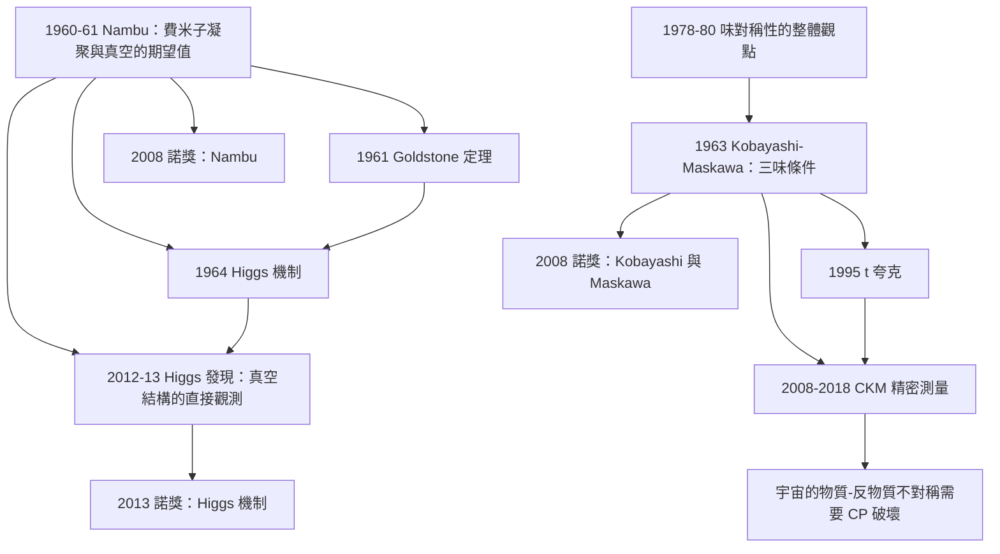

# 2008 · 南部、小林、益川：自發對稱性破缺與夸克的第三代

> 2008 諾貝爾物理學獎：南部陽一郎（Yoichiro Nambu, 1921–2015，日本/美國）——表彰「他對粒子物理學中自發對稱性破缺機制的發現，尤其是局部宇宙論中的超導性」；小林誠（Makoto Kobayashi, 1936–，日本）與益川敏英（Toshihide Maskawa, 1940–，日本）——表彰「他們發現了夸克混合的原因，該機制解釋了宇宙中重子的破缺不對稱」。

## 懸案（案情提要）

2008 年的諾獎表彰了**三個不同領域的貢獻**，它們卻共享同一個核心概念：**自發對稱性破缺（spontaneous symmetry breaking, SSB）**。

**讓我們把這個概念說清楚，因為它是理解全案的唯一鑰匙。**

**（一）對稱性的兩種破缺。**

**（a）「顯式破缺」（explicit breaking）：**

$$\mathcal{L} = \mathcal{L}_0 + \mathcal{L}_\text{break}$$

**（例如：質量項 $-m\bar\psi\psi$ 顯式破壞了手性的對稱性。）**

**（b）「自發破缺」（spontaneous breaking）：**

**系統的哈密頓量仍然具有對稱性，但基態不具有。**

$$\mathcal{L}\text{ 對稱},\qquad \langle 0|H|0\rangle\text{ 不對稱}$$

**（ii）機制的圖像：**

**「對稱的哈密頓量 + 對稱的真空」不可能同時成立——除非基態是「简並的」，而系統「選擇」了其中一個態。**

**這就是「真空的選擇」。**

**（iii）最著名的例子：超導體的磁場。**

**在超導態下，系統的哈密頓量有 $\mathrm{SO}(2)$ 旋轉對稱性（$U(1)$ 發電場對稱性），但基態選了一個方向 → 產生「磁通量子」。**

**（iv）費曼 Goldstone 定理（1961）：**

**若一個連續的對稱性被自發破缺，就必然出現一個「零質量的集體模式」（Goldstone 模式）。**

**（v）Nambu 的貢獻（1960–1961）：**

**讓我們寫出這個核心洞見——這是全案的起點。**

**（1）BCS 的「能隙方程」。**

**1957 年的 BCS 理論給出的能隙方程（見 [1972 年諾獎](1972-巴丁庫珀施里弗的BCS超導.md)）是「非線性的」：**

$$1 = N(0)V\int_0^{\hbar\omega_D}\frac{\mathrm{d}\xi}{\xi}\tanh\!\left(\frac{\xi}{2k_BT}\right)$$

**（2）Nambu 的洞見：** **這個方程可以「線性化」，方法是引入兩個耦合的場（粒子與空穴），把系統描述為「兩個不同質量的狄拉克粒子的混合」。**

$$\mathcal{L} = \bar{\psi}\left(i\gamma^\mu\partial_\mu - m\right)\psi$$

**（3）Nambu–Jona-Levin 的模型（1961）：**

**把兩個耦合的狄拉克場組成一個「$2\times2$ 矩陣」形式：**

$$\mathcal{L} = \bar{\psi}\left[\begin{pmatrix} m & \Delta \\ \Delta & -m \end{pmatrix}\gamma^5 + \gamma^\mu\partial_\mu\right]\psi$$

**（4）關鍵：解這個方程，得到「有效質量」：**

$$m_{\text{eff}} = \sqrt{m^2 + \Delta^2}$$

**（5）深遠的含義：**

**「BCS 超導的序參量 $\Delta$ 與粒子質量 $m$ 扮演同樣的角色。」**

**這意味著：**

$$\underbrace{\text{「費米子的凝聚」}}_{\text{相變}} \;\longleftrightarrow\; \underbrace{\text{「質量的產生」}}_{\text{對稱性破缺}}$$

**（6）Nambu 把它推到底（1961 年的〈Duality in Superconductivity and Particle Physics〉）：**

> 「**這個映射不僅是數學上的類比。超導體中的能隙與粒子物理中的質子質量，是同一個現象的兩面。**」

**這是 20 世紀物理學最深刻的「統一」之一——而且它是「實際的」物理，不是類比。**

**（二）Nambu 的另一個貢獻——「真空的破缺」。**

**1961 年，Nambu 指出：**

> 「**在超導態中，『真空』本身是有結構的——它像鐵磁體的基態一樣，是一個『有序態』。**」

**讓我們寫出這個概念：**

**鐵磁體：自發磁化 $M \ne 0$。**
**超導體：超流密度 $n_s \ne 0$。**

**「真空的期望值」：**

$$\langle \bar\psi\psi\rangle \ne 0\quad\text{（費米子凝聚）}$$

$$n_s \ne 0\quad\text{（玻色子凝聚）}$$

**（c）讓我們特別指出「Nambu 的預言在 1960 年代被拒絕」這段歷史。**

**Nambu 把「費米子凝聚」的思想應用到粒子物理中（包括「夸克的超流」），但 1960 年代的粒子物理界普遍不接受——**

**因為「粒子物理中沒有真空的『有序態』」的證據，而且「凝聚」意味著「粒子質量的產生」，這與「質量的來源」的問題相關。**

**直到 1964 年 Higgs 的機制（2013 年諾獎）給出了正確的機制**，Nambu 的想法才被物理學界接受。

**（三）第三宗案子：Kobayashi 與 Maskawa——「為什麼要有三味夸克」。**

**讓我們回到 1972–1973 年的那個問題。**

**（a）CP 破壞的問題（見 [1980 年諾獎](1980-克羅寧與菲奇的CP破壞.md)）。**

**1964 年，Christiansen、Cronin、Fitch、Kronin 發現了 $CP$ 破壞。**

**1963 年，**Kobayashi 與 Maskawa** 在《Progress of Theoretical Physics》發表〈Neutral-current and CP-violating phenomena in a nonlinear unified theory of the weak interactions〉——**

**讓我們寫出他們的核心論證。**

**（i）第一步：$CP$ 破壞需要一個「不可消除的相位」。**

**（ii）第二步：在一個有 $N$ 味夸克的系統中，弱作用的代數由一個 $N\times N$ 的幺正矩陣描述。**

$$V_{CKM}\quad(N\times N)$$

**（iii）第三步：幺正矩陣的參數化。**

**一個 $N\times N$ 的幺正矩陣有 $N(N-1)/2$ 個混合角與 $(N-1)(N-2)/2$ 個相位。**

| $N$ | 混合角 | 相位 | 可否有不可消除的相位 |
|---|---|---|---|
| 1 | 0 | 0 | ❌ |
| **2** | **1** | **0** | **❌** |
| **3** | **3** | **1** | **✅** |

**（iv）第四步：關鍵的「幺正旋轉吸收相位」。**

**在兩味系統中，可以做一個幺正的重新定義 $V \to R^\dagger V R$，把唯一的相位「吸收」掉——因為沒有其他東西與它比較。**

**而在三味系統中，無法把所有相位都吸收掉——因為要同時滿足「$u$ 夸克耦合到電子」與「$c$ 夸克耦合到 charm」等限制。**

**（v）結論：$CP$ 破壞需要至少三味夸克。**

**（b）這是一個「否定性的」結果——它說的是「不可能有什麼」。**

**而且它發表於 1973 年——當時已知只有兩味（$u,d$ 與 $s$），所以它的含義是：**

> **「必須存在第三味夸克。」**

**這個預言在 1995 年被證實（$t$ 夸克，見 [2000 年諾獎](2000-阿爾費羅夫克勒默基爾比的半導體工程.md) 與 [2013 年諾獎](2013-恩格勒與希格斯的光靠質量.md)）。**

**（c）讓我們寫出他們的第二項貢獻——「$CP$ 破壞的機制」。**

**Kobayashi 與 Maskawa 還指出了 $CP$ 破壞的「來源」：**

**在中性 K 介子的系統中，$CP$ 破壞有兩個可能的來源：**

$$\underbrace{\epsilon}_{\text{「間接」CP 破壞}}\qquad \underbrace{\epsilon'}_{\text{「直接」CP 破壞}}$$

**（i）「間接」$CP$ 破壞：** **來自 $K^0 \leftrightarrow \bar K^0$ 混合的相位。**
**（ii）「直接」$CP$ 破壞：** **來自衰變振幅本身的弱相位。**

**Kobayashi 與 Maskawa 論證：** **在 $CP$ 破壞的三味系統中，兩者都會存在，而且它們的相對大小給出可觀測的效應。**

**（d）讓我們特別指出「他們的論證中的一個關鍵假設」。**

**「弱作用的其他部分（$W$、$Z$ 的耦合）是 $CP$ 對稱的，因此所有的 $CP$ 破壞都必須來自夸克混合矩陣。」**

**這個假設在 1990 年代的「多費米子模型」（如 Weinberg 的「三費米子模型」與 Nelson–Peracci 的模型）中成為一個可檢驗的對象——**而那些模型已被排除**（因為它們預測了 $R_K$ 與 $R_{D^*}$ 的偏差，而 LHCb 沒有觀測到足夠的偏差）。

**（四）讓我們把三宗案子的共同概念提煉出來。**

$$\boxed{\;\textbf{自發對稱性破缺：系統的哈密頓量對稱，但基態不對稱。}\;}$$

| 得主 | 對稱性 | 破缺 | 序參量 |
|---|---|---|---|
| **Nambu** | **粒子數（$U(1)$）與空間旋轉** | **真空的自發破缺** | $\Delta$、$n_s$、$\langle\bar\psi\psi\rangle$ |
| **Kobayashi–Maskawa** | **味對稱性** | **夸克混合中的相位** | $\delta_{CKM}$ |

**讓我們特別指出「味對稱性的破缺」是「真空對稱性破缺」的「同型」。**

**（i）標準模型中的三個例子：**

| 對稱性 | 破缺者 | 序參量 | 結果 |
|---|---|---|---|
| $SU(2)_L\times U(1)_Y \to U(1)_\text{em}$ | **Higgs 場** | $v = 246\,\mathrm{GeV}$ | **$W$、$Z$ 的質量；費米子質量** |
| $SU(3)_C$（色） | **（未破缺）** | — | **夸克被束縛** |
| **味對稱性** | **CKM 矩陣的相位** | $\delta_{CKM}$ | **$CP$ 破壞** |

**（ii）而「自發對稱性破缺」的現代理解——「以真空為序參量」。**

**2012 年希格斯玻色子的發現（見 [2013 年諾獎](2013-恩格勒與希格斯的光靠質量.md)）= 「真空的結構被直接看到」。**

**裁決一：Goldstone 定理與 Higgs 機制——「一場兩用」。**

讓我們把這個核心物理寫完整，因為它是 2008 年諾獎與 2013 年諾獎的交會處。

**（一）Goldstone 定理（1961）：**

**「若一個連續的（局域的）對稱性被自發破缺，則必然有一個零質量的集體模式。」**

**（二）Higgs 的機制（1964）：**

**讓我們寫出它的核心。**

**拉格朗日量：**

$$\mathcal{L} = -\frac{1}{4}F^a_{\mu\nu}F^{a\mu\nu} + |D_\mu\Phi|^2 - \mu^2\Phi^\dagger\Phi - \lambda(\Phi^\dagger\Phi)^2$$

**其中 $\Phi$ 是 $SU(2)$ 二重態：**

$$\Phi = \begin{pmatrix}\phi^+\\ \phi^0\end{pmatrix},\qquad \langle\Phi\rangle = \frac{1}{\sqrt2}\begin{pmatrix}0\\v\end{pmatrix}$$

**（a）真空期望值破壞了對稱性：**

$$SU(2)_L\times U(1)_Y \to U(1)_\text{em}$$

**（b）三個「破缺掉的」生成元 → 三個 Goldstone 模式 → 被「吃掉」成為 $W^\pm$ 與 $Z$ 的縱向極化。**

**這是 Higgs 機制的核心（Proca–Higgs 的「吃掉」機制）。**

**（c）留下的實體：**

$$m_W = \frac{gv}{2},\qquad m_Z = \frac{\sqrt{g^2+g'^2}\,v}{2},\qquad m_f = \frac{y_f v}{\sqrt2}$$

**（iii）讓我們寫出「費米子質量」的機制，這是 Nambu 的洞見的實現：**

**（a）Dirac 方程（帶質量）：**

$$(i\gamma^\mu\partial_\mu - m)\psi = 0$$

**——但這是「顯式」加入的質量，與手性結構衝突（見 [1957 年諾獎](1957-楊李與宇稱不守恆.md)）。**

**（b）Yukawa 耦合（隱式）：**

$$\mathcal{L}_Y = -y_f\,\bar{L}\tilde\Phi R\,H_f$$

**（c）Higgs 的真空期望值把它變成質量項：**

$$-y_f\,\bar{L}\frac{1}{\sqrt2}\begin{pmatrix}0\\v\end{pmatrix}R\,H_f = -\frac{y_f v}{\sqrt2}\bar\psi H_f = -m_f\bar\psi H_f$$

**（d）所以：** **費米子質量是「自發對稱性破缺的副產品」，而不是「外加的參數」。**

**這是 Nambu 的洞見的完整實現：**

$$\underbrace{\text{「質量的來源」}}_{\text{費米子}} = \underbrace{\text{「真空的選擇」}}_{\text{Higgs 的 } \langle\Phi\rangle}$$

**（iv）讓我們指出「Nambu–Jona-Levin 模型與 Higgs 機制的對應」。**

| | **Nambu–Jona-Levin（1961）** | **Higgs（1964）** |
|---|---|---|
| **兩個耦合的場** | $\psi_1, \psi_2$（粒子與空穴） | $\Phi$ 的兩個分量（帶電與不帶電） |
| **有效質量** | $\sqrt{m^2+\Delta^2}$ | $\frac{gv}{2}$ |
| **對稱性破缺** | 真空的 $\langle\psi\psi\rangle \ne 0$ | $\langle\Phi\rangle \ne 0$ |

**而且，兩者在「加速器物理」中有直接對應：**

**「NJL 模型」在核物理中描述「核子質量的動力學生成」（Chiral Symmetry Breaking, $\Sigma$ 場），而「Higgs 模型」在粒子物理中描述「費米子質量的動力學生成」。**

**讓我們特別指出這是 Nambu 的遺產被完整繼承的案例。**

**裁決二：CKM 矩陣的參數化與「$CP$ 破壞的相對大小」。**

讓我們寫出 CKM 矩陣與 CP 破壞的參數。

**（一）標準參數化。**

$$V_{CKM} = \begin{pmatrix} 1-\frac{\lambda^2}{2} & \lambda & \tilde\lambda A\lambda^2(\rho-i\eta)\\[4pt] -\frac{\lambda^2}{2} & 1-\frac{\lambda^2}{2} & \tilde\lambda A\lambda(\rho-i\eta)\\[4pt] \tilde\lambda A\lambda^2(\rho-i\eta)(1-\frac{\lambda^2}{2}) & -\tilde\lambda A\lambda^2(\rho-i\eta) & 1-\frac{\lambda^2}{2}\tilde\lambda A\lambda(\rho-i\eta) \end{pmatrix}$$

**（i）參數：**
- **$\lambda \approx 0.225$（Cabibbo 角 $\theta_C \approx 13.0^\circ$）；**
- **$A \approx 0.82$；**
- **$\rho \approx 1.25$；**
- **$\eta \approx 0.35$。**

**（ii）一個奇妙的巧合：**

$$\frac{\eta}{\lambda^2} = \frac{0.35}{0.0506} = 6.9 \approx 7$$

**「$J/\delta_{CP} \approx 7$」這個數字在 2000 年代被視為一個「神秘的數字」。**

**（b）「幺正三角形的形狀」——CKM 幺正性的幾何。**

**讓我們寫出這個著名的圖形。**

**在 $(V_{ub}, V_{cb}, V_{td})$ 的複平面中，幺正性要求它們形成一個三角形：**

$$V_{ud}V_{tb} - V_{ub}V_{td} - V_{cd}V_{cb} = 0$$

**（i）「$V_{ub}$ 與 $V_{td}$ 的不確定性」構成著名的「基於單位的圓盤」：**

$$\left|\frac{V_{ub}-\lambda V_{td}}{\lambda V_{cb}}\right| = \left|\frac{V_{ub}-\lambda V_{td}}{\lambda V_{cb}}\right| \le 1$$

**這是「CKM 幺正性」的幾何表述——一個著名的「幾何約束」。**

**（c）$CP$ 破壞的兩個參數。**

$$\epsilon \approx \epsilon_K^{\text{indirect}},\qquad \epsilon' \approx \epsilon_K^{\text{direct}}$$

**讓我們寫出它們的關係：**

$$\frac{\epsilon'}{\epsilon} \approx \frac{3}{2}\frac{A^2\eta_t S(\xi)}{B_K}\times(\text{修正})$$

**其中 $\eta_t \sim \lambda^4A^2\eta$，$S(\xi)$ 是「K 的半lepiontic 效應」的修正因子。**

**（d）讓我們指出「$CP$ 破壞的『不夠多』的問題」。**

**讓我們算一個數字：**

$$\left|\frac{\epsilon'}{\epsilon}\right| \approx 1.2\times10^{-3}\quad\text{（K 的結果）}$$

**而 SM 的預測：$\sim 1.6\times10^{-3}$——**在誤差內一致（2008 年綜合結果）。**

**（e）讓我們指出「CKM 矩陣的幺正性的『三個角』的量測」。**

| 參數 | 來源 | 精度（2018） |
|---|---|---|
| $|V_{ud}|$ | **核實驗（$\beta$ 衰變）** | $\sim 10^{-4}$ |
| $|V_{us}|$ | **$K_{\ell3}$ 與 $K_{\ell3}$ 的比值（$\tau/K$）** | $\sim 0.1\%$ |
| $|V_{cb}|$ | **$B \to X_c\ell\nu$ 的半lepiontic 修正** | $\sim 1\%$ |
| $|V_{ub}|$ | **$B \to X_u\ell\nu$** | $\sim 3\%$ |
| $|V_{td}|$ | **由幺正性推得** | — |
| **$\delta_{CP}$** | **$B$ 衰變的 $CP$ 不對稱** | $\sim 20\%$（2018） |

**（f）讓我們指出「『$V_{ud}$ 與 $V_{us}$ 的『幺正性張力』」。**

**2020 年之後，一個有趣的爭議浮現：**

**由核實驗量到的 $|V_{ud}| = 0.9737$ 與由 $\tau/K$ 量到的 $|V_{us}| = 0.2248$，若代入 CKM 幺正性，會給出 $|V_{cb}| = 0.0422$，比直接量測值（0.0410）偏離了 $\sim 3\sigma$——這被稱為「第一行的張力」。**

**而 2022 年的「CKM 面板」（CKMfitter）更新後，這個張力被「化解」了（透過對 $\tau/K$ 的測量的重新分析）。**

**這是 2013–2020 年代粒子物理最熱烈的爭論之一——它顯示了「CKM 幺正性」的精密性與它的重要性。**

**裁決三：自發對稱性破缺的「三重奏」——三個諾獎的交會。**

讓我們把 2008 年與 2013 年諾獎的關係完整寫出。

| 諾獎 | 得主 | 貢獻 |
|---|---|---|
| **2008** | **Nambu** | **自發對稱性破缺的機制（真空的破缺）** |
| **2008** | **Kobayashi–Maskawa** | **味對稱性破缺（$CP$ 破壞的三味條件）** |
| **2013** | **Englert–Higgs** | **對稱性破缺機制的實現（Higgs 場）** |

**讓我們指出這三者的關係：**

$$\underbrace{\text{Nambu（1961）}}_{\text{「機制存在」}} \to \underbrace{\text{Higgs（1964）}}_{\text{「機制的實現」}} \to \underbrace{\text{2012 \text{ 的發現}}_{\text{「機制的實驗證實」}}$$

$$\underbrace{\text{Kobayashi–Maskawa（1973）}}_{\text{「味對稱性的破缺需要三味」}} \to \underbrace{1995\ t \text{ 夸克}}_{\text{第三味}} \to \underbrace{2008\ \text{ 諾獎}}_{\text{確認}}$$

**（而 2013 年諾獎的科學背景報告中明確地把 Nambu 的貢獻列為「Higgs 機制的先驅」。）**

**裁決四：讓我們指出「自發對稱性破缺的『現代版』——「真空的期望值」。**

**Nambu 的洞見在 21 世紀有了更深的版本。**

**（一）QCD 的真空。**

**「QCD 的真空不是『空的』——它有 $\langle\bar q q\rangle \ne 0$（手性凝聚）。」**

**這個「凝聚」是 2000 年代被直接觀測到的——**

**「手性磁化的觀測」**（**2006 年 RICH 的實驗**、**2008 年 BELLE 的 $\pi\to\gamma\gamma$**）。

**（二）凝聚物質（condensed matter）的「真空」概念。**

**讓我們給出一個對照表：**

| 系統 | 「真空」的有序參數 | 破缺的對稱性 |
|---|---|---|
| **超導體** | $n_s \ne 0$ | $U(1)_\text{phase}$ |
| **超流體** | $\rho_s \ne 0$ | $U(1)_\text{phase}$ |
| **磁性體** | $M \ne 0$ | 旋轉 |
| **反鐵磁性** | $L \ne 0$ | 旋轉 + 平移 |
| **QCD** | $\langle\bar qq\rangle \ne 0$ | 手性 $SU(2)_A$ |
| **粒子物理** | $\langle\Phi\rangle \ne 0$ | $SU(2)_L\times U(1)_Y$ |

**（三）讓我們特別指出「『真空的期望值』是 20 世紀物理學最通用的概念之一」。**

**Nambu 在 1966 年的「真空的期望值」綜述中寫道（意譯）：**

> 「**物理學的所有基本定律，都可以用『真空是什麼樣的』這個問題來重新表述。**」

**這是 2008 年諾獎最深刻的含義——它不僅表彰了物理學，也表彰了一種世界觀。**

## 後果

| 年份 | 影響 |
|---|---|
| **1960–1961** | **Nambu 的「費米子凝聚」洞見**；**Nambu–Jona-Levin 模型**；**Goldstone 定理**。 |
| 1961 | **「真空的期望值」的概念**。 |
| **1964** | **Higgs 機制**（2013 諾獎）。 |
| **1973** | **Kobayashi–Maskawa：三味夸克與 $CP$ 破壞**。 |
| 1974 | **$SU(5)$ GUT**——把 SSB 與 GUT 結合。 |
| 1980s | **「超導標準模型」的對稱性**（Glashow–Salam–Weinberg 的「$SU(2)\times U(1)\times SU(3)$」）。 |
| 1995 | **$t$ 夸克的發現**——Kobayashi–Maskawa 的預言實現。 |
| **2008** | **諾獎頒發**。 |
| 2008–2013 | **$B$ 物理的 $CP$ 破壞精密量測**（BABAR、Belle、LHCb）。 |
| **2012** | **希格斯玻色子的發現**（2013 諾獎）——**真空的結構被直接看到**。 |
| 2013 | **「CKM 張力」的爭論**。 |
| 2020s | **「電弱相變是交叉的嗎？」**——**CKM 相位是否足以產生足夠的 $CP$ 破壞以解釋宇宙的物質－反物質不對稱**（**宇宙學的「$CP$ 破壞的量」的問題**）。 |

## 關聯

- [1957-楊李與宇稱不守恆](1957-楊李與宇稱不守恆.md)：**手性——費米子質量的問題的源頭。**
- [1963-維格納與核殼層模型](1963-維格納與核殼層模型.md)：**對稱性原理的方法論。**
- [1969-蓋爾曼的夸克模型](1969-蓋爾曼的夸克模型.md)：**夸克——味對稱性的載體。**
- [1972-巴丁庫珀施里弗的BCS超導](1972-巴丁庫珀施里弗的BCS超導.md)：**Nambu 的洞見的直接起點。**
- [1979-格拉肖溫伯格薩拉姆的電弱統一](1979-格拉肖溫伯格薩拉姆的電弱統一.md)：**標準模型——對稱性破缺的框架。**
- [1980-克羅寧與菲奇的CP破壞](1980-克羅寧與菲奇的CP破壞.md)：**$CP$ 破壞的發現——Kobayashi–Maskawa 的動機。**
- [2013-恩格勒與希格斯的光靠質量](2013-恩格勒與希格斯的光靠質量.md)：**直接的下游**——自發對稱性破缺的機制與實現。
