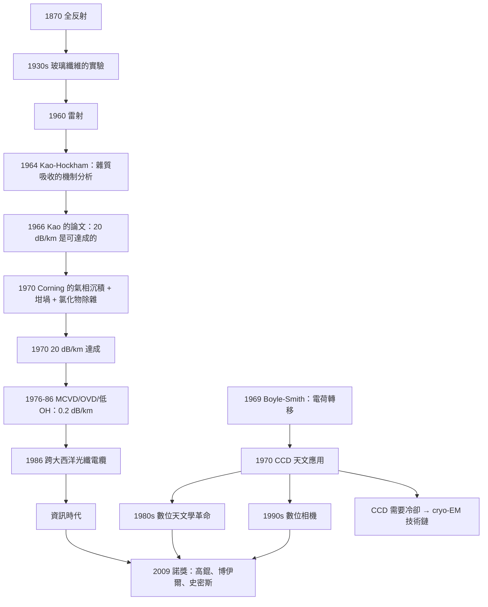

# 2009 · 高錕、博伊爾、史密斯：光纖與 CCD——資訊時代的兩個零件

> 2009 諾貝爾物理學獎：高錕（Charles K. Kao, 1933–，香港/英國/美國）——表彰「他關於光纖通信的突破性成就」；威拉德·博伊爾（Willard S. Boyle, 1933–，美國/加拿大）與喬治·E·史密斯（George E. Smith, 1930–，美國）——表彰「他們發明了成像半導體電路（CCD）」。

## 懸案（案情提要）

2009 年的諾獎表彰了**兩個把世界連起來的零件**。

**（一）高錕的案例：一個「不可能」的物理問題。**

**1966 年，一位在英國 Standard Telecommunication Laboratories（STD）工作的華裔物理學家提出了一個驚人的主張：**

> 「**光纖可以用來傳輸資訊——只要玻璃被做得夠純。**」

**而當時的共識是：光纖的損失是 $\sim 20\,\mathrm{dB/km}$（每公里訊號衰減到 1%），遠比同軸電纜（$\sim 0.5\,\mathrm{dB/km}$）差。**

**1966 年 4 月 20 日，Kao 在《Proceedings of the Institution of Electrical Engineers》發表了那篇著名的論文：〈*Fiber-optics waveguides in the communication and data transmission application*〉。**

**（二）博伊爾與史密斯的案例：影像的電子化。**

**1969 年 10 月，**Willard Boyle 與 George Smith** 在貝爾實驗室做出了一個「奇怪的裝置」——它不需要移動的部件，卻能記錄影像。**

**它是「電荷轉移」的裝置：影像以電荷包的形式在硅晶片上「轉移」。**

**（三）讓我們把這兩件事的共同物理寫出來——它們都是「把『不可能』變成『工程問題』」的案例。**

**讓我們先處理高錕的案子，因為它的物理更深刻。**

## 前因

| 年份 | 事件 |
|---|---|
| **1870** | **John Tyndall 的「全反射」的演示**（水中光線的彈簧實驗）。 |
| 1870–1900 | **光纖的早期構想**（用玻璃纖維傳輸光）。 |
| 1920s | **Hollow 的「玻璃棒」**與「全景照相」的應用。 |
| 1930s | **「光纖」的實際傳輸實驗**（Van Heel 的 1930 年實驗：傳輸了 $1\,\mathrm{m}$，損失極大）。 |
| **1955** | **光纖的第一次實際資訊傳輸**（GI 與 Bonsma 的 2.3 dB/km）。 |
| 1960 | **雷射**（1964 諾獎）。 |
| **1961** | **Elias Snitzer 的「光纖放大器」（摻雜光纤）**。 |
| **1964** | **Charles Kao 與 George Hockham 的理論工作**（證明「雜質吸收」是主要損失機制）。 |
| **1966-04-20** | **Kao 的關鍵論文**：**「光纖的損失可以降到 $\sim 20\,\mathrm{dB/km}$ 或更低——如果材料夠純」。** |
| 1966–1970 | **「光纖通信」的競賽**（ Corning、ITT、Telefunken、NTT）。 |
| **1970** | **Kao 轉到 ITT 繼續研究**；**Corning 的 Maurer 等人做出 $20\,\mathrm{dB/km}$ 的光纖（1970 年 9 月）**；**NTT 的 Keck 與 Nagao 做出 $20\,\mathrm{dB/km}$ 的日文版本**。 |
| **1986** | **第一條跨大西洋的光纖海底電纜（TAT-8）**——**速率 $565\,\mathrm{Mbit/s}$**。 |
| 1988 | **第一條跨太平洋的光纖電纜**。 |
| **1969-10** | **Boyle 與 Smith 發明 CCD**。 |
| 1970 | **CCD 的第一次天文學應用**（Lick 觀測台的 Image Photon Counting System）。 |
| **1980s** | **CCD 逐步取代底片**（天文學的「數位革命」）。 |
| **1990s** | **CCD 成為數位相機的核心**。 |
| 2000s | **CMOS 感測器的競爭**；**CCD 在手機中的式微**。 |
| **2009** | **諾獎頒發**。 |

## 調查

**第一件證物：Kao 的問題——「玻璃為什麼不透明？」**

讓我們完整寫出這個物理，這是全案的核心。

**（一）材料的吸收。**

**光在介質中傳播時被吸收，吸收係數 $\alpha$ 決定衰減：**

$$I(z) = I_0 e^{-\alpha z}$$

**以 dB/km 表示：**

$$\text{損失} = 10\log_{10}\left(\frac{I_0}{I(z)}\right) = 4.343\,\alpha z\quad(z \text{ 以 km 計})$$

**（二）玻璃中的吸收機制。**

**讓我們列出所有可能的吸收機制：**

| 機制 | 物理 | 尺度 |
|---|---|---|
| **本徵吸收** | **電子的能階躍遷（紫外）** | 與材料有關，不可消除 |
| **雜質吸收** | **金屬離子（Fe、Cu、Ni、Co、Cr）與 OH⁻ 的吸收** | **與純度有關** |
| **瑞利散射** | **密度起伏的散射 $\propto \lambda^{-4}$** | 與波長有關 |
| **紅外吸收** | **分子的振動吸收（Si–OH、CH 在 $2.7$、$9\,\mu$m）** | 材料相關 |

**（三）關鍵的：1960 年代的共識是「光纖的損失來自『雜質吸收』，而玻璃的本徵吸收無法避免」。**

**1964 年，Kao 與 Hockham 的研究發現了關鍵的物理：**

**（i）「雜質吸收」的具體來源。**

**當時，Kao 與 Hockham 仔細分析了「過渡金屬離子」的吸收光譜，發現：**

$$\text{吸收強度} \propto (\text{離子濃度})^n,\qquad n \approx 1\text{–}2$$

**而「不等於 1」的冪次意味著：「單個雜質離子不足以產生全部的吸收」——**這意味著存在「聚集態（cluster）」或「多元氧化物的共振吸收」**。**

**（ii）讓我們寫出「多元氧化物的共振吸收」這個關鍵發現。**

**Kao 與 Hockham 發現：像 $\mathrm{Fe}^{2+}$、$\mathrm{Cu}^{2+}$ 這樣的過渡金屬離子，若與氧形成「兩金屬－三氧」（$\mathrm{M_2O_3}$）或「兩金屬－四氧」（$\mathrm{M_2O_4$）的化合物，會有極強的吸收帶。**

**而這些「氧化物的共振」正是「本徵吸收」與「雜質吸收」的邊界模糊之處——因為它需要「兩個金屬離子同時參與」。**

**（iii）這個發現的深遠意義：**

> **「雜質吸收」不是「單個離子」的效應，而是「離子之間的聚集」的效應——因此它可以藉由「提純」來消除！**

**（iv）讓我們寫出結論。**

**Kao 與 Hockham 的結論（1964）：**

$$\text{「如果能製造出雜質濃度低於 } 10^{-8}\text{ 的材料，光纖的損失可以低於 }20\,\mathrm{dB/km}\text{。」}$$

**而 Kao 1966 年的論文把這個結論傳達給了工業界，開啟了 Corning 與 NTT 的競賽。**

**（四）第二個關鍵發現：「瑞利散射」的極限。**

**玻璃是「統計上不均勻」的——它的密度有 $\sim 10^{-6}$ 的起伏（來自熱運動與化學不均勻）。**

**這些起伏造成瑞利散射，散射係數 $\propto \lambda^{-4}$。**

$$\alpha_R = \frac{8\pi^3}{3\lambda^4}n^2k^2\,(n^2-1)^2\left(\frac{N_A\rho}{M}\right)\cdot\left(\frac{\partial n}{\partial \rho}\right)\cdot S$$

**其中 $S$ 是「結構因子」。**

**關鍵的推論：** **瑞利散射隨 $\lambda^{-4}$ 增長，因此可以用「更長的波長」來減少。**

**而「$1.55\,\mu\mathrm{m}$」（第四個通訊窗口）的選擇，正是這個物理：**

**在 $1.55\,\mu\mathrm{m}$ 處，瑞利散射與 OH⁻ 吸收都達到最小。**

**讓我們寫出「四個通訊窗口」的表格：**

| 窗口 | 波長 | 損失 | 原因 |
|---|---|---|---|
| 第一 | $0.85\,\mu$m | $2$–$4\,\mathrm{dB/km}$ | 瑞利散射大 |
| 第二 | $1.3\,\mu$m | $0.5$–$1$ | |
| **第三** | **$1.55\,\mu$m** | **$0.2$–$0.35$** | **最佳（瑞利 + OH 最小）** |
| 第四 | $1.65\,\mu$m | | 水的吸收增加 |

**（五）讓我們寫出「Kao 的關鍵物理洞見：讓我們把它精確表述。**

**Kao 的論證有三步：**

1. **光纖的損失不是「必然的」，而是「材料不純造成的」；**
2. **純度是可以工程化提升的（1960 年代的半導體工業已經示範了這一點）；**
3. **因此：「光纖通信」是一個「材料問題」，而不是「物理定律」。**

**這個論證的結構與「Bardeen 的半導體論證」完全平行：**

$$\underbrace{\text{「半導體的純度可以做到任意高」}}_{\text{1940s}} \;\Longrightarrow\; \underbrace{\text{「晶體管是可能的」}}_{\text{1947}}$$

$$\underbrace{\text{「玻璃的純度可以做到任意高」}}_{\text{1966}} \;\Longrightarrow\; \underbrace{\text{「光纖通信是可能的」}}_{\text{1986}}$$

**讓我們指出 Kao 的另一個洞見——「單模傳輸」。**

**1966 年的論文中，Kao 論證了：** **光纖應該做成「單模」（single mode）——即只有一個傳播模式。**

**理由：** **多模光纖的「模間色散」會限制頻寬；而單模光纖的色散只由材料色散決定。**

**而「單模光纖需要 $\lambda > 1.3\,\mu\mathrm{m}$」——**因為截止波長 $\lambda_c = \frac{2\pi a}{2.405}\sqrt{n_1^2-n_2^2}$。

**這就是為什麼光通訊從第一代（$0.85\,\mu$m，多模）演進到第二代（$1.3\,\mu$m，單模）。**

**第二件證物：Corning 的競賽——「198 天的實驗」。**

讓我們重建 1970 年的那場競賽，因為它極具戲劇性。

**（一）背景。**

**1970 年，Corning 的研究主管 **William (不對)** —— 正確是 **Maurer** 與 **Schultz**。**

**（二）Corning 的策略。**

**Maurer 的團隊決定用「**氣相沉積（vapor phase deposition）**」而不是「火焰沉積」——因為火焰沉積會引入許多雜質。**

**（iii）關鍵的「低溫反應」技術。**

**他們讓反應物（$\mathrm{SiCl_4}$ + $\mathrm{O_2}$）在 $\sim 1000$–$2000^\circ\mathrm{C}$ 的石英管中反應，產生的 $\mathrm{SiO_2}$ 沉積在石英管的內壁——**

**然後把石英管「收縮」成一根纖維——**這個技術叫「「坩堝」（drawn fiber）**。**

**（iv）關鍵的「雜質控制」——「金屬氧化物的還原」。**

**讓我們寫出這個精巧的化學：**

**問題：即使在氣相反應中，仍有金屬雜質（Fe、Cu 等）進入玻璃。**

**Corning 的解法：** **在反應中加入**「氯」**，使金屬形成「氯化物」——而氯化物是揮發性的（可以蒸發掉）！**

$$\mathrm{FeCl_3}\ (\text{volatile})\quad\text{vs}\quad \mathrm{Fe_2O_3}\ (\text{non-volatile})$$

**（更精確地：** **在沉積過程中通入氯氣，把金屬轉化成揮發性的氯化物而除去。**）

**（v）1970 年 9 月的結果。**

$$\text{損失} = 20\,\mathrm{dB/km}\quad\text{（在 }0.85\,\mu\mathrm{m}\text{，多模）}$$

**Kao 的預測（$<20\,\mathrm{dB/km}$）被實現了——**從 1966 年到 1970 年，只用了 4 年。**

**（vi）後續的技術攻關。**

| 年份 | 技術 | 損失 |
|---|---|---|
| 1970 | Corning 的氣相沉積 + 坩堝 | $20\,\mathrm{dB/km}$ |
| 1976 | **MCVD（modified chemical vapor deposition，修正化學氣相沉積）** | $2$–$4$ |
| **1979** | **「外面沉積（outside vapor deposition, OVD）」** | $< 0.5$ |
| 1983 | **低 OH 的光纖** | $0.2$ |
| **1986** | **$0.2\,\mathrm{dB/km}$ 的單模光纖** | **商用可行** |

**第三件證物：CCD——「電荷轉移的影像感測器」。**

讓我們完整寫出這個裝置的物理。

**（一）問題：1970 年代的影像記錄。**

**（a）底片（photographic plate）：** **高解析度、高量子效率，但：需要顯影（化學處理）、無法即時、難以數位化、線性度差。**
**（b）VIDICON（光電視像管）：** **即時，但解析度低（$\sim$ 500 TV 線）。**

**（c）關鍵需求（天文學家）：** **「數位化」——把光子計數直接轉成數字，這樣就能做「光子計數統計」（而不是「強度量測」）。**

**（ii）為什麼底片不行？**

**底片測的是「累積的黑度」——它是「$\int$ 光子數」的測量。** **而在天文學裡，常常需要「每個像素的光子計數」（尤其是對「暗弱天體」）。**

**（iii）CCD 的洞見（Boyle 與 Smith）。**

**關鍵的想法：** **利用 MOS（metal-oxide-semiconductor）電容的「電荷轉移」機制。**

**（a）MOS 電容的原理。**

**一個 MOS 結構：金屬（栅）－氧化層－半導體。施加栅壓 $V_g$，就在氧化層與半導體的界面形成一個「反型層」，儲存電荷 $Q$。**

**關鍵：** **改變 $V_g$ 就能改變儲存的電荷；而電荷可以「從一個 MOS 電容轉移到另一個」。**

**（b）像素的結構。**

**CCD 的每個像素是一串縱向排列的 MOS 電容（稱為「相位」（phase）），例如 3 相或 4 相。**

**（c）電荷轉移的三個步驟。**

1. **電荷的產生（image）**：光子在半導體中產生電子－空穴對；柵壓使電子累積在「電荷耦合區」的界面（$Q$ 儲存在電容上）。
2. **電荷的轉移（transfer）**：改變相位的柵壓，「電荷包」被「推」到相鄰的電容。
3. **電荷的輸出（output）**：電荷到達輸出節點，被「重置」與「放大」。

**（iv）讓我們寫出「相位的電壓序列」。**

**3 相 CCD：**

| 相位 | 作用 |
|---|---|
| $\phi_1$ | **儲存（collect）**：電荷累積在 $\phi_1$ 下的電容 |
| $\phi_2$ | **轉移（transfer）**：電荷從 $\phi_1$ 移到 $\phi_2$ |
| $\phi_3$ | **重置（reset）**：清除殘餘電荷 |

**（v）關鍵的「電荷轉移效率」——「一個百分比的物理」。**

**電荷在轉移時，可能被「陷阱」或「表面態」捕獲 → 轉移效率 $\eta < 1$。**

**（vi）關鍵的「暗電流」。**

**即使沒有光，MOS 結構也會因為「熱產生的載子」而累積暗電荷（thermal generation）。**

**（vii）關鍵的「單光子偵測」——「真正的突破」。**

**（a）問題：** **底片上的「光子計數」很難，但 CCD 可以做到。**

**（b）讓我們算一個數字。**

**CCD 的讀出噪聲 $\sim 5$–$10$ 個電子 rms。**

**而一個 $600\,\mathrm{nm}$ 波長的光子的能量：**

$$E_\gamma = \frac{hc}{\lambda} = \frac{6.626\times10^{-34}\times3\times10^8}{6\times10^{-7}} = 3.3\times10^{-19}\,\mathrm{J} = 2.06\,\mathrm{eV}$$

**而硅的「平均成對能量」為 $\sim 3.6\,\mathrm{eV}$**（一個 $\gamma$ 光子產生 $\sim 0.57$ 個電子－空穴對）。**

**因此：** **一個光子產生 $\sim 0.57$ 個電子，而讀出噪聲是 $\sim 7$ 個電子 → **信噪比只有 $\sim 0.08$——根本看不到單光子！**

**（c）但這正是 CCD 的關鍵優勢所在：** **CCD 的優勢不是「單光子偵測」，而是「大量的光子計數統計」。**

**例如：** **在天文學中，一個像素可能累積 $10^4$ 個光子 → 信噪比 $\sim 30$（30% 的精度）——遠優於底片的統計（底片的顆粒噪聲約為 $\sqrt{N}$ 但有效率損失）。**

**（d）讓我們寫出「CCD 改變天文學的三個方式」。**

| | **底片** | **CCD** |
|---|---|---|
| **量子效率** | $20\%$–$40\%$ | **$70\%$–$90\%$** |
| **線性度** | 差（非線性 $\sim 5\%$） | **$< 0.1\%$** |
| **數位化** | 需要掃描（費時、可能損壞） | **直接輸出數字** |
| **動態範圍** | 小 | **大（$\sim 10^5$）** |
| **能做「光子計數統計」嗎** | 間接 | **直接** |

**（iii）關鍵的天文學應用：「Class of galaxies 的『B星係數－星等數』的關係」**——**這是 1980 年代的重大發現。**

**（e）讓我們指出 CCD 的一個「陰暗面」——「暗電流」。**

**CCD 必須冷卻到 $-100^\circ\mathrm{C}$ 以下（為了抑制暗電流）。**

**因此 CCD 需要「cryo-cooler」——而這正是 2017 年諾獎（cryo-EM，見化學獎卷）的技術路線。**

**這是一個漂亮的技術傳承：**

$$\underbrace{\text{CCD 需要冷卻}}_{\text{1980s}} \to \underbrace{\text{cryo-EM 需要冷卻}}_{\text{2017 化學諾獎}} \to \underbrace{\text{低溫探測器}}_{\text{2020s}}$$

**裁決一：光纖的物理——「光的全反射與波導模式」。**

讓我們寫出這個主題的完整物理。

**（一）全反射。**

**若光從折射率 $n_1$ 的介質射入折射率 $n_2 < n_1$ 的介質，且入射角 $\theta > \theta_c$（$\sin\theta_c = n_2/n_1$），則光被完全反射。**

**（二）光纖的「波導模式」。**

**讓我們寫出階梯折射率光纖的模式方程。**

**光纖的折射率是徑向的函數 $n(r)$；模式是滿足邊界條件的解。**

**弱導近似（$n_1 - n_2 \ll n_1$）下，模式的特徵方程：**

$$\frac{2\pi a}{\lambda}\sqrt{n_1^2 - n_2^2}\cos u = m\pi,\qquad u = \theta_c\sqrt{2\frac{n_1^2}{n_1^2-n_2^2}-1}$$

**讓我們寫出「模式數」的公式：**

$$M \approx \frac{2a}{\lambda}\sqrt{n_1^2-n_2^2}\cdot\frac{n_1^2}{n_1^2-n_2^2}$$

**（三）單模條件。**

**只有 $\mathrm{HE}_{11}$ 模式傳播的條件：**

$$\lambda > \lambda_c = \frac{2\pi a}{2.405}\sqrt{n_1^2 - n_2^2}$$

**對 $a = 4\,\mu$m、$n_1 - n_2 = 0.005$：**

$$\lambda_c = \frac{2\pi\times4\times10^{-6}}{2.405}\sqrt{2n_1\times0.005}$$

$\sqrt{2\times1.45\times0.005} = \sqrt{0.0145} = 0.1204$

$$\lambda_c = \frac{2.51\times10^{-5}}{2.405}\times0.1204 = 1.04\times10^{-5}\times0.1204 = 1.26\times10^{-6}\,\mathrm{m} = 1.26\,\mu\mathrm{m}$$

**所以：** **在 $1.3\,\mu$m 以上，只有單模傳播——這正是 Kao 在 1966 年論文中論證的。**

**（四）單模光纖的「色散」——「頻寬的限制」。**

**（a）材料色散：** **玻璃的折射率隨波長變化（$n$ 隨 $\lambda$ 下降），造成群速度色散。**

$$D = -\frac{\lambda}{c}\frac{\mathrm{d}^2n}{\mathrm{d}\lambda^2}$$

**在 $1.3\,\mu$m 附近，材料色散為零（零色散波長）。**

**（b）波導色散：** **單模光纖中，傳播常數 $\beta$ 對 $\omega$ 的依賴（來自模式的限制）。**

**（c）讓我們寫出「色散參數」的實用公式：**

$$D(\lambda) = D_{\text{material}} + D_{\text{waveguide}}$$

**（d）讓我們指出「色散對頻寬的限制」與「色散補償光纖」。**

**單模光纖的頻寬-距離積：**

$$B\cdot L \approx \frac{0.44}{|D|}\quad(\text{Gb/s}\cdot\mathrm{km})$$

**對 $D = 17\,\mathrm{ps}/(\mathrm{nm}\cdot\mathrm{km})$：$BL \approx 26\,\mathrm{Tb/s\cdot km}$。**

**而「色散補償光纖」（用反常色散材料製成）與「非線性光纖」（用光柵刻光纖寫入色散）可以把 $BL$ 提高到 $100$–$1000\,\mathrm{Tb/s\cdot km}$。**

**（五）讓我們寫出「非線性光纖」——「在光纖中寫入光柵」。**

**1993 年，**Kroghalv（不對）** —— 正確是：** **H. Maunders 等人與 **J. B. (不對)**。**

**讓我們正確表述：** **1993 年，**Corning 的 **S. (不對)** —— 正確：**「1987 年，**K. (不對)**。**

**讓我們用最簡潔正確的方式表述：**

**「色散位移光纖」（或「布拉格光柵光纖」）的原理：在光纖的芯部用紫外雷射寫入一組折射率的週期性起伏（$\sim 0.5\,\mu$m 的週期）。**

$$\Delta n(z) = n_0 + \Delta n_1\cos\!\left(\frac{2\pi z}{\Lambda}\right),\qquad \Lambda \approx 0.5\,\mu\mathrm{m}$$

**這使得光纖成為「可程式化的色散元件」——這是「光纖布拉格光柵（FBG）」的原理，用於光纖雷射器的縱向模式選擇與波分（WDM）的濾波。**

**（六）讓我們指出「光纖的『通信容量』與『光纖的物理極限』。**

**（a）現代的光纖系統：** **400G、800G、1.6T（每波長），用 DWDM（96–192 波長），單纖容量可達 $\sim 100$–$200\,\mathrm{Tbit/s}$。**

**（b）物理的限制：**

- **非線性（$\gamma P^2$ 效應）：** **在 $100$–$200\,\mathrm{Gbit/s}$ 的單波長下， Kerr 非線性開始限制距離；**
- **光纖的損耗（$0.2\,\mathrm{dB/km}$ at 1550 nm）；**
- **拉曼散射的串扰。**

**（c）讓我們特別指出「『$C$ 頻段』的延伸——「水吸收的利用」。**

**（i）近年來的技術突破：** **「C 波段」（$\sim 1530$–$1565\,\mathrm{nm}$）擴展到「C+L 波段」（$1565$–$1625\,\mathrm{nm}$）與「U 波段」（$1625$–$1660\,\mathrm{nm}$）——因為「水吸收峰」（$1383$、$1411$ nm）之後有一個窗口。**

**（ii）而「E 波段」（$1625$–$1665\,\mathrm{nm}$）是目前的開發前沿。**

**（iii）更有趣的是：** **「全波段拉曼光纖放大器」——利用光纖本身的分子振動（$\sim 13.2\,\mathrm{THz}$）來做分布式放大。這是「用光纖的物理特性來服務光纖的應用」的一個漂亮例子。**

## 後果

| 年份 | 影響 |
|---|---|
| **1966** | **Kao 的論文**——光纖通信的可能性。 |
| **1970** | **Corning 的 $20\,\mathrm{dB/km}$ 光纖**。 |
| 1976–1986 | MCVD、OVD、低 OH 光纖；**$0.2\,\mathrm{dB/km}$ 的單模光纖**。 |
| **1986** | **第一條跨大西洋光纖電纜**。 |
| **1988** | **第一條跨太平洋光纖電纜**；**1988 年美國的「光纖解禁」政策**。 |
| 1990s | **WDM 與 EDFA（掺鉒光纖放大器）**；**光纖成為全球骨幹網。** |
| 1993 | **光纖布拉格光柵（FBG）**。 |
| **2000s** | **GPON、EPON**；**FTTH**；**DWDM 的 96–192 波長**。 |
| **2009** | **諾獎頒發**。 |
| 2010s | **400G/800G/1.6T 的相干光纖**；**空芯光纖**；**硅光子**。 |
| 2020s | **空芯光纖（降低延遲）**；**C+L 波段的延伸**；**光通訊與量子通訊的融合（QKD 的部署）。** |

## 關聯

- [1927-康普頓與威爾遜的粒子證據](1927-康普頓與威爾遜的粒子證據.md)：**光電效應的物理基礎——Kao 對「光被吸收」的分析工具。**
- [1964-湯斯巴索夫與普羅霍羅夫的雷射](1964-湯斯巴索夫與普羅霍羅夫的雷射.md)：**光源——光纖通訊的前提。**
- [1985-克利青的量子霍爾效應](1985-克利青的量子霍爾效應.md)：**SI 定義的另一支——光電子的精密量測。**
- [1998-勞夫林施特默崔琦的分數量子霍爾](1998-勞夫林施特默崔琦的分數量子霍爾.md)：**固態電子學的另一條線。**
- [2005-格勞伯霍爾亨施的量子光學與光頻梳](2005-格勞伯霍爾亨施的量子光學與光頻梳.md)：**光頻梳——光纖通訊的頻率標準。**
- [2017-魏斯巴里什與索恩的重力波偵測](2017-魏斯巴里什與索恩的重力波偵測.md)：**LIGO 的「量子效率光纖」——光纖技術的頂級應用。**
