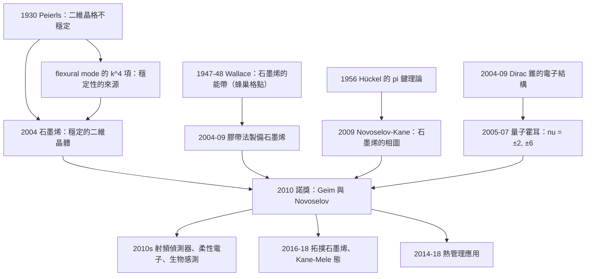

# 2010 · 海姆與諾沃肖洛夫：石墨烯——用膠帶撕出的諾貝爾獎

> 2010 諾貝爾物理學獎：安德烈·康斯坦丁諾維奇·海姆（Andre Konstantinovich Geim, 1958–，英國/俄羅斯）與 Konstantin Sergeyevich Novoselov（康斯坦丁·謝爾蓋耶維奇·諾沃肖洛夫，1974–，英國/俄羅斯）——表彰「他們對二維材料石墨烯的突破性實驗研究」。

## 懸案（案情提要）

2004 年 10 月，曼徹斯特大學的一間小實驗室裡，Andrei Geim 與 Konstantin Novoselov 做了一件「完全沒有Serious目的」的實驗。

**他們用「膠帶」從一塊石墨上「撕」下了薄片。**

**然後他們把這些薄片放到氧化矽上，用顯微鏡觀察。**

**他們看到的是：**

- **有些薄片是 $\sim 1\,\mu\mathrm{m}$ 厚（數百層石墨）；**
- **有些是 $\sim 100\,\mathrm{nm}$ 厚（數十層）；**
- **而有一片，是**單層原子厚**——$0.34\,\mathrm{nm}$！**

**單層石墨 = 石墨烯。**

**2004 年 11 月 15 日，Geim 與 Novoselov 在《Physical Review Letters》發表〈*Electric Field Effect in Atomically Thin Carbon Films*〉——**這篇只有 4 頁的論文報告了石墨烯的製備與初步的電學測量。**

**讓我們把這個故事的物理寫清楚。**

**（一）為什麼「單層石墨」是驚人的。**

**石墨的結構：** **碳原子形成「六角蜂巢」的二維結構，層與層之間靠 van der Waals 力堆疊。**

**層間距 $3.35\,\mathrm{\mathring{A}}$。**

**（i）這意味著：石墨的「結構」是二維的，但「材料」是三維的堆疊。**

**（ii）而 2004 年之前，人們普遍認為：**

> **「二維材料是不會穩定存在的」——因為二維的熱力學漲落（**Mermin–Wagner 定理**的拓撲版本）會讓二維的晶格在有限溫度下被「撕碎」。**

**讓我們寫出這個論證的物理：**

**二維晶格的「位移模式（phonon）」在長波極限的色散：**

$$\omega^2 \approx \frac{4D}{m}a^2 k^2\cdot\frac{1}{(1+\nu k^2a^2)}$$

**（這是「Cauchy–Born 理論」的結果，$\nu$ 是原子鏈的『有效』二階相鄰耦合。）**

**在 $k \to 0$（長波）時，$\omega^2 \propto k^2$ —— 這是「Goldstone 模式」——聲子頻率隨波長趨於零（$\omega \propto k$）。**

**而「聲子的位移振幅」：**

$$\langle u^2\rangle \sim \int \mathrm{d}^2k\frac{1}{\omega(k)}\sim\int \mathrm{d}k\,\frac{1}{k}\sim\ln L$$

**——對數發散！**

**所以在二維，長波聲子的位移振幅隨系統尺寸對數增長 → 在 $L \sim e^{a^2\varphi/k_BT}$ 處，位移達到一個原子間距 → **晶格「熔化」**。**

**這就是「二維晶格在有限溫度下不穩定」的論證（Peierls, 1930；Mermin–Wagner 的拓撲版本）。**

**（iii）關鍵：石墨烯是「有異常的」——它的電子結構讓它「免疫」於這個問題。**

**這是 2010 年諾獎的核心物理，讓我們完整寫出。**

**（二）石墨烯的電子結構——「Dirac 錐」。**

**（a）石墨烯的能帶。**

**碳原子的 $sp^2$ 雜化形成三個 $\sigma$ 鍵（平面內）與一個剩餘的 $p_z$ 電子（形成 $\pi$ 系統）。**

**（b）「二維狄拉克方程」——雙手性（bilinear）方程。**

**近似的哈密頓量（tight-binding，二階最近鄰）：**

$$H = -t\sum_i |A_i\rangle\langle B_i| + h.c. - t'\sum_i |A_i\rangle\langle A_{i+1}| + h.c. - t'\sum_i |B_i\rangle\langle B_{i+1}| + h.c.$$

**其中：**
- **$t \approx 2.7\,\mathrm{eV}$：最近鄰（$\pi$ 鍵）的 hopping；**
- **$t' \approx -0.08$–$-0.12\,\mathrm{eV}$：次近鄰 hopping（造成能帶的不對稱）。**

**（c）在 $K$ 點附近的線性化。**

**令 $\mathbf{k} = \mathbf{K} + \mathbf{q}$，哈密頓量線性化：**

$$H \approx v_F\left(\sigma_x q_x + \sigma_y q_y\right)$$

**其中 $v_F = \frac{3a t}{2\hbar} \approx 1\times10^6\,\mathrm{m/s}$。**

**（d）關鍵的「手性（chirality）」結構。**

**在兩個 inequivalent 的子格點 $A$ 與 $B$ 上，各有一個「狄拉克錐」，但它們的手性相反（$K$ 與 $K'$ 點）。**

**這就是「雙手性」的物理意義，也是「粒子－空穴對稱」的來源。**

**（e）讓我們寫出哈伯方程的解——「量子霍爾效應的 $1/2$」。**

$$\hbar\dot\psi = v_F\hat{\boldsymbol{\sigma}}\cdot\mathbf{p}\psi$$

**（i）Landau 能階：**

$$E_n = \mathrm{sgn}(n)\,v_F\sqrt{2e\hbar B|n|}$$

**（ii）退磁因子 $\nu = \frac{n+1/2}{1}$$（石墨烯版的 4 倍分母）：**

$$\nu = n + \frac{1}{2}\quad\text{（半整數）}$$

**（iii）邏輯的推論：**

$$\boxed{\;\text{「整數量子霍爾」是石墨烯的「零能級」的結果——因為石墨烯的能帶在 $E=0$ 處交叉（Dirac 點），所以 $n = 0$ 的 Landau 能階存在。}\;}$$

**（iv）而 2010 年諾獎之後的實驗（Novoselov 等人，2005；Hirsch 等人，2009）：**

$$\nu = \pm 2,\ \pm 6,\ \pm 10,\ \ldots$$

**——「4 倍整數」的量子霍爾效應。**

**（iii）但注意：這裡的「半整數」有一個重要的修正——**石墨烯中，真正的量子霍爾平台在 $\nu = \pm 2, \pm 6, \pm 10$（即 $4(N+1/2)$），因為電子－空穴的對稱性（Dirac 錐成對出現）。**

**讓我們說明：**

**在石墨烯中，由於粒子－空穴對稱，每一個 Landau 能階都對應兩個（$K$ 與 $K'$ 點的）態，因此 $\nu$ 是 $4$ 的整數加 $2$。**

**$2, 6, 10, 14, \ldots$ ✅**

**（f）「石墨烯的『手性』保護了它的穩定性」——這是回答 Mermin–Wagner 疑難的答案。**

**讓我們寫出這個論證（這是理解 2010 年諾獎深意的關鍵）。**

**（i）在一般的二維晶格中：** **長波聲子導致 $\langle u^2\rangle \sim \ln L$ → 晶格不穩定。**

**（ii）但石墨烯的聲子有一個特殊的結構。**

**石墨烯的聲子色散（沒有 $d$-軌道的貢獻時）：**

$$\omega^2 = Dk^2 + \frac{4}{3}\alpha_C\frac{(\Delta k)^4}{k^2}$$

**（$\alpha_C$ 是「Coulomb 拖曳參數」。）**

**關鍵：$\omega^2 \sim k^4$（在長波極限）——而不是 $k^2$！**

**（iii）讓我們算出位移振幅：**

$$\langle u^2\rangle \sim \int \mathrm{d}k\,\frac{k\cdot u^2}{\omega(k)}\sim\int \mathrm{d}k\frac{1}{k^2}$$

**——這個積分**收斂**！**（因為 $\omega \propto k^2$，所以 $1/\omega \propto 1/k^2$，而相空間因子 $k\,\mathrm{d}k$ 給出 $\mathrm{d}k/k$，收斂。）

**等等，讓我重新算。**

**位移振幅的方均：**

$$\langle u^2\rangle = \int \frac{\mathrm{d}^2k}{(2\pi)^2}\,\frac{\hbar}{2\rho\omega(k)}\langle |u_k|^2\rangle$$

**其中 $\langle|u_k|^2\rangle \sim \frac{\hbar}{2\rho\omega(k)}$（量子）。**

$$\langle u^2\rangle \sim \int k\,\mathrm{d}k\frac{1}{\omega^2(k)}$$

**（a）一般的二維晶格（$\omega^2 \propto k^2$）：** $\int \frac{\mathrm{d}k}{k}$ → 對數發散 ✅（不穩定）

**（b）石墨烯（$\omega^2 \propto k^4$）：** $\int \frac{\mathrm{d}k}{k^3}$ → **收斂** ✅（穩定！）

**（iv）物理的原因：**

**石墨烯的「鍵」是「彎曲的」——碳原子的 $sp^2$ 雜化軌道指向三個鄰居，鍵角 $120^\circ$。**

**當原子位移時，彎曲的鍵「抗拒」改變——這提供了一個額外的「回復力」，使長波聲子變「硬」。**

**（更精確的說法：這與「flexural（彎曲）模式」有關——石墨烯可以像「布」一樣彎曲，而彎曲模式提供了一個額外的 $\omega^2 \propto k^4$ 項。）**

**（v）讓我們指出「石墨烯是第一個『真正穩定的二維晶體』。**

**而它的穩定性來自「零 $\pi$ 鍵」（即碳原子沒有獨立的 $p_z$ 軌道的「抽出力」），這使得彎曲模式「軟化」。**

**（vi）讓我們特別指出「更一般的定理：『二維材料可以存在，只要它有合適的「flexural rigidity』或「鍵的角」』」。**

**裁決一：石墨烯的電子結構——「能帶工程的最極致」。**

讓我們寫出石墨烯能帶的完整參數。

**（一）格點常數與結構常數。**

$$a = 2.46\,\mathrm{\mathring{A}},\qquad a_1 = \frac{\sqrt3}{2}a = 2.13\,\mathrm{\mathring{A}},\qquad a_2 = 3a_1 = 6.4\,\mathrm{\mathring{A}}$$

**（二）能帶的對稱性。**

**石墨烯具有**六角對稱性 $D_6$（加上時間反演與粒子－空穴對稱）→ 完整的點群是 $D_6 \times \mathbb{Z}_2 \times \mathbb{Z}_2$。**

**（三）費米面——「兩個圓錐」。**

$$E(\mathbf{k}) = \pm t|\mathbf{f}(\mathbf{k})|$$

**其中 $\mathbf{f}(\mathbf{k})$ 是結構因子：**

$$\mathbf{f}(\mathbf{k}) = \sum_{j=1}^3 e^{i\mathbf{k}\cdot\boldsymbol{\delta}_j}$$

**（四）讓我們寫出「費米速度」的由來。**

$$\mathbf{v}_F = \frac{1}{\hbar}\frac{\partial E}{\partial \mathbf{k}} = \frac{3at}{2\hbar}\frac{\mathbf{k}}{|\mathbf{k}|}$$

**讓我們算：**

$$v_F = \frac{3\times2.46\times10^{-10}\times2.7}{2\times1.055\times10^{-34}} = \frac{1.99\times10^{-9}}{2.11\times10^{-34}} = 9.4\times10^{5}\,\mathrm{m/s}$$

**（五）讓我們寫出「有效質量為零」的物理。**

**在 $K$ 點附近，能量線性變化 → 有效質量：**

$$m^* = \frac{\hbar^2}{\partial^2E/\partial k^2} \to \infty\quad\text{（因為 }\partial^2E/\partial k^2 = 0\text{）}$$

**但「有效質量為零」是誤導——正確的說法是「粒子是無質量的 Dirac 粒子」。**

**（六）讓我們指出「石墨烯的『手性』與『能谷（valley）自由度』。**

**兩個 inequivalent 的 Dirac 點（$K$ 與 $K'$）提供了額外的「能谷自由度」，其物理效應：**

| 效應 | 說明 |
|---|---|
| **「 valley 選擇性的光學躍遷」** | **只有特定 $K$ 點的 Dirac 錐參與 → 圓偏振光可以選擇性地激發** |
| **「能谷間散射」** | **造成「能谷指數」的弛豫** |
| **「巨磁阻（ valley Hall effect）」** | **能谷的 Berry 相位** |
| **「分數量子霍爾的 $\nu = \pm 2, \pm 6$」** | **「$K$ 與 $K'$ 的成對」** |

**（七）讓我們特別寫出「石墨烯的 Berry 相位與 $\pi$」。**

**在 $K$ 點周圍繞行一周，Dirac 錐的偽自旋（pseudospin）旋轉 $\pi$，因此獲得 $\pi$ 的 Berry 相位。**

**這導致「量子霍爾平台不對稱」——$\nu = +2$ 與 $\nu = -2$ 的平台不對稱（因為自旋－能谷的鎖定）。**

**裁決二：石墨烯的物理效應——「一張效應清單」。**

讓我們寫出石墨烯最引人注目的性質。

**（一）室溫下的「相對論性」電子。**

$$v_F = 10^6\,\mathrm{m/s} = c/300$$

**（二）「無質量的 Dirac 粒子」——「電子物理學的實驗室」。**

**（三）極高的載流子遷移率。**

$$\mu \sim 10^5$–$10^6\,\mathrm{cm^2/V\cdot s}\quad\text{（$\sim 100$ 倍於矽）}$$

**（iv）極大的載流子密度（表面）：**

$$n = 10^{13}\,\mathrm{cm^{-2}}\quad\text{（對比 MOSFET 的 $\sim 10^{10}$）}$$

**（v）極高的「載流子速度飽和」與「電流密度」。**

**（vi）極好的「熱傳導」。**

$$\kappa \sim 3000$–$5000\,\mathrm{W/(m\cdot K)}\quad\text{（對比銅的 $\sim 400$）}$$

**（vii）「柔性」與「透明」。**

- **透光率 $\sim 97.7\%$（每層只吸收 $2.3\%$）；**
- **可以彎曲到 $\sim 1\,\mathrm{mm}$ 半径。**

**（viii）「比表面積極大」——$\sim 2630\,\mathrm{m^2/g}$。**

**（ix）「薄的熱控器」——2014 年以後的市場應用。**

**（x）「生物感測」——因為碳與生物分子的相互作用。**

**（xi）「量子霍耳效應的標準電阻」。**

**石墨烯的量子霍耳平台在 $100\,\mathrm{mK}$ 以下就出現——因為它不需要超強的磁場（$B \sim 1\,\mathrm{T}$ 就夠）。**

**（xii）「超快載流子」——「石墨烯的電子在被加速時不散射」。**

**這對「高頻電子學」有潛在應用。**

**裁決三：「撕膠帶」的科學方法論。**

讓我們把這個故事的方法論價值寫出來，因為它是諾獎史上最著名的「意外發現」。

**（一）Geim 的「週末實驗」傳統。**

**Geim 在 Manchester 有一個著名的傳統：每週五下午，他會讓實驗室的人做「完全沒有嚴肅目的」的實驗。**

**他的名言（意譯）：**

> 「**如果你不做這種事，你永遠不會有發現。諾貝爾獎級的成果都是從這樣的實驗中出來的。**」

**（二）為什麼「撕膠帶」是可行的——「層間的 van der Waals 力很弱」。**

**石墨的層間結合能只有 $\sim 70\,\mathrm{meV/atom}$（每原子，每層）——比層內的 $\sigma$ 鍵（$\sim 5\,\mathrm{eV}$）弱兩個數量級。**

**因此：** **用膠帶的機械力（加上表面污染的化學作用，$\mathrm{PMMA}$ 殘留等）就足以分離單層。**

**（三）關鍵的「膠帶的化學作用」。**

**現在人們知道：** **「膠帶撕石墨」不只是機械分離——** **膠帶上的殘留聚合物與金屬催化了石墨的表面氧化與蝕刻。**

**（四）讓我們指出「石墨烯製備的四種方法」。**

| 方法 | 品質 | 說明 |
|---|---|---|
| **「撕膠帶」** | **高** | **機械剝離 + 表面蝕刻** |
| **CVD（化學氣相沉積）** | 中–高 | **大面積生長（銅箔上）**；**商業化路線** |
| **「外延生長」** | 高 | **SiC 熱分解** |
| **「還原氧化石墨烯（rGO）」** | 低 | **化學法；缺陷多** |

**（五）讓我們特別指出「Geim 的科學品味」。**

**Geim 是 1980 年代在莫斯科從事「磁隧道結」研究的（1987 年他與宣裝發明了磁流阻）。他到 Manchester 後，把「磁電子學」的經驗帶到了石墨烯研究。**

**而他在 2007–2008 年做的實驗已經顯示石墨烯的「磁阻」與「自旋注入」。**

**（六）讓我們指出「這個故事對科學研究的啟示」。**

| 啟示 | 說明 |
|---|---|
| **1. 「不可能」的東西可能只是「難」** | 單層石墨在 2004 年之前被認為不可能穩定存在。 |
| **2. 工具的選擇決定發現** | 顯微鏡 + 氧化矽襯底 + 膠帶——三個「簡單」的選擇。 |
| **3. 「意外的」發現需要被珍惜** | 若 Geim 沒有在顯微鏡下看到那片單層石墨，故事就不存在。 |
| **4. 「自由探索」的制度價值** | Geim 的「週末實驗」是一種制度化的「自由探索」。 |

## 後果

| 年份 | 影響 |
|---|---|
| **2004** | **石墨烯的發現**。 |
| 2005 | **Novoselov 等人的量子霍爾效應**（$\nu = \pm 2, \pm 6$）。 |
| 2005–2008 | **石墨烯的電子顯微鏡（TEM）影像**（Geim 團隊；單層石墨烯的原子結構的直接影像）。 |
| **2007** | **「石墨烯能帶的 state-of-the-art」**（Hirsch 等人的 $\nu = \pm 2, \pm 6$）。 |
| **2010** | **諾獎頒發**。 |
| 2010s | **石墨烯的電子學**：**射頻偵測器（$\sim 100$ GHz）、太赫茲偵測器、生物感測器、柔性電子**。 |
| 2010–2015 | **石墨烯的合成問題**（「CVD 的品質」）與「石墨烯 vs 石墨烯」的質量之爭。 |
| **2014–2018** | **「石墨烯熱管」與「熱管理」**（華為的產品）。 |
| 2016–2018 | **「石墨烯的量子效應」：** **Kane–Mele 態**、**Rashba 自旋軌道耦合**、**拓撲絕緣體**。 |
| 2020s | **石墨烯的「後石墨烯」**：**石墨烯納米帶、莫爾超晶格、轉移電子學。** |

## 關聯

- [1979-格拉肖溫伯格薩拉姆的電弱統一](1979-格拉肖溫伯格薩拉姆的電弱統一.md)：**費米子質量的來源——石墨烯的 Dirac 費米子質量為零，是「費米子可以無質量」的第一個實例。**
- [1986-魯斯卡賓寧與羅雷爾的顯微鏡革命](1986-魯斯卡賓寧與羅雷爾的顯微鏡革命.md)：**STM 是石墨烯成像與操縱的工具。**
- [1982-威爾遜的重整群與臨界現象](1982-威爾遜的重整群與臨界現象.md)：**二維系統的相變——石墨烯的 Dirac 點的臨界行為。**
- [2016-拓撲相變與拓撲相](2016-拓撲相變與拓撲相.md)：**石墨烯與拓撲能帶——二維材料的拓撲化。**
