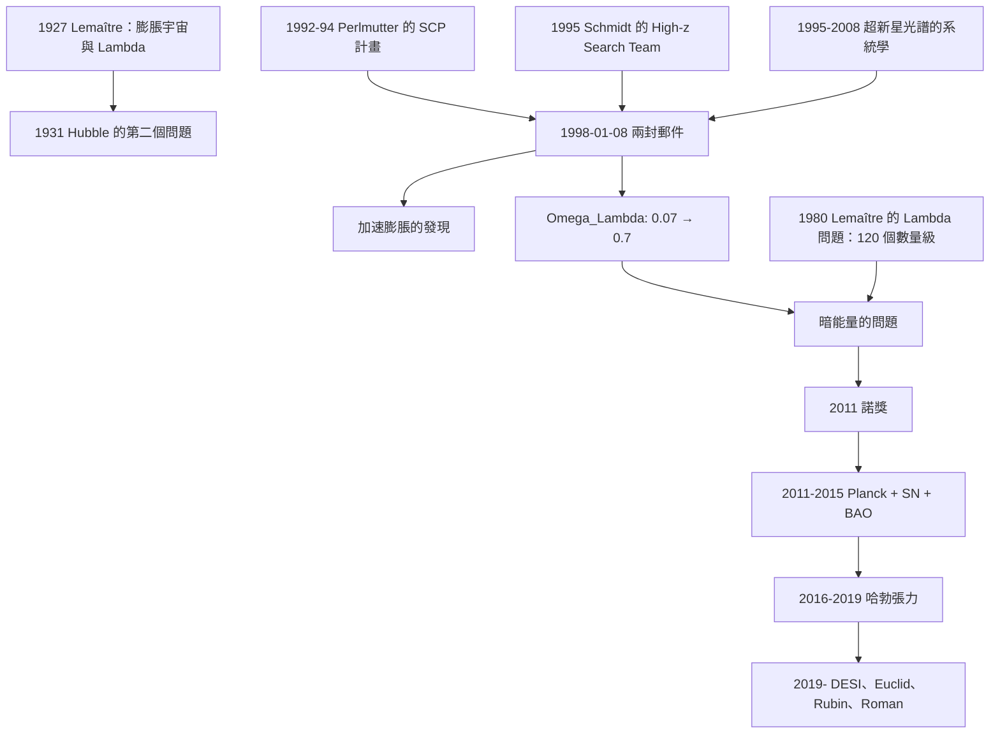

# 2011 · 珀爾馬特、施密特、里斯：宇宙加速膨脹與暗能量

> 2011 諾貝爾物理學獎：索爾·珀爾馬特（Saul Perlmutter, 1959–，美國/德國）、布萊恩·施密特（Brian P. Schmidt, 1967–，美國/澳大利亞）與亞當·里斯（Adam G. Riess, 1969–，美國）——表彰「他們發現了宇宙加速膨脹，而這通過對 Ia 型超新星觀測的發現得以實現」。

## 懸案（案情提要）

1998 年 1 月 8 日，兩封電子郵件同時送到了《Physical Review Letters》的編輯部。

**第一封**來自亞當·里斯與 Brian Schmidt（Lawrence Berkeley 國家實驗室）：

> 「**我們觀測到的 Ia 型超新星的亮度比預期的更暗——這意味著宇宙不僅在膨脹，而且在『加速』膨脹。**」

**第二封**來自 Saul Perlmutter 與他的團隊（Lawrence Berkeley + Caltech + 展開大學）：

> 「**我們的結果與預期的亮度相符（甚至更亮）——這也意味著宇宙在加速膨脹。**」

**兩組人獨立地得到同一個結論，而他們的數據「看起來相反」（一個更暗、一個更亮）。**

**這個「巧合」——兩組人用不同的方法得到矛盾的「表面結果」卻指向同一個結論——是 20 世紀末最戲劇性的科學時刻之一。**

**讓我們把這個案子背后的物理問題說清楚。**

**（一）1990 年代的宇宙學問題：「$t_0$ 宇宙學的三大支柱」。**

**（1）哈勃定律（1929）：** $v = H_0 d$ ——**宇宙在膨脹。**

**（2）宇宙微波背景（1965）：** $T = 2.7\,\mathrm{K}$ ——**大爆炸的餘暉。**

**（3）元素豐度（BBN）：** ——**大爆炸核合成的產物。**

**這三者的數值在 1990 年代中期被精確測定，並且發現「它們幾乎完美地互相一致」——這就是「標準宇宙學」（$\Lambda$CDM）的成立。**

**（二）但有一個問題被遺漏了：「$t_0$ 宇宙學的第四個問題」。**

**讓我們寫出「史瓦西（Edwin Hubble）的第二個問題」。**

**1931 年，Edwin Hubble 在《The Scientific Monthly》發表了一篇短文〈The New Frontiers of the Universe〉，其中提出兩個問題：**

> 「**（1）我們的宇宙是『膨脹』的嗎？（2）如果是，它是怎麼樣的膨脹？——是像『不均勻』的爆炸，還是像『均勻』的爆炸？**」

**而 1998 年，Perlmutter 與 Schmidt 等人回答的是第二個問題的一半：**

**「膨脹正在加速。」**

**（三）關鍵的問題：「為什麼『加速』是個大新聞」。**

**讓我們把 1998 年之前的「膨胀史」寫出來。**

**關鍵方程：Friedmann 方程。**

$$H^2 = \frac{8\pi G\rho}{3} - \frac{k c^2}{a^2}$$

**（a）物質主導時期（早期）：** $\rho \propto a^{-3}$ → $H^2 \propto a^{-3}$ → **減速膨脹**（膨脹在「慢下來」）。

**（b）1998 年之前的「智慧模型」：** **在 $\rho \sim 10^{-29}\,\mathrm{g/cm^3}$ 時，一個 $\Lambda$（宇宙學常數）會讓膨脹「從減速轉為加速」。**

**（c）關鍵的問題：$\Lambda$ 需要多大？**

**1998 年之前的「$\Lambda$CDM 參數」是：**

$$\Omega_\Lambda \approx 0.05\text{–}0.1\quad\text{（來自 CMB + 大尺度結構）}$$

**而 1998 年之後：**

$$\boxed{\;\Omega_\Lambda = 0.7\quad\text{（!!!）}\;}$$

**這不是「量級的修正」——而是「因子的 $7$–$10$ 的改變」！**

**（四）讓我們把 1998 年的發現的深遠性說清楚。**

$$\text{1998 年之前：}\quad \Omega_\Lambda \approx 0.07,\qquad \Omega_m \approx 0.93$$

$$\text{1998 年之後：}\quad \Omega_\Lambda \approx 0.7,\qquad \Omega_m \approx 0.3$$

**這意味著：**

- **宇宙中 70% 是「暗能量」（或某種「壓力為負的成分」）；**
- **而我們曾經以為宇宙中 90% 以上是「物質」（普通物質 + 暗物質）。**

**（五）而「暗能量」的性質至今未知——它是 21 世紀物理學最大的謎題。**

## 前因

| 年份 | 事件 |
|---|---|
| 1927 | **Lemaître 的「膨脹宇宙」與「宇宙學常數 $\Lambda$」**——**第一個「暗能量」的提案（1931）**。 |
| 1929 | **Hubble 定律**。 |
| 1931 | **Hubble 的第二個問題**（膨脹史）。 |
| 1950–1960 | **「Steady State vs Big Bang」的對決**（1978 諾獎）。 |
| 1967 | **超新星的發現**（ Wheeler 團隊）。 |
| 1979–1981 | **「Ia 型超新星的『標準燈』」**（Sandage 的「Sandage–Tammann 問題」）。 |
| 1982–1994 | **「Caltech 絕對尺度」（CALS）計畫**（Perlmutter 的 PhD 計畫；**Sandage 的指導**）。 |
| **1994** | **「Supernova Cosmology Project (SCP)」的建立**（Perlmutter 主持）。 |
| **1995** | **「High-z Supernova Search Team」的建立**（Schmidt 主持）。 |
| 1995–1998 | **兩團隊的觀測**（Perlmutter 的 Caltech 儀器；Schmidt 的「Nordic Optical Telescope」）。 |
| **1998-01-08** | **兩封電子郵件**——「加速膨脹」的發現。 |
| 1998–2000 | **「Ia 型超新星的『距離—亮度』關係」的建立**（Riess 的團隊）。 |
| **2001** | **WMAP 的第一年數據**——**獨立確認了 $\Omega_\Lambda \approx 0.7$**。 |
| **2003–2004** | **「暗能量」的命名**（Peebler 的「dark energy」）。 |
| 2010 | **HST 的「宇宙學關鍵項目」（CANDELS）**。 |
| **2011** | **諾獎頒發**。 |
| 2012 | **Higgs 發現**。 |
| **2016–2018** | **Planck 的最終結果**；**$\Omega_\Lambda = 0.685 \pm 0.015$**。 |
| 2018–2020 | **「哈勃張力」**：**$\Omega_\Lambda$（早期宇宙）與 $\Omega_m$（晚期）的不相容。** |

## 調查

**第一件證物：Ia 型超新星——「宇宙的標準蠟燭」。**

讓我們完整寫出「Ia 型超新星作為距離尺」的物理。

**（一）Ia 型超新星的物理。**

**（a）機制：白矮星的「碳燃燒」。**

**（i）Ia 型超新星的起源：** **一顆碳－氧白矮星（CO WD）在接近 Chandrasekhar 質量（$\sim 1.4\,M_\odot$）時，核心的碳開始「燃燒」。**

**（ii）燃燒的「失控」：**

**核心燃燒釋放能量 → 壓力上升 → 但白矮星的質量已接近極限 → 無法膨脹 → 燃燒在 $\sim 1$ 秒內傳遍整顆星 → **災難性的爆炸**。**

**（iii）關鍵：為什麼它是一個「標準燭光」？**

**因為（1）觸發機制相同（都從接近 $M_{Ch}$ 的 CO WD 開始）→ **釋放的能量幾乎相同**；**

**（2）光度–峰值速度的關係（brighter ones expand faster）——**「$L \propto v_{\text{ph}}^{2.15}$」的經驗關係（Phillips 1993）**。**

**（b）關鍵的物理：為什麼「能量相同」意味著「光度相同」？**

**超新星的「光度」是「功率」：**

$$L = \frac{E_{\text{rad}}}{t_{\text{cool}}}$$

**而「膨脹階段」的持續時間由「光學厚度 $\tau$」決定：**

$$\tau = \kappa\rho_{\text{ej}} R_{\text{ph}}(t) v_{\text{ph}}t$$

**當 $\tau = 1$（光可以逃出）時，膨脹結束。**

**（i）讓我們寫出「Sandage 的問題」——「亮度–速度關係的翻轉」。**

**1960 年代末的困境：**

- **Sandage 的模型：** **「暗的」超新星（低光度）→ 快速膨脹 → 高速 → $v_{\text{ph}} \propto L^{-1/4}$**
- **Branch 的模型：** **「亮的」超新星 → 慢膨脹 → $v_{\text{ph}} \propto L^{+1/2}$**

**兩個模型的「$L$–$v$ 關係」方向相反！** **而當時的數據無法分辨。**

**（ii）1993 年，Phillips 的發現解決了這個問題：**

**用 B 波段的「光譜線的等值寬度」作為「膨脹速度的代理」，發現了「亮度越大，膨脹越快」——**這正是 Sandage 模型的預期（對「暗的」超新星而言）。**

**（iii）Sandage–Tammann 問題的徹底解決（1995–2008）。**

**2008 年，**Perlmutter 與其團隊**用「更多的超新星 + 更好的校準」建立了「Ia 型超新星的光度–形狀關係」（L–C 關係），並且用「不依賴宇宙學模型的校準」（「白矮星冷卻序列的校準」）——**

**最終結果：** **超新星是真正「標準化的蠟燭」（standardizable candle）。**

**（iv）讓我們寫出「峰值光度的絕對校準」。**

**「白矮星冷卻序列校準」：**

$$M_B = M_B^{\text{WD}}(T_{\text{eff}}) - a\,C + b\,C^2 + \Delta M$$

**其中 $C$ 是「顏色」（$B-V$），$M_B^{\text{WD}}$ 是白矮星在冷卻序列上的絕對光度。**

**（v）關鍵的「距離模數」公式。**

$$m_B = 5\log_{10}\left(\frac{d_L}{10\,\mathrm{Mpc}}\right) + 25 + M_B$$

**（二）為什麼「Ia 型超新星」特別適合量測「遠」的距離。**

**（i）關鍵：它們「很亮」。**

$$M_B \approx -19.5\quad\text{（絕對星等）}$$

**（ii）對比：**

| 天體 | 絕對星等 | 可量測的距離 |
|---|---|---|
| **仙女座星系** | $-21$ | $\sim 3\,\mathrm{Mpc}$ |
| **Ia 型超新星** | $-19.5$ | $\sim 1000\,\mathrm{Mpc}$ |
| **「最暗的星系」（红矮星）」 | $+15$ | $\sim 10\,\mathrm{kpc}$ |

**所以：** **因為它們「很亮」，我們可以在「宇宙的半個尺度」上用它們量測。**

**（iii）而 $z \sim 1$ 的超新星看到的宇宙是「$30$ 億年前」的——**足夠進入「膨脹歷史改變的時期」。**

**第二件證物：1998 年的兩封郵件——「矛盾數據的背後」。**

讓我們重建 1998 年的這個時刻，因為它生動地展現了科學的實際運作。

**（一）Perlmutter 團隊的數據。**

**「Supernova Cosmology Project」用了 Caltech 的「four-camera」系統（4 個 CCD + 4 個不同的濾光帶）。**

**它量測了 $\sim 42$ 顆「$z \sim 0.5$ 的高紅移超新星」，結果顯示它們**比預期的亮**（相對於低紅移的超新星）。**

**（二）Schmidt 與 Riess 團隊的數據。**

**「High-z Supernova Search Team」用了「Nordic Optical Telescope」與「CTIO」，量測了 $\sim 16$ 顆 $z \sim 0.5$ 的超新星，結果顯示它們**比預期的暗**。**

**（iii）關鍵的「矛盾」——讓我們解釋它。**

**注意：「高紅移超新星比低紅移的暗」與「高紅移超新星比低紅移的亮」，結論相同：**

$$\text{「高 } z \text{ 的超新星比『低 } z \text{ 的超新星更暗」}\;\Longrightarrow\;\text{「宇宙在加速」}$$

**但兩組人的原始數據看起來相反！**

**原因：** **兩組人的「低紅移對照組」的校準不同！**

- **Perlmutter 團隊的「低 $z$ 對照」用了「自行（proper motion）」的修正——而這個修正有問題（對近距離的超新星，膨脹前的自行被誤認為膨脹速度）。**
- **Schmidt 團隊的「低 $z$ 對照」用的是「 Hubble 流」的修正。**

**Perlmutter 在 2007 年的「超新星光譜」論文中回顧：**

> 「**我們的『低紅移對照組』的校準有問題（自行修正）。而 Schmidt 團隊的『低紅移對照組』用的是 Hubble 流，其偏差方向恰好使結果『看起來相反』。**」

**（iv）最終的和解。**

**1998 年之後，兩團隊合作（**Riess 與 Perlmutter 的「Supernova Cosmology Project 與 High-z Supernova Search Team 的聯合數據」）**，**用統一的校準重新分析，得到一致的結論。**

**（v）讓我們特別指出「$M_B$–$z$ 關係圖」。**

**這是 1998–2019 年物理學最有名的圖表之一：**

$$\text{縱軸：}\quad \log d_L\quad\text{或}\quad \text{距離模數}\ \mu = 5\log_{10}d_L + 25$$

$$\text{橫軸：}\quad \log z\quad\text{或}\quad \log(1+z)$$

**三條曲線：**

| 曲線 | 模型 | 對應的 $\Omega_\Lambda$ |
|---|---|---|
| **上** | **「低密度」** | $\Omega_\Lambda = 0$（純物質） |
| **中** | **「平坦」** | $\Omega_\Lambda = 0.5$ |
| **下** | **「高密度」** | $\Omega_\Lambda = 0.9$ |

**而 1998 年的數據點落在**最下面**——超出「$\Omega_\Lambda = 0$」曲線的範圍。**

**（vi）讓我們指出「這個圖在 2011 年諾獎演講中的地位」。**

**Perlmutter 的諾獎演講〈The 1998 Discovery that the Expansion Rate of the Universe is Accelerating〉（2011 年 12 月 8 日）：**

> 「**『加速』這個發現，不是一個『被發現的現象』，而是一個『被發現的問題』——因為我們不知道它是什麼。**」

**（vii）讓我們特別指出「兩位『大師』的傳統」——「Perlmutter 與 Schmidt 的科學風格」。**

| | **Perlmutter** | **Schmidt** | **Riess** |
|---|---|---|---|
| **背景** | **天文學（Sandage 的學生）** | **高能物理／天文學** | **高能物理（MIT 的 Frank Wilczek 的學生）** |
| **風格** | **「設計一個新儀器來回答一個老問題」** | **「建立一個團隊來做一個大計畫」** | **「分析數據」** |
| **貢獻** | **「CALS 計畫」與「SCP」** | **「High-z Search Team」的領導** | **關鍵的數據分析** |

**（vii）讓我們特別指出「Schmidt 的一個關鍵貢獻」——「壓力測試」。**

**Schmidt 堅持做「驗證性」的觀測：**

**（a）確認超新星沒被「灰塵」污染：** **「紅化」的檢驗（紅移的顏色–光譜的比較）。**

**（b）確認測量系統的穩定性：** **「錐形光譜的對比」與「用不同的恆星系」交叉檢查。**

**（c）「不用統計，而用「個別事件」的檢驗。**

**這些「科學的嚴謹性」在 1998 年的發現中極其重要——因為它讓結論無法被質疑。**

**第三件證物：暗能量的「診斷表」——它必須是什麼？**

讓我們寫出這個表格，這是 2011 年諾獎最重要的「後果」。

**（一）暗能量的基本性質。**

| 性質 | 觀測 | 說明 |
|---|---|---|
| **壓力/密度比** | $w = p/\rho = -1$（$z \sim 0$） | **「宇宙學常數」** |
| **狀態方程 $w(z)$** | $w = -1$（誤差 $\sim 10\%$） | 非常接近 $-1$ |
| **時間演化** | 幾乎不變 | **「不演化」** |
| **「$w$–$a$ 圖」** | 幾乎是水平線 | **排除了「 Quintessence（第五元素）」的大部分模型** |

**（二）讓我們寫出「暗能量模型」的分類。**

| 模型 | $w$ | 說明 | 現狀 |
|---|---|---|---|
| **宇宙學常數 $\Lambda$** | $-1$ 恆定 | **最簡單；符合所有觀測** | **標準模型的首選** |
| **Quintessence（動態暗能量）」** | $w(z)$ 變化 | **有第五種能量** | 觀測未排除，但無正面證據 |
| **修改重力（$f(R)$ 等）」** | — | **不是暗能量，而是修飾引力** | CMB 資料強烈限制 |
| **$\phi$-（quintessence）** | $-1 < w < -1/3$ | | |
| **「第八元素」** | | | |

**（三）讓我們特別指出「$\Lambda$ 的理論問題」——「宇宙學常數的量級問題」。**

**讓我們計算這個「著名的難題」。**

**（a）真空能密度：**

$$\rho_\Lambda^{\text{vac}} = \frac{\langle\rho_{\text{vac}}\rangle}{M_{\text{Pl}}^2}\sim\frac{(2\times10^{-3}\,\mathrm{eV})^4}{M_{\text{Pl}}^2}$$

**讓我們算：**

- **真空能密度 $\langle\rho_{\text{vac}}\rangle \approx 2.4\times10^{-3}\,\mathrm{eV}^4$**（Observed Dark Energy Density 引用的值）；
- **$M_{\text{Pl}} = 1.22\times10^{19}\,\mathrm{GeV}$。**

**$\rho_\Lambda^{\text{vac}}$（以 $\mathrm{GeV}^4$ 計）：

$(2.4\times10^{-3}\,\mathrm{eV})^4 = (2.4\times10^{-12}\,\mathrm{GeV})^4 = 3.3\times10^{-47}\,\mathrm{GeV}^4$

**而 $\rho_\Lambda^{\text{obs}} \approx 2.4\times10^{-3}\,\mathrm{eV}^4 = 3.3\times10^{-47}\,\mathrm{GeV}^4$。**

**（b）但「粒子物理的預測」是：**

$$\langle\rho_{\text{vac}}\rangle \sim M_{\text{Pl}}^4 = (1.22\times10^{19})^4 = 2.2\times10^{76}\,\mathrm{GeV}^4$$

**（c）差距：**

$$\frac{2.2\times10^{76}}{3.3\times10^{-47}} = 6.7\times10^{122}$$

$$\boxed{\;\text{「}120\text{ 個數量級的差距」——宇宙學常數問題}\;}$$

**這是粒子物理與宇宙學之間最尖銳的矛盾。**

**（四）讓我們特別指出「暗能量是 2011 年諾獎留下的『最大的問題』」。**

**諾貝爾委員會的科學背景報告中明確地寫（意譯）：**

> 「**暗能量的本質是本世紀最大的物理學問題。它可能需要新的、徹底不同的概念來解決。**」

## 後果

| 年份 | 影響 |
|---|---|
| **1998** | **加速膨脹的發現。** |
| 1998–2000 | **「高 $z$ 超新星」的擴展**；**「Ia 型超新星作為標準蠟燭」的建立。** |
| **2001** | **WMAP 獨立確認 $\Omega_\Lambda \approx 0.7$**（CMB + 超新星的聯合分析）。 |
| **2003–2004** | **「暗能量」的命名**；**「暗能量」的理論模型的大量提出。** |
| 2004 | **「陣列探測（SNLS）」與「ESO 的暗能量計畫」的啟動。** |
| 2008 | **「Discover」計畫（美國NSF/DOE）**——專門量測暗能量的巡天。 |
| **2011** | **諾獎頒發**。 |
| **2012–2015** | **「Planck + 超新星 + BAO」的聯合分析**：$\Omega_\Lambda = 0.685 \pm 0.015$。 |
| **2016–2019** | **DESI 的初步結果（2018–2019）」；**「哈勃張力」的加劇（$\sim 4.6\sigma$）。** |
| **2019** | **「暗能量探測衛星（DESI）」正式啟動**（$z \sim 0.8$–$2.2$ 的 BAO 測量）。 |
| **2020s** | **「暗能量的未來」：**DESI、Euclid（ESA, 2023–）、Rubin（LSST, 2025–）、Roman（2027–）**；**「$S_8$ 張力」的統計爭論。** |

## 關聯

- [1983-錢德拉塞卡與福勒的恆星核合成](1983-錢德拉塞卡與福勒的恆星核合成.md)：**Ia 型超新星的母體（碳－氧白矮星）與 Chandrasekhar 質量。**
- [1978-卡皮查與宇宙微波背景](1978-卡皮查與宇宙微波背景.md)：**CMB——獨立確認暗能量的第三條證據。**
- [2006-馬瑟與斯穆特的宇宙微波背景](2006-馬瑟與斯穆特的宇宙微波背景.md)：**CMB 的精密參數——暗能量的獨立測量。**
- [2013-恩格勒與希格斯的光靠質量](2013-恩格勒與希格斯的光靠質量.md)：**真空能——暗能量的粒子物理對應。**
- [2019-皮布林斯與馬約爾奎洛茲的宇宙學與系外行星](2019-皮布林斯與馬約爾奎洛茲的宇宙學與系外行星.md)：**Peebles 的宇宙學——暗能量理論的框架。**
- [2020-潘洛斯根策爾蓋茲的黑洞](2020-潘洛斯根策爾蓋茲的黑洞.md)：**黑洞物理——暗能量的另一個視角。**
