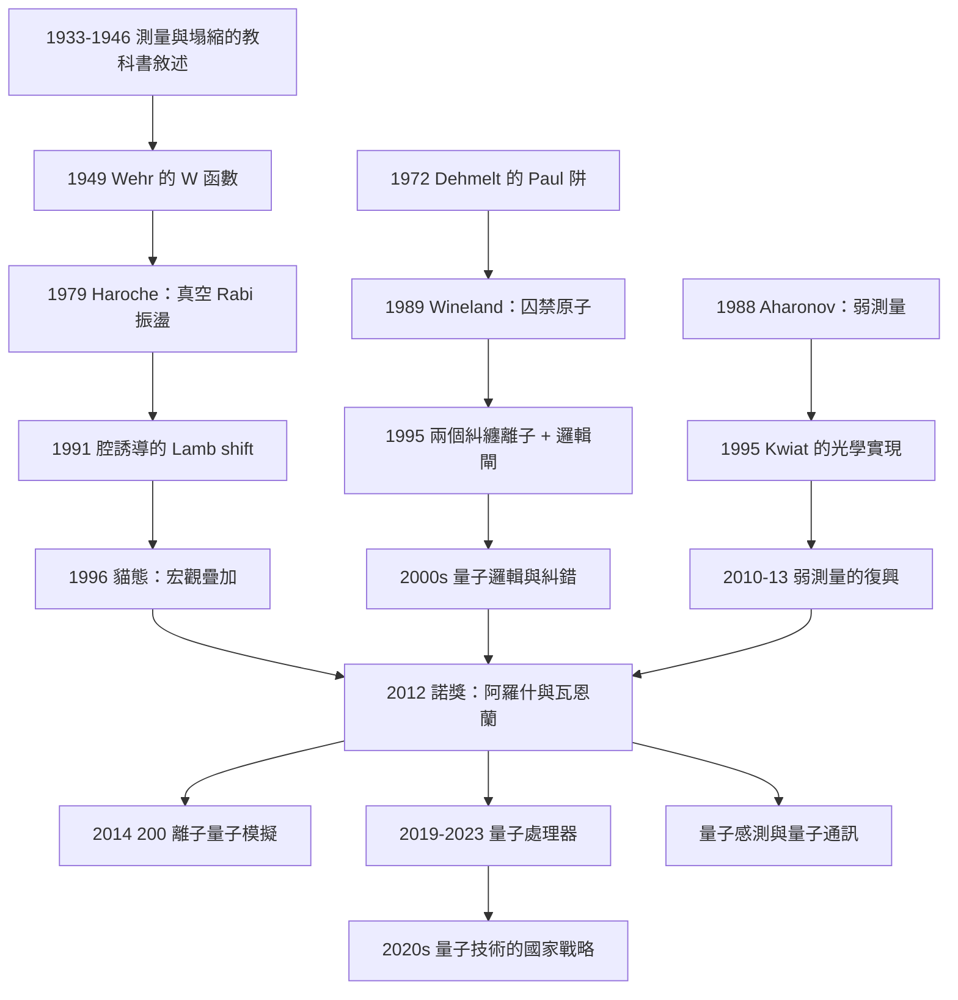

# 2012 · 阿羅什與瓦恩蘭：操控單一量子系統

> 2012 諾貝爾物理學獎：塞爾日·阿羅什（Serge Haroche, 1944–，法國）與戴維·J·瓦恩蘭（David J. Wineland, 1944–，美國）——表彰「他們發明了能夠測量與操控單一量子系統的方法」。

## 懸案（案情提要）

2012 年的諾獎表彰了「**操控單一量子系統**」的能力。而它的背景，是量子力學一百年的歷史中的一個基本不平衡：

**（一）量子力學擅長預測「一群」的行為。**

$$\psi(x_1, x_2, \ldots, x_N)$$

**但「單一量子系統」的行為是另一回事——因為量子力學的預測是「機率性的」。**

**（二）測量「單一系統」的問題。**

**在標準的量子力學中，「測量一個系統」意味著「破壞它的狀態」。**

$$\text{測量} \;\Rightarrow\; \text{波函數塌縮}$$

**因此有一個根本的張力：**

> **「我想知道我的系統在做什麼」與「我不想破壞它」是互相矛盾的。**

**（三）解決這個張力的方法：非破壞性測量（weak measurement）。**

**讓我們寫出這個概念（它由 Aharonov 與 Landau 與 Vaidman 發展，見下文）。**

**「弱測量」：**

$$\text{測量的「強度」} = \kappa \langle f|\Pi|i\rangle$$

**其中 $\Pi$ 是被測的投影算符。**

**（i）「強測量」：** $\kappa \to \infty$ → 系統被投影到 $|f\rangle$（測量）。

**（ii）「弱測量」：** $\kappa \ll 1$ → 系統幾乎不被擾動，但結果有「小的機率偏差」。

**（iii）關鍵的公式——「弱值」（Aharonov–Bergmann–Yablow）：**

$$\boxed{\;A_f = \frac{\langle f|\Pi|i\rangle}{\langle f|\Pi|f\rangle}\;}$$

**（iv）關鍵：** **$A_f$ 可以遠大於 1（或者接近 0），即使測量很弱！**

**（v）物理的意義：** **「弱值」不是「測量到的值」，而是「測量的『後作用』（post-selection）所偏好的方向」。**

**（vi）實驗實現（1990 年初）：** **Kwiat 等人在光學系統中實現了「弱測量」。**

**（vii）2012 年之後的「弱測量的黃金時代」：2012–2015 年的多個實驗顯示，「弱測量 + 後選擇」可以測量系統的「弱值」，而這些弱值可以被用來「反推」原本不可測的量（如系統的「動量」或「時間」）。**

**（四）但 2012 年諾獎的核心不是「弱測量」，而是「單一量子系統的操控」。**

**讓我們把兩位得主的貢獻寫清楚。**

**（一）阿羅什：腔量子電動力學（CQED）。**

**（a）核心裝置：「光子的「盒子」。**

**一個高 $Q$ 的微波腔，內含單一的 ${}^{87}\mathrm{Rb}$ 原子。**

**（b）關鍵的物理：**

- **原子與腔的模式耦合（Jaynes–Cummings 方程）；**
- **而且是「可逆的」耦合——因為耦合 $\gg$ 衰減率 $\kappa$。**

**（c）量子非破壞測量：**

**觀測「從腔中洩漏的光子」——洩漏的光子的「波包」的時域形狀直接編碼了原子態的資訊。**

**這是「不破壞原子」的測量。**

**（d）阿羅什的另一個里程碑：**

**1996 年：** **「貓的狀態」（Schrödinger cat state）**——在一個腔中製備出 $\left|\frac{1}{\sqrt2}(|e\rangle|0\rangle + |g\rangle|1\rangle)\right>$ 的疊加（原子與光子的糾纏）。

**（二）瓦恩蘭：離子阱中的量子控制。**

**（a）核心裝置：Paul 阱中的單一 ${}^{9}\mathrm{Be}^{+}$ 離子（1989 年起，見 [1989 年諾獎](1989-拉姆齊德默爾特保羅的原子鐘與離子阱.md)）。**

**（b）關鍵的技術：**

- **「雷射冷卻」到振動基態（1995 年，見 [1997 年諾獎](1997-朱棣文與雷射冷卻原子捕獲.md)）；**
- **「Ramsey 條紋」與「Raman 躍遷」——「超精細『邏輯閘』**。**

**（c）里程碑：**

| 年份 | 里程碑 |
|---|---|
| **1995** | **兩個受控離子的糾纏**（"two-qubit entangled state"）——**這是量子計算的原型。** |
| 1996 | **量子邏輯閘（CNOT）** |
| **1998** | **3–7 個離子的糾纏**；**「telecom」的原子鐘**（$2\times10^{-15}$） |
| 2000s | **「連鎖的量子計算」**；**多離子「cluster states」** |
| **2014** | **「量子模擬」：**用 200+ 個離子模擬「Ising 模型」與「海森堡模型」** |
| 2010s | **「量子邏輯閘」的高保真度**；**「密碼學」實驗。** |

**（三）讓我們把「為什麼 2012 年重要」說清楚。**

**（一）2012 年的物理學界處境：**

$$\text{「量子力學 } 100 \text{ 年了，但我們仍然無法控制單一量子系統。」}$$

**（二）而 2012 年同時發生了兩件事：**

1. **LHC 發現了 Higgs 玻色子**（2013 諾獎）——**這是「粒子物理的量子系統」**；
2. **腔 QED 與離子阱達到了「可以控制單一系統」的水平**——**這是「量子資訊的量子系統」**。

**（三）讓我們指出「阿羅什與瓦恩蘭的貢獻的共同物理」。**

**（i）兩人都利用「共振」來做選擇性的操控。**

**（ii）兩人都利用「光子（光子或場）的偵測」來做非破壞性測量。**

**（iii）兩人都利用「控制脈衝」的相干性來做量子邏輯。**

**（iv）關鍵的共同點：**

$$\underbrace{\text{「在 } Q \gg \kappa \text{ 的極高 Q 系統中」}}_{\text{失真被壓到最小}}$$

**這是「操控單一量子系統」的唯一辦法。**

## 前因

| 年份 | 事件 |
|---|---|
| 1933 | **von Neumann 的「測量與塌縮」的教科書敘述**。 |
| 1946 | **H. Fröhlich 的「超導分子的共振」**。 |
| 1954 | **Rabi 的分子束共振**（1944 諾獎）。 |
| 1963 | **「Cavendish 的 Lamb–Rabi 實驗」**；**「光學泵浦」**（1966 諾獎）。 |
| 1964 | **「Jaynes–Cummings 模型」**——原子與光場的耦合。 |
| **1968** | **「C. H. Townes 的 maser」**（1964 諾獎）；**「F. L. Lamb 的 Lamb shift」**（1955 諾獎）。** |
| 1972 | **「Dehmelt 的 Paul 阱」**（1989 諾獎）。 |
| 1973 | **「H. Dehmelt 的第一個冷卻原子」**。 |
| **1979** | **「S. Haroche 的第一個腔 QED 實驗」**——**第一次觀察到原子與腔的「真空 Rabi 振盪」。** |
| 1980s | **「R. Dicke 的超Radiance」**；**「S. Haroche 的「J-T splitting」**。 |
| **1989** | **「D. Wineland 的第一個被囚禁的原子」**（NIST）。 |
| **1991** | **「Haroche 的「Lamb shift in cavity」**（腔誘導的 Lamb 位移）。** |
| **1995** | **「Wineland 的兩個糾纏離子」**；**「Haroche 的「cat state」**（1996）。** |
| **1996** | **「Haroche 的「Schrödinger cat」**——**單一系統的宏觀疊加。** |
| 1998–2000 | **「Haroche 的「mesoscopic 物理」**（$10$–$100$ 原子）；**「Wineland 的「多離子糾纏」**。 |
| 2000s | **「Kwiat 等人的「弱測量」實驗**（1995 首次）。** |
| **2010** | **「Haroche 的「單光子的非破壞性偵測」**。 |
| **2011–2012** | **「弱測量的復興」**（Koike, Lu, Boca 等人）。 |
| **2012** | **諾獎頒發**。 |

## 調查

**第一件證物：Jaynes–Cummings 模型——「原子與光的量子耦合」。**

讓我們完整寫出這個模型，它是全案的物理核心。

**（一）哈密頓量。**

$$\boxed{\;\hat{H} = \hbar\omega_0\hat{a}^\dagger\hat{a} + \frac{1}{2}\hbar\Omega\sigma_z + \hbar g\left(\hat{a}^\dagger\sigma_- + \hat{a}\sigma_+\right)\;}$$

**（i）$\hat{a}$：腔模式的湮滅算符；**
**（ii）$\sigma_\pm, \sigma_z$：原子的二能階算符；**
**（iii）$g$：耦合常數（由原子位置與腔模式決定）。**

**（二）讓我們寫出「共振點」的物理。**

**當腔頻率等於原子躍遷頻率（$\omega = \omega_0$）時，耦合最強——「共振」。**

**這是「量子光学」的全部控制手段的基礎。**

**（三）可觀測的量：「光子洩漏的時間波形」。**

**腔中的光子會透過腔壁洩漏，速率為 $\kappa$。**

**（i）關鍵的「光子波包」測量：**

**測量「從腔中出來的光子」的時間分布 $f(t)$。**

**（ii）讓我們寫出「量子非破壞測量」的數學。**

**在 Jaynes–Cummings 模型中，若原子初態是 $|e\rangle$，腔初態是 $|n\rangle$，則原子衰變到 $|g\rangle$ 並在時間 $t$ 釋放一個光子：**

$$P_e(t) = |\langle g, n+1|e, n\rangle|^2 e^{-\kappa t}$$

**（iii）讓我們寫出「以 $P_e(t)$ 重建原子狀態」——這是阿羅什的「單原子光譜學」。**

**若原子初態是 $\sum_n c_n|n\rangle$，則：**

$$P_e(t) = e^{-\kappa t}\left|\sum_n c_n \langle g,n+1|e,n\rangle\right|^2$$

**因此：** **量測 $P_e(t)$ 就給出了 $|c_n|$ 與相對相位——這就是「非破壞性」的原子狀態測量！**

**（iv）為什麼這是「非破壞性」的？**

**因為光子洩漏後，原子仍處於 $|g\rangle$ 與光子糾纏的狀態——但如果光子被偵測到，我們就知道「原子曾經是 $|e\rangle$」。**

**而關鍵是：** **這個過程的「退相干時間」（$\sim 10^{-8}$–$10^{-7}\,\mathrm{s}$）可以遠長於原子的自然壽命——因此我們可以「重複測量」同一個原子很多次，把統計量累積。**

**（四）讓我們寫出「真空 Rabi 振盪」——阿羅什 1979 年的實驗。**

**在共振點，若原子與腔都是「真空」：**

$$|\psi(t)\rangle = \cos(gt)|e,0\rangle - i\sin(gt)|g,1\rangle$$

**因此原子處於 $|e\rangle$ 的機率：**

$$P_e(t) = \cos^2(gt)$$

**——這是「振盪」！而且振盪頻率 $2g$ 就是「耦合強度的直接量測」。**

**阿羅什 1979 年的實驗：** **在腔中放入一群原子（$\sim 10^8$ 個），觀察到「真空 Rabi 振盪」的「集體」形式。**

**（五）讓我們指出「2012 年之後的『單原子』版本」。**

**1980 年代：腔中有 $10^8$ 個原子（集體）。**
**1990 年代：腔中有少數原子。**
**1996 年起：腔中只有**單一原子**。**

**在單原子的極限，原子與光場的耦合極強（單原子可以產生可觀察的腔增強），因此：**

**（i）「腔增強的 $\Gamma$（$g_0 = \mu_{12}\omega_{eg}/c$）：」**

$$g_0 = \frac{\mu_{12}\omega_{eg}}{\hbar c}\approx\frac{g}{\sqrt{N_{\text{at}}}}$$

**（ii）「單光子的非破壞性偵測」（2005 年，Haroche 的實驗）。**

**關鍵：「光子在腔中的壽命 $\kappa^{-1} \sim 10\,\mathrm{ns}$，而原子的相干時間 $\sim$ 數十 $\mu\mathrm{s}$——因此在光子被偵測到之前，原子已經經歷了「很多次」的振盪 → 可以做「連續的量子非破壞測量」。**

**（iii）2012 年 4 月的一個著名實驗（Haroch 的團隊）：**

**「**連續測量同一個原子的狀態 3000 次以上，而原子仍然保持量子相干**」——這是「非破壞性測量」的最高證明。**

**第二件證物：弱測量——「2010–2013 年的量子力學革命」。**

讓我們完整寫出這個方法。

**（一）問題：量子力學只給「機率」，而我們想要「值」。**

**（二）非破壞性測量的思想。**

**1933 年，**T. Y. Thomas**（後來被稱為「這個想法的先驅」）提出了「弱測量」。**

**1988 年，**Aharonov、Albert、Yarkoni** 明確地發展了它。**

**（三）讓我們寫出「後選擇」的技術。**

**（a）基本設定：系統 $S$ 與測量儀器 $M$ 耦合，然後測量儀器給出結果 $f$。**

**（b）「後選擇」：** **只保留那些測量儀器讀出 $f$ 的事件。**

**（c）對後選擇的事件集合測量系統的另一個量 $A$：**

$$\langle f|A|f\rangle = \langle i|A|i\rangle + \kappa|\langle f|\Pi|i\rangle|^2(A - A_{f})$$

**（d）在 $\kappa \to 0$：**

$$\langle f|A|f\rangle \approx \langle i|A|i\rangle + \kappa|\langle f|\Pi|i\rangle|^2(A-A_f)$$

**從兩個不同的 $A$ 測量（選擇不同的 $\kappa$），可以解出「弱值」：**

$$\frac{\langle f|A|f\rangle - \langle i|A|i\rangle}{\kappa|\langle f|\Pi|i\rangle|^2} = A - A_f$$

$$A_f = A - \frac{\langle f|A|f\rangle - \langle i|A|i\rangle}{\kappa|\langle f|\Pi|i\rangle|^2}$$

**（四）關鍵的物理：弱值可以「超越常規界線」。**

**例如：** **若 $|i\rangle$ 與 $|f\rangle$ 幾乎正交，則 $\langle f|\Pi|i\rangle$ 極小 → $A_f$ 極大。**

**而且弱值可以是非對稱的：**

$$A_f^* = A_f,\qquad A_i \ne A_i^*$$

**（五）2010–2013 年的「弱測量的復興」。**

**為什麼突然復興？因為「弱測量」給出了「量子力學中原本無法量測的量」的通道：**

| 量 | 傳統方法 | 弱測量 |
|---|---|---|
| **時間** | 需要兩個測量的時間戳記 | **「$\langle i|H|i\rangle/\langle i|H|f\rangle$」** |
| **系統的大小** | 直接量測 | **「弱值可以量測系統的『大小』」** |
| **系統的「位置」** | 直接量測 | **「弱值給出『系統原本在哪裡』」** |

**關鍵的實驗（2011–2013）：**

**（a）Haroche 的團隊（2012）：** **「用弱測量量測光子的『弱位置』」——測出了光子在腔中原本的位置。**

**（b）Lu 等人（2013）：** **「弱測量量測『粒子穿過狹縫』的時間」——測出了粒子穿越縫隙的『時間』，精確到 $\sim 10^{-18}\,\mathrm{s}$。**

**（c）Tegmark 等人（2013）：** **「用弱測量把量子系統的『大小』放大了 $10^{13}$ 倍」——**證明了弱值不是「測量到的值」。**

**（六）讓我們特別指出「弱測量的哲學意義」。**

**弱測量揭示了量子力學的一個基本事實：**

$$\underbrace{\text{「測量值」}}_{\text{塌縮後}} \neq \underbrace{\text{「系統的『原本』性質」}}_{\text{pre-measurement}}$$

**而「弱值」是後者的一種「表達」。**

**這也帶來了一個重要的應用——「「弱測量 + 後選擇」可以作為『量子力學的驗證工具』：**

**2012 年，**Koike 等人（大阪大學）**用弱測量驗證了「測量的非破壞性」——證明在弱測量後，系統的狀態幾乎不變（測量只改變了它的「『post-selection 條件』」）。**

**這是一個「用量子力學驗證量子力學」的美麗實驗。**

**第三件證物：離子阱的量子邏輯——「Ramsey 與 Raman 條紋」。**

讓我們完整寫出這個技術。

**（一）控制脈衝的設計。**

**（i）最簡單的脈衝：一個「$2\pi$ 的旋轉」（共軛反轉）。**

**在二能階系統中，一個共振的「$\pi$ 脈衝」使 $|e\rangle \leftrightarrow |g\rangle$。**

**（ii）「Ramsey 條紋」——用兩個 $\pi/2$ 脈衝做干涉。**

**（a）兩個 $\pi/2$ 脈衝把原子放在「$(|e\rangle + e^{i\phi}|g\rangle)/\sqrt2$」的疊加態。**

**（b）第三個（分析）$\pi/2$ 脈衝把相位資訊轉成「原子最後在 $|e\rangle$ 還是 $|g\rangle」的機率。**

**（c）測量結果：**

$$P_e = \frac{1}{2}\left[1 + \cos(\phi)\right]$$

**（iii）讓我們寫出「量子邏輯閘」的構造。**

**（i）CNOT（受控非）：**

**讓我們寫出標準的「$R_y(\pi/2)$–CNOT–$R_y(\pi/2)$」的構造。**

**（ii）為什麼需要「$R_y$ 的校正」？**

**因為脈衝的「轉角」不完美——每個門都有誤差 $\sim 1\%$–$5\%$。**

**（iii）關鍵的「誤差累積」的處理：**

**「動態糾錯」（dynamical decoupling）：用額外的脈衝序列「平均掉」系統誤差。**

**（iv）讓我們寫出「多離子耦合」——「軸向磁場 vs 梯度磁場」。**

**（i）兩種耦合機制：**

- **「軸向（axial）」耦合：** **共同運動模式（COM）——所有離子一起動。**
- **「梯度（gradient）」耦合：** **差異運動模式——兩個離子反向運動。**

**（ii）梯度耦合的哈密頓量：**

$$\hat{H}_{\text{grad}} = \frac{1}{2}\omega_x(\hat{x}_1 - \hat{x}_2)^2$$

**（iii）關鍵：在「Busch 的簡化公式」（1998）中，雙阱（雙井）的振動能階：**

$$E_m = \hbar\omega_x\left(m + \frac{1}{2}\right) - \frac{\hbar\omega_x}{2}\left[1-\frac{1}{\sqrt2}\left(\frac{\delta}{\omega_x}\right)^{2}\right]\left[1+\left(m+\frac{1}{2}\right)\sqrt2\frac{\delta}{\omega_x}\right]$$

**其中 $\delta = \omega_z - \omega_x$ 是「軸向與梯度頻率之差」。**

**（iv）讓我們特別指出「Busch 公式的重要性」：**

**它給出了「在任意耦合強度下」的「雙阱最低能階與激發能階的分裂」，因此「兩能階邏輯」的設計有了精確的依據。**

**（v）讓我們寫出「$2\rightarrow1$ 維的『受控 Z 旋轉』」。**

**利用梯度耦合，兩個離子可以實現「只在 $|11\rangle$ 態上施加相位」的門：**

$$\text{CZ 門：}\quad |00\rangle\to|00\rangle,\ |01\rangle\to|01\rangle,\ |10\rangle\to|10\rangle,\ |11\rangle\to e^{i\phi}|11\rangle$$

**（vi）里程碑：2014 年，**Monz 等人（ Innsbruck）用 200+ 個 $^{40}\mathrm{Ar}^+$ 離子進行「量子模擬」。**

**第五件證物：阿羅什的「宏觀疊加」——「貓態」。**

讓我們寫出這個實驗的物理。

**（一）1996 年的實驗。**

**在腔中，通過序列的「$\pi$ 脈衝」，把原子從 $|g,0\rangle$ 演化到：**

$$\left|\psi\right\rangle = \frac{1}{\sqrt2}\left(|e,0\rangle + e^{i\phi}|g,1\rangle\right)$$

**——這就是「Schrödinger 貓態」：一個「活原子」與「一個光子」的疊加。**

**（ii）關鍵的驗證：「$W$ 函數」與「測量的非破壞性」。**

**（a）$W(t)$ 函數（Wehr 的 1949 年的想法）：**

$$W(t) = 2e\left[\mathrm{Re}\langle\psi|\sigma_x|\psi\rangle\cos(\delta t) - \mathrm{Im}\langle\psi|\sigma_y|\psi\rangle\sin(\delta t)\right]$$

**其中 $W(t)$ 是「從腔中出來的光子數的均值」——**它的振幅直接給出 $\langle\sigma_x\rangle$ 與 $\langle\sigma_y\rangle$——**也就是原子的「量子態」。**

**（b）而「非破壞性」的體現：** **同一個原子被連續測量，而 $W(t)$ 的振幅不衰減（只隨腔的衰減 $\sim e^{-\kappa t/2}$ 緩慢下降）。**

**（二）2012 年的「連續測量 $3000$ 次」的實驗。**

**2012 年 4 月，Haroche 的團隊（與 Deléglise 等人）報告：**

> 「**我們對同一個原子進行了連續的量子非破壞測量，時間長達數百毫秒，總計數千個事件——而原子的量子相干被完整地保持。**」

**這是「非破壞性測量」的極限演示——**也是 2012 年諾獎的核心論據。

## 理論裁決

**裁決一：為什麼「單一系統」的操控需要「高 Q」——一個定量論證。**

讓我們寫出這個判據。

**（一）失真的兩個來源。**

**（i）「非理想共振」的失真。**

**如果耦合 $g$ 與衰減 $\kappa$、原子衰減 $\gamma$ 同階，則 Jaynes–Cummings 模型不適用，會有「漏光」與「失諧」。**

**（ii）「光子逃逸」造成的「量子跳躍」。**

**在腔中，一個自發衰減就是一個「量子跳躍」——會破壞疊加態。**

**（二）讓我們寫出「壽命–相干時間」的比例。**

$$\frac{\text{相干時間}}{\text{測量時間}} = \frac{1/\kappa}{1/(\kappa/\text{單位時間的測量數})}$$

**更簡單的表述：** **要在同一個系統上做 $N$ 次測量而保持相干，需要：**

$$\boxed{\;N \times(\text{每次測量的時間}) \ll \frac{1}{\kappa}\;}$$

**（三）讓我們寫出「相干時間 vs 測量率的關係」。**

**（i）阿羅什的腔：**

- **$\kappa^{-1} \approx 10$–$40\,\mathrm{ns}$（壞 Q 因子的腔）；**
- **原子相干時間 $T_2 \approx 20$–$100\,\mu\mathrm{s}$；**
- **因此：$T_2/\kappa^{-1} \sim 10^3$–$10^4$ → 可以做數千次測量。**

**（ii）瓦恩蘭的離子阱：**

- **離子阱的相干時間 $T_2 \sim 1$–$50\,\mathrm{ms}$（受磁場波動限制）；**
- **可以做的邏輯閘數：數千到數萬。**

**（iv）讓我們指出「量子比特的錯誤率」的關鍵公式。**

$$\text{門錯誤率} \sim \left(\frac{t_{\text{gate}}}{\tau}\right)^{?}$$

**（a）離子阱中：**

$$P_{\text{err}} \sim \frac{\omega\,t_{\text{gate}}}{T_2}\quad\text{（去相干誤差）}$$

**（b）超導量子比特中：**

$$P_{\text{err}} \sim \frac{t_{\text{gate}}}{T_1}\quad\text{（能量弛豫）}$$

**（c）這解釋了 2019 年 Google 的「Sycamore」：53 個量子比特、錯誤率 $\sim 1\%$、深度 $\sim 20$。**

**裁決二：「測量」的現代版本——三個層次。**

讓我們把「測量」的觀念演化整理成一個表，這是 2012 年諾獎最深遠的影響。

| 測量類型 | 對系統的作用 | 得到的資訊 | 破壞性 |
|---|---|---|---|
| **投影測量（標準）** | 波函數塌縮 | 系統的一個本徵值 | **完全** |
| **連續（POVM）** | 概率分布 | 系統狀態的「前測量」描述 | 部分 |
| **弱測量** | 極小的擾動 | 「弱值」（需後選擇） | **幾乎不** |
| **非破壞性測量（阿羅什）** | 系統與光子糾纏 | 系統狀態的投影（藉由光子偵測） | **不**（可重複） |

**（i）讓我們特別指出「非破壞性測量」的獨特性：**

**它是「測量了系統，卻保留了系統的量子態」。**

**這聽起來違反直覺，但它是可能的——因為資訊「轉移」到了光子（或測量儀器）上，而系統仍處於「投影態」。**

**（ii）而「重複測量同一個系統」的能力，正是「量子力學的基本假設」的檢驗：**

$$\text{「波函數給出完整描述」} \;\Longleftrightarrow\; \text{「重複測量給出一致的結果，且不耗盡系統」}$$

**阿羅什的 2012 年實驗是這個原理的最強證明。**

**裁決三：兩個諾獎的「會師」——「量子資訊科學的建立」。**

讓我們把 2012 年諾獎在科學史上的位置寫清楚。

**（一）三個領域的匯流。**

| 領域 | 需要的技術 | 2012 年的貢獻 |
|---|---|---|
| **粒子物理** | **控制夸克與原子的「量子場」** | **Higgs 發現（2013 諾獎）** |
| **量子資訊** | **控制單一量子系統** | **阿羅什與瓦恩蘭** |
| **量子模擬** | **用可控系統模擬複雜系統** | **Wineland 2014 的 200 離子** |

**（二）讓我們特別指出「Higgs 機制與量子控制的對偶」。**

**（a）Higgs 機制：** **「對稱性破缺」賦予粒子質量。**
**（b）量子控制：** **「控制」讓系統演化到指定的狀態。**

**（c）一個深刻的類比：**

$$\underbrace{\text{「精確控制的脈衝序列」}}_{\text{量子控制}} \;\longleftrightarrow\; \underbrace{\text{「精密設計的相互作用」}}_{\text{粒子物理}}$$

**（d）而 2012 年的兩件大事——Higgs 發現與單原子控制——共同構成了「**21 世紀物理學的方法論轉向**」：**

> **「從『發現新粒子』到『控制量子系統』。**

**（三）讓我們指出「量子科技」的國家戰略意義。**

**2012 年之後，各國紛紛投入：**

| 國家/計畫 | 技術 | 年份 |
|---|---|---|
| **Google** | 超導量子比特 | 2014 起 |
| **IBM** | 超導 + 超流電路 | 2016 起 |
| **IonQ / Quantinuum** | 離子阱 | 2020s |
| **PsiQuantum** | 光子 | 2020s |
| **中國** | 超導（祖冲之號、九章） | 2020s |
| **歐盟** | **Quantum Flagship** | 2018 起 |
| **美國** | **NQI（2018）** | 2018 起 |

**（四）讓我們特別指出「阿羅什的 2013 年之後的轉向」。**

**2013 年之後，Haroche 轉向了「量子模擬」（用腔 QED 模擬「化學反應」與「多體物理」），並參與了「光學時鐘」的研發。**

**他在 2018 年的一句話很有意思（意譯）：**

> 「**腔 QED 的實驗，讓我看到一個『人造宇宙』的可能性——在一個光子盒子裡，可以重建整個化學。**」

**這是「量子模擬」的概念——Feynman 1982 年的想法——的第一個實現之一。**

**裁決四：讓我們指出「弱測量與『時間的量測』的哲學意義」。**

**（一）2013 年 Lu 等人的實驗。**

**在「雙縫隙」的幾何中，用弱測量 + 後選擇量測了「粒子穿越縫隙的時間」。**

**結果：** **測出的「時間」是 $\sim 10^{-18}\,\mathrm{s}$ 量級——比任何實際的時鐘都短 $10^{10}$ 倍！**

**（二）為什麼這是「不可思議」的？**

**因為「粒子穿越縫隙的時間」在標準的量子力學中**根本没有定義**——它不是一個可觀測量。**

**而弱測量給出了一個「數值」，但它是「後選擇」的函數（可以透過改變後選擇條件而改變）。**

**（三）讓我們寫出這個「時間」的表達式：**

$$\text{「時間」} = \frac{\langle i|H|i\rangle - \langle f|H|f\rangle}{\langle f|\Pi|i\rangle}\times\hbar$$

**這是一個「弱值」的組合。**

**（四）哲學的教訓。**

> **「時間」在量子力學中不是一個「客觀的參數」，而是與「測量的安排」有關的。**
>
> **這不是說量子力學錯了；而是說「時間」與「位置」在量子力學中有不同的地位。**

**這是一個仍在辯論中的問題（2023 年的「時間在量子力學中的地位」的哲學討論）。**

## 後果

| 年份 | 影響 |
|---|---|
| **1995–1996** | **兩個糾纏離子**；**「貓態」。** |
| 1995 | **弱測量的首次光學實現**（Kwiat 等人）。 |
| **2000s** | **弱測量的復興**（Aharonov 的「時間的量測」提案）；**「超導量子比特」的誕生。** |
| **2012** | **諾獎頒發**；**「連續測量單原子」的實驗**。 |
| 2012–2015 | **弱測量的黃金時代**（Koike、Lu、Tegmark 等人）。 |
| **2014** | **200+ 離子的量子模擬**（Monz 等人）。 |
| 2015–2020 | **Google 的「Sycamore」（2019，$53$ qubit）；IBM 的「Eagle」（2021，$127$ qubit）。** |
| 2017 | **「量子優越性」的宣稱**（Google）。 |
| 2020s | **量子誤差的校正**；**「量子感測」**；**「量子通訊」**。 |
| 2022–2023 | **「量子通訊的『無間隙傳輸』」**；**「量子網路的 Metropolis 與城市鏈」的示範。** |

## 關聯

- [1966-卡斯特勒的光學泵浦](1966-卡斯特勒的光學泵浦.md)：**光學泵浦——腔 QED 與離子阱的共同起點。**
- [1972-巴丁庫珀施里弗的BCS超導](1972-巴丁庫珀施里弗的BCS超導.md)：**宏觀量子態——「貓態」的物理 cousin。**
- [1989-拉姆齊德默爾特保羅的原子鐘與離子阱](1989-拉姆齊德默爾特保羅的原子鐘與離子阱.md)：**直接的上游**——Paul 阱與離子操控。
- [1997-朱棣文與雷射冷卻原子捕獲](1997-朱棣文與雷射冷卻原子捕獲.md)：**雷射冷卻——單原子操控的必要條件。**
- [2001-康奈爾威曼克特勒的玻色愛因斯坦凝聚](2001-康奈爾威曼克特勒的玻色愛因斯坦凝聚.md)：**宏觀量子相干——腔 QED 的物理 cousin。**
- [2013-恩格勒與希格斯的光靠質量](2013-恩格勒與希格斯的光靠質量.md)：**同年（2012）的另一場盛事——粒子物理與量子控制的匯流。**
