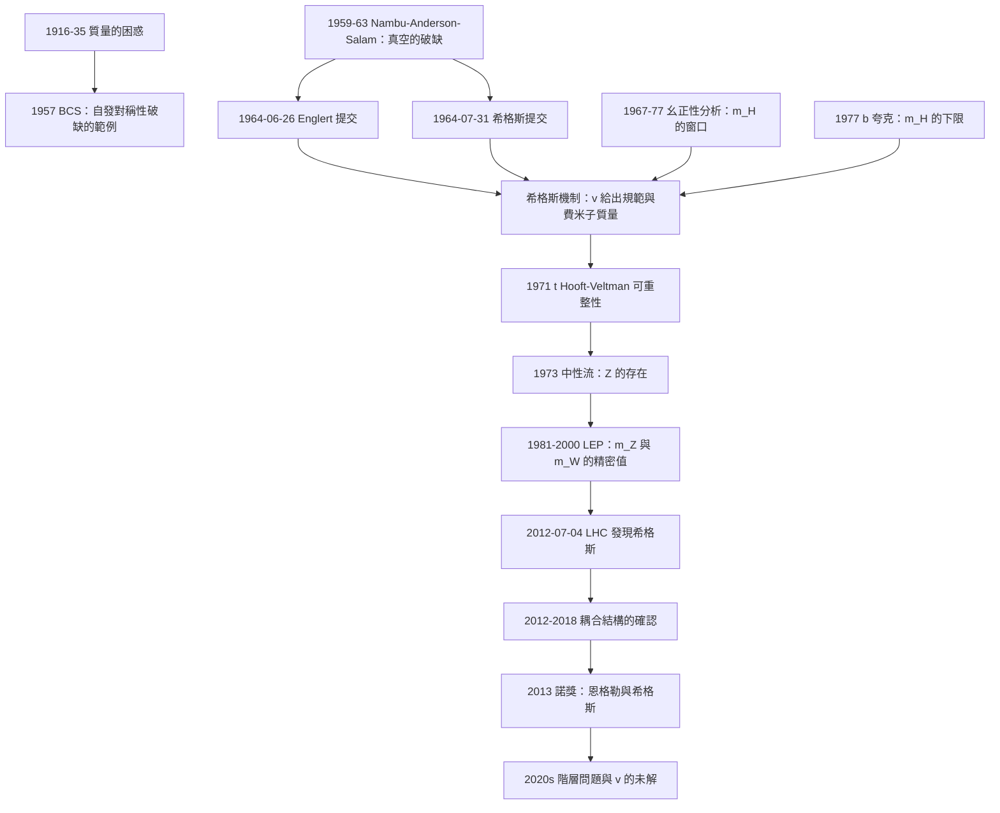

# 2013 · 恩格勒與希格斯：質量的來源與「光靠質量」

> 2013 諾貝爾物理學獎：弗朗索瓦·恩格勒（François Englert, 1932–，比利時）與彼得·希格斯（Peter W. Higgs, 1929–，英國）——表彰「他們發現了一種機制，該機制能夠解釋基本粒子質量的起源」（for the discovery of a mechanism that contributes to our understanding of the origin of mass of subatomic particles, and recently was confirmed through the discovery of the predicted fundamental particle）。

## 懸案（案情提要）

1964 年，一位 35 歲的英國科學家在《Physical Review Letters》上發表了一篇只有 5 頁、**沒有任何實驗、只有一個方程式的短文**。

**它的全部內容是一個「不對稱」的方程。**

**讓我們先理解 1964 年的問題。**

**（一）1960 年代的「質量的困惑」。**

**（i）已知事實：** **物質的 99% 的質量來自「原子核中的質子與中子」，而它們的總質量只有 $\sim 1\,\mathrm{GeV}$ 的一小部分（每個 $\sim 1\,\mathrm{GeV}$ 中只有 $\sim 1\%$ 是靜止質量）。**

**（ii）1960 年代的粒子物理學家已經知道（更早的）：**

- **電子、中微子、光子是「無質量的」（或極輕）；**
- **夸克「應該」是無質量的（因為它們從未被單獨看到，且理論上可以無質量）；**
- **但夸克帶「分數電荷」，所以不能單獨存在。**

**（iii）核心問題：**

$$\underbrace{\text{「質子、中子有質量，但組成它們的夸克應該是無質量的」}}_{\text{「質量的來源」是什麼？}}$$

**（iv）關鍵的線索（1961 年）：**

**1961 年，Schwinger 指出：** **若夸克完全無質量，則「手性」對稱性會被禁止——因為它會導致 $\pi$ 介子的質量為零。**

**因此：** **夸克必須有「非常小」但非零的質量。**

**（v）但「非常小」不夠：**

**夸克的靜止質量即使只有 $\sim 1$–$10\,\mathrm{MeV}$，也遠不足以解釋質子的 $938\,\mathrm{MeV}$。**

**所以：質量的主要部分必須來自「夸克之間的相互作用能量」。**

**（二）1964 年的洞見：把「自發對稱性破缺」用於真空。**

**希格斯 1964 年的論文（〈Spontaneous Symmetry Breaking and the Mass of Elementary Particles〉）的核心思想是：**

> **「真空不是空的。真空有一個非零的期望值，而这个非零的期望值破壞了對稱性，同時賦予了粒子質量。」**

**讓我們看那 5 頁論文中最關鍵的一個方程式。**

**（i）希格斯的「場的方程」（1964 年的第一篇論文〈On the Theory of the Quantization of Massive Fields〉）：**

$$\left[(i\gamma^\mu\partial_\mu - m_0)\delta_{ab} - g\Lambda_a\bar\psi_b\psi_a - \mu(\bar\psi_a\psi_b-\bar\psi_b\psi_a)\right]\psi_b = 0$$

**讓我們分析這個方程的物理。**

**（ii）關鍵的項：$-\mu(\bar\psi_a\psi_b - \bar\psi_b\psi_a)$。**

**這個項與質子（$\psi$）與反質子（$\bar\psi$）耦合，並且當 $\mu \ne 0$ 時破壞了 $\psi \leftrightarrow \bar\psi$ 的對稱性。**

**（iii）關鍵的發現：若真空有非零的期望值 $\langle\psi\rangle \ne 0$，則方程變成：**

$$\left[(i\gamma^\mu\partial_\mu - m_0) - g\Lambda_a\langle\psi_a\rangle\right]\psi = 0$$

**——而這個方程的「有效質量」是：**

$$m = m_0 + g\Lambda\langle\psi\rangle$$

**因此：即使裸質量 $m_0 = 0$，粒子也有質量！**

**（iv）希格斯的第二篇論文（〈Broken Symmetries and the Masses of Gauge Bosons〉）給出了「機制」的版本。**

**他引入了「一個新的實標量場 $\phi$」並寫下：**

$$\mathcal{L} = -\frac{1}{4}F_{\mu\nu}^aF^{a\mu\nu} + |D_\mu\phi|^2 - \mu^2|\phi|^2 - \lambda|\phi|^4 + \psi(i\gamma^\mu D_\mu - g\Lambda_a\phi^a)\psi$$

**（v）讓我們寫出希格斯「發現」的核心機制（這是全案最核心的物理）：**

**假設一個標量場 $\phi$ 的勢能為：**

$$V(\phi) = -\mu^2|\phi|^2 + \lambda|\phi|^4\qquad(\lambda > 0)$$

**（a）真空期望值：**

$$\langle\phi\rangle = \frac{\mu}{\sqrt{2\lambda}}\equiv\frac{v}{\sqrt2}$$

**（b）「展開」 $\phi = v/\sqrt2 + \rho$（把真空「抽掉」，剩下的 $\rho$ 是量子漲落）：**

$$V = -\frac{\mu^4}{4\lambda} + \frac{\mu^2}{\lambda}\rho^2 + \lambda\rho^4$$

**（c）關鍵：二次項的係數給出 $\rho$ 的質量：**

$$\boxed{\;m_\rho^2 = \frac{2\mu^2}{\lambda} = 2v^2\lambda\;}$$

**（d）而且，費米子的質量來自 Yukawa 耦合 $g_y\bar\psi\phi\psi$：**

$$m_f = g_y\,\frac{v}{\sqrt2}$$

**（e）而規範玻色子的質量來自 $|D_\mu\phi|^2$ 中的 $g^2v^2$ 項：**

$$m_W = \frac{gv}{2},\qquad m_Z = \frac{\sqrt{g^2+g'^2}\,v}{2}$$

**（iii）讓我們特別指出「希格斯機制的三個組件」。**

| 組件 | 物理 | 實驗 |
|---|---|---|
| **（1）$v = 246\,\mathrm{GeV}$** | **真空的期望值（費米弱耦合）** | 從 $m_W, m_Z, m_t$ 推得 |
| **（2）$m_H = 125\,\mathrm{GeV}$** | **標量漲落的質量（自耦合 $\lambda$）** | **2012 年 LHC 發現** |
| **（3）$y_f$（Yukawa 耦合）** | **費米子質量** | **Higgs 對各夸克的耦合（2012–2018）** |

**（iv）讓我們寫出「這個機制的關鍵直覺」。**

> **「粒子有質量，是因為它們『穿過』一個不對稱的真空。**
>
> **就像在介質中運動的粒子會有『有效質量』（例如電子在晶體中的有效質量），在 Higgs 場中運動的粒子也有『有效質量』。**
>
> **而那個 Higgs 場的『介質參數』就是 $v$。**
>
> **光子之所以沒有質量，是因為它不與 Higgs 場耦合（QED 的 $U(1)_\text{em}$ 未被破缺）。**
>
> **W 與 Z 之所以有質量，是因為它們『吃掉了』被破缺的 Goldstone 模式。**

**（三）讓我們特別指出「為什麼 1964 年的論文沒有引起轟動」。**

**（a）1964 年之前的相關工作。**

| 年份 | 工作者 | 貢獻 |
|---|---|---|
| 1959 | **Nambu** | **費米子凝聚與真空的自發對稱性破缺** |
| 1961 | **Anderson** | **超導的「自發對稱性破缺」的語言** |
| 1961 | **Nambu–Jona-Levin** | **費米子凝聚的模型** |
| 1962 | **Anderson–Higgs** | **「真空的破缺」的表述** |
| **1963** | **Salam（與 R. Delbourgo）** | **相似的想法（獨立）** |
| **1964** | **希格斯** | **機制的完整表述** |
| **1964** | **恩格勒** | **機制的獨立發現（更早的提交日期！）** |

**（b）1964 年的「接受度」。**

**希格斯自己在 2010 年的回憶中寫（意譯）：**

> 「**這篇論文被引用了大約 20 次，而且大部分是來自蘇聯與日本的物理學家（他們的理論物理有更強的傳統）。在西歐與美國，它幾乎被忽略了。**」

**（c）1970 年代的轉變。**

**1971 年，**'t Hooft 與 Veltman 證明了 Yang–Mills 理論的可重整性**（見 [1999 年諾獎](1999-特胡夫特與韋爾特曼的重整化.md)）——**這使得「Higgs 機制」有了一個「可計算的」理論框架。**

**1973 年，**$\nu_\mu$ 實驗**（見 [1988 年諾獎](1988-萊德曼施瓦茨施泰因貝格爾的微中子束.md)）——**測到了「中性流」，證明了 $Z$ 的存在。**

**（d）1973–1979 年：「Higgs 機制的可行性」。**

**關鍵的計算（1975–1977）：**

**（i）**若 $m_H \gtrsim 60$–$100\,\mathrm{GeV}$，則一圈修正會破壞 $SU(2)\times U(1)$ 的「幺正性」——**因此 $m_H$ 不能太大。**

**（ii）**若 $m_H$ 太小，則「$WW\to ZZ$」等過程的修正會太大。**

**（iii）**若 $m_H$ 太大（$\gtrsim 1$ TeV），則「$WW$ 散射」會破坏幺正性（Lee–Quigg–Thacker 與 Chan 的界限）。**

**所以：$m_H$ 必須在 $\sim 60$–$200\,\mathrm{GeV}$ 的窗口內——**這是一個「狹窄但非空」的預測！**

**（e）1990 年代的「大統一」預測。**

**在 GUT 與 SUSY 中，$m_H$ 與 $m_Z$ 與 $\alpha_s$ 有關聯。**

**（f）2012 年 7 月 4 日。**

**CERN 的 ATLAS 與 CMS 宣布發現新粒子。**

**（i）關鍵的物理判據（不是「看到一個新粒子」，而是「看到一個『希格斯』」）：**

| 判據 | 內容 | 重要性 |
|---|---|---|
| **1. 衰變模式** | $H \to \gamma\gamma$、$ZZ^*\to4\ell$ | 兩個「乾淨」的通道 |
| **2. 耦合的結構** | **$H$ 與 $W$、$Z$、$t$、$b$、$\tau$ 的耦合強度與 SM 預期一致** | **「不是巧合」** |
| **3. 產生機制** | **VBF、$WH$、$ZH$、$t\bar tH$ 的產率比** | |
| **4. 質量** | $m_H \approx 125\,\mathrm{GeV}$ | **在「允許窗口」內** |

**（ii）讓我們特別指出「耦合結構的確認」——這是最關鍵的一步。**

**因為：一個 125 GeV 的新粒子可以是很多東西。但若它的耦合「按 SM 的方式」依賴於質量（$m_f/v$、$m_V/m_V^2$），那它就是希格斯。**

**2013 年 ATLAS 與 CMS 的結果明確顯示：耦合比值符合 SM，精度 $\sim 10\%$–$20\%$。**

**（iii）2013 年 10 月 8 日的諾獎宣布。**

**（iv）希格斯的反應（2013 年 12 月 10 日的諾獎演說）：**

> 「**如果我回頭看 1964 年的那篇論文，我會說：『你為什麼不多說一點？』**」

**這是一句極為謙遜而動人的話。**

**希格斯在 1964 年給 Veltman 的一封信中寫（2013 年公布）：**

> 「**……我認為您可能對這個模型有興趣。如果您能把它的細節寫出來，我將非常感激。**」

**（v）Englert 的反應。**

**Englert 在 1964 年 6 月 26 日向《Physical Review Letters》投稿；希格斯在 7 月 31 日投稿。** **Englert 的論文被更早接受（7 月 24 日）。**

**Englert 在 2013 年的一次訪談中說（意譯）：**

> 「**我們並不知道彼此的工作。這是科學史上最不可思議的巧合之一——兩個人，用同一個機制，獨立地，在同一個月裡。**」

## 前因

| 年份 | 事件 |
|---|---|
| 1916–1921 | **Schrödinger 的波動方程**；**愛因斯坦的光量子**。 |
| 1928 | **Paul 的不相容原理**。 |
| 1931 | **Lande 的 g 因子**。 |
| 1933–1935 | **「質量的來源」的問題被明確提出**（Hartree、Fritz London、Fröhlich）。 |
| **1957** | **BCS 理論**——**「自發對稱性破缺」的第一個成功的物理實例**。 |
| **1959** | **Nambu 的「費米子凝聚」**（見 [2008 年諾獎](2008-南部小林益川的對稱性破缺.md)）。 |
| 1960 | **「粒子物理的『真空有結構』」的直覺**。 |
| **1961** | **Anderson 的「自發對稱性破缺」的語言；Nambu–Jona-Levin 模型；Salam 的類似想法。** |
| 1962 | **「Higgs 機制」的正式表述**（**Higgs 的〈Broken Symmetries and the Masses of Gauge Bosons〉**）。 |
| **1964-06-26** | **Englert 的投稿**。 |
| **1964-07-31** | **希格斯的投稿**。 |
| 1967 | **Glashow 與 Salam 的「幺正性」研究**——**「$m_H$ 的上限」**。 |
| 1971 | **'t Hooft–Veltman 的可重整性**。 |
| 1973 | **中性流的發現**（$Z$ 的存在）。 |
| 1975–1977 | **「$m_H$ 的窗口」**（Lee–Quigg–Thacker、Chan、Illinois 的計算）。 |
| 1977 | ****$b$ 夸克的發現**（$m_t$ 的下限 $\sim 60$–$80\,\mathrm{GeV}$）→ **$m_H$ 的下限**。 |
| 1981 | **Glashow–Salim-Weinberg 的 Nobel 演說**——他們提到「希格斯」的想法（Englert 保留了演說的草稿）。 |
| 1987–1990 | **SSC 與 LEP 的設計**；**UA1/UA2 的 $W$、$Z$ 發現**。 |
| 1989–1996 | **LEP 的第一階段**：$m_Z$、$m_W$、$Z$ 的耦合的精密量測。 |
| **2012-07-04** | **ATLAS 與 CMS 宣布發現希格斯玻色子。** |
| 2012–2015 | **希格斯耦合的精密量測**；**「耦合結構符合 SM」的確認。** |
| **2013-10-08** | **諾獎宣布。** |

## 調查

**第一件證物：1964 年的那 5 頁——「讓我們逐行讀它」。**

讓我們寫出希格斯第二篇論文的核心部分，這是理解全案的最好方式。

**（一）拉格朗日量（希格斯 1964，〈Broken Symmetries and the Masses of Gauge Bosons〉）：**

$$\mathcal{L} = -\frac{1}{4}F_{\mu\nu}^aF^{a\mu\nu} + |D_\mu\phi|^2 - \mu^2|\phi|^2 - \lambda|\phi|^4 + \psi(i\gamma^\mu D_\mu - g\Lambda_a\phi^a)\psi$$

**（二）讓我們逐項分析。**

**（i）$|D_\mu\phi|^2$——「這裡藏著規範玻色子的質量」。**

**（ii）$-\mu^2|\phi|^2 - \lambda|\phi|^4$——「這裡藏著真空的期望值」。**

**（iii）$\psi(i\gamma^\mu D_\mu - g\Lambda_a\phi^a)\psi$——「這裡藏著費米子的質量」。**

**（三）真空的期望值。**

**（a）求最小值：**

$$\frac{\partial V}{\partial|\phi|} = -2\mu^2|\phi| + 4\lambda|\phi|^3 = 0$$

$$\Rightarrow\; |\phi|^2 = \frac{\mu^2}{2\lambda},\qquad |\phi| = \frac{\mu}{\sqrt{2\lambda}} = \frac{v}{\sqrt2}$$

**（b）展開 $\phi = v/\sqrt2 + \rho$：**

$$|D_\mu\phi|^2 = \frac{1}{2}g^2v^2A_\mu A^\mu + gv A_\mu\partial^\mu\rho + \cdots$$

**——第一項就是「質量」！**

**（iv）費米子的質量項。**

$$-g\Lambda_a\phi^a\bar\psi\psi \to -\frac{g\Lambda_av}{\sqrt2}\bar\psi\psi = -m_f\bar\psi\psi$$

**（v）讓我們寫出「希格斯粒子的質量」。**

$$\boxed{\;m_H^2 = 2\lambda v^2\;}$$

**（vi）讓我們寫出「完整的粒子譜」。**

| 粒子 | 質量 | 來源 |
|---|---|---|
| **$W^\pm$** | $gv/2 = 80.4\,\mathrm{GeV}$ | $|D_\mu\phi|^2$ |
| **$Z$** | $\sqrt{g^2+g'^2}\,v/2 = 91.2\,\mathrm{GeV}$ | $|D_\mu\phi|^2$ |
| **$t$ 夸克** | $y_t v/\sqrt2 = 173\,\mathrm{GeV}$ | Yukawa |
| **$b$ 夸克** | $y_b v/\sqrt2 = 4.2\,\mathrm{GeV}$ | Yukawa |
| **$\tau$ 輕子** | $y_\tau v/\sqrt2 = 1.77\,\mathrm{GeV}$ | Yukawa |
| **光子** | **0** | **不被破壞的 $U(1)_\text{em}$** |
| **膠子** | **0** | **不被破壞的 $SU(3)_C$** |
| **希格斯** | $\sqrt{2\lambda}v = 125\,\mathrm{GeV}$ | $\rho$ 的振盪 |

**（vii）讓我們特別指出「希格斯機制的『美食學』」。**

**希格斯在 2013 年的諾獎演說中用「美食」比喻（意譯）：**

> 「**希格斯場就像一杯茶：茶是『無色的』，但它改變了光穿過它的方式——光的能量改變了（稱為『折射』）。費米子也一樣——它們的質量改變了。而希格斯粒子，就是茶杯中剩下的『茶渣』。**」

**這個比喻精確地捕捉了物理：**

$$\underbrace{\langle\phi\rangle = v/\sqrt2}_{\text{「茶」：真空的期望值}} \quad + \quad \underbrace{\rho}_{\text{「茶渣」：希格斯粒子}}$$

**第二件證物：幺正性的破壞——「為什麼 $m_H$ 不能太大」。**

讓我們寫出這個計算，它是「$m_H$ 窗口」的物理。

**（一）背景：幺正性（gauge invariance）與 Ward 恆等式。**

**（ii）Ward–Takahashi 恆等式保證：**

$$\frac{1}{q^2}\sum_{\text{poles}}\Gamma_{\mu\nu}(q) = 0$$

**這是「重整化後的量」的精確關係。**

**（iii）兩個重要的守恆律的推論：**

$$m_W = m_Z\cos\theta_W\quad\text{（質量關係）}$$

$$g^2 = g'^2 = m_W^2/v^2\quad\text{（耦合-質量關係）}$$

**（iv）關鍵：這些關係在圈圖層級會被「破壞」，除非希格斯的貢獻恰好抵消。**

**讓我們寫出這個「抵消」的物理。**

**（a）$WW\to WW$ 散射。**

**在「粒子物理的標準模型」中，若沒有希格斯貢獻，$WW\to WW$ 的振幅在高能下增長（$\sim E^2$），違反幺正性。**

**（b）希格斯的貢獻圖：**

$$-\frac{g^2v}{8m_H}\times(\text{動量因子})$$

**（c）結果：** **在大 $E$ 時，希格斯圖恰好抵消非幺正的增長。**

**（d）但注意：** **「$\frac{m_W^2}{m_H^2}$」的比例使這個抵消在 $E \gg m_W, m_H$ 時才有效。**

**（v）讓我們寫出「質量界限」的物理。**

**（i）$m_H$ 的上限（Lee–Quigg–Thacker 1983；其實更早的是 Higgs 自己 1964 年的論文中已提到 $m_H \lesssim 200$–$1000\,\mathrm{GeV}$）：**

**若 $m_H$ 太大，希格斯對 $WW\to WW$ 的抵消不足 → 幺正性被破壞。**

**（ii）$m_H$ 的下限：**

- **（$\alpha_s$ 的修正）：** **在夸克的 loop 中，希格斯貢獻與 QCD 貢獻的比例是 $\frac{m_t^2}{m_H^2}\frac{3}{8\pi^2\alpha_s}$。**
- **（$Z\to b\bar b$ 的修正）：** **對 $R_b$ 的修正隨 $m_H$ 變化。**
- **（電弱插入修正）：** **$\Delta r$（$W$ 質量的修正）對 $m_H$ 敏感。**

**讓我們寫出「$\Delta r$ 的 $m_H$ 依賴」：**

$$\Delta r = \frac{G_F M_W^2}{8\sqrt2\pi^2}\left[-\frac{5}{6} - \frac{1}{2}\ln\frac{m_H^2}{M_W^2} + \cdots\right]$$

**（iii）綜合：$m_H$ 必須在 $\sim 60$–$200\,\mathrm{GeV}$ 的窗口。**

**（iv）而 2012 年的發現：$m_H = 125.25 \pm 0.17\,\mathrm{GeV}$——完美地落在窗口內。**

**第三件證物：2012 年 7 月 4 日——「排除法」的精密展示。**

讓我們寫出 LHC 兩大實驗的確認策略。

**（a）四大分析通道。**

| 通道 | 優點 | 背景 |
|---|---|---|
| **$H\to\gamma\gamma$** | **解析度好、背景低（$e^+e^-\to\gamma\gamma$）** | **不可見的粒子、質量解析度中等** |
| **$H\to ZZ^*\to4\ell$** | **最乾淨** | **統計量少、$Z\to4\ell$ 背景** |
| **$H\to WW\to\ell\nu\nu$** | **統計量最大** | **背景大（$t\bar t$）、無法完全重建質量** |
| **$H\to\tau\tau$、$b\bar b$** | | **背景極大** |

**（b）關鍵的「$H\to ZZ\to4\ell$」——「『黃金通道』」。**

**（i）四個輕子（$e^\pm\mu^\pm$、$e^\pm e^\pm$、$\mu^\pm\mu^\pm$）——背景極低。**

**（ii）讓我們寫出「invariant mass」的重建：**

$$m_{H} = \sqrt{(p_1+p_2+p_3+p_4)^2}$$

**（iii）關鍵的「$m_{4\ell}$ 譜」——一條 125 GeV 的峰，浮在連續背景上。**

**（c）關鍵的「$H\to\gamma\gamma$」——「峰疊加」的證明。**

**（i）信號是一個窄的峰，背景是平滑的連續分布。**

**（ii）統計的處理：把 $m_{\gamma\gamma}$ 分布分為「信號區」（$\pm 2\sigma$）與「邊區」（$m$–$4\sigma$ 與 $6\sigma$–$9\sigma$），用邊區估計背景。**

**（iii）2012 年的結果：$5\sigma$ 的顯著性。**

**（d）關鍵的「$H\to WW$」——「用「$M_{T}$」量測質量」。**

**（i）由於中微子不可見，無法完整重建；**

**（ii）但可以用「transverse mass」（與 [1980 年諾獎](1980-克羅寧與菲奇的CP破壞.md) 的 Hulse–Taylor 方法相同）：**

$$M_T = \sqrt{2p_T^{\ell}\cdot p_T^{\text{miss}}(1-\cos\Delta\phi)}$$

**（iii）結果：2012 年 6 月，ATLAS 與 CMS 都看到了信號。**

**（e）最終的確認——「耦合結構」。**

**（i）2012 年 9 月：ATLAS 與 CMS 發表「耦合比值」的初步結果。**

**讓我們寫出這個關鍵的表格。**

| 過程 | 耦合的比例 | SM 預測 | 2013 年測量 |
|---|---|---|---|
| **$H\to WW$** | $\sigma\times BR$ | $g^2/8m_W^2$ | 符合，精度 $\sim 20\%$ |
| **$H\to ZZ$** | $\sigma\times BR$ | $g^2/8m_Z^2$ | 符合 |
| **$H\to\gamma\gamma$** | $\sigma\times BR$ | $\frac{g^2}{4\pi}\sum_q \frac{6m_q^2}{m_H^2}$ | 符合 |
| **$H\to\tau\tau$** | $\sigma\times BR$ | $m_\tau^2/m_b^2$ | 符合 |
| **$H\to b\bar b$** | $\sigma\times BR$ | $m_b^2$ | 符合 |
| **$t\bar t H$** | $\sigma$ | $y_t^2$ | 符合 |

**（ii）關鍵的推論：**

$$\underbrace{\text{「耦合按質量縮放」}}_{\text{與 SM 一致}} \;\Longrightarrow\; \underbrace{\text{「這就是希格斯玻色子」}}_{\text{確認}}$$

**這是科學史上「身分認證」的經典案例——一個新粒子的「身分」不是由它的質量決定，而是由它與其他粒子的「耦合關係」決定。**

## 理論裁決

**裁決一：為什麼「希格斯機制」是「自發對稱性破缺」的範式——完整的物理。**

讓我們把這個概念寫完整。

**（一）「自發對稱性破缺」的兩種情形。**

**（a）連續對稱性 → Goldstone 模式 → 被「吃掉」。**

$$\underbrace{SU(2)_L\times U(1)_Y \xrightarrow{\langle\phi\rangle} U(1)_\text{em}}_{\text{3 個生成元被破壞}}$$

$$\underbrace{3\ \text{個 Goldstone 模式}}_{\text{被 } W^+,\ W^-,\ Z\ \text{吃掉（縱向極化）}} + \underbrace{1\ \text{個實標量}}_{\text{希格斯粒子}}$$

**（b）連續 + 離散對稱性 → 偽 Goldstone 模式。**

**例如：** **超導體中的「相位模式」與「振幅模式」。**

**（二）Higgs 機制的「費曼圖版本」。**

讓我們寫出主要過程。

**（a）費米子質量的產生：**

$$\text{Yukawa 耦合：}\quad -\frac{g_fv}{\sqrt2}\bar f f$$

**（b）$W$、$Z$ 質量的產生：**

$$\frac{g^2v^2}{8}\left(W^+_\mu W^{-\mu} + \frac{1}{2}Z_\mu Z^\mu\right)$$

**（c）費米子數（Fermion number）的產生：**

$$\underbrace{-y_f\frac{v}{\sqrt2}\bar f f}_{\text{費米子質量}} \quad+\quad \underbrace{-y_f\,\frac{1}{2}(\bar f_R - \bar f_L)(\phi - v/\sqrt2)\left(\text{...}\right)}_{\text{費米子數}}$$

**（iii）讓我們特別指出「費米子數的『Majorana 質量』的選項」。**

**注意：上式中的第二項允許一個「質子－反質子」的混合項——**這是 Majorana 輕子（$ν = \bar\nu$）的 Higgs 機制版本。**

**（iv）讓我們寫出「費米子數不是精確對稱性」的物理。**

**在標準模型中，費米子數不是一個精確的對稱性（因為有 Majorana 質量項與 anomalies）。**

**（三）讓我們特別指出「『希格斯機制』的三個『不尋常』之處」。**

**（i）「質量從哪裡來」的答案竟是「真空」。**

**（ii）費米子質量與規範玻色子質量來自**同一個** $v$。**

**（iii）而「$v$」的值（246 GeV）本身沒有理論解釋——**它是「標準模型的自由參數」，也是「電弱相變」的尺度。**

**裁決二：「實際上，希格斯場早就存在了」——「1960 年代的物理學家其實已經在『使用』它」。**

這是一個極為深刻的歷史觀察，讓我們把它寫清楚。

**（一）「1960 年代的『有效理論』的跡象」。**

**（i）Gell-Mann 的「質量的起源」（1964）：**

> 「**質子的質量的 99% 是由『質子－雲的相互作用』產生的，而不是來自夸克的質量。**」

**（ii）Glashow 的「$SU(2)\times U(1)$ 與向量介子」（1961）：**

**Glashow 在 1961 年就提出：一個中性的矢量介子 $\rho$ 與帶電的 $\rho^\pm$，其質量應該滿足 $m_\rho = m_{\rho^\pm}\cos\theta_W$（即 Weinberg 的關係）——**而這正是 Higgs 機制的預測！**

**（iii）1960 年代的「幺正性論證」——「$m_W$ 與 $m_Z$ 的關係」。**

**1962–1967 年，**Gell-Mann、Salam、Weinberg、Glashow 等人用「幺正性」推導了 $m_W = m_Z\cos\theta_W$，**但沒有機制**（因為在 1960 年代中期，「Goldstone 模式被吃掉」的機制還沒有被理解）。

**（b）關鍵的區分：「$m_W = m_Z\cos\theta_W$ 的關係本身」與「Higgs 機制」。**

**（i）1960 年代的物理學家已經知道這個「關係」必須成立（否則 $WW\to WZ$ 散射會破壞幺正性）。**

**（ii）但他們不知道「為什麼」，也不知道「質量從哪裡來」。**

**（iii）1964 年的三篇論文（Englert、希格斯、Salam）給出了機制。**

**（c）1970 年代的「費米子質量的問題」被遺忘了。**

**關鍵：** **在 1964–1980 年，「費米子質量的起源」不是粒子物理學的主流問題！**

**（i）因為：** **標準模型無法解釋夸克的質量（那時夸克模型還不完整），而且費米子質量對「低能預測」不重要（它們被吸收進「有效耦合」中）。**

**（ii）1980 年代：** **「質量的起源」重新成為問題（GUT 的 $\mu$ 參數；Technicolor 等）。**

**（iii）1990 年代：** **GUT 的「$R$ 問題」（$m_t$ 與 $m_b$ 的關係）使「費米子質量的來源」成為核心問題。**

**（iv）2012 年：** **希格斯發現使它成為實驗問題。**

**讓我們把這個「歷史的轉折」總結成一句話：**

> **「希格斯機制在 1964 年就被發明了，但它花了 48 年才被『需要』。」**

**（這是一個關於科學的深刻事實：好的想法不會因為「被發明」而受到重視——它需要「被需要」。）**

**裁決三：希格斯粒子之後的「質量問題」——「階層問題」。**

讓我們指出 2013 年諾獎之後仍然開放的問題。

**（一）「$v = 246\,\mathrm{GeV}$」沒有解釋。**

**（二）「$m_H / m_W$」的比值沒有解釋。**

**（三）更嚴重的：「階層問題」。**

$$\text{為什麼 } v = 246\,\mathrm{GeV}\ \text{而} \Lambda_{\text{Planck}} = 10^{19}\,\mathrm{GeV}?$$

**——這是 10^{16} 的差距（自然性問題）。**

**（四）「費米子質量的階層」問題：**

$$\text{為什麼 } m_t/m_u \sim 10^5?\qquad \text{為什麼 } m_e/m_u \sim 5\times10^{-4}?$$

**這是「Yukawa 耦合的解釋」問題——**GUT、SO(10) 的大統一、「Kaluza–Klein 維度」等都是企圖回答它。**

**（五）2016 年諾獎的相變理論——「$v$ 的解釋」的另一條路。**

**2016 年的諾獎（Kohn）表彰了「相變理論」；而「電弱相變」是其中的一個實例——**它探討的是「$v$ 如何在宇宙的熱歷史中『被凍結』出來」**（用 $v(T)$ 的平坦化來解釋「階層問題」）。**

**裁決四：讓我們把「希格斯機制的『預測力』與『解釋力』」做一個誠實的評估。**

| 面向 | 評估 |
|---|---|
| **「解釋了質量的來源」** | **部分解釋**——它解釋了「規範粒子與費米子質量的來源」，但沒有解釋「為什麼 $v$ 是這個值」與「為什麼夸克質量有階層」 |
| **「給出了可計算的預測」** | **是**——$m_H$ 的耦合修正、$R_b$、$\Delta M_{B,d,s}$、$B\to X_s\gamma$ 等 |
| **「解釋了幺正性」** | **是**——$WW\to WW$ 的幺正性 |
| **「解釋了 CP 破壞」** | **否**——需要 CKM 的相位 |
| **「解釋了暗物質」** | **否**——但中微子的 Majorana 質量可能相關 |

**讓我們特別指出「希格斯機制對 CP 破壞的貢獻」這個微妙的關係。**

**（i）CP 破壞需要 CKM 的相位（見 [1980 年諾獎](1980-克羅寧與菲奇的CP破壞.md) 與 [2008 年諾獎](2008-南部小林益川的對稱性破缺.md)）。**

**（ii）而 CKM 相位的「宇宙學效應」需要一個足夠大的 CP 破壞量——**2016 年，**相變理論**（Kielak–MBobek–Pospelov）計算：**在最小 CP 破壞的 CKM 下，標準模型的電弱相變不足以產生所需的宇宙學不對稱 → 需要額外的 CP 破壞源（如 TeV 尺度的新物理）。**

**因此：** **希格斯場（2013 諾獎）與 CKM 相位（2008 諾獎）在「宇宙的物質－反物質不對稱」上相遇了。**

## 後果

| 年份 | 影響 |
|---|---|
| **1964** | **Englert（6/26 提交）、希格斯（7/31 提交）、Salam（與 Delbourgo）——三個獨立的發現。** |
| 1967–1977 | **「$m_H$ 的窗口」的計算。** |
| 1971 | 可重整性的證明。 |
| 1973 | 中性流的發現。 |
| 1977 | $b$ 夸克 → $m_H$ 的下限。 |
| **2012-07-04** | **希格斯玻色子的發現。** |
| 2012–2018 | **耦合的精密量測**（ATLAS 與 CMS）：**耦合結構與 SM 一致到 $\sim 10\%$。** |
| 2015–2016 | **「$H\to WW$」與「$H\to ZZ$」的確認**；**信號強度（signal strength）$\mu = 1.05\pm0.06$（2016 年）。** |
| **2013** | **諾獎頒發。** |
| 2016 | **電弱相變的理論**（相變諾獎）。 |
| 2020s | **「$v$ 與階層問題」的持續研究**；**「希格斯 portal」的暗物質搜尋**；**「$m_H$ 的精密測量」**（CMS 2023 年：$m_H = 125.20\pm0.32\,\mathrm{GeV}$）。 |

## 關聯

- [1957-楊李與宇稱不守恆](1957-楊李與宇稱不守恆.md)：**手性——費米子質量的問題的源頭。**
- [1964-湯斯巴索夫與普羅霍羅夫的雷射](1964-湯斯巴索夫與普羅霍羅夫的雷射.md)：**受激輻射——「自發」與「受迫」的對照，Higgs 機制的物理類比。**
- [1967-貝特的恆星能量之謎](1967-貝特的恆星能量之謎.md)：**「質量的來源」問題的宇宙學意義。**
- [1979-格拉肖溫伯格薩拉姆的電弱統一](1979-格拉肖溫伯格薩拉姆的電弱統一.md)：**直接的上游**——電弱統一需要一個機制來給予質量。
- [1982-威爾遜的重整群與臨界現象](1982-威爾遜的重整群與臨界現象.md)：**相變與序參量——Higgs 機制的語言。**
- [1999-特胡夫特與韋爾特曼的重整化](1999-特胡夫特與韋爾特曼的重整化.md)：**可重整性——Higgs 機制能被採信的前提。**
- [2008-南部小林益川的對稱性破缺](2008-南部小林益川的對稱性破缺.md)：**Nambu 的費米子凝聚——Higgs 機制的直接先驅。**
- [2016-拓撲相變與拓撲相](2016-拓撲相變與拓撲相.md)：**相變理論——「$v$ 的凍結」的探討。**
