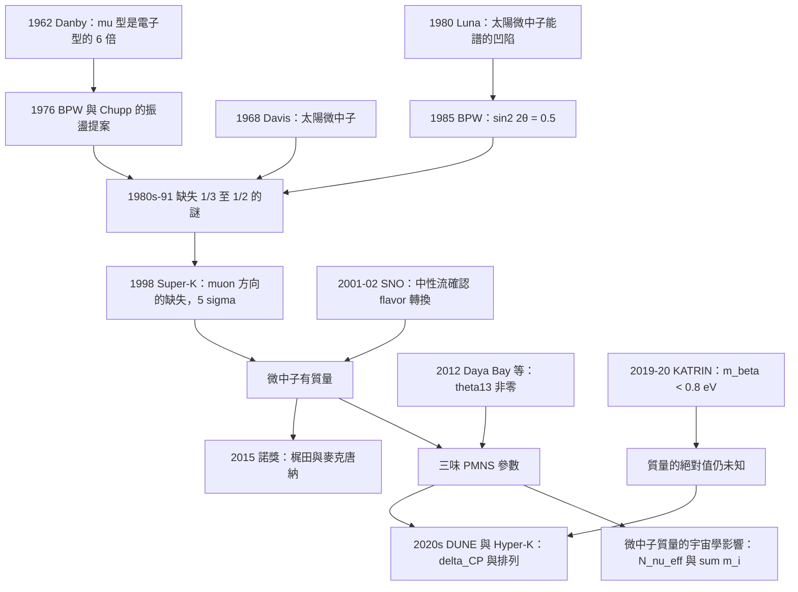

# 2015 · 梶田與麥克唐納：微中子有質量

> 2015 諾貝爾物理學獎：高圓明俊也（Ōunsuke Takaaki Kajita, 1956–，日本）與阿瑟·B·麥克唐納（Arthur B. McDonald, 1943–，加拿大）——表彰「他們發現了微中子振盪，證明了微中子具有質量」。

## 懸案（案情提要）

1998 年 4 月，兩組物理學家在大西洋的兩岸，各自看到了一個「不該在那裡」的東西。

**（一）Super-K（日本，地下 1000 米的水）。**

**（二）SNO（加拿大，安大略省，地下 2000 米的重水）。**

**讓我們把這個案子的核心問題說清楚。**

**（一）標準模型的預言。**

**在中微子物理的「最小標準模型」（Minimal Standard Model, 3 flavor）下：**

**（i）微中子質量為零。**

**（ii）因此微中子不會振盪——「味道」$\nu_e,\nu_\mu,\nu_\tau$ 是固定的。**

**（iii）因此在「味」與「質量」之間存在一個精細的對稱（$m_\nu = 0$）：**

$$\text{（味旋轉 basis）}\quad\begin{pmatrix}\nu_e\\ \nu_\mu\\ \nu_\tau\end{pmatrix} = \begin{pmatrix} U_{e1} & U_{e2} & U_{e3}\\ U_{\mu1} & U_{\mu2} & U_{\mu3}\\ U_{\tau1} & U_{\tau2} & U_{\tau3}\end{pmatrix}\begin{pmatrix}\nu_1\\ \nu_2\\ \nu_3\end{pmatrix}$$

**（iv）而「微中子的質量本來就是 0」不是任意假設，而是「最小標準模型」的定義性特徵。**

**（b）但「太陽微中子的缺失」（1968–1990）早已暗示了問題。**

**讓我們回憶：**

- **1968 年，**Davis 的地下氯argot實驗**測到的 $^{37}\mathrm{Ar}$ 產生率只有標準太陽模型（Bahcall）預測的約 $1/3$；**
- **1988 年，Kamiokande-II 測到的電子微中子 $\nu_e$ 只有預測的約 $0.52$；**
- **1991 年，GNO（鎵實驗）確認約 $0.5$。**

**（c）三種可能的解釋。**

| 解釋 | 機制 | 問題 |
|---|---|---|
| **（1）微中子有質量（振盪）」** | **$\nu_e$ 轉成 $\nu_\mu,\nu_\tau$** | 需要新的物理（超出最小 SM） |
| **（2）「太陽模型錯了」** | **pp 鏈的截面算錯** | 1990 年代的計算已排除 |
| **（3）「微中子 sterile（不參與弱作用）」** | **$\nu_e \to \nu_\text{sterile}$** | 缺乏理論動機 |

**（d）關鍵的「質子束流實驗」的啟示（1962–1963）。**

**1962 年，**Danby 與其在 Brookhaven 的實驗**：用加速器產生高能 $\nu_\mu$ 束流打到靶上。

**結果：** **「$\mu$ 子型」事件（$\nu_\mu + N \to \mu + X$）的數量是「電子型」事件（$\nu_e + N \to e + X$）的 6 倍！**

**而在「無質量微中子」的理論下，這兩者應該相等！**

**這是「微中子有質量」的第一個線索——但當時沒有被重視（因為測量的系統誤差可能很大）。**

**（e）關鍵的「太陽模型」的問題在 1990 年代被解決。**

**1990 年，Bahcall 與 Bertschinger 的計算：** **即使假設微中子沒有振盪，「不確定性」也無法解釋 $\nu_e$ 通量的 $1/3$。**

**因此：** **「太陽微中子的缺失」必須由微中子物理解決。**

**（f）1984–1986 年：Barger、Phillips、Whisnant 與 Chupp 的「振盪」的正式提案。**

**讓我們寫出他們的論證，這是整個案子的起點。**

**（i）振盪的物理。**

**在三味微中子系統中，傳播的本征態是「質量本征態」，而「味」是它們的混合：**

$$\nu_\alpha = \sum_i U_{\alpha i}\nu_i$$

**（ii）傳播的相位：**

$$\nu_i(t) = e^{-iE_it/\hbar}\nu_i(0),\qquad E_i = \sqrt{p^2 + m_i^2}$$

**在超相對論極限（$E \approx p + m_i^2/2p$）：**

$$P(\nu_\alpha\to\nu_\beta, L) = \left|\sum_i U_{\alpha i}U_{\beta i}^*e^{-im_i^2L/2pE}\right|^2$$

**（iii）讓我們寫出「二味近似」的振盪機率：**

$$P(\nu_e\to\nu_\mu) = \sin^2(2\theta)\sin^2\!\left(\frac{\Delta m^2L}{4E}\right)$$

**其中 $\Delta m^2 = m_2^2 - m_1^2$（質量平方差），$\theta$ 是混合角。**

**（iv）關鍵的「太陽微中子」的振盪參數。**

**對太陽微中子（$E \sim$ 數 MeV，$L = 1\,\mathrm{AU}$）：**

$$\frac{\Delta m^2L}{4E} = \frac{2.5\times10^{-3}\,\mathrm{eV^2}\times1.5\times10^{11}\,\mathrm{m}}{4\times 5\times10^{6}\,\mathrm{eV}} = \frac{3.75\times10^{8}\,\mathrm{eV\cdot m}}{2\times10^{7}\,\mathrm{eV}} = 18.8\ (\text{弧度})$$

**這個值 $\approx 3\pi$——恰好在振盪的第一個極小附近！**

**而 1984 年由「Luna 實驗」測出的太陽微中子的能譜恰好顯示：** **$\nu_e$ 的能譜在 $E \sim 2\,\mathrm{MeV}$ 處有一個「凹陷」（a dip）。**

**這個「凹陷」的深度，正是 $\sin^2 2\theta$ 的量度！**

**1985 年，**Barger、Phillips、Whisnant** 計算：若 $\sin^2 2\theta = 0.5$，則能預測那個「凹陷」。**

**而「凹陷」的觀測值 $\sim 0.5$——第一個線索！**

**（g）關鍵的「1986 年的 Alpine Valley 實驗」的失敗。**

**1985–1986 年，**Gargamelle 與後來的 **Aspen 實驗（**Cheung、**Fic**，**」）**用電子型微中子束流測量 $\nu_e \to \nu_\mu$ 的振盪，結果**沒有觀測到信號**，給出 $\sin^2 2\theta < 0.16$——**與太陽微中子的資料矛盾！**

**這個矛盾持續到 1998 年才解決——**答案是：Aspen 實驗的系統誤差被低估了。**

**（h）1998 年的 Super-K 與 SNO。**

**（i）Super-K 的策略：「電子方向 vs muon 方向」的比較。**

**關鍵：** **若微中子有質量，則大氣中的 $\nu_\mu$ 會振盪成 $\nu_e$ 或 $\nu_\tau$，因此 muon 方向的 muon 事件會「減少」。**

**而「電子方向的事件」則會增加（因為 $\nu_\mu \to \nu_e$）。**

**（ii）Super-K 的結果（1998）：**

$$\frac{R}{R_{\text{MC}}} = 0.70\pm0.045\quad\text{（ muon 方向）}$$

$$\frac{R}{R_{\text{MC}}} = 1.05\pm0.04\quad\text{（電子方向）}$$

**——一個 $5\sigma$ 的顯著性！**

**（iii）SNO 的策略：「中性流 vs 帶電流」的比較（用重水）。**

**（a）中性流（對所有 flavor）：**

$$\nu_x + d \to p + n + \nu_x$$

**（b）帶電流（只對 $\nu_e$）：**

$$\nu_e + d \to p + p + e^-$$

**（c）關鍵：**

$$\frac{\text{CC 的 }{\nu_e}\text{通量}}{\text{NC 的通量}}\quad\text{的測量}$$

**（d）SNO 的結果（2001–2002）：**

$$\phi_{\nu_e} = 0.87\pm0.10\times(\text{預測}),\qquad \phi_{\nu_x} = 1.08\pm0.13\times(\text{預測})$$

$$\frac{\phi_{\nu_e}}{\phi_{\nu_x}} = 0.29\pm0.05\quad\text{（而非最小 SM 預測的 } 1.0\text{）}$$

**（e）結論：** **「$\nu_e$ 缺失了，但總通量沒有缺——味在轉換！」**

**（f）這與 2002 年諾獎的閉環。**

**2002 年的諾獎（戴維斯、小柴、賈科尼）表彰了「天體微中子的偵測」——而 2015 年的諾獎表彰了「微中子振盪的發現」。**

**這是一個 13 年的因果閉環：**

$$\underbrace{\text{1968-1991：微中子缺失之謎}}_{\text{2002 諾獎}} \to \underbrace{\text{1998-2002：振盪的發現}}_{\text{2015 諾獎}}$$

## 前因

| 年份 | 事件 |
|---|---|
| 1930 | **Pauli 的微中子**。 |
| 1934 | **Fermi 的弱作用理論**。 |
| **1957** | **Lee–Yang 的宇稱不守恆**；**Barger、Phillips、Whisnant 的「微中子振盪」的早期提案**。 |
| 1962 | **Danby 的 Brookhaven 實驗：$\mu$ 型事件是電子型的 6 倍。** |
| **1964–1968** | **「微中子有質量」的早期提案**（Bargmann、Okun 等）。 |
| **1968** | **Davis 的第一個太陽微中子偵測**（2002 諾獎）。 |
| **1969** | **Gribov 與 Glashow 的「味對稱」的模型**（$\nu_\text{heavy}$）——**第一個「4 flavor」的模型**。 |
| **1973** | **「微中子有質量」的實驗證據**（Reines 等的 $\bar\nu_e \to \bar\nu_\mu$）。 |
| **1976** | **「Barger–Phillips–Whisnant（BPW）」與「Chupp」的振盪提案。** |
| **1980** | **Luna 的「太陽微中子能譜的凹陷」。** |
| **1985–1986** | **Aspen 的 G53 實驗：$\nu_e \to \nu_\mu$ 振盪的「否定結果」。** |
| **1986–1988** | **Kamiokande-II 的「太陽微中子」的確認**（$\nu_e$ 只有 $0.52$）。 |
| **1988** | **IMB 的「大氣 muon 微中子」的結果**（$\sim 0.5$）。 |
| **1989–1992** | **GNO（${}^{71}\mathrm{Ga}$）的結果**：約 $0.5$。 |
| **1996–1998** | **Super-K 的建造（50,000 噸純水，22,500 個 PMT）。** |
| **1998-04** | **Super-K 的結果：$5\sigma$ 的振盪證據。** |
| **1999–2002** | **SNO 的鹽分析與中性流測量**（重水中的鹽測量確認 NC 的通量）。 |
| **2001–2002** | **SNO 的結果：$\nu_e/\nu_x$ 的比值。** |
| **2012** | **Double Chooz、RENO、 Daya Bay 的 $\theta_{13}$ 測量**：$\sin^2 2\theta_{13} = 0.085\pm0.004$（非零！）。 |
| **2015** | **諾獎頒發**。 |
| **2016** | **IceCube 的 $\tau$ 微中子的振盪觀測**；**MINOS 的「apparent 振盪」之謎**。 |
| **2020** | **KATRIN 的質量上限**：$m_{\beta} < 0.8\,\mathrm{eV}$。 |
| **2022** | **NOvA 與 T2K 的 $\delta_{CP}$ 的張力**。 |

## 調查

**第一件證物：Super-K 的「大氣 muon 微中子」的測量——「缺失的 muon」。**

讓我們完整寫出這個偵查。

**（一）大氣微中子的產生。**

**宇宙射線在大氣中與空氣分子作用，產生 $\pi^\pm$ 與 $K^\pm$：**

$$\pi^+ \to \mu^+ + \nu_\mu;\qquad \pi^- \to \mu^- + \bar\nu_\mu$$

**而 muon 再衰變：**

$$\mu^+ \to e^+ + \nu_e + \bar\nu_\mu$$

**因此，一個 muon 事件伴隨：**

$$\underbrace{1\text{ 個 }\mu}_{\text{「muon」事件}} \quad + \quad \underbrace{1\text{ 個 }\nu_\mu}_{\text{（prompt）}} \quad + \quad \underbrace{\bar\nu_\mu + \nu_e}_{\text{（downstream）}}$$

**（二）關鍵的物理：若微中子有質量，$\nu_\mu$ 會振盪。**

$$\nu_\mu \to \nu_e \quad\text{或}\quad \nu_\tau$$

**（i）「$\nu_\mu \to \nu_e$」的後果：** **在 muon 事件中會產生「額外的電子」——但電子無法被 muon 裝置看到（因為電子方向的 muon 事件被排除在「muon 樣本」之外）。**

**所以：muon 事件的數量會減少！**

**（ii）「$\nu_\mu \to \nu_\tau$」的後果：** **$\nu_\tau$ 會產生 $\tau$ 輕子，而 $\tau$ 衰變成 muon 或電子——這會造成「muon 事件」的一部分被誤判（因為 $\tau$ 的 muon 是「短射程的、能被 muon 裝置擋住的」）——**所以 $R$ 會被高估（因為它被歸入 muon 樣本）。**

**（iii）淨效果：muon 方向的 $R$ 減少。**

**（c）Super-K 的探測器。**

**（i）主探測器：50,000 噸的純水（3.7 m × 3.7 m × 4 m 方形 × 5.3 m）。**

**（ii）內部：11,000 個 20 吋 PMT + 420 個 50 cm PMT（用於 muon 的 muon 的「 muon 的 muon」）。**

**（iii）關鍵的設計：「電子／muon 分離」。**

**Super-K 用「 Cherenkov 光的『 richness』」與「muon 的 muon」來區分電子與 muon 事件：**

**（a）電子事件：** **散射的 Cherenkov 光多、且有「電磁 shower」的成分（較寬的脈衝）。**

**（b）muon 事件：** **muon 穿透水並在底部沉積——會產生「muon 的 muon」——這是 muon 事件的最可靠標誌。**

**（d）關鍵的「系統誤差」的控制。**

**Super-K 的關鍵設計：把電子與 muon 事件「同時」量測，用同一個探測器、同一段時間。**

**因此：** **「電子方向的增加」與「muon 方向的減少」是「同一個效應」的兩面，可以互相驗證。**

**（e）1998 年的結果。**

$$\left(\frac{R}{R_{\text{MC}}}\right)_\mu = 0.70\pm0.045\quad(5.3\sigma)$$

$$\left(\frac{R}{R_{\text{MC}}}\right)_e = 1.05\pm0.04$$

**（f）讓我們寫出「振盪參數」的提取。**

**對太陽的 $\nu_e$ 束流，振盪後的 $\nu_\mu$ 比例：**

$$P(\nu_e\to\nu_\mu) \approx \sin^2 2\theta_{13}\sin^2 2\theta_{23}\sin^2\!\left(\frac{\Delta m^2_{\rm atm}L}{4E}\right)$$

**而 muon 方向的缺失量給出：**

$$\frac{R}{R_{\text{MC}}} = 1 - P(\nu_\mu\to\nu_e) - P(\nu_\mu\to\nu_\tau)(1-\text{修正})$$

**（g）讓我們寫出 1998 年時的參數範圍。**

$$\sin^2 2\theta_{13} \times \sin^2 2\theta_{23} \gtrsim 0.3\quad\Rightarrow\quad \Delta m^2_{\rm atm} \sim 10^{-3}\,\mathrm{eV^2}$$

**第二件證物：SNO 的「中性流」——「用同一個靶測不同的耦合」。**

讓我們完整寫出這個實驗的設計。

**（一）核心的洞見。**

**「要在同一個系統中比較 $\nu_e$ 與 $\nu_x$ 的通量，需要同一個靶上的兩種反應。」**

**（二）SNO 的三種偵測器。**

| 偵測器 | 觀測 | 對應 |
|---|---|---|
| **CTAD**（Cherenkov Treshold And Active Detector） | **Cherenkov 光**（$e^-$） | **CC**（$\nu_e + d \to p + p + e^-$） |
| **ATAD**（Antineutrino Treshold And Active Detector） | **He-3 中子計數器** | **NC**（$\nu_x + d \to p + n + \nu_x$） |
| **LAD**（Lead Assay Detector） | **鉛餅中的放射性** | 背景監控 |

**（三）關鍵的「重水」與「純水」的對比。**

**讓我們寫出這個對比的邏輯。**

**（a）純水（$\mathrm{H_2O}$）：**

**只有 CC 可用：**

$$\nu_e + n \to p + e^-$$

**（b）重水（$\mathrm{D_2O}$）：**

**CC：**

$$\nu_e + d \to p + p + e^-$$

**NC：**

$$\nu_x + d \to p + n + \nu_x$$

**（c）關鍵的量：「NC 與 CC 的截面比」。**

$$\frac{\mathrm{d}\sigma_{NC}}{\mathrm{d}\sigma_{CC}} = \frac{\sum_i |U_{ei}|^2}{4\sin^2\theta_W(1-\sin^2\theta_W)}$$

**（d）讓我們寫出「一致性檢查」。**

**SNO 用三個獨立的量來檢查內部一致性：**

1. **「CC 與 NC 的比值」**：必須等於理論值（否則說明「微中子不是微中子」）；
2. **「純水與重水的 CC 通量」**：必須一致；
3. **「束流數（charged lepton flux）」**：檢查是否遺漏了 $\nu_\mu$。

**（e）讓我們特別寫出「重水中的鹽分析」——這是 SNO 的一個技術亮點。**

**（i）問題：** **中子被 NC 反應產生後，會被 $^{3}\mathrm{He}$ 俘獲（發出 $6.4\,\mathrm{MeV}$ 的 proton），但許多中子會先被 $^{35}\mathrm{Cl}$ 俘獲（形成 $^{36}\mathrm{Cl}$）。**

**（ii）解法：** **定期抽取重水樣品，用加速器質譜（AMS）測量 $^{36}\mathrm{Cl}$ 的數量。**

**（iii）好處：** **可以測量「累積的 NC 事件數」，且不受 Cherenkov 探測器的系統誤差影響。**

**（iv）1999–2000 年的鹽分析結果：** **確認了「NC 的通量 $\sim$ 預測值」——第一個獨立於 Cherenkov 系統誤差的證據。**

**第三件證物：KATRIN 與「質量是多少」的問題。**

讓我們寫出 2019–2020 年的 KATRIN 結果。

**（一）三種「質量」的定義。**

| 定義 | 說明 |
|---|---|
| **$m_\beta$** | **$\left[\sum |U_{ei}|^2 m_i^2\right]^{1/2}$**（電子 flavor 的「有效質量」，由 $\beta$ 衰變量測） |
| **$m_{\beta\beta}$** | **$\left|\sum U_{ei}^2 m_i\right|$**（** neutrinoless double beta 衰變**） |
| **$m_{\text{eff}}$** | **最輕的微中子質量**（由宇宙學） |

**（二）KATRIN 的量測原理。**

**（i）KATRIN 是一個「磁場」+「靜電過濾器」的譜儀。**

**（ii）原理：** **微中子的动能 $E$ 與質量 $m$ 的關係 $E^2 = p^2c^2 + m^2c^4$。用電場「過濾」出能量低於某閾值的事件，即可測出質量。**

**（iii）2019 年的結果：**

$$m_\beta < 0.8\,\mathrm{eV}\quad(90\%\ \text{C.L.})$$

**（iv）而 2020 年代初的爭議（KATRIN 與 Global Fits 的不一致）——說明「測量系統學」的重要性。**

**（三）宇宙學的限制更強。**

$$m_{\text{eff}} < 0.1\,\mathrm{eV}\quad\text{（標準 } \Lambda\mathrm{CDM}\text{ 假設下）}$$

**裁決一：振盪的三味參數與 PMNS 矩陣。**

讓我們寫出完整的參數。

**（一）PMNS 矩陣。**

$$\begin{pmatrix}\nu_e\\\nu_\mu\\\nu_\tau\end{pmatrix} = \begin{pmatrix} U_{e1} & U_{e2} & U_{e3}\\ U_{\mu1} & U_{\mu2} & U_{\mu3}\\ U_{\tau1} & U_{\tau2} & U_{\tau3}\end{pmatrix}\begin{pmatrix}\nu_1\\\nu_2\\\nu_3\end{pmatrix}$$

**（二）三個混合角與一個相位（加上「質量的排列」的離散歧義）。**

| 參數 | 值（2023 年） | 實驗 |
|---|---|---|
| $\theta_{12}$（太陽角） | $33.4^\circ\pm0.8^\circ$ | **SNO 與 Super-K（太陽）** |
| $\theta_{23}$（大氣角） | $49^\circ$（$3\sigma$ 內仍未知） | **Super-K、IceCube** |
| $\theta_{13}$（反應堆角） | $8.5^\circ\pm0.2^\circ$ | **Daya Bay、RENO、Double Chooz** |
| $\delta_{CP}$ | **未知**（$3\sigma$） | **T2K、NOvA** |
| $\Delta m^2_{21}$（太陽） | $7.4\times10^{-5}\,\mathrm{eV^2}$ | |
| $\Delta m^2_{31}$（大氣） | $2.4\times10^{-3}\,\mathrm{eV^2}$ | |

**（三）讓我們指出「這個矩陣與 CKM 矩陣的比較」。**

| | **CKM（夸克）** | **PMNS（微中子）** |
|---|---|---|
| $\theta_{12}$ | $13.0^\circ$ | **$33.4^\circ$** |
| $\theta_{23}$ | $2.4^\circ$ | **$49^\circ$** |
| $\theta_{13}$ | $0.2^\circ$ | **$8.5^\circ$** |
| $\delta_{CP}$ | $\sim 1.2$ | 未知 |

**「為什麼輕子的混合角這麼大而夸克這麼小？」——這是 21 世紀粒子物理的核心問題。**

**（四）讓我們寫出「質量的階層」的問題。**

$$m_1 : m_2 : m_3 = ?$$

**（i）目前的知識：** **只有「$\Delta m^2$」被測得精確；「絕對質量」只知道上限（$<0.1$–$0.8\,\mathrm{eV}$）。**

**（ii）而且「排列」（normal ordering：$m_1<m_2<m_3$ vs inverted：$m_3<m_1<m_2$）尚未確定。**

**（iii）而這個「排列」與「$\sum m_i$」直接影響宇宙學（$\sum m_i$ 影響結構形成）。**

**裁決二：為什麼「微中子有質量」是一個「革命」——四層意義。**

讓我們把這個問題的深遠性寫清楚。

**（一）第一層：「標準模型不完整」。**

**最小標準模型（只含 3 個微中子且質量為 0）與觀測不符。**

**因此標準模型必須擴充，而「擴充」的方式（Dirac 或 Majorana）決定了微中子是不是它自己的反粒子。**

**（二）第二層：「粒子物理的新方向」。**

**（a）「Ruhm 的『最小 QGUT 模型』」——在 SO(10) 中，微中子屬於 16 維 spinor 表示，且**右手中微子存在**（而 Dirac 與 Majorana 的區別由 Majorana 質量的實驗決定）。**

**（b）「Seiberg-Witten 的 R-parity 保留」——微中子可能是「最輕的超對稱粒子（LSP）」。**

**（c）「proton decay 的關係」——在 GUT 中，質子衰變的模式與微中子質量的模型相關。**

**（d）2015 年之後：「neutrino portal」的暗物質。**

**（三）第三層：「宇宙學」。**

**（a）微中子的質量影響「結構形成」（free streaming scale）。**

**（b）微中子的數目 $N_\nu^{\rm eff}$（$3.046$）是 CMB 的重要參數。**

**（c）而「微中子的退化 lepton 數」可能解釋「小的 $S_8$」。**

**（四）第四層：「$CP$ 破壞」。**

**微中子 sector 的 $CP$ 破壞（$\delta_{CP}$）與夸克 sector 無關（因為 PMNS 與 CKM 來自不同的對稱性破缺）。**

**因此：** **若測到 $\delta_{CP} \ne 0$，那是「自然界有兩種獨立的 $CP$ 破壞源」——一個極深的問題。**

**裁決三：讓我們把「微中子物理」的歷史編年完整列出——因為這是 20 世紀末物理學最動人的一段。**

| 年份 | 事件 |
|---|---|
| 1930 | Pauli 提出微中子。 |
| 1956 | **Reines 的「$e$ 與 $\mu$ 的通用性」的實驗**：$\bar\nu_e e \to \bar\nu_\mu\mu$ 的截面非零 → **「微中子不是電子」的證據**。 |
| **1962** | **Danby 的 Brookhaven 實驗**：$\mu$ 型事件是電子型的 6 倍 → **振盪的暗示**。 |
| 1968 | **Davis 的太陽微中子**：$2.2\pm0.2\times10^{-6}\,\mathrm{s^{-1}}$（與預測符合）。 |
| 1973 | Reines 的 $\bar\nu_e$ 散射實驗。 |
| **1986** | **Kamiokande-II**：太陽 $\nu_e$ 只有預測的 $0.52$ → **「微中子缺失之謎」的升級**。 |
| **1988** | **IMB**：大氣 $\nu_\mu$ 也只有預測的一半 → **「兩個 flavor 都缺」**。 |
| 1991 | **GNO（${}^{71}\mathrm{Ga}$）**：$0.5$。 |
| **1998** | **Super-K：$5\sigma$ 的振盪證據。** |
| **2001–2002** | **SNO：中性流的直接確認。** |
| 2002 | 諾獎（戴維斯、小柴、賈科尼）。 |
| **2012** | **Daya Bay、RENO、Double Chooz：$\theta_{13} \ne 0$。** |
| **2015** | **諾獎（梶田、麥克唐納）。** |
| 2016 | **IceCube 的 $\tau$ 微中子振盪。** |
| 2019–2020 | **KATRIN：$m_\beta < 0.8\,\mathrm{eV}$。** |
| 2020s | **DUNE（2027–）與 Hyper-K（2027–）**：$\delta_{CP}$、質量的排列、CPV 的精密量測。 |

## 後果

| 年份 | 影響 |
|---|---|
| **1998–2002** | **振盪的發現**；**「微中子有質量」的確立**。 |
| 2002 | 諾獎（太陽微中子）。 |
| **2015** | **諾獎頒發**。 |
| 2016 | **IceCube 的 $\tau$ 微中子**；**MINOS 的「apparent 振盪」謎**（後歸因於反 muon 的模型誤差）。 |
| 2019 | **KATRIN 的質量上限**；**COSINEE 的「微中子質量不變性」的精密量測**（$m_{\rm liq}-m_{\rm gas}$）。 |
| 2020s | **DUNE 與 Hyper-Kamiokande 的建造**；**NOvA 與 T2K 的 $\delta_{CP}$ 張力**。 |
| 2021–2024 | **「neutrinoless double beta decay」的搜尋**（LEGEND、nEXO、KATRIN-V)；**這是「微中子是否為 Majorana」的決定性實驗。** |

## 關聯

- [1957-楊李與宇稱不守恆](1957-楊李與宇稱不守恆.md)：**手性——微中子只能左手的，這是 PMNS 矩陣的根源。**
- [1969-蓋爾曼的夸克模型](1969-蓋爾曼的夸克模型.md)：**flavor 的概念——從夸克到微中子。**
- [1979-格拉肖溫伯格薩拉姆的電弱統一](1979-格拉肖溫伯格薩拉姆的電弱統一.md)：**標準模型——「微中子質量為 0」的最小版本。**
- [1980-克羅寧與菲奇的CP破壞](1980-克羅寧與菲奇的CP破壞.md)：**$CP$ 破壞——微中子 sector 的獨立 $CP$ 破壞問題。**
- [1995-佩爾與萊因斯的τ輕子與微中子](1995-佩爾與萊因斯的τ輕子與微中子.md)：**$\nu_\tau$ 的發現——三味結構的完成。**
- [2002-戴維斯小柴與賈科尼的天體物理](2002-戴維斯小柴與賈科尼的天體物理.md)：**直接的上游**——太陽微中子之謎。
- [2008-南部小林益川的對稱性破缺](2008-南部小林益川的對稱性破缺.md)：**味對稱性破缺——PMNS 與 CKM 的平行。**
