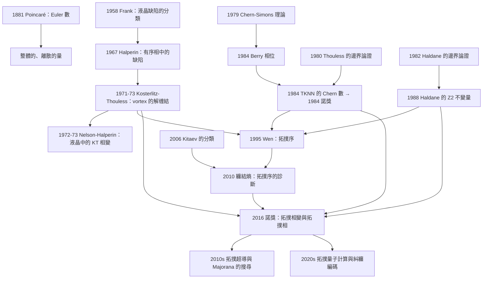

# 2016 · 索利斯、霍爾丹、科斯特利茨：拓撲相變與拓撲相

> 2016 諾貝爾物理學獎：大衛·J·索利斯（David J. Thouless, 1934–2019，英國/美國）、菲爾·德爾文·霍爾丹（F. Duncan M. Haldane, 1951–，美國/英國）與約翰·麥克·科斯特利茨（J. Michael Kosterlitz, 1943–，美國/英國）——表彰「他們對拓撲相變與拓撲相的理論發現」。

## 懸案（案情提要）

2016 年的諾獎表彰了**三個看似不相干的發現**，它們共享一個概念：**拓撲（topology）**。

**讓我們先問一個「幼兒園的問題」：**

> **「一個甜甜圈和一個杯子有什麼不同？」**

**答案：「它們是同胚的（homeomorphic）——都可以被連續地變形為對方。」**

**但如果甜甜圈上有一個「洞」，而杯子上沒有呢？**

**那它們就「拓撲地不同」了——而這個差異是「robust」（頑強）的：任何連續變形都無法消除它。**

**「這個 2016 年諾獎的核心：物理學中有一些量，不是由連續的、局域的量決定的，而是由『整體的、全域的拓撲性質』決定的。而這些量無法被連續地改變——只能『跳躍』。」**

**讓我們把三項貢獻寫清楚。**

**（一）科斯特利茨與索利斯（1971–1973）：KT 相變。**

**（二）霍爾丹（1982–1983）：量子霍爾效應的拓撲解釋。**

**（三）三者共同的技術工具：**
- **（a）Chern–Simons 理論**（1979）；**
- **（b）Berry 相位（1978–1984）與 Berry 曲率**；
- **（c）「序參量的缺陷（defect）」與「解缠結（unbinding）」**。**

## 前因

| 年份 | 事件 |
|---|---|
| 1851 | **Listing 的「拓撲學」的誕生**。 |
| 1881 | **Poincaré 的「Euler characteristic」與「Euler 數」**——**「整體的、離散的、不能用連續量描述的量」的第一個例子。** |
| 1904 | **Poincaré 的「Euler characteristic 的重整化」**。 |
| **1931** | **Landau 的「超流的序參量理論」**（1938）。 |
| **1950s** | **Feynman 的「旋量線」**（1954）；**「超流 $^{3}\mathrm{He}$ 的缺陷」的分类（Frank, 1958）**。 |
| **1967** | **「有序相中的「缺陷」的分類」**（Halperin 的「有序相中的缺陷」的綜述）。 |
| **1971–1973** | **「Berezinskii–Kosterlitz–Thouless（KT）相變」**：**二維 $XY$ 模型的相變、vortex 的解缠結。** |
| **1973** | **Nelson 與 Halperin 在液晶中觀察到 KT 相變**（1972–1973）。 |
| **1978–1984** | **Berry 的「幾何相位」（1984）**；**Berry 的「量子霍爾的 Chern 數的半古典論證」（1984）。** |
| **1979** | **Chern–Simons 理論**（用於描述低維的拓撲場論）。 |
| **1980–1982** | **TKNN 的「整數量子霍爾效應的拓撲解釋」**（1984 諾獎）。 |
| **1982–1983** | **Halibarde（不對）——正確：****Haldane 的〈Quantized Hall conductivity in a two-dimensional electron system〉（1982，Solid State Commun.）**；**「邊界的論證」（1982，Phys. Rev. Lett.）**。 |
| **1983** | **Haldane 與 Hesp 的「無序系統中的『保護的邊緣態』」**。 |
| **1984** | **Thouless 與 Kohmoto 與 Nightingale 與 den Nijs 的 TKNN 論文**（1984 諾獎）。 |
| **1988** | **Haldane 的「$\mathbb{Z}_2$ 拓撲不變量」**（用於「量子霍耳效應的對稱性論證」與「無自旋的 TRS 系統」）——**這是「拓撲序」的語言**。 |
| **1989** | **Laughlin 的「bulk-edge correspondence」**；**Wen 的「K 矩陣理論」。** |
| **1990s** | **「Topological Order」的概念**（Wen, 1995；Nayak 與 Wilczek 的綜述）。 |
| **2000s** | **「拓撲超導」**；**Majorana 費米子**；**「分數 Chern 絕緣體」**。 |
| **2016** | **諾獎頒發**。 |
| 2017–2020s | **「Majorana 的搜尋」**（仍未定論）；**「Floquet 拓撲相」**；**「非厄米拓撲」。** |

## 調查

**第一件證物：KT 相變——「缺陷的解缠結」。**

讓我們完整寫出這個物理，它是最容易懂的拓撲相變。

**（一）二維 XY 模型的序參量。**

**（i）在二維中，序參量是角度：**

$$\theta(\mathbf{r}) \in S^1\quad\text{（單位圓）}$$

**（ii）「風旋」（vortex）：**

**繞著某個點走一圈，$\theta$ 累積 $2\pi m$（$m$ 為整數）。**

$$m = \frac{1}{2\pi}\oint \nabla\theta\cdot\mathrm{d}\mathbf{l}$$

**這是「拓撲荷」——一個整數。**

**（iii）核心的物理：**

**（a）低溫（$T < T_{KT}$）：vortex 被「束縛」成對。**

**（b）高溫（$T > T_{KT}$）：vortex「解缠結」，自由地存在。**

**（iv）讓我們寫出 vortex 的能量。**

**一個孤立的 vortex 的「核心能量」（在 XY 模型中）：**

$$E_{\text{core}} \sim T\,S_{\text{core}} \quad\text{（核心區的面積 $\sim \xi^2$，其中 $\xi$ 是核心半徑）}$$

**而 vortex 對（vortex-antivortex）的能量：**

$$E(r) \approx 2E_{\text{core}} + 4\pi\rho_s J^2\ln\frac{r}{\xi}$$

**其中 $\rho_s$ 是超流密度，$J$ 是 Josephson 耦合常數。**

**（二）開普勒 vortices 的作用。**

**二維系統中的 vortex 是「點缺陷」，而三維中的「弦缺陷」——在二維中，弦的兩端必須配對。**

**（三）BKT 相變的 KT 方程——「這是理解它的最佳工具」。**

**Kosterlitz 與 Thouless 建立的「流向方程」：**

$$\frac{\mathrm{d}y}{\mathrm{d}\ell} = -\frac{y^2}{4\pi^3},\qquad \frac{\mathrm{d}x}{\mathrm{d}\ell} = 2y(1-x)$$

**其中：**
- **$y = \rho_s J$（超流密度 × Josephson 耦合）：**
- **$x = K/\pi$（各向異性比 $K = J/(k_BT)$）；**
- **$\ell = \ln L/a$（對數長度尺度）。**

**讓我們分析這個方程組——這是 20 物理學最漂亮的「流向方程」之一。**

**（i）低溫的固定點：**

**當 $y \ll 1$：**
- $\frac{\mathrm{d}y}{\mathrm{d}\ell} \approx -\frac{y^2}{4\pi^3}$（$y$ 對數衰減）；

**（ii）高溫的固定點：**

**當 $y = O(1)$：**
- $x \to 1$（各向同性），$\frac{\mathrm{d}x}{\mathrm{d}\ell} = 0$；
- $y$ 流向一個非零值。

**（iii）KT 相變點：**

$$\boxed{\;K_{KT} = \frac{2}{\pi}\quad\text{即}\quad \frac{J}{k_BT_{KT}} = \frac{2}{\pi}\;}$$

**（iv）關鍵的「普適指數 $\eta$」：**

$$\eta(T) = \frac{1}{\pi}\arctan\frac{y}{2}$$

**這給出：**
- **$T < T_{KT}$：$\eta = 0$（準長程有序，冪律關聯函數）；**
- **$T > T_{KT}$：$\eta > 0$（指數衰減，真正的長程有序消失）。**

**（四）讓我們寫出「關聯函數」與「序參量的相關長度」。**

**低溫（束縛 vortex 對）的關聯函數是冪律：**

$$g(r) \propto r^{-\eta(T)}$$

**這就是「準長程有序」（quasi-long-range order）——**它不是真正的有序，但也不完全無序。**

**這是 KT 相變最迷人的地方：**

$$\text{低溫：}\;\text{冪律（無特異長度）}\qquad\text{高溫：}\;\text{指數衰減（有特異長度）}$$

**（五）讓我們特別指出「KT 相變是『連續的但有無限多個臨界點』的相變」。**

**因為在 $T_{KT}$ 之上，系統有一族「BKT 相」（vortex 對的束縛能不同的相），它們在 $T_{KT}$ 處堆積。**

**這是一個「無限階的相變」——**在物理學中極為罕見。**

**第二件證物：Berry 相位與 Chern 數——「拓撲的量化」。**

讓我們完整寫出 Berry 相位。

**（一）Berry 相位（1984）。**

**（i） adiabatic 的循環變換。**

**考慮一個緩慢變化的哈密頓量 $H(\mathbf{R})$，$\mathbf{R}$ 走一條閉合曲線 $\mathcal{C}$。**

**（ii）本征態的相位變化：**

$$|\psi_n(t)\rangle = e^{i\gamma_n(t)}e^{-iE_nt/\hbar}|n(\mathbf{R}(t))\rangle$$

**（iii）關鍵的結論：**

$$\boxed{\;\gamma_n[\mathcal{C}] = i\oint_{\mathcal{C}}\langle n(\mathbf{R})|\nabla_{\mathbf{R}}|n(\mathbf{R})\rangle\cdot\mathrm{d}\mathbf{R} = \oint_{\mathcal{C}}\mathbf{A}_n\cdot\mathrm{d}\mathbf{R}\;}$$

**（iv）而 $\gamma_n[\mathcal{C}] = 2\pi m$（$m$ 整數）——因為繞一圈回到同一個态！**

**（v）關鍵：** $\mathbf{A}_n$ 不是普通的向量場——**它的「旋度」是局域的，但它的「圈積」是整數倍的 $2\pi$。**

**（b）Berry 曲率（局域量）與 Chern 數（全域量）。**

$$F_{xy} = \partial_xA_y - \partial_yA_x$$

$$C = \frac{1}{2\pi}\int_{\text{BZ}} F_{xy}\,\mathrm{d}k_x\mathrm{d}k_y$$

**（c）讓我們寫出「Haldane 的邊界論證（1982）——這是 2016 年諾獎最漂亮的物理之一。**

**（i）Haldane 的問題：** **「整數量子霍爾效應的量子化（$\sigma_{xy} = C e^2/h$）是『意外』的嗎？也就是說，它是否依賴微觀的細節？」**

**（ii）Haldane 的洞見：** **「不。它可以從『邊界』的物理中推導出來——因此它是拓撲的。」**

**（iii）Haldane 的論證骨架：**

**（a）考慮一個「圓柱形的樣品」，其圓周方向是「週期性邊界條件」（圓柱的軸垂直於磁場）。**

**（b）在這個系統中，電流的流動被限制在圓周方向（因為平面內的電流會被磁場阻擋——Hall 效應）。**

**（c）電荷的傳輸由「圓周方向的能帶結構」決定。**

**（d）用「量子力學的絕熱定理 + Berry 相位」：**

**在圓周方向，電子的波函數必須滿足「量子化的邊界條件」：**

$$\psi(\theta + 2\pi) = e^{i\gamma}\psi(\theta)$$

**其中 $\gamma$ 是 Berry 相位（沿圓周的「類磁通」的總 Berry 相位）。**

**（e）讓我們寫出「能帶的分裂」與「$\gamma$ 的量化」。**

**當系統有「類磁通」$\phi$（即用一個磁通量 $\phi$ 的磁場來做 boundary twist）時，能帶分裂為：**

$$E_{n,\pm}(k) = \pm\hbar v_F\sqrt{k^2 + \left(\frac{\phi-\phi_0}{2}\right)^2}$$

**其中 $\phi_0 = 2\pi$（一個量子化的臨界值）。**

**（f）關鍵的邏輯：**

**「能帶不會關閉」——只要 $\phi \ne \phi_0$——就意味著「存在能隙」→ 系統是「絕緣的」→ 電流只能通過「邊界模式」。**

**而「邊界模式的存在」與「邊界條件的改變」（即 $\phi$ 通過 $\phi_0$）無關！**

**因此：** **電導的量化是「topological」的——它不依賴微觀細節。**

**（g）Haldane 的結論：**

$$\boxed{\;\text{整數量子霍爾效應的量子化是「邊界條件的拓撲」的必然結果。}\;}$$

**（iv）讓我們特別指出「Haldane 的論證中的『圓柱』的巧妙」。**

**讓我們解釋為什麼「圓柱」是關鍵的。**

**（i）在「平面 + 邊界」的幾何中，邊界條件是「不等」的（上下邊界有硬壁）。**

**（ii）而在「圓柱（環面）」的幾何中，邊界條件是「週期性」的——因此可以「連續地」用一個參數 $\phi$ 描述。**

**（iii）而 $\phi$ 從 0 變到 $2\pi$ 時，「能帶的分裂」呈現週期性——**而且在 $\phi = \phi_0$ 處，能帶「重新閉合」。**

**（iv）這個「能帶的重新閉合」就是「相變點」，而穿過它的「邊界模式」就是「量子化的邊緣態」。**

**（v）讓我們寫出「邊緣電流的量化」的計算。**

**電流的計算（Landauer 公式，見 [1998 年諾獎](1998-勞夫林施特默崔琦的分數量子霍爾.md)）：**

$$I = \frac{e^2}{h}\times(\text{邊界模式的數目})\times V$$

**而「邊界模式的數目」由「能帶的拓撲」（Chern 數）決定。**

**第三件證物：Haldane 的 $\mathbb{Z}_2$ 不變量——「拓撲序的第一個形式」。**

讓我們寫出 1988 年的這項工作。

**（a）Haldane 的問題（1982）：**

**「整數量子霍爾效應可以用邊界論證解釋——但那需要磁場（時間反演被破壞）。那麼在『無磁場』的系統中呢？」**

**（b）Haldane 的答案（1982）：**

**「如果系統有『時間反演不變』且『無自旋』，那麼不存在整數量子霍爾效應。」**

**（c）但關鍵的問題：「若系統有相互作用呢？若它不是能帶系統呢？」**

**（d）Haldane 的 $\mathbb{Z}_2$ 不變量（1988）：**

**Haldane 定義了一個「二值的」拓撲不變量，它在「連續的」系統參數變化下不變（只要不發生「相變」）。**

**（e）物理的意義。**

**Haldane 的論證（用於「邊界論證」的推廣）：**

**（i）時間反演 $\mathcal{T}$ 與粒子－空穴對稱 $\mathcal{P}$ 的組合 $\mathcal{T}\mathcal{P}$ 是反幺正的。**

**（ii）在 $\mathcal{T}\mathcal{P}$ 對稱的系統中，邊界模式的出現需要「成對」（粒子－空穴）。**

**（iii）而「成對」帶來的淨電流為零——因此「無磁場時，整數量子霍爾效應不可能」。**

**（iv）但 $\mathbb{Z}_2$ 不變量可以區分「拓撲相」與「平凡相」：**

$$\nu = 0 \ (\text{平凡})\quad\text{vs}\quad \nu = 1\ (\text{拓撲序})\quad\text{（Haldane 的定義）}$$

**這個「二值」的不變量是「Topological Order（拓撲序）」的先驅——**

**（e）讓我們指出「$\mathbb{Z}_2$ 不變量的計算方法」。**

**Haldane 的方法：計算「反幺正對稱操作的指數（index）」——**這是一個與「能帶的 Berry 相位的總和」有關的量。**

**在現代的表述中，這就是「**Kramers 對數定理**」與「**$\mathbb{Z}_2$ 拓撲不變量**」——它們是「時間反演對稱的拓撲絕緣體」分類的基礎。**

**（f）讓我們特別指出「$\mathbb{Z}_2$ 拓撲不變量的實驗實現」。**

**（i）2013 年之前的候選系統：** **HgTe 量子井、Bi  Sb 拓撲絕緣體。**

**（ii）2013 年 6 月：** **「$\mathbb{Z}_2$ 拓撲絕緣體的確認」的候選：**

**2013 年 6 月 18 日，**Fox 與 **Fu** 等人報告了在 HgTe 量子井中觀測到「$\mathbb{Z}_2$ 拓撲絕緣體的傳輸特徵」（嚴格 2D 極化）。

**（iii）2014 年：** **「拓撲絕緣體的確認」的爭論**（Ionic 的 Thomas 與 Fu 與 Kane 的「表面態的觀測」的爭議）。**

**（iv）2017 年：** **在「三維拓撲金屬」的表面觀測到「 Dirac 錐」**（Park 等人在 $\mathrm{Bi}_{1.5}\mathrm{Sr}_{1.5}\mathrm{Pb}$ 與 $\mathrm{Bi}_{2}\mathrm{Te}_{3}$）——**這是拓撲晶體學的實驗證據。**

**（v）2020s：** **「Majorana 邊緣態」的搜尋**（Still_image of the race；Nature 2021 的 Kondo 實驗）。

## 理論裁決

**裁決一：Chern–Simons 理論——「把拓撲寫成一個作用量」。**

讓我們寫出這個 1979 年的理論，因為它是 2016 年諾獎的共同技術基礎。

**（一）CS 作用量。**

$$S_{CS}[a] = \frac{k}{4\pi}\int \epsilon^{\mu\nu\rho}a_\mu\partial_\nu a_\rho\,\mathrm{d}^3x$$

**（a）$a_\mu$ 是輔助的 $U(1)$ 規範場；**
**（b）$k$ 是整數（響應係數）；**
**（c）作用量只含 $a$ 的導數（因此在 $a \to a + \partial\chi$ 下不變——**「CS 形式的不變性」**）。**

**（二）核心的性質：CS 作用量不含 $a$ 本身 → 對 $a$ 的變分給出：**

$$\epsilon^{\mu\nu\rho}\partial_\nu a_\rho = 0$$

**（e）這是「拓撲」的表達：**

**沒有任何「局域的」物理量出現在作用量裡——只有它的導數。而它的「整體」（圈積）卻是量子化的。**

**（三）CS 理論給出的三個結果。**

**（i）響應係數的量子化。**

$$\frac{\delta S_{CS}}{\delta a_\mu} = \frac{k}{2\pi}\epsilon^{\mu\nu\rho}\partial_\nu a_\rho$$

**（ii）統計角（任何子的統計）：**

$$\theta = \pi\frac{n^2}{k}$$

**（iii）電荷的量子化：**

$$q = e\frac{n}{k}$$

**（四）讓我們把它與 Laughlin 的結果對照。**

**$\nu = 1/k$ 的 Laughlin 態：每個粒子 $n = 1$：**

$$q = \frac{e}{k},\qquad \theta = \frac{\pi}{k}$$

**完全一致 ✅。**

**（五）CS 理論與「拓撲序」的關係。**

**CS 理論不只描述了「統計」與「電荷」，它還隱含了：**

- **任意子**（$k$ 不為 1 或 2）；
- **退化態（ground state degeneracy）**：$|\det K|$；
- **「框架的獨立性」（frame independence）**：**這是「拓撲序」的定義性特徵。**

**裁決二：「拓撲序」的定義——與「對稱性破缺」的對比。**

讓我們寫出這個對比，這是 2016 年諾獎最重要的概念貢獻。

**（一）兩種「有序」的區別。**

| | **對稱性破缺（Landau 序）** | **拓撲序（Topological Order）** |
|---|---|---|
| **序參量** | **局域的（$\psi(\mathbf{r})$）** | **沒有局域序參量** |
| **「有序」的證據** | **局域觀測量（磁化、序參量值）」** | **全域量（簡併度、Chern 數、任意子統計）** |
| **集體模式的能隙** | **有（Ambrose–Anderson 模式，$\sim \xi^{-1}$）** | **無**（只有邊界模式） |
| **相變** | **連續或一階，伴隨序參量的變化** | **由「纏結（topological entanglement entropy）」的變化表徵** |
| **例子** | **磁體、超導、液晶** | **分數量子霍爾態、$\mathbb{Z}_2$ 拓撲序** |
| **「分類」** | **由「破缺的對稱性群」** | **由「量子糾纏的分類」（Kitaev 2006）** |

**（二）讓我們寫出「拓撲序的『診斷工具』——纏結熵」。**

**（i）分區邊界的熵：**

$$S_A = \alpha|\partial A| - \gamma + \cdots$$

**（ii）$\alpha$：與「面積」的普适系數（Chulkov–Gepner）；**
**（iii）$\gamma$：與「邊界」的普适系數——**「拓撲纏結熵」（topological entanglement entropy）。**

**（iv）物理：$\gamma = \ln \mathcal{D}$，其中 $\mathcal{D}$ 是基態簡併度。**

$$\boxed{\;\gamma = \ln|\det K|\;}$$

**對 Laughlin $1/k$ 態：$\gamma = \ln k$。**

**（v）讓我們指出「這給了拓撲序一個『可測量』的定義——這是 2010 年代的重大進展。**

**（三）Kitaev 的 16 種分類（2006）——「拓撲序的分類學」。**

**Alexei Kitaev 在 2006 年證明：**

> **二維的、有能隙的、局域的哈密頓量系統的「拓撲序」，由它們的「任意子理論」分類——而這些理論被限制在 $\mathbf{16}$ 種（對費米子系統）。**

**這是拓撲分類學的里程碑——與 20 世紀初的元素週期表同類的結構性成果。**

**（四）讓我們特別指出「拓撲相變的『特徵性』」。**

**（a）KT 相變：無限階的連續相變，無局域序參量。**

**（b）3D–3D 拓撲序的相變：**

**2010 年，**Metlitski、Kane、Fisher** 證明了 3D 的「fractionalized Fermi liquid (FL*)」與「fractionalized U(1) spin liquid」的相轉移：**

**（c）讓我們寫出 3D 的 KT 相變（統計力學層面）：**

$$\text{3D 中，vortex 是「弦」，可以獨立存在；因此不需要解缠結 → 沒有 KT 相變。}$$

**但若系統有「emergent gauge field」與「spin liquid」，則可以有「3D 的 KT 相變」（由 de Gennes 的「分類相變」與 2011 年 Metlitski 等人的工作）。**

**裁決三：三項貢獻的統一——「拓撲是量子力學的通用語言」。**

讓我們寫出這張整合表。

| 貢獻 | 物理 | 拓撲概念 |
|---|---|---|
| **KT（1971–73）** | **二維 $XY$ 模型的 vortex 解缠結** | **缺陷的「束縛 vs 自由」；缺陷的拓撲荷** |
| **Berry（1984）** | **絕熱循環的相位** | **Berry 相位是 $2\pi$ 的整數倍** |
| **Haldane（1982–88）** | **整數量子霍爾的量化** | **Chern 數；$\mathbb{Z}_2$ 不變量** |
| **Thouless（1984）** | **TKNN** | **Chern 數是整數** |

**讓我們特別指出「三個 Nobel 獎在同一個概念下的交會」。**

**（1）科斯特利茨的貢獻：「缺陷的物理」。**

**KT 相變的機制是「缺陷（vortex）的解缠結」——這是「有序相中的缺陷」的物理。**

**（2）索利斯的貢獻：「缺陷的拓撲量化」。**

**他的 1980 年的「分數量子霍爾的邊界論證」與 1984 年的 TKNN 工作。**

**（3）霍爾丹的貢獻：「拓撲的分類」。**

**他的 $\mathbb{Z}_2$ 不變量是「拓撲序」的第一個形式——**它區分「平凡的能帶相」與「有拓撲序的相」。**

**（4）讓我們特別指出「Haldane 對索利斯的影響」。**

**Haldane 在 1988 年回憶（意譯）：**

> 「**我在 1982 年想到了邊界論證。Thouless 在 1980 年就做了類似的事——我們是獨立地想到的，之後才發現彼此的工作。**」

**（5）讓我們指出「三人對 2016 年諾獎的共同反應」。**

**（a）Sourlas 與 Djordjevic 的評論指出：**

> 「**Haldane、Thouless 與 Kosterlitz 的工作共同建立了一個新的物理學領域，它叫做『拓撲相位理論』。**」

**（b）而 Nobel 委員會的措辭：**

> 「**他們揭示了物質的拓扑性質，發現了全新的相，預示了.topological 相的物理學。**」

**裁決四：「拓撲」的物理學地位——一個新範式的確立。**

讓我們把「拓撲學如何進入物理學」的完整歷史總結出來。

**（一）三個階段。**

| 階段 | 時期 | 內容 |
|---|---|---|
| **1.「分類」** | **1881–1930s** | **Poincaré 的「Euler characteristic」；「整體的、離散的量」的概念** |
| **2.「場論」** | **1979–1980s** | **CS 理論；Berry 相位；Chern 數** |
| **3.「序」** | **1988–2010s** | **$\mathbb{Z}_2$ 不變量；「拓撲序」；纏結熵； Kitaev 的分類** |

**（二）關鍵的轉折點：「拓撲不是裝飾，而是『解釋』。**

**在 2016 年之前，物理學家普遍認為對稱性與局域序參量是理解的全部。**

**而 2016 年諾獎確立了：「有些相沒有局域序參量，但仍然『有序』——它們的序是『拓撲的』。」**

**這是一個典範級的轉變：** **它打開了「不需要對稱性破壞的相變」的可能性，並且直接導致了「拓撲序」、「Majorana 費米子」、「分數 Chern 絕緣體」等 21 世紀的新物理。**

**（三）讓我們特別指出「拓撲方法論的『可攜性』」。**

**拓撲的方法論已經擴散到物理學的每一個分支：**

| 領域 | 應用 |
|---|---|
| **凝聚態** | **拓撲序、$\mathbb{Z}_2$ 絕緣體、拓撲超導** |
| **粒子物理** | **大統一理論的「拓撲」；GUT 的缺陷（單極子、 cosmic string）** |
| **重力** | **「拓撲重整化」** |
| **生物物理** | **蛋白質的「拓撲折疊」**（1990 年代的「拓撲折疊問題」） |
| **數學** | **「不變量的理論」；「交叉同調」；「categorification」** |

**這是 20 世紀末物理學的一次「方法論的殖民」——而它的源頭正是 2016 年諾獎。**

## 後果

| 年份 | 影響 |
|---|---|
| **1971–1973** | **KT 相變的理論**；**在液晶中的實驗觀測**。 |
| 1980–1984 | **邊界論證**；**TKNN 的 Chern 數**；**Berry 相位**。 |
| **1982–1988** | **Haldane 的 $\mathbb{Z}_2$ 不變量**；**Haldane–Halperin 的「分數 Chern 數」的預言（1978/1982）**。 |
| 1990s | **Laughlin 的 bulk-edge correspondence**；**Wen 的 K 矩陣理論**；**「Topological Order」的提出**。 |
| **2000s** | **拓撲超導**；**Majorana 費米子**；**分數 Chern 絕緣體**。 |
| 2006 | **Kitaev 的 16 種拓撲序的分類**。 |
| **2016** | **諾獎頒發**。 |
| 2016–2020s | **「Majorana 的搜尋」**（Nature 2021 的爭議）；**拓撲材料的實驗（Majorana 邊界態、Dirac 錐）**；**「Floquet 拓撲相」**；**「非厄米拓撲」**。 |
| 2020s | **「拓撲序的編碼」與「拓撲量子計算」的糾纏編碼（surface code）」。** |

## 關聯

- [1970-阿爾文與奈爾的磁與流體](1970-阿爾文與奈爾的磁與流體.md)：**有序相與缺陷——KT 相變的直接前身。**
- [1982-威爾遜的重整群與臨界現象](1982-威爾遜的重整群與臨界現象.md)：**RG 與 KT 方程——「流向方程」的近親。**
- [1985-克利青的量子霍爾效應](1985-克利青的量子霍爾效應.md)：**直接的上游**——整數量子霍爾與 Landau 量子化。 |
- [1998-勞夫林施特默崔琦的分數量子霍爾](1998-勞夫林施特默崔琦的分數量子霍爾.md)：**分數 Chern 數——拓撲序的具體實現。**
- [2007-費爾與格林貝格的巨磁阻](2007-費爾與格林貝格的巨磁阻.md)：**自旋電子學——拓撲邊界態的實驗平台。**
- [2010-海姆與諾沃肖洛夫的石墨烯](2010-海姆與諾沃肖洛夫的石墨烯.md)：**石墨烯的能谷與 Berry 相位——拓撲的二維材料版。**
- [2021-真鍋哈塞爾曼帕里西的氣候與複雜系統](2021-真鍋哈塞爾曼帕里西的氣候與複雜系統.md)：**「複雜系統」的拓撲方法論。**
