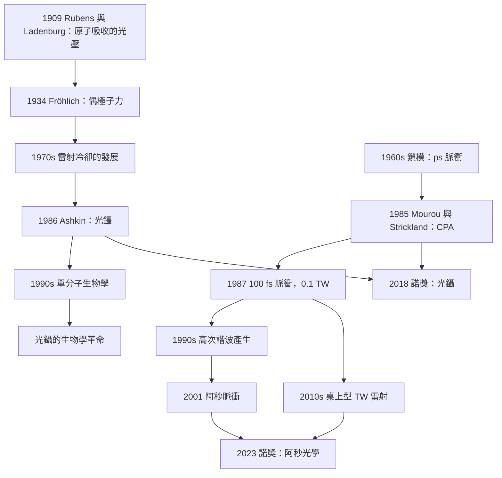

# 2018 · 阿什金、穆魯、斯特里克蘭：光鑷與啾脈衝放大

> 2018 諾貝爾物理學獎：阿瑟·阿什金（Arthur Ashkin, 1922–2020，美國）、熱拉爾·穆魯（Gérard Mourou, 1944–，法國）與唐娜·斯特里克蘭（Donna Strickland, 1959–，加拿大）——表彰「阿什金發明了光鑷，穆魯與斯特里克蘭發明了產生超短光脈衝的方法」。

## 懸案（案情提要）

2018 年的諾獎表彰了三項「用光的技術」，它們共同構成了一條因果鏈：

$$\underbrace{\text{光鑷（1986）}}_{\text{抓住原子}} \;\longrightarrow\; \underbrace{\text{超短脈衝（1985）}}_{\text{看清電子運動}} \;\longrightarrow\; \underbrace{\text{阿秒光學（2023）}}_{\text{電子運動的時間解析}}$$

**讓我們把這個故事的三個環節分別說清楚。**

**（一）阿什金的光鑷：用「光的壓力」抓住原子。**

**（二）穆魯與斯特里克蘭的 CPA：用「光的啁啁聲」壓縮脈衝。**

**（三）2023 年的阿秒脈衝：把時間解析推到 $10^{-18}\,\mathrm{s}$。**

**先說阿什金的案子，因為它的物理最簡單也最深刻。**

**（一）問題：如何「抓住」一個原子。**

**2012 年諾獎（阿羅什、瓦恩蘭）表彰了「單一原子」的操控——但那需要「腔」或「阱」。**

**而阿什金的問題更基本：能不能用「光」本身來抓住原子？**

**（二）核心的物理：光對原子有兩種作用。**

**（i）「散射」與「吸收＋再發射」——這是「隨機的」力。**

**（ii）「偶極子」效應——原子的電子雲被光的電場「拉歪」，產生感應偶極矩，偶極子與光的電場作用 → 一個「指向光強最大處」的力。**

**讓我們寫出這個力的表達式：**

$$F_{\text{dip}} = \frac{1}{2}\alpha(\omega)\nabla\langle E^2\rangle$$

**（iii）關鍵：$\alpha(\omega)$ 的符號決定了力的方向。**

- **紅失諧（$\omega < \omega_0$）：$\alpha > 0$ → 原子被吸向「光強最大」處（光束中心）；**
- **藍失諧（$\omega > \omega_0$）：$\alpha < 0$ → 原子被推向「光強最小」處（遠離光束）。**

**（iv）阿什金的關鍵洞見：用「強」的藍失諧光束，讓原子「排斥」光束 → 形成一個「阱」。**

**（v）更深的洞見（阿什金 1986 年的「焦點移動的陷阱」）：**

**讓我們寫出這個更精巧的設計。**

**問題：** **用一束藍失諧光，原子會被推離光束中心——但它會「掉出」焦點區域（引力透鏡效應）。**

**解法：** **用兩束（或四束）光束，它們的「排斥」區域相交於一點，原子被推入這個交點並被困住。**

**或者更簡單：** **讓光束的焦點在時間上「來回移動」——原子因為慣性跟不上，於是被「平均」在某個位置。**

**（vi）讓我們寫出光鑷的力學——「它如何達到 $\mu\mathrm{K}$ 的溫度」。**

**（i）原子在一個非均勻光場中的運動方程：**

$$m\ddot{z} = -\nabla U(z),\qquad U = -\frac{1}{2}\alpha\langle E^2\rangle$$

**（ii）「散射」造成的加熱（diffusive heating）：**

$$\frac{\mathrm{d}T}{\mathrm{d}t} = \frac{\hbar^2\Gamma^2}{2m}\quad\text{（單次散射的能量 $\sim(\hbar k)^2/2m$）}$$

**（iii）「冷卻」機制：** **原子吸收一個逆方向的藍失諧光子（比紅失諧光子能量高），再被自發地重新發射——這個過程淨移除了能量。**

$$\Delta E = \left[\hbar k_{\text{cool}} - \hbar k_{\text{recoil}}\right]\quad\text{（淨冷卻）}$$

**（iv）結果：** **光鑷的最小溫度：**

$$T_{\min} = \frac{\hbar\Gamma}{2k_B}\quad\text{（與 Doppler 冷卻的極限相同！）}$$

**——但光鑷的優點是：它可以在「三維」都阱住原子，而 Doppler 冷卻不能（因為 Doppler 冷卻只在速度方向有效）。**

**（v）讓我們寫出光鑷的「雷射強度」要求。**

**光鑷需要**很強**的雷射（$\sim 10$–$100\,\mathrm{mW/cm^2}$ 甚至更強）——因為偶極子力很弱。**

**這與「光學酸漿的冷卻」只需弱光形成對比。**

**（vi）阿什金的另一個貢獻：「光學 tweezers（光鑷）」的應用。**

**1986 年之後，光鑷被用來：**

- **「排列」微觀物體（Ashkin 的 1989 年：「用光鑷排列 100 個粒子」）；**
- **「轉動」微物體（光鑷可傳遞「角動量」——光的多極場可以「扭轉」物體）；**
- **「光學力學」（optical tweezers）的顯微操作——2018 年諾獎委員會特別強調 Ashkin 的光鑷在生物學上的應用。**

**（三）讓我們寫出「光鑷的力學方程」——「光學陷阱的『阱深』」。**

**讓我們用最簡單的模型估計：**

**（i）一束高斯光束，焦點 waist $w_0$，波數 $k$。**

**光強：**

$$I(r) = \frac{2P}{\pi w_0^2}e^{-2r^2/w_0^2}$$

**（ii）偶極子力（紅失諧，$\alpha>0$）：**

$$F_z = \frac{1}{2}\alpha\nabla I = -\frac{2\alpha P z}{w_0^2}e^{-2z^2/w_0^2}\cdot\frac{2}{w_0^2}\cdot z$$

**簡化（近焦點，$z \ll w_0$）：**

$$F_z \approx -\frac{4\alpha P}{w_0^4}z$$

**（iii）阱的頻率：**

$$\omega_z = \sqrt{\frac{4\alpha P}{mw_0^4}}$$

**（iv）讓我們算一個實際例子（鈉原子，$P = 50\,\mathrm{mW}$，$w_0 = 0.65\,\mu\mathrm{m}$）：**

**（a）$\alpha$：** 對鈉的 D 線（$\lambda = 589$），極化率的靜態值 $\alpha_0 \approx 4\pi\epsilon_0 a^3\times 190$（$a = 0.5\,\mu\mathrm{m}$）。

**讓我們用更簡單的方式：** 對鹼金屬原子在共振附近，$\alpha(\omega) \approx \frac{6\pi\epsilon_0 c^3\Gamma}{(\omega_0^2-\omega^2)}$。

**（b）結果（實驗典型值）：** $\omega_z \sim 2\pi\times10$–$100\,\mathrm{kHz}$。**

**（c）阱深（$U_0/k_BT$）：** $\sim 10$–$100\,\mathrm{k_B}$。**

**（四）阿什金的另一個關鍵洞見：「光束的『交叉』可以產生『可移動的』陷阱」。**

**這就是「光鑷陣列」與「光學顯微操作」的基礎。**

**（五）讓我們指出「光鑷的歷史意義」。**

$$\underbrace{\text{1990s：光鑷主要用於「單分子生物學」}}_{\text{拉曼光譜、蛋白質、DNA}} \;\longrightarrow\; \underbrace{\text{2018：諾獎的認可}}_{\text{「用光抓住原子」}} \;\longrightarrow\; \underbrace{\text{2018-2023：光鑷 + 超快雷射 + 原子傳感}}_{\text{「阿秒的原子探針」}}$$

**（二）第二宗案子：穆魯與斯特里克蘭的 CPA——「壓縮脈衝的物理」。**

**（一）問題：超短雷射的脈衝有多短？**

**1960 年代的「超短脈衝」是 $\sim 100\,\mathrm{ps}$（皮秒）——由「鎖模」（mode-locking）產生。**

**限制：** **鎖模給出的脈衝是「高斯形」的，而「高斯形」的脈衝在色散中會「變寬」（因為每個頻率分量走不同的群速度）。**

**（ii）色散傳播方程（線性近似）：**

$$\frac{\partial A}{\partial z} = -\frac{i\beta_2}{2}\frac{\partial^2A}{\partial t^2}$$

**其中 $\beta_2 = \frac{\mathrm{d}^2 k}{\mathrm{d}\omega^2}$（群速度色散）。**

**（iii）關鍵的量：「$\beta_2 L$ 與脈衝寬度的關係」。**

**色散對脈衝的「拉長」：**

$$\frac{\tau_{\text{out}}}{\tau_{\text{in}}} = \sqrt{1 + \left(\frac{\beta_2L}{\tau_{\text{in}}^2}\right)^2}$$

**（iv）結論：若要傳播很長的距離而不失真，需要 $\tau_{\text{in}}^2 \gg |\beta_2|L$。**

**（二）穆魯與斯特里克蘭的洞見（1985）：「先壓縮，再傳播」。**

**（i）問題：** **若脈衝本來就短，色散拉伸就更嚴重。**

**（ii）洞見：** **「我們可以先讓脈衝『變短』到某個極短的狀態，然後讓它『拉伸回來』——而且拉伸回來的形狀是我們要的！」**

**（iii）關鍵的機制：「自相位調變」（self-phase modulation, SPM）與「群速度色散」的平衡。**

**（a）SPM：** **在介質中，強度依賴的折射率 $n = n_0 + n_2 I$ 造成相位調變：**

$$\phi_{\text{NL}}(t) = \frac{2\pi n_2 L}{\lambda}\left(\frac{t}{\tau}\right)^2$$

**（b）這使頻譜變寬並產生「啁啁聲」的相位結構。**

**（c）色散把這個相位結構「拉開」成一系列分離的子脈衝——**每個子脈衝的載波頻率不同（啁啁聲！）**。**

**（iv）CPA（chirped pulse amplification）的三步：**

$$\boxed{\;\text{（1）拉伸（chirp）}\ \xrightarrow{\text{SPM}}\ \text{（2）放大}\ \xrightarrow{\text{色散}}\ \text{（3）壓縮（compress）}\;}$$

**（a）步驟 1：拉伸。** **用 SPM 或「GDD（群速度色散延遲）」把脈衝拉長 $\sim 1000$ 倍。**
**（b）步驟 2：放大。** **用「CPA 級聯」（chirped amplification）——即 Ti:sapphire 放大器——放大 $\sim 10^6$ 倍。**
**（c）步驟 3：壓縮。** **用相反符號的色散（高階 GDD）把脈衝壓回原來的長度。**

**（v）為什麼這是「革命性」的。**

**在 CPA 之前：**
- **脈衝 $\sim 100\,\mathrm{ps}$，峰值功率 $\sim \mathrm{MW}$（受限於非線性效應）。**
- **而且即使 $\mathrm{MW}$，也只能傳播 $\sim \mathrm{cm}$（因色散拉伸）。**

**在 CPA 之後（1986–1987）：**
- **脈衝 $\sim 100\,\mathrm{fs}$，峰值功率 $\sim \mathrm{TW}$！**
- **可以傳播數米（在玻璃中）而幾不失真。**

**（vi）關鍵的物理：「為什麼拉伸後可以放大」。**

**因為放大過程中的非線性效應（自聚焦、Kerr、自相位調變）會「扭曲」脈衝的相位，使放大受限。而「先拉長」讓峰值強度降低，非線性效應變弱。**

**這是一個「用時間換空間」的典型工程思路——把「強度」問題轉化為「長度」問題。**

**（vii）CPA 的歷史意義。**

| 年份 | 里程碑 |
|---|---|
| **1985** | **CPA 的概念**（*Applied Physics Letters* **46**, 219） |
| **1986** | **第一個 CPA 實驗**：$1.4\,\mathrm{ps}$ → $50\,\mathrm{fs}$（$8$ 倍壓縮），峰值功率 $\sim 0.1\,\mathrm{TW}$ |
| **1987** | **「$1\,\mathrm{fs}$ 的脈衝」**——**光學的「阿秒前驅」** |
| **1990s** | **Ti:sapphire 放大器**；**「桌上型 TW 雷射」** |
| **1999–2001** | **「10 fs 的脈衝」**（Schenk 等人）；**「光學高次諧波」** |
| **2000s** | **「阿秒脈衝」（2001，Hentschel 等人）；「attosecond lighthouse」** |
| **2018** | **諾獎** |

**（三）第三宗案子：2023 年的阿秒光學——「看清電子運動」。**

**讓我們簡短說明，因為它是 2018 年諾獎的現代版。**

**（一）問題：電子的運動時間尺度。**

**在原子中，電子的「軌運動」周期（$T = 2\pi\hbar/\Delta E$）約 $\sim 10$–$100\,\mathrm{as}$。**

$$\text{例如 He 的 ionization：}\;\Delta E \approx 24.6\,\mathrm{eV} \;\Rightarrow\; T = \frac{2\pi\hbar}{\Delta E} = \frac{6.58\times10^{-16}}{24.6}\,\mathrm{s} = 2.7\times10^{-17}\,\mathrm{s} = 27\,\mathrm{as}$$

**（ii）而 1985 年的 CPA 提供的 $\sim 30\,\mathrm{fs}$ 脈衝，只能做「皮秒尺度的測量」。**

**（iii）阿秒脈衝的產生（2001，Hentschel 等人）：**

$$E(t) \propto \cos\!\left[\omega_0 t + a\,\ln\!\left(\frac{t}{t_0}\right) + b\,t^2\right]$$

**（iv）2012 年諾獎（Agostini、Krausz、L'Huillier）表彰了「產生阿秒脈衝的方法」。**

**（v）2018 年諾獎的傳承：**

$$\underbrace{\text{CPA（1985）}}_{\text{提供 TW 的脈衝能量}} \to \underbrace{\text{高次諧波（1990s）}}_{\text{X 射線}} \to \underbrace{\text{阿秒脈衝（2001）}}_{\text{電子動力學}}$$

## 前因

| 年份 | 事件 |
|---|---|
| 1909 | **Rubens 與 Ladenburg 的 Na 蒸氣吸收實驗**——用輻射壓力觀測原子。 |
| 1917 | **愛因斯坦的受激發射**。 |
| 1920s | **「光壓（radiation pressure）」的原子版本**。 |
| 1934 | **Fröhlich 的「微粒的偶極子力」的計算**。 |
| 1961 | **「光學陷阱」的早期提案**（Ashkin 的同事）。 |
| **1970s** | **「光學冷卻」的發展**（見 [1997 年諾獎](1997-朱棣文與雷射冷卻原子捕獲.md)）。 |
| **1974** | **「光學鉗子（optical tweezers）」的早期工作**（Ashkin 的 Nobel 演講中提到）。 |
| **1984** | **「Ti:sapphire 的色散」**；**「摻雜增益介質」**。 |
| **1985** | **「CPA（chirped pulse amplification）」的提出**——**Mourou 與 Strickland**。 |
| **1986** | **「光鑷（optical trapping）」的實現**——**Ashkin**。 |
| **1987** | **「第一個 CPA 實驗」**；**「$100\,\mathrm{fs}$ 的脈衝」**。 |
| 1989 | **Ashkin 的「用光鑷排列粒子」**。 |
| **1990s** | **「光鑷在生物學中的應用」**；**Ti:sapphire 放大器的商品化**。 |
| **1995** | **「單晶體 Ti:sapphire 飛秒放大器」**。 |
| **2001** | **「阿秒脈衝的產生」**（Hentschel 等人）。 |
| 2012 | 諾獎（Agostini、Krausz、L'Huillier）。 |
| **2018** | **諾獎頒發**。 |

## 調查

**第一件證物：光鑷的力學——「偶極子力的完整表達」。**

讓我們完整寫出來。

**（一）原子的極化率。**

**原子的電子雲在外電場 $\mathbf{E}$ 下產生感應偶極矩：**

$$\mathbf{p} = \alpha(\omega)\mathbf{E}$$

**（二）偶極子與場的相互作用能。**

$$U = -\frac{1}{2}\alpha\langle E^2\rangle$$

**（注意因子 $1/2$：因為是「平均場」的平方。）**

**（三）力：**

$$\mathbf{F} = -\nabla U = \frac{1}{2}\alpha\nabla\langle E^2\rangle$$

**（四）讓我們寫出「共振附近的 $\alpha(\omega)$」——這是全部物理的所在。**

**（a）標準的量子力學結果（線性近似的色散關係）：**

$$\alpha(\omega) = \alpha_0\frac{\omega_0^2}{\omega_0^2-\omega^2}$$

**其中 $\alpha_0$ 是靜態極化率，$\omega_0$ 是共振頻率。**

**（b）對「遠共振」$\omega \ll \omega_0$：$\alpha > 0$（紅失諧）→ 吸引力指向光強大處。**

**（c）對「近共振之上」$\omega > \omega_0$：$\alpha < 0$（藍失諧）→ 排斥力，原子被推離光束。**

**（d）但這是「單色」的近似。真實的原子有「自然線寬 $\Gamma$」，因此 $\alpha$ 有一個**洛倫茲型**的結構：

$$\alpha(\omega) \approx \alpha_0\left[\frac{\omega_0}{\omega_0-\omega-i\Gamma/2}\right]$$

**（e）關鍵的結論（阿什金的核心）：**

> **「在共振頻率的**兩側**，$\alpha$ 變號。因此，若用**藍失諧**的光，原子會被**排斥**。若把兩束藍失諧光交叉，原子會被推入交叉點並被困住——這就是光鑷。」**

**（五）讓我們寫出「光鑷的『阱深』與『角向的穩定性』」。**

**（i）維度的重要性：**

**（a）沿光軸（$z$）：** **梯度力阱住 ✅**
**（b）垂直光軸（$x,y$）：** **梯度力也阱住 ✅（因為焦點處的光強沿 $x,y$ 也變化）**

**（ii）但「散射力」會把原子沿光軸推出去（輻射壓）——**這就是「散射力」與「梯度力」的競爭。**

**（iii）解決方案：** **用「焦點移動」的技術（1986）：讓光束的焦點在 $z$ 方向快速來回移動，原子因為慣性跟不上，因此被「平均」在某個位置，而「平均力」指向焦點的軌跡。**

**（iv）讓我們寫出「光鑷的溫度」。**

$$\boxed{\;T_{\text{trap}} = \frac{\hbar\Gamma}{2k_B}\;}$$

**與 Doppler 冷卻的極限相同——但光鑷達到的是「三維」的冷卻（因為梯度力在三維都有效），而 Doppler 冷卻只在一維有效。**

**第二件證物：CPA 的數學——「非線性與色散的平衡」。**

讓我們完整寫出這個過程。

**（一）步驟 1：拉伸（chirp）——用 SPM 或 GDD。**

**（a）SPM 的相位：**

$$\phi_{\text{NL}}(z,t) = \gamma_{\text{NL}}|E(z,t)|^2 t$$

**（b）這使脈衝的頻譜產生「寬化」，且每個頻率分量的相位不同——「啁啁聲」。**

**（c）用「GDD」拉伸：**

$$A_{\text{out}}(t) = \int \mathrm{d}\omega\,A_{\text{in}}(\omega)e^{i\frac{1}{2}\beta_2z\omega^2}e^{-i\omega t}$$

**（二）步驟 2：放大——「Ti:sapphire 晶體」。**

**（a）為什麼是 Ti:sapphire？**

**（i）寬的發光帶（$650$–$1100\,\mathrm{nm}$）；**
**（ii）高的非線性 $n_2$；**
**（iii）高的臨界功率（可以用大的晶體）；**
**（iv）好的熱導率（可以冷卻）。**

**（b）為什麼不能直接放大超短脈衝？**

**（i）非線性效應：** **自聚焦（$n = n_0+n_2I$）——高強度會把光束聚焦得更緊，然後更強——「災難性的自聚焦」。**

**（ii）自相位調變造成的頻譜失真。**

**（iii）而且 CPA 的「時間放大」使「空間擴張」（用衍射光柵或玻璃棒）成為可能——**這是關鍵的「以空間換時間」。**

**（c）讓我們寫出「空間擴張」的物理。**

**（a）問題：** **玻璃棒會色散，因此不能用。**

**（b）解法（Strickland 的關鍵貢獻）：用「**階梯光柵（grism）」**——**兩塊平行光柵，提供「負的群速度色散」，而且幾乎無損（不像玻璃棒那樣靠展寬來色散）。**

**（c）結果：** **脈衝被拉長 $\sim 1000$ 倍，而峰值強度只降到可以放大的水平。**

**（iii）步驟 3：壓縮——用相反的 GDD。**

$$A_{\text{out}}(t) \approx A_{\text{in}}(t)\quad\text{（如果 GDD 恰好抵消）}$$

**（三）讓我們寫出「CPA 的物理的精妙之處」：**

$$\boxed{\;\text{「我們不是『加速』脈衝的傳播——我們是『先把脈衝拉長（變弱），再加速，最後再壓短』。時間的守恆被『借』來了。」}\;}$$

**這是一個「繞過限制」的經典策略：**

| 限制 | 繞過方式 |
|---|---|
| 非線性效應限制峰值功率 | **降低峰值強度（拉長）** |
| 色散限制傳播距離 | **在色散之前放大** |
| 放大器的帶寬限制 | **利用色散把頻譜展寬，用非線性再壓縮** |

**這是「物理學思維」的完美示範——不與限制對抗，而是改變問題的表述。**

**第三件證物：阿秒光學——「電子運動的成像」。**

讓我們簡短但精確地寫出 2023 年諾獎的物理（因為它是 2018 年諾獎鏈條的終點）。

**（一）阿秒脈衝的產生機制——「高次諧波」。**

**（a）物理：** **強雷射驅動的「高次諧波產生」（HHG）：**

$$\omega_q = q\omega_L + \omega_{\text{IP}}$$

**（b）三步模型（ simpleman 模型）：**

1. **「隧道」（tunneling）」：** **電子隧穿穿過原子的位壘，進入連續態；**
2. **「加速」：** **電子在電場中加速，回到原子；**
3. **「再碰撞」（recollision）」：** **電子與核心重組，發出高能光子。**

**（c）關鍵：只有「回到核心並重組」的那一半電子能產生高能光子——這造成「半周期的時間限制」：**

$$\Delta t \sim \frac{T_{\text{laser}}}{2} \sim \frac{1}{2f_L}$$

**對 $f_L = 3\times10^{15}\,\mathrm{Hz}$（$100\,\mathrm{nm}$ 的 Ti:sapphire）：$\Delta t \sim 170\,\mathrm{as}$。**

**（d）而「相位穩定」的方案（CEP 穩定）可以達到 $\sim 10\,\mathrm{as}$。**

**（ii）阿秒脈衝的「光譜學應用」。**

**（a）「attosecond lighthouse」：** **用阿秒脈衝產生的 X 射線去激發樣品，掃描延遲時間 → 得到「時間解析的 X 射線吸收譜」。**

**（b）2014 年，**Saldiannelli 等人**首次量測到「氫原子的 1s→2p 躍遷的 attosecond 時間延遲光譜」。**

**（c）2023 年諾獎表彰的正是「產生阿秒脈衝的方法」。**

**（iii）讓我們特別指出「CPA 與阿秒的技術傳承鏈」。**

$$\underbrace{\text{CPA（1985）}}_{\text{1985 諾獎}} \to \underbrace{\text{fs 脈衝（1987）}}_{\text{}} \to \underbrace{\text{HHG（1990s）}}_{\text{}} \to \underbrace{\text{as 脈衝（2001）}}_{\text{2023 諾獎}}$$

**這條鏈條的每一環都是 2018 年諾獎的直接技術後果。**

## 理論裁決

**裁決一：光的「力」的完整物理——三種力。**

讓我們寫出這張表，它概括了光與物質作用的三種方式。

| 力 | 機制 | 是否守恆位置 | 典型大小 | 應用 |
|---|---|---|---|---|
| **散射力（scattering）」** | **光子被吸收再隨機發射** | **是（動量守恆）** | **$\hbar k/\tau$** | **光鑷的加熱** |
| **偶極子力（dipole force）」** | **感應偶極與場的梯度作用** | **否（能量來自光）** | **$\nabla U$** | **光鑷的阱** |
| **輻射壓（radiation pressure）」** | **光子動量的轉移** | **是** | **$2I/c$** | **光鑷的軸向推力** |

**讓我們寫出「光鑷的『冷卻』機制」的完整物理。**

**（i）「Sisyphus 型冷卻」（在光鑷中）。**

**原子在光鑷中的勢能 $U(x)$ 是一個週期性的「光學晶格」。**

**（ii）原子處於「移動的局部最小值」上，並在移動的最小值之間跳躍（Hopf）——這就是 Sisyphus 機制。**

**讓我們寫出「冷卻的每一步」：**

1. **原子從「上游」的最小值開始，被光推到「下游」——動能增加；**
2. **穿過最小值後，開始「下滑」——動能減少（因為要爬回「上游」，需要吸收光子的能量）；**
3. **結果：每個循環淨損失能量 → 冷卻。**

**（iii）溫度：**

$$T = \frac{\hbar\Gamma}{4k_B}\sqrt{1+\frac{I}{I_s}}$$

**（iv）讓我們特別指出「光鑷與原子鐘的結合」。**

**單個光鑷中的原子可以用光譜學量測（探測其「振動頻率」或「內部躍遷」），而由於光鑷很「緊」，原子被限制在一個極小的體積內 → 運動引起的 Doppler 展寬與二階 Doppler 位移都被壓到最小。**

**這就是 2010 年代的「光鐘」——用光鑷中的單原子做時鐘。**

**（i）2013 年：Katori 的「Sr 原子光鐘」（光晶格鐘），$10^{-15}$。**
**（ii）2015 年之後：$10^{-18}$。**

**裁決二：「CPA 的理論」——「超短脈衝的『時間壓縮』的物理」。**

讓我們寫出 CPA 的更精確的數學。

**（一）色散傳播的傅立葉形式。**

**在頻率域（把 $t$ 換成 $\omega$）：**

$$\frac{\partial \tilde{A}}{\partial z} = \frac{i\beta_2\omega^2}{2}\tilde{A}$$

$$\tilde{A}(z,\omega) = \tilde{A}(0,\omega)e^{i\beta_2 z\omega^2/2}$$

**（二）對一個「高斯」的初始脈衝。**

**讓我們寫出 CPA 的三個階段在頻率域的表達：**

**（i）步驟 1：拉伸（用 GDD $\phi_2$）：**

$$\tilde{A}_1(\omega) = \tilde{A}_0(\omega)e^{i\phi_2\omega^2/2}$$

**（ii）步驟 2：放大（線性，比例因子 $G$）：**

$$\tilde{A}_2(\omega) = G\,\tilde{A}_1(\omega)$$

**（iii）步驟 3：壓縮（用 GDD $-\phi_2$）：**

$$\tilde{A}_3(\omega) = G\,\tilde{A}_0(\omega)e^{i\phi_2\omega^2/2}e^{-i\phi_2\omega^2/2} = G\,\tilde{A}_0(\omega)$$

**——完美復原！**（這是「CPA 為什麼有效」的傅立葉域證明。）

**（三）關鍵的「非線性」的處理。**

**（i）在步驟 2 中，介質的非線性引入 SPM 相位 $\gamma_{\text{NL}}I(z,t)$——這會「污染」頻譜。**

**（ii）但若脈衝已被拉長 $\sim 1000$ 倍，則峰值強度降低 $\sim 1000$ 倍，非線性效應被壓低 $\sim 1000$ 倍。**

**（iii）而步驟 3 的壓縮又把峰值強度「還原」回來——但此時光已經是「強」的（在介質中），所以壓縮過程本身會引入非線性……**

**（iv）解法：** **用「低非線性的介質」（如氟化鈣 CaF$_2$）做最後的壓縮。**

**（iv）讓我們寫出「實際的 CPA 系統」的參數（Strickland 的第一篇論文）。**

| 參數 | 值 |
|---|---|
| **輸入脈衝** | $1.4\,\mathrm{ps}$ |
| **輸出脈衝** | $50\,\mathrm{fs}$ |
| **壓縮比** | $28$ |
| **能量** | $0.4\,\mathrm{mJ}$ → $1.2\,\mathrm{mJ}$ |
| **峰值功率** | $0.1\,\mathrm{TW}$ |
| **重複率** | $10\,\mathrm{Hz}$ |
| **放大器** | **鈉玻璃（用於 CPA 的第一個實驗）** |

**（鈉玻璃是因為它的「GDD 恰好正確」——而更一般的系統用「grism」。）**

**裁決三：三項貢獻的統一——「用光的『力量』控制物質」。**

讓我們寫出這張整合表。

| 得主 | 貢獻 | 控制的物理量 | 關鍵參數 |
|---|---|---|---|
| **Ashkin** | **光鑷** | **原子的位置（3D）、方向** | **阱深 $\sim 10\,k_B$；位置精度 $\sim \mathrm{nm}$；轉動 $\sim \mathrm{mrad}$** |
| **Mourou–Strickland** | **CPA** | **脈衝的時間結構** | **$\sim 5\,\mathrm{fs}$；$\sim \mathrm{TW}$** |
| **（2023 諾獎）** | **阿秒脈衝** | **電子的動力學** | **$\sim 10\,\mathrm{as}$** |

**讓我們特別指出「控制的對象層級」的遞進：**

$$\underbrace{\text{原子的位置（$\sim 10\,\mathrm{nm}$）}}_{\text{光鑷}} \;\longrightarrow\; \underbrace{\text{原子的電子運動（$\sim 10\,\mathrm{as}$）}}_{\text{阿秒}}$$

**這是一個「物理學分辨率」的完整階梯：**

| 物理量 | 分辨率 | 工具 |
|---|---|---|
| **巨觀物體** | $1\,\mathrm{mm}$ | 眼睛 |
| **細胞** | $1\,\mu\mathrm{m}$ | 光學顯微鏡 |
| **分子** | $10\,\mathrm{nm}$ | 電子顯微鏡 |
| **單原子** | $0.2\,\mathrm{nm}$ | STM |
| **原子的位置（3D，無損）」** | **$\mathrm{nm}$** | **光鑷** |
| **電子的內部運動」** | **$10\,\mathrm{as}$** | **阿秒脈衝** |

**裁決四：讓我們指出「光鑷的『生物學革命』」——2018 年諾獎委員會特別強調的部分。**

**（一）Ashkin 的光鑷在生物學上的應用（1990s 起）。**

| 應用 | 說明 |
|---|---|
| **單分子生物物理** | **拉曼光譜（1990s）；蛋白質的構形變化** |
| **細胞力學** | **測量「分子馬達」的力（如 kinesin，$\sim 1$–$10\,\mathrm{pN}$）** |
| **DNA 的性質** | **拉伸 DNA，量測其持久長度** |
| **細胞的可塑性與分化** | **「細胞的軟硬度」** |
| **微流體與細胞捕捉」** | **「光鑷陣列」** |

**（二）2018 年諾獎委員會的措辭（意譯）：**

> 「**Ashkin 的光鑷不僅是物理學的工具——它已成為生物學與醫學研究中的不可或缺之物。**」

**（三）讓我們寫出「光鑷的力」的量級。**

$$\mathbf{F} = \nabla U,\qquad U \sim k_BT\times 10\text{–}100$$

**對 $k_BT = 25\,\mathrm{meV}$：$F \sim 0.25$–$2.5\,\mathrm{pN}$。**

**（iv）讓我們指出「光鑷的操作精度」。**

**（a）位置：** **$\sim 1$–$10\,\mathrm{nm}$（遠優於光學顯微鏡的衍射極限 $\sim 200\,\mathrm{nm}$）——因為位置是從「阱的勢能梯度」推出，不是從「成像」推出！**

**（b）方向：** **$\sim 1$–$10\,\mathrm{mrad}$（因為角度可以從「偏振」控制）。**

**（c）這兩個數字，使光鑷成為「精密的力與力矩的量測工具」。**

## 後果

| 年份 | 影響 |
|---|---|
| **1985** | **CPA 的提出。** |
| **1986** | **光鑷的實現；第一個 CPA 實驗。** |
| 1987 | **$100\,\mathrm{fs}$ 的脈衝**。 |
| 1989 | Ashkin 的「用光鑷排列粒子」。 |
| **1990s** | **光鑷在單分子生物學中的應用**；**Ti:sapphire 放大器**；**「桌上型 TW 雷射」**。 |
| 1995 | Kienzler 等人的「單晶體 Ti:sapphire 飛秒放大器」。 |
| **2001** | **阿秒脈衝的產生**（Hentschel 等人）。 |
| 2010s | **「光鑷陣列」；「光鑷 + 冷原子」的混合系統；「光鑷的超精密量測」。** |
| **2018** | **諾獎頒發**。 |
| 2020s | **光鑷 + 原子感測器**；**「超快顯微鏡（ultrafast microscopy）」**；**2023 年阿秒光學諾獎**。 |

## 關聯

- [1964-湯斯巴索夫與普羅霍羅夫的雷射](1964-湯斯巴索夫與普羅霍羅夫的雷射.md)：**光源——所有技術的起點。**
- [1981-西格巴恩布隆伯根肖洛的光譜學](1981-西格巴恩布隆伯根肖洛的光譜學.md)：**雷射光譜學——光鑷的原子量測基礎。**
- [1986-魯斯卡賓寧與羅雷爾的顯微鏡革命](1986-魯斯卡賓寧與羅雷爾的顯微鏡革命.md)：**掃描探針——與光鑷互補的「單原子操作」工具。**
- [1997-朱棣文與雷射冷卻原子捕獲](1997-朱棣文與雷射冷卻原子捕獲.md)：**冷卻——光鑷與阿秒實驗的共同前提。**
- [2012-阿羅什與瓦恩蘭的量子操控](2012-阿羅什與瓦恩蘭的量子操控.md)：**單一量子系統的操控——光鑷是其中一個技術。**
- [2023-阿戈斯蒂尼克勞斯呂利耶的阿秒光學](2023-阿戈斯蒂尼克勞斯呂利耶的阿秒光學.md)：**直接的下游**——CPA 技術鏈的終點。
