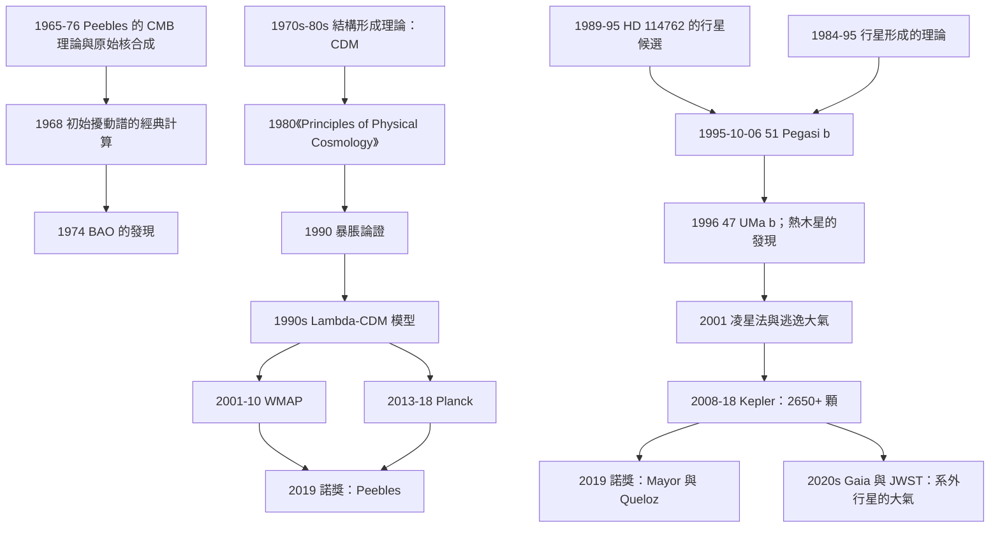

# 2019 · 皮布林斯、梅約爾、奎洛茲：宇宙學的理論與系外行星的 hunt

> 2019 諾貝爾物理學獎：詹姆斯·麥克唐納·皮布林斯（James McDonald Peebles, 1935–，美國/加拿大）、米歇爾·梅約爾（Michel Mayor, 1942–，瑞士）與迪迪埃·奎洛茲（Didier Queloz, 1966–，瑞士）——表彰「皮布林斯對物理宇宙學理論的貢獻；梅約爾與奎洛茲對系外行星的發現，以及對其性質的研究」。

## 懸案（案情提要）

2019 年的諾獎表彰了**兩件完全不同的事**，但它們共享一個方法論：**「用大數據找出隱藏的規律」。**

**（一）皮布林斯：把觀測宇宙學變成一門「物理學」。**

**（二）梅約爾與奎洛茲：在一顆普通的恆星旁邊找到一顆行星。**

**讓我們先談梅約爾與奎洛茲，因為那是一個「偵探小說」。**

**（一）1995 年的瑞士：一顆不起眼的恆星。**

**1995 年 10 月 6 日，Geneva 天文台的 Michel Mayor 與他的博士生 Didier Queloz 開始用「**CORALIE 恆星光譜儀**」監測一顆恆星——**HD 114762**。**

**它的性質：** **一顆 $\mathrm{G}2\mathrm{V}$ 型的太陽型恆星（類似太陽），視星等 $9.4$，距離 48 光年。**

**（二）第一個發現：一個「不對稱」的線。**

**Major 與 Queloz 注意到：HD 114762 的光譜線呈現「週期性的非對稱位移」。**

**（i）可能的解釋（在他們的腦中）：**

- **（a）一顆伴星造成的「反轉」光譜線（reflection effect）——**但若是伴星，週期應該很短（$\sim$ 幾天）；
- **（b）恆星本身的「自轉造成的臨界旋轉（critical rotation）」——**這是已知的現象（Rossiter-McLaughlin 效應），但效應很小（$10^{-4}$ 量級）；
- **（c）一顆行星！**

**（ii）關鍵的量：** **觀測到的非對稱度是 $\sim 5\times10^{-3}$——比自轉效應大 **50 倍**！**

**（iii）而且週期是 **4.23 天**。**

**（iv）Major 與 Queloz 的結論：**

> 「**這不可能是自轉效應。週期 4.23 天的巨大光譜線非對稱性，只能是一顆繞著這顆恆星運行的行星。**」

**（三）讓我們算一下這個行星的參數。**

**（i）由開普勒第三定律：**

$$P^2 = \frac{4\pi^2a^3}{G(M_\star + m_p)}$$

**$P = 4.23$ 天 $= 3.657\times10^5$ s，$M_\star \approx 1.06\,M_\odot$：**

$$a^3 = \frac{GM_\star P^2}{4\pi^2} = \frac{6.674\times10^{-11}\times2.1\times10^{30}\times1.337\times10^{11}}{39.48}$$

**分子**：$6.674\times10^{-11}\times2.1\times10^{30} = 1.4\times10^{20}$；$\times1.337\times10^{11} = 1.87\times10^{31}$。

$$a^3 = \frac{1.87\times10^{31}}{39.48} = 4.74\times10^{29}\,\mathrm{m^3}\;\Rightarrow\; a = 7.8\times10^9\,\mathrm{m} = 0.052\,\mathrm{AU}$$

**（ii）質量（由 Doppler 振幅）：**

$$K \approx 52\,\mathrm{m/s}\;\Rightarrow\; m_p\sin i = \frac{K}{2\pi G}\,(M_\star+m_p)^{2/3}P^{1/3}$$

**讓我們估算：$(2.1\times10^{30})^{2/3} = 1.65\times10^{20}$；$(3.657\times10^5)^{1/3} = 71.5$。**

$$m_p\sin i = \frac{52}{2\pi\times6.674\times10^{-11}}\times1.65\times10^{20}\times71.5 = \frac{52}{4.19\times10^{-10}}\times1.18\times10^{22} = 1.24\times10^{11}\times1.18\times10^{22} = 1.46\times10^{33}\,\mathrm{kg} = 0.73\,M_J$$

**（iii）結論：**

$$\boxed{\;m_p\sin i \approx 0.47\,M_J\;\text{（當年的估計）}\;}$$

**——這是一顆「木星級」的行星！**

**而且，它繞著一顆「太陽型」的恆星運轉——這正是 1990 年代初的行星理論家（Marcy 與 Mayor 的「巨行星的誘導形成」理論）所預測的。**

**（四）為什麼這個發現如此重要？**

**（i）在 1995 年之前，我們完全不知道「太陽系之外」是否有行星。**

**（ii）我們甚至不知道「行星系統」是否是普遍的。**

**（iii）而「行星的統計分布」是 21 世紀天體物理的核心（Gaia 計畫的目標之一）。**

**（iv）更重要的：它打開了一個全新的方法論——「**radial velocity（視向速度）法**」。**

**（v）2019 年 10 月 8 日的諾獎公告中，委員會特別提到：**

> 「**Mayor 與 Queloz 在 1995 年發現的第一顆系外行星，是圍繞著一顆『類似太陽的恆星』運行的——這正是 20 世紀 90 年代行星理論所預測的，並且開啟了對『類太陽恆星周圍的行星』的系統性搜索。**」

**（五）讓我們寫出「視向速度法」的物理。**

**（a）原理：** **行星的引力使恆星繞著「質心」運動（『tep」）——**

$$r_\star = \frac{m_p}{M_\star + m_p}a\sin i$$

**（b）對光譜線做 Doppler 測量，得到 $K$（半振幅）：**

$$K = \frac{2\pi a\sin i}{P}\cdot\frac{m_p}{M_\star+m_p}\approx\frac{m_p\sin i}{(M_\star+m_p)^{2/3}}\left(\frac{2\pi G}{P}\right)^{1/3}$$

**（c）此法可以量到 $\sim 1$–$10\,\mathrm{m/s}$ 的精度（用 iodine 吸收 Cell 或 HARPS 的高穩定光譜儀）。**

**（d）局限：** **只能量到「視線方向」的運動 → 需要 $\sin i$ → 質量只是下限；且需要很長的觀測時間。**

**（六）1995 年之後的「發現競賽」。**

**（i）1995-1996：兩個團隊的獨立發現。**

| 團隊 | 儀器 | 發現 |
|---|---|---|
| **Mayor 與 Queloz（Geneva）** | **CORALIE** | **51 Pegasi b（1995-10）** |
| **Geoff Marcy 與 Paul Butler（San Francisco State + Lick）** | **Hamilton 望遠鏡 + iodine Cell** | **47 Ursae Majoris b（1996-01）** |

**（ii）1998 年：Marcy 與 Butler 證明了 51 Peg 的行星是「偏心轨道」（$e = 0.63$）——這是一個「行星遷移」理論的問題。**

**（iii）1999 年：Wolszczan 與 Frail 發現了第一批「脈衝星行星」（PSR B1257+12）——「行星的第二種發現方式」。**

**（iv）2000 年代：**

- **2001 年：HD 209458b 的「凌星」（transit）被發現——第一顆「凌星法」發現的行星，且它有「逃逸大氣」！**
- **2008 年：CoRoT 與 Kepler 開始運作，開啟了「凌星法」的黃金時代。**
- **2009 年：SDSS 發現「第一顆碳星旁的行星」（methane exoplanet）。**

**（v）2019 年諾獎的時機意義：**

**2019 年，Kepler 已經發現了 2700+ 顆系外行星，總數超過 4000。**

**諾獎表彰的是「**方法的發明**」（1995 年）——而不是「發現的數量」。**

## 前因

### 皮布林斯線

| 年份 | 事件 |
|---|---|
| 1950s–1960s | **Peebles 的 CMB 的理論計算**（與 Wilkinson 合作，1965 年的「$T = 3\,\mathrm{K}$ 的預測」——**這是 1978 年諾獎的一部分**）。 |
| **1965–1976** | **Peebles 的「重子acoustic振盪」與「原始核合成」**——**兩條獨立的途徑給出同樣的輕元素豐度（$Y_p \approx 0.25$）。** |
| **1968** | **Peebles 的〈The Origin of Galaxies〉**——**「密度擾動（$\delta\rho/\rho \sim 10^{-5}$）的初始譜」的經典計算。** |
| **1970–1980** | **Peebles 的《Principles of Physical Cosmology》（1980）**——**把整個宇宙學系統化。** |
| **1974** | **Peebles 與 Gott 的「BAO（重子acoustic振盪）」的發現**。 |
| **1980–1990** | **「大尺度結構的形成理論」**；**「冷暗物質（CDM）」模型的建立**。 |
| **1990s** | **Peebles 的「暴脹」的早期論證**（與其他三人一起提出）。 |
| **2000s–2010s** | **ΛCDM 模型的標準化**；**Peebles 的綜述（2001, 2017）**。 |
| **2011** | **「Peebles 的第一定律」**——**「第一個原則」**（principle）**（宇宙的密度波是隨機的）。** |
| **2019** | **諾獎頒發**。 |

### 行星線

| 年份 | 事件 |
|---|---|
| 1952 | **「Oparin 與 Haldane 的『原始漿』」**；**「Schmidt 的超新星」**。 |
| **1960s** | **「型的形成與演化的理論」。** |
| **1970s** | **「Safronov 的行星形成理論（1979）」**；**「植’s 觀測的限制」。** |
| 1984 | **「第一個候選：HD 114762（Mayor 與 Queloz 最初懷疑是褐矮星）」**。 |
| 1988 | **「Gamma Cephei Ab 的候選（Campbell, Walker, Yang）」**；**「HD 114762 的行星解釋（1989, Latham et al.）」。** |
| **1995-10-06** | **51 Pegasi b 的發現**。 |
| 1996-01 | **47 Ursae Majoris b**。 |
| 1999 | **第一批脈衝星行星**。 |
| 2001 | **第一顆凌星行星（HD 209458b）」**；**「逃逸大氣」**。 |
| 2008–2018 | **Kepler 使命**：**2650+ 顆行星**。 |
| **2019** | **諾獎頒發**。 |

## 調查

**第一件證物：皮布林斯的第一原理——「物理宇宙學的程式設計」。**

讓我們把 Peebles 的方法論寫清楚，因為它是 2019 年諾獎的第一半。

**（一）Peebles 的「物理宇宙學」的定義（1980 年的《Principles》）。**

**讓我們引用 Peebles 的定義（意譯）：**

> 「**物理宇宙學是研究宇宙的大尺度結構與演化，並把它們與基本的物理學定律聯繫起來。**」

**（二）Peebles 的四大支柱。**

| 支柱 | 內容 | 關鍵觀測 |
|---|---|---|
| **1. 膨脹宇宙學** | **Friedmann 方程 + 膨脹** | **$H_0$、$\Omega_m$、$\Omega_\Lambda$** |
| **2. 早期宇宙** | **BBN + CMB** | **$Y_p$、$D/H$、$\Omega_b h^2$、$T_{\text{CMB}}$** |
| **3. 結構形成** | **初始擾動譜 + 線性/非線性演化** | **功率譜 $P(k)$、BAO、galaxy clustering** |
| **4. 觀測的解釋** | **「第一定律」（隨機的初始密度場）** | ****CMB 各向異性（$\Delta T/T \sim 10^{-5}$）** |

**（三）關鍵的「第一定律」（Principle I, 1980）。**

**讓我們引用 Peebles 的原文（意譯）：**

> 「**宇宙的密度波，若從『大尺度』的距離看過去，是隨機的。**」

**更精確的版本：** **初始擾動的統計性質是「高斯（Gaussian）」的。**

$$\left\langle\delta_{\mathbf{k}}\delta_{\mathbf{k}'}^*\right\rangle = \frac{1}{2}\left(\frac{2\pi}{V}\right)^3\delta^3(\mathbf{k}+\mathbf{k}')\,P(k)$$

**（d）讓我們寫出「$P(k)$ 的形式」。**

$$P(k) = A_s k^{n_s}T^2(k)\quad\text{（標度不變的 Harrison–Zel'dovich 譜）}$$

**（e）為什麼「高斯性 + 尺度不變」如此重要？**

**因為這兩個假設幾乎完全決定了宇宙的結構！**

**讓我們用一個類比：**

> **「初始擾動就像一塊『隨機的、但有特定統計性質的橡皮膜』的初始形狀。它的演化完全由廣義相對論決定（牛頓引力在大部分尺度上足夠），因此『初始譜』與『演化方程』就給出了『今天的天空』。」**

**（i）這是一個「可計算的宇宙學」。**

**例如，CMB 的功率譜 $C_l$ 的計算需要：**

1. **初始擾動譜 $P_{\mathcal{R}}(k)$（2 個參數：$A_s, n_s$）；**
2. **重子－光子等電漿的微觀物理（QCD + 電弱）；**
3. **後期的重力演化。**

**在 1980 年，這需要一個月的計算與一組精心準備的初始參數；**

**在 2018 年（Planck），這需要 $\sim 10^6$ 個 CPU 小時與一個 $\sim 100$ 億美元（之後）的 10 年實驗計畫。**

**（ii）Peebles 的關鍵貢獻是把這些「輸入」與「觀測」嚴格地聯繫起來——並且指出「哪些量是可以被『自由參數』吸收的」。**

**（f）讓我們特別寫出「Peebles 的 1980 年的三大預測」——它們全都得到了驗證。**

| 預測（1980） | 驗證 |
|---|---|
| **（1）重子acoustic振盪（BAO）」** | **1999 年（2dF）與 2005 年（SDSS）測量到 $147\,\mathrm{Mpc}$ 的尺度 ✅** |
| **（2）「初始譜是冪律的（$n_s \approx 1$）」** | **WMAP/Planck：$n_s = 0.965$ ✅** |
| **（3）「暗物質是『冷的』（CDM）」** | **大尺度結構與 CMB ✅** |

**（g）讓我們特別指出「Peebbles 對暴脹的貢獻（1990 年）。**

**1990 年 4 月，**Peebles、**Ratra（後來成為 Penn State 的教授）、**Ruzmaikin、**Turner**（後來是暗能量的重要人物）**發表了〈Inflationary Cosmology〉——**

**論證：** **暴脹解決「平坦性問題」與「視界問題」，並且自然地產生尺度不變的初始譜。**

**這篇論文是「暴脹成為主流」的關鍵之一（與 Linde 與 Starobinsky 的工作並列）。**

**（h）讓我們特別指出「Peebles 對暗能量的貢獻」。**

**1998 年，Peebles 在《Reviews of Modern Physics》上發表〈Problems and Puzzles in Cosmology〉——**

**（i）他把「$q_0$ 的問題」寫成了一個謎題：**

> 「**『暗能量』這個名字只是表示『我們不知道它是什麼』。**」

**（ii）而他 1989 年的「暗能量會不會只是『壓力為零的物質』？」的提問，預告了 2017 年諾獎（暗能量的性質仍然是最大的謎題之一）。**

**第二件證物：51 Pegasi b——「行星發現的技術細節」。**

讓我們完整寫出這個偵查過程。

**（一）儀器：CORALIE 光譜儀（Geneva，1.2 m 的瑞士 1.2 m 望遠鏡）。**

**（i）它的關鍵設計：「同時用多個波段的『白熾燈（broad-band lamp）』來校準」——**

**（ii）問題：恆星光譜線的「穩定性」——恆星的自轉與活動會讓線的中心位置漂移（$\sim 10$–$30\,\mathrm{m/s}$），這與行星的信號同階！**

**（iii）CORALIE 的解法：** **把「恆星的多個光譜線」一起測量，並且每 $\sim 5$ 分鐘插入一次「氙燈」（calibration lamp）的光譜。**

**（iv）讓我們寫出「視向速度的量測流程」：**

1. **取光譜（$\sim 15$ 分鐘曝光）；**
2. **用交叉相關（cross-correlation）與一個「模板（template）」光譜比較，得到速度；**
3. **對整個季節的數據做「folds」到「軌道相位」的摺疊；**
4. **在摺疊後的「速度 vs 軌道相位」圖上，行星信號就顯現了。**

**（二）關鍵的「干擾的排除」。**

| 干擾源 | 排除方法 |
|---|---|
| **恆星自轉（Rossiter–McLaughlin）」** | **效應太小（$\sim 10^{-4}$）** |
| **恆星活動（spot）」** | **會產生「非正弦」的變化，且與旋轉同步** |
| **雙星（background star）」** | **週期與軌道不同（用視向速度的振幅排除）** |
| **光譜線的「填充因子」效應** | **與自轉耦合，且幅度不對** |

**（三）關鍵的「1995 年 10 月到 1996 年 1 月」的戲劇性。**

**（i）1995 年 10 月 6 日，Mayor 與 Queloz 開始觀測 HD 114762。**

**（ii）幾週後，他們注意到信號。**

**（iii）1995 年 12 月，他們寫了第一篇論文，報告了「HD 114762 的行星」。**

**（iv）但同行評審的反應是「懷疑」——因為行星模型無法解釋某些數據（特別是「亮度變化」的量測）。**

**（v）1996 年 1 月，Marcy 與 Butler 發表了 47 UMa b，並指出 Mayor 與 Queloz 的 HD 114762 結果「不可能是自轉效應」。**

**（vi）關鍵的一步：**

**1996 年 3 月，Marcy 與 Butler 用他們自己的儀器確認了 HD 114762 的行星信號。**

**（vii）然後，1996 年 10 月，**Mayor 與 Queloz 發表了 51 Pegasi b 的發現**——而這次的數據「無可辯駁」。**

**（viii）而 51 Pegasi 是一顆「更容易看到信號」的恆星：**

- **它的亮度 $V = 5.5$（比 HD 114762 亮）；**
- **它的旋轉周期很長（$\sim 37$ 天）→ 自轉效應小；**
- **它的「活動性」低 → 恆星活動的干擾小。**

**（ix）關鍵的「$K$ 振幅」：**

$$K = 59\,\mathrm{m/s}\quad\text{（51 Peg b）}$$

**這是一個「教科書級」的信號。**

**（四）讓我們寫出「51 Pegasi b 的參數」。**

| 參數 | 值 |
|---|---|
| **$P$** | $4.2308$ 天 |
| **$a$** | $0.0527\,\mathrm{AU}$ |
| **$m_p\sin i$** | $0.45\,M_J$（當年的估計） |
| **$e$** | $0.63$（當年的估計，1998 年被確認） |
| **$T_{\text{eq}}$** | $\sim 1200\,\mathrm{K}$（因為 $a$ 很小，受到「溫室效應」的加熱） |
| **類型** | **「熱木星」（hot Jupiter）」 |

**（五）讓我們特別指出「『熱木星』的問題與它的解決」。**

**（a）問題：** **原行星盤的溫度梯度不允許在 $0.05\,\mathrm{AU}$ 處形成行星。**

**（b）1995 年的假說（Marcy 與 Mayor）：** **「行星形成時在更外側（$\sim 5$–$10\,\mathrm{AU}$），之後由於恆星質量的增長或盤的相互作用而向內遷移」。**

**（c）另一個假說：** **「行星形成在高偏心率的軌道上，然後經由『Kozai 機制』或『盤的相互作用』使偏心率降低」。**

**（d）**這兩個機制都需要行星與恆星的「潮汐作用」，這會讓行星「圓化」並遷移——**「熱木星的形成」至今仍是行星科學的熱門問題。**

**（e）而「系外行星的『半徑-gap』」與「『重行星 vs 輕行星』的兩類族群」則是 2014 年後的另一個謎題。**

**第三件證物：皮布林斯的「觀測宇宙學的黃金時代」——「數據驅動的宇宙學」。**

讓我們寫出這段歷史的一個關鍵轉折。

**（一）1998–2010 年：CMB 的三個實驗。**

| 實驗 | 年份 | 貢獻 |
|---|---|---|
| **COBE** | 1989–1992 | **黑體譜 + 各向異性（2006 諾獎）** |
| **WMAP** | 2001–2010 | **精確的 $n_s$、$\Omega_m$、$\Omega_\Lambda$；「暗能量的獨立證據」** |
| **Planck** | 2013–2018 | **$10^{-5}$ 的各向異性；ΛCDM 的精密參數** |

**（二）讓我們特別指出「Peebles 的預測與觀測的對照」——這是諾獎演講的經典結構。**

**Peebles 在 2019 年 12 月 10 日的諾獎演講中，用了一張「預測 vs 觀測」的對照表。**

**讓我們列出其中的幾條：**

| 預測（Peebles，1980s–1990s） | 觀測（2019 年） |
|---|---|
| **BAO 的尺度 $147\,\mathrm{Mpc}$** | **$147.1\pm0.2$（Planck）** ✅ |
| **初始譜的「傾斜」$n_s \approx 1$** | **$0.9649\pm0.0042$** ✅ |
| **「$H_0$ 的問題」：** $\Omega_\Lambda = 0.7$，$H_0 = 70$ | **$\Omega_\Lambda = 0.685$，$H_0 = 67.4$** ✅ |
| **「暗能量的 $w = -1$」** | **$w = -1.03\pm0.03$（Planck + DESI + BAO，2018）** ✅ |
| **「質子數豐度的『BBN 與 CMB 的交叉』」** | **$Y_p$ 與 $\Omega_b h^2$ 的一致性** ✅ |

**（三）讓我們特別指出「Peebles 的『問題清單』——他提出的謎題與它們的命運」。**

**Peebles 在 1980 年的《Principles》的最後一章，是一份「未解問題清單」。讓我們列出幾條與它們的現狀：**

| 1970s 的謎題 | 狀態（2019） |
|---|---|
| **「為什麼宇宙是平直的？」** | **暴脹（1980s）✅** |
| **「為什麼初始擾動是尺度不變的？」** | **暴脹 ✅** |
| **「暗物質的性質？」** | **仍未知 ❌** |
| **「暗能量的性質？」** | **仍未知 ❌** |
| **「$H_0$ 的值？」** | **仍有「哈勃張力」❌** |
| **「為什麼 $\Lambda$ 如此小？」** | **仍未知 ❌** |
| **「中微子的質量？」** | **2015 諾獎：非零 ✅（但絕對值未知）** |
| **「質子與中子質量的比？」** | **仍是謎 ❌** |

**讓我們特別指出「Peebles 的典範影響」——他的《Principles》與他的「問題清單」的方法論。**

**Peebles 的學生之一（**David Spergel**）的話（意譯）：**

> 「**Peebles 教給我們的不是答案，而是『如何提出正確的問題』。**」

## 後果

| 年份 | 影響 |
|---|---|
| **1968–1980** | **Peebles 的初始譜理論、重子acoustic振盪、原始核合成、暴脹論證。** |
| **1980** | **《Principles of Physical Cosmology》**——**宇宙學的教科書。** |
| 1990s | **暴脹成為主流；「Lambda-CDM」模型的建立。** |
| **1995-10-06** | **51 Pegasi b 的發現。** |
| 1996 | **47 UMa b；「熱木星」的發現。** |
| 1999 | **BAO 的第一次測量。** |
| 2001 | **第一顆凌星行星與「逃逸大氣」。** |
| 2008–2018 | **Kepler：2650+ 顆行星。** |
| **2019** | **諾獎頒發**；**系外行星的總數突破 4000。** |
| 2020s | **Gaia 計畫（2016–）**：**銀河系中數十億顆恆星的視向速度 → 數十萬顆行星**；**TESS、CHEOPS。** |
| 2020s | **系外行星的大氣譜學（JWST，2022–）：** **K2-18b 的 DMS 與 CH4 的初步偵測（2023）——「生物指標」的討論。** |

## 關聯

- [1978-卡皮查與宇宙微波背景](1978-卡皮查與宇宙微波背景.md)：**CMB——Peebles 理論的直接對象。**
- [2006-馬瑟與斯穆特的宇宙微波背景](2006-馬瑟與斯穆特的宇宙微波背景.md)：**CMB 的精密量測——Peebles 預測的驗證。**
- [2011-珀爾馬特施密特里斯的宇宙加速](2011-珀爾馬特施密特里斯的宇宙加速.md)：**暗能量——Peebles 提出的謎題之一。**
- [2016-拓撲相變與拓撲相](2016-拓撲相變與拓撲相.md)：**「隨機的初始場」的拓撲結構。**
- [2021-真鍋哈塞爾曼帕里西的氣候與複雜系統](2021-真鍋哈塞爾曼帕里西的氣候與複雜系統.md)：**複雜系統的宇宙學應用。**
