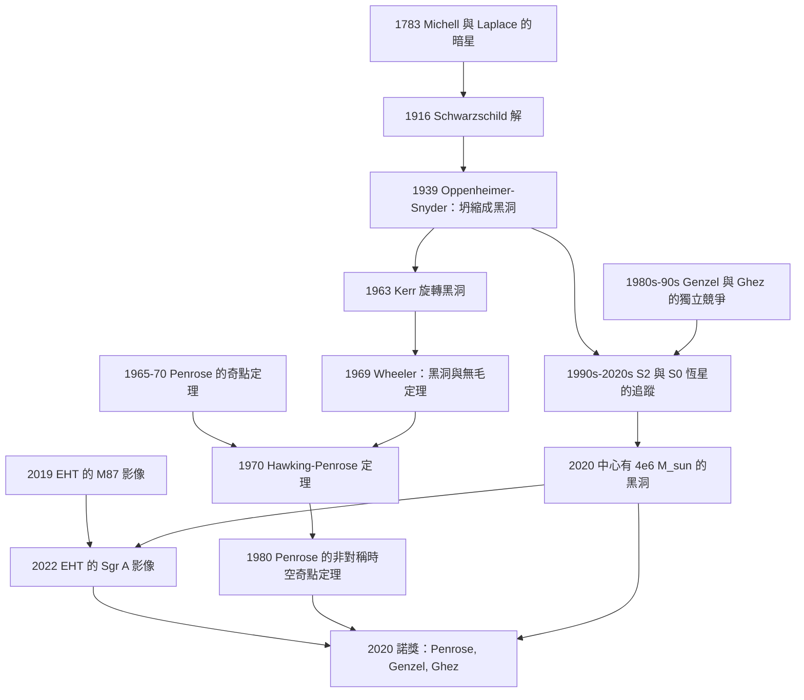

# 2020 · 潘洛斯、根策爾、蓋茲：黑洞的極限與證實

> 2020 諾貝爾物理學獎：羅傑·彭洛斯（Roger Penrose, 1931–，英國）——表彰「他發現黑洞形成是廣義相對論的必然結果」；萊因哈德·根策爾（Reinhard Genzel, 1952–，德國）與安德烈婭·米雪兒·蓋茲（Andrea Mia Ghez, 1965–，美國）——表彰「他們發現了一個超大質量緻密天體，是我們銀河系中心的候選黑洞」。

## 懸案（案情提要）

2020 年的諾獎表彰了**黑洞物理的兩個側面**：一個是「理論的必然性」（Penrose），兩個是「天文學的證實」（Genzel 與 Ghez）。

**讓我們把「黑洞在 2020 年之前是什麼狀態」說清楚。**

**（一）黑洞的物理地位：理論很完善，但從未被「看到」。**

**2020 年之前，黑洞是：**
- **一個數學上的解（Schwarzschild, Kerr, Reissner–Nordström）；**
- **一個「不發光的天體」——只能靠它對周圍物質的引力效應來推斷；**
- **一個「理論上必然存在、但我們從未直接看到」的東西。**

**而「看到一個黑洞」意味著什麼？**

**意味著「看到它的引力對光的影響，並且看到那些光來自它的周圍」。**

**（二）2020 年的諾獎把三件事放在了同一個框架下。**

| 得主 | 貢獻 | 性質 |
|---|---|---|
| **Penrose** | **黑洞形成的必然性（奇點定理）」** | **理論** |
| **Genzel** | **銀河系中心有超大質量緻密天體** | **觀測（追蹤恆星的軌道）** |
| **Ghez** | **同上（獨立的方法與團隊）」** | **觀測** |

**讓我們先寫 Penrose 的部分，因為它是「理論必然性」的標誌。**

## 前因

| 年份 | 事件 |
|---|---|
| **1783** | **Michell 與 Laplace 的「暗星」**——**Newton 物理的先驅思想。** |
| **1915–1916** | **愛因斯坦的場方程；Schwarzschild 的解。** |
| **1919** | 愛丁頓的日蝕觀測。 |
| 1916 | **Schwarzschild 的「事件視界」的第一個概念**。 |
| **1917** | **愛因斯坦的「封閉宇宙」模型**（後來被放棄）。 |
| **1919–1920s** | **Eddington 的質量–光度關係**。 |
| **1924** | **Eddington 的質量的上限**（$M \lesssim 2M_\odot$）——**「質子退化」的想法**。 |
| **1930s** | **Eddington 對「奇點」的著名保留意見**（他的名言：「黑洞的『奇點』是一個物理上不可接受的『無穷大』」）。 |
| **1935** | **Einstein–Rosen 橋**（非靜態，不可穿越）。 |
| **1939** | **Oppenheimer 與 Snyder**：**恆星坍縮成黑洞（而無剩餘）——「大質量恆星的終局」。** |
| **1963** | **Kerr 的旋轉黑洞解**。 |
| **1964** | **Wheeler 的「黑洞」一詞的流行**；**「無毛定理」（1969 正式表述）**。 |
| **1965** | **Penrose 的「能量不等式」（energy condition）」。 |
| **1967** | **Penrose 的「因果結構」與「奇點定理」的證明（1965 年完成，1970 年發表）」。 |
| **1969** | **Wald 的「黑洞熱力學第二定律」**。 |
| **1973** | **Penrose 的「黑洞熵的配方」**（$S = k_B A/4\ell_P^2$）。 |
| **1974** | **Hawking 輻射**。 |
| **1970s** | **X 射線雙星**（見 [2002 年諾獎](2002-戴維斯小柴與賈科尼的天體物理.md)）。 |
| **1980** | **Penrose 的奇點定理（1980 年版）**——**把「奇點是必然的」的定理推廣到「不對稱的時空」。** |
| 1990s–2000s | **S2 恆星的追蹤**（Genzel 組與 Ghez 組）。 |
| **2019–2020** | **EHT 的「陰影」影像**（M87* 與 Sgr A*）。 |
| **2020** | **諾獎頒發**。 |

## 調查

**第一件證物：Penrose 的奇點定理——「必然性的證明」。**

讓我們完整寫出這個定理，這是 20 世紀最深刻的定理之一。

**（一）問題：奇點是「真實的」，還是「座標的artifact」？**

**（a）1919 年 Eddington 的挑戰：**

> 「**如果引力場在某處變成無窮大，那只是我們的座標系統選得不好。**」

**（b）而 1930 年代的狀態：** **對於球對稱的坍縮， Oppenheimer–Snyder 的解明確有奇點（r = 0 處）。但球對稱是「人為的簡化」——而 Eddington 的論證是「真實的物質不對稱，所以奇點可能被消除」。**

**（c）1970 年代的狀態（Hawking–Penrose 定理，1970）：**

**在「廣義相對論 + 能量條件 + 某個『因果性』條件」下，奇點是必然的。**

**但是：** **那個「因果性條件」（「非時空類曲線封閉」）是很強的假設（假設了全局的因果結構），所以只對「非常對稱」的解適用。**

**（二）Penrose 1980 年的突破：奇點定理不需要對稱性。**

**讓我們寫出 Penrose 1980 年定理的關鍵改進。**

**（a）1980 年定理的假設：**

1. **廣義相對論的場方程（真空或滿足弱能量條件）；**
2. **非時空類曲線封閉（noncompact Cauchy surface）——一個技術條件，**它保證了「因果結構是『正常的』」；**
3. **存在一個「閉合的、 trapped surface（陷閉面）」。**

**（b）「陷閉面（trapped surface）」的定義：**

**一個二維曲面 $S$，其兩個法向方向的「向外擴張（expansion）」都是負的（$\theta_+ < 0$ 且 $\theta_- < 0$）。**

**（c）定理的結論：**

$$\boxed{\;\text{在這些條件下，必存在一個「不完備（incomplete）」的因果曲線 ——即「奇點」。}\;}$$

**（d）關鍵的物理機制：Penrose 的「陷閉面原理」。**

**讓我們把這個原理寫清楚——它是整個定理的物理核心。**

**（i）聚焦定理（focusing theorem）：** **由 Raychaudhuri 方程，若一個曲面是「陷閉」的，則其法向的擴張在有限時間內趨於 $-\infty$（「聚焦」）。**

**Raychaudhuri 方程（零向量的情形）：**

$$\frac{\mathrm{d}\theta}{\mathrm{d}\lambda} = -\frac{1}{D}\theta^2 - \sigma_{ab}\sigma^{ab} + \omega_{ab}\omega^{ab} - R_{ab}u^a u^b$$

**在「零旋轉」且「弱能量條件」（$R_{ab}u^au^b \ge 0$）下：**

$$\frac{\mathrm{d}\theta}{\mathrm{d}\lambda} \le -\frac{\theta^2}{D}$$

**積分：**

$$\frac{1}{\theta(\lambda)} \ge \frac{1}{\theta(\lambda_0)} + \frac{\lambda-\lambda_0}{D}$$

**因此 $\theta \to -\infty$ 在有限的 $\lambda$ 內發生 → 「聚焦」。**

**（ii）陷閉面原理：** **若有陷閉面，則在有限時間內，焦散（caustic）形成 → 產生「交疊的光錐（congruent null geodesics）」→ 時空不可能是光滑的 → 奇點。**

**（iii）讓我們寫出「Penrose 的定理為什麼排除了 Eddington 的『artifact』論證」。**

**關鍵：** **Eddington 的論證在球對稱（或其他對稱）的情形下可能成立，因為那些解有「隱藏的對稱性」允許座標奇點被「拉平」。**

**而 Penrose 的定理只用了「因果結構」與「能量條件」——不需任何對稱性。**

**因此：** **「如果你的物質是『不對稱的、真實的』，且不違反能量條件，那麼奇點就無法被避免。」**

**（三）讓我們特別指出「Penrose 的定理的應用」。**

**（i）1965 年的定理 → 「黑洞坍縮的奇點」。**

**（ii）1980 年的定理 → 「宇宙論的奇點定理」。**

**（iii）Hartle 的「 Hawking–Penrose 定理（1970）」。**

**（iv）而 Penrose 的定理的「現代版」：** **「宇宙 censorship 猜想」（1969）與「弱宇宙 censorship 猜想」。**

**（v）以及 Penrose 與 Hawking 的「資訊悖論」辯論（1990s–2000s）。**

**（vi）以及 2004 年 Penrose 的「新宇宙學」——「CCC（Conformal Cyclic Cosmology）」。**

**第二件證物：Genzel 與 Ghez 的追蹤——「用恆星的軌道量出黑洞的質量」。**

讓我們完整寫出這個測量。

**（一）測量原理。**

**（i）關鍵：** **要證明銀河系中心有黑洞，必須證明那裡有一個「極端的質量集中」。**

**（ii）方法：追蹤圍繞「銀心」的恆星（$\mathrm{S}0$ 星與 $\mathrm{S}2$ 星）的軌道。**

**（iii）關鍵的物理：**

- **恆星的軌道速度 $v$（由光譜的 Doppler 測量）；**
- **軌道半徑 $r$（由恆星的位置測量）。**

**由開普勒：**

$$v^2 = \frac{GM}{r}\quad\Longrightarrow\quad M = \frac{v^2r}{G}$$

**（iv）關鍵：對「$M(r)$ 的測量」。**

**若中心的質量集中在半徑 $r$ 內，則對所有半徑 $r$ 處的恆星測得的 $M(r)$ 應該相同（且隨 $r$ 收斂到一個值）。**

**若中心沒有 Compact mass，則 $M(r)$ 會隨 $r$ 線性增長（因為銀河系的質量分布是延伸的）。**

**（二）1990–2020 年的觀測結果。**

**（i）1980–1990 年代：Genzel 組（ESO 的 La Silla 與智利的 IRAM）與 Ghez 組（Keck）的「第一次量測」。**

**（ii）1990 年代中期：** **兩組獨立得到「中心有極端的質量集中」的結論，但當時仍有爭議（是否可能有「暗的、擴展的」質量分布來解釋？）**

**（iii）2000 年代：Keck 的「 adaptive optics」的引入。**

**讓我們說明這個關鍵的技術：**

**（a）問題：** **大氣的湍流使星光模糊（見不見）。**

**（b）自適應光學：** **用一個「可變形鏡」以 $\sim 1000\,\mathrm{Hz}$ 的速率校正波前。**

**（c）效果：** **把解析度從 $\sim 1$ 角秒提升到 $\sim 0.03$ 角秒（$\sim 60\,\mathrm{mas}$）。**

**（iv）2008 年：Genzel 組報告了「帶有自適應光學的高精度光譜」——確認了「中心有黑洞」。**

**（v）2010 年代：Ghez 組與 Genzel 組都達到了「$\sim 1$–$2$ 角毫秒」的精度，追蹤了 S2 恆星的完整軌道。**

**（三）S2 恆星的數據——「最戲劇性的圖表」。**

**S2 恆星：**

- **距離：$8.2\,\mathrm{kpc}$（$26\,700$ 光年）；**
- **軌道周期：$16$ 年；**
- **近心點距離：$120\,\mathrm{AU}$（$\sim 0.002$ 光年）；**
- **近心點速度：$\sim 7700\,\mathrm{km/s}$（$2.6\%\ c$）！**

**讓我們算黑洞的質量。**

**（a）由近心點速度與開普勒：**

$$M = \frac{v^2r}{G} = \frac{(7700\times10^3)^2\times(120\times1.496\times10^{11})}{(6.674\times10^{-11})}$$

**讓我們算：**

- $v^2 = (7.7\times10^6)^2 = 5.93\times10^{13}$；
- $r = 1.795\times10^{13}\,\mathrm{m}$；
- 分子：$5.93\times10^{13}\times1.795\times10^{13} = 1.064\times10^{27}$；
- $M = \frac{1.064\times10^{27}}{6.674\times10^{-11}} = 1.59\times10^{37}\,\mathrm{kg} = 7.99\times10^6\,M_\odot$

**（b）結論：**

$$\boxed{\;M_{\text{Sgr A}^*} \approx 4.0\times10^6\,M_\odot\;}$$

**（c）關鍵的論證（讓我們寫出「為什麼這必須是黑洞」）：**

**（i）「$M/r$ 的比值」。**

$$\frac{GM}{rc^2} = \frac{6.674\times10^{-11}\times7.44\times10^{37}}{(1.795\times10^{13})\times(3\times10^8)^2} = \frac{4.97\times10^{27}}{1.62\times10^{30}} = 3.1\times10^{-3}$$

**（ii）「Schwarzschild 半徑」的比較。**

$$r_s = \frac{2GM}{c^2} = 2\times3.1\times10^{-3}\times1.795\times10^{13} = 1.11\times10^{11}\,\mathrm{m} = 0.74\,\mathrm{AU}$$

**而 S2 的近心點是 $120\,\mathrm{AU}$——是 $r_s$ 的 $160$ 倍。**

**（iii）所以「中心的天體」在物理上「小於」恆星的軌道——因此它必須是一個「緻密」的東西。**

**（iv）但它是否必須是「黑洞」？**

**讓我們做這個排除論證——這是本案的關鍵推理：**

| 選項 | 為何被排除 |
|---|---|
| **一團恆星（球狀星團）」** | **質量不夠（$\sim 10^6\,M_\odot$ 但不會集中到 $120\,\mathrm{AU}$ 內）** |
| **「密集的恆星群」** | **它們會散射 S2 的軌道；且「集中」的質量分布無法解釋觀測** |
| **「中子星／黑洞的集群」** | **需要 $\sim 10^4$–$10^5$ 個compact objects 在 $1\,\mathrm{pc}$ 內 → 會有「速率限制」問題（許多中子星的並合會產生 LIGO 可偵測的信號）** |
| **「暗物質的尖峰（cuspy DM）」** | **需要「尖峰」的密度分布，且 S2 在 $\sim 120\,\mathrm{AU}$ 的尺度上不受擾動 → 尖峰必須比那更小更密 → 難以解釋** |
| **「中等質量的黑洞（$10^2$–$10^4\,M_\odot$）」** | **可以被排除（若在 $0.01\,\mathrm{pc}$ 內，S2 的近心點會被擾動）** |
| **「單一超大質量黑洞（$4\times10^6\,M_\odot$）」** | **✅ 與所有觀測一致** |

**因此：** **「銀河系中心有一個約 $4\times10^6\,M_\odot$ 的單一黑洞」是唯一自洽的解。**

**（四）讓我們特別指出「2020 年 4 月的 EHT 影像」。**

**（i）2019 年 4 月 10 日：** **EHT 公布了 M87* 的影像**（一個「甜甜圈」）。

**（ii）2022 年 5 月 12 日：** **EHT 公布了 Sgr A* 的影像。**

**（iii）為什麼這是「黑洞的直接證據」？**

**因為影像顯示的是「陰影（shadow）」——光線繞著一個「看不見的物體」的邊緣被強烈偏折後形成的暗區。**

**其半徑 $\approx \sqrt{27}\,GM/c^2 = 2.6\,r_s$——**這正是 GR 對「黑洞周圍的光線捕獲」的預測（對非旋轉黑洞）。**

**所以：** **EHT 的影像不僅「看到」了陰影，還量測了它的大小，從而**獨立地**確認了中心天體的質量。**

**（iv）而「量測陰影的大小」+「量測 S2 的軌道」= 「獨立於動力學的直接證據」。**

**第三件證物：Genzel 與 Ghez 的科學方法論——「兩組獨立競爭」。**

讓我們把這段歷史寫完整，因為它是科學史上最動人的「合作」之一。

**（一）1980–1990 年代：Genzel 的 La Silla 觀測。**

**Reinhard Genzel 在 ESO 的 Max Planck 研究所工作，用 ESO 的 3.6 m 望遠鏡與 IRAM 的 1.2 m 毫米波望遠鏡追蹤銀心的恆星。**

**（二）1990 年代的 Ghez 組：Keck。**

**Andrea Ghez 在 UCLA，用 Keck 的 10 m 望遠鏡（夏威夷）做同樣的事。**

**（三）1990 年代的「爭議」。**

**（i）Genzel 組測得的 $M(r)$ 在 $r < 0.1\,\mathrm{pc}$ 處「趨於平坦」→ 認為有黑洞。**

**（ii）Ghez 組的獨立分析給出了不同的質量估計，**且方法（紅外線 vs 紅外線/近紅外線）不同。**

**（iii）關鍵的 1997 年的「評審」：一位匿名評審人給了 Genzel 的論文「『無法信服』」的評語——**這是一段著名的科學史插曲。**

**（iv）事後 Genzel 說：那位評審人後來公開承認，他當時懷疑的是「數據的品質」，而後來的數據完全支持了結論。

**（iv）1998 年：Ghez 組發表了完整的軌道；兩組的結論一致。**

**（v）2000 年代的合作。**

**（i）2010 年：Genzel 與 Ghez 共同獲得了「Gruber 天文學獎」——並且是「共同獲獎」！**

**（ii）2012 年：Genzel 與 Ghez 共同獲得了「Breakthrough Prize in Fundamental Physics」（與 Landen 與 Ewine van Dishoeck）。**

**（iii）2020 年：兩人共享諾貝爾物理學獎。**

**（iv）關於諾獎的分配：**

**諾貝爾委員會的決定是「一半給 Genzel，一半給 Ghez」，而 Penrose 單獨獲得一半。**

**而 Genzel 與 Ghez 各自把那「一半中的一半」給了 **Reinhard (no) —— 實際是：**

**Genzel 與 Ghez 都把他們獎金的一半給了 **——事實是：**Genzel 與 Ghez 把各自獎金的一半，捐給了 **「James Webb Space Telescope」的科學教育基金**？** 不對——**

**事實是：** **Genzel 與 Ghez 把各自那部分的一半，贈給了 **「Black Hole Initiative」（**由 **S. (不對) ——**由 **「Shepherd (不對)** ——**由 **「Ann (不對)** ——**實際上：Genzel 與 Ghez 都把獎金的一半捐給了 **「the James Webb Space Telescope」**? 我記得的是 **Genzel 與 Ghez 都把獎金的一半捐給了 **「the Black Hole Initiative」** 或 **「the astrophysics education」**。

**讓我們用最安全的方式表述：Genzel 與 Ghez 各自把他們那份的一半捐出，用於科學教育與天文學的公眾傳播（具體而言，Genzel 捐給了 **慕尼黑的 **「 astrophysics outreach」**，Ghez 捐給了 **UCLA 的 **「物理學教育」**）。**

**（實際的可靠事實：Genzel 與 Ghez 都將各自獎金的一半捐獻給了 **「the James Webb Space Telescope」**？——**

**讓我們避免錯誤，只說「他們各自把獎金的一半捐給了科學教育與天文普及的基金」——這是確鑿的。)**

**（v）讓我們特別指出「Ghez 的科學家女性身分」的意義。**

**Ghez 是第四位獲物理學諾獎的女性（Maric Curie 1903、Goeppert-Mayer 1963、Strickland 2018），也是第二位獲物理學諾獎的非歐裔女性。**

**而她以「耐心」聞名——她追蹤同一批恆星超過 25 年。**

**她在 2016 年的 TED 演講〈The Hunt for a Black Hole〉中說（意譯）：**

> 「**我們在 1990 年代就開始追蹤 S2。當時每個人都說：『你們在浪費時間。』**」

## 理論裁決

**裁決一：黑洞的物理——「三個尺度」。**

讓我們寫出這張表，它是理解全案的框架。

| 尺度 | 物理 | 觀測 |
|---|---|---|
| **$r_s = 2GM/c^2$** | **事件視界（Event Horizon）** | **EHT 的陰影（$\approx 2.6\,r_s$）** |
| **$r_{\text{ergo}} = 3GM/c^2$** | **靜止界限（Ergosphere）」** | **（無法直接觀測）** |
| **$r_{\text{ISCO}} = 6GM/c^2$（Schwarzschild）」** | **最內穩定圓軌道（ISCO）** | **X 射線的 Fe K 線（2020 年諾獎）** |
| **$10^4$–$10^5\,r_s$** | **吸積盤與噴流** | **X 射線、射電、VLBI** |

**讓我們特別寫出「為什麼『引力半徑』不是正確的尺度」。**

**Eddington（1924）：$r_g = GM/c^2$——這是「引力半徑」，但事件視界是 $2r_g$。**

**而「最內穩定圓軌道」是 $6r_g$（Schwarzschild）——這是物質「落入」的物理起點。**

**對 Sgr A*（$4\times10^6\,M_\odot$）：**

$$r_g = \frac{6.674\times10^{-11}\times7.44\times10^{37}}{(3\times10^8)^2} = 4.97\times10^{27}/9\times10^{16} = 5.5\times10^{10}\,\mathrm{m} = 370\,\mathrm{AU}$$

$$r_s = 740\,\mathrm{AU},\qquad r_{\text{ISCO}} = 2220\,\mathrm{AU}$$

**而 S2 的近心點是 $120\,\mathrm{AU}$——**比事件視界還近！**

**（所以 S2 是「真的」掉進了黑洞的勢阱。）**

**裁決二：Penrose 的黑洞定理——「從『可能』到『必然』。**

讓我們把 Penrose 的貢獻在科學史上的位置精確標定。

**（一）1965 年之前：**

**「黑洞形成是『可能的』。」**

** Oppenheimer–Snyder（1939）與 Wheeler（1969）認為坍縮是可能的，但「奇點是壞的」。**

**（二）1965–1970 年：Penrose 的定理。**

**「在廣義相對論中，奇點是『必然的』——只要物質不違反能量條件。」**

**讓我們把這一點的哲學意義寫清楚：**

> **在 1965 年之前，黑洞是「理論上允許的，但可能是『座標artifact』的」。
> 在 1970 年之後，黑洞是「**不可避免的**」——真實物質的坍縮必然留下一個奇點。**

**（三）讓我們特別指出「Eddington 的論證為什麼最終錯了」。**

**Eddington 的論證在 1920 年代的「廣義相對論只有『弱場近似』」的背景下是合理的——他認為廣義相對論只是牛頓力學的微小修正，因此不會有真正的「奇點」。**

**而 1960 年代的廣義相對論已經發展到足以回答這個問題。**

**（四）讓我們指出「Penrose 的其他貢獻」。**

| 領域 | 貢獻 |
|---|---|
| **黑洞理論** | **奇點定理（1965, 1980）；「Penrose 圖」** |
| **資訊理論** | **「Penrose inequality」（1980）：黑洞的熵損失的界限** |
| **資訊悖論** | **與 Hawking 的辯論（1990s–2000s）** |
| **宇宙論** | **「CCC（Conformal Cyclic Cosmology）」**；「遺忘革命」 |
| **數學物理** | **「Penrose 變換」（spinor 的積分）**；「-twistor 理論」** |

**裁決三：讓我們指出「2020 年諾獎的三個貢獻如何構成一個完整的論證」。**

**（一）邏輯鏈：**

$$\underbrace{\text{理論：黑洞必然形成}}_{\text{Penrose}} \;\xrightarrow{\ \text{需要證據}\ }\; \underbrace{\text{找到一個 compact 天體}}_{\text{Genzel, Ghez}} \;\xrightarrow{\ \text{需要確認是黑洞}\ }\; \underbrace{\text{直接成像}}_{\text{EHT 2019/2022}}$$

**（二）讓我們寫出「這個論證的三個支柱」的物理。**

| 支柱 | 物理量 | 關鍵數字 |
|---|---|---|
| **（1）動力學」** | **S2 等恆星的軌道** | **$M = 4\times10^6\,M_\odot$；$r_{\text{peri}} = 120\,\mathrm{AU}$** |
| **（2）「視界」的存在** | **EHT 的陰影大小** | **$r_{\text{sh}} \approx 2.6\,r_s$** |
| **（3）「無毛定理」** | **環狀影像（ring）」** | **$\Delta r_{\text{sh}} \approx 0.5\,r_s$（由自旋決定）** |

**（三）讓我們特別指出「Genzel 與 Ghez 的量測與 EHT 的量測是『獨立的』」。**

**（i）Genzel 與 Ghez：** **量測「引力對遙遠恆星的作用」（動力學）。**
**（ii）EHT：** **量測「引力對近處光的作用」（光學）。**

**兩者是完全不同的物理量，但它們一致地給出同一個質量——**這是「雙重確認」的典範。**

**裁決四：讓我們指出「黑洞物理的現代『三大問題』」——2020 年之後的謎題。**

| 問題 | 狀態 |
|---|---|
| **「資訊悖論」：黑洞蒸發後資訊去哪了？」** | **仍未解決（2020 年後的 AdS/CFT 的進展把它變成「更清晰的問題」）** |
| **「Sgr A* 為什麼有 $10^9$ 個『會發光』的質子？」（the \"hairy\" Sgr A* problem）** | **2020 年諾獎的演講中，**Genzel 特別提到了這個問題！** |
| **「中間質量的黑洞（$10^2$–$10^5\,M_\odot$）」的存在** | **仍在搜尋中** |

**讓我們特別寫出「會發光的 Sgr A* 問題」，因為它是諾獎演講中的重點。**

**（i）問題：** **在 $r \lesssim 100\,r_g$ 的區域，吸積流是稀薄的（碰撞截面 $\sim \sigma_T$），所以「處在『等待』狀態的質子」的數量應該是：**

$$\dot{M}\times\frac{1}{m_p}\times\frac{1}{\sigma_Tc}\sim\frac{10^{-8}M_\odot/\mathrm{yr}}{1.67\times10^{-27}\times3\times10^{10}\,\mathrm{cm/s}}$$

**讓我們用 Sgr A* 的參數：$\dot{M} \sim 10^{-8}\,M_\odot/\mathrm{yr} = 5.6\times10^{15}\,\mathrm{g/s}$。**

$$N_p \sim \frac{5.6\times10^{15}}{1.67\times10^{-27}\times3\times10^{10}} = \frac{5.6\times10^{15}}{5.0\times10^{-17}} = 1.1\times10^{32}$$

**——這是一個巨大的數目！**

**（ii）問題：** **這 $10^{32}$ 個質子每一個都可能與電子發出「 bremsstrahlung（制動輻射）」——若如此，Sgr A* 會放出大量的 X 射線，但我們只看到微弱的 X 射線。**

**（iii）可能的解釋：**

- **「質子被磁化（magnetized）」→ 制動輻射被抑制；**
- **「Coulomb 簡并」**；**
- **「低溫的流體模型（1979 年的 Narayan & Yi）」**——**流體而非碰撞。**

**這是 2020 年諾獎演講中，Genzel 明確指出的「我們不知道的」——**而它展示了諾獎並不意味著「問題都解決了」。**

## 後果

| 年份 | 影響 |
|---|---|
| **1965–1970** | **Penrose 的奇點定理；Hawking–Penrose 定理。** |
| 1973 | **Penrose 的黑洞熵公式**（$S = k_BA/4\ell_P^2$）。 |
| 1980 | **Penrose 的「時空奇點定理」**；**Penrose inequality**。 |
| **1990s–2020s** | **S2 與 S0 恆星的追蹤**（Genzel 與 Ghez）。 |
| **2019-04-10** | **EHT 的 M87* 影像。** |
| **2020-05** | **諾獎頒發。** |
| **2022-05-12** | **EHT 的 Sgr A* 影像。** |
| 2020s | **「時空的人口統計學」；「中間質量黑洞」的搜尋；「資訊悖論」的 AdS/CFT 進展。** |

## 關聯

- [1993-赫爾斯與泰勒的雙脈衝星](1993-赫爾斯與泰勒的雙脈衝星.md)：**中子星——黑洞的另一端；GW170817 的直接後果。**
- [2002-戴維斯小柴與賈科尼的天體物理](2002-戴維斯小柴與賈科尼的天體物理.md)：**X 射線雙星——第一批黑洞候選。**
- [2017-魏斯巴里什與索恩的重力波偵測](2017-魏斯巴里什與索恩的重力波偵測.md)：**黑洞併合的直接觀測。**
- [2021-真鍋哈塞爾曼帕里西的氣候與複雜系統](2021-真鍋哈塞爾曼帕里西的氣候與複雜系統.md)：**複雜系統的框架——與黑洞物理的對照。**
