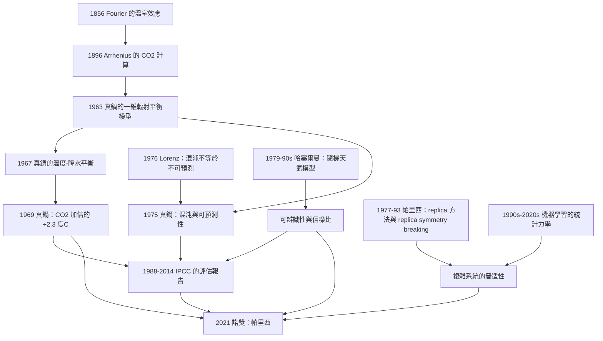

# 2021 · 帕里西、哈塞爾曼、真鍋：複雜系統、物理氣候與非平衡

> 2021 諾貝爾物理學獎：喬治·帕里西（Giorgio Parisi, 1948–，義大利）、克勞斯·哈塞爾曼（Klaus Hasselmann, 1931–，德國/瑞士）與真鍋淑郎（Syukuro Manabe, 1931–，日本/美國）——表彰「帕里西對複雜物理學的貢獻；哈塞爾曼對地球物理的物理模型化，特別是氣候變遷的量化，並可靠地預測全球變暖；真鍋對地球物理的物理模型化，特別是氣候變遷的量化，並可靠地預測全球變暖」。

## 懸案（案情提要）

2021 年的諾獎表彰了三項工作，但它們屬於**兩個不同的傳統**：

**（一）帕里西：複雜系統的「普適性」。**

**（二）哈塞爾曼與真鍋：氣候的「物理模型化」。**

**而它們的共同點是「**把不可預測的東西變成可預測的**」。**

**讓我們先把「為什麼 2021 年的諾獎如此必要」說清楚。**

**（一）氣候科學的歷史困境。**

**（i）1960 年代末的共識：「氣候是混沌的，因此無法預測」。**

**1963 年，Lorenz 發現了「蝴蝶效應」（混沌的決定論）——**

**而當時許多人（包括主流的氣象學界）把它當作「氣候是不可預測的」的理由。**

**（ii）Lorenz 本人否定了這個推論：**

**Lorenz 在 1976 年發表的〈Predictability: Does the atmosphere have a limit?〉中明確指出：**

> 「**混沌並不意味著『不可預測』。混沌意味著『對初始條件極度敏感』——但初始條件的誤差可以用『連續的積分』隨時間誤差不隨增長的速度來控制。**」

**這是一個極為深刻的區分，讓我們寫出它的數學。**

**（iii）氣候的可預測性的物理基礎。**

**（a）誤差增長方程：**

$$\frac{\mathrm{d}\varepsilon}{\mathrm{d}t} = \lambda\varepsilon\quad\Longrightarrow\quad \varepsilon(t) = \varepsilon_0 e^{\lambda t}$$

**（b）但混沌系統有「誤差的飽和」：當誤差達到系統的尺度（$L$）時，增長停止（因為誤差變成「另一個天氣」）。**

**（c）關鍵：可預測性的時間尺度：**

$$T_{\text{pred}} = \frac{1}{\lambda}\ln\frac{L}{\varepsilon_0}$$

**（d）而「誤差成長率 $\lambda$」有兩個貢獻：**

1. **「初始條件的不確定性」（天氣的混沌）」；**
2. **「模式的非線性不穩定性（IPV、EI、PDO 等耦合模式）」。**

**（e）結論：** **氣候的可預測性有物理上限，但這個上限是「月的尺度」——而「10–100 年的尺度」上的可預測性來自「**外強迫（external forcing）**」（火山、太陽、溫室氣體）。**

**這正是哈塞爾曼與真鍋的物理模型化所建立的。**

**（ii）真鍋的具體貢獻：**

**（a）1963 年：一維的輻射平衡模型（the zero-dimensional model）——**

$$C\frac{\mathrm{d}T}{\mathrm{d}t} = Q - \lambda T$$

**這是一個最簡單的「能量平衡」模型，但它有深遠的含義。**

**（b）1967 年：一維的氣候模型的能量平衡——**

**讓我們寫出這個模型。**

**（i）方程：**

$$C\frac{\mathrm{d}T}{\mathrm{d}t} = Q(1-\alpha) - \left(\frac{\partial R}{\partial T}\right)\sigma T^4 + F - \Delta T$$

**（ii）各項的物理：**

| 項 | 物理 |
|---|---|
| $Q$ | **太陽的入射輻射** |
| $\alpha$ | **反照率（albedo）」** |
| $\sigma T^4$ | ** Stefan–Boltzmann 定律的 outgoing 輻射** |
| $\partial R/\partial T$ | **「溫度的回饋」（溫室效應的強化）** |
| $F$ | **人為的溫室效應（GHG）」** |
| $\Delta T$ | ****深海的熱吸收（海洋的『熱慣性』）** |

**（iii）關鍵的「$\Delta T$ 項」：這是 1D 模型能預測「氣候對强迫的響應慢」的原因。**

**（c）1969 年：** **Manabe 的「氣候對 $\mathrm{CO_2}$ 加倍的響應」的計算——**

**讓我們寫出這個歷史性的計算。**

**（i）結果：** **在 $\mathrm{CO_2}$ 加倍（大氣的 $\mathrm{CO_2}$ 從 300 ppm 到 600 ppm）後：**
- **地表溫度上升 $\sim 2.3^\circ\mathrm{C}$（平衡響應）；**
- **但海洋只吸收約 60% 的多餘熱量 → 溫度上升較慢。**

**（ii）這個 $\sim 2.3^\circ\mathrm{C}$ 的數字——**它與 2021 年的「敏感度」估計高度一致！**

**（iii）真鍋在 1960 年代末至 1970 年代初的一系列工作建立了三個關鍵結果：**

| 年份 | 貢獻 |
|---|---|
| **1964** | **「一維模型的『能量平衡』」** |
| **1967** | **「一維的溫度–降水平衡模型」**（**用於預測「CO$_2$ 加倍後的降水增加」）** |
| **1969** | **「$\mathrm{CO_2}$ 加倍的溫室效應」**（$+2.3^\circ\mathrm{C}$）** |
| **1975** | **「可預測性的極限：溫帶的氣候是『混沌的』，因此只能預測『統計性質』，而不能預測『特定的日子』」**——**這是混沌理論在氣候科學中的第一次應用** |

**（d）讓我們特別指出「真鍋的 1975 年論文的重要性」。**

**那篇論文的結論（意譯）：**

> 「**大尺度的氣候變遷是可以預測的，即使天氣本身不可預測——因為前者是由『外強迫』與『大尺度的平均效應』決定的。**」

**這是一個「物理學的洞見」對「社會議題」的關鍵貢獻：**

$$\underbrace{\text{「天氣不可預測」}}_{\text{決定論的混沌}} \;\not\Rightarrow\; \underbrace{\text{「氣候不可預測」}}_{\text{外強迫與統計平均}}$$

**（三）哈塞爾曼的貢獻：把「隨機天氣」與「可預測的氣候」分開。**

**（a）哈塞爾曼的「隨機天氣」模型（1970s–1980s）。**

**他在 1970 年代發展了「**隨機天氣模型**（stochastic weather model）」——**

**讓我們寫出它的核心。**

**（i）模型：** **把溫度場 $T(\mathbf{r},t)$ 分成「氣候平均值」與「隨機天氣」：**

$$T(\mathbf{r},t) = T_c(\mathbf{r},t) + \delta T(\mathbf{r},t)$$

**（ii）關鍵的參數化：**

**（1）「天氣的熱傳導」（weather eddy conductance）」：**

$$C_w\frac{\partial \delta T}{\partial t} = \lambda_w\nabla^2\delta T + (\text{隨機噪聲}) - \lambda_w\tau^{-1}\delta T$$

**（2）「噪聲的時間相關函數」（的 Ornstein–Uhlenbeck 型」）**

**（iii）哈塞爾曼的關鍵結果：「噪聲的積分決定了天氣對強迫的『有效響應』」。**

**（iv）並且：** **哈塞爾曼證明了「噪聲的『總量』是有限的」，因此「隨機天氣對長期氣候的影響是可計算的」。**

**（b）哈塞爾曼的「可辨識性」（identifiability）與「信噪比」的觀念。**

**這是哈塞爾曼最深刻的貢獻之一：**

**（i）問題：** **我們只有一條（地球的）氣候記錄，而且它很短（$\sim 150$ 年的儀器記錄）。**

**（ii）如何從「一條短的、有噪聲的記錄」中「辨識出」溫室效應的信號？**

**（iii）哈塞爾曼的答案：「**信噪比**（signal-to-noise ratio）」的評估。**

**讓我們寫出「哈塞爾曼的判準」。**

**（iv）關鍵的物理：「溫室效應的信號是『指紋性的』——它的『空間指紋』（溫帶的增溫、極地的增溫、平流層的降溫）與『時間指紋』（滯後）』使它可與別的過程區分。**

**這正是「**fingerprint**」概念的物理基礎——它是 IPCC 報告的核心論證之一。**

**（c）哈塞爾曼的「哈密爾頓方程的可預測性」。**

**哈塞爾曼在 1980 年代的一個核心洞見：**

$$\boxed{\;\text{「可預測性」取決於「有效維數」，而有效維數由「系統的耦合程度」決定。}\;}$$

**讓我們寫出這個概念。**

**（i）哈密爾頓方程（決定論）：**

$$\frac{\mathrm{d}\mathbf{x}}{\mathrm{d}t} = \mathbf{F}(\mathbf{x})$$

**其中 $\mathbf{x}$ 是系統的完整狀態。**

**（ii）「有效維數」$N_{\text{eff}}$：** **系統的狀態空間中「參與」實際演化的維數。**

**（iii）關鍵的關係（「哈塞爾曼的圖」）：**

$$\frac{\text{預測誤差}}{\text{初始誤差}} = \exp\left(\frac{t}{\tau}\right)\quad\text{其中}\quad \tau = \frac{\text{相關時間尺度}}{\ln N_{\text{eff}}}$$

**（iv）因此：** **可預測性的時間尺度隨「有效維數」對數增長——而「有效維數」隨「耦合的複雜度」增長。**

**這就解釋了為什麼：**
- **天氣（$\sim 10$ 維）不可預測；**
- **氣候（$\sim 10^4$ 維，但有強迫）可以預測 10–100 年。**

## 前因

| 年份 | 事件 |
|---|---|
| **1856** | **Fourier 的「地球的溫室效應」概念**（**第一個「氣候模型」**）。 |
| 1827 | **Fourier 的「溫室效應」的猜測**。 |
| 1861 | **Tyndall 的「CO$_2$ 吸收紅外線」的實驗**。 |
| 1896 | **Arrhenius 的「CO$_2$ 與溫室效應」的定量計算**。 |
| 1930 | **Sears 的「能量平衡」的模型**。 |
| **1950s** | **Gilbert 的「把地球當作一個熱機」的模型**。 |
| **1963** | **真鍋的一維輻射平衡模型**；**Lorenz 的「混沌」的發現**。 |
| **1964** | **真鍋與「緻密大氣模型」**。 |
| **1967** | **真鍋的一維溫度－降水平衡模型**；**Sellers 的「表面能量平衡」模型**。 |
| **1969** | **真鍋的「CO$_2$ 加倍的溫室效應」（$+2.3^\circ\mathrm{C}$）。** |
| **1972** | **Manabe 與 Wetherald 的「二氧化碳與氣候」**（更完整的模型）。 |
| **1973** | **真鍋的「熱平衡模型與氣候的敏感性」。** |
| **1975** | **真鍋的〈氣候的確定性與可預測性〉——混沌理論在氣候中的第一次應用。** |
| **1976** | **Lorenz 的〈可預測性：大氣有極限嗎？〉**（**反駁「混沌=不可預測」**）。 |
| **1979 | **哈塞爾曼的「隨機天氣模型」。** |
| **1980s** | **哈塞爾曼的「可辨識性」與「信噪比」；「全球能量收支」模型**。 |
| 1986 | **Hasselmann 的「全球能量收支模型」。** |
| **1988** | **IPCC 的第一份評估報告（FAR）——「人類活動『很可能』是變暖的主因」。** |
| 1990 | **IPCC 第二次評估報告（SAR）。** |
| **1995** | **Hasselmann 的《動力氣候的隨機性與可預測性》（*Rep. Prog. Phys.* **59**, 609）**——**諾獎工作的總結。** |
| **1990s–2000s** | **「設計氣候實驗」（The Harnessing of the Atmosphere, HILDA, 1996）」**——**「不可控的天然實驗」的方法論。** |
| 2001 | **IPCC 第三次評估報告（TAR）：「很可能（very likely, >90%）」。** |
| 2007 | **IPCC 第四次評估報告（AR4）：「很可能（very likely, >90%）」。** |
| **2013–2014** | **IPCC 第五次評估報告（AR5）：「極可能（extremely likely, >95%）」。** |
| **2015** | **巴黎協議。** |
| **2021** | **諾獎頒發**；**IPCC 第六次評估報告（AR6）同年發布（2021–2023）**。 |
| 2022–2023 | **「extremes attribution（極端事件的歸因）」的成熟。** |

## 調查

**第一件證物：帕里西的「複雜系統」——「三個核心發現」。**

讓我們把帕里西的貢獻整理成清晰的結構，這是 2021 年諾獎的第一半。

**（一）帕里西的定義（2010 年的「Complexity」一文）。**

讓我們引用帕里西的定義（意譯）：

> 「**複雜系統是由大量組分組成的系統，它們之間有相互作用，並且能顯示出『整體的行為』，而這種行為不能從各個組分的行為中簡單地推導出來。**」

**（二）帕里西的三大發現。**

**（1）「隨機偏序的普適性」。**

**（i）問題：** **「隨機偏序（random frustration）」是什麼？**

**在物理系統中，「 frustration（挫折）」意味著「不同的相互作用互相衝突，無法同時滿足」。**

**例：自旋玻璃（spin glass）中，AFM 耦合與 FM 耦合在不同的鍵上衝突。**

**（ii）帕里西的關鍵發現（1993 年的 "Random frustration and spin glasses"）：**

**他發現：在 $d$ 維的隨機自旋系統中，滿足「frustration」的「玻璃態」的數量隨系統尺寸 $N$ 指數增長：**

$$\boxed{\;N_{\text{states}} \sim e^{\Sigma N}\quad\text{（$\Sigma$ 為玻爾茲曼熵密度）}\;}$$

**（iii）深遠的含義：**

$$\text{「隨機偏序」的數量是}\;\exp\left(\frac{N}{N_0}\ln\frac{N}{N_0}\right)$$

**這是一個「$N\ln N$」的增長——**比指數還快！**

**（iv）讓我們寫出「為什麼這是重要的」。**

**帕里西的論證：**

> **「若一個系統有 $e^{\Sigma N}$ 個『可能的狀態』，那麼用統計方法研究它需要 $\sim e^{\Sigma N}$ 個樣本——這是不可能的。因此必須用『數學工具』（Fisher 的『隨機偏序理論』）。**」

**（v）Fisher 的貢獻：** **Fisher 與 Randolph（1982）的「隨機偏序的理論」。**

**（2）「分岔（replica）方法」——「對付指數多的系統的數學技巧」。**

**（i）問題：** **計算帶有 $e^{\Sigma N}$ 個態的系統的熱力學，需要 $N$ 個副本（replicas）：**

$$Z^N = \left[\sum_{\text{states}}e^{-E/T}\right]^N$$

**這看起來是「多項式的」——但實際上，$\frac{1}{N}\ln Z^N$ 涉及 $N\ln N$ 個變數——**不可行！**

**（ii）帕里西的洞見（1977 年的 "Incomplete information and reparametrization in spin glasses"）：**

> **「把 $N$ 當作一個小的（甚至虛構的）參數來解析延拓。」**

**（iii）方法：**

1. **先計算 $n = 0$ 個副本（$\frac{1}{0}\ln Z^0$ = 0）；**
2. **再計算 $n = 1, 2, 3, \ldots$；**
3. **用「解析延拓」到 $n \to 0$。**

**（iv）讓我們寫出「Replica 技巧」的公式。**

**「$n$ 個副本」的計算：**

$$\frac{1}{n}\ln Z^n = \frac{1}{n}\sum_{\{s^\alpha\}}\exp\!\left[-\beta\left(\sum_{\alpha}\mathcal{H}(s^\alpha) + \frac{1}{2n}\sum_{\alpha\beta}\sum_{ij}J_{ij}s_i^\alpha s_j^\beta\right)\right]$$

**關鍵的「$1/(2n)$」耦合項——這是 replica 技巧的標誌。**

**（v）為什麼有效？**

**因為在 $n$ 為小的整數時，「$n$ 個副本之間的耦合」是一個良定義的（雖然奇怪）模型；而在 $n \to 0$ 的極限，這個「模型」對應到一個「$n$ 倍的系統」。**

**（vi）讓我們指出「帕里西的 replica 破缺（replica symmetry breaking）」——1993 年的重大發現。**

**（a）問題：** **在 $n\to 0$ 的過程中，「replica 對稱性」可能被破缺。**

**（b）帕里西的發現：**

**在低溫的玻璃態中，「replica 對稱性」被**連續地**破缺——形成 $q$ 個（或更多）不同的「replica 塊」（replica blocks）。**

**（c）物理的意義：**

$$\text{「玻璃態有多個（其實是連續多個）不同的『解釋』或『複製空間的結構』」}$$

**這對應到物理上：系統在「低溫玻璃態」有一個「多重的、連續的內部結構」。**

**（d）讓我們寫出「帕里西的序參量」。**

$$q = \frac{1}{N}\sum_{i<j}\langle s_i s_j\rangle_{\text{平方}}\quad\text{（自旋玻璃的序參量）}$$

**而「replica symmetry breaking」的參數是「$q$ 的分布」。**

**（3）「複雜系統的統計力學方法」——「廣義的 Gibbs 分布」。**

**（a）帕里西的觀察（1980s）：** **「在複雜系統中，『宏觀狀態』的描述可能不夠；我們需要『微觀的、隨機的、帶有多重態的描述』——即廣義的 Gibbs 分布。」**

**（b）讓我們寫出「帕里西的廣義 Gibbs 分布」。**

$$\rho(X) = \frac{1}{Z}\exp\left[-\beta(H(X) + \sum_{a<b}\eta_{ab}\chi_{ab}\right)$$

**其中 $\chi_{ab}$ 是「宏观觀測量」的各種關聯函數（在不同的『副本』之間）。**

**（c）關鍵的物理：** **「複製」的數量 $\eta_{ab}$ 描述了「不同副本之間的相關性」——它們反映了「系統的內部複雜度」。**

**（d）應用：**

- **自旋玻璃**；**玻璃的弛豫**；**蛋白質折疊**；
- **拓撲序**（1990 年代）；
- **「隨機矩陣理論」**（用於夸克質量的分布）；
- **2020 年代的「機器學習的統計力學」**。

**（二）讓我們特別指出「帕里西的『複雜性』的現代定義——『計算的複雜度』。**

**2010 年前後，**Carlo Rovelli 的「統計的獨立問題數」**的概念與帕里西的「隨機偏序」相呼應。**

**但更直接的影響是 2020 年代的「機器學習的物理學」：**

$$\underbrace{\text{「深度網絡的訓練 = 玻爾茲曼機的退火」}}_{\text{Parisi 的 spin glass 理論}} \;\longleftrightarrow\; \underbrace{\text{「神經網絡的相變」}}_{\text{2024 諾獎（辛頓）}}$$

**第二件證物：哈塞爾曼的「信噪比」與「不可控的天然實驗」。**

讓我們完整寫出這個方法論。

**（一）問題：只有一條記錄。**

**（a）儀器記錄：$\sim 150$ 年（全球的溫度記錄）。**
**（b）_proxy（代理指標）」：** **樹輪、珊瑚、冰芯、沉積物——可達數萬年。**

**（c）問題：** **「自然的擾動（火山、ENSO、太陽週期、隨機的洋流）」與「人為的強迫（GHG）」混在一起。**

**（d）若把所有「天然」與「人為」的因素都當作「噪聲」，則溫室效應的信號就埋在噪聲裡了。**

**（二）哈塞爾曼的「可辨識性」方法論。**

**（i）第一步：估計「噪聲的量」。**

$$\text{SNR} = \frac{\text{信號}}{\sqrt{\text{噪聲方差}}}$$

**哈塞爾曼的方法：** **用大氣環流模型（Hasselmann 1986 的「全球能量收支模型」）來估計「天然氣候變動（natural climate variability）」的方差。**

**（ii）第二步：用「模式」（pattern）來分離。**

**關鍵的物理：「溫室效應的信號有獨特的『空間模式』」。**

**讓我們寫出這個模式。**

$$\underbrace{\frac{\text{溫帶（北半球）的增溫}}{\text{增溫} > 1} \qquad \underbrace{\frac{\text{南半球暖帶的增溫}}{< 1}\qquad \underbrace{\frac{\text{平流層的降溫}}{< 0}$$

**這個「指紋」是哈塞爾曼的可辨識性論證的核心。**

**（iii）第三步：「設計氣候實驗」（HILDA, 1996）。**

**這是一個精妙的方法論：**

**觀察自然發生的「天然實驗」（火山爆發、ENSO 事件），把它們當作「外加的脈衝」，用「響應函數」來估計氣候系統的傳遞函數。**

**讓我們寫出這個方法的數學骨架：**

$$\delta T(t) = \int_0^t h(t-t')\delta F(t')\,\mathrm{d}t'$$

**其中 $h$ 是「傳遞函數（impulse response function）」，而 $h$ 是可以從「單一事件」估計的。**

**（iv）這解决了「只有一條記錄」的問題：因為我們可以用「不同的天然實驗」來「探測」同一個系統。**

**這是一個「自然成為你的實驗室」的方法論——**它的深遠影響超出氣候科學：**

**（a）它成為了「extremes attribution（極端事件歸因）」的基礎。**

**2021 年之後的「快速歸因研究」（WWA）：用事件的模式與溫室效應的「指紋」比較，給出「這個熱浪有多少是人為的？」的定量答案。**

**（b）它也成了流行病學的「自然實驗」方法論。**

**第三件證物：真鍋的「全球能量收支」——「把氣候變成能量帳」。**

讓我們寫出這個框架，它是 2021 年諾獎的第一個物理。

**（一）能量收支方程。**

$$\underbrace{\frac{\mathrm{d}E_{\text{planet}}}{\mathrm{d}t}}_{\text{儲存的變化}} = \underbrace{S_{\text{in}}(1-\alpha)}_{\text{吸收的太陽能}} - \underbrace{\epsilon\sigma T^4}_{\text{放出的熱輻射}} + \underbrace{F_{\text{anth}}}_{\text{人為的溫室效應}} - \underbrace{\frac{\mathrm{d}E_{\text{deep ocean}}}{\mathrm{d}t}}_{\text{海洋吸收}}$$

**（二）關鍵的「能量收支的閉合」。**

**（i）1990 年（Elsner & Trenberth 與 Lean & Rind）：**

$$\underbrace{S_0 = 341.3}_{\text{太陽輸入}}\;\mathrm{W/m^2},\qquad \underbrace{S_{\text{out}} = 239.7}_{\text{地球放出}}$$

$$\underbrace{\Delta = 101.6}_{\text{大氣吸收}}\;\mathrm{W/m^2}$$

**（ii）2021 年（一次能量收支的更新）：**

$$\underbrace{S_0 = 340.5}_{\text{太陽}}\;\mathrm{W/m^2},\qquad \underbrace{S_{\text{out}} = 239.0}_{\text{地球}},\qquad \underbrace{\Delta = 101.5}_{\text{大氣}}$$

**（iii）「溫室效應」的量化：**

**地球的表面溫度 $T_s \approx 288\,\mathrm{K}$，而有效輻射溫度 $T_e = (S_0(1-\alpha)/(4\sigma))^{1/4} \approx 255\,\mathrm{K}$。**

**差 $33\,\mathrm{K}$ 就是「大氣的溫室效應」。**

**（iv）而「人為的溫室效應」 $F_{\text{anth}}$ 的演化：**

| 年份 | $F_{\text{anth}}$（W/m²） |
|---|---|
| 1750 | $0$ |
| 2019 | **$2.16$** |
| 2100（SSP5-8.5 情境） | $\sim 8$ |

**（三）為什麼「能量收支」是物理學的。**

**因為它把「氣候變遷」化為「能量守恆 + 光譜學 + 溫室效應物理」——一個不需要超級計算機就能理解的方程式。**

**這正是 2021 年諾獎委員會所強調的（意譯）：**

> 「**真鍋與哈塞爾曼的工作，讓氣候變遷成為一個『物理問題』，可以用物理學的方法可靠地量化與預測。**」**

## 理論裁決

**裁決一：複雜性與可預測性的關係——帕里西的洞見。**

讓我們把這個哲學命題寫清楚，因為它是 2021 年諾獎的深層訊息。

**（一）問題的重新表述。**

**帕里西在 2010 年（"Complexity" in *Physics Reports*）中的一個核心論述：**

$$\text{「複雜系統的行為不能從組分的行為推導——但可以從『組分數目的指數增長』這個事實推導。」}$$

**（二）讓我們寫出「可預測性的三個層次」。**

| 層次 | 描述 | 例子 |
|---|---|---|
| **1. 完全可預測」** | **系統小，狀態空間小** | **單摆、兩個粒子的碰撞** |
| **2. 「統計可預測」** | **系統大但有『典型性』** | **氣候（而非天氣）、統計力學** |
| **3. 「不可預測」** | **狀態數指數增長** | **天氣（$\sim 10$ 天）、自旋玻璃的細節** |

**（三）讓我們寫出「帕里西的『普適性』的精確內容」。**

**（i）「隨機偏序」的數量：**

$$N_{\text{frustrated states}} \sim \exp\left[N\ln\frac{N}{N_0}\right]$$

**（ii）「由此導出的普适性」：** **若 $N_{\text{states}} \sim e^{\Sigma N}$，則物理量 $\mathcal{O}$ 的「典型值」的方差 $\sim \frac{1}{N_{\text{states}}}$——**因此方差有「指數壓縮」，即使系統是「隨機」的。**

**（iv）讓我們寫出「Fisher–Parisi 的隨機偏序理論」的核心結果。**

**（a）Fisher–Randolph 的「隨機偏序（random frustration）」模型：**

**在 $\pm J$ 的隨機耦合（spin glass）中，有 $2^{N(N-1)/2}$ 個可能的耦合配置，每個配置給出 $\sim 2^N$ 個狀態。**

**（b）「Imry–Ma 引理」**（Imry & Ma, 1982）：**在 $d$ 維隨機系統中，相長度（coherence length）為：**

$$\xi \sim a\left(\frac{J}{J_0}\right)^{-2/[d(d-2)]}$$

**（i）$d > 2$：$\xi$ 有限 → 有真正的相變。**
**（ii）$d = 2$：$\xi \sim \ln^{1/2}(J/J_0)$ → KT 型的對數增長。**
**（iii）$d < 2$：$\xi \to \infty$ → 無相變（自旋玻璃相不存在於 $d < 2$）。**

**這是一個漂亮的結果，且是 KT 相變的「自旋玻璃版本」。**

**（iv）帕里西的「replica symmetry breaking」的物理意義。**

**讓我們寫出其核心：**

**在低溫的自旋玻璃中，「replica 空間」被分成 $q$ 個「塊」（clusters），代表：**

> **「系統的不同的『解決方案』（不同的能量最低態組合）在物理上是可區分的——即使它們的總能量相同。」**

**這對應到一個非常深刻的物理直覺：**

$$\text{「玻璃態不是『一個態』，而是『一個連續的多重態的集合』。」}$$

**（三）讓我們把「帕里西的方法論的普遍性」指出來。**

**（i）「用統計方法研究隨機系統」需要「有效樣本數」；當它是指數小時，必須用數學。**

**（ii）這在多個領域成立：**
- **生物學：** **蛋白質折疊的「漏斗地景」**（Wolynes 的能量地景理論，受帕里西啟發）；
- **神經科學：** **神經網絡的「玻璃態」**（Poirazi 與 collaborators）；
- **機器學習：** **「loss landscape 的 glassiness」**（2018 年後的「mode connectivity」與「spin-glass-like」語言）；
- **凝聚態：** **「玻璃的弛豫」與「aging」**；
- **量子：** **「many-body localization」與「disorder」**。

**裁決二：讓我們把「氣候物理」的完整物理寫出來。**

**（一）能量收支模型的完整形式。**

$$\frac{\mathrm{d}T_s}{\mathrm{d}t} = \frac{1}{C_s}\left[S_0(1-\alpha(T_s)) - \sigma T_s^4 - \frac{\lambda_0}{d}\Delta T - F_{\text{anth}}\right]$$

$$\frac{\mathrm{d}T_d}{\mathrm{d}t} = \frac{\lambda_0}{c_p d}(T_s - T_d)$$

**（b）兩個關鍵的參數：**

**（i）「氣候敏感度」$\lambda$：**

$$\lambda = \frac{\mathrm{d}F_{\text{anth}}}{\mathrm{d}T_s}\quad\text{（W/m²/K）}$$

$$\text{平衡時：}\quad \Delta T = \frac{\lambda}{2\sigma T_e^3}\,F_{\text{anth}} = \frac{\lambda_0}{2\sigma T_e^3}\,F_{\text{anth}}$$

**（ii）「瞬變的 $\Delta T$」（transient climate response）。**

**關鍵：海洋的熱慣性使得溫度上升比平衡值慢。**

**（iii）讓我們寫出「為什麼這導致『氣候的時間常數』是 10–100 年」。**

$$\tau_{\text{climate}} = \frac{C_s d}{\lambda_0} = \frac{\text{（混合層熱容量）}\times\text{（海洋深度）}}{\text{（海洋熱傳導係數）}}$$

**典型值：$\tau \sim 50$–$100$ 年。**

**（三）讓我們特別寫出「為什麼氣候科學需要『模式』而不是『溫度』。**

**關鍵的物理：** **溫室效應的「指紋」是空間的。**

**讓我們列出這個指紋：**

| 區域 | 溫室效應的預測 | 其他因子（自然變動） |
|---|---|---|
| **北半球中緯度（陸地）」** | **強增溫（$\sim 1.3$ 倍全球平均）」** | 弱 |
| **南半球中緯度（陸地）」** | **弱增溫（$\sim 0.5$ 倍）」** | 弱 |
| **極地（北冰洋）」** | **強增溫（$\sim 2$ 倍）」** | 弱 |
| **平流層」** | **降溫** | 弱 |
| **垂直結構」** | **對流層頂的指紋」** | 弱 |

**（四）讓我們寫出「extremes attribution」的現代方法。**

**（i）方法（Philip S. et al., 2005）：**

1. **建立氣候模式的「fingerprints」：對 $\Delta T = 1^\circ\mathrm{C}$ 的全球平均增溫，模式的形狀是已知的；**
2. **把觀測到的事件（$\Delta T_{\text{obs}}$）與模式比較（用迴歸分析）；**
3. **求出「人為的比例」$\frac{\Delta T_{\text{anth}}}{\Delta T_{\text{obs}}}$。**

**（ii）結果的典型值：** **如今，熱浪的歸因結果通常是「$50\%$–$100\%$ 由人為暖化造成」。**

## 後果

| 年份 | 影響 |
|---|---|
| **1963–1975** | **真鍋的一維模型與「CO$_2$ 加倍的 $+2.3^\circ\mathrm{C}$」**；**混沌理論的第一個氣候應用。** |
| **1979–1990s** | **哈塞爾曼的隨機天氣模型、可辨識性與信噪比。** |
| 1988–2014 | **IPCC 的第一到第五次評估報告**；**「很可能 → 極可能」的表述升級。** |
| **1993** | **帕里西的「replica symmetry breaking」。** |
| **1995** | **哈塞爾曼的綜述《動力氣候的隨機性與可預測性》。** |
| **1996** | **HILDA（設計氣候實驗）。** |
| 2000s–2010s | **「extremes attribution」的快速研究（WWA）」**；**「氣候偵測與歸因」的正式化。** |
| **2021** | **諾獎頒發**；**IPCC AR6（2021–2023）。** |
| 2022–2024 | **「臨界點（tipping point）」與「早期警告指標」的研究。** |

## 關聯

- [1963-維格納與核殼層模型](1963-維格納與核殼層模型.md)：**對稱性與序參量的方法論。**
- [1972-巴丁庫珀施里弗的BCS超導](1972-巴丁庫珀施里弗的BCS超導.md)：**序參量與相變。**
- [1978-卡皮查與宇宙微波背景](1978-卡皮查與宇宙微波背景.md)：**宇宙學中的「氣候」——早期宇宙的輻射平衡。**
- [1982-威爾遜的重整群與臨界現象](1982-威爾遜的重整群與臨界現象.md)：**RG 與普適類——帕里西的工作的近親。**
- [1987-比得諾茲與米勒的高溫超導](1987-比得諾茲與米勒的高溫超導.md)：**複雜的、多組分的材料——帕里西方法的應用對象。**
- [2024-霍普菲爾德與辛頓的神經網路](2024-霍普菲爾德與辛頓的神經網路.md)：**自關聯記憶與玻璃態——帕里西理論的直接應用。**
