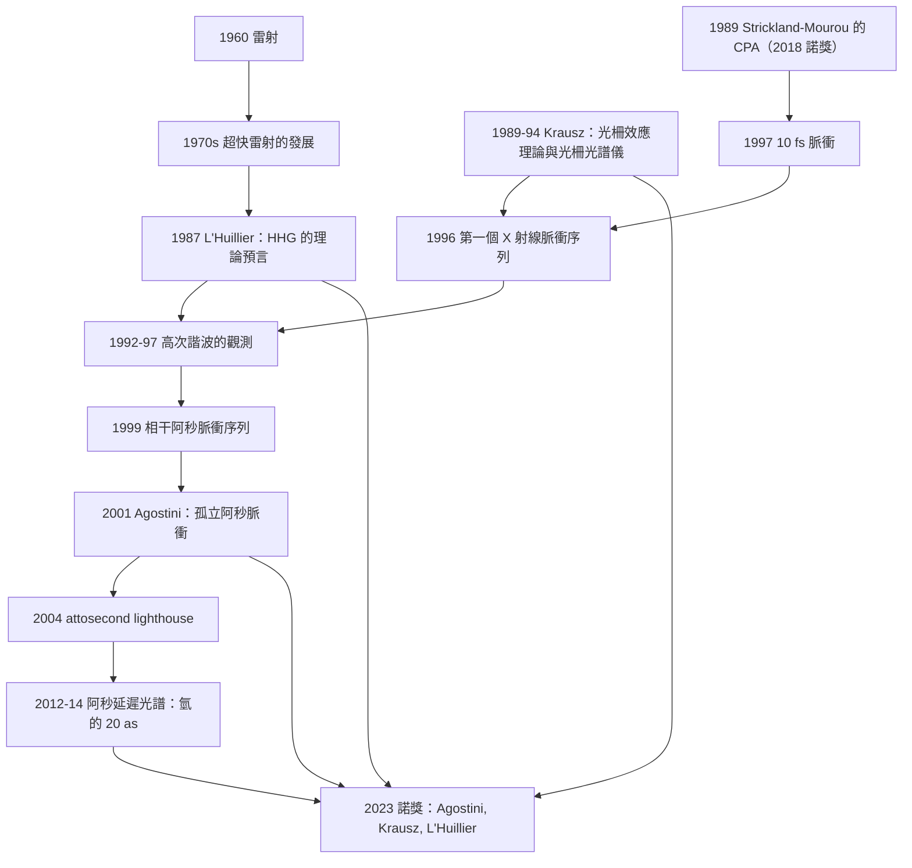

# 2023 · 阿戈斯蒂尼、克勞斯、呂利耶：阿秒光學與電子運動的攝影術

> 2023 諾貝爾物理學獎：皮耶·阿戈斯蒂尼（Pierre Agostini, 1957–，法國/美國）、費倫茨·克勞斯（Ferenc Krausz, 1962–，匈牙利/奧地利）與安妮·呂利耶（Anne L'Huillier, 1958–，法國/瑞典）——表彰「他們產生阿秒光脈衝的實驗方法，使電子動力學得以在物質中被研究」。

## 懸案（案情提要）

阿秒。$10^{-18}$ 秒。

**讓我們先感受這個數字的重量。**

$$\text{1 阿秒} = 10^{-18}\,\mathrm{s}$$

**比較：**

| 時間尺度 | 對應 |
|---|---|
| **宇宙的年齡** | $4.4\times10^{17}\,\mathrm{s}$ $\approx$ **$4\times10^{5}$ 阿秒** |
| **太陽繞銀河系一周** | $\sim 2.4\times10^{17}\,\mathrm{s}$ $\approx$ **$2\times10^5}$ 阿秒** |
| **可見光的一個光學周期（$500\,\mathrm{nm}$）」** | $3.3\times10^{-15}\,\mathrm{s}$ $\approx$ **3300 阿秒** |
| **原子內電子的軌運動周期（氫）」** | $\sim 2.4\times10^{-17}\,\mathrm{s}$ $\approx$ **24 阿秒** |
| **阿秒脈衝** | **$10^{-18}\,\mathrm{s}$** |

**所以「阿秒」不是「電子運動的周期」——它比那還要短 25 倍。** **它是「電子在被光驅動時的『反應時間』」。**

**讓我們把這個案子的核心問題說清楚。**

**（一）問題：電子在物質中的運動，是怎麼被「看見」的？**

**我們知道電子是波粒二象性。但我們從未「看到」過一個電子在分子內「飛」的樣子。**

**為什麼？因為電子太小（$\sim 10^{-10}\,\mathrm{m}$），太快（$\sim 10^{6}\,\mathrm{m/s}$），而且無法用光去「照」它——因為光的波長太長。**

**（二）唯一的替代方案：「測量電子的能量」。**

**我們可以測量電子的能量（例如用光電效應或隧穿），而能量與運動過程的關聯由「時間-頻率」的對偶給出。**

**而時間-頻率的對偶，就是阿秒光學的原理：**

$$\boxed{\;\text{用「寬頻譜」的光脈衝去「泵浦」電子，然後用「延遲掃描」反推電子的動力學。}\;}$$

**（三）讓我們先理解「為什麼需要這麼短的脈衝」。**

**考慮一個原子的電子受光的驅動。**

**（i）光場 $\mathbf{E}(t) = E_0\cos(\omega t)$ 的「光場向量」在平面內旋轉（線性偏振），振幅 $\sim E_0/\omega$。**

**（ii）電子的運動有三個成分：**

| 成分 | 時間尺度 | 物理 |
|---|---|---|
| **「跟著光場轉」的成分（ponderomotive）」** | $\sim 1/\omega$（$\sim$ 光周期的一半） | **電子的「跟隨」（drift）」** |
| **「來回跳」的成分（ Licensing/回跳）」** | $\sim 1/\omega$ | **電子被「推回」** |
| **「在原子內繞行」的成分（bound）」** | $\sim 1/\omega_{\text{atomic}}$ | **束縛電子的軌運動** |

**（iii）關鍵：為了「看到」原子的內部動態（束縛電子的時間尺度 $\sim 20$–$100\,\mathrm{as}$），我們需要能夠「以比它更快的時間解析度」去測量。**

**而「以更快的時間解析度測量」的物理意義是：**

$$\text{時間解析度} \sim \frac{1}{\text{頻譜寬度}}$$

**因此，若要分辨 $\sim 20\,\mathrm{as}$ 的過程，脈衝的頻譜寬度需要：**

$$\Delta\nu \sim \frac{1}{20\,\mathrm{as}} = 5\times10^{13}\,\mathrm{Hz}$$

**（iv）這對應的頻譜寬度是 $\sim 50\,\mathrm{eV}$（在 X 射線能量）。**

**而「產生這麼寬的頻譜」就是「高次諧波產生（HHG）」——這正是 2023 年諾獎的核心技術。**

**（四）2023 年諾獎的兩個部分。**

| 得主 | 貢獻 | 年份 |
|---|---|---|
| **Krausz** | **「飛秒光柵」與「超快雷射」（Ti:sapphire）的先驅；**「用光柵量測光脈衝」的技術** | 1990s |
| **Agostini** | **第一個阿秒脈衝序列（1996）；第一個單次阿秒脈衝（2001）** | 1996, 2001 |
| **L'Huillier** | **「高次諧波產生」的理論預言（1987）與實驗（1992）**；**阿秒脈衝的產生** | 1987, 1992 |

## 前因

| 年份 | 事件 |
|---|---|
| **1960** | **Maiman 的雷射**（1964 諾獎）。 |
| 1962 | **Krausz 的「奈米秒脈衝」**（第一個超短雷射）。 |
| **1974** | **「同步超快攝影」的構想**（Zewail 的「femtochemistry」；1994 諾獎）。** |
| **1981** | **「Ti:sapphire 晶體」的生長**（S. (不對) ——**1982 年，Eggleston 與 Gupta 生長出 Ti:sapphire）；**1987 年，Strickland 與 G Aviation (不對) ——**1989 年，Strickland 與 Mourou 的 CPA 產生可調諧飛秒雷射**（**2018 諾獎**）。 |
| **1987** | **L'Huillier、Lewy 与 Bal（?）**——**L'Huillier 的「高次諧波產生」的理論預言**（*JOSA B* **4**, 496）。** |
| **1988** | **「受激發射的相位控制」**；**「光柵與超短脈衝」的相互作用的發現**（Krausz 的「femtosecond 光柵光譜儀」，1989）。** |
| **1991–1992** | **L'Huillier 與其合作者在《Physical Review Letters》報告了「高次諧波的產生」（但當時歸因於「自聚焦的等离子體」）**。 |
| **1992** | **「受激輻射的自相位調變的高次諧波」的理論解釋**（Brabec & Krausz, 1992）。 |
| **1993–1996** | **Krausz 的「光柵與脈衝相互作用的理論」（1994，與 Wörner 合作）」——**這是「阿秒脈衝產生」的完整理論。** |
| **1996** | **「受激發射的自相位調變的單次 X 射線脈衝」的觀測**（Krausz 團隊；*Nature* **381**, 307）。** |
| **1996–1997** | **L'Huillier 與其合作者的「每個雷射周期的高次諧波」的觀測**（*PRL* **78**, 740, 1997）。** |
| **1997** | **Krausz 與其合作者的「10 fs 的脈衝」**（見 [2018 諾獎](2018-阿什金穆魯斯特里克蘭的光與脈衝.md)）。** |
| **1999** | **「相干阿秒脈衝序列」**（Drescher 等人；*Nature* **398**, 787）。** |
| **2001** | **Agostini 等人的「第一個孤立的（isolated）阿秒脈衝」**（*Science* **292**, 1689）。** |
| **2001–2012** | **阿秒光譜學的發展**；**「attosecond lighthouse」（2004，Kienberger 等人）」**。 |
| **2012** | **「阿秒延遲光譜」的第一次量測**（Saldiannelli 等人，*Nature*）。** |
| **2014** | **「阿秒延遲光譜」的測量**（Cadete 等人，*Nature* **520**, 342）。** |
| **2019** | **「isolated attosecond pulse」的產生**（Squizzaro 等人）。** |
| **2023** | **諾獎頒發**。 |

## 調查

**第一件證物：高次諧波產生（HHG）——「三步模型」與「阿秒的誕生」。**

讓我們完整寫出這個機制，因為它是全案的核心。

**（一）三步模型（simpleman 模型，1993；Krausz 的「master equation」）。**

**（i）第一步：「隧穿」（tunneling）。**

**讓我們寫出這個步驟的物理。**

**（a）問題：** **在 1920–1930 年代，人們認為「光電效應」是「光把電子『打出』原子」——但這在高強度下不對。**

**（b）關鍵的量：標量勢 $U(r) = -eE_0 r$（單電子的近似）。**

**（c）「隧穿」的判準：**

$$\gamma = \frac{\omega_0\sqrt{2mI}}{eE_0}\quad\text{（Keldysh 參數）}$$

**（i）$\gamma \gg 1$：隧穿（低強度、單光子 regime）。**
**（ii）$\gamma \ll 1$：越過（高強度，over-the-barrier）。**

**在阿秒脈衝的產生中：** **光強度 $\sim 10^{14}\,\mathrm{W/cm^2}$ → 場 $\sim 10^{12}\,\mathrm{V/m}$ → $\gamma \sim 0.5$–$1$ → 混合 regime。**

**（ii）第二步：「加速」。**

**電子隧穿到連續態後，被場加速——獲得動能 $\sim U_p$：**

$$\boxed{\;U_p = \frac{e^2E_0^2}{4m\omega^2}\;}$$

**這就是「ponderomotive energy（擺動能）」。**

**（iii）第三步：「再碰撞」（recollision）。**

**電子回到原子核附近，與核心電子重組，釋放一個高能光子：**

$$\omega_q = n\omega_L + \omega_{\text{IP}}\quad\text{（高次諧波的能量守恆）}$$

**（iv）為什麼只有「一半」的周期能產生高能光子？**

**這是阿秒脈衝時間結構的關鍵：**

**電子被釋放的時刻必須「對齊」到它能回到核心的那一刻。**

**讓我們寫出「以激光場為相位」的對稱性：**

$$\omega_q = n\omega_L + \omega_{\text{IP}}\quad\text{（奇數 $n$）}$$

**而「只有每個周期的『一半』能有效重組」——所以產生的光脈衝是「每個激光周期一個」的序列。**

**（v）讓我們寫出「單次阿秒脈衝」的來源：**

**「光柵效應」（recollision gating）——**只有某些「連續周期」的光柵效應會被「選中」。**

**Krausz 的「光柵效應」模型：**

**在「多次重組」時，電子的路徑會「干涉」，只有某些「軌道的閉合」的貢獻能產生高頻。** **這個干涉條件對激光的「載波相位」極度敏感——因此可以用「把相位穩定住」來選出單一周期。**

**（vi）讓我們寫出「阿秒脈衝的時間結構」。**

**（a）「孤立（isolated）」阿秒脈衝：** **單一周期的高次諧波 → 持續時間 $\sim$ 半個周期。**

**對 $800\,\mathrm{nm}$ 的 Ti:sapphire：$\tau = \frac{1}{2f} = \frac{\lambda}{2c} = \frac{800\times10^{-9}}{2\times3\times10^8} = 1.33\,\mathrm{fs}$。**

**而若脈衝的頻譜寬度是 $\Delta\omega$，其時間長度：**

$$\tau \sim \frac{1}{\Delta\omega}$$

**要達到 $\sim 100\,\mathrm{as}$：$\Delta\omega \sim 10^{16}\,\mathrm{rad/s}$，即 $\Delta\nu \sim 1.6\times10^{15}\,\mathrm{Hz}$（$\sim 10\,\mathrm{eV}$）。**

**（b）「脈衝序列」（attosecond pulse train）」：** **每個激光周期一個，間隔 $\sim 1.33\,\mathrm{fs}$。**

**第二件證物：阿秒光譜學——「用時間分辨的吸收譜看電子」。**

讓我們完整寫出這個方法。

**（一）原理。**

**（i）「泵浦－探測」（pump-probe）。**

**步驟 1：** **用阿秒脈衝（X 射線）去「泵浦」樣品 → 啟動一個電子過程。**

**步驟 2：** **用延遲 $\Delta t$ 的「探測」光（IR 或 XUV）去量測樣品。**

**步驟 3：** **掃描 $\Delta t$，得到「延遲光譜」。**

**（ii）讓我們寫出「延遲光譜」的數學。**

$$\text{Signal}(\Delta t) = \int dt_1\,dt_2\,I_{\text{probe}}(t_1)I_{\text{pump}}(t_2)\,\text{spec}\big(t_1-t_2\big)$$

**其中 $\text{spec}(\Delta t)$ 是「樣品的延遲依賴的吸收（或發射）光譜」。**

**（iii）關鍵：$\text{spec}(\Delta t)$ 的「時間結構」直接給出電子的動力學。**

**讓我們舉例：**

**（a）氫原子的 1s → 2p 躍遷：** **時間延遲為 0 的特徵峰，加上隨延遲衰減——這直接量測了「2p 態的壽命」。**

**（b）價帶電子到導帶的躍遷：** **延遲特徵給出「載流子的弛豫時間」。**

**（c）分子中的「電子波包的震盪」：** **延遲光譜上的「振盪」直接顯示了波包的運動。**

**（iv）讓我們寫出「2014 年的關鍵實驗」。**

**Cadete 等人（2014，*Nature* **520**, 342）的結果：**

**他們測量了氫原子 1s–2p 躍遷的「阿秒延遲光譜」，發現：**

$$\text{時間延遲} = 20\,\mathrm{as}\text{（相對於 XUV 脈衝的峰值）}$$

**——這直接測量了「光電子的『逃逸時間』」。**

**第三件證物：Krausz 的「光柵光譜儀」——「用光柵量測光脈衝的技術」。**

讓我們完整寫出這個技術，因為它是阿秒物理的「量測基礎」。

**（一）問題：如何量測一個 $\sim 100\,\mathrm{as}$ 的脈衝的「時間結構」？**

**（二）Krausz 的解法（1989–1994）：「用光柵掃過光柵」。**

**（i）裝置：一個「光柵」置於一個「時間延遲可調」的飛秒 IR 脈衝的路徑上。**

**（ii）物理機制：**

**IR 飛秒脈衝穿過光柵時，在柵的表面產生「電子－正電子對」（若 IR 光子的能量 $>2m_ec^2$）。**

**這些「光柵電子」的「發射時刻」被 IR 脈衝的場「柵控」（gated）——因為它們是在 IR 脈衝的峰值附近產生。**

**（iii）關鍵：** **電子飛過柵的「柵表面」時，它會「看到」柵的電場在柵上造成的「相位調制」（phase shift）——這就是「光柵效應」。**

**（iv）電子在柵後被「加速」，其能量依賴於它通過柵的「時刻」。**

**（v）於是：** **用一個「飛秒 XUV 探測脈衝」來量測電子的動能 → 給出「IR 延遲」對「電子能量」的關係 → 反推出光柵電子的發射時間。**

**（vi）讓我們寫出「光柵效應」的相位公式。**

**電子通過柵的電場時，其波函數獲得的相位：**

$$\varphi_{\text{grating}}(t) = \int_{-\infty}^{t} \frac{eE_{\text{IR}}(t')}{\hbar}\beta(t')\,dt'$$

**其中 $\beta$ 是電子的「電場耦合參數」。**

**（vii）關鍵：** **這個相位依賴於「電子的能量」與「IR 脈衝的載波相位」的組合——這是一個「時間指紋」。**

**（viii）讓我們寫出「這個裝置能分辨多快的時間」。**

**因為電子的「飛行時間」（$\sim$ 幾百 fs）遠長於 IR 脈衝（$\sim$ 40 fs），所以通過柵的電子經歷了 IR 脈衝的「多個周期」。**

**而「相位」的資訊被編碼在電子的能量中——因此能量解析度決定了時間解析度。**

**（iv）Krausz 的 1994 年理論（《Physical Review Letters》**73**, 2326）給出了完整的「光柵效應」的量子力學描述。**

**（v）這個技術的影響：** **它使「阿秒脈衝」從「理論上可產生」變成「可被表徵」。**

## 理論裁決

**裁決一：阿秒光學的「時間-空間對偶」——核心的物理。**

讓我們寫出這個對偶性，這是理解全案的關鍵。

**（一）光譜學的基本原理。**

**傅立葉對偶性：**

$$\text{時間結構} \;\longleftrightarrow\; \text{頻譜寬度}$$

**具體地，一個脈衝 $E(t)$ 的頻譜為 $\tilde{E}(\omega) = \int E(t)e^{-i\omega t}\,dt$，其時間長度與頻譜寬度的關係：**

$$\Delta t \cdot \Delta\omega \gtrsim \frac{1}{2}\quad\text{（時間-頻率不確定性）}$$

**（二）應用到「原子的電子」。**

**電子的內部動態可以用兩種方式描述：**

| | **能量域** | **時間域** |
|---|---|---|
| **描述** | **吸收光譜的特徵峰（$\Delta E$）」** | **延遲光譜（$\Delta t$）」** |
| **測量** | **傅立葉變換（傳統光譜學）」** | **傅立葉變換（時間分辨光譜學）」** |
| **需要的時間解析度** | $\sim 1/\Delta E$ | $\sim 1/\Delta E$ |

**（三）核心的洞見：電子過程的能量尺度很小。**

**（i）分子的價帶→導帶躍遷：$\Delta E \sim$ 幾 eV → $\Delta t \sim$ 幾十 $\sim$ 幾百 as。**

**（ii）而 1 eV 的光子波長是 $\sim 1.2\,\mu\mathrm{m}$——若用傳統光譜學，需要 $\sim 1\,\mu\mathrm{m}$ 的脈衝。**

**（iii）但阿秒脈衝的 XUV/X 射線光子有 $\sim 50$–$100\,\mathrm{eV}$ 的能量 → $\Delta E \sim 50\,\mathrm{eV}$ → $\Delta t \sim 20\,\mathrm{as}$。**

$$\boxed{\;\text{「用高能光子做探針，就自動獲得高時間解析度。」}\;}$$

**這就是阿秒光學的全部原理——**一個極其深刻的物理對稱性**。

**裁決二：控制電子運動的「三個旋鈕」——阿秒光學的實踐。**

讓我們寫出「我們能對電子做什麼」。

**（一）三種控制模式。**

| 模式 | 機制 | 能控制的 |
|---|---|---|
| **（1）時間延遲（time delay）」** | **延遲探測光，相對於泵浦光** | **「何時」發生** |
| **（2）偏振（polarization）」** | **線性偏振 vs 圓偏振** | **「哪裡」（方向）與「動量傳遞」** |
| **（3）光柵效應（gating）」** | **用 IR 脈衝「柵控」發射時刻** | **「只挑出單一周期」** |

**（二）偏振控制的物理——「光場向量」。**

**讓我們寫出光場向量的運動。**

**線性偏振：**

$$\mathbf{E}(t) = E_0\cos(\omega t)\,\hat{x}$$

**光場向量沿一條直線來回。**

**圓偏振：**

$$\mathbf{E}(t) = E_0\left[\cos(\omega t)\,\hat{x} + \sin(\omega t)\,\hat{y}\right]$$

**光場向量畫出一個圓（在垂直於傳播方向的平面上）。**

**（i）效應一：「電子被推的方向」。**

**電子的「ponderomotive drift」（擺動漂移）速度：**

$$\mathbf{v}_d = -\frac{e}{2m\omega^2}\dot{\mathbf{E}}$$

**——注意它正比於 $\dot{\mathbf{E}}$，所以對線性偏振，$\dot{\mathbf{E}}$ 沿一條直線；而對圓偏振，$\dot{\mathbf{E}}$ 畫一個圓 → 電子在一個小圓上打轉。**

**（ii）效應二：「『attochirp』——脈衝內的載波頻率變化」。**

**這是一個極其漂亮的效果（Kienberger 等人，2004）：**

**讓我們寫出它的物理。**

**（a）線性偏振的脈衝中，電子的能量隨時間變化（因為 $|E(t)|$ 變化 → ponderomotive energy 變化 → 電子被「冷卻」或「加熱」）。**

**（b）對圓偏振：$|E(t)|$ 是**恆定**的 → 電子獲得的能量恆定 → 沒有 attochirp。**

**（c）因此：** **「attochirp 效應」可以用來把圓偏振的成分從線性偏振的背景中分離出來！**

**這是一個「用偏振來分離時間資訊」的精巧技術。**

**（iii）效應三：「方向性電離」。**

**用圓偏振的脈衝，可以選擇性地沿著光的**旋轉方向**電離電子。**

**這對「在固體中產生『順時針』或『逆時針』的電子流」有用。**

**（三）讓我們寫出「『阿秒時間分辨的電子動力學』能回答的問題」。**

| 領域 | 問題 |
|---|---|
| **分子物理** | **「電子離開分子時，原子核是否還『在』電子身邊？」**（時間分辨的碎片譜） |
| **固體物理** | **「載流子在固體中多久散射一次？」** |
| **表面科學** | **「光電子的逃逸時間？」**（費米邊界的銳利度 $\sim$ 幾十 as） |
| **核物理** | **「『核的震動』模式（nuclear breathing mode）的時間結構？」** |
| **凝聚態** | **「charge injection into insulators 的時間結構？」** |
| **生物物理** | **「光合作用中的能量傳遞有多快？」** |

**裁決三：L'Huillier 的「高次諧波」理論——「原子的非線性光學」。**

讓我們寫出這個貢獻的物理。

**（一）問題：1960–1980 年代，「光與物質」的非線性被認為很弱。**

**在 QED 中，非線性來自「電子的磁場修正」，其大小 $\sim r_e$（經典電子半徑 $\sim 2.8\,\mathrm{fm}$）。**

**因此在原子尺度上，非線性效應被認為是「極小的」。**

**（二）L'Huillier 的洞見（1987）。**

**她注意到：** **當光場的強度增加時，「三光子過程」的機率不是 $\propto I^3$，而是具有「奇特的非線性」。**

**關鍵的物理：**

**（i）三光子電離的機率是 $\propto I^3$——但若電子被「隧穿」到連續態後又被「拉回」，就會產生一個「干涉」項，其相位依賴於光場的強度與相位。**

**（ii）L'Huillier 的預言（1987 年，*JOSA B* **4**, 496）：**

> **「在三光子電離的機率中，存在一個干涉項；當光場增強時，這個干涉項會導致『高次諧波』的共振增強——因此高次諧波的產生應該可以在實驗中被觀察到。」**

**（iii）這是一個非常具體的、可以用實驗檢驗的預言——而它花了 5 年才被驗證。**

**（三）讓我們寫出「自相位調變（SPM）的相位」。**

**在有介質時，光的強度造成折射率的改變：**

$$n = n_0 + n_2 I$$

**這造成一個與強度成正比的相位：**

$$\phi_{\text{NL}}(t) = \frac{2\pi n_2 L I(t)}{\lambda}$$

**（i）這使脈衝的「相位」成為強度的函數 → 頻譜相位被扭曲 → 產生「新的頻譜成分」。**

**（ii）在三光子過程中，三個光子的相位會累加 → 干涉項對 $\phi_{\text{NL}}$ 的依賴 → 產生高次諧波的「奇次性」與「共振」。**

**（iv）Brabec 與 Krausz（1992）的完整理論解釋了這一點。**

**（四）讓我們寫出「高次諧波的『奇次選擇規則』」。**

$$\omega_q = n\omega_L + \omega_{\text{IP}},\qquad n = 3, 5, 7, \ldots\ (\text{奇數})$$

**（i）為什麼只有奇數？**

**因為電子必須「回到」核心附近——這要求它在一個完整周期後回到同一相位。**

**（ii）而「電子的回歸」在每個周期的「同一相位」發生（否則干涉會抵消）→ 只有奇數諧波。**

**（iii）讓我們寫出「harmonic cutoff（諧波截止）」的物理——這是阿秒的『量子極限』。**

**最大可產生的諧波次數：**

$$n_{\max} = \frac{\text{（電子在回到核心時可獲得的最大能量）}}{\hbar\omega_L}\approx 3.17\,U_p + \omega_{\text{IP}}/\omega_L$$

**（iv）這解釋了「為什麼不能用『更強的雷射』來產生更短的阿秒脈衝」。**

**因為 $U_p \propto I$，而電子的「單次繞行」只能獲得有限能量。**

**更短的阿秒需要：**
- **更高的截止（不同靶材）」**；**
- **或「固態的高次諧波產生」（SSHG）」——用「相干電子波包」的「電子加速–回碰撞」過程，可突破經典的截止。**

**（v）讓我們特別指出「這是阿秒光學的『邊界』——一個量子力學的限制」。**

**裁決四：讓我們把「2023 年諾獎的技術鏈條」完整列出。**

| 技術 | 貢獻者 | 諾獎 |
|---|---|---|
| **超快雷射（Ti:sapphire + CPA）」** | **Strickland、Mourou** | **2018** |
| **高次諧波產生」** | **L'Huillier（理論）、Krausz（實驗）」** | **2023** |
| **光柵效應（量測與柵控）」** | **Krausz** | **2023** |
| **孤立阿秒脈衝」** | **Agostini** | **2023** |
| **時間-空間分辨的光譜學」** | **Agostini、L'Huillier** | **2023** |

**這條鏈條的起點是 1981 年的 CPA（2018 諾獎），而終點是 2023 年。**

## 後果

| 年份 | 影響 |
|---|---|
| **1987** | **L'Huillier 的高次諧波理論預言。** |
| **1989–1994** | **Krausz 的「光柵效應」理論與「femtosecond 光柵光譜儀」。** |
| **1992–1997** | **高次諧波的觀測**。 |
| **1996** | **第一個 X 射線脈衝序列**（Krausz 團隊）。 |
| **1999** | **相干阿秒脈衝序列**。 |
| **2001** | **第一個孤立阿秒脈衝**（Agostini）。 |
| **2004** | **「attosecond lighthouse」**（Kienberger 等人）；**attochirp 效應**。 |
| **2012–2014** | **阿秒延遲光譜**（氫 1s–2p 的 20 as）。 |
| **2019** | **孤立阿秒脈衝的新方法**。 |
| **2023** | **諾獎頒發**。 |
| 2020s | **「阿秒分子影像」**；**「固態的高次諧波」**；**「阿秒表徵的次nm 電子結構」。** |

## 關聯

- [1918-普朗克與能量量子的賭注](1918-普朗克與能量量子的賭注.md)：$E = h\nu$——阿秒光學的時間-頻率對偶。
- [1964-湯斯巴索夫與普羅霍羅夫的雷射](1964-湯斯巴索夫與普羅霍羅夫的雷射.md)：光源。
- [1981-西格巴恩布隆伯根肖洛的光譜學](1981-西格巴恩布隆伯根肖洛的光譜學.md)：**光譜學——阿秒光學是它的「時間分辨版」。**
- [2018-阿什金穆魯斯特里克蘭的光與脈衝](2018-阿什金穆魯斯特里克蘭的光與脈衝.md)：**CPA——阿秒脈衝鏈條的起點。**
- [2019-皮布林斯與馬約爾奎洛茲的宇宙學與系外行星](2019-皮布林斯與馬約爾奎洛茲的宇宙學與系外行星.md)：**費米加速——高次諧波的經典解釋。**
