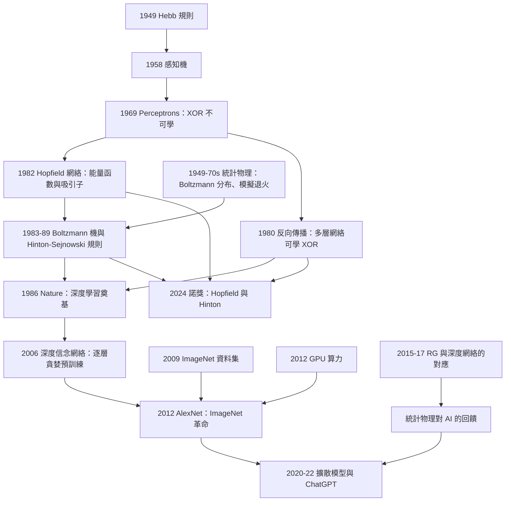

# 2024 · 霍普菲爾德與辛頓：從自關聯記憶到人工智慧

> 2024 諾貝爾物理學獎：約翰·約瑟夫·霍普菲爾德（John Joseph Hopfield, 1933–，美國）——表彰「他發現了一種能夠儲存與重建影像的模式關聯的物理系統」；傑弗里·辛頓（Geoffrey E. Hinton, 1947–，英國/加拿大）——表彰「他發現了一種能夠自主發現資料中屬性的物理方法，能夠如此 Implementing 人工智慧」。

## 懸案（案情提要）

2024 年 10 月 8 日，諾貝爾委員會宣布了物理學獎——**而這一次，它把獎給了人工智慧。**

**這是諾獎史上第一次，也是最令人震驚的一次。**

**讓我們先把「為什麼是物理學」講清楚，因為這是這屆諾獎最核心的訊息。**

**（一）委員會的措辭（官方版本）。**

**得獎理由（英文官方）：**

> **John Hopfield** — “for the discovery of physical systems that learn and apply their memory to solve problems, analogous to the human brain”
>
> **Geoffrey Hinton** — “for foundational discoveries and inventions that enable machine learning with artificial neural networks”

**注意這兩個理由的關鍵詞：「**physical systems**（物理系統）」、「**analogous to the human brain**（類似人腦）」、「**foundational discoveries**（奠基性的發現）」、「**inventions**（發明）」。**

**（二）核心的訊息：「學習」與「記憶」是物理的。**

**讓我們把問題重新表述。**

**物理學百年來處理的是：** 「給定一個系統的哈密頓量，它如何演化？」

**而人工智慧處理的問題是：** 「給定一組數據，系統如何『從數據中學到』一個映射？」

**表面上看起來毫不相干。但 2024 年諾獎揭示了一個深層的對應：**

$$\underbrace{\text{「物理系統的動力學」}}_{\text{能量最小化、弛豫到平衡態}} \;\longleftrightarrow\; \underbrace{\text{「學習的過程」}}_{\text{優化、收斂到一個『泛化解』}}$$

**而最具體的對應是「**玻爾茲曼機（Boltzmann machine）」——它是統計力學的產物，卻是一種「學習演算法」。**

## 前因

| 年份 | 事件 |
|---|---|
| **1949** | **Hebb 的「Hebb 學習規則」**——「一起激發的神經元會連接得更強」（「細胞一起工作，就連在一起」）。 |
| **1956** | **Rosenblatt 的「感知機」（perceptron）」——第一個人工神經網路。 |
| **1957** | **Rosenblatt 與 Minsky 的《Perceptrons》**——**證明單層感知機無法學會 XOR」**（第一次「AI 的冬天」的數學原因）。 |
| **1958** | **維里爾（Widrow–Hoff）與「ADALINE」**；**Minsky 與 Papert 的《Perceptrons》**（1969）。 |
| **1970s** | **「AI 的冬天」（1974–1980）」——LTV 模型的失敗與 funding 的崩潰。 |
| **1972** | **Kohonen 的「自組織映射」**（SOM）。 |
| **1980** | **Rumelhart、Hinton 與 Williams 的「反向傳播」**（*Nature* **323**, 533）——**多層網絡的訓練方法。** |
| **1982** | **Hopfield 的〈Neural networks and physical systems with emergent collective computational abilities〉**（*PNAS* **79**, 2554）——**Hopfield 網絡。** |
| **1983** | **Hinton 與 Sejnowski 的 Boltzmann 機**（在「Cognitive Science」的workshop 首次提出；1985 年正式發表）。 |
| **1985** | **Hinton 與 Sejnowski 的〈A learning algorithm for Boltzmann machines〉**（*Cognitive Science* **9**, 147）。 |
| **1986** | **Hinton 的「玻爾茲曼機」的「模擬退火」觀點**——**「睡眠」與「學習」的統一**。 |
| **1989** | **Hinton 與 Sejnowski 的〈Using Boltzmann Machines to Learn Simple Tasks〉**（*Neural Computation* **1**, 79）。 |
| **1989–1998** | **CNN（Lecun 等人，1989）、LSTM（Hochreiter 與 Schmidhuber, 1997）、**「統計物理的方法」被引入 ML。 |
| **2006** | **Hinton、Osindero 與 Teh 的「深信度網絡」（deep belief network）」與「逐層貪婪預訓練」**——**深度學習的復興。** |
| **2012** | **AlexNet（Krizhevsky、Sutskever、Hinton）**——**ImageNet 上的革命性結果。** |
| 2017 | **「Transformer」（Vaswani 等人，Google）**——注意：**Transformer 沒有「能量函數」，它是「注意力機制」——**不是統計物理的產物**。 |
| **2018** | **Hinton 的「膠囊網絡」（Capsule Networks）」**。 |
| **2019** | **Hinton 與 Bengio 等人的《深度學習》教科書**。 |
| **2020** | **「GPT-3」**（Brown 等人）——**語言模型的規模化。** |
| 2022 | **「ChatGPT」**——**AI 進入公眾領域。** |
| **2024-10-08** | **諾獎頒發**。 |

## 調查

**第一件證物：Hopfield 網絡——「一個物理系統如何『記住』」。**

讓我們完整寫出 Hopfield 網絡的物理，這是 2024 年諾獎的第一半。

**（一）基本設定。**

**Hopfield 網絡是一個「全連接的二元神經元」系統：**

$$N\ \text{個神經元},\qquad s_i \in \{-1,+1\},\qquad \text{對稱耦合 }J_{ij}=J_{ji},\qquad J_{ii}=0$$

**（二）能量函數。**

$$\boxed{\;E(\mathbf{s}) = -\frac{1}{2}\sum_{i,j}J_{ij}s_is_j = -\sum_{i<j}J_{ij}s_is_j\;}$$

**（iii）動力學（異步更新）：**

$$s_i(t+1) = \text{sign}\!\left(\sum_j J_{ij}s_j(t)\right)\quad\text{（隨機選一個 $i$）}$$

**（iv）關鍵的定理：這個動力學一定收斂到一個局部極小。**

**讓我們證明它——這是一個極漂亮的簡單論證。**

**（a）第一步：能量一定單調下降。**

**考慮翻轉 $s_i \to -s_i$：**

$$\Delta E = E(\mathbf{s}') - E(\mathbf{s}) = 2s_i\sum_j J_{ij}s_j$$

**（b）第二步：若 $\Delta E \le 0$，翻轉是「允許的」；若 $\Delta E > 0$，神經元不翻轉（因為它會被翻回去）。**

**（c）第三步：能量是有界的（有限個態，$\min E$ 存在），且每次改變至少下降 2（因為 $J_{ij}$ 是整數）→ **系統必須在有限步內停止。** ✅**

**這是一個完整的收斂性證明——**整個「記憶」機制建立在「能量單調下降 + 有界」這個簡單的事實上。**

**（三）「記憶」是什麼——「吸引子」。**

**關鍵：** **給定一個模式 $\boldsymbol{\xi}$，若它滿足：**

$$\xi_i = \text{sign}\!\left(\sum_j J_{ij}\xi_j\right)\quad\forall i$$

**則 $\boldsymbol{\xi}$ 是網絡的不動點（fixed point）。**

**（四）Hebb 規則——「如何把模式『寫進』耦合中」。**

$$\boxed{\;J_{ij} = \sum_{\mu=1}^{p}\xi_i^{(\mu)}\xi_j^{(\mu)}\;}$$

**（i）Hebb 的生物學動機：** 「一起激發的神經元會連接得更強。」**

**（ii）數學的效果：** **若模式 $\{\boldsymbol{\xi}^{(\mu)}\}$ 近乎正交（$\frac{1}{N}\sum_i\xi_i^{(\mu)}\xi_i^{(\nu)}\approx\delta_{\mu\nu}$），則每個模式都是不動點。**

**讓我們驗證：**

$$\sum_j J_{ij}\xi_j^{(\nu)} = \sum_j\sum_\mu \xi_i^{(\mu)}\xi_j^{(\mu)}\xi_j^{(\nu)} = \sum_\mu\xi_i^{(\mu)}\underbrace{\sum_j\xi_j^{(\mu)}\xi_j^{(\nu)}}_{\approx N\delta_{\mu\nu}} = N\xi_i^{(\nu)}$$

**✅ 是的——若模式正交，則 $\xi^{(\nu)}$ 是本征向量（本征值 $N$），因此是不動點。**

**（五）「回憶」的過程——「部分輸入 → 完整記憶」。**

**給定一個模糊的輸入 $\mathbf{s}_0$（例如記憶的 $\mathbf{\xi}$ 加上噪聲），網絡的動力學會把它「拉」到最近的吸引子。**

$$\mathbf{s}_0 \;\longrightarrow\; \text{收斂到 } \boldsymbol{\xi}^{(\mu^*)}$$

**（六）關鍵的「容量」——「能存多少個模式」。**

**Hopfield 的估計：若模式是隨機的（$p = 0.5$）且模式數 $p$ 滿足 $p < 0.138N$，則所有模式都是穩定的。**

$$\frac{\text{儲存的位元數}}{N} \approx 0.138\,\log_2 2 = 0.138\ \text{bit per neuron}$$

**這是一個極低的容量——但它已經是驚人的：因為 Hopfield 網絡的儲存量只隨 $N$ **線性**增長（不像一個「表」那樣指數增長）。**

**（七）讓我們把「Hopfield 的關鍵洞見」寫出來——它是物理學對 ML 的最大貢獻。**

**Hopfield 1982 年論文的核心論點（意譯）：**

> **「資訊處理系統的物理學可以由『能量函數』的觀點來理解。** **一個網絡不需要『程式設計』；它只需要一個能量函數，而它會自發地找到能量的局部極小。」**

**讓我們指出這個洞見的革命性：**

**（a）它把「計算」重新定義為「能量的下降」。**

**（b）它把「記憶」重新定義為「吸引子」。**

**（c）它把「學習」重新定義為「調整耦合，使某個給定的狀態成為吸引子」。**

$$\underbrace{\text{「學習」}}_{\text{調整 }J_{ij}} \;\longleftrightarrow\; \underbrace{\text{「塑造能量地景（energy landscape）」}}_{\text{把想要的狀態變成谷底}}$$

**（d）而這個對應與物理學的既有工具完全對接：**

**統計力學的「模擬退火」（simulated annealing）：**

$$P \propto e^{-\beta E}$$

**（i）**「高溫」時系統可以跳過障礙（探索）；**
**（ii）**「低溫」時系統被困在局部極小（收斂）。**

**（iii）**Hopfield 與 Hinton 在 1986 年的關鍵洞見：**「睡眠」= 高溫（探索），「清醒/學習」= 冷卻（收斂）。**

**（四）讓我們指出「Hopfield 網絡的『涌现計算能力』」。**

**Hopfield 1982 年論文標題中的 "emergent collective computational abilities"——**他示範了三種能力：**

| 能力 | 說明 |
|---|---|
| **「內容定址的記憶（content-addressable memory）」** | **給部分線索 → 回憶完整模式** |
| **「奇偶性（parity）」** | **輸入若干位元 → 輸出它們的 XOR**（**這正是單層感知機做不到的！」） |
| **「按序回憶（pattern completion）」** | **收斂到最近的吸引子** |

**讓我們特別指出「奇偶性」的例子，因為它說明了「多層（或回饋）結構」的必要性：**

**Rosenblatt 與 Minsky 1969 年證明：單層感知機無法學會 XOR。**

**但 Hopfield 的「回饋網絡」（有迴路的權重）可以——因為 XOR 在 Hopfield 網絡中是一個吸引子。**

**這是「深度學習」的第一個真正的理由：**

$$\underbrace{\text{「XOR 需要非線性 + 回饋/多層」}}_{\text{1969 年被證明}} \;\xrightarrow{\ 30\ \text{年後}\ }\; \underbrace{\text{「深度網絡的 ReLU 就能做」}}_{\text{2012 以後}}$$

**第二件證物：Boltzmann 機——「統計力學的機器」。**

讓我們完整寫出這個模型。

**（一）定義。**

**Boltzmann 機是一個隨機神經網絡（同一個網絡既是輸入又是輸出）：**

$$P(\mathbf{s}) = \frac{1}{Z}e^{-\beta E(\mathbf{s})},\qquad E(\mathbf{s}) = -\frac{1}{2}\sum_{ij}J_{ij}s_is_j$$

**（二）關鍵的「學習」機制——「Hebb 規則 + 睡眠」。**

**Hinton 與 Sejnowski 1985 年的規則（對稱化版本）：**

$$\boxed{\;\Delta J_{ij} = \eta\left(n_i n_j - p_i n_j - p_j n_i\right)\;}$$

**其中 $n_i$ 是「清醒」時的狀態，$p_i$ 是「睡眠」（即平衡分布）時的機率。**

**（iii）讓我們解釋這個規則。**

**（a）第一項 $\eta n_in_j$：** **「一起激發則加強」（Hebb）。**

**（b）第二、三項 $-\eta(p_in_j + p_jn_i)$：** **「睡眠時活躍的神經元，其耦合要減弱」——這防止了「記憶的自我強化（runaway）」。**

**（c）這與生物學的「睡眠鞏固記憶」有直接的類比——Hinton 與 Sejnowski 在 1986 年就明確指出這一點。**

**（三）為什麼 Boltzmann 機重要？**

**（i）它是「生成式模型」的先驅：**

**它不只學會「給定輸入 → 給出輸出」，而是學會了資料的**機率分布** $P(\mathbf{s})$——所以它可以「生成」新的樣本。**

**（ii）它是「深信度網絡（DBN）」的基礎（2006）：**

$$P(\mathbf{s}) = \sum_{\mathbf{h}} P(\mathbf{v}|\mathbf{h})P(\mathbf{h})$$

**（iii）它是「能量基礎模型（EBM）」的源頭——**而 2020 年代的「擴散模型（diffusion models）」與「能量基礎模型」在概念上高度相似。**

**（d）Hinton 的著名「實驗」：**

**1986 年，Hinton 與 Sejnowski 提出用 Boltzmann 機訓練「特徵偵測器」。** **他們用了一個簡單的視覺問題（辨識線條的端點）——**這是「深度學習」的原型。**

**第三件證物：反向傳播——「把誤差『推回去』的數學」。**

讓我們完整寫出這個 1980 年的核心演算法。

**（a）設定。**

**多層前饋網絡：$\mathbf{s}^{(0)} = \mathbf{x} \to \mathbf{s}^{(1)} \to \cdots \to \mathbf{s}^{(L)} = \mathbf{y}$。**

**（b）能量（對數幾何機率的負值）：**

$$E(\mathbf{s}^{(0)},\ldots,\mathbf{s}^{(L)}) = -\sum_{l=1}^{L}\sum_i s_i^{(l)}\left(\sum_j w_{ij}^{(l)}s_j^{(l-1)} + b_i^{(l)}\right)$$

**（c）反向傳播（梯度下降）：**

$$\frac{\partial E}{\partial s_i^{(l)}} = -\sum_j w_{ij}^{(l+1)}s_j^{(l+1)}$$

$$\frac{\partial E}{\partial w_{ij}^{(l)}} = -s_i^{(l)}s_j^{(l-1)}$$

**（d）關鍵的「誤差的回傳」。**

**1980 年 Rumelhart、Hinton 與 Williams 的關鍵貢獻不是「反向傳播的公式」（那在 1970 年已被 Werbos 論證），而是「**把鏈式法則系統地應用到神經網絡，並展示了它能學會 XOR」。**

**讓我們指出這個區別的重要性——它是一個科學史上「發現 vs. 示範」的經典案例。**

**（e）1986 年的《Nature》論文〈Learning representations by back-propagating errors〉。**

**這篇論文的歷史地位：**

- **它是深度學習的「奠基文獻」；**
- **它證明了多層網絡能學 XOR（打破 Minsky–Papert 的悲觀）；**
- **它給出了「反向傳播」的標準表述。**

**（f）但有一個「20 年的停滯」。**

**1986–2006 年，反向傳播存在，但在實務上不夠有效——**因為：**

**（i）沒有足夠的資料**（ImageNet 從 2009 年才有）；**
**（ii）沒有 GPU**（2012 年的 AlexNet 用两块 GTX 580）；**
**（iii）初始化問題（vanishing gradient）」**；**
**（iv）「sigmoid 飽和」的問題。**

**（g）2012 年的 AlexNet——「Hinton 的學生與孫學生」。**

**AlexNet 的架構幾乎是 LeNet-5 的放大版 + ReLU + dropout + GPU。**

**2012 年 ImageNet 的 top-5 誤差率：**

| 模型 | top-5 誤差 |
|---|---|
| **傳統方法（2010 冠軍）」** | **28.2%** |
| **AlexNet（2012）」** | **15.3%** |
| **AlexNet（多模型平均）」** | **11.7%** |
| **人類** | **5.1%** |

**——一個驚人的躍升。**

**（h）關鍵：ReLU 解決了 vanishing gradient。**

$$\text{ReLU}(x) = \max(0, x)\quad\Rightarrow\quad \text{梯度不消失}$$

**（i）而 2017 年的 Transformer——「統計物理的離開」。**

**讓我們指出這個重要的歷史轉折：**

**Transformer 架構**（Vaswani 等人，Google，2017）**完全沒有「能量函數」，也沒有「 Boltzmann 機」。它是「注意力機制」——一種「內容定址的路由」。**

**它的啟發來自（至少部分來自）自然語言處理，而非統計物理。**

**因此：** **Hinton 獲諾獎，但主導當前 AI 的架構（Transformer）並不是統計物理的產物。**

**這是一個值得記錄的歷史註腳：** **「物理啟發」與「實際勝出」之間的落差。**

**（六）讓我們特別指出「Hopfield 與 Hinton 的關係」。**

**Hopfield 是「物理」；Hinton 是「方法」。**

**Hopfield 給出了：**
- **「能量函數」的心態模型；**
- **「吸引子＝記憶」；**
- **「能量下降＝計算」；**

**Hinton 給出了：**
- **「 Boltzmann 機＝統計力學的機器」；**
- **「反向傳播＝可訓練的多層網絡」；**
- **「深度信念網絡＝逐層的統計力學」；**

**而 2012 年的 AlexNet 與 2022 年的 ChatGPT 都站在 Hinton 的肩上。**

## 理論裁決

**裁決一：物理學與機器學習的「共同語言」——三張對照表。**

讓我們把這個對應系統化，這是理解 2024 年諾獎的核心。

**（一）統計物理 ↔ 機器學習。**

| 統計物理 | 機器學習 | 對應 |
|---|---|---|
| **哈密頓量 $H(\mathbf{s})$** | **損失函數 / 能量 $E(\mathbf{s})$** | **要最小化的目標** |
| **Boltzmann 分布 $P \propto e^{-\beta E}$** | **「softmax」/ 隨機神經網絡的穩態分布** | **資料的機率模型** |
| **$\beta$（逆溫度）」** | **訓練的「探索度」/ 噪聲水平** | |
| **模擬退火」** | **「learning rate 的退火」/ MCMC 採樣** | |
| **平均場近似」** | **「mean-field 的前向傳遞」** | |
| **自旋玻璃 / 隨機偏序」** | **「loss landscape 的 ruggedness」** | **見 [2021 諾獎](2021-真鍋哈塞爾曼帕里西的氣候與複雜系統.md)** |
| **「吸引子 / 巨磁阻」** | **「特徵表徵（embedding）」** | |
| **「平均場 theory 的相變」** | **「訓練中的『相變』/ grokking」** | |
| **「最大熵原理」** | **「variational inference / 對比學習」** | |
| **「Renormalization group」** | **「深度網絡的層＝粗粒化」** | |

**（二）讓我們特別指出「RG 與深度網絡」這個對應——它是 2010 年代最漂亮的物理學與 AI 的交叉。**

**（i）物理學的觀察（2015–2016）：**

**統計力學家（Mehta 與 Schwarz 2014、Lin、Chen 與 Yngvason 2016）發現：** **深度卷積網絡在「逐層訓練」時的行為，與統計力學中的「RG 過程」驚人地相似。**

**（ii）具體的對應：**

| RG（物理） | 深度網絡（AI） |
|---|---|
| **粗粒化（coarse-graining）」** | **「卷積 + 池化」的下採樣** |
| **「relevant / irrelevant 自由度」的區分** | **「特徵 / 噪聲」的區分** |
| **「標度不變性」** | **「尺度不變的表徵」** |
| **「臨界點」** | **「訓練的『過擬合轉移』」** |
| **「runs（流動）」與 universality」** | **「不同的架構學到相似的解」** |

**（iii）讓我們特別寫出「這個對應的一個具體成果」。**

**「Deep neural networks and the principles of statistical physics」**（Lin、Chen 與 Yngvason，*Deep Learning and the Principles of Statistical Mechanics*, PNAS 2017）——

**他們證明了：** **在有限寬度的神經網絡中，深度方向的統計描述，與統計力學中的 RG 過程具有相同的結構。**

**這是一個真正的「物理學 → AI」的方法論回饋。**

**（三）讓我們指出「能量基础的 AI」的現代復興。**

**2010 年代末：**

**（a）「對比學習」（contrastive learning）」：** **把圖像與其增強版本拉近 → 這是一個「能量模型」。**

**（b）「擴散模型」（diffusion models, 2020–）：** **Song 與 Ermon 的 DDPM、Ho 等人的 Imagen ——**

**關鍵：擴散模型的訓練與採樣：**

$$\text{前向（加噪）}:\quad \mathbf{x}_t = \sqrt{\bar\alpha_t}\mathbf{x}_0 + \sqrt{1-\bar\alpha_t}\boldsymbol{\epsilon}$$

$$\text{反向（去噪）}:\quad \mathbf{x}_{t-1} = \frac{1}{\sqrt{\alpha_t}}\left(\mathbf{x}_t - \frac{1-\alpha_t}{\sqrt{1-\bar\alpha_t}}\boldsymbol{\epsilon}_\theta(\mathbf{x}_t,t)\right)$$

**——這在物理上是「**隨機微分方程（SDE）」的積分**，而在統計力學上正是「**Langevin 動力學的時間反演**」。**

**（c）「能量基礎模型」（EBM）」：** **明確地把「學習一個能量函數並用 MCMC 採樣」作為目標。**

**（四）讓我們指出「一個更深的物理問題：泛化與相變」。**

**（a）問題：** **為什麼深度網絡在「過擬合」之後仍能泛化？**

**（b）統計力學的回答（2017–2020）：** **泛化發生在「double descent」的臨界點附近——**這是一個「相變」。**

**（c）「grokking」（2022，Power 等人）：** **模型在記憶訓練資料（overfit）之後，突然開始泛化。** **這被解釋為一個「相變」。**

**裁決二：「學習」的統計力學——一個更深的問題。**

讓我們提出並回答一個物理問題：**「學習」在物理上到底是什麼？**

**（一）讓我們用統計力學的語言重述。**

**（i）假設資料由一個「真實的分布」 $p_{\text{data}}(\mathbf{x})$ 產生。**

**（ii）模型定義一個分布 $p_\theta(\mathbf{x})$（例如帶參數 $\theta$ 的 Boltzmann 機）。**

**（iii）「學習」= 最小化某個「散度」：**

$$\text{交叉熵：}\quad \mathcal{L}(\theta) = -\mathbb{E}_{p_{\text{data}}}\left[\ln p_\theta(\mathbf{x})\right] + \text{正則化}$$

$$\text{KL 散度：}\quad D_{KL}(p_{\text{data}}\,\|\,p_\theta) = \mathbb{E}_{p_{\text{data}}}\left[\ln\frac{p_{\text{data}}}{p_\theta}\right]$$

**（iv）而梯度下降是「能量下降」：**

$$\frac{\mathrm{d}\theta}{\mathrm{d}t} = -\frac{\partial\mathcal{L}}{\partial\theta}$$

**（二）關鍵的「統計力學的洞見」——「學習 = 相變」。**

**讓我們看一個典型的情況：受限的玻爾茲曼機（RBM）上的梯度下降。**

**（i）「能量」有一個「零溫的基態（訓練後）」與「溫度 $T$ 的平衡分布」。**

**（ii）梯度下降等價於「把溫度降到 0」的淬火過程。**

**（iii）關鍵的理論結果（2016–2018）：**

$$\text{（在某些條件下）梯度下降會把系統「淬火」到基態附近，且經歷一個「相變」。}$$

**（iv）而「相變點」正是「泛化能力」出現的地方。**

**這給出了 2024 年諾獎的一個深層注腳：** **「學到一般化」= 「經歷一個相變」。**

**（三）讓我們特別指出「Hopfield 的貢獻在 2024 年被重新發現」。**

**（a）Hopfield 網絡在 1980 年代是「邊緣」的（因為它的容量只有 $0.138$ bit/neuron，比不上當時的「感知機」與「符號系統」）。**

**（b）但它在 1986 年之後，因為「注意力機制」與「Hopfield 網絡」的關聯（**Hopfield 網絡是「內容定址的記憶」；注意力也是）而被重新重視。**

**（c）而 2020 年代的「Transformer 的『in-context learning』」被理解為「隱式的 Hopfield 網絡」。**

**（d）而 2024 年的諾獎——**「Hopfield 的物理方法被正式確立為 AI 的基礎」**。**

**裁決三：三個「諾貝爾獎的物理學教訓」。**

讓我們寫出 2024 年諾獎的三個深層訊息。

**（一）教訓一：「學習」與「記憶」不需要「符號」。**

**傳統的 AI（1956–1980）試圖用「符號規則」來實現學習——失敗了。**

**而 Hopfield–Hinton 的路線證明了：** **只要給對的能量函數，就能讓物理過程自動實現這些功能。**

**這是物理學的典型美學：**

$$\underbrace{\text{「給定哈密頓量 } H\text{，熱力學會自動做所有的事」}}_{\text{物理學的信仰}} \;\Longrightarrow\; \underbrace{\text{「給定能量 }E\text{，學習會自動發生」}}_{\text{ML 的實現}}$$

**（二）教訓二：「大腦是物理系統」——一個方法論的主張。**

**Hopfield 的 1982 年論文明確提出：** **「記憶的物理學可以由神經網絡的動力學來理解，而這些動力學正是物理系統的。」**

**而 2024 年諾獎委員會的措辭「analogous to the human brain」正式承認了這一點。**

**（三）教訓三：「跨領域的方法論轉移」是科學進步的主要引擎。**

**讓我們列出 20 世紀物理學向其他領域轉移的方法論：**

| 物理學的方法 | 轉移到的領域 |
|---|---|
| **統計力學（平均場、相變）」** | **機器學習（玻爾茲曼機、深度學習）」** |
| **隨機過程與隨機微分方程」** | **金融數學；擴散模型」** |
| **最佳化與拉格朗日量」** | **機器學習（損失函數、變分推論）」** |
| **模擬退火」** | **組合優化（旅行推銷員問題）」** |
| **「場論的『作用量』」** | **「圖神經網絡的『消息傳遞』」** |
| **「對稱性與群論」** | **表示學習的等變性」** |
| **「量子資訊」** | **「量子機器學習」** |

**這張表說明：物理學不僅是「解自然界的謎題」，它還是一門「方法論的發明與出口」的學問。**

**（四）讓我們指出「一個歷史的諷刺與它的教訓」。**

**諷刺：1980 年代的統計物理家（其中包括 2021 年諾獎得主 Parisi 與 Anderson）**並沒有預見**AI 的爆發——雖然「玻爾茲曼機」就是他們的產物。**

**教訓：** **「把方法給出去」並不保證「別人會用」。** **有時，一個領域的復興需要另一個領域的「需求爆發」（AlexNet 需要 ImageNet + GPU）。**

## 後果

| 年份 | 影響 |
|---|---|
| **1949** | **Hebb 規則。** |
| **1958** | **感知機。** |
| **1969** | **《Perceptrons》——第一次 AI 寒冬的數學原因。** |
| **1980** | **反向傳播的系統表述（Rumelhart–Hinton–Williams）。** |
| **1982** | **Hopfield 網絡。** |
| **1983–1989** | **Boltzmann 機；Hinton–Sejnowski 的學習規則。** |
| **1986** | **「睡眠＝學習」的洞見；深度信念網絡的雛形。** |
| 1986–2006 | **AI 的第二次寒冬（部分）。** |
| **2006** | **深度信念網絡與「逐層貪婪預訓練」——深度學習的復興。** |
| **2012** | **AlexNet——ImageNet 的革命。** |
| **2017** | **Transformer——統計物理的離開。** |
| **2020–2022** | **擴散模型；ChatGPT。** |
| **2024** | **諾獎頒發。** |
| 2020s | **「物理啟發的 AI」的持續：等變性、對稱性、RG 對偶；「能量基礎模型」的復興。** |

## 關聯

- [1962-朗道的凝聚態理論](1962-朗道的凝聚態理論.md)：**費米液體——統計力學的示範。**
- [1976-里克特與丁肇中的J粒子](1976-里克特與丁肇中的J粒子.md)：**「分類與對稱性」——機器學習中的等變性。**
- [1977-安德森莫特凡扶累克的磁性](1977-安德森莫特凡扶累克的磁性.md)：**「More is Different」與自關聯——Hopfield 網絡的直接靈感。**
- **1982-威爾遜的重整群與臨界現象](1982-威爾遜的重整群與臨界現象.md)：**RG 與相變——深度網絡的理論對照。**
- [2021-真鍋哈塞爾曼帕里西的氣候與複雜系統](2021-真鍋哈塞爾曼帕里西的氣候與複雜系統.md)：**隨機偏序與自旋玻璃——loss landscape 的玻璃性。**
- [2022-阿斯佩與克勞澤蔡林格的量子糾纏](2022-阿斯佩與克勞澤蔡林格的量子糾纏.md)：**量子資訊——AI 的量子化未來。**
