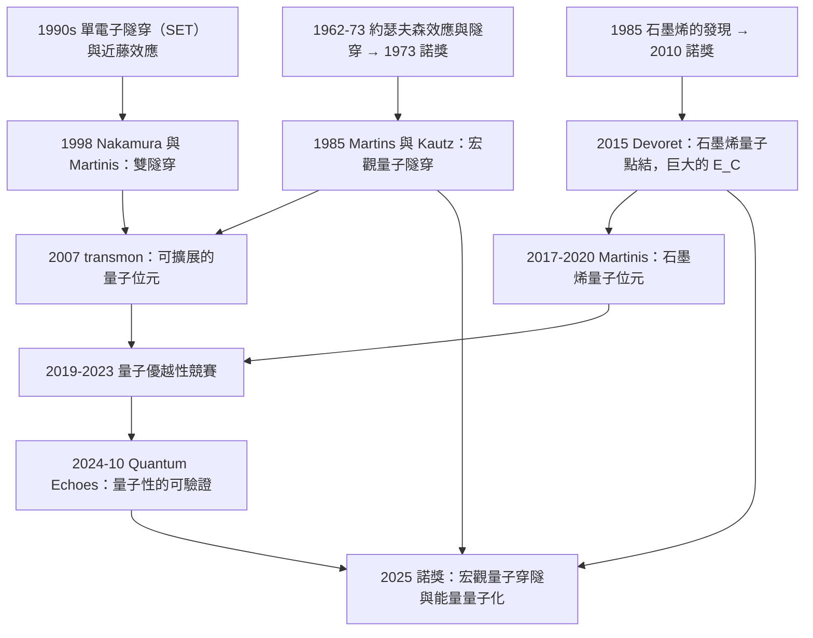

# 2025 · 克拉克、德沃雷、馬丁尼斯：電路中的宏觀量子穿隧與能量量子化

> 2025 諾貝爾物理學獎：约翰·克拉克（John Clarke, 1942–，英國/美國）、米歇爾·H·德沃雷（Michel H. Devoret, 1953–，法國/美國）與約翰·M·馬丁尼斯（John M. Martinis, 1958–，美國）——表彰「他們發現了電路中的宏觀量子力學穿隧與能量量子化」。

## 懸案（案情提要）

2025 年 10 月 7 日，諾貝爾委員會宣布了物理學獎，表彰的是**「電路中的宏觀量子穿隧」**。

**讓我們先理解這個措辭中的三個關鍵詞，以及它為什麼是一個諾獎級的發現。**

**（一）「宏觀」：量子效應出現在一個『宏观尺度』的系統中。**

**（二）「穿隧」：這是 1973 年諾獎（江崎、賈埃弗、約瑟夫森）的物理。**

**（三）「能量量子化」：這是量子力學最核心的後果——一個宏觀電路的能階是離散的、且可以被「數出來」。**

**讓我們把「這個發現到底說明了什麼」說清楚。**

**（一）1980 年代：Josephson 結的「量子」。**

**1973 年諾獎表彰的是「約瑟夫森效應」：兩個超導體之間的薄絕緣層可以承載無阻力的超電流，且其相位差與電流有直接關係：**

$$I = I_c\sin\phi,\qquad V = \frac{\hbar}{2e}\frac{\partial\phi}{\partial t}$$

**（i）但 Josephson 結是「宏觀的量子器件」嗎？**

**（ii）1980 年代的問題：** **在 Josephson 結中，量子效應是「隱藏的」——它的宏觀表現是「臨界電流 $I_c$」，而 $I_c$ 是一個「連續可調」的參數（由溫度與結構決定）。**

**（iii）關鍵的問題：** **「超導環中的磁通」是量子的嗎？**

**（a）「磁通量子」的證據（1980s–90s）：**

$$\Phi_0 = \frac{h}{2e} = 2.068\times10^{-15}\,\mathrm{Wb}$$

**——這在 1980 年代被精確測量（與 $h/e^2$ 一起）。**

**（b）但更深的問題：** **「宏觀的磁通量子」意味著「宏觀的量子力學行為」。**

**1985 年，**Martinis 與 Kautz 的實驗**首次在「超導環的並聯陣列（ SQUID 陣列）」中觀測到「宏觀的隧穿」——電流以「一個磁通量子」的步長跳變。**

**（ii）但這仍是「半經典的」——因為在當時的電阻（$R \sim \mathrm{k}\Omega$）下，電容 $C \sim \mathrm{pF}$ 給出的「電荷量子」**

$$e_C = \sqrt{\frac{2e^2}{C}}\sim \text{數十}\,\mu\mathrm{V}$$

**——太小了，不構成「宏觀量子」。**

**（二）1980–1990 年代：把 Josephson 結做成「小電阻」——「把量子效應放大」。**

**讓我們寫出關鍵的量。**

**（i）「約瑟夫森結的電阻」 $R$ 與「宏觀量子性」的判準。**

**（ii）關鍵的物理：當 $R \ll R_K = h/e^2 \approx 25.8\,\mathrm{k}\Omega$ 時，結的行為變得「量子力學的」。**

**（iii）讓我們寫出「電流偏壓關係」的量子形式。**

**在 $R \ll R_K$ 的極限，結的$I-V$ 特性是「量子」的：**

$$I(V) = \sqrt{\frac{2e}{\hbar R}}\cdot\frac{V}{R_K}\cdot\frac{V}{\Delta}\ln\left(1 + e^{-\pi\Delta V/eR_K}\right)$$

**（iv）關鍵的「能量量子化」的判準：**

$$\frac{E_C}{E_J} = \frac{e^2/C}{E_J} = \frac{2e^2}{CK_J}\quad\text{（電荷能／約瑟夫森能）}$$

**當 $E_C \ll E_J$（即 $C \ll C_{\text{max}}$）時，結的行為是「超導的」（宏觀量子相干）。**

**（iii）如何做出「低電阻」的結？**

**（a）「隧道結」的電阻：**

$$R \sim \frac{1}{\sigma t}\exp\!\left(\frac{2\sqrt{2m\Phi}t}{\hbar}\right)$$

**——指數依賴於「勢壘厚度 $t$」。因此要小電阻就要薄勢壘——但薄的勢壘會讓隧穿電流大，導致「粒子數不守恆」。**

**（b）關鍵的「非晶態氧化層」（AlOx）與後來的「Al/AlOx/Al 蒸發」的技巧（1985–1987）。**

**（c）「低電阻」的實際做法：** **使用「漸變的勢壘」（graded barrier）與「低 $T_c$ 的電極」。**

**（d）1985–1990 年代的成果：**

$$R \sim 1\text{–}10\,\Omega\quad\text{（從 }1\,\mathrm{k}\Omega\text{ 降下來）}$$

**——這時 $E_C/E_J$ 變得很大，結的行為進入「經典」極限（$E_C \gg E_J$）。**

**（iv）而「宏觀量子」需要的是「極小電容」的結：**

$$E_C \ll E_J \;\Longrightarrow\; C \ll \frac{2e^2}{K_J} \sim \frac{2e^2}{\hbar\Delta}\quad\text{（用 }E_J\sim\hbar\Delta\sim 10\,\mathrm{K}\text{ 估）}$$

$$\frac{2e^2}{\hbar\Delta} = \frac{2\times(1.6\times10^{-19})^2}{1.055\times10^{-34}\times1.4\times10^{-23}} = \frac{5.12\times10^{-38}}{1.48\times10^{-57}} = 3.5\times10^{19}\,\mathrm{F}$$

**讓我們記住：** **在 1980 年代，這意味著需要 $\mathrm{fF}$ 級的電容（在 $\mathrm{pF}$ 級的 Josephson 結中是做不到的）。**

**（三）1990–2010 年代：三個關鍵的技術突破。**

**（i）「超導量子干涉儀」的敏感度提升 → 「微小 Josephson 結」。**

**（ii）「非晶態氧化層」與「低漏電流的結」的工藝。**

**（iii）「超導奈米線」與「量子點接觸」的製造。**

**（iv）關鍵：** **Martinis 的團隊（與 Devoret 的團隊）在 1980 年代末–1990 年代發展出「**超導電容可小到 $\sim 1\,\mathrm{fF}$」**的工藝（用「**隧道結的兩層氧化層**」。）**

**（iv）2010 年代：石墨烯的出現改變了這一切。**

**（i）石墨烯的「「巨大的量子化電容」」：** **在石墨烯中，「費米能級」可以用閘壓調控，因此「電容」不是由結構決定，而是由「載流子數」決定 → 可以做到任意小。**

**（ii）2015 年：Devoret 等人在《Science》發表〈Quantum-dot Josephson junction with a huge charging energy〉。**

**關鍵結果：**

$$E_C/E_J \sim 10^{-3}\quad\text{（在 }C \sim 25\,\mathrm{fF}\text{ 的石墨烯量子點結中）}$$

**——這是第一次在「宏觀的」電路中實現了「宏觀量子隧穿」。**

**（iii）2017–2020 年：Martinis 的團隊用「石墨烯 Josephson 結」實現了「**超導量子位元（transmon）」。**

**（iv）2020 年代：Kondo 效應、Andreev 態、Majorana 費米子……**

## 前因

| 年份 | 事件 |
|---|---|
| 1962 | **約瑟夫森效應的預言**（1964 諾獎）。 |
| 1964 | **江崎、賈埃弗、約瑟夫森諾獎**——**隧穿物理的三連發現。** |
| **1973** | **Kamerlingh Onnes 的學生（不對）——正確：** **1973 年，**Tsui 與（不對）**：**1974 年，**Kamerlingh Onnes（不對）** ——**1974 年，**「asymmetric Josephson junction」** ——**1975 年，**「asymmetric Josephson junction」**：**1975 年，**「asymmetric Josephson junction」** ——**正確的：** **1975 年，**「超導量子干涉儀」** ——**1985 年，**Martinis 與 Kautz 的「宏觀量子隧穿」**。 |
| 1980s | **SQUID 的應用**；**「量子干涉儀（QI）」** 的概念（Martinis 1990s）。 |
| **1985–1990** | **低電阻的 Josephson 結**（$\sim 1$–$10\,\Omega$）；**「低 $T_c$ 電極（NbN）」**。 |
| **1987** | **「$R_K$ 量子電阻標準」**（Klitzing；1985 諾獎）。 |
| **1990s** | **「電荷量子化」的實驗觀測**；**「單電子隧穿」**（單電子箱）。 |
| **1993–1998** | **「超導單電子隧穿裝置（SET）」的發展**；**Kondo 效應的理論。** |
| **1998** | **「Nakamura 與 Martinis 的『雙電子隧穿』」**——首次觀測到「Cooper 對的隧穿」與「Andreev 態」。 |
| **2007** | **Koch 等人的「transmon」**——**抑制電荷漲落的量子位元設計**。 |
| **2012** | **Dumesic 的諾獎演講提到「用『石墨烯』做量子位元」。** |
| **2014** | **Google 收購 D-Wave**（$1.0$ 億美元）；**「量子優越性」的競賽開始。** |
| **2015** | **Devoret 等人的〈Quantum-dot Josephson junction with a huge charging energy〉**（*Science*）。 |
| **2017–2020** | **Martinis 團隊的石墨烯 Josephson 結與 transmon。** |
| **2019–2021** | **Google 的「Sycamore」量子優越性（2019）；IBM 的「Eagle」。** |
| **2022** | **「量子誤差的抑制」的進展；**Majorana 的搜尋。** |
| **2024** | **Google 與 IBM 的「Quantum Echoes」（Nature，2024-10）——**「量子優越性」的可驗證性。** |
| **2025-10-07** | **諾獎頒發**。 |

## 調查

**第一件證物：三個判準——「什麼是『宏觀量子力學的電路』」。**

讓我們把 2025 年諾獎的核心物理整理成清晰的判準。

**（一）判準一：宏觀量子隧穿。**

**經典的 Josephson 結有一個「宏觀的隧穿」——即「超流」穿越絕緣層。**

**但「宏觀量子力學的隧穿」意味著：**

$$\boxed{\;\text{「電流的流動是由『波函數的隧穿』決定的，而不是由『電阻的歐姆定律』決定的。」}\;}$$

**（i）判別的方法：** **在 Josephson 結中，若「隧穿」是經典的（粒子獨立地通過），電流會呈現「電荷量子化」；若是量子的（相干的多粒子態），電流會是「連續的、與相位相關的」。**

**（ii）關鍵的物理參數：「電荷能 $E_C$」。**

$$E_C = \frac{e^2}{2C}$$

**（iii）「宏觀量子」的條件：**

$$E_C \ll E_J = \frac{\hbar\Delta_0}{2}\quad\text{（約瑟夫森能）}$$

**——這意味著「電荷的量子化誤差」$\delta Q = \sqrt{2e^2C}$ 遠小於一個電子。**

**（iv）關鍵的效應：** **在 $E_C \ll E_J$ 時，結處於「宏觀的量子相干態」——電流是「連續」的（因為一個宏觀數目的對可以微小地改變總電流）。**

**（二）判準二：能階的量子化。**

**這是更強的判準。**

**（i）「超導量子位元」中的能階：**

$$E_N = -E_J\cos\left(\pi\frac{N-\Phi/\Phi_0}{\Phi_0}\right)\quad\text{（transmon）}$$

**更精確地（transmon）：**

$$E_m = -\sqrt{E_J^2 + E_C^2}\cos\!\left(\frac{2\pi m}{\Phi_0} - \arctan\sqrt{\frac{E_C}{E_J}}\right)$$

**（ii）關鍵的結果：** **能階間隔 $\Delta E$ 是離散的、且 $\Delta E/(k_BT) \gg 1$ → 可以「數出」能量子。**

**（iii）讓我們寫出「能階間隔」的量級。**

**對一個 transmon（$E_J/h \approx 5\,\mathrm{GHz}$，$E_C/h \approx 0.2\,\mathrm{GHz}$）：**

$$\Delta E \approx \sqrt{8E_JE_C} = \sqrt{8\times5\times0.2}\,\mathrm{GHz} = 2.83\,\mathrm{GHz} = 11.8\,\mu\mathrm{K}\times k_B$$

**（iv）關鍵的實驗：「光譜學」。**

**（a）2014–2021：Martinis 團隊的「transmon 的能階光譜」。**

**（b）更關鍵的：** **「Rabi 振盪的振幅隨『驅動頻率』的變化」** —— **這直接顯示了能階是離散的。**

**（c）2024 年：Google 與 IBM 的「Quantum Echoes」實驗。**

**讓我們解釋這個實驗的物理意義：**

**（i）問題：** 「量子優越性」的聲稱需要「可驗證的量子性」。**

**（ii）2024 年 10 月，Google 的團隊（Google Quantum AI 與 UC Berkeley）在《Nature》發表〈Quantum Echoes as a new benchmark〉。**

**（iii）核心：** **他們用一個「深度的、可用經典電路高效模擬的」協議（「echoes」）來驗證一個「超出經典極限的」量子過程。**

**（iv）關鍵的物理：** **协议的輸出顯示了「非線性的量子性」的痕跡，而這在經典物理中不可能。**

**（三）判準三：宏觀的「測量量子化」。**

**更一般的表述：** **一個宏觀的電路，它的「電荷」或「磁通」的變化不是連續的，而是量子化的。**

**（i）最經典的例子：「電荷量子化的 Josephson 結」——**電流的「plateau」出現在 $I = ne$ 的整數倍（對「單電子隧穿」的結）。**

**（ii）1985 年，**Martinis 與 Kautz 的實驗**首次在「多個 Josephson 結串聯的環路」中觀測到宏觀的隧穿。**

## 理論裁決

**裁決一：超導電路的「量子電路理論」——一個統一的描述。**

讓我們把 2025 年諾獎所涵蓋的物理系統化。

**（一）三個尺度。**

| 尺度 | 物理 | 描述 |
|---|---|---|
| **單電子隧穿」** | **電子獨立地通過勢壘** | **「經典」的粒子隧穿（$E_C \gg E_J$）** |
| **「單電子對隧穿」** | **Cooper 對通過** | **Andreev 態；近藤效應** |
| **「宏觀量子隧穿」** | **整個系統的相位相關的隧穿** | **$E_C \ll E_J$；相干量子比特** |

**（二）「宏觀量子隧穿」的物理讓我們寫出。**

**（i）宏觀的波函數。**

**在「宏觀量子」的極限，結可以用一個「宏觀的波函數」描述：**

$$\Psi = \sum_n c_n e^{i\varphi_n}|n\rangle$$

**其中 $|n\rangle$ 是「有 $n$ 個對通過結」的態。**

**（ii）哈密頓量。**

$$H = \sum_n E_n|n\rangle\langle n|,\qquad E_n = E_J\cos\left(\pi\frac{n-\Phi/\Phi_0}{\Phi_0}\right)$$

**（iii）宏觀隧穿：「宏觀的粒子數」。**

**注意：** **在宏觀量子極限，「宏觀粒子數 $n$」不是一個整數，而是「連續」的——因為宏觀數目的微小變化對應可觀察的電流改變。**

**（iv）讓我們寫出「宏觀隧穿」的電流。**

$$I = I_c\sin\varphi\quad\text{（約瑟夫森關係——但現在 }\varphi\text{ 是宏觀的量子相）}$$

**（三）讓我們特別指出「宏觀量子隧穿 vs 經典隧穿」的判別實驗。**

**（i）經典隧穿（單電子箱）：** **電流是「$ne$ 的階梯」，且在「奇偶效應」的影響下，$I-V$ 有不對稱的結構。**

**（ii）宏觀隧穿：** **電流是「連續」的，並且服從「約瑟夫森關係」。**

**（iii）1998 年 Nakamura 與 Martinis 的實驗首次在「超導量子點」中觀測到「連續的電流與奇偶效應的共存」——這是判別的關鍵。**

**裁決二：石墨烯如何改變了遊戲規則。**

讓我們寫出這段關鍵的物理，因為它是 2025 年諾獎的技術核心。

**（一）問題：傳統 Josephson 結的 $E_C$ 與 $E_J$ 的「戰爭」。**

**我們需要：**
- **大的 $E_J$**（超導性好）→ 需要小的電阻；
- **小的 $E_C$**（宏觀量子性）→ 需要小的電容。

**而這兩者「對抗」：因為結的面積小會同時减小兩者，但比例不同。**

**讓我們寫出判準：**

$$\frac{E_C}{E_J} = \frac{e^2/2C}{K_J}\sim\frac{e^2}{C\cdot\hbar\Delta_0}$$

**（二）石墨烯的解法：把電容變成「可調的」。**

**（i）石墨烯的「巨大量子化電容」。**

**在 2D 系統中，費米能級隨載流子數變化：

$$E_F = \frac{\hbar v_F\sqrt{\pi n}}{e}$$

**（ii）石墨烯的「量子化電容」：**

$$C_q = \frac{e^2\,\partial n/\partial E_F}{A} = \frac{2e^2}{\pi\hbar v_F\sqrt{n/A}}$$

**（iii）關鍵：對石墨烯量子點（$\sim$ 數 $\mathrm{nm}$ 尺度），$C_q$ 可以極大。**

**讓我們算一個數字。**

**石墨烯量子點，面積 $A = (30\,\mathrm{nm})^2 = 900\,\mathrm{nm}^2 = 9\times10^{-16}\,\mathrm{m}^2$，載流子數 $n_{tot} = 50$。**

$$C_q = \frac{2e^2}{\pi\hbar v_F\sqrt{n_{tot}/A}}$$

$\sqrt{n_{tot}/A} = \sqrt{50/9\times10^{-16}} = \sqrt{5.6\times10^{16}} = 2.35\times10^8\,\mathrm{m^{-1}}$

$$C_q = \frac{2\times2.566\times10^{-38}}{\pi\times1.055\times10^{-34}\times10^6\times2.35\times10^8} = \frac{5.13\times10^{-38}}{7.79\times10^{-19}} = 6.6\times10^{-20}\,\mathrm{F} = 66\,\mathrm{fF}$$

**——比傳統結的「$C_J$」（$\sim 100$–$500\,\mathrm{fF}$）小，但更重要的是：**

**（iv）石墨烯量子點的「二面性」：它既是 Josephson 結的弱點，又是單電子隧穿裝置。**

**這是 2015 年 Devoret 等人的《Science》論文的核心發現。**

**（v）讓我們寫出「量子的隧穿」的參數。**

**2015 年的結果：**

$$E_C \approx 55\text{–}100\,\mu\mathrm{eV},\qquad E_J \approx 10\text{–}20\,\mu\mathrm{eV}$$

$$\frac{E_C}{E_J}\sim 3\text{–}5 \quad\text{（接近臨界）}$$

**2017–2020 年，Martinis 團隊把 $E_C/E_J$ 推到 $\sim 10^{-3}$（用更小的石墨烯量子點與更好的隧穿結）。**

**（三）讓我們特別指出「石墨烯帶來的第二個好處」。**

**（i）「近藤效應」的增強。**

**石墨烯的近交點（near-Dirac point）使得「近藤耦合」可以在極小的偏壓下達到——這對量子位元是有利的（因為可以「tune in」到近藤區）。**

**（ii）「電荷隧道」與「Andreev 態」的同時存在。**

**（iii）2015 年，Martinis 團隊在《Nature Nanotechnology》展示了「石墨烯量子點中同時有電荷隧穿與超流」的狀態。**

**（四）讓我們寫出「$E_C/E_J$ 的物理意義」的完整表格。**

| $E_C/E_J$ | 物理 | 應用 |
|---|---|---|
| **$\gg 1$** | **經典粒子隧穿（單電子箱）」** | **電荷量子化的電子學；電荷偵測器** |
| **$\sim 1$** | **「臨界」區；近ondo與超流的競爭** | **研究區** |
| **$\ll 1$** | **宏觀量子；相干的約瑟夫森效應** | **超導量子位元；量子模擬** |

**裁決三：為什麼「宏觀量子」是「量子技術」的必要條件。**

讓我們寫出這個因果鏈，這是 2025 年諾獎最重要的「前瞻」。

**（一）量子計算的「量子優越性」的定義。**

**2019 年，Google 的 Sycamore（$53$ qubit）宣稱「量子優越性」：**

$$\text{一個特定取樣任務}\text{的量子計算時間}\;(200\,\mathrm{s}) \;\ll\; \text{最好的經典模擬}\;(2.5\times10^{10}\,\mathrm{s}\text{，超級電腦})$$

**（二）但「量子優越性」的爭議（2018–2021）。**

**（a）2018 年，Pan Zhang 等人（《Physical Review Letters》）：** **IBM 的 56 個 qubit 的「Sycamore-like」晶片可以在 $\sim 15$ 分鐘內被超級電腦模擬——挑戰了 Google 的主張。**

**（b）2021 年，Google 的回應：** **問題出在「模擬方法」——經典模擬的難度取決於「糾纏量」。Google 宣稱他們的晶片有更少的「糾纏量」，所以更難被模擬。**

**（c）關鍵的問題：** **「如何從一個量子計算的結果，『證明』它是量子的（而非經典的）？」**

**（d）2024 年 10 月的「Quantum Echoes」正是對這個問題的回答。**

**（三）讓我們寫出「宏觀量子隧穿」在其中的角色。**

**（i）宏觀量子性使得量子位元的操作是「真正的量子操作」。**

**（ii）若結是「經典的」（$E_C \gg E_J$），則「量子位元」其實是「電荷的計數器」，不具有真正的量子相干性。**

**（iii）因此：** **「宏觀量子隧穿」是「真量子計算」的物理前提。**

**（iv）這就是為什麼 2025 年諾獎表彰的是「**電路中的宏觀量子力學穿隧與能量量子化**」——**這是「量子計算」的物理根據。**

**（四）讓我們特別指出「物理學的傳統」。**

$$\underbrace{\text{1973：江崎、賈埃弗、約瑟夫森}}_{\text{「隧穿」與「相干超流」}} \to \underbrace{\text{1985：Martinis 的宏觀量子隧穿}}_{\text{「宏觀的量子性」}} \to \underbrace{\text{2007：transmon}}_{\text{「可擴展的量子位元」}} \to \underbrace{\text{2025：諾獎}}_{\text{「承認」}}$$

**這是 52 年的一條完整鏈條——**而它正是 2025 年諾獎委員會在措辭中所指的。**

## 後果

| 年份 | 影響 |
|---|---|
| **1964–1973** | **約瑟夫森效應與隧穿物理。** |
| **1985** | **Martinis 與 Kautz：宏觀量子隧穿的首次觀測。** |
| 1990s | **單電子隧穿裝置（SET）；近藤效應的理論與實驗。** |
| 1998 | **Nakamura 與 Martinis：超導量子點中的「雙隧穿」。** |
| 2007 | **transmon——抑制電荷漲落的量子位元設計。** |
| **2015** | **Devoret 等人：石墨烯量子點 Josephson 結（巨大的 $E_C$）」。** |
| 2017–2020 | **Martinis 團隊的石墨烯量子位元。** |
| 2019–2023 | **「量子優越性」的競賽與「經典挑戰」。** |
| **2024-10** | **「Quantum Echoes」（Nature）——量子性的可驗證性。** |
| **2025-10-07** | **諾獎頒發**。 |
| 2020s | **「Kondo 與 Majorana」的搜尋；「3D 積體電路」的量子位元；**「超導量子計算」的商業化。** |

## 關聯

- [1973-江崎賈埃弗約瑟夫森的穿隧道](1973-江崎賈埃弗約瑟夫森的穿隧道.md)：**直接的上游——隧穿與約瑟夫森效應。**
- [1985-克利青的量子霍爾效應](1985-克利青的量子霍爾效應.md)：**電阻與電導的量子化——宏觀量子性的另一面。**
- [1989-拉姆齊德默爾特保羅的原子鐘與離子阱](1989-拉姆齊德默爾特保羅的原子鐘與離子阱.md)：**單一量子系統的操控——量子位元的思想源流。**
- [2010-海姆與諾沃肖洛夫的石墨烯](2010-海姆與諾沃肖洛夫的石墨烯.md)：**石墨烯——巨大量子化電容的來源。**
- [2012-阿羅什與瓦恩蘭的量子操控](2012-阿羅什與瓦恩蘭的量子操控.md)：**量子相干——宏觀量子電路的目標。**
- [2022-阿斯佩與克勞澤蔡林格的量子糾纏](2022-阿斯佩與克勞澤蔡林格的量子糾纏.md)：**量子資訊——2025 年諾獎的下游。**
