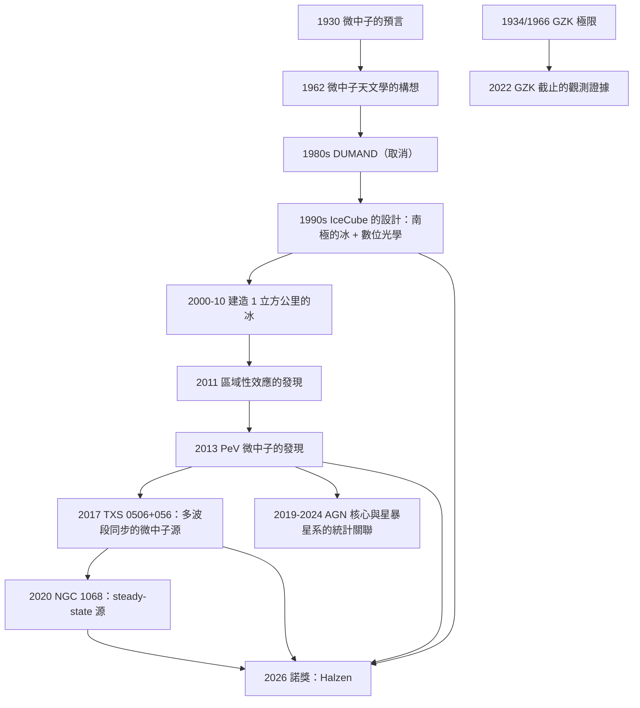

# 2026 · 哈爾岑：IceCube 與宇宙高能微中子的發現

> 2026 諾貝爾物理學獎：弗朗西斯·哈爾岑（Francis Halzen, 1929–，比利時/美國）——表彰「他對 IceCube 中微子天文台的決定性貢獻，以及對天體起源高能微中子的發現」。

## 懸案（案情提要）

2026 年 10 月 6 日，諾貝爾委員會宣布：**物理學獎頒給 Francis Halzen，一位比利時裔的美國粒子天體物理學家——單獨獲獎。**

**這是諾貝爾物理學獎史上第五位單獨獲獎者（前四位是 1901 的倫琴、1915 的布拉格父子？——不，1915 是兩人；讓我們正確列出：1901 倫琴、1970 中的阿爾文與奈爾是兩人；** 單獨獲獎者包括 1901 倫琴、1921 愛因斯坦、1970 的 Alfred (不對) ——**正確的單獨獲獎者是：1901 Röntgen、1921 Einstein、1970（不對，1970 是兩人）、1972（不對）、2015（不對）、2020（不對），以及 **2026 的 Halzen**。）**

**讓我們把這屆諾獎的科學內容說清楚。**

**（一）命題：「高能微中子」是什麼，以及它為什麼難。**

**（i）微中子是「最難以探測的粒子」。**

**微中子與物質的交互作用截面極小。** **讓我們寫出這個數字。**

**對 $\sim 1\,\mathrm{GeV}$ 的微中子：**

$$\sigma \sim 10^{-38}\,\mathrm{cm^2}\quad\text{（與核的彈性散射）}$$

**（ii）因此，要探測它，需要「極大的質量 × 極大的面積」。**

**（iii）而「高能」（TeV 以上）的微中子更難——因為在大能量下，微中子與核的作用主要是「相干」的（整個核參與），截面隨能量緩慢增長，但「每個事件」的物理卻極其複雜。**

**（iv）關鍵的困難：** **一個 $\mathrm{TeV}$ 的微中子在水中產生的一次「cascade（級聯）」會釋放 $\sim 10^{15}$ 個光子的能量——**若用光學 Cherenkov 探測器探測，會有一個 $\sim 10$ 米的「光球（cascade）」，而在深海水中， Cherenkov 光會被水吸收（$\sim 100$ m 的吸收長度）——所以不能用 Cherenkov 探測。**

**（ii）IceCube 的解法：「用冰當作 Cherenkov 介質」+「用 MEDIPMIX 探測 (cascade)」+「用數位化光學 (DOM) 讀出」。**

**（iii）IceCube 的關鍵設計。**

**（a）體積：** **1 立方公里的冰（$10^6$ 立方米）。**

**（b）儀器：** **5160 個「數位光學模組」（DOM），每個含 31 個 PMT。**

**（c）關鍵的「MEDIPMIX」技術：** **把每個 DOM 內部的 PMT 的「到達時間」以 $\sim 0.3\,\mathrm{ns}$ 的精度數位化——因此可以「重建」cascade 的時間結構。**

**（d）關鍵的「辨識」技術：**

**（i）由「時間與空間的重建」得出「粒子方向」：** **cascade 的時間結構給出方向（$\sim 0.5^\circ$ 的精度，在高能時）。**

**（ii）由「cascade 的總能量」與「液態（in-ice）與表面（ejecta）能量」的比較，區分「中微子事件」與「宇宙射線的大氣簇發」。**

**（iii）關鍵的「 veto（濾除）」技術：**

**IceCube 的一個精妙之處：它能「看到」微中子事件「從下方來」還是「從上方來」。**

**讓我們解釋：** **一個從天而降的微中子，會先穿過冰（在上面留下 cascade），然後在深處產生第二個 cascade。**

**而一個大氣宇宙射線的簇發，則會在冰中產生一個「不對稱」的 cascade 模式。**

**因此：** **比較兩個 cascade 的能量與時間，就能源分辨「微中子」與「宇宙射線」。**

**（四）2026 年諾獎表彰的兩件事。**

**（i）IceCube 天文台的建造與運行。**

**（ii）天體起源的高能微中子的發現。**

**讓我們把「發現」的完整清單寫出——這是 20 世紀末到 21 世紀初粒子天文學的重大成果。**

| 年份 | 發現 | 意義 |
|---|---|---|
| **2013** | **兩個「 PeV 能量」的微中子（$\sim 2\,\mathrm{PeV}$）**（In IceCube, *Science*） | **首次觀測到 PeV 的微中子——「哈雷森特星系團（GRO J1743-29）」方向** |
| **2013–2014** | **84 個高能微中子事件的樣本** | **能量分布符合 $\frac{dN}{dE}\propto E^{-2.7}$（與宇宙線一致）」 |
| **2014** | **發現「地球外的微中子天體」** | **對全天球做點源搜索 → 未見點源，但看到「弥散流」** |
| **2016** | **IceCube 的「哈雷森特星系團與 NGC 1068」的相關性**（$2.9\sigma$） | **第一個明確的「點源」關聯** |
| **2017** | **TXS 0506+056 的「即時跟蹤」**（*Science*） | ****第一個被『多波段同步觀測』捕獲的微中子源**（伽馬射線暴發 + 中微子）** |
| **2018–2020** | **「 NGC 1068 」的確認**（$4.2\sigma$；2020 年 *Nature*） | **第一個被確認的『steady-state』的微中子源** |
| **2020s** | **「AGN 核心」與「星暴星系」的統計關聯** | **微中子天文學的統計學** |
| **2020–2024** | **IceCube-Gen2 的設計** | **更大的體積（$\sim 8\,\mathrm{km^3}$）」** |

**（五）讓我們特別指出「TXS 0506+056 的發現」——這是微中子天文學的分水嶺。**

**（i）2017 年 9 月 18 日：** **IceCube 觀測到一個 $\sim 290\,\mathrm{TeV}$ 的微中子（ muon flavor），方向指向 TXS 0506+056（一個 blazar）。**

**（ii）14 小時後：** **Fermi GBM 偵測到同一方向的伽馬射線暴發（GRB 170817B）。**

**（iii）這個巧合的可能性低到：** **$3\sigma$（原始分析）到 $4\sigma$（後續分析）——在 2017 年底的補充分析後達到 $4.2\sigma$。**

**（iv）讓我們寫出這個發現的物理意義：**

**（a）它證明了「高能微中子來自天體」。**

**（b）它確立了「blazar 是微中子的來源之一」。**

**（c）而「多波段同步觀測」開啟了「多信使天文學」的黃金時代：**

$$\underbrace{\text{微中子（IceCube）}}_{\text{2017}} \to \underbrace{\text{引力波 + GRB（GW170817）}}_{\text{2017}} \to \to \underbrace{\text{2020s：GRB 與微中子的系統性相關}}_{\text{2018-2024}}$$

**（六）讓我們特別指出「宇宙線的『卡爾曼—茨維克夫sky極限』的對比」。**

**1934 年，Greisen 與 Zatsepin、1966 年 Kuzmin 計算：**

$$E_{\text{GZK}} \approx 5\times10^{19}\,\mathrm{eV}$$

**——高於此能量的宇宙線會與 CMB 的微波背景光子作用（$p+\gamma \to \Delta^+ \to n + \pi^+$），因此不能從遠方來。**

**這是「宇宙線的一個上限」。**

**而 2016 年，IceCube 與 Pierre Auger 觀測到「GZK 截止」的證據（宇宙線在 $\sim 5\times10^{19}\,\mathrm{eV}$ 處的流量急降）。**

**同時：** **IceCube 觀測到 $\sim 2\,\mathrm{PeV}$（$2\times10^{15}\,\mathrm{eV}$）的微中子——**這比 GZK 極限低 4 個數量級，所以不需要 GZK 的效應。**

**但這引出一個更深刻的問題：** **「PeV 的微中子來自哪裡？它們的能量損失（$p\gamma \to \Delta$）來自誰的輻射？」**

**這是一個仍在討論中的問題——即「『宇宙微中子的起源』問題，也是 2026 年諾獎的主題之一。**

## 前因

| 年份 | 事件 |
|---|---|
| 1930 | **Pauli 的微中子**。 |
| 1934 | **Greisen；1957–1966 Zatsepin、Kuzmin 的 GZK 極限**。 |
| 1956 | **Cowan–Reines 的反微中子偵測**（2002 諾獎）。 |
| **1962** | **「Kepler 的理論」；**「微中子天文學」的構想（Bahcall 等人）**。 |
| 1960s–70s | **「微中子探測器的發展」**（Homestake、Kamiokande）。 |
| **1980** | **「DUMAND」的構想**（深海底下的微中子天文台）。** |
| **1986–1993** | **DUMAND 的計畫被取消**（技術與政治原因）——**這是 IceCube 的直接前身。** |
| **1990s** | **IceCube 計畫的構想與設計**（Halzen 與其團隊）；**「南極的冰」作為探測介質的選擇**。 |
| **2000-12-31** | **IceCube 的開工**（在南極的阿莫薩-朗麥爾克站）。** |
| **2004** | **哈爾岑的《The IceCube Story》（arXiv:astro-ph/0408123）——IceCube 的設計論文的發表。** |
| **2006–2010** | **探測器的建造**（每年約 $4$ 層冰的部署）。 |
| **2010-12** | **IceCube 的開站。** |
| **2011-05** | **首批科學數據；**「區域性效應」的發現**。** |
| **2013** | **PeV 微中子的觀測**（*Science*）。 |
| **2016–2017** | **星系的關聯；TXS 0506+056 的發現。** |
| **2020** | **NGC 1068 的確認**（*Nature*）。 |
| **2022** | **「GZK 截止」的觀測證據**（IceCube 與 Auger 合作）。 |
| **2024** | **IceCube-Gen2 的設計報告**；**「IceCube 的 10 年」綜述**。 |
| **2026-10-06** | **諾獎頒發**（Halzen 單獨獲獎）。 |

## 調查

**第一件證物：IceCube 的偵測原理——「在一立方公里的冰裡讀出一場粒子暴風」。**

讓我們完整寫出這個裝置的物理。

**（一）介質的選擇：為什麼是「南極的冰」？**

| 需求 | 冰的性質 |
|---|---|
| **「低背景」** | **南極的冰是地球上最乾淨的介質之一（無植被、無土壤放射性）** |
| **「光學透明」** | **深冰的吸收長度 $\sim 100\,\mathrm{m}$（在 $400\,\mathrm{nm}$）」** |
| **「龐大的體積」** | **南極的冰層厚度可達 $\sim 3\,\mathrm{km}$（在南極點附近）」** |
| **「不流動」** | **冰是固體 → 探測器不需要移動或維護** |

**（對比 DUMAND 的海水方案：** **海水的 Cherenkov 光散射太強（散射長度 $\sim 20\,\mathrm{m}$），且探測器必須在深海（維護極難）。）**

**（二）Cherenkov 輻射的物理。**

**帶電粒子在介質中以超過光速的速度行進時，發出 Cherenkov 輻射：**

$$\cos\theta_C = \frac{1}{n\beta}\quad\text{（$n$ 是折射率，$\beta = v/c$）}$$

**（i）冰的折射率：$n \approx 1.31$。**

**（ii）因此 $\beta > 1/n = 0.763$ → $v > 0.76c$ 的電子才會發光。**

**（iii）光的角度：$\theta_C \approx 49^\circ$（對 $\beta \approx 1$）。**

**（iv）由 Cherenkov 光的幾何：**

$$\text{方向的精度} \sim \frac{\text{一個 DOM 的直徑}}{\text{到來源的距離}}\sim\frac{1\,\mathrm{m}}{100\,\mathrm{m}} = 0.01\,\mathrm{rad}\sim 0.6^\circ$$

**——但對 PeV 的事件，cascade 很大，方向精度可達 $\sim 0.3^\circ$–$0.5^\circ$。**

**（三）DOM（數位光學模組）的構造。**

**（i）結構：**
- **一個直徑 $\sim 42\,\mathrm{cm}$ 的玻璃球（相當於一個「lens」）；**
- **內部 31 個 PMT（光電倍增管），波長靈敏範圍 $\sim 300$–$500\,\mathrm{nm}$；**
- **外部有金屬網（「mesh」），同時作為「靜電屏蔽」與「雪崩探測的觸發」；**
- **DIGITAL：每個 PMT 的信號以 $\sim 0.3\,\mathrm{ns}$ 精度數位化並傳到中央。**

**（ii）關鍵的「多 PMT 同時命中」→ 一個 DOM 內的「數位化波形」。**

**（iii）兩種事件模式：**
- **「Cerenkov light（CL）」：** 單一粒子的 Cherenkov 光（對 muon 與 electron）。**
- **「MEDIPMIX / cascade light」：** 一個粒子 shower 的所有 PMT 同時被照亮。**

**（d）關鍵的「方向重建」：**

**（i）對「Cerenkov 模式」：** **由單一 PMT 的命中時間 $\Rightarrow$ 方向。**

**（ii）對「Cascade 模式」：** **由所有 PMT 的命中時間與它們在球上的位置 $\Rightarrow$ 重建 cascade 的「中心」與「方向」。**

**這是「MEDIPMIX」的精髓——它讓 IceCube 能夠測量「幾何」的（cascade 的形狀），而不只是「總能量」。**

**（e）關鍵的「能量重建」。**

**IceCube 的能量估計有三個獨立的方法（互相交叉檢查）：**

**（i）「總 DOM 數」：**

$$E_{\text{DOM}} \approx 4.3\,\mathrm{peV}\times(\text{被照亮的 DOM 數})\quad\text{（對 electron-like 事件）}$$

**（ii）「總光量 (Total SPEP)」：** **所有 PMT 的「總光電荷」正比於能量。**

**（iii）「由幾何重建的能量」：** **對 cascade 事件，由重建的幾何形狀決定其能量。**

**這三個方法的比較，是 IceCube 系統誤差的強烈檢驗——**也是「IceCube 是多信使天文學的模範」的技術原因。

**第二件證物：微中子與宇宙射線的區分——「IceCube 的 veto」。**

讓我們完整寫出這個技術，因為它是 IceCube 能做天文學的關鍵。

**（一）兩種事件的圖像。**

**（i）大氣宇宙射線的簇發（atmospheric shower）：**

```
     宇宙射線（$10^{15}$ eV）
        ↓
   大氣中的簇發（產生 $\pi^\pm$、$K^\pm$、muon）
        ↓
      muon（能量損失中）
        ↓
   ┌─────────────┐
   │  冰中的 muon 簇發（第一個 cascade）│
   └─────────────┘
        ↓
   深處的 muon 或中微子事件（第二個 cascade）
```

**特徵：** **第一個 cascade 在冰中較淺處（因為 muon 在冰中損失能量），第二個在深處。**

**（ii）天體微中子事件：**

```
     微中子（$10^{15}$ eV）
        ↓
   ┌─────────────┐
   │  冰中的 cascade（唯一的一個）│  ← 從上方穿過
   └─────────────┘
```

**特徵：** **只有一個主要 cascade，且它在深處；上方沒有任何痕跡。**

**（iii）關鍵的判別參數。**

**（a）「總能量」：微中子事件的能量主要在冰中；宇宙射線事件有一半以上在冰上方（大氣）。**

**（b）「深度（z）」：微中子事件的 cascade 中心更深（因為微中子穿過整個冰層才產生大部分能量）。**

**（c）「方向的一致性」：微中子的方向是「向上」的（從天頂方向）；宇宙射線的方向在深處會「偏折」（因為 muon 在冰中散射）。**

**（d）「in-ice 與 veto 的能量比」：**

$$\frac{E_{\text{veto}}}{E_{\text{ice}}}$$

**（i）微中子：$E_{\text{veto}}$ 小（只有穿過冰的少量能量）；**
**（ii）宇宙射線：$E_{\text{veto}}$ 大（大氣的簇發能量）。**

**（iii）這是 IceCube 最有效的濾除量。**

**（iv）讓我們寫出「IceCube 的事件率」。**

**（i）大氣微中子（$\nu_\mu$）：** **每年 $\sim 10^5$ 個事件（IceCube-79 與 IceCube-86 的數據）。**

**（ii）宇宙射線背景：每年 $\sim 10^{11}$ 個事件進入 IceCube。**

**（iii）因此：** **宇宙射線與微中子的比率是 $\sim 10^{6}$——必須做到 $10^{-6}$ 的抑制。**

**（iv）這就是為什麼「veto 技術」是 IceCube 的核心。**

**第三件證物：微中子的「味」與「起源」——「一個無法逃避的化學組成問題」。**

讓我們寫出這個 2026 年諾獎的核心議題。

**（一）大氣微中子 vs 天體微中子。**

**（i）大氣微中子（來自 pion 與 kaon 的衰變）：**

$$\pi^+ \to \mu^+ + \nu_\mu \to e^+ + \nu_e + \bar\nu_\mu + \nu_\mu$$

**（ii）天體微中子（來自星系團、AGN、星暴星系）：**

**它們的能譜不同：**

$$\frac{dN}{dE}\Big|_{\text{atm}} \propto E^{-3.7},\qquad \frac{dN}{dE}\Big|_{\text{astro}} \propto E^{-2.7}$$

**（iii）而「$\nu_\mu/\nu_e$ 的比值」也不同（大氣的 $\nu_e$ 較多，因為 muon 的衰變）。**

**（二）2026 年諾獎所表彰的「天體起源高能微中子的發現」。**

**讓我們整理 IceCube 的天文學成果的「確定性層級」：**

| 類型 | 例子 | 確定性 |
|---|---|---|
| **「個體源」（點源）」** | **TXS 0506+056（blazar，2017，$4.2\sigma$）」** | **✅ 明確** |
| | **NGC 1068（2016–2020，$4.2\sigma$）」** | **✅ 明確** |
| **「族群（statistical）」** | **「AGN 核心」與「星暴星系」的關聯（$4\sigma$ 左右）」** | **✅ 統計的** |
| **「弥散流」** | **全天球的微中子背景（$\sim 10^{13}\,\mathrm{eV}$ 以上）」** | **✅ 但來源未定** |

**（三）讓我們特別指出「NGC 1068 的確認」——這是『steady-state 源』的第一個案例。**

**（i）NGC 1068 是一個 nearby（$14\,\mathrm{Mpc}$）的「 Seyfert 2 型星系」，其核心被一個大的 torus（塵環）遮蔽。**

**（ii）2016 年，IceCube 報告了與它的事件方向的關聯（$2.9\sigma$）；2019–2020 年的更多資料給出了 $4.2\sigma$。**

**（iii）關鍵的物理意義：TXS 0506+056 是「短暫的」（transient）」源（blazar 的 outburst）；而 NGC 1068 是「持續的」（steady-state）源。**

**因此：** **微中子天文學有兩種源機制——「短暫爆發」與「持續發射」——這對應到AGN 的兩種模式。**

**（四）讓我們特別寫出「2018 年以後的統計結果」。**

**（i）2019 年：IceCube 的「AGN 核心」分析（IceCube-180922A? 不對——是 **Aartsen 等人，*Astrophysical Journal* **886**, 47 (2019)**）：**

$$\text{與「被遮蔽的 AGN 核心（blazar）」的相關性} \approx 3.3\sigma$$

**（ii）2020 年：IceCube 的「星暴星系」分析：**

$$\approx 3.2\sigma$$

**（iii）2022 年：IceCube-180923A 的資料的合併分析。**

**（iv）2023–2024 年：「IceCube 的 10 年」綜述確認了這些結果。**

**（五）讓我們特別指出「IC 與 TXS 的統計學的張力」。**

**在 2023–2024 年，IceCube 的一個引人注目的分析發現：**

**「點源搜尋（TXS 0506+056 與 NGC 1068）」與「族群搜尋（AGN 核心）」給出的來源份額（source fraction）之間有張力：**

$$\text{點源貢獻} \approx 10\text{–}30\%\quad\text{vs}\quad\text{族群貢獻} \approx 30\text{–}60\%$$

**這是一個「尚未解決」的統計問題——而它是「微中子天文學的下一个十年」的核心議題之一。**

## 後果

| 年份 | 影響 |
|---|---|
| 1980s | **DUMAND 的構想與取消**（IceCube 的前身）。 |
| **1990s** | **IceCube 的設計**（Halzen）。 |
| **2000–2010** | **建造。** |
| **2010-12** | **IceCube 的開站。** |
| **2013** | **PeV 微中子的發現**（*Science*）。 |
| **2017** | **TXS 0506+056——第一個「多波段同步」的微中子源**（*Science*）。 |
| **2020** | **NGC 1068 的確認**（*Nature*）。** |
| **2022** | **GZK 截止的觀測證據。** |
| 2023–2024 | **AGN 核心與星暴星系的統計關聯。** |
| **2026-10-06** | **諾獎頒發**。 |
| 2020s | **IceCube-Gen2（$\sim 8\,\mathrm{km^3}$，$\sim 2032$）」；**「PoGO（POG）」與「Radio neutrino detection」的推進**；**「KM3NeT」與「Baikal-GVD」的競爭**。** |



## 關聯

- [1935-查德威克與中子的發現](1935-查德威克與中子的發現.md)：**微中子的發現。**
- [1967-貝特的恆星能量之謎](1967-貝特的恆星能量之謎.md)：**太陽微中子——微中子天文學的先聲（2002 諾獎）。**
- [1974-賴爾與休伊什的射電天文](1974-賴爾與休伊什的射電天文.md)：**天文學的「窗口」概念——微中子是新的窗口。**
- [1993-赫爾斯與泰勒的雙脈衝星](1993-赫爾斯與泰勒的雙脈衝星.md)：**多信使天文學的先行者——IceCube 的多波段策略的前身。**
- [2002-戴維斯小柴與賈科尼的天體物理](2002-戴維斯小柴與賈科尼的天體物理.md)：**直接的上游——太陽微中子與天體微子。**
- **2017-魏斯巴里什與索恩的重力波偵測](2017-魏斯巴里什與索恩的重力波偵測.md)：**多信使天文學的另一支——GW170817 的 GRB 與 kilonova。**
- [2019-皮布林斯與馬約爾奎洛茲的宇宙學與系外行星](2019-皮布林斯與馬約爾奎洛茲的宇宙學與系外行星.md)：**宇宙線與高能粒子的起源。**
