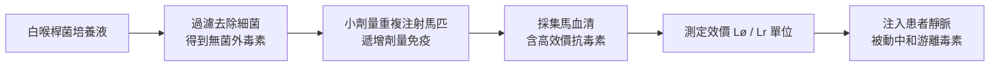

# 1901 · 白喉血清療法：第一支對抗死神注射器的誕生

> **1901 諾貝爾生理學或醫學獎**：埃米爾·阿道夫·馮·貝林（Emil Adolf von Behring，德國）— 表彰「對血清療法的研究，特別是在治療白喉應用上的貢獻，由此開闢了醫學領域研究的新途徑，也因此使得醫生手中有了對抗疾病和死亡的有力武器」。首屆諾貝爾生理學或醫學獎。

## 懸案（案情提要）

十九世紀末，白喉（diphtheria）是兒童病房裡的頭號殺手，歐洲城市每逢冬春便有數以萬計的孩童被「窒息之病」奪走性命。病名來自希臘語 *diphthera*（皮革）——白喉棒狀桿菌（*Corynebacterium diphtheriae*）在患兒咽喉形成一層灰白假膜，剝之出血、隨時可能脫落堵塞氣道；更可怕的是細菌分泌的外毒素（diphtheria toxin）會隨血流侵襲心臟與神經，造成心肌炎與癱瘓。當時醫生手上只有局部切開氣管的插管術，能做的僅是「讓孩子多喘幾口氣」，對體內蔓延的毒素束手無策。

疑點有三：一、細菌主要盤踞在咽喉，為何心臟、神經會遠端受損？二、為什麼得過一次白喉的孩子終身免疫，而醫生能從痊癒者身上「偷」到什麼？三、能否把這種「免疫之謎」變成可以量產、可以注射的藥？

## 前因

| 年份 | 事件 |
| --- | --- |
| 1883–1884 | 克勒布（Edwin Klebs）與呂弗勒（Friedrich Löffler）從白喉患者假膜中分離出棒狀桿菌，並證明其為病原。 |
| 1884 | 呂弗勒解剖病死者屍體，發現細菌僅在咽喉局部，全身病變卻毫無菌蹤——毒素假說初現端倪。 |
| 1888 | 魯（Émile Roux）與耶爾森（Alexandre Yersin）在巴黎巴斯德研究所用細菌濾液（無菌的培養上清）重現全部白喉症狀：**外毒素**正式現身。 |
| 1888 | 格蘭基（Pierre-Victor Galtier）顯示動物可對毒素產生耐受；同年代埃爾利希以小劑量遞增法使小鼠耐受蓖麻毒蛋白。 |
| 1890 | 柯霍學派日趨成熟，細菌學已成「可操作的偵查學科」，柏林傳染病研究所（柯霍任所長）成為破案現場。 |
| 1890 | 貝林與日本學者北里柴三郎在柏林展開「血清能對抗毒素嗎」的聯合調查。 |

## 調查

貝林與北里柴三郎的第一個偵查動作，是回答「毒素去哪了、身體如何應對」。他們以白喉與破傷風外毒素重複小劑量注射豚鼠與家兔，發現動物的血清中逐漸累積一種可對抗毒素的物質——他們命名為**抗毒素（Antitoxin）**。

1890 年 12 月，兩人發表關鍵實驗：取免疫動物的血清注入正常豚鼠體內，再注入足以致死十倍的毒素劑量，對照組全數死亡，實驗組卻安然無恙。偵查邏輯如下：

「血清效價」的定量工作由埃爾利希（Paul Ehrlich）在柏林-施泰格利茨感染病研究所完成，他建立了白喉抗毒素的標準單位系統——這是藥品標準化史上第一次以生物學單位（bioassay unit）標示藥效。效價的定義可寫成：在固定試驗動物系統中，能中和 **100 致死劑量（100 MLD）** 毒素的最小血清量為 1 個單位。若血清含 $c$ 單位/毫升，患者體內游離毒素為 $T_0$ ，則所需血清量粗略為

$$V = \frac{T_0 / 100}{c}$$

1891 年聖誕夜，柏林聖喬治醫院的貝爾格曼（Bergmann）醫師以貝林的馬血清救治一名瀕死白喉患兒，成為血清療法臨床第一案。之後大規模臨床數據接踵而至：1894 年魯、馬丁（Louis Martin）與肖謝爾（Alexis Chaillou）在巴黎兒童醫院的對照研究中，接受血清治療者的死亡率從未治療組的約 52% 降至約 24%；若在發病首兩日即注射，死亡率可再壓至約 10%。貝林 1893 年起在瑪爾堡（Marburg）藥廠量產血清，白喉從「死神署名」降級為「可治急症」。

「首兩日注射者死亡率最低」這一數據同時揭穿了病理真相：毒素一旦與組織結合（內化進入細胞）便不可逆，抗毒素只能中和游離毒素。這解釋了為何治療越早越好，也為 1901 年的「首屆」桂冠寫下了最堅實的臨床證詞。

## 理論裁決

血清療法的背後是一整套**體液免疫的對抗平衡模型**：

1. **抗原—抗體特異結合**：毒素分子上的「毒力決定位」與「免疫決定位」分離，因此以甲醛處理毒素可得到保持抗原性卻失去毒性的**類毒素（toxoid）**（後由拉蒙於 1920 年代改進），成為現代疫苗原料。
2. **劑量—中和動力學**：抗毒素中和毒素近似二級結合反應
   $$\text{Toxin} + \text{Antibody} \rightleftharpoons \text{Complex}, \qquad K_d = \frac{[T][A]}{[TA]}$$
   只要游離抗體濃度夠高， $[T]_{\text{free}} \to 0$ ，臨床症狀即被遏制。
3. **被動免疫 vs 主動免疫**：注射現成抗體是「借兵」，保護期僅數週；引出主動免疫（類毒素疫苗）才是「練兵」。貝林本人也於 1913 年提出白喉類毒素免疫接種，完成了從治療到預防的閉環。

血清效價隨時間衰減可用一級動力學近似：

$$c(t) = c_0 \, e^{-kt}$$

半衰期 $t_{1/2} = \ln 2 / k$ （馬血清中 IgG 約數日至兩週），這解釋了被動免疫「快而不久」的特性，也說明了為什麼血清是急救武器、疫苗才是長期防線。

## 後果

| 領域 | 影響 |
| --- | --- |
| 臨床醫學 | 白喉死亡率在 1900 年代大幅下降，血清療法成為史上第一種「特效藥」，樹立了以生物製劑治病的範式。 |
| 公共衛生 | 嬰幼兒大規模血清注射與推廣活動出現（1900 年代紐約等地），現代免疫接種計畫由此起步。 |
| 製藥工業 | 貝林在瑪爾堡創立的血清工廠後為赫希斯特（Hoechst）合作量產；生物藥品標準化（國際單位 IU）制度奠基。 |
| 免疫學 | 埃爾利希的抗毒素標準化與側鏈理論（見 [1908-免疫雙雄](1908-免疫雙雄.md)）直接承繼本案方法學。 |
| 其他諾獎 | 貝林 1901 獲獎；其導師柯霍 1905 年以結核病研究獲獎（見 [1905-結核桿菌與柯霍法則](1905-結核桿菌與柯霍法則.md)）。 |
| 醫學倫理 | 首次以對照死亡率數據證明療效，臨床試驗的量化精神萌芽。 |

## 追查支線（未結之謎）

- 貝林曾於 1913 年再以白喉類毒素疫苗研製獲第二度提名，完成「被動→主動免疫」閉環，但未再得獎；
- 白喉棒狀桿菌的毒素基因其實來自 $\beta$ -棒狀桿菌噬菌體（1950 年代證實）——「毒計」竟是病毒的贈禮，這一細菌病原學的轉折遲至分子時代才破案；
- 貝林晚年轉攻結核病血清治療未果，1914 年病逝，死前留下「瑪爾堡血清工廠」的產業遺產；
- 抗毒素馬匹的大量免疫也開啟了動物來源血清製劑的「異種蛋白反應」（血清病）問題——血清病正是 1906 年里歇過敏反應研究的臨床素材之一；
- 為何有些兒童對白喉毒素特別敏感、有些帶菌而不發病？宿主遺傳與受體（HB-EGF）表達的謎團要到 1980 年代才解開；
- 「血清病」的免疫複合物致病機理，要到 1906 年里歇過敏反應（[1913-過敏反應](1913-過敏反應.md)）與之後第三型過敏的概念才被完整定性。

## 證物與數據（偵查卷宗摘錄）

| 證物 | 數值／內容 | 偵查意義 |
| --- | --- | --- |
| 呂弗勒屍檢（1884） | 細菌僅見於咽喉，心臟神經無菌 | 證明「遠端毒殺」，毒素假說成立 |
| 魯與耶爾森濾液實驗（1888） | 無菌培養液重現全部症狀 | 鎖定外毒素為兇器 |
| 貝林—北里免疫血清（1890） | 免疫豚鼠血清中和 100 MLD 毒素 | 抗毒素存在之鐵證 |
| 巴黎兒童醫院對照（1894） | 死亡率 52% → 24%（全程）；首兩日治療降至約 10% | 臨床療效的量化證詞 |
| 埃爾利希標準化 | 以乾燥血清標準品定義抗毒素單位（AU） | 藥品效價國際標準之濫觴 |
| 1901 年獎金 | 150,782 瑞典克朗 | 首屆諾貝爾生理學或醫學獎 |

卷宗中最具推理張力的一行，是「發病首兩日注射者死亡率 10%」與「第三日以後注射者療效驟降」之間的斷崖——這一非線性正是毒素不可逆結合的指紋：游離毒素濃度隨時間呈指數下降，可寫為 $[T](t) = [T]_0 e^{-\lambda t}$ （ $\lambda$ 為組織結合清除速率），因此抗毒素的獲益窗口集中在病程最初期。這條「時間窗」定律日後成為一切抗毒、抗蛇毒血清療法的操作準則，也預告了現代急診醫學「時間即器官」的信念。此外，馬匹免疫工藝本身就是一門工程：以類毒素遞增免疫馬匹、監測血中效價曲線、在效價峰值放血採血——整套「血漿採集—分離—濃縮—滅菌—標定」流程，是生物製藥產業的史前原型，其量化思維（效價、單位、批間一致性）沿用至今日的單株抗體工廠。

## 關聯

- [1905-結核桿菌與柯霍法則](1905-結核桿菌與柯霍法則.md) — 導師柯霍建立的細菌學偵查法則是本案的方法論母體。
- [1908-免疫雙雄](1908-免疫雙雄.md) — 抗毒素現象背後的免疫理論大決戰：吞噬細胞 vs 側鏈學說。
- [1907-原生動物致病](1907-原生動物致病.md) — 同時期「病原體時代」的另一條偵查線：原蟲致病。
- [1923-胰島素](1923-胰島素.md) — 治療醫學的另一里程碑，延續「以生物製劑救命」的譜系。
- [1960-後天免疫耐受](1960-後天免疫耐受.md) — 免疫學從抗體到耐受的長線故事。
