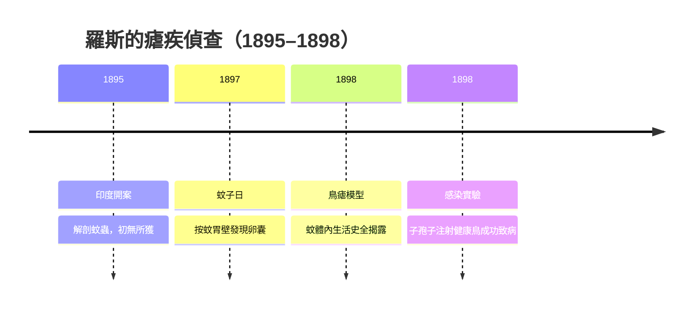
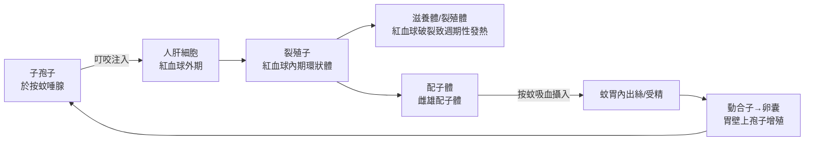

# 1902 · 瘧疾傳播鏈：按蚊、瘧原蟲與熱帶病院的八年偵查

> **1902 諾貝爾生理學或醫學獎**：羅納德·羅斯（Ronald Ross，英國）— 表彰「在瘧疾研究上的工作，由此顯示了瘧疾如何進入生物體，也因此為成功地研究這一疾病以及對抗這一疾病的方法奠定了基礎」。

## 懸案（案情提要）

瘧疾（malaria，義大利語「壞空氣」）折磨人類數千年，到十九世紀末仍是熱帶殖民帝國最大的兵源殺手——印度每年因瘧疾死亡上百萬人，羅馬城郊的沼澤地帶則讓「羅馬熱」聲名狼藉。案情撲朔迷離：空氣中到底藏著什麼？「瘴氣說」盛行兩千年；1880 年代雖有拉韋朗在病人血液中抓到瘧原蟲（見 [1907-原生動物致病](1907-原生動物致病.md)），但新的懸案隨即出現：

1. 瘧原蟲只寄生於人的紅血球與肝細胞，**它如何從病人身上轉移到下一個病人？**
2. 為什麼沼澤、雨季、低窪地區與瘧疾形影不離？
3. 抓住傳播鏈的環節，有沒有可能**用工程與公共衛生手段斬斷它**？

## 前因

| 年份 | 事件 |
| --- | --- |
| 1880 | 拉韋朗在阿爾及利亞君士坦丁軍醫院的人血紅血球中發現瘧原蟲，推翻「瘴氣中毒」假說的微生物部分。 |
| 1883 | 帕特里克·曼森（Patrick Manson）在廈門證明絲蟲病由蚊子（庫蚊）傳播——「蚊子傳病」概念的首次鐵證。 |
| 1890s | 俄國學者達尼列夫斯基等提出鳥類瘧疾模型；意大利學者比納米（Bignami）、戈爾基（Camillo Golgi）確立人體內瘧原蟲的三日瘧、惡性瘧分段與發熱節律。 |
| 1894 | 曼森向羅斯提出「蚊—瘧」猜想：蚊子吸血時可能把瘧原蟲傳給人，並贈送顯微鏡下的關鍵線索——配子體。 |
| 1895 | 羅斯以軍醫身分赴印度塞康德拉巴德、班加羅爾等地，開始系統性解剖蚊蟲的漫長排查。 |

## 調查

羅斯的偵查首先敗在「物證採集」：他最初追蹤曼森的猜想——人喝下含蟲的水、或被感染水沾身的蚊蟲叮咬——兩條線索全部落空。幾年間他解剖了成千上萬隻蚊蟲，屢屢在實驗記錄中寫下「無所獲」。真正的突破口在方法學：

1. **養蚊現場**：1897 年，羅斯改用「現捕現養」——把剛孵出、從未吸血的按蚊關入紗籠，再餵以特定瘧疾病人的血，讓每一隻蚊的「進食史—解剖史」都可追溯。這是流行病學偵查中經典的「密閉案件重演」。
2. **按蚊與庫蚊分流**：1897 年 8 月 20 日（後被稱為「蚊子日」），他在餵食惡性瘧患者 Hussain Khan 血液的「斑翅蚊」（*Anopheles* 屬）胃壁上發現一顆顆圓形色素體結構——瘧原蟲的**卵囊（oocyst）**。同一批庫蚊、及未吸血對照組皆為陰性。嫌犯鎖定按蚊。
3. **鳥類模型補完**：1898 年，羅斯被調往加爾各答，改用鳥瘧原蟲（*Plasmodium relictum*）做完整傳播實驗。他追蹤到瘧原蟲在蚊體內的全程發育：配子體在蚊胃中出絲（exflagellation）、受精成動合子（ookinete）、穿過胃壁形成卵囊、卵囊內產生成千上萬**子孢子（sporozoites）**、遷移到唾腺。他以子孢子懸液注射健康麻雀，成功誘發瘧疾——**傳播鏈全程闭环**。

1900 年，意大利學者格拉西（Giovanni Grassi）與英國帕特里克·曼森團隊分別在人類瘧疾上完成最終臨床驗證（志願者試驗）：按蚊叮咬確能使人感染瘧疾。人類第一次完整看見一種疾病的「作案路線圖」。

## 理論裁決

瘧原蟲生活史——本案的核心「案卷」——可寫成兩個宿主的接力：

**傳播動力學**：設按蚊叮人率（每人每晚被叮次數）為 $a$ ，感染性蚊的比例為 $s$ ，恢復率為 $r$ ，則基本再生數可近似為經典 Ross–Macdonald 模型：

$$R_0 = \frac{m a^2 b c \, e^{-g n}}{r\, g}$$

其中 $m$ 為人均蚊密度， $b$ 、 $c$ 為蚊與人方向的傳染效率， $g$ 為蚊死亡率、 $n$ 為子孢子成熟所需天數。**$a$ 以平方出現**——這是整場抗瘧戰爭的數學結論：把蚊蟲密度壓到極低（即使不滅絕），傳播就會被超比例削弱，因為 $R_0$ 隨 $a^2$ 下降。這解釋了為何「滅蚊不必趕盡殺絕」，正是 20 世紀抗瘧工程的理論基石。

羅斯本人進一步推導出瘧疾流行閾值：只有當 $R_0 > 1$ 時瘧疾才會流行，故把 $ma$ 壓低至 $\sqrt{rg/(a b c e^{-gn})}$ 以下即可讓疫情熄火。沼澤排水、紗窗、蚊帳、殺蟲劑——每一項公共衛生措施都能在這條公式中找到自己的係數。

## 後果

| 領域 | 影響 |
| --- | --- |
| 公共衛生 | 「以控制傳播媒介斷絕傳染鏈」成為流行病學基本戰略；巴拿馬運河工程（1904–1914）靠滅蚊與排水使黃熱病、瘧疾可控，工程才得以完成。 |
| 醫學地理學 | 按蚊棲息習性研究催生現代醫學昆蟲學；各地「抗瘧站」制度建立。 |
| 理論流行病學 | Ross–Macdonald 模型成為媒介傳播病數學模型的原型，直接影響登革熱、利什曼病等防治。 |
| 其他諾獎 | 拉韋朗 1907 年獲獎（[1907-原生動物致病](1907-原生動物致病.md)）；青蒿素抗瘧 2015 年獲獎（[2015-青蒿素與阿維菌素](2015-青蒿素與阿維菌素.md)）。 |
| 科學史 | 羅斯與意大利學派的優先權之爭亦成科學社會學經典案例。 |

## 追查支線（未結之謎）

- 惡性瘧原蟲（*P. falciparum*）的肝細胞內「休眠」之謎不在其身，而在間日瘧與卵形瘧的**休眠子（hypnozoite）**——潛伏數年後復發，今日仍以伯氨喹根除，是傳播鏈上最後一個頑固環節；
- 按蚊的叮咬偏好（內棲 vs 外棲、嗜人 vs 嗜畜）決定了各地防疫策略，媒介生物學至今仍在細化這張「嫌犯畫像」；
- 抗藥性瘧原蟲（氯喹、青蒿素抗性）不斷改寫戰局，傳播鏈模型中的 $c$ （人的傳染效率）因子隨之浮動；
- 羅斯晚年轉向社會工程：他把「滅蚊預算—疫情曲線」寫成說帖遊說殖民政府，成為「衛生經濟學」的早期實踐者；
- 羅斯與曼森、與意大利學派的優先權爭議，以及他在印度的軍醫身分與殖民科學的糾葛，是本案卷宗中最複雜的「非科學」頁面。

## 證物與數據（偵查卷宗摘錄）

| 證物 | 數值／內容 | 偵查意義 |
| --- | --- | --- |
| 1895–1897 解蚊記錄 | 羅斯解剖蚊蟲累計數以萬計 | 「陰性」也是證據：排除庫蚊等非按蚊路線 |
| 1897-08-20 蚊子日 | 按蚊胃壁見色素顆粒卵囊 | 兇手鎖定 *Anopheles* 屬 |
| 1898 鳥瘧傳播實驗 | 子孢子懸液注射健康麻雀 → 發病 | 傳播鏈閉環完成 |
| 蚊胃卵囊 | 卵囊內孢子增殖可釋出數千子孢子 | 「一隻蚊＝一個孢子工廠」 |
| 子孢子成熟期 $n$ | 惡性瘧約 10–14 天（依氣溫） | 溫度—疫情相關的機制解釋 |
| $R_0$ 公式 | $m a^2 b c e^{-gn} / (rg)$ | 滅蚊工程的數學憲法 |

卷宗裡還藏著一條「環境物證鏈」：氣溫升高加速蚊蟲發育與子孢子成熟（ $n$ 變短、 $g$ 變小），故雨季與暖年疫情暴增；海拔與緯度則以溫度為閘門，限定了瘧疾的地理疆界。這一氣候—傳播的定量關係，在今日已成為氣候變遷模型中預測瘧疾版圖北移的基礎方程。羅斯本人亦把這套數學寫進 1911 年《預防瘧疾》：以差分方程模擬蚊密度與病人數的逐月聯動，是流行病學史上第一個系統的數學模型——比現代 SIR 模型早了十餘年。值得一提的是，羅斯與意大利學派（格拉西、比納米）關於「誰先證明人瘧由按蚊傳播」的優先權之爭延續終身，這樁「共同署名之爭」也成為科學史與科學社會學的經典教材。

## 關聯

- [1907-原生動物致病](1907-原生動物致病.md) — 瘧原蟲的發現者拉韋朗獲 1907 年諾獎，是本案的「上游案」。
- [1905-結核桿菌與柯霍法則](1905-結核桿菌與柯霍法則.md) — 同時代細菌學偵查方法的姊妹篇。
- [1912-血管縫合與器官移植](1912-血管縫合與器官移植.md) — 同年諾獎圈內的另一宗醫學工程案。
- [2015-青蒿素與阿維菌素](2015-青蒿素與阿維菌素.md) — 一百一十三年後，抗瘧武器升級為青蒿素，本傳播鏈仍是戰場。
- [1927-瘧疾發熱療法](1927-瘧疾發熱療法.md) — 荒誕的逆用：故意接種瘧疾以治神經梅毒。
