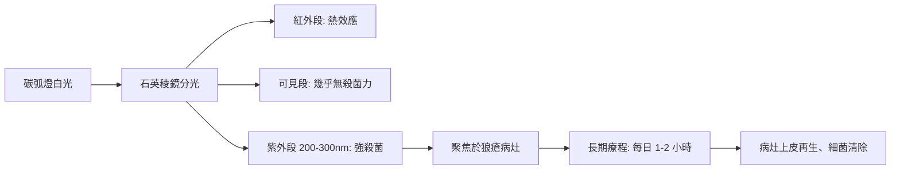

# 1903 · 光線治療狼瘡：芬森醫學光學實驗室的「以光為刀」

> **1903 諾貝爾生理學或醫學獎**：尼爾斯·呂貝里·芬森（Niels Ryberg Finsen，丹麥）— 表彰「在用集中的光輻射治療疾病，特別是尋常狼瘡方面的貢獻，由此開闢了醫學研究的新途徑」。

## 懸案（案情提要）

陽光治病的傳說古已有之——希臘名醫希波克拉底便有「日療」記載，但那是民間偏方，不是醫學。1890 年代的懸案在於：**光到底是什麼？哪一段波長能殺菌？怎樣把散漫的日光變成可劑量、可操作的治療武器？**

具體案情有三：

1. 尋常狼瘡（lupus vulgaris，皮膚結核）在北歐陰冷環境肆虐，患者面部潰爛毀容，外科切除與藥物皆束手無策——有沒有非手術的治法？
2. 陽光缺乏的北方（丹麥、冰島）狼瘡高發，這是巧合還是因果？
3. 日光充沛的南方風俗「曬傷能治病」到底有沒有科學機理可循？

## 前因

| 年份 | 事件 |
| --- | --- |
| 1877 | Downs 與 Blunt 在英國證明日光可抑制細菌培養——「光殺菌」首次進入實驗室。 |
| 1881 | Widmark 發現紫外線（UV）可致皮膚紅斑，紅斑波長與曬傷光譜被描繪。 |
| 1882 | 柯霍分離結核桿菌，狼瘡被確認為皮膚結核（見 [1905-結核桿菌與柯霍法則](1905-結核桿菌與柯霍法則.md)）。 |
| 1888 | Duclaux 證明紫外線殺菌力最強的波長在近 254–280 nm 區段，越短越強。 |
| 1893 | 芬森在哥本哈根展開「光的生理效應」系統實驗，本人飽受 Niemann–Pick 病折磨、終身與病榻為伍。 |

## 調查

芬森的偵查始於一個看似簡單的問題：**為何南方的蟲與瘴疠較少、北方的皮膚病較多？** 他首先建立「光譜—生物效應」對照實驗，把光拆成不同波段逐一測試：

1. **波長分段試驗**：他把培養皿上的細菌（包括結核桿菌）曝於不同波段光下，發現紫外線殺菌最強；紅光幾乎無效。這是**「光的劑量效應曲線」**的開端——若照光強度為 $I$ 、時間 $t$ ，則累積劑量
   $$D = \int_0^t I(\lambda, s) \, ds$$
   殺菌存活率大致服從
   $$N(t) = N_0 \, e^{-k I t}$$
   其中 $k(\lambda)$ 是波長依賴的殺菌常數，紫外段 $k$ 值最高。芬森因此判斷：要「以光為刀」，必須**把紫外段最大化、把紅外熱段過濾掉**。
2. **聚光與冷卻**：他設計了巨大的凸透鏡陣列＋碳弧燈——「芬森燈（Finsen lamp）」。碳弧產生強紫外，經銅製濾光層吸收紅外熱，再以水流冷卻燈體，使紫外光束集中照射病灶而不燙傷皮膚。這是第一台「醫用光學儀器」。
3. **臨床驗證**：1895 年起在哥本哈根芬森醫學光學研究所（Finsen Medical Light Institute）治療尋常狼瘡。到 1901 年，丹麥狼瘡患者痊癒率顯著提升（療程 6–12 個月，病灶癒合、痂皮脫落、新生上皮覆蓋），患者來自全歐洲，成果於 1900 年巴黎萬國博覽會展出。哥本哈根市政與丹麥國會先後撥款擴建研究所，治療大廳內芬森燈成排而立，病患每日按時入座照光——「光療時間表」成為醫院日常，這是治療程序標準化的早期範本。
4. **丹麥高發的解釋**：芬森觀察到北歐狼瘡病人多有日曬不足史，紫外線缺乏使皮膚局部的結核桿菌得以長存——「以人為陽光」彌補地理缺陷，這一推理本身即是環境醫學的先聲。他還注意到患者多為戶外勞動者中的「陰面工作者」（漁民、農人日曬不均），進一步支持「局部免疫 — 日照」的因果鏈。

## 理論裁決

本案的理論核心是**紫外線的殺菌機制與劑量效應**：

1. **DNA 損傷機制**（後世補完）：紫外線（尤其 254–280 nm）被核酸鹼基強烈吸收，於 DNA 相鄰胸腺嘧啶之間形成**環丁烷嘧啶二聚體**，阻斷複製，細菌及結核桿菌因此無法分裂。劑量—存活關係是經典一級指數衰減：
   $$N(t) = N_0 \, e^{-k D}$$
2. **熱與光的分離**：紅外線只產熱不殺菌，芬森把「熱」剔除、「紫外」留下——這一設計哲學（光譜選擇＋聚焦＋冷卻）成為日後所有醫用光源（雷射手術刀、光動力療法）的共同祖先。
3. **光療的臨床規範化**：芬森定義了「光劑量」（照距、時間、濾片），首次把光變成可計量的處方。這與 1895 年倫琴發現 X 射線幾乎同時，開啟了「輻射醫學」紀元——倫琴同年獲首屆物理學獎（見 ../物理學獎/1901-倫琴與X射線.md）。

## 後果

| 領域 | 影響 |
| --- | --- |
| 皮膚科 | 光療成為狼瘡、銀屑病、白癜風等治療法之一；紫外線滅菌進入手術室、結核病房、自來水廠。 |
| 醫學工程 | 芬森研究所成為世界最早的醫學光學實驗室；光動力療法（20 世紀後期）遙承其餘緒。 |
| 佝僂病與營養學 | 紫外線促進皮膚合成維生素 D 的機制（1919 年 Huldschinsky 以紫外線治佝僂病）亦屬「光醫學」譜系，關聯 1929 年維生素諾獎（見 [1929-維生素](1929-維生素.md)）。 |
| 輻射防護 | 紫外致癌機制研究（後世 p53 突變譜）亦承其光譜分類。 |
| 科學史 | 芬森本人因 Niemann–Pick 病長年臥床，於頒獎翌年（1904）病逝，是諾獎史上最令人唏噓的「帶病領獎」故事之一。 |

## 追查支線（未結之謎）

- 狼瘡的光療為何在 20 世紀中葉式微？抗結核化療藥物（異菸鹼醯肼，1952）問世後，皮膚結核有了化學武器，光療讓位於內科——本案的「武器替換」是治療醫學進化的縮影；
- 芬森對「紅光有減輕天花膿皰疤痕之效」的觀察（1895 年紅光病房實驗）在今日以「紅光—成纖維細胞膠原合成」的名義被重新檢驗；
- 紫外線殺菌的分子機制（胸腺嘧啶二聚體）要等到 1940–1960 年代 DNA 時代才徹底破案；
- Niemann–Pick 病（芬森的致命疾病）的溶酶體脂質堆積本質，1960 年代才由德迪夫的溶酶體學說（見 [1974-細胞結構與功能組織](1974-細胞結構與功能組織.md)）定性；
- 光療與維生素 D 的關聯（佝僂病、季節性情緒）至今仍是光醫學的活躍支線；
- 芬森的「劑量—波長—療效」三維思考，預告了今日光動力療法的「光敏劑—波長—氧」三要素法則；
- 他的病例登記與追蹤制度（治療前後照相存證），是皮膚科臨床試驗照片紀錄的先例；
- 芬森醫學光學研究所其後培養出丹麥一代光生物學者，紫外線滅菌、日光療養院、光療浴，皆循此建制擴散至北歐各國；
- 「光」與「藥」的合流（光敏劑＋照光＝光動力療法）在 1970 年代完成，被視為芬森光療的現代完成式；
- 芬森領獎時已無法出席典禮，由丹麥王室特使代領——頒獎辭中「他以病弱之軀，把光變成藥」一句，成為諾獎史上最動人的致意之一。

## 證物與數據（偵查卷宗摘錄）

| 證物 | 數值／內容 | 偵查意義 |
| --- | --- | --- |
| Duclaux 光譜實驗（1888） | 殺菌力峰值在近 254–280 nm | 鎖定「紫外段」為有效波段 |
| Downs 與 Blunt（1877） | 日光抑制細菌培養 | 光殺菌的實驗室開端 |
| 芬森燈設計 | 碳弧燈＋銅濾光層＋水冷卻 | 去熱留紫，第一台醫用聚光系統 |
| 療程數據 | 每日 1–2 小時、療程 6–12 個月 | 光劑量首次處方化 |
| 1900 巴黎博覽會 | 狼瘡治療成果國際展出 | 療效獲歐洲學界公認 |
| 芬森研究所 | 1896 年成立於哥本哈根 | 世界首座醫學光學實驗室 |

卷宗中還有一條易被忽略的推理支線：芬森觀察到紫外線治療狼瘡的關鍵不在「殺菌」一端，而在**局部免疫與組織反應**——適量紫外劑量引發輕度發炎、血管擴張與局部細胞浸潤，正是這一「可控的小戰場」幫助清除深藏的結核病灶。過量則反致灼傷與惡化。因此治療窗（therapeutic window）概念在此萌芽：劑量 $D$ 必須滿足 $D_{\min} < D < D_{\max}$ ，低於下限無效、高於上限致傷——這是藥理學治療窗理論在「非藥物療法」上的首次應用。芬森因 Niemann–Pick 病全身癱瘓，於病榻上以滑輪系統操縱鏡架完成晚年觀察；1904 年病逝，是諾獎史上在領獎後極短時間內即逝於原發疾病的早期得主。其研究所後來改組為丹麥生物醫學光學中心，光療譜系延續至今日的光動力療法與 UVB 治療銀屑病。

## 關聯

- [1905-結核桿菌與柯霍法則](1905-結核桿菌與柯霍法則.md) — 狼瘡的真兇（結核桿菌）由柯霍鎖定，芬森的「光」是針對該菌的武器。
- [1929-維生素](1929-維生素.md) — 紫外線—維生素 D—佝僂病的後續案件。
- [1901-白喉血清療法](1901-白喉血清療法.md) — 同期「療法革命」的兩條路：血清 vs 光。
- [1911-眼睛屈光學](1911-眼睛屈光學.md) — 光學同樣在眼科掀起精密工程（古爾斯特蘭德）。
- ../物理學獎/1901-倫琴與X射線.md — 同年物理學獎倫琴的 X 射線，與芬森共同開啟「輻射醫學」時代。
