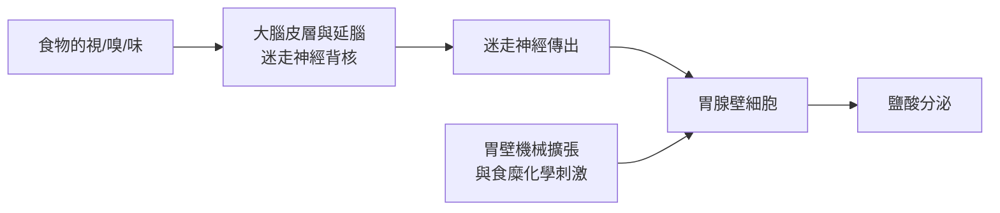

# 1904 · 消化生理與條件反射：巴甫洛夫手術台上的「偽飼」偵查

> **1904 諾貝爾生理學或醫學獎**：伊萬·巴甫洛夫（Ivan Petrovich Pavlov，俄國）— 表彰「在消化的生理學研究上的工作，這一主題的重要方面的知識由此被轉化和擴增」。有趣的是，桂冠表彰的是他的消化研究，而他名留青史的「條件反射」只是消化實驗的意外副產品。

## 懸案（案情提要）

十九世紀末，消化生理學還是一片「只許解剖屍體、不許窺探活體」的禁地：胃液、胰液、膽汁如何被召喚出來？是食物的化學刺激、胃壁機械撐張，還是某種神經密令？當時的實驗動物只要一開腹、一切開神經，便會因急性衰竭而失去「正常消化」的參考價值——活體消化成為「黑箱」。

疑點：

1. 胃液分泌的「指揮系統」是誰？神經？激素？還是雙重指揮？
2. 為什麼「看見食物」甚至「聽見開飯鈴聲」就會流口水？這種「心理性分泌」是玄學還是生理學？
3. 胰液的分泌又由什麼啟動？（此問題 1902 年由拜利斯與斯塔林以「促胰液素」答出，開啟內分泌學。）

## 前因

| 年份 | 事件 |
| --- | --- |
| 1822 | 加拿大獵人 Alexis St. Martin 被獵槍誤傷，留下終生胃瘻；軍醫博蒙特（William Beaumont）藉此做出史上第一次人體胃液研究。 |
| 1833 | 博蒙特出版《胃液與消化生理學》：證明胃液受神經與心理影響，並記錄「憤怒抑制分泌」等心理現象。 |
| 1849 | 克勞德·貝爾納（Claude Bernard）確立胰液在脂肪消化中的角色，生理學「以手術窺探活體」的傳統確立。 |
| 1870s | 亥姆霍茲學派與海登海因（Rudolf Heidenhain）分離胃腺，建立胃液分泌的定量方法。 |
| 1890 | 巴甫洛夫在聖彼得堡軍事醫學院建立「生理學研究所」——一座為慢性實驗特製的「靜默塔」實驗樓，隔音、控溫，犬隻在此長期飼養。 |

## 調查

巴甫洛夫的偵查方法自成一派——**「慢性實驗」**：不殺動物、不毀功能，而是以精巧外科手術為犬隻裝上「永久窺窗」，讓犬在近乎清醒、近乎自然的狀態下持續「供述」消化數據。他因此建造了兩座關鍵儀器：

1. **巴甫洛夫小胃（Pavlov pouch, 1894）**：從犬胃切出一小片胃壁、保留完整神經與血管供應，縫合成一個開口於腹壁的小袋。這個「迷你胃」既分泌真實胃液（神經支配完好），又與主胃隔離，可以**逐滴收集、逐滴定量**。他在小胃與主胃之間留下一薄層黏膜，使神經跨壁連接完整——這是外科史上的精密傑作。
2. **食道切開術＋「偽飼（sham feeding）」**：把犬的食道在頸部切斷、兩端引出皮膚。當犬進食時，食物從頸部瘻口漏出，永不入胃——但**唾液與胃液照樣大量分泌**。這一實驗直指「指揮系統在腦」：

3. **定量數據**：巴甫洛夫以「狗見肉不流涎、聞肉流涎、見餵食者亦流涎」的梯度觀察，繪出胃液分泌的時間曲線。偽飼引發的分泌在 5 分鐘內啟動、可持續 30–60 分鐘；迷走神經切斷後，「看見食物」的分泌**完全消失**，只剩下胃壁直接刺激的局部分泌——證明「心理性分泌」走的是**迷走神經**這條密道。他還用阿托品阻斷膽鹼受體，進一步證實傳遞物質是乙醯膽鹼（此化學身分由其後繼者戴爾、勒維於 1921–1936 補完，見 [1936-神經化學傳遞](1936-神經化學傳遞.md)）。

   同一時期，他把「分泌量的時間積分」作為反應強度的量度——每分鐘滴數、總酸度、酶活性三者並記，這一「多指標聯合量化」的做法在今日生理學實驗中仍是標準配備。他也注意到：強烈的情緒（恐懼、憤怒）會立即壓抑分泌，這條「情緒—消化」軸線在百年後以「腸腦軸」與壓力性潰瘍研究重獲新生。

4. **意外副產品——條件反射**：在飼餵前反覆響鈴，數日後犬「聽鈴即分泌」。巴甫洛夫將此命名為**條件反射（conditional reflex）**，並量化了其規律：消退（只響鈴不餵食，分泌漸減）、泛化（相近頻率鈴聲亦致分泌）、辨別（經訓練可區分）。這套行為定量方法日後成為行為主義心理學、學習與記憶研究的母語。

## 理論裁決

巴甫洛夫裁決的核心是**消化的神經—體液雙重調節模型**：

1. **頭期（cephalic phase）**：視、嗅、味覺經皮層—延腦—迷走神經直達胃腺，可寫成神經傳導增益
   $$V_{\text{acid}} = k_1 \cdot S_{\text{sensory}}$$
   其中 $S_{\text{sensory}}$ 為感官刺激強度。條件刺激（鈴聲）可等效替代非條件刺激（食物），其效力由強化頻率與間隔決定。
2. **胃期（gastric phase）**：胃壁擴張與食糜胜肽直接刺激胃竇 G 細胞釋放胃泌素（gastrin，1905 年由 Edkins 發現），經血流回饋胃體。
3. **腸期（intestinal phase）**：酸性食糜進入十二指腸，刺激 S 細胞分泌促胰液素（secretin）——1902 年拜利斯與斯塔林以去神經腸段證明其為**激素**（見 ../生理醫學獎/1923-胰島素.md 同譜系）。
4. **條件反射的數學抽象**：可寫成條件聯想強度 $W$ 的更新律（近似 Rescorla–Wagner 模型的先聲）
   $$\Delta W = \alpha \, \beta \, (V_{\max} - W)$$
   即每次「鈴—食」配對使聯想強度向飽和值逼近；只響鈴不餵食則 $V_{\max} \to 0$ 、 $W$ 逐次衰減——**消退**由此得到形式化解釋。

## 後果

| 領域 | 影響 |
| --- | --- |
| 胃腸生理學 | 消化分期（頭期、胃期、腸期）成為教科書框架；壁細胞泌酸機制（質子幫浦）在其神經—激素框架內繼續破案。 |
| 內分泌學 | 促胰液素（1902）與胃泌素的發現沿著「去神經對照」的路徑走通，開啟激素學。 |
| 行為科學 | 條件反射成為斯金納操作制約、華生行為主義的方法學母體；亦影響學習理論與成癮研究。 |
| 臨床醫學 | 消化性潰瘍的神經—胃酸模型（後由幽門螺桿菌改寫，見 [2005-幽門螺桿菌](2005-幽門螺旋桿菌.md)）；迷走神經切斷術治潰瘍風行一時。 |
| 神經科學 | 「心理現象可被生理學定量」的信念，奠定 20 世紀神經生理學（謝靈頓、赫斯等，見 [1932-神經元功能](1932-神經元功能.md)）的哲學基調。 |

## 追查支線（未結之謎）

- 「心理性分泌」的中央迴路（皮層—下視丘—迷走背核）要到 20 世紀神經解剖學與功能性影像時代才被完整繪製；
- 巴甫洛夫堅信條件反射發生於大腦皮層，此說後來被證實部分錯誤：小腦、杏仁核與紋狀體亦可承載條件聯想；
- 他的「高級神經活動類型」（神經過程的強度、平衡、靈活）分類，是人格神經科學的早期嘗試，方法粗糙但問題提對了；
- 蘇聯時期條件反射學被奉為官方心理學（別赫捷列夫、維高斯基時代的糾葛），科學與意識形態的纏結是本案的社會史支線；
- 迷走神經不僅傳指令，也傳「腸—腦」回饋：腸道嗜鉻細胞、腸腦軸研究在 21 世紀重啟了巴甫洛夫的問題清單；
- 他晚年（1907 年後）的「皮層抑制」與實驗性神經症研究，試圖以生理學解釋歇斯底里——這一雄心在今日以神經迴路與精神藥理學的語言被部分接手；
- 「第一信號系統／第二信號系統」（動物與語言的區分）是他後期理論中最具爭議的部分，成為蘇聯心理學的必修而西方心理學的棄卷；
- 他的消化液收集技術（小胃、胰瘻、腮腺瘻）被「慢性瘻管動物」研究沿用至 20 世紀中葉，是人體消化功能知識的實驗基座。

## 證物與數據（偵查卷宗摘錄）

| 證物 | 數值／內容 | 偵查意義 |
| --- | --- | --- |
| 博蒙特胃瘻研究（1833） | 憤怒抑制胃液分泌 | 心理因素入卷的第一筆記錄 |
| 巴甫洛夫小胃（1894） | 保留神經支配的隔離小胃 | 消化液「可逐滴定量」的採樣系統 |
| 偽飼實驗 | 食物不入胃、胃液照常分泌 | 分泌指令出自腦而非胃壁 |
| 迷走神經切斷對照 | 心理性分泌完全消失 | 鎖定迷走神經為傳令兵 |
| 阿托品阻斷 | 分泌被抑制 | 膽鹼能傳遞的藥理指紋 |
| 鈴聲實驗 | 聽鈴即分泌（數日配對後形成） | 條件反射的立案 |

卷宗還記載了巴甫洛夫實驗樓的「偵查紀律」：狗被單獨隔離於隔音小室，觀察者從潛望鏡與遠端記錄系統讀取分泌量滴數——因為他發現**旁觀者的腳步聲、餵食者的出現本身都是條件刺激**，任何環境雜訊都會污染數據。這種「消除實驗者效應」的意識，比現代實驗心理學的雙盲設計早了半個世紀。定量方面，他測得偽飼引發的胃液分泌高峰在開食後 15–30 分鐘、酸度可達 $\mathrm{pH} \approx 1$ ；強化次數與條件反射形成速度近似正相關，而單純重複鈴聲（無強化）則使反應量按近指數衰減。巴甫洛夫在領獎演說中刻意只講消化、避談條件反射——他自認生理學家而非心理學家，這一「科學身分自白」也是本案卷宗中最有趣的一頁：一個實驗室的「副產品」最終占領了心理學、神經科學與計算學習理論三個大陸。

## 關聯

- [1936-神經化學傳遞](1936-神經化學傳遞.md) — 迷走神經遞質（乙醯膽鹼）的身分，由勒維雙蛙心實驗補完。
- [1905-結核桿菌與柯霍法則](1905-結核桿菌與柯霍法則.md) — 同時期「慢性實驗動物模型」的醫學偵查文化。
- [1932-神經元功能](1932-神經元功能.md) — 神經調節的電生理後續。
- [2005-幽門螺桿菌](2005-幽門螺旋桿菌.md) — 消化性潰瘍病因由神經—胃酸改寫為細菌的翻案。
- [1963-離子機制](1963-離子機制.md) — 神經細胞膜興奮的物理化學細節。
