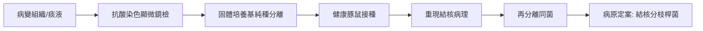

# 1905 · 結核桿菌與柯霍法則：一次奪走四分之一人口世紀的偵查學教科書

> **1905 諾貝爾生理學或醫學獎**：羅伯特·柯霍（Robert Koch，德國）— 表彰「對結核病的相關研究和發現」。

## 懸案（案情提要）

十九世紀，「白色瘟疫」結核病（tuberculosis）每七個歐洲人中就有一人死於其手——它不挑貧富，從布魯塞爾的礦工到蕭邦、契訶夫這樣的藝術家皆難倖免。案件撲朔迷離之處在於：

1. 病灶裡到底藏著什麼？為什麼屍檢只能看見乾酪樣壞死、看見「結核結節」？
2. 同一種病，為何有人慢性潰敗數十年、有人急性數週？
3. 結核病會傳染嗎？（1870 年代以前主流意見認為它源自遺傳或營養不良。）
4. 病原在哪裡？如何證明？如何「令其現形」？

## 前因

| 年份 | 事件 |
| --- | --- |
| 1866 | 法國醫生 Villemin 以兔子實驗顯示結核物質可傳染，但實驗屢遭質疑。 |
| 1876 | 柯霍以簡陋鄉間實驗室證明炭疽桿菌為炭疽病原，奠定細菌致病學方法。 |
| 1878 | 柯霍發表《外傷感染病因研究》，確立「細菌培養＋純種分離＋動物接種」的實驗路徑。 |
| 1881 | 柯霍任柏林帝國衛生局實驗室主任，全力投入結核病原偵查。 |
| 1881 | Koch 學生 Löffler 與其助手亦參與染色方法的改進；「染出病原」是當時最大技術難關。 |

## 調查

柯霍的偵查可拆解為三幕技術劇：

### 第一幕：染色——令隱形者現形

結核桿菌極小、且因細胞壁富含分枝菌酸（mycolic acid）而**不為普通苯胺染料著色**。柯霍屢試屢敗，直到改用**亞甲藍鹼性染色＋ Vesuvin 複染**（1882 年 3 月 24 日在柏林生理學會公布，後經 Ziehl–Neelsen 改良為抗酸染色法）：在顯微鏡下，肺結核病人痰液組織中第一次看見了細細彎曲的藍紫色桿菌。病原現身，這是本案第一塊鐵證。

### 第二幕：純培養——與病人體內的「共犯群體」切割

柯霍發明**固體培養基**（最初以煮熟馬鈴薯切片、後改用明膠與瓊脂平板，並與其助手 Petri 發明了**培養皿**）：把痰液塗於固體表面，每一菌落來自一個單一細胞——純種分離成為可能。

### 第三幕：動物接種——重新犯罪，完成閉環

柯霍將純培養的結核桿菌注入豚鼠與兔子，動物重現人類結核病的全部病理——**柯霍法則（Koch's postulates）**由此定案：

1. 病原菌在每一病例皆能找到；
2. 可在體外純培養；
3. 純培養物注入健康動物可重現疾病；
4. 可再次從該動物分離出同一病原。

### 第四幕：結核菌素的爭議

1890 年柯霍公布「結核菌素」（tuberculin，結核桿菌培養濾液），原以為是治療劑，臨床試驗失敗、甚至有病人惡化；但其後（由 von Pirquet 於 1907–1911 發展）成為**結核菌素皮膚試驗**的基礎——感染過結核者皮膚對結核菌素產生遲發型超敏反應。治療失敗，診斷成功，本案的「副作用」反而更有生命力。

## 理論裁決

柯霍的裁決不只是「找到兇手」，而是樹立了**病原學偵查的通用程序**（Koch's postulates），其背後的理論支柱：

1. **特異病原論（germ theory specificity）**：每一種傳染病各有其特定病原，而非「瘴氣」「體液失衡」一類模糊整體；此說與巴斯德學說共同終結了自然發生說與瘴氣論。
2. **感染劑量與傳播動力學**：結核主要經飛沫核（1–5 μm）空氣傳播，感染後只有約 $5\%\text{–}10\%$ 在一生中進展為活動性疾病，其餘呈**潛伏感染**（latent TB）。可寫成簡單進展模型：設暴露者中感染率 $p_{\text{inf}}$ ，潛伏者每年活化率 $\alpha \approx 0.5\%\text{–} 1\%$ （免疫抑制時暴增數十倍），則一生發病機率
   $$P_{\text{active}} = 1 - e^{-\alpha T}$$
   $T$ 為潛伏年數，免疫抑制（如 HIV）使 $\alpha$ 上升、 $P$ 隨之劇增——這正是 1980 年代結核病隨愛滋病回潮的數學註腳。
3. **超敏反應（遲發型）**：結核菌素試驗陽性反映的是 T 細胞介導的免疫記憶而非「抗體」——這一現象日後成為細胞免疫學（梅契尼科夫之外的另一半免疫世界）的門票，見 [1908-免疫雙雄](1908-免疫雙雄.md)。
4. **公共衛生的操作化**：隔離、痰液消毒、牛奶巴氏殺菌（牛型結核桿菌防控）、抗酸染色普查——這一整套「以病原為靶點」的公衛工程，使 20 世紀已開發國家結核死亡率下降逾 90%。

## 後果

| 領域 | 影響 |
| --- | --- |
| 細菌學 | 柯霍法則成為病原學金標準，此後霍亂弧菌（1883）、白喉桿菌、破傷風桿菌等相繼鎖定。 |
| 公共衛生 | 結核病防治體系（結核病院、卡介苗 1921、DOTS 療法 1990s）全部以本案為起點。 |
| 免疫學 | 遲發型超敏反應與細胞免疫研究由此萌芽，關聯 1911 年代以後的 T 細胞免疫。 |
| 其他諾獎 | 貝林（1901，柯霍弟子）與拉韋朗（1907）同屬「病原學時代」；瓦克斯曼 1952 年鏈黴素首克結核（[1952-鏈黴素](1952-鏈黴素.md)）。 |
| 科學史 | 「結核菌素事件」成為著名醫學醜聞與科學倫理教材——大師亦會為過早臨床宣稱付出代價。 |

## 追查支線（未結之謎）

- 潛伏感染為何能被免疫系統「封印」數十年又不被清除？肉芽腫的免疫建築學至今仍是活躍的破案現場；
- 卡介苗（1921，Calmette 與 Guérin 的減毒牛型桿菌）對兒童重症結核有效、對成人肺結核保護力卻起伏不定——疫苗效力之謎延宕百年，與環境分枝桿菌暴露假說競逐中；
- 柯霍法則在無菌培養困難的病原（麻風桿菌、梅毒螺旋體、病毒）上屢屢失效，法則的「例外清單」本身就是微生物學史的側寫；
- 結核菌素試驗與後來的干擾素-γ 釋放試驗（IGRA）之辨，是百年診斷工具的新舊對照；
- 全球結核病例在 2020 年代仍逾千萬／年，本案的偵查至今「未完全結案」。

## 證物與數據（偵查卷宗摘錄）

| 證物 | 數值／內容 | 偵查意義 |
| --- | --- | --- |
| 抗酸染色（1882） | 亞甲藍鹼性染色＋複染顯出桿菌 | 兇手首次現形 |
| 培養皿與固體培養基 | Petri 皿、明膠／瓊脂平板 | 純種分離的技術前提 |
| 豚鼠接種（1882） | 純培養物重現結核病理 | 柯霍法則第三條達成 |
| Villemin 兔實驗（1866） | 結核物質可傳染 | 傳染說的先驅（方法粗糙未定案） |
| 結核菌素（1890） | 治療失敗、診斷成功（遲發超敏） | 「廢墟中撿到的診斷寶石」 |
| 死亡率曲線 | 歐洲結核死亡率 20 世紀下降逾 90% | 公衛干預＋營養＋化療的合力 |

卷宗中還有一段被低估的定量推理：柯霍注意到結核桿菌生長極緩慢（固體培養基上菌落需數週），分裂時間 $t_d \approx 18\text{–}24$ 小時，遠慢於大腸桿菌的 20 分鐘——以指數增長 $N(t) = N_0 e^{kt}$ 計算，這意味著臨床上「痰中查菌」需要極高的載菌量才能陽性，也解釋了為何培養確認需要漫長等待。慢生長同時是治療耐藥的溫床：藥物只能打擊代謝活躍的菌群，休眠菌成為復燃的火種，這一「持留菌（persister）」問題至今仍是結核治療療程長達六個月以上的根本原因。柯霍晚年為研究結核還遠赴非洲與印度研究牛瘟、東岸熱（1903 年諾貝爾獎演說後的旅程），其「傳染病無國界」的田野作風，成為 20 世紀熱帶醫學的行為典範。

## 關聯

- [1901-白喉血清療法](1901-白喉血清療法.md) — 柯霍弟子貝林承其方法學而開創血清療法。
- [1908-免疫雙雄](1908-免疫雙雄.md) — 結核菌素遲發反應揭示的細胞免疫世界。
- [1902-瘧疾傳播鏈](1902-瘧疾傳播鏈.md) — 同時代傳染病偵查的另一條戰線（寄生蟲學）。
- [1952-鏈黴素](1952-鏈黴素.md) — 結核病第一次擁有有效抗生素。
- [1930-人類血型](1930-人類血型.md) — 同時期實驗室方法學革命的另一分支。
