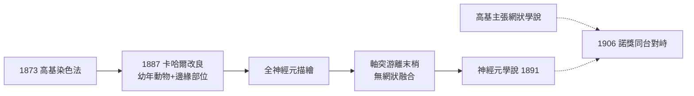

# 1906 · 神經元學說：高基染色、卡哈爾之眼與「神經系統是網還是鏈」的世紀之辯

> **1906 諾貝爾生理學或醫學獎**（共享）：卡米洛·高基（Camillo Golgi，義大利）— 表彰「在神經系統結構研究上的工作」；聖地牙哥·拉蒙-卡哈爾（Santiago Ramón y Cajal，西班牙）— 同上。兩人共享獎項，卻在頒獎典禮上各自為敵對學說辯護——史上最著名的「諾獎同台對峙」之一。

## 懸案（案情提要）

腦是人體最複雜的器官，但在十九世紀末，科學家甚至無法回答最基礎的問題：**神經系統的「建築單元」是什麼？**

1. 顯微鏡下神經組織緻密如毛氈，軸突與樹突纏結交錯，無法追蹤單一細胞的邊界；
2. 網狀學派（reticular theory，以高基為首）主張神經纖維互相融合成連續網絡，如同血管相連；
3. 神經元學派（neuron doctrine，以卡哈爾為首）主張每個神經元是獨立細胞，彼此以「間隙」相接；
4. 誰對？誰的證據才是鐵證？「間隙」是否真的存在？

## 前因

| 年份 | 事件 |
| --- | --- |
| 1838–1839 | 施萊登與許旺提出細胞學說——動植物皆由細胞構成；但神經組織是唯一的「拒絕就範者」。 |
| 1865 | Deiters 描繪帶軸突的神經細胞，但仍無法看見其終末。 |
| 1872–1873 | 高基在自家廚房偶然以重鉻酸鉀浸漬＋硝酸銀沉積，意外發明**高基染色法（Golgi's black reaction）**：只讓約 1%–5% 的神經元被完整染黑。 |
| 1887 | 卡哈爾在馬德里見到高基染色標本，震撼之下全力投入；他改良染色法（重複浸漬、幼年動物組織）使染色更可靠。 |
| 1888–1889 | 卡哈爾以小腦、視網膜、嗅球等「邊緣部位」為材料，系統追蹤單一神經元全貌。 |
| 1891 | 瓦爾代耶（Wilhelm von Waldeyer）綜合卡哈爾證據，正式提出「神經元學說」一詞。 |

## 調查

高基染色法的妙處在於**「稀釋取樣」**——正因為只有少數神經元被染色，它們在棕色背景中全貌孤懸、毫無遮蔽。卡哈爾以此為「顯微鏡下的偵查利器」，展開系統調查：

1. **幼年動物取材**：胚胎與新生動物神經元較小、突起較短，更易全貌追蹤；
2. **邊緣部位取樣**：小腦浦肯野細胞、視網膜節細胞、嗅球僧帽細胞——這些「神經系統邊疆」的神經元數量少、結構清晰，是理想的「孤立案發現場」；
3. **全細胞追蹤**：卡哈爾證明每個神經元有明確的細胞體、樹突（接收端）與軸突（傳出端），軸突以**游離末梢**（free endings）終止於目標細胞旁——**沒有融合**。

關鍵的「推理對決」發生在 1906 年 12 月 11 日斯德哥爾摩諾貝爾頒獎典禮：高基與卡哈爾同台演講，**高基仍堅持網狀學說**，卡哈爾以大量標本圖版反駁。最終裁決者既非兩人，而是後繼的電子顯微鏡——1950 年代，Palade 與 De Robertis 以電鏡直接拍到突觸間隙：兩膜之間有約 20 nm 的**突觸裂隙（synaptic cleft）**，神經元確實彼此獨立。神經元學說獲得終極鐵證（該工作的科系脈絡見 [1974-細胞結構與功能組織](1974-細胞結構與功能組織.md)）。

值得一提的是，卡哈爾的「辯護證詞」本身已成科學寫作的經典：他在頒獎演說中一頁頁展示手繪圖版——小腦、海馬、脊髓——每一幅都是「單一神經元自證清白」的視覺證詞；而高基的演說則以「染色標本的還原銀沈積可能造成人為斷裂」為由反駁，主張所見游離末梢只是染色失敗的假象。這場對峙教導後世一課：**顯微技術的每一步，都伴隨「假象（artifact）」與「實體」的辨證**——染色假象學（fixation artifacts）從此成為組織學的必修科目。

## 理論裁決

**神經元學說**的理論內涵：

1. **獨立性（個體性）**：每個神經元是一個代謝與遺傳的獨立單位，這使「神經可塑性」「神經退化」等概念有了細胞學的落點。
2. **極性與資訊流**：卡哈爾提出**動力極化律（law of dynamic polarization）**——資訊一律由樹突流入、細胞體整合、由軸突輸出。用現代神經編碼語言可寫成
   $$r_{\text{axon}} = f\left(\sum_i w_i \, r_i^{\text{dendrite}} - \theta\right)$$
   其中 $r_i$ 為上游第 $i$ 條突起之輸入率、 $w_i$ 為突觸權重、 $\theta$ 為放電閾值——這正是日後人工神經網路「加權求和—非線性閾值」的生物原型。
3. **突觸是「可開關的接點」而非「焊接線」**：間隙的存在預告了**化學傳遞**的可能（1905 年謝靈頓即提出「synapse」一詞，見 [1932-神經元功能](1932-神經元功能.md)；化學遞質 1921–1936 年由勒維與戴爾鎖定，見 [1936-神經化學傳遞](1936-神經化學傳遞.md)）。
4. **高基的另類貢獻**：高基本人除染色法外，還發現**高基體（Golgi apparatus）**，其細胞學貢獻在 1974 年由德迪夫等人的細胞結構學承接（見 [1974-細胞結構與功能組織](1974-細胞結構與功能組織.md)）。

## 後果

| 領域 | 影響 |
| --- | --- |
| 神經解剖學 | 神經元學說成為現代神經科學的細胞學基礎，連接組學（connectomics）至今日仍在走卡哈爾的路。 |
| 神經生理學 | 突觸概念的確立直接鋪路：謝靈頓整合反射弧、霍奇金—赫胥黎動作電位、赫布學習律。 |
| 計算神經科學 | 「加權求和—閾值」模型成為 McCulloch–Pitts 神經元、感知機乃至深度學院的生物藍本。 |
| 醫學 | 阿茲海默、帕金森、漢丁頓舞蹈症等神經退化疾病，皆以「神經元個體死亡」為病理單元。 |
| 科學史 | 高基至死堅持網狀說，成為科學史上「開創技術者誤讀自家技術」的著名案例。 |

## 追查支線（未結之謎）

- 卡哈爾主張成體腦神經元不再新生——這一「教條」在 1960 年代被成體神經新生（Altman、Kaplan；1990 年代 songbird 研究）部分推翻，人類海馬是否終身生新神經元至今仍在激辯；
- 高基染色法為何只染少數細胞？其化學機理（重鉻酸銀晶核的隨機成核）要到 20 世紀末才被解明；
- 電突觸（縫隙連接）證明網狀說的「部分正確」——神經系統兼有化學與電學兩種接線方式；
- 卡哈爾 1894 年提出「神經生長圓錐趨化導向」假說，1979 年由 Sperry 的視網膜頂蓋投射實驗與後續導向因子（netrin、ephrin）研究逐一證實；
- 「突觸權重可塑」從卡哈爾的直覺，經 Hebb（1949）到長期增強（LTP，1973），成為學習記憶的分子基礎——與 [2000-神經訊號傳導](2000-神經訊號傳導.md) 相連；
- 高基本人在 1898 年還發現高基體並推測其為細胞的「分泌器」，這一功能判斷在 1974 年細胞結構諾獎中被證實為蛋白質加工與運輸的樞紐；
- 神經膠細胞（glia）確實形成連續網絡——網狀學派的「殘餘正確」說明神經系統是「神經元網絡＋膠細胞網絡」的雙層結構；
- 卡哈爾對「樹突棘」的執著描繪（他視其為真正的突觸位點）在電鏡時代獲得證實，樹突棘的可塑性成為學習記憶研究的核心地帶；
- 神經元學說與基因學說在 20 世紀初合流：神經元的個體性使「每個神經元一套基因表達譜」成為可能，單細胞定序時代（2010s）為此補上分子註腳；
- 1906 年的「同台對峙」也留下制度性遺產：諾貝爾委員會此後對共享獎項的「並列但相異」表述更趨謹慎，1908 年免疫雙雄的合併表彰即是參照此例。

## 證物與數據（偵查卷宗摘錄）

| 證物 | 數值／內容 | 偵查意義 |
| --- | --- | --- |
| 高基染色法（1873） | 重鉻酸鉀＋硝酸銀，染 1%–5% 神經元 | 「稀釋取樣」令孤島現形 |
| 卡哈爾視網膜標本（1888） | 追蹤光感受器→雙極→節細胞全鏈 | 資訊流向的形態學證據 |
| 小腦浦肯野細胞 | 樹突樹、軸突末梢全貌 | 全細胞追蹤的典範標本 |
| 幼年動物取材 | 突起短、細胞小、易全染 | 方法學的取材智慧 |
| 謝靈頓「synapse」一詞（1897） | 命名神經元間接點 | 為「間隙」預留理論席位 |
| 電鏡突觸照片（1950s） | 突觸裂隙約 20 nm | 網狀說的終極判決 |

卷宗中最耐人尋味的，是高基與卡哈爾對同一批染色標本作出了相反解讀——這樁「同物證、異結論」的懸案說明：技術無罪，解讀有偏。高基堅持網狀說有其時代合理性（神經膠細胞確實形成連續合胞體、部分神經元確有電突觸直接耦合），但主幹道上的化學突觸是「裂隙式」的。卡哈爾的偵查哲學可總結為三條：以最簡單的標本（邊疆部位）回答最普遍的問題；以形態推斷功能（結構即偵查線索）；以對比與序列（不同物種、不同發育階段）取代單一觀察。他終身手繪的上千幅神經元圖版，至今仍是神經解剖學的「原始卷宗」。1989 年後，螢光蛋白與連接組學讓「染出每一條突起」的夢想升級為「數清每一條突觸」，電子顯微鏡連接組計畫完成的果蠅全腦連接組（2023–2024），正是卡哈爾直尺與墨水在 135 年後的數位重生。

## 關聯

- [1932-神經元功能](1932-神經元功能.md) — 謝靈頓的突觸整合與反射弧，是神經元學說的生理學翻版。
- [1936-神經化學傳遞](1936-神經化學傳遞.md) — 突觸裂隙裡的「化學信使」。
- [1963-離子機制](1963-離子機制.md) — 軸突動作電位的離子通道物理。
- [1981-視覺皮層](1981-視覺皮層.md) — 卡哈爾的形態學在 75 年後由電生理接棒。
- [1974-細胞結構與功能組織](1974-細胞結構與功能組織.md) — 高基體與細胞超微結構的後續偵查。
