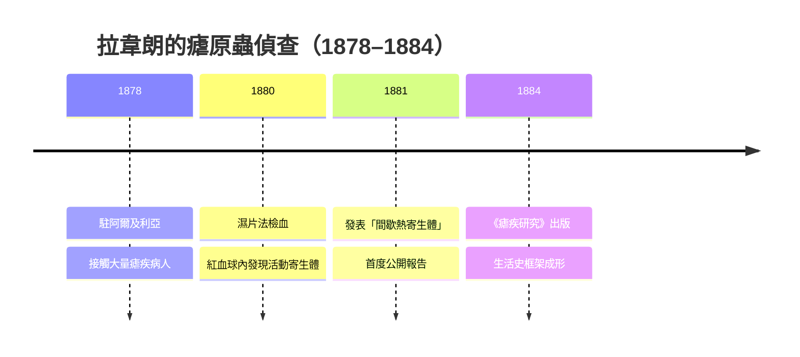

# 1907 · 原生動物致病：拉韋朗與「瘧原蟲現形記」

> **1907 諾貝爾生理學或醫學獎**：夏爾·路易·阿方斯·拉韋朗（Charles Louis Alphonse Laveran，法國）— 表彰「對原生動物在致病中的作用的研究」。

## 懸案（案情提要）

瘧疾（malaria）以義大利語「壞空氣」為名，幾千年來被歸咎於沼澤瘴氣。到了 1880 年，細菌學正席捲歐洲，巴斯德與柯霍已把炭疽、結核的兇手一一揪出（見 [1905-結核桿菌與柯霍法則](1905-結核桿菌與柯霍法則.md)），但瘧疾的兇手始終不現形——因為它根本不是細菌。懸案有三：

1. 瘧疾患者血液中藏著什麼？為何發作呈 48 或 72 小時的週期性？
2. 兇手到底是細菌、毒素、還是某種「從未見過」的生物？
3. 若是寄生蟲，它如何進入人體、如何離開、如何循環？

## 前因

| 年份 | 事件 |
| --- | --- |
| 1870s | 細菌學革命：炭疽桿菌（1876）、鏈球菌、葡萄球菌相繼現形，微生物致病學說確立。 |
| 1878 | 拉韋朗以軍醫身分派駐阿爾及利亞君士坦丁軍醫院，面對大量「間歇熱」病人。 |
| 1879 | 拉韋朗學習顯微鏡技術與血液濕片法，開始系統檢查發熱病人。 |
| 1880 | 同時期意大利學者 Corrado Tommasi-Crudeli 與 Edwin Klebs 宣稱從羅馬沼澤水土中培養出「瘧疾桿菌」，一度聲勢浩大（後證偽）。 |

## 調查

1880 年 11 月 6 日，拉韋朗在君士坦丁醫院解剖一名瘧疾病人的屍體時，先用「濕片法」檢查其新鮮血液（不加固定、不加染色的活體觀察）——這是偵查手法上的關鍵一步：固定與染色會殺死脆弱的寄生蟲，而**活體觀察**才能捕捉運動中的嫌犯。

他在一名 24 歲士兵的紅血球裡看到**有偽足運動的透明小體**；在其他標本中又見到帶有色素顆粒的半月形、球形的寄生體。他記錄了完整的「作案形態學」：

1. 紅血球內的小型活動體（滋養體，trophozoite）；
2. 成熟的裂殖體（schizont）與釋放出的裂殖子（merozoite）；
3. 釋放瞬間與患者寒戰發作同時——**發熱的時鐘被破譯**；
4. 游離於血漿中的「新月形」配子體（gametocyte，當時被誤認為「旗狀體」）。

1. **與「細菌說」對峙**：拉韋朗確認這種生物不具細胞壁的典型細菌形態、有變形運動與色素顆粒，判斷它屬於**原生動物（protozoa）**——這是醫學史上第一次把一種人類重大疾病歸因於原生動物寄生。
2. **發熱節律的定量**：他與意大利學派（Golgi 1885–1886）共同確立了「三日瘧每 48 小時、四日瘧每 72 小時、惡性瘧 36–48 小時」的裂殖週期。裂殖子同步釋放時引發寒戰、高熱——這一同步性來自**紅血球侵襲的同步化**，可寫成週期函數
   $$T(t) = T_0 + A \sum_n f(t - n\tau)$$
   其中 $\tau$ 為裂殖週期（48 h 或 72 h）， $f$ 為一次裂殖爆發引發的體溫脈衝——瘧疾的「週期性發熱」由此獲得定量解釋。
3. **配子體的未解之謎**：拉韋朗注意到這些「半月體」不會在紅血球內裂殖，他正確地推測它們與寄生蟲的「另一階段」有關——這條線索 1897 年由羅斯與曼森接力追蹤到蚊體內（見 [1902-瘧疾傳播鏈](1902-瘧疾傳播鏈.md)），最終補完瘧原蟲的**兩宿主生活史**。
4. **推廣至其他原蟲病**：拉韋朗的偵查方法（活體濕片＋形態分類）隨後應用於錐蟲（trypanosomes，非洲昏睡病、南美錐蟲病）與利什曼原蟲的研究，開創了整個**醫學原生動物學**。他自己亦於 1884 年出版《瘧疾研究》專著，系統整理形態與臨床對照，成為原蟲病學的第一部「案卷彙編」。值得注意的是，他的發現最初遭到意大利與德國主流學派的質疑——「瘧疾桿菌」假說的擁護者一度佔上風，拉韋朗花了近十年才讓「原蟲致病」成為共識；這段「孤證不立、以重複觀察翻盤」的經歷，正是他一生最珍視的方法論註腳。

## 理論裁決

本案的理論裁決可總結為三條：

1. **「原生動物也可致病」**：這是病原學的疆域擴張——細菌之外，寄生蟲（單細胞真核生物）亦是傳染病元兇。人類瘧疾的四種病原（*Plasmodium vivax*、*P. ovale*、*P. malariae*、*P. falciparum*）由 1880–1897 年間多國學者共同分類完成。
2. **裂殖週期與發熱同步**：紅血球內期的同步化（synchrony）導致週期性發熱，是「寄生蟲—宿主節律互動」的第一個定量模型。
3. **「有性世代」的預言**：拉韋朗推測配子體代表寄生蟲生活史的另一世代——這一「有性生殖可能在另一宿主」的猜想，直接引導了 1897–1898 年蚊體內配子生殖的發現。

## 後果

| 領域 | 影響 |
| --- | --- |
| 醫學寄生蟲學 | 開創原蟲病學；阿米巴痢疾（Kartulis 1887、Krarwinkel）、非洲昏睡病、利什曼病相繼納入「原蟲病」家族。 |
| 瘧疾防治 | 配合羅斯的傳播鏈（1902），瘧疾從「瘴氣」變成「可斬斷傳播鏈的寄生蟲病」，公共衛生工程（排水、滅蚊、藥物治療）得以展開。 |
| 藥理學 | 奎寧之後，氯喹（1934）、伯氨喹（1946）等抗瘧藥研發全部以「裂殖體／配子體」為藥理標靶。 |
| 其他諾獎 | 羅斯 1902 年獲獎（[1902-瘧疾傳播鏈](1902-瘧疾傳播鏈.md)）；青蒿素 2015 年獲獎（[2015-青蒿素與阿維菌素](2015-青蒿素與阿維菌素.md)）。 |
| 演化醫學 | 鐮刀型紅血球對惡性瘧的保護（1949）成為「平衡多態性」經典案例。 |

## 追查支線（未結之謎）

- 瘧原蟲如何在紅血球內同步化裂殖？宿主晝夜節律與寄生蟲節律的耦合（2010 年代以分子鐘研究重啟）仍在解密；
- 紅血球侵襲的受體—配體細節（Duffy 抗原、Glycophorin 等）要到 1970–2000 年代才逐一定性；
- 配子體為何只在蚊子胃中出絲？環境溫度下降作為「開關」的信號通路近年才被解析；
- 惡性瘧的腦型瘧（ cerebral malaria ）致死機制（微血管阻塞 vs 發炎风暴）至今仍是重症醫學懸案；
- 瘧疾對人類基因組的演化壓力（鐮刀型血球、G6PD 缺乏、地中海貧血）把本案延伸到演化醫學的法庭；
- 拉韋朗晚年（1897 年後）轉任巴斯德研究所，培育了整個法國寄生蟲學派——原蟲病的「偵查學院」就此建制化；
- 他的回憶錄對「被同僚質疑與官僚打壓」的記述，是科學傳播史上「新病原學說艱難立足」的第一手卷宗；
- 原蟲病的「人—媒介—環境」三角模型日後由黃熱病（蚊子—病毒，1901 年里德委員會）、睡眠病（采采蠅—錐蟲，1903 年布魯斯）逐一複製，熱帶醫學的偵查模板至此定型；
- 佩博式的古 DNA、基因體流行病學在百年後回望瘧疾：人類基因組上瘧疾壓力的「指紋」被定量讀出，是本案最遙遠的回聲；
- 瘧原蟲基因體計畫（2002）解碼了惡性瘧原蟲的全部基因，抗原變異家族（var 基因）的發現解釋了免疫逃逸——「兇手的偽裝術」至今仍在偵查中；
- 瘧疾疫苗（RTS,S 與 2021 年後的新一代疫苗）數十年難產的曲折，說明原蟲病原遠比細菌、病毒更難「通緝」。

## 證物與數據（偵查卷宗摘錄）

| 證物 | 數值／內容 | 偵查意義 |
| --- | --- | --- |
| 1880-11-06 濕片檢血 | 紅血球內見偽足運動小體 | 兇手現形（活體觀察取勝） |
| 色素顆粒（瘧色素） | 寄生體內棕黑色素沉積 | 為瘧原蟲的代謝指紋 |
| 裂殖同步釋放 | 寒戰與裂殖子釋放同時 | 發熱週期 48/72 小時的機制 |
| 半月形配子體 | 血漿中游離、不裂殖 | 「另一世代」的伏筆（後由羅斯接力） |
| Tommasi-Crudeli 瘧疾桿菌 | 後證偽 | 排除細菌路線的「反物證」 |
| 四種人瘧原蟲分類（1880s–1897） | *P. vivax* 等四種 | 物種特異性確立 |

卷宗裡還藏著一個病理學細節：瘧色素（hemozoin）是瘧原蟲消化血紅蛋白後結晶化的副產物——這一「代謝殘渣」既是大體解剖時辨認瘧疾死者的法醫學標記（脾臟、腦微血管中的黑色素沉積），也在 21 世紀成為新藥靶：氯喹正是干擾瘧色素結晶化的藥物。拉韋朗當年只把它當作形態標記，卻不知自己畫下的「指紋」日後成為藥理學的鑰匙。另外，他把原生動物致病概念推廣到錐蟲的研究，直接促成 1901 年布魯斯（David Bruce）鎖定非洲昏睡病病原（*Trypanosoma brucei*，採采蠅傳播）——「原蟲＋吸血昆蟲＋人」的三宿主模型從此成為熱帶病偵查學的標準模板，採采蠅之於昏睡病、白蛉之於利什曼病、錐蝽之於美洲錐蟲病，逐一按圖索驥。

## 關聯

- [1902-瘧疾傳播鏈](1902-瘧疾傳播鏈.md) — 羅斯把拉韋朗的配子體線索追到蚊體內，補完傳播鏈。
- [1905-結核桿菌與柯霍法則](1905-結核桿菌與柯霍法則.md) — 細菌學偵查法的同期姊妹篇。
- [1927-瘧疾發熱療法](1927-瘧疾發熱療法.md) — 瘧原蟲被「反用」為梅毒的治療劑。
- [2015-青蒿素與阿維菌素](2015-青蒿素與阿維菌素.md) — 抗瘧武器的現代化。
- [1930-人類血型](1930-人類血型.md) — 同年代紅血球研究與免疫學的分支線。
