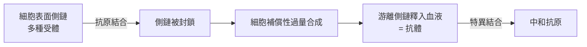

# 1908 · 免疫雙雄：梅契尼科夫的吞噬細胞對決埃爾利希的側鏈理論

> **1908 諾貝爾生理學或醫學獎**（共享）：伊利亞·梅契尼科夫（Élie Metchnikoff，俄國；法國巴斯德研究所）— 表彰「在免疫性研究上的工作」；保羅·埃爾利希（Paul Ehrlich，德國）— 同上。細胞免疫與體液免疫兩大學派的領袖共享同一座獎，是免疫學史上最具象徵意義的「和解」。

## 懸案（案情提要）

1880 年代的免疫學正在爆發期：貝林剛剛用抗毒素血清救活白喉患兒（見 [1901-白喉血清療法](1901-白喉血清療法.md)），體液中的「神奇武器」似乎無所不能。但一個根本問題懸而未決：

**免疫到底是什麼？** 血清裡的抗體從何而來？身體為何能「認出」外來者？還是說——真正的防衛者根本不在血清裡，而在細胞裡？

兩派陣營壁壘分明：

1. **細胞學派**（梅契尼科夫）：免疫的主體是會「吃」病原的白血球——吞噬細胞（phagocyte）。
2. **體液學派**（埃爾利希、貝林）：免疫的主體是血清中的抗毒素與補體等化學分子，細胞只是戰場。

## 前因

| 年份 | 事件 |
| --- | --- |
| 1866 | 梅契尼科夫生於俄國哈爾科夫省，早年師從動物學家科瓦列夫斯基，成為比較胚胎學家。 |
| 1882 | 梅契尼科夫在義大利墨西拿以海星幼蟲做實驗，觀察到透明幼蟲體內細胞會圍攻刺入的薔薇棘刺——吞噬現象首次被賦予「免疫防衛」解釋。 |
| 1883 | 梅契尼科夫提出吞噬細胞學說（phagocytosis theory），主張白血球是免疫主力。 |
| 1888 | Nuttall 顯示正常血清有微弱殺菌力；Buchner 發現血清中的「防禦素」（後名為補體）。 |
| 1890 | 貝林與北里發現抗毒素（見 [1901-白喉血清療法](1901-白喉血清療法.md)），體液學派聲勢大漲。 |
| 1894–1895 | Bordet 發現補體與補體結合反應；同時 Denys 與 Leclef 顯示抗體可「調理」細菌使其更易被吞噬。 |
| 1897–1900 | 埃爾利希提出側鏈學說（side-chain theory），為抗體提供化學結構模型。 |

## 調查

### 第一條偵查線：梅契尼科夫的「海星幼蟲實驗」

1882 年聖誕夜，梅契尼科夫在墨西拿以玫瑰刺刺入透明海星幼蟲，翌日顯微鏡下見到**發育中細胞群聚於刺周**，包圍、吞噬異物。他隨即追蹤：

1. **水蚤實驗（1884）**：以淡水橈足類水蚤（*Daphnia*）為模型，注入釀酒酵母（*Monospora bicuspidata*）孢子，顯微鏡下全程觀察吞噬細胞與真菌孢子的攻防：有的水蚤被孢子殺死（感染成立），有的孢子被完全吞噬、宿主痊癒——這是免疫學史上**第一個活體內免疫「現場直播」**。
2. **發炎＝戰場**：他重新詮釋炎症：紅腫熱痛不是「疾病」，而是吞噬細胞集結作戰的表象——病理學的一次觀點革命。
3. **「不腐的諷刺」**：梅契尼科夫注意到吞噬細胞同時是老化的搬運工，晚年轉向長壽與腸道菌研究（「優格長壽說」），預告了今日微生物組—免疫軸的研究。

### 第二條偵查線：埃爾利希的「側鏈模型」

埃爾利希自 1890 年代起追問：**抗體從何而來、為何專一？** 1897 年他提出著名的**側鏈學說（Seitenkettentheorie）**：

1. 細胞表面原本就長著各種「側鏈」（後稱受體），各有特定分子構形，功能是與養分等內源分子結合；
2. 當外源抗原（如毒素）以其互補構形「卡」上某條側鏈，該側鏈即被封鎖、無法履行原職；
3. 細胞於是**過量補償**：合成多餘的側鏈並釋放進血液——這些游離側鏈就是**抗體**。

以現代語言，抗體—抗原結合可寫成平衡

$$[A] + [Ag] \rightleftharpoons [A{\cdot}Ag], \qquad K_a = \frac{[A{\cdot}Ag]}{[A][Ag]}$$

埃爾利希與約翰·奧恩比（Julius Morgenroth）更於 1900 年提出**「毒與藥的劑量曲線」**與紅血球溶血定量系統，奠定血清學定量分析的基礎。他還以「**Corpora non agunt nisi fixata**（不入結合，不生作用）」概括受體—配體法則——這條格言日後成為整個藥理學受體理論的憲法。

### 第三條偵查線：和解

1890 年代末，兩派的對峙被一系列實驗化解：Denys 與 Leclef（1895）、Wright 與 Douglas（1903）發現**調理素（opsonin）**——血清抗體先「標記」細菌，吞噬細胞才能高效吞噬。免疫既非純細胞、亦非純體液，而是**兩條戰線的協同作戰**。1908 年諾貝爾委員會以「在免疫性研究上的工作」合併表彰兩人，正是對這場「學派內戰」的裁決。

## 理論裁決

1. **免疫的雙軌模型**：先天免疫（吞噬細胞、補體）與後天免疫（抗體、淋巴細胞）兩軸並立——這一框架沿用至今，1908 年獎正是這個「二元憲法」的開國文件。
2. **受體論的誕生**：埃爾利希的側鏈模型是第一個**分子層次受體—配體模型**，比受體的生化證實早了半個世紀；「抗體多樣性預先生成於基因組」的直覺在 1976 年由利根川進以基因重排證實（見 [1987-抗體多樣性](1987-抗體多樣性.md)）。
3. **選擇論 vs 指令論**：埃爾利希主張「抗原選擇既存受體」（選擇論），這一思想在 1950 年代由伯內特發展為**克隆選擇學說**（見 [1960-後天免疫耐受](1960-後天免疫耐受.md)），成為現代免疫學的總綱。
4. **定量血清學**：埃爾利希的抗毒素標準化（見 [1901-白喉血清療法](1901-白喉血清療法.md)）＋溶血滴度系統，使免疫學從「定性描述」進入「可滴定、可計數」的定量科學；抗原—抗體沉澱曲線（Heidelberger–Kendall, 1930s）把 $K_a$ 與濃度比寫成了標準曲線。
5. **吞噬與受體的統一**：吞噬細胞識別病原也要靠「受體」（今日的 Toll 樣受體、Fc 受體）——2011 年先天免疫諾獎（TLR）正是側鏈思想在先天免疫的還魂（見 [2011-先天免疫與樹突細胞](2011-先天免疫與樹突細胞.md)）。

## 後果

| 領域 | 影響 |
| --- | --- |
| 免疫學 | 細胞免疫 vs 體液免疫框架確立；吞噬細胞→巨噬細胞、樹突細胞譜系研究延續至今。 |
| 藥理學 | 受體—配體法則成為藥物設計總綱；埃爾利希 1910 年研發砷凡納明（606）治梅毒，開創化學治療學。 |
| 血清學 | 補體結合試驗（1901）、瓦瑟曼反應（1906）使梅毒等疾病血清診斷成為常規。 |
| 理論免疫學 | 克隆選擇、免疫耐受、抗體多樣性等後續諾獎皆站在側鏈學說的肩膀上。 |
| 微生物組學 | 梅契尼科夫的腸道菌—長壽假說在 21 世紀微生物組研究處被重新檢視。 |

## 證物與數據（偵查卷宗摘錄）

| 證物 | 數值／內容 | 偵查意義 |
| --- | --- | --- |
| 海星幼蟲實驗（1882） | 細胞包圍玫瑰棘刺 | 吞噬現象的首次免疫解讀 |
| 水蚤實驗（1884） | 吞噬成功則痊癒、失敗則死亡 | 活體內免疫攻防的現場直播 |
| 貝林—北里抗毒素（1890） | 血清中和 100 MLD 毒素 | 體液學派的開山物證 |
| Nuttall／Buchner（1888–1889） | 正常血清有殺菌力 | 補體（先天免疫）現蹤 |
| 調理素實驗（1895–1903） | 抗體標記後吞噬效率倍增 | 兩派和解的橋樑 |
| 側鏈學說（1897） | 受體過量補償釋出為抗體 | 抗體來源的第一個分子模型 |

卷宗的深層伏筆在於「選擇 vs 指令」之辯：埃爾利希的側鏈模型主張細胞**預先生成**千萬種受體、抗原只負責「挑選」，這一選擇論在 1950 年代被伯內特擴寫為克隆選擇學說，成為現代免疫學的總綱；而與之競爭的「指令論」（抗原作為模板直接塑造抗體）則在 1960 年代抗體一級結構解析後被淘汰。埃爾利希以化學家直覺押中正確模型，堪稱理論免疫學的第一案。梅契尼科夫一側的伏筆同樣深遠：他晚年提出的「腸道菌群—發炎—老化」假說（優格中的乳酸桿菌抑制腸道腐敗菌），在百年後被微生物組研究以糞菌移植、短鏈脂肪酸、發炎老化（inflammaging）等概念部分平反。1908 年的這座獎，因此可以讀作兩條百年研究長河的共同源頭：一條流向受體與抗體的分子免疫學，一條流向巨噬細胞、樹突細胞與微生物組的細胞生態學。

## 關聯

- [1901-白喉血清療法](1901-白喉血清療法.md) — 抗毒素血清是埃爾利希側鏈模型的直接素材。
- [1913-過敏反應](1913-過敏反應.md) — 里歇揭示免疫的「暗面」：抗體亦可致災。
- [1960-後天免疫耐受](1960-後天免疫耐受.md) — 側鏈「選擇論」發展成克隆選擇與免疫耐受。
- [1987-抗體多樣性](1987-抗體多樣性.md) — 利根川進以基因重排解釋抗體多樣性之謎。
- [2011-先天免疫與樹突細胞](2011-先天免疫與樹突細胞.md) — 吞噬細胞學說的現代化身：Toll 樣受體與樹突細胞。
