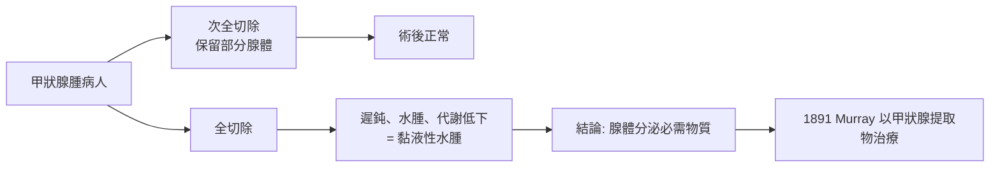

# 1909 · 甲狀腺外科：科赫爾與「切除腺體後病人變呆」的內分泌偵查

> **1909 諾貝爾生理學或醫學獎**：埃米爾·特奧多爾·科赫爾（Emil Theodor Kocher，瑞士）— 表彰「對甲狀腺的生理學、病理學以及外科學上的研究」。他是首位獲得諾貝爾生理學或醫學獎的外科醫師。

## 懸案（案情提要）

十九世紀末，甲狀腺手術死亡率高達 40% 以上——出血、窒息、感染三座大山。但比技術更深的謎團在於：

1. **甲狀腺到底是做什麼的？** 有些病人甲狀腺腫大卻相安無事，有些切除後卻出現遲鈍、水腫、昏迷；
2. 為什麼德國山區與瑞士阿爾卑斯居民好發「大脖子病」（地方性甲狀腺腫）與「呆小症」（cretinism）？
3. 切除多少甲狀腺才安全？全切與次全切的界線在哪裡？

外科醫生手上有一把刀，卻沒有一份「腺體的說明書」。科赫爾的任務，是邊開刀邊破案，把這份說明書寫出來。

## 前因

| 年份 | 事件 |
| --- | --- |
| 1850s–1870s | 麻醉（1846）與消毒（1867，李斯特）使腹部手術成為可能，但頸部手術因血管密佈、氣道狹窄仍是禁區。 |
| 1872 | 科赫爾任瑞士伯恩大學外科教授，伯恩州地處甲狀腺腫高發區，手術需求殷切。 |
| 1873 | Gull（英國）首度描述甲狀腺功能低下的臨床表現；1874 年 Ord 命名「黏液性水腫（myxoedema）」。 |
| 1878 | 施夫（Moritz Schiff）早於 1856 年即以犬實驗顯示切除甲狀腺可致死、移植可救——「腺體分泌某種必需物質」的假說已出現但未受重視。 |
| 1880s | Reverdin（日內瓦）報告甲狀腺全切後出現「手術後黏液性水腫」，科赫爾隨即展開自己的對照追蹤。 |

## 調查

科赫爾的偵查方法是把**外科手術台變成流行病學實驗室**——每一台手術都是一次「干預」，每一位病人都是長期追蹤的「觀察對象」：

### 第一幕：把死亡率從 40% 壓到 0.5% 以下

1. **解剖學精修**：科赫爾重新描繪甲狀腺血管分佈，確立「先結紮甲狀腺上、下動脈再切腺體」的順序，大幅減少術中失血；
2. **無菌與輕柔操作**：嚴格遵守李斯特消毒法，術中避免牽拉喉返神經與甲狀旁腺；
3. **統計公開**：他逐年公布死亡數據——1870 年代早期死亡率約 14%，1884 年降至約 8%，1895 年約 2%，1900 年代低於 0.5%。這種以公開數據驅動改良的做法，正是「外科循證醫學」的雛形。

### 第二幕：切除後的「呆滯」——腺體功能的偵破

1883 年，科赫爾報告一批甲狀腺**全切除**的病人在術後數月出現精神遲鈍、皮膚乾厚水腫、代謝低下——他意識到這與「呆小症」及「黏液性水腫」是**同一病理**。這一臨床對照（全切 vs 部分切除 vs 未切）實際上做成了人類甲狀腺功能的「自然實驗」：

### 第三幕：地方性甲狀腺腫與碘的線索

科赫爾同時追蹤流行病學線索：阿爾卑斯地區的水土缺碘 → 居民甲狀腺代償性增生（大脖子）→ 母親孕期缺碘 → 胎兒神經發育受損（呆小症）。1890 年代末，Baumann（1895）證明甲狀腺是人體碘濃度最高的器官；1910 年代，瑞士與美國（Marine 與 Kimball）推動食鹽加碘，地方性甲狀腺腫與呆小症大幅絕跡——這是公共衛生史上「以微量元素預防神經發育障礙」的第一案。

## 理論裁決

1. **內分泌概念確立**：甲狀腺是「無管腺」——它不經導管、而以**激素（hormone）**分泌入血，調節全身代謝。甲狀腺素（thyroxine）的化學結構由 Kendall（1914）與 Harington（1926）闡明；「激素」一詞 1905 年才由 Starling 正式提出。這一案例與 1902 年促胰液素（見 [1904-消化生理與條件反射](1904-消化生理與條件反射.md)）共同構成內分泌學的雙柱。
2. **基礎代謝率的定量**：甲狀腺素提高基礎代謝率（BMR）。產熱可寫成
   $$\dot{Q} = \dot{Q}_0 \cdot (1 + \alpha\, [T_4])$$
   其中 $[T_4]$ 為血中甲狀腺素濃度， $\alpha$ 為敏感係數；甲狀腺功能亢進時 BMR 可升高 50%–80%，低下時可下降 40%——這是臨床上最早以**代謝率**定量內分泌功能的疾病。
3. **負回饋調節的先聲**：腺體切除後腦下垂體代償性增大（TSH 細胞增生），預告了下視丘—腦垂腺—甲狀腺軸（HPT axis）的負回饋結構：
   $$\text{TRH} \to \text{TSH} \rightleftharpoons T_4/T_3$$
   $T_3/T_4$ 升高抑制 TSH，反之則刺激——這是生理學負回饋模型的教科書案例。
4. **手術改良的方法論**：以「公開統計＋逐年對照」驅動技術迭代，科赫爾的外科改良本身就是**品質改善循環（PDCA）**的醫學先聲。

## 後果

| 領域 | 影響 |
| --- | --- |
| 外科 | 甲狀腺切除術死亡率從 40% 降至 1% 以下，成為內分泌外科的起點；「Kocher 鉗」「Kocher 切口」沿用至今。 |
| 內分泌學 | 腺體—激素—靶器官模型確立，腎上腺（1930s）、腦垂腺（1947）等後續諾獎（見 [1947-糖代謝與激素](1947-糖代謝與激素.md)）皆循此路。 |
| 公共衛生 | 食鹽加碘運動（1920s）使呆小症在多國絕跡，為世界衛生組織微量元素干預政策的原型。 |
| 代謝醫學 | 基礎代謝率成為臨床常規檢查；甲狀腺功能檢驗（後以放射免疫法，見 [1977-放射免疫分析](1977-放射免疫分析.md)）精確化。 |
| 神經發育 | 母體碘缺乏導致胎兒腦發育損傷的機制，奠定「碘—智力」公共衛生觀。 |

## 追查支線（未結之謎）

- 甲狀腺素的「細胞內作用」之謎（它是否進入細胞核調節轉錄）要到 1960–1980 年代以核受體研究定案——甲狀腺素受體成為核受體超家族的一員；
- T3 與 T4 的雙激素分工、脫碘酶的組織特異調控，是內分泌代謝的後續細節偵查；
- 格雷夫斯病（甲狀腺亢進）的自免疫本質（LATS 長效甲狀腺刺激物，1956）把本案與免疫學接軌；
- 科赫爾本人反對「把甲狀腺手術再擴大適應症」的濫用，其保守外科倫理與後世「預防性甲狀腺切除」的爭議形成對照；
- 環境內分泌干擾物（甲狀腺毒素、碘過量）對甲狀腺疾病版圖的改寫，是本案的 21 世紀續集。

## 證物與數據（偵查卷宗摘錄）

| 證物 | 數值／內容 | 偵查意義 |
| --- | --- | --- |
| 全切病人追蹤（1883） | 術後遲鈍、水腫、代謝低下 | 腺體分泌「必需物質」的臨床鐵證 |
| 手術死亡率曲線 | 40% → 14%（1872）→ <0.5%（1900s） | 以公開統計驅動技術改良 |
| Reverdin 報告 | 術後黏液性水腫的獨立觀察 | 交叉驗證 |
| Baumann（1895） | 甲狀腺為人體碘濃度最高器官 | 缺碘線索定案 |
| 鹽加碘（1920s） | 地方性甲狀腺腫、呆小症絕跡 | 預防醫學的經典干預 |
| Kendall（1914）／Harington（1926） | 甲狀腺素結構 | 激素的化學身分補完 |

卷宗中還有一段「術中意外的破案」：科赫爾在手術中觀察到，切除甲狀腺時若不慎摘除緊貼其後的四枚小小甲狀旁腺，病人會出現手足搐搦、喉肌痙攣——這一併發症使他意識到頸部還藏著另一群內分泌器官，鈣代謝由甲狀旁腺激素（PTH）獨立調控。副甲狀腺功能（1908 年後由 MacCallum 等闡明）成為內分泌學的第二章，其發現竟是手術台上的「附帶物證」。另外，科赫爾的統計公開做法還帶來一個制度性遺產：他堅持逐年公布全國而非僅自選病例的手術結果，這種「不分案報喜」的透明原則，正是現代外科登記制度（registry）與醫療品質指標的雛形。他的學生 Theodor Kocher 之名還留在三件手術器械上；而「伯恩學派」培養的醫師把甲狀腺手術帶到歐陸各國，使該手術在 1910 年代已成為可常規執行的內分泌外科。

## 關聯

- [1904-消化生理與條件反射](1904-消化生理與條件反射.md) — 內分泌學的另一支柱：促胰液素與激素概念。
- [1923-胰島素](1923-胰島素.md) — 同譜系：內分泌療法的臨床革命。
- [1947-糖代謝與激素](1947-糖代謝與激素.md) — 腦垂腺激素對代謝的調節，延續 HPT 軸的邏輯。
- [1977-放射免疫分析](1977-放射免疫分析.md) — 激素檢測的定量革命。
- [1912-血管縫合與器官移植](1912-血管縫合與器官移植.md) — 同時期外科技術革命的另一戰線。
