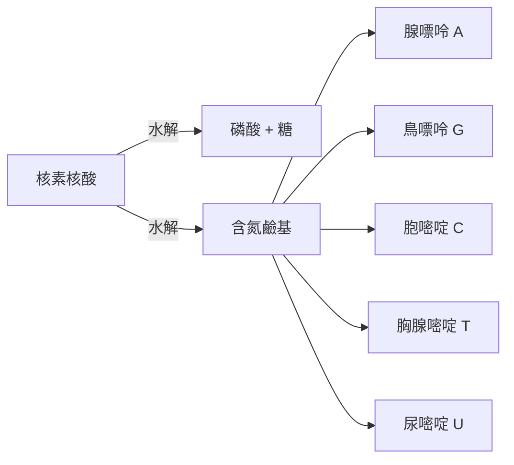

# 1910 · 細胞核化學：科塞爾把「遺傳物質」拆成五塊鹼基

> **1910 諾貝爾生理學或醫學獎**：阿爾布雷希特·科塞爾（Albrecht Kossel，德國）— 表彰「通過對包括細胞核物質在內的蛋白質的研究，為了解細胞化學做出的貢獻」。

## 懸案（案情提要）

1869 年，米歇爾（Friedrich Miescher）從外科繃帶的膿液白血球中分離出一種前所未見的酸性物質——「核素（nuclein）」，它藏在細胞核裡、富含磷。但接下來四十年，化學家面對的是一片「無人區」：

1. 核素到底是什麼？是單一化合物還是混合物？
2. 它與蛋白質（染色體的另一半）是什麼關係？
3. 它與孟德爾 1865 年發現、1900 年才被重新重視的「遺傳因子」有無瓜葛？
4. 為什麼**每一種生物**的細胞核裡都有它，而構成它的「積木」卻似乎只有少數幾種？

## 前因

| 年份 | 事件 |
| --- | --- |
| 1865 | 孟德爾在布爾諾公布豌豆雜交實驗，「遺傳因子」的概念問世（當時無人理會）。 |
| 1869 | 米歇爾在杜賓根從膿液白血球核中分離「核素」——核酸的第一次現身。 |
| 1871–1878 | 科塞爾師從化學家霍佩-賽勒（Hoppe-Seyler，米歇爾的發表人），系統研究核素化學。 |
| 1882 | 弗萊明（Walther Flemming）以染色技術描述染色體有絲分裂與「染色質（chromatin）」。 |
| 1885–1901 | 科塞爾在海德堡以水解—分離—結晶的路徑，把核素拆解成五種含氮鹼基。 |
| 1900 | 孟德爾定律被德弗里斯、柯林斯、丘爾馬克三人同時重新發現，遺傳學起飛，對「遺傳的化學載體」的需求急迫。 |

## 調查

科塞爾的偵查方法是**古典有機化學式的「拆解法」**：把細胞核物質「煮開、分餾、結晶」，逐一認領每一塊積木。

### 第一幕：水解核素，認領含氮鹼基

他把胸腺、酵母等富含細胞核的組織反覆水解，以酸、鹼分步斷鍵，再用沈澱與結晶分離產物。1885–1901 年間，他陸續分離出五種含氮鹼基：

1. **腺嘌呤（adenine，1885）**：從胰臟、胸腺中取得；
2. **胸腺嘧啶（thymine，1893）**：從小牛胸腺水解物中結晶；
3. **胞嘧啶（cytosine，1894）**：同樣來自胸腺水解；
4. **鳥嘌呤（guanine）與**尿嘧啶（uracil，1900，由 Ascoli 完成）——完整湊齊**五種鹼基**，核酸字母表的化學目錄就此公開。

### 第二幕：證明核素是「磷酸—糖—鹼基」三件套

科塞爾與其學生（Neumann、Steudel 等）證明核素水解產物只有三類：磷酸、五碳糖（該糖的身分遲至 1909 年由 Levene 定為核糖）、含氮鹼基。這是**核酸化學結構的骨架圖**——雖然當時 Levene 錯誤地以為是「四核苷酸」單調重複（四核苷酸假說，1909），導致核酸長期被認為結構太簡單、不可能承載遺傳資訊。

### 第三幕：蛋白質的另一半偵查

科塞爾同時研究**組織蛋白（histones）**——一類與核酸緊密結合的鹼性蛋白，並提出蛋白質中「特定胺基酸組合對應特定生物功能」的想法。他的學生身邊聚集了後來分離出嘌呤結構的埃米爾·費雪（Emil Fischer）譜系，蛋白質化學由「總氮量」進入「序列與組成」時代。

### 第四幕：細胞核化學的定量

科塞爾注意到**同一物種各組織細胞核中，鹼基組成比例相對恆定**、不同物種則有差異——這是核酸物種特異性的最早線索（但被四核苷酸假說的迷霧遮蔽了三十年，直到 1950 年 Chargaff 重新發現「A=T、G=C」的定量規則，見 [1962-DNA 雙螺旋](1962-DNA雙螺旋.md)）。

## 理論裁決

1. **核苷酸的化學憲法**：核苷酸 = 磷酸 + 五碳糖 + 含氮鹼基；RNA 含 A、G、C、U，DNA 含 A、G、C、T。這一化學分類至今未變，是分子生物學的「元素週期表」。
2. **核酸 vs 蛋白質：資訊載體之辯**：科塞爾的化學目錄使「核素是遺傳載體」成為可能假設——但因當時核酸被認為太「單調」，主流反而押注蛋白質。這場誤判直到 1944 年 Avery 以轉化實驗、1952 年 Hershey–Chase 以噬菌體標記實驗才翻案（見 [1969-噬菌體遺傳](1969-噬菌體遺傳.md)）。
3. **物種化學特異性**：科塞爾確立「不同物種核酸組成有別」，為後續 DNA 組成定量（Chargaff 法則）提供方法學起點。
4. **核素與染色質的對位**：細胞化學（科塞爾）與細胞形態學（弗萊明、魏斯曼）在 1900 年代合流，形成「染色體由核素與蛋白構成」的共識——遺傳的化學偵查就此立案。

## 後果

| 領域 | 影響 |
| --- | --- |
| 分子生物學 | 鹼基目錄成為 DNA 雙螺旋（1953）、遺傳密碼（1968）的化學前提。 |
| 遺傳學 | 「遺傳的化學載體」問題正式立案；Avery–McLeod–McCarty（1944）與 Hershey–Chase（1952）完成翻案。 |
| 生物化學 | 標誌著「細胞化學」的成熟，開啟生物化學的諾獎序列（瓦爾堡 1931、李普曼 1953 等）。 |
| 藥理學 | 嘌呤、嘧啶化學成為抗代謝藥物（1948，見 [1988-藥物治療原理](1988-藥物治療原理.md)）與核苷類抗病毒藥物的化學基礎。 |
| 營養學 | 科塞爾學派同時確立「必需胺基酸」概念（其弟子包括研究精胺酸的 Duldberg 等），蛋白質營養學奠基。 |

## 追查支線（未結之謎）

- DNA 與 RNA 兩種核酸的糖分別（去氧核糖 vs 核糖）由 Levene 於 1909–1929 年間定案，「為何遺傳用去氧、信使用核糖」的演化之謎至今仍被討論；
- 組織蛋白（histone）從「包裝材料」被重新定義為「基因調控開關」——組蛋白乙醯化、甲基化密碼是表觀遺傳學的主戰場；
- 核酸的「極性」（5'→3' 方向性）與磷酸二酯鍵的骨架結構，要等到 1935–1952 年 Levene、Todd 等的化學工作才補全；
- 科塞爾的學生 Johnui（日本留學生）與其門生網絡把核化學傳到日本，影響了後來的分子生物學譜系；
- 若核酸「太單調」的偏見不存在，雙螺旋是否會提前二十年？這是科學史上的反事實思考題。

## 證物與數據（偵查卷宗摘錄）

| 證物 | 數值／內容 | 偵查意義 |
| --- | --- | --- |
| 米歇爾核素（1869） | 膿液白血球核中富磷酸性物質 | 案發現場的最初物證 |
| 腺嘌呤（1885） | 自胰臟、胸腺水解物結晶 | 核酸字母表第一個字母 |
| 胸腺嘧啶（1893） | 自小牛胸腺水解 | 動物核酸特徵鹼基 |
| 胞嘧啶（1894） | 同上 | 第三塊積木 |
| 五碳糖的身分（1909，Levene） | 核糖／去氧核糖 | 骨架定案 |
| 四核苷酸假說（1909） | 誤判核酸為單調重複 | 延宕三十年的錯誤偵結 |

卷宗中最值得記取的教訓是「四核苷酸假說」這宗錯誤偵結：Levene 與科塞爾學派依據當時粗糙的水解定量，誤認為核酸由四種核苷酸等摩爾重複構成——若此為真，核酸便「太單調」、不可能攜帶千變萬化的遺傳訊息，於是學界把目光轉向了結構更複雜的蛋白質。這一偏見延宕三十年：直到 1944 年 Avery 以肺炎鏈球菌轉化實驗、1950 年 Chargaff 以紙層析測得「不同物種核酸組成各異、且 $A=T$ 、 $G=C$ 」，錯案才被翻轉，1953 年雙螺旋模型順勢而立。科塞爾本人的貢獻不因該誤判而失色——他建立的水解—分離—結晶流程、以及「不同物種鹼基組成有別」的定量直覺，正是 Chargaff 法則的方法學前身。此外，他對組織蛋白（histone）的研究在百年後開花：組蛋白密碼（histone code）與染色質修飾已成表觀遺傳學的主戰場，1910 年的「細胞核化學」卷宗至今仍在增補新頁。

## 關聯

- [1962-DNA 雙螺旋](1962-DNA雙螺旋.md) — 鹼基的化學目錄是雙螺旋模型的材料清單。
- [1968-遺傳密碼](1968-遺傳密碼.md) — 四字母鹼基如何編碼二十種胺基酸的後續案件。
- [1969-噬菌體遺傳](1969-噬菌體遺傳.md) — 遺傳物質身分的終極鐵證。
- [1933-染色體遺傳](1933-染色體遺傳.md) — 摩根把孟德爾因子落到染色體上，與科塞爾的化學線在細胞核會師。
- [1908-免疫雙雄](1908-免疫雙雄.md) — 同時代德國生理化學界的另一場偵查：埃爾利希的免疫側鏈理論。
