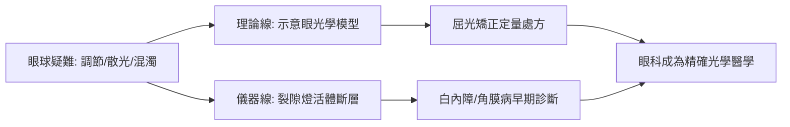

# 1911 · 眼睛屈光學：古爾斯特蘭德把眼光學寫成方程式

> **1911 諾貝爾生理學或醫學獎**：阿爾瓦·古爾斯特蘭德（Allvar Gullstrand，瑞典）— 表彰「在眼睛屈光學研究上的工作」。同年物理學獎委員會一度提名他為物理獎得主，經卡羅琳斯卡堅持其工作屬醫學範疇而改授醫學獎——諾獎史上著名的「學科歸屬之爭」。

## 懸案（案情提要）

人眼是一台精密相機，但十九世紀末的眼光學仍停留在亥姆霍茲（Hermann von Helmholtz, 1856）的**厚透鏡近似模型**：角膜與晶狀體被簡化成兩個球面、一組平均值。案情不明之處：

1. 眼睛**調節（accommodation）**——從看遠到看近的對焦切換——到底靠什麼機制？晶狀體如何變形？
2. 散光（astigmatism）、老花（presbyopia）的幾何光學根源是什麼？如何定量矯正？
3. 為什麼眼球內部檢查（眼底、晶狀體混濁）只能靠粗糙的檢眼鏡，看不清楚？

物理學家寫得出理想透鏡公式，卻套不上真實的眼球；醫生會開處方，卻解釋不了成像品質。**眼光學需要一位既懂醫學又懂光學的「雙料偵探」。**

## 前因

| 年份 | 事件 |
| --- | --- |
| 1851 | 亥姆霍茲發明檢眼鏡，眼科從此有「窺探眼球內部」的工具。 |
| 1856–1866 | 亥姆霍茲出版《生理光學手冊》，建立眼光學的經典模型（眼軸、調節理論）。 |
| 1864 | Donders《眼的屈光與調節》：確立近視、遠視、散光的臨床分類與鏡片矯正法。 |
| 1880s | 晶狀體的「亥姆霍茲調節理論」（睫狀肌收縮→懸韌帶放鬆→晶狀體變凸）成為主流，但缺乏定量驗證。 |
| 1894 | 古爾斯特蘭德任烏普薩拉大學眼科教授，開始以幾何光學重新審視眼球。 |

## 調查

古爾斯特蘭德的偵查分兩路：**理論一路、儀器一路**。

### 第一路：重寫眼光學的「案卷」

1. **角膜的非球面與漸變折射率**：古爾斯特蘭德實測角膜前表面並非理想球面，周邊區域曲率漸平（aplanatic 表面），他為此引入**近軸光學＋非球面校正**的混合模型。眼球折射系統被他寫成**六折射面的**「示意眼（schematic eye）」：
   $$\frac{n_1}{s_1} + \frac{n_2}{s_2} = \frac{n_2 - n_1}{R}$$
   對每一折射面逐面套用，再以矩陣光學合併全系統——這是**史上第一次對眼球做嚴謹的高斯光學建模**，比早期模型精確一個量級。
2. **調節機制的定量修正**：他測定不同年齡晶狀體前表面的形變曲率，證明調節時**前表面中央區**變化最劇（而非整體均勻變形），從而修正了亥姆霍茲理論的定量細節，並定量解釋**老花**：晶狀體彈性隨年齡衰退，調節幅度 $A(T)$ 隨年齡衰減
   $$A(T) \approx 18 - 0.3\,T \;\text{（diopters, 20 歲以下）} \quad \text{至} \quad A(60) \approx 1$$
   這條曲線成為配老花鏡的臨床依據。他還指出：遠視者動用「儲備調節」應付看遠、近視者動用「儲備鬆弛」，因此同一年齡下遠視者先感老花——這一「調節預算」概念使驗光從靜態測量轉為動態分析。
3. **散光的幾何根源**：他以柱面透鏡與散光軸向的定量描述，把「看不清」從主觀描述變成**可測量的光學缺陷清單**。

### 第二路：發明裂隙燈——眼科的「顯微偵查鏡」

1911 年，古爾斯特蘭德與蔡司公司合作製造**裂隙燈顯微鏡（slit lamp）**：以一條窄縫狀亮光斜切角膜、晶狀體，配合雙目顯微鏡，可見到眼球的**光學斷層切面**——角膜水腫、白內障初期的混濁、房水閃輝皆無所遁形。這是眼科診斷學的「X 光時刻」：無創、活體、可反覆追蹤。

## 理論裁決

1. **示意眼模型**：古爾斯特蘭德把眼球折光系統抽象成嚴謹的光學系統，定義了焦點、主點、結點、視度（diopter）等量值——「驗光處方」從此有了理論基礎。
2. **調節的現代詮釋**：修正後的亥姆霍茲理論 + Schachar 理論（1990s）的爭議至今未決，但古爾斯特蘭德的定量數據仍是基准。晶狀體調節幅度隨年齡的公式成為**人工水晶體（IOL）度數計算**的基礎。
3. **像差理論的醫學化**：他對球面像差、色像差在眼中的角色做了定量分析——日後**波前像差引導雷射手術（wavefront-guided LASIK）**正是此線的 21 世紀延伸。
4. **物理學獎插曲**：1911 年諾貝爾物理學獎原本屬意古爾斯特蘭德的折射光學工作，卡羅琳斯卡醫學院堅持該工作屬醫學範疇，最終物理獎改頒維恩，醫學獎歸古爾斯特蘭德——科學分類史上的一段著名插曲。

## 後果

| 領域 | 影響 |
| --- | --- |
| 眼科臨床 | 裂隙燈成為全球眼科標準設備，沿用至今；白內障、青光眼、角膜病的早期診斷全面精確化。 |
| 屈光矯正 | 驗光學（optometry）成為獨立專業；散光矯正、老花配鏡皆有定量公式。 |
| 現代延伸 | 人工水晶體、準分子雷射、波前像差引導手術——整條 21 世紀屈光手術鏈都立足於示意眼模型。 |
| 光學工程 | 蔡司公司的醫用光學事業由此起飛，醫療光學儀器工業成型。 |
| 諾獎譜系 | 眼與視覺的後續諾獎：1967 年視覺過程（見 [1967-視覺過程](1967-視覺過程.md)）、1981 年視覺皮層（[1981-視覺皮層](1981-視覺皮層.md)）。 |

## 追查支線（未結之謎）

- 晶狀體調節的微觀力學（懸韌帶、囊膜彈性、基質纖維）至今仍有「亥姆霍茲 vs Schachar」之辯；
- 近視大流行的成因（戶外光照、看近調節、脈絡膜缺氧信號）是本案在 21 世紀最熱的續集——全球半數人口將於 2050 年近視；
- 裂隙燈之後，OCT（光學同調斷層掃描，1991）把「光學斷層」推向微米級，是本案的直系技術後代；
- 角膜塑型與多焦點光學的像差取捨，仍在古爾斯特蘭德像差框架內做工程折衝；
- 眼與腦的聯合校正（色差補償、斯特列斯-克勞福特效應）使「眼光學」與「神經視覺」的邊界持續改寫；
- 古爾斯特蘭德本人也是高度近視者，他對近視病理的切身觀察（脈絡膜、鞏膜變化）寫入其眼科病理講義；
- 他在 1912 年後轉向「眼睛調節的力學模型」與幾何生理學，晚年以數學生理學（幾何方法研究生物形態）自成一格；
- 瑞典眼科界至今以「古爾斯特蘭德獎章」紀念其屈光學貢獻；其示意眼的參數表仍是視光學教材的第一課；
- 「眼睛是可建模的光學儀器」這一信念，直接啟發了 20 世紀的眼追蹤（eye tracking）、角膜地形圖與像差測量儀的設計哲學。

## 證物與數據（偵查卷宗摘錄）

| 證物 | 數值／內容 | 偵查意義 |
| --- | --- | --- |
| 亥姆霍茲模型（1856） | 兩球面厚透鏡近似 | 被本案修正的「舊偵結」 |
| Donders 屈光分類（1864） | 近視、遠視、散光 | 臨床分類的既有框架 |
| 示意眼（六折射面） | 角膜非球面＋漸變折射率 | 光學建模精確一個量級 |
| 調節幅度—年齡曲線 | 10 歲約 10 D → 60 歲約 1 D | 老花的定量法典 |
| 裂隙燈（1911，與蔡司合作） | 窄縫光學斷層＋雙目顯微 | 眼科診斷的「X 光時刻」 |
| 1911 物理獎插曲 | 原提名古爾斯特蘭德，改頒維恩 | 學科分界之辯的經典案例 |

卷宗中還有一筆「用數字定義視力」的偵查：古爾斯特蘭德把視敏度（visual acuity）與屈光不正（diopter，屈光度）聯繫成可換算的定量系統——1 屈光度對應焦距 1 米，近視 $-3.0\ \mathrm{D}$ 即焦點落於網膜前約 33 cm。驗光處方由「試鏡片試出來的感覺」升級為以光學量為單位的處方箋。他還分析過「眼在調節時的像差變化」：瞳孔縮小可增大景深、減少周邊像差，這一解釋在今日被用來評估多焦點人工水晶體與小孔徑矯正技術的設計取捨。另一樁延伸懸案是色差：人眼縱向色差約 $2.5\ \mathrm{D}$ （紅光與藍光焦點差），大腦卻能自動補償——這一「光學—神經聯合補償」的主題，把本案與 1967 年視覺過程、1981 年視覺皮層的後續案件串成一條長線：眼睛是光學儀器，大腦是它的校正軟體。

## 關聯

- [1903-光線治療狼瘡](1903-光線治療狼瘡.md) — 光學與醫學的另一次相遇：光作為治療武器。
- [1967-視覺過程](1967-視覺過程.md) — 從眼光學深入到視網膜的化學視覺過程。
- [1981-視覺皮層](1981-視覺皮層.md) — 視覺資訊在大腦中的加工。
- [1906-神經元學說](1906-神經元學說.md) — 卡哈爾的視網膜神經元形態學是本案的解剖學前置。
- ../物理學獎/1911-維恩.md — 同年物理學獎的插曲與「科學分界」之辯。
