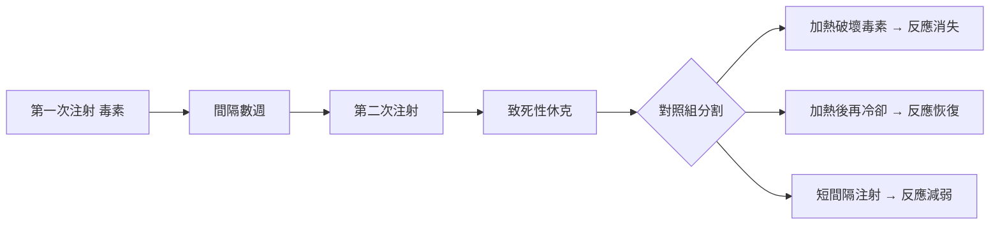
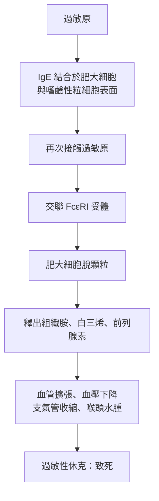

# 1913 · 過敏反應：里歇與波提埃在郵輪甲板上遭遇「免疫的暗面」

> **1913 諾貝爾生理學或醫學獎**：夏爾·羅貝爾·里歇（Charles Robert Richet，法國）— 表彰「在過敏反應研究上的工作」（"in recognition of his work on anaphylaxis"）。

## 懸案（案情提要）

1901 年，巴黎的生理學家夏爾·里歇（Charles Richet）與他的助手保羅·波提埃（Paul Portier）受摩納哥親王艾伯特一世（Albert I）邀請，登上了考察法國大西洋沿岸的考察船 *Princesse Alice II*。船上有位船員被葡萄牙僧帽水母（Physalia）的刺螫後出現症狀；船醫把水母触手取出，用醋酸處理，得到一種They称之为「催眠毒素」（hypnotoxin）的液體。里歇原本預期的實驗目的很單純：**把毒素給狗注射，看看狗會不會產生免疫力**。

然而實驗翻盤：

1. 第一次注射，沒事；
2. 幾週後第二次注射，**狗當場休克死亡**；
3. 而且——**與劑量無關**：即使減到原量的一半，仍是致死反應。

這樁「預期防禦、實為致命」的反轉案例，是免疫學史上最重要的懸案之一：**免疫系統不只保護，它也能殺死宿主。**

## 前因

| 年份 | 事件 |
| --- | --- |
| 1898 | 保罗·貝林與北里柴三郎證明抗毒素可被製造，免疫被視為單向的「保護」（見 [1901-白喉血清療法](1901-白喉血清療法.md)）。 |
| 1899–1901 | 埃利希提出側鏈學說，認為抗體是「過量釋出的受體」，選擇論觀點成形（見 [1908-免疫雙雄](1908-免疫雙雄.md)）。 |
| 1901 | 里歇與波提埃登上 *Princesse Alice II* 考察船，取得水母毒素。 |
| 1902 | 里歇與波提埃在實驗室重做實驗，確立「間隔數週後第二次注射必致致死休克」，並向巴黎生物學會報告（1902 年 2 月 15 日）。 |
| 1902 | 里歇創造新詞 **anaphylaxis**（原寫作 *aphylaxis*，因前者聽感更佳而改定），希臘語意為「against protection」——「反向的防禦」。 |
| 1906 | 奧地利兒科醫師 Clemens von Pirquet 創造 **allergy**（過敏）一詞，並提出「過敏症＝提前的免疫反應」的定義。 |

## 調查

### 第一幕：郵輪上的第一次「作案重演」

里歇後來自述，那晚在甲板上的狗實驗是本案的第一現場。關鍵在於「**間隔**」——兩次注射之間必須有數週。里歇與波提埃迅速在巴黎實驗室重現：把水母毒素（實為一種超大分子量的複合蛋白毒素）注入犬靜脈，觀察到第二劑引發的並非「毒性累積」，而是**全身性血管擴張、血壓驟降、支氣管痙攣與窒息**的休克——典型的**過敏性休克（anaphylactic shock）**。

他們並未就此罷手，而是設計了一組切割實驗來找出「兇手」：

### 第二幕：三個關鍵分割實驗定案

1. **加熱實驗**：把毒素加熱至 $56\text{–}60\ \mathrm{C}$ 後再注射，致死反應消失；加熱後冷卻的毒素又恢復致敏能力。這排除了「毒素本身的直接毒性」，證明反應需要**完整的抗原性結構**——兇手不是毒素的藥理作用，而是毒素引發的免疫產物。
2. **間隔實驗**：兩次注射間隔越長，反應越強；間隔過短（如 5–10 天）反而反應輕微。這提示需要一段**潜伏期讓宿主產生抗體**，正是典型的一級免疫反應（primary response）動力學——第一次接觸後約 7–14 天產生 IgE。
3. **被動轉移實驗**：把已致敏動物的血清轉移給未致敏動物，可使後者立刻過敏。這是里歇與波提埃最具決定性的一步：**證明「兇手」是血清中的可轉移因子（抗體）**，把過敏從「 mysterious 生理現象」拉進免疫學的量化框架。

### 第三幕：臨床面的展開

1902 年之後，過敏性休克的臨床病例迅速累積：部分病人只在**第二次**接觸藥物時才休克（如破傷風抗毒素、含馬血清製劑），部分病人則在暴露後**立即**發作（IgE 早已存在，如蜜蜂螫刺後的再次螫刺致死）。里歇在 1913 年的諾貝爾演講中特別強調兩種時態的區別：「**先前的過敏狀態（état anaphylactique）**」與「**當下的過敏反應（réaction anaphylactique）**」——這是今日「致敏期（sensitization phase）」與「症狀期（elicitation phase）」的雛形。

## 理論裁決

1. **免疫學的兩面性**：過敏反應宣告免疫系統不只有「保護」模式，還有「反噬」模式。可用一個簡單的抗體生成模型表述：
   $$[A_{\text{total}}] = [A_{\text{free}}] + \sum_{i} [A\text{-}Ag_i] + [A\text{-}IgE]$$
   第二次暴露時，游離抗體已全部被「中和」，抗原反而得以**交聯**結合在細胞表面的 IgE 上——保護機制的反轉，正是本案最深的機制裁決。
2. **IgE 的發現**：1920–1920 年代，研究者才從過敏血清中分離出那條「可轉移因子」，確認它是**免疫球蛋白 E（IgE）**，分子量約 $188\ \mathrm{kDa}$ ，壽命極短（血中半衰期約 2 天），但對肥大細胞表面受體 $\mathrm{Fc}\varepsilon\mathrm{RI}$ 的親和力極高——IgE 幾乎全身都趴在肥大細胞與嗜鹼性粒細胞上等待過敏原。
3. **致敏的量化**：第一次暴露後 IgE 產生遵循指數型上升
   $$\text{IgE}(t) = \text{IgE}_{\max}\left(1 - e^{-k(t - t_0)}\right)$$
   $t_0$ 為致敏起算點， $k$ 反映 B 細胞活化與類別轉換效率。解釋了為何初次接觸無症狀、再次接觸即刻發作。
4. **治療的數學**：腎上腺素（epinephrine）能逆轉休克，正是因為它作用在 $\beta_2$ 受體上提升 cAMP、抑制脫顆粒，並在 $\alpha$ 受體上收縮血管——這條藥理路徑的發現晚於本案 20 年（1930 年代由邁爾霍夫、Goodman 闡明 cAMP 與兒茶酚胺的作用，見 [1971-第二信使](1971-第二信使.md)）。
5. **阿司匹林過敏的機制差異**：非免疫性過敏（假性過敏）不需 IgE 參與，而是 COX-1 抑制造成白三烯過量——「過敏」一詞在臨床上必須分清「免疫性」與「非免疫性」兩條不同機制的偵查路徑。

## 追查支線（未結之謎）

- 為何需要「兩次接觸」？lgE 類別轉換與 T 細胞輔助的精細時序，直到 1960 年代細胞免疫學成熟才被釐清；
- 里歇本人未能在有生之年分離出 IgE，這樁「冠軍與兇手擦肩而過」的案件在免疫學史上備感遺憾；
- 里歇晚年轉向「超心理學」（ectoplasm、第六感），並曾被通靈者欺騙，成為科學史上「可信者也可能被騙」的著名案例；
- 他也是優生學倡議者與法國優生學會會長（1920–1926），這一段暗黑歷史已成為諾獎得主研究史的必修章；
- 蜂毒、食物過敏、藥物過敏的現代流行病學（IgE 介導 vs 非 IgE 介導）是此案的當代分支。

## 證物與數據（偵查卷宗摘錄）

| 證物 | 數值／內容 | 偵查意義 |
| --- | --- | --- |
| 1901 郵輪實驗 | 水母毒素首度致敏成功 | 案發現場 |
| 間隔實驗 | 間隔愈長反應愈強 | 一級免疫反應動力學 |
| 加熱實驗 | $56\text{–}60\ \mathrm{C}$ 破壞致敏性 | 抗原性結構必要性 |
| 血清轉移實驗 | 抗體可被動轉移過敏 | 「兇手是可轉移抗體」定案 |
| 臨床時態 | 致敏期 vs 症狀期 | 臨床分類雛形 |
| 諾貝爾演講（1913） | 「Anaphylaxis」全文 | 首份系統性總結 |

## 後果

| 領域 | 影響 |
| --- | --- |
| 免疫學 | 開創過敏學與免疫病理學；IgE 與肥大細胞研究自此成為獨立領域。 |
| 臨床 | 過敏性休克成為急診核心症狀；腎上腺素注射筆（EpiPen）成為救命常備品。 |
| 藥理 | 抗組織胺藥物（第一代 H1 拮抗劑，1930s–40s）由過敏機制直接催生。 |
| 疫苗安全 | 「疫苗與血清可致敏」成為免疫接種安全監測的常規項目。 |
| 其他諾獎 | 與 [1908-免疫雙雄](1908-免疫雙雄.md) 同屬免疫學奠基期；波提埃未獲獎，但波提埃噬菌體與 Bordetella 屬名皆留史冊（見 [1919-補體與免疫](1919-補體與免疫.md)）。 |

## 關聯

- [1908-免疫雙雄](1908-免疫雙雄.md) — 埃利希側鏈學說正是解釋 IgE 生成的理論前提。
- [1901-白喉血清療法](1901-白喉血清療法.md) — 同一支抗體路線的另一端：保護與危害的分野。
- [1919-補體與免疫](1919-補體與免疫.md) — 里歇的學生梅契尼科夫在巴黎的同門傳承與補體的發現。
- [1988-藥物治療原理](1988-藥物治療原理.md) — 受體理論在治療領域的應用延伸。
- [1971-第二信使](1971-第二信使.md) — 肥大細胞脫顆粒的下游訊號路徑。
