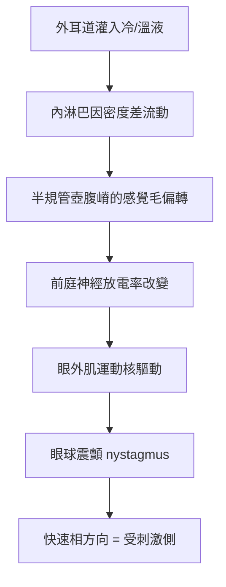

# 1914 · 前庭器官與眼震：巴拉尼從「耳鳴」一桩小事裡挖出整座平衡器官

> **1914 諾貝爾生理學或醫學獎**：羅伯特·巴拉尼（Róbert Bárány，奧匈帝國／今奧地利，後入瑞典籍）— 表彰「在前庭器官的生理學與病理學研究上的工作」（"for his work on the physiology and pathology of the vestibular apparatus"）。

## 懸案（案情提要）

1900 年前後，維也納大學的一間病房裡發生了一件小事：一位耳科醫師巴拉尼替病人用冷水沖洗外耳道，為緩解其眩暈發作。病人卻當場出現**眩暈加不自主的眼球震顫（nystagmus）**。巴拉尼換用溫水，病人再次發作，但**眼球震顫方向相反**。

這個「冷水向左、溫水向右」的臨床小謎，揭開了一樁人類感官科學中最深的空白：身體如何知道自己在哪裡？耳朵裡那三條半規管究竟在做什麼？

核心案情：

1. 眩暈與眼球震顫是同一現象的兩面嗎？它由什麼器官產生？
2. 為什麼冷熱會改變震顫方向？液體在裡面怎麼動？
3. 前庭器官的訊息如何與小腦、脊髓、眼肌協同，維持身體平衡？
4. 能否用臨床測試快速評估一個人的前庭功能？

## 前因

| 年份 | 事件 |
| --- | --- |
| 1828 | 弗盧里（Pierre Flourens）以鴿子實驗破壞小腦不同部位，發現前庭神經受損的鴿子頭部姿態固定不動（強直），而半規管受損者頭部不停顫抖，證明半規管與平衡姿勢直接相關。 |
| 1871 | 亥姆霍茲提出「頭部轉動時內耳液體惯性移動」的假說，但無法驗證。 |
| 1886 | 德國生理學家 Friedrich Goltz 在狗身上證明：切斷半規管神經，狗的頭部不再隨身體傾斜而偏轉。 |
| 1892 | 波蘭科學家 Józef Magnus（來自生理學家家族）以鴿子實驗明確區分：頸部肌肉的**姿勢反射**與內耳的**加速度反射**是两套独立系統。 |
| 1900 | 巴拉尼在維也納發生前述「冷水沖耳」事件，開始系統研究。 |
| 1905 | 巴拉尼在耳生理學與耳科學領域發表大量研究，提出「前庭器官」（vestibular apparatus）一詞。 |

## 調查

### 第一幕：一場臨床意外的因果推理

巴拉尼把冷熱效應歸因於**內淋巴（endolymph）的溫度差造成密度差與流動**：溫水使半規管內液體上升、冷水使其下沉，方向相反的流動刺激了不同方向的壺腹嵴（ampulla crista），因而引發方向相反的眼球震顫。這就是**熱性眼震（caloric reaction）**的物理解釋。

### 第二幕：把「巧合」做成「測驗」

他隨即把這個偶然發現轉化為可重複的**床邊生理檢查法**：



關鍵在於**眼震的方向律**：巴氏規定，眼震的**快速相**方向指向受刺激的那一侧半規管——這條規則至今仍是臨床判定前庭病變側的基本原理，被稱為 **Alexander's law**（亞歷山大定律）。

### 第三幕：「落石症」的發現

1902–1903 年，巴拉尼描述了**良性陣發性位置性眩暈（BPPV）**：某些患者在頭部轉到特定姿勢時突然天旋地轉，離開該姿勢即緩解。他推論是耳石（otoconia）脫落並滯留於半規管——但真正的機制要等到 1920 年代由 Dix 與 Hallpike 以眼震圖（nystagmoscopy）量化，1970 年代由 Epley 手法治療（Semont、Epley 复位法）才臨床落地，成為今日耳科最有效的門診處置之一。

### 第四幕：前庭神經傳導的定量

巴拉尼在動物實驗中測得前庭神經的放電模式：靜止時有自發性背景放電（tonic discharge），頭部轉動時放電率隨加速度變化。這一「靜息放電 + 加速調變」的發現，是後來霍奇金—赫胥黎—埃克爾斯「神經元以放電率編碼訊息」模型的先聲（見 [1963-離子機制](1963-離子機制.md)）。

### 第五幕：一戰與戰俘營

1914 年他獲獎時正在俄國戰俘營中——直至 1916 年在瑞典、丹麥、挪威、荷蘭的共同外交努力與紅十字會協助下獲釋，才於 1916 年 12 月赴斯德哥爾摩領獎。戰俘營中的數年，他仍繼續指導研究。

## 理論裁決

1. **半規管的工作原理：角加速度計**。三對半規管大致位於三個互相垂直的平面，各自偵測繞特定軸的**角加速度**：
   $$\alpha \approx \frac{d\omega}{dt}$$
   當頭部以角加速度 $\alpha$ 旋轉，慣性使內淋巴相對膜迷路滯後偏移，牽動壺腹嵴的纖毛偏轉，改變前庭神經放電率。靜止時放電率不為零（tonic），使前庭系統能分辨「不動」與「正在動」。

2. **耳石器：線加速度與重力**。橢圓囊與球囊的耳石膜負責偵測**線加速度**與重力方向，加速度 $\vec{a}$ 在膜上產生的等效重力為
   $$\vec{g}_{\text{eff}} = \vec{g} - \vec{a}$$
   這解釋了為什麼太空人失重時會失去「上下」的 sense——這也是本案在 1960 年代被 NASA 用於載人航天的一個有趣後續。

3. **眼震的量化與代償機制**。前庭—眼反射（VOR）的增益定義為
   $$G = \frac{\text{眼速}}{\text{頭速}}$$
   正常值約為 $-1$ （完全代償），使眼球在頭動時保持穩定、讓視線鎖定於環境目標。垂直方向的眼震（downbeat、upbeat）尤其提示中樞病變，是今日臨床鑑別診斷的重要線索。

4. **頭部位置與身體姿勢的聯鎖**：前庭訊息經前庭神經核投射至脊髓（前庭脊髓束，調控伸肌張力）與小腦（絨毛球、頂核），形成「加速 → 姿勢 → 眼動」三聯反應，可用流程圖概括為

   ```mermaid
   flowchart LR
   A[半規管/耳石器] --> B[前庭神經核]
   B --> C1[眼運動神經核<br>→ 眼震]
   B --> C2[前庭脊髓束<br>→ 伸肌張力]
   B --> C3[小腦絨毛球<br>→ 協調與學習]
   ```

5. **臨床測驗的數學基礎**：巴拉尼的旋轉試驗（Barany rotation chair）以恆定角加速度旋轉後突然停止，觀察眼震衰減曲線，可估計前庭系統的**時間常數**；旋轉後眼震持續時間 $t$ 反映半規管–中樞的整合程度，是量化的前庭功能檢查雛形。

## 追查支線（未結之謎）

- BPPV 的耳石脫落與後半規管的解剖學路徑，要到 20 世紀中期才由 Dix–Hallpike 與 Epley 補完；
- 前庭系統與「內感覺」（proprioception）如何整合以維持穩定，尚無統一理論；
- 巴拉尼 1917 年即提名弗洛伊德角逐諾獎，是諾獎史上著名的提名事件之一，而弗洛伊德的回信極為尖銳；
- 巴拉尼之子 Ernst Bárány 成為耳科學者、瑞典皇家科學院院士，其孫 Anders Bárány 為諾貝爾物理委員會祕書——一家三代與諾獎的緣分；
- 前庭 Migraine（vestibular migraine）等疾病直到 21 世紀才被正式分類。

## 證物與數據（偵查卷宗摘錄）

| 證物 | 數值／內容 | 偵查意義 |
| --- | --- | --- |
| 1900 冷水灌耳事件 | 冷、熱引發方向相反的眼震 | 案發現場 |
| 熱性眼震原理 | 內淋巴密度差造成流動 | 半規管是角加速度計 |
| Alexander 定律 | 快速相指向受刺激側 | 至今的定位判讀規則 |
| 前庭神經靜息放電 | 恆定 tonic 放電率 | 「以放電率編碼」的先聲 |
| BPPV 描述（1902–03） | 特定頭位誘發陣發眩暈 | 今日耳科最常見可治眩暈 |
| 戰俘營歲月（1914–1916） | 研究不輟，1916 年獲釋 | 科學的韌性 |

## 後果

| 領域 | 影響 |
| --- | --- |
| 耳鼻喉科 | 眩晕門診、前庭功能檢查（眼震電圖 VNG、vHIT）成為專科技術。 |
| 航空航海 | 前庭失調造成「空間定向障礙」；巴拉尼與德國學者共同奠定的空間定向生理學，直接催生現代航空醫學。 |
| 神經科學 | 前庭神經核作為「感覺輸入—運動輸出」中樞整合的經典範例，影響運動控制理論。 |
| 復健醫學 | 前庭復健（vestibular rehabilitation）以眼震與姿勢穩定度為客觀指標。 |
| 其他諾獎 | 與 [1961-耳蝸行波](1961-耳蝸行波.md) 同屬內耳感覺生理學譜系；[1938-竇與主動脈反射](1938-竇與主動脈反射.md) 則是另一組壓力感受器。 |

## 關聯

- [1963-離子機制](1963-離子機制.md) — 前庭神經「放電率編碼」的細胞生理學基礎。
- [1932-神經元功能](1932-神經元功能.md) — 謝靈頓整合理論與前庭—姿勢反射的整合。
- [1961-耳蝸行波](1961-耳蝸行波.md) — 同一座骨迷路裡的另一部偵探：耳蝸與聽覺。
- [1938-竇與主動脈反射](1938-竇與主動脈反射.md) — 壓力感受器如何調節呼吸與血壓。
- [1906-神經元學說](1906-神經元學說.md) — 前庭神經節細胞的形態學基礎。
