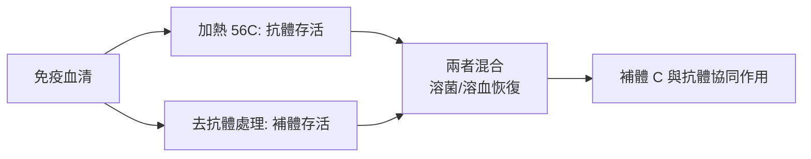
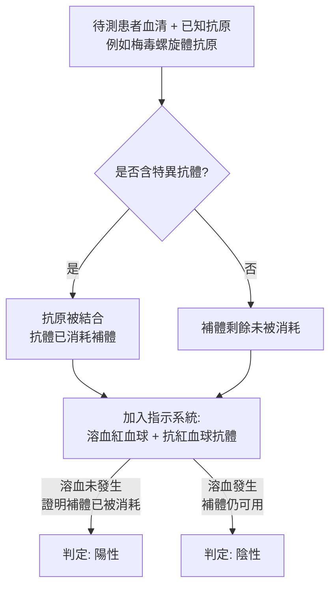

# 1919 · 補體與免疫：博爾代補上免疫拼圖的「溶菌那一塊」

> **1919 諾貝爾生理學或醫學獎**：朱爾·博爾代（Jules Jean Baptiste Vincent Bordet，比利時）— 表彰「免疫性方面的發現」（"for his discoveries relating to immunity"）。

## 懸案（案情提要）

1900 年前後，免疫學地圖上有兩塊拼圖已經各自成形：

1. **體液派（埃利希）**：血清中有抗毒素抗體，能中和毒素；
2. **細胞派（梅契尼科夫）**：白血球能吞噬病原菌。

但有一件事無法解釋：**抗體本身不會殺死細菌**。梅契尼科夫的學生博爾代在 1895 年發現，抗毒素血清能「增強」某種天然存在的血清成分對細菌的溶解作用——那個成分本身對細菌殺傷力微乎其微，一旦有了抗體就能把細菌溶解掉。這個成分後來被命名為**補體（complement）**，博爾代稱之為 **alexine**（希臘文 alexein，「防禦」）。

案情的核心疑點：

1. 抗毒素既然能「中和」毒素，為何還需要另一種分子來「溶解」細菌？兩者的分工是什麼？
2. 補體這種物質為什麼**不耐熱**（加熱 $56\ \mathrm{C}$ 即失效）？它與抗體（耐熱）在熱力學上屬於完全不同的世界？
3. 能否用這套機轉建立可定量、可作診斷用的血清試驗？

## 前因

| 年份 | 事件 |
| --- | --- |
| 1884–1885 | Nuttall 發現正常血清有殺菌力；Buchner 命名「防禦素」（defensin），這是補體的最早痕跡。 |
| 1894 | 梅契尼科夫在巴黎巴斯德研究所主持免疫部，博爾代自 1894 年起在此從事研究，師承梅契尼科夫。 |
| 1895 | 博爾代證明：特異性抗體可**在體內顯著增強**天然血清的溶菌作用，並將該血清成分命名為 **alexine**。 |
| 1896 | 席夫（Schiff）稱之為「補體（complement）」，此名沿用至今。 |
| 1898 | 博爾代與 Gengou 建立「補體結合反應」的雛形，用以檢測抗原抗體反應是否發生。 |
| 1899 | 博爾代描述**溶血現象（hemolysis）**：外來紅血球在免疫血清中溶血，成為最靈敏的補體活性指標。 |
| 1906 | 博爾代與 Gengou **分離出百日咳桿菌（Bordetella pertussis）**，並主張其為百日咳的病原。 |
| 1921 | 瓦瑟曼（August von Wassermann）將博爾代的原理用於梅毒血清診斷，發表**瓦瑟曼反應**。 |

## 調查

### 第一幕：分離「兇手」

博爾代的偵查方法極為古典而有效：**把血清「拆成兩半」**。他把免疫血清分成兩份：

- 一份加熱至 $56\ \mathrm{C}$ 30 分鐘 → **抗體仍存活**（抗體耐熱），但溶解作用消失；
- 另一份未加熱 → 溶解作用完整。

於是兇手現形：**不耐熱的補體**。他進一步以化學方法（鹽析、透析）分離出兩種成分，並證明它們必須**同時存在**才能發揮作用。

### 第二幕：溶血系統——最靈敏的偵測器

博爾代發現：**外來紅血球 + 抗體 + 補體 → 溶血**。紅血球本來堅韌難破，一旦補體被「激活」，便在膜上打出破洞而溶解。這給了免疫學家一個極其方便、可肉眼判讀（溶血＝透明、瓊脂板上出現溶血圈）的指示系統。**梅克爾（Koch）與保羅·薩巴捷（Paul Sabattini）**同期用炭疽桿菌與抗炭疽血清發現相同現象——補體的溶菌作用由此並行破解。

### 第三幕：定量——溶血滴度與補體效價

博爾代建立了定量語言：把血清連續稀釋，測定仍能產生溶血的最高稀釋度，即**溶血滴度**；同理測得**補體效價**。這是免疫血清學從「有沒有反應」走向「有多少效價」的分水嶺。

溶血過程本身可用質量作用定律描述：

$$K_a = \frac{[A{\cdot}Ag]}{[A][Ag]}$$

抗體與紅血球抗原結合後，補體 $\mathrm{C1} \to \mathrm{C2} \to$ 攻擊複合體（membrane attack complex, MAC）逐步組裝，最終在膜上形成孔道：

$$\mathrm{C5b{-}C6{-}C7{-}C8{-}C9} \rightarrow \text{MAC pore}$$

孔道形成使細胞內外離子梯度崩潰，導致溶血——這條「補體級聯反應」的完整圖譜，要到 1950–1960 年代由 Hans J. Müller-Eberhard 等人補完（見 [1960-後天免疫耐受](1960-後天免疫耐受.md) 的免疫學背景、2011 年先天免疫諾獎的補體與 TLR 脈絡）。

### 第四幕：補體結合試驗——從機理到診斷

博爾代最重要的應用性發明，是**補體結合試驗**。邏輯極為精巧：

**「反應的指示系統（indicator system）」**是這套方法的精髓，也是免疫學方法論的重大發明：檢測一個看不見的免疫反應，用第二組可見反應（溶血）做「顯影」。這正是今天 ELISA、免疫斑點與化學發光免疫分析的祖型。

### 第五幕：百日咳桿菌的分離

1906 年，博爾代與 Gengou 用改良的 Bordet–Gengou 培養基（含馬血、蛋白胨、澱粉與洋甘菊）從百日咳患兒的咽拭中**分離出百日咳桿菌**。這是細菌學「分離病原」路徑的又一樁成功案例（對照 [1905-結核桿菌與柯霍法則](1905-結核桿菌與柯霍法則.md)），也開啟了後續的百日咳疫苗（全細胞疫苗，1920s；後續 acellular 疫苗）。

## 理論裁決

1. **免疫的雙要素結構**：抗體（特異識別）＋補體（效應執行）。這解釋了為何中和毒素不需補體（中和是化學封鎖），而溶解細菌卻必須依賴補體（需要形成破膜孔道）。
2. **熱力學指紋**：補體在 $56\ \mathrm{C}$ 30 分鐘即失活（熱不穩定的球蛋白），抗體則可耐受；此性質被用於「分離兩者」——加熱是十九世紀免疫學的關鍵工具。
3. **級聯放大的邏輯**：補體激活具有級聯性，單一抗體—抗原結合可級聯放大為數百個 MAC 孔道，放大倍數極高：
   $$N_{\text{MAC}} \approx \prod_{i} n_i \gg 1$$
   這與 1914 年里歇案中的 IgE 脫顆粒級聯（見 [1913-過敏反應](1913-過敏反應.md)）是同一種「少量啟動、大量放大」免疫邏輯。
4. **診斷學的普適格式**：補體結合試驗示範了一個可推廣的範式——**以已知試劑 + 指示系統做間接偵測**。這一模板在 20 世紀被搬到血凝、凝集、放射免疫分析（見 [1977-放射免疫分析](1977-放射免疫分析.md)）與 ELISA 上。

## 追查支線（未結之謎）

- 博爾代晚年否認噬菌體的存在（認為是細菌自溶），此說在 1941 年魯斯卡拍出首張電鏡照片後崩潰——本案卷宗裡最著名的「錯判」；
- 補體的完整級聯（經典途徑、替代途徑、凝集素途徑）要花 40 年才補完；
- 補體與凝血系統的關係（共享 C3/C5 轉換酶的結構同源性）直到 1980 年代才被系統描繪；
- 免疫複合體疾病（補體消耗性腎炎、SLE）是補體研究的臨床副產物；
- Bordetella 屬與百日咳疫苗的百年史（acellular 疫苗 1990s）是本案最長的臨床延伸。

## 證物與數據（偵查卷宗摘錄）

| 證物 | 數值／內容 | 偵查意義 |
| --- | --- | --- |
| 加熱血清（ $56\ \mathrm{C}$ /30 min） | 抗體存活、溶解消失 | 補體熱不穩定之證 |
| 溶血現象（1899） | 紅血球在免疫血清中溶解 | 最靈敏的補體指示器 |
| 溶血滴度 | 連續稀釋下的最高稀釋度 | 免疫學的定量語言 |
| 補體結合試驗（1898） | 抗原抗體反應的「顯影」機制 | 診斷血清學原型 |
| 瓦瑟曼反應（1921） | 梅毒血清診斷 | 方法走出實驗室 |
| Bordet–Gengou 培養基（1906） | 分離百日咳桿菌 | 第二樁病原分離案 |
| 噬菌體否認（1930 年）→ 1941 電鏡 | 錯判被推翻 | 科學自我修正的樣本 |

## 後果

| 領域 | 影響 |
| --- | --- |
| 免疫學 | 補體成為免疫系統三大分支之一（固有免疫、體液免疫、細胞免疫）的交會點。 |
| 診斷學 | 補體結合試驗開啟現代免疫檢驗學，是 20 世紀前半葉血清診斷的主流工具。 |
| 微生物學 | 百日咳桿菌的分離帶動百日咳疫苗與細菌性肺炎的病原學擴張。 |
| 抗體結構 | 抗體的「效應功能（effector function）」與「結合功能」分離，是 1972 年抗體結構諾獎的重要背景（見 [1972-抗體結構](1972-抗體結構.md)）。 |
| 其他諾獎 | 師承梅契尼科夫（1908 年諾獎），並由 2011 年先天免疫諾獎續寫 Toll 與補體的故事。 |

## 關聯

- [1908-免疫雙雄](1908-免疫雙雄.md) — 博爾代的導師梅契尼科夫，與被他在同室研究多年的埃利希。
- [1913-過敏反應](1913-過敏反應.md) — 同一個時代的另一塊免疫拼圖：IgE 與肥大細胞。
- [1901-白喉血清療法](1901-白喉血清療法.md) — 抗毒素是抗體的第一个臨床應用，本案則補上「抗體如何殺敵」的一環。
- [1972-抗體結構](1972-抗體結構.md) — 抗體分子結構與效應功能的化學基礎。
- [2011-先天免疫與樹突細胞](2011-先天免疫與樹突細胞.md) — 補體與 Toll 樣受體在 21 世紀的整合。
