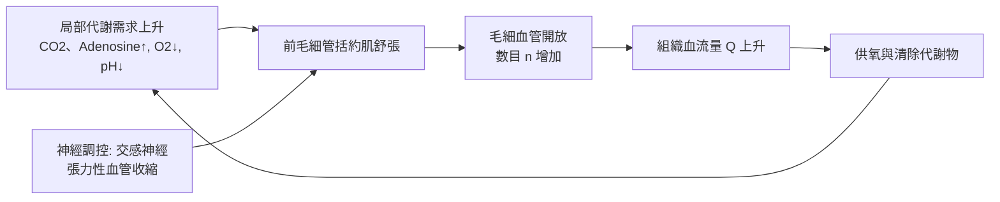

# 1920 · 毛細血管運動的調節：克羅證明血流由「需求」開關，而非由心臟決定

> **1920 諾貝爾生理學或醫學獎**：奧古斯特·克羅（Schack August Steenberg Krogh，丹麥）— 表彰「發現毛細血管運動的調節機理」（"for his discovery of the capillary motor regulating mechanism"）。

## 懸案（案情提要）

十九世紀末的心臟生理學已經相当精準：心跳容積、血壓、輸出量都有公式。但有一個更根本的問題懸在所有生理學家頭上：

**血流是怎麼分配的？** 主動脈把血液送往全身，但各器官的需求差異極大——休息時肌肉只需少量血流，跑動時卻要增加二十倍；腦組織恆定依賴血流，皮膚則隨體溫大幅變動。是心臟「決定」誰分得多、誰分得少，還是血管本身會「自己安排」？

克羅的答案是：**毛細血管與小動脈會因局部代謝需求而自主開閉**——這就是「克羅原理（Krogh principle）」背後的微循環調控觀念，也是本案的核心。

## 前因

| 年份 | 事件 |
| --- | --- |
| 1871 | 埃利希與諾伊博爾德（S. Neumann）描述毛細血管的形態：單層內皮構成的管道，前毛細管括約肌（precapillary sphincter）環繞。 |
| 1880s | 丹麥學者 Krogh 的老師 Christian Bohr 在研究呼吸生理，開啟了哥本哈根生理學派的血氣調控傳統。 |
| 1887 | 生理學家 Danish 學者 沃丹（V. H. Heymann）以顯微鏡直接觀察蛙蹼的活體循環，首次看到毛細血管血流的變化。 |
| 1904–1907 | 克羅在哥本哈根以自製的顯微鏡與測量裝置，觀察蛙、哺乳動物肌肉的微循環，累積大量毛細管開放數與管徑的定量資料。 |
| 1908 | 克羅出版《毛細血管的解剖與生理》，確立毛細血管網的統計學描述。 |
| 1912 | 克羅提出「克羅原理」：「對於大量問題，總存在某種動物或幾種動物，能最方便地研究它。」 |
| 1920 | 以「發現毛細血管運動的調節機制」獲諾貝爾生理學或醫學獎。 |

## 調查

### 第一幕：測量工具的自製

克羅的偵查第一步是**自製儀器**。他與工程師合作製成可安裝在顯微鏡物鏡上的「測量裝置」，能同時測量：

- 毛細血管直徑 $d$ ；
- 紅血球通過速度 $v$ ；
- 開啟的毛細血管數 $n$ 。

由這些量即可估算區域血流量：

$$Q = n \cdot \pi \left(\frac{d}{2}\right)^2 \cdot v \cdot \varphi$$

其中 $\varphi$ 為血球在毛細管內的佔積比（管徑與血球直徑相近時約為 $0.8\text{–}0.9$ ）。這是第一次用微觀尺度的直接測量給出組織血流量的數值。

### 第二幕：核心實驗——把「運動」與「代謝需求」掛鉤

克羅在蛙腿與哺乳動物肌肉上觀察到：當肌肉收縮或局部施加刺激時，**先前關閉的毛細血管會被招募開啟**，血流量顯著上升；停止活動後，毛細管再度關閉。與此同時，他發現毛細血管的**平滑肌（括約肌）位於前毛細管入口**，這正是調節的閥門所在。

### 第三幕：主動性 vs 順應性

克羅最精準的推論是區分兩種機制：

- **順應性（passive/secondary）**：大動脈、小動脈隨心臟搏動與血壓而舒縮——這是被動的。
- **主動性（active/primary）**：**毛細血管與前毛細管括約肌能依局部代謝狀況自主調節**，主動脈的搏動被「濾掉」，組織血流因此獲得獨立調控。

這是第一次在生理學上確立**「局部調控優先於中央調控」**的原則，也是今日微循環生理學、冠脈血流自調（coronary autoregulation）與功能性充血（functional hyperemia）理論的直接祖先。

### 第四幕：氧氣擴散距離的計算

克羅另有一項與諾獎直接相關的定量貢獻：以數學模型估算組織中氧的擴散供應，得出**克羅長度（Krogh length）**——即毛細管間距的理論上限，氧氣須在擴散距離 $\ell$ 內自血管送達耗氧細胞：

$$\ell_{\max} \sim \sqrt{\frac{D \, \Delta p}{Q}}$$

其中 $D$ 為氧擴散係數、 $\Delta p$ 為分壓差、 $Q$ 為局部血流密度。克羅的結論是：**毛細管間距並非隨機，而是被組織的代謝需求精密調配**，太遠則缺氧、太密則浪費。

### 第五幕：一戰後的科學產業化

1922 年克羅赴北美講學途中造訪多倫多，得知班廷與貝斯特（Best）已製得活性胰島素；克羅取得北歐胰島素生產授權，與糖尿病醫師 Hagedorn 合作，於 1923 年成立 **Nordisk Insulinlaboratorium**，後與 **Novo Terapeutisk Laboratorium**（1925 年由 Pedersen 兄弟創立）於 1989 年合併為今日的 **Novo Nordisk**——全球胰島素生產的巨頭。克羅的科學事業由此延伸出產業的傳奇。

## 理論裁決

1. **微循環的分層調節模型**：阻力血管（小動脈）控制總流量與分配，毛細血管前括約肌控制**區域內的微單位（microcirculatory unit）**，後者才是真正的工作單位。
2. **局部代謝性調節的數學**：以代謝物濃度作為調節訊號時，血管張力與代謝物濃度呈非線性關係，典型為 S 型（sigmoid）反應曲線：
   $$T = T_{\max} \bigg/ \left(1 + \left(\frac{[M]}{K_m}\right)^n\right)$$
   $n > 1$ 產生陡峭的調控特性，使血流能「全開或全關」而非零星微調——這正是毛細血管招募（capillary recruitment）呈階梯式變化的數學解釋。
3. **自調（autoregulation）的區間**：克羅在腎臟與腦的實驗中顯示，灌流壓在一定範圍內變動時，組織血流量維持相對恆定：
   $$\frac{dQ}{dP} \approx 0 \quad \text{當 } P \in [P_1, P_2]$$
   這是 1930 年代「肌源性反應（myogenic response）」與代謝性反應共同作用的結果，也是日後血壓藥理學（ACE 抑制劑、鈣通道阻斷劑）的受體基礎。
4. **呼吸氣體運輸的物理化學**：克羅與其妻子 Marie Krogh 合作研究氣體的擴散與血紅蛋白結合，發展「根岑（Roth）—克羅」血氧測量法，並以「克羅原理」示範跨物種模型選擇：鳥類紅血球含高濃度血紅蛋白、哺乳動物則靠大量血管化，兩者的解法不同卻同樣有效——這是比較生理學的方法論宣言。
5. **一氧化氮的預警**：克羅在 1930 年代注意到**組胺（histamine）與前列腺素能引起毛細血管擴張與通透性增加**，並以「血管擴張物質」的概念預告了 1980 年代一氧化氮作為內皮衍生舒張因子（EDRF）的發現（見 [1998-一氧化氮](1998-一氧化氮.md)）。

## 追查支線（未結之謎）

- 微循環的「選擇性灌注」現象（某些微血管持續流通而其他關閉）要靠活體顯微鏡與雙光子影像在 21 世紀才看得清楚；
- 內皮細胞作為「感測器與訊號整合器」的地位，是 1998 年 NO 諾獎與 2019 年氧氣感知諾獎（見 [2019-氧氣感知](2019-氧氣感知.md)）的核心議題；
- 肌肉微血管的密度與運動型纖維（快肌/慢肌）比例的關係，是運動生理學與演化生物學的交會處；
- 克羅的「10 萬公里血管」說法在 2010 年代被重新核算（實際約 9,000–19,000 公里），成為量級誤差教育的經典教材；
- 克羅的學生 Torkel Weis-Fogh 揭示昆蟲飛行肌肉的呼吸機制，把克羅原理推入動物運動生理學。

## 證物與數據（偵查卷宗摘錄）

| 證物 | 數值／內容 | 偵查意義 |
| --- | --- | --- |
| 微循環直接測量 | $Q = n \pi (d/2)^2 v \varphi$ | 首次給出組織血流量數值 |
| 毛細血管招募 | 肌肉活動時開放數顯著增加 | 「需求決定供給」的鐵證 |
| 前毛細管括約肌 | 毛細網入口的平滑肌閥門 | 調節的解剖學定位 |
| 克羅長度 | 氧擴散距離上限 $\ell_{\max}$ | 毛細管間距非隨機 |
| 克羅原理 | 「選對動物做對實驗」 | 比較生理學方法論 |
| 血氧測量 | 血紅蛋白氧飽和的光學測量 | 呼吸生理學的量化基礎 |
| 胰島素產業 | Nordisk（1923）與 Novo（1925）→ Novo Nordisk（1989） | 科學到產業的長鏈 |

## 後果

| 領域 | 影響 |
| --- | --- |
| 微循環生理學 | 局部代謝性調節成為主流範式，冠脈、腦、腎臟血流的自調理論皆由此發展。 |
| 麻醉與外科 | 休克、缺血再灌流的微循環障礙研究，以此為基礎展開。 |
| 運動生理學 | 肌肉血流隨代謝需求上升的量化（功能充血）成為運動生理學核心章節。 |
| 製藥產業 | 胰島素工業化直接催生 Novo Nordisk，亦為重組 DNA 胰島素（1980s）提供商業土壤。 |
| 其他諾獎 | 與 [1998-一氧化氮](1998-一氧化氮.md)、[2019-氧氣感知](2019-氧氣感知.md) 同屬血管生理學長線。 |

## 關聯

- [1914-前庭器官與眼震](1914-前庭器官與眼震.md) — 巴拉尼同樣是前庭—姿勢反射的生理學先驱；克羅的肌肉血流感研究同屬「姿勢與循環的整合」。
- [1938-竇與主動脈反射](1938-竇與主動脈反射.md) — 壓力感受器在循環調節中的角色。
- [1998-一氧化氮](1998-一氧化氮.md) — 克羅預告的「血管擴張物質」的身份。
- [1923-胰島素](1923-胰島素.md) — 克羅直接推動胰島素的北歐工業化。
- [2019-氧氣感知](2019-氧氣感知.md) — 組織氧供需匹配的分子層級解答。
