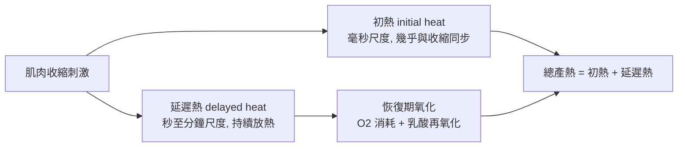

# 1922 · 肌肉產熱與糖酵解：希爾與邁爾霍夫把「力量」還原成化學

> **1922 諾貝爾生理學或醫學獎**（共享）：阿奇博爾德·希爾（Archibald Vivian Hill，英國）— 表彰「在肌肉產生熱量上的發現」；奧托·邁爾霍夫（Otto Fritz Meyerhof，德國）— 表彰「發現肌肉中氧的消耗和乳酸代謝之間的固定關係」。

## 懸案（案情提要）

十九世紀的生理學教科書常說「肌肉做功就產生熱」，但這個說法無法量測，也無法回答追問：

1. 肌肉收縮時釋放的能量，究竟去了哪裡？變成熱，還是變成機械功？比例是多少？
2. 肌肉在做功的同時是否**同時消耗氧氣**？若沒有氧氣，肌肉能撐多久？
3. 肌肉疲勞時為什麼會「發酸」？那個「酸」是什麼？
4. 定量生理學能否給出「能量守恆」在生物體內的驗證？

這樁案件的答案最終揭曉了生物能量學的兩塊基石：**Hill 的熱力學收支方程式**，與 **Meyerhof 的乳酸—氧耗固定關係（後被 Warburg 命名為「無氧糖酵解」）**。

## 前因

| 年份 | 事件 |
| --- | --- |
| 1847 | 布爾德（Robert Boyle）首度在肌肉收縮時觀察到「發熱」現象。 |
| 1864–1870 | Fick 與 Helmholtz 等測定肌肉的「氧耗」與「產熱」，初步提出化學能轉換說。 |
| 1894 | Hill 在劍橋（後來在倫敦 UCL）開始肌肉熱力學研究，發明**熱絲式肌肉熱電偶測量裝置**。 |
| 1904 | Hill 與同事測定蛙縫匠肌的「初熱」與「延遲熱」，提出「初熱 = 活化熱，延遲熱 = 恢復期氧化」的分期模型。 |
| 1909 | 邁爾霍夫在海德堡證明無氧條件下肌肉仍能收縮並產生乳酸，提供能量的**無氧代謝**路徑。 |
| 1912 | 邁爾霍夫測得「1 分子乳酸對應 6 分子氧」的定量關係，並預言存在一個「氧化的中間物」——**輔酶 A 的概念由此萌芽（1925 年由李普曼正式提出）**。 |
| 1924 | Hill 提出著名的「熱產生的數學指數曲線」模型（見下文）。 |
| 1926 | Hill 與 Lusztig 首次證明乳酸可被氧化回來（Hill–Lusztig 假說），閉合能量循環。 |

## 調查

### 第一幕：Hill 的「熱絲」量測

Hill 的偵查起點是一個極其艱難的量測問題：肌肉收縮產生的熱量只有幾毫卡，需要在毫秒尺度的時間解析下測量。他自製的裝置以鎳絲或鉑絲作為電阻元件，置於肌肉中，肌肉收縮時熱量使電阻改變，經鏡式電流計記錄——這是**生物物理量測史上的里程碑儀器**，開啟了「生物電—生物熱」的定量傳統。

### 第二幕：初熱與延遲熱——能量收支表

Hill 的關鍵發現是**把產熱分成兩個時間窗**：

「初熱」與收縮幾乎同步，代表**肌肉蛋白質本身的彈性形變與活化能**（此機制直到 1950 年代才由 Huxley 的滑行肌模型定案）；「延遲熱」則對應收縮後的代謝恢復，**這一延遲正是氧氣參與的證據**。

### 第三幕：Hill 的數學模型——本案最著名的理論產物

Hill 發現，延遲熱隨時間的上升可用**指數函數**描述，並提出著名的 Hill 方程（Hill 方程本是描述氧合血紅蛋白結合的，但此處用於產熱動力學）：

$$y(t) = \frac{A (1 - e^{-\alpha t}) - \alpha \beta (t - 1 + e^{-\alpha t})}{1 - e^{-\alpha t}}$$

其中 $y(t)$ 為總產熱量， $\alpha$ 與 $\beta$ 為兩個可擬合的速率常數（ $\alpha$ 代表快速反應的速率， $\beta$ 代表較慢的恢復速率）。這是**生物物理學中第一個以少數參數擬合整條肌肉力學曲線的模型**，也是 20 世紀「力—速度關係」分析的起點。

Hill 更以「短期能量儲備」概念解釋了初熱的來源：肌肉內有類似「彈簧」的儲能系統 $E_0$ ，在收縮中被動釋放：

$$\dot{E}(t) = -\dot{E}_{\text{store}} + \dot{E}_{\text{oxid}} - \dot{W}_{\text{mech}}$$

### 第四幕：邁爾霍夫的乳酸收支

邁爾霍夫的偵查分兩步：

1. **無氧也能收縮**：把肌肉置於無氧環境，仍能收縮並產生乳酸，但**很快疲勞**；
2. **固定的化學當量關係**：測定無氧狀態下生成的乳酸量 $L$ 與之後恢復期消耗的氧量 $O_2$ ，發現一條**固定比例**：
   $$O_2 = \frac{1}{6} L \quad \Longleftrightarrow \quad L = 6\,O_2$$
   即：**每 6 分子氧對應 1 分子乳酸**。這就是「氧的消耗和乳酸代謝之間的固定關係」，也是 1927 年瓦爾堡提出「**Embden–Meyerhof–Warburg 途徑**」的數據基礎。

這條關係的意義在於：它把「疲勞」從模糊的生理感受，變成一個**化學收支的可測量結果**。而「1 : 6」的當量比之所以成立，是因為乳酸是丙酮酸還原而來，其電子經由 NADH 傳遞給氧：

$$\text{Glucose} + 2\,\mathrm{NAD}^+ \rightarrow 2\,\text{Lactate} + 2\,\mathrm{NADH} + 2\,\mathrm{H}^+$$

再由氧氣接受電子：

$$2\,\mathrm{NADH} + 2\,\mathrm{H}^+ + \mathrm{O}_2 \rightarrow 2\,\mathrm{NAD}^+ + 2\,\mathrm{H_2O}$$

### 第五幕：Hill–Lusztig 假說與閉環

1926 年，Hill 與 Lusztig 證明：先前無氧產生的乳酸，在有氧恢復期可被**重新氧化**，且其氧化所需的氧量與原先生成乳酸的氧耗完全相符——**能量收支閉環成立**。這排除了「乳酸只是有毒廢物」的直覺解釋，並預告了今日「乳酸不是疲勞主因、而是燃料」的觀點。

## 理論裁決

1. **能量守恆在肌肉的驗證**：肌肉做的機械功 $W$ 與產生的熱 $Q$ 之和，等於代謝釋放的能量：
   $$W + Q = \int \dot{E}_{\text{oxid}} \, dt$$
   這是生物體首次把熱力學第一定律嚴格應用到活體組織，並以毫秒級精度實測。
2. **氧耗與乳酸的固定關係**（本案最核心的公式）： $L = 6\,O_2$ 。此關係不僅確立了無氧糖酵解的能量效率（每分子葡萄糖淨產 2 ATP，效率約 6%），也讓「測乳酸」成為推算無氧代謝量的標準方法——今日運動科學中「乳酸閾值」測試的祖宗。
3. **能量分配的經典悖論**：Hill 指出，**最大效率並不等於最大功率**。若把中間產物完全用於做功，功率反而低；生理系統總在效率與功率間取折衷。此「功率—效率取捨」在生物力學與運動生理學中至今仍是核心分析框架。
4. **糖酵解的氧化還原平衡**：由 $L = 6\,O_2$ 必須存在「乳酸可逆」的結論，邁爾霍夫預言了一種能在無氧時攜帶氫、在有氧時交出氫的**中間載體**——這正是李普曼 1925 年發現的**輔酶 A（CoA）**與其後被確認的 $\mathrm{NAD}^{+}$ /NADH 系統（見 [1953-檸檬酸循環](1953-檸檬酸循環.md)）。
5. **收縮機制的物理層次**：Hill 的「初熱 = 彈性能釋放」直覺，在 1954 年 Huxley 與 Hodgkin 的滑行肌模型中獲得分子解釋——肌漿蛋白與肌動蛋白之間的交聯橋在 $\mathrm{Ca}^{2+}$ 觸發下形成與分離，其勢能即為初熱來源。

## 追查支線（未結之謎）

- 肌肉疲勞的真正機制（不是乳酸堆積，而是 $\mathrm{Ca}^{2+}$ 回收障礙與興奮—收縮耦合失效）至今仍部分未定；
- 乳酸穿梭（lactate shuttle，Cori 循環）的細節在 2000 年代由 Brooks 重新爭論；
- Hill 方程在運動科學中的「功率—速度曲線」應用（Hill 的功量曲線）仍是體能訓練的理論基石；
- 邁爾霍夫的「輔酶」預言，開啟了維生素與輔酶的整條研究線（見 [1929-維生素](1929-維生素.md)）；
- 肌肉收縮的分子機制由 1954 年諾貝爾（ATP 與離子通道）與 2002 年線蟲細胞死亡諾獎續寫。

## 證物與數據（偵查卷宗摘錄）

| 證物 | 數值／內容 | 偵查意義 |
| --- | --- | --- |
| 熱絲量測裝置 | 毫卡量級、毫秒解析 | 生物物理量測的開端 |
| 初熱 | 與收縮同步，毫秒尺度 | 肌肉蛋白彈性的能量 |
| 延遲熱 | 秒至分鐘尺度 | 氧化參與的證據 |
| Hill 方程 | $y(t)$ 擬合總產熱 | 少參數模型的成功先例 |
| 乳酸—氧當量 | $L = 6\,O_2$ | 無氧糖酵解的定量定律 |
| Hill–Lusztig（1926） | 乳酸可逆、再氧化 | 能量收支閉環 |
| 肌肉功—速度曲線 | $P = (P_0 + V)w / (P_0 / w + V)$ | 功率與效率的取捨模型 |

## 後果

| 領域 | 影響 |
| --- | --- |
| 生物物理學 | Hill 是生物物理學奠基人之一，其量測風格影響整個領域。 |
| 生物能量學 | 糖酵解、氧化磷酸化、檸檬酸循環三聯畫由此開啟（見 [1931-呼吸酶](1931-呼吸酶.md)、[1953-檸檬酸循環](1953-檸檬酸循環.md)）。 |
| 運動科學 | 乳酸閾值測試、功率—速度關係、疲勞的化學解釋成為運動處方的基礎。 |
| 臨床 | 休克時的「氧債（oxygen debt）」概念源自 Hill 的收支分析，是復甦醫學的重要指標。 |
| 其他諾獎 | 邁爾霍夫的輔酶預言由李普曼實現（1953 諾獎）；Hill 的肌肉力學預告了 1954 年諾貝爾。 |

## 關聯

- [1931-呼吸酶](1931-呼吸酶.md) — 瓦爾堡接力揭開呼吸鏈的酵素細節。
- [1953-檸檬酸循環](1953-檸檬酸循環.md) — 邁爾霍夫的「中間載體」預言在此兌現。
- [1929-維生素](1929-維生素.md) — 能量代謝與維生素 B 群的故事線。
- [1950-腎上腺皮質激素](1950-腎上腺皮質激素.md) — 代謝激素調節的生理學分支。
- [1944-神經纖維分化](1944-神經纖維分化.md) — 希爾的學生 Gasser 與 Erlanger 在神經傳導上的接棒。
