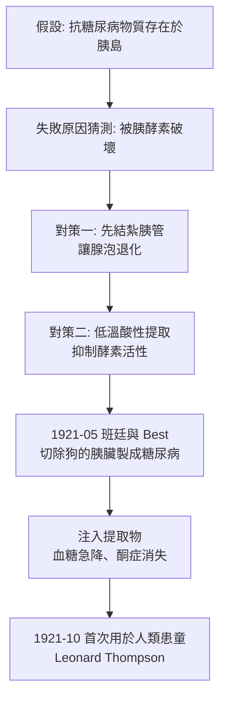

# 1923 · 胰島素的發現：十一天、一條狗與糖尿病的解封

> **1923 諾貝爾生理學或醫學獎**（共享）：弗雷德里克·格蘭特·班廷（Frederick Grant Banting，加拿大）— 表彰「發現胰島素」（"for the discovery of insulin"）；約翰·麥克勞德（John James Rickard Macleod，英國）— 同上。

## 懸案（案情提要）

1921 年，多倫多。糖尿病有兩型：兒童與年輕人得的「消瘦型」多在數月內因高血糖、酮症酸中毒與衰竭而死（後稱 1 型），中老年人的「肥胖型」則較溫和（2 型）。而胰島素被切除的狗與人類胰島切除的病人一樣，出現劇烈糖尿病並迅速死亡。

一樁被生理學界視為定案的舊案懸在那裡：**胰臟同時製造「糖」（外分泌的胰酵素）與「血糖調節者」（某種內分泌）**。爭議在於：

1. 胰臟的「抗糖尿病物質」是什麼？它存在於腺泡細胞、導管細胞，還是散在的島狀構造？
2. 若存在於「島」，為何過去三十年的提取工作總是失敗？提煉時它被什麼破壞了？
3. 提取成功後，它能否**治死人**？胰島素能不能讓瀕死的糖尿病童活下去？

## 前因

| 年份 | 事件 |
| --- | --- |
| 1869 | 蘭格漢斯（Paul Langerhans）在胰臟切片中發現一群與導管、腺泡皆不同的散在細胞，命名為**島狀構造（islets of Langerhans）**——但其功能不明。 |
| 1892–1894 | 澤寧（Nikolai Zermakov）與西格堡（Oskar Minkowski）以「胰切除術」在狗身上製造糖尿病，證明胰臟與糖尿病有關；1900 年，Schulze 證明是**胰島**而非外分泌組織在起作用。 |
| 1902–1906 | 朗格爾（Leonard Thompson）嘗試以甲醇提取物治療糖尿病兒童，短期見效但因甲醇毒性而中止——這是胰島素史上第一個「成功卻失敗」的實驗。 |
| 1911 | 貝林（Ehrlich 學派）提出「島」中可能存在一種激素。此後數年，Bliss 與protozoan 團隊嘗試多種提取法均告失敗。 |
| 1916–1918 | 巴拿馬醫師（「Zülzer」）曾報告注射胰腺提取物可降低血糖，被認為方法不嚴謹。 |
| 1921 年 5 月 | 多倫多大學生理學實驗室裡，青年外科醫師**班廷**在麥克勞德的實驗室，利用暑假進行一項看似希望渺茫的實驗。 |

## 調查

### 第一幕：班廷的「兩個想法」

班廷的推理鏈非常清晰，事後被記為醫學史上最優雅的假說驅動之一：

**想法一（外分泌液的干擾）**：過去所有提取都失敗，可能不是因為活性物質不存在，而是因為它**在提取過程中被胰酵素分解了**——胰臟分泌的胰蛋白酶會在擠壓、研磨時把島的激素切碎。

**想法二（不製造胰液的胰管結紮）**：若先把胰管結紮，讓外分泌腺泡退化（外分泌功能喪失、胰酵素消失），再取胰臟提取，就可能保住那個脆弱的「島激素」。

### 第二幕：十一天的實驗日誌

1921 年 5 月，班廷與其助手**查爾斯·貝斯特（Charles Best）**（當時是四年級醫學生）開工。他們取狗的胰臟：

1. 結紮胰管 → 等待數週讓腺泡組織退化；
2. 取退化後的胰臟組織，切碎；
3. 在低溫、酸性條件下以 70% 乙醇提取（抑制胰酵素）；
4. 蒸發去除乙醇，得到的提取物皮下注射給糖尿病狗。

**1921 年 5 月 30 日**（提取物製得後僅數日），注射後血糖曲線出現戲劇性下降。

接下來的十天是生理學史上最密集的十天：貝斯特每天在固定時段抽血、測定血糖、注射提取物、記錄尿糖與體重——他設計的檢驗表至今仍是生理學教科書的經典插圖。

### 第三幕：第一次人類試驗

1921 年 10 月，15 歲的**萊昂納德·湯普森（Leonard Thompson）**成為首位接受胰島素的病人。他已瀕臨酮症酸中毒昏迷；注射後血糖下降、酮體消失，得以存活。1922 年 1 月，多倫多兒童醫院的報告公布，轟動世界。**1922 年 1 月 23 日**，班廷與麥克勞德為湯普森與一名 11 歲女孩注射胰島素——今日被訂為**世界糖尿病日（World Diabetes Day, 11 月 14 日）**的由來（班廷的生日）。

### 第四幕：純化與工業化

1922 年，班廷與貝斯特在多倫多大學分離出**胰島素結晶**（「胰島素圖譜」的出現，使得一個新的測定方法成為可能）。1923 年，卡羅琳斯卡醫學院提名並頒獎予班廷與麥克勞德——**貝斯特未獲獎**，這成為諾獎史上最大的一次爭議。班廷當時將自己那份獎金與榮譽分一半給貝斯特，麥克勞德則分給共同研究者 Collip。多年後（1970 年代）的獨立史學審查認定麥克勞德的角色遠比當時所評述的重要。

1923 年，班廷與**克羅（August Krogh）**合作在哥本哈根建立生產（見 [1920-毛細血管調節](1920-毛細血管調節.md)），催生了 Nordisk 與 Novo 兩家公司，今日 Novo Nordisk 是全球胰島素巨頭。

## 理論裁決

1. **胰島素的化學本質**：胰島素是由 51 個胺基酸組成的**雙股胜肽**（A 鏈 21 個、B 鏈 30 個，以二硫鍵連接），序列於 1955 年由桑格（Sanger）測定——這是史上第一個被完全定序的蛋白質，桑格因此獲 1958 年化學諾獎。

2. **降血糖的機制**：胰島素作用於肝細胞與肌肉細胞的受體，促進 GLUT4 轉位到細胞膜：

   $$\text{GLUT4}_{\text{cytosol}} \xrightarrow{\text{insulin}} \text{GLUT4}_{\text{membrane}}$$

   葡萄糖攝取速率可寫成飽和型運輸方程：

   $$J_{\text{glc}} = J_{\max} \frac{[\text{Glc}]_{\text{out}}}{K_m + [\text{Glc}]_{\text{out}}}$$

   胰島素提高 $J_{\max}$ （增加運輸蛋白數量）並降低 $K_m$ （提高親和力），使血糖下降。

3. **肝醣合成的動力學**：胰島素促進肝醣合成酶（glycogen synthase）去磷酸化（活性型），糖原合成速率近似：

   $$\frac{dG}{dt} = k_{+}[G_{\text{glc}}] - k_{-}G$$

   在胰島素作用下 $k_{+}$ 上升、 $k_{-}$ 下降，肝醣儲存淨增加。

4. **血糖的穩定方程**：一型糖尿病的病理可用簡化的血糖平衡模型描述：

   $$\frac{dB}{dt} = R_{\text{hepatic}} - R_{\text{peripheral}} - \text{urine loss}$$

   正常情況下 $R_{\text{hepatic}} = R_{\text{peripheral}}$ 保持平衡；缺乏胰島素時肝臟持續輸出葡萄糖而組織無法攝取， $B$ 上升至腎糖閾（ $\approx 10\ \mathrm{mmol/L}$ ）以上，葡萄糖溢出尿中並帶走滲透性利尿的水分，造成多尿、脫水與酮症酸中毒。

5. **雙向性**：胰島素不只降血糖，也抑制肝臟糖質新生（gluconeogenesis）與脂肪分解；因此 1 型糖尿病是**胰島素全面缺乏**而非單純高血糖——這一定性改變了治療策略（補充胰島素取代磺醯脲等降糖藥）。

## 追查支線（未結之謎）

- 為何班廷的提取法在重複實驗中時靈時不靈？Collip 製備的較純提取物曾使 10 名病人死亡（1922 年 1 月「治療室悲劇」），最終查明是製劑含有雜質——「生物製劑純度」從此成為醫學的生死課題；
- 抗胰島素抗體與接受豬胰島素者的免疫反應，至今仍是糖尿病治療的重要障礙；
- 1 型糖尿病的真正病因（免疫系統攻擊 β 細胞）直到 1960 年代才被確立（1960 年諾貝爾免疫耐受工作亦提供背景）；
- β 細胞再生與胰島移植、胰島細胞幹細胞研究是本案的當代延伸；
- 「空腹血糖診斷標準」從 1997 年起重新調整，顯示「何謂正常血糖」仍在移動的天平上。

## 證物與數據（偵查卷宗摘錄）

| 證物 | 數值／內容 | 偵查意義 |
| --- | --- | --- |
| 結紮胰管 | 腺泡退化、胰酵素消失 | 保護脆弱的島激素 |
| 酸性低溫乙醇提取 | 抑制酵素活性 | 提取工藝的關鍵 |
| 1921-05 首次注射 | 血糖曲線戲劇性下降 | 活性物質存在之證 |
| 貝斯特檢驗表 | 每日血糖、尿糖、體重 | 定量追蹤的經典範本 |
| 1921-10 湯普森 | 12 歲患童首度注射後存活 | 臨床突破 |
| 1922-01-23 | 胰島素正式公布之日 | 糖尿病學的新紀元 |
| 胰島素序列（1955） | 51 胺基酸、雙股、2 個二硫鍵 | 首個完整定序的蛋白質 |
| 1923 諾獎 | 班廷＋麥克勞德（貝斯特未得獎） | 諾獎史上最大爭議 |

## 後果

| 領域 | 影響 |
| --- | --- |
| 糖尿病學 | 1 型糖尿病由絕症變為可管理疾病，患者的預期壽命由數月提升至數十年。 |
| 製藥工業 | 加拿大（Toronto General 製藥）、丹麥 Nordisk、丹麥 Novo 三地並起，胰島素成為最早實現全球化的生物藥之一。 |
| 內分泌學 | 激素概念（Starling, 1905）在胰島素身上得到最有力的實例。 |
| 醫學倫理 | 「誰該拿獎」的爭議催生了諾貝爾委員會提名程序的改革討論。 |
| 其他諾獎 | 與 [1931-呼吸酶](1931-呼吸酶.md)、[1953-檸檬酸循環](1953-檸檬酸循環.md) 同屬代謝生理學主線。 |

## 關聯

- [1920-毛細血管調節](1920-毛細血管調節.md) — 克羅直接推動胰島素的北歐工業化。
- [1909-甲狀腺外科](1909-甲狀腺外科.md) — 內分泌腺體治療的早期典範。
- [1922-肌肉產熱與糖酵解](1922-肌肉產熱與糖酵解.md) — 糖代謝的化學底盤。
- [1953-檸檬酸循環](1953-檸檬酸循環.md) — 胰島素作用的代謝路徑全景。
- [1987-抗體多樣性](1987-抗體多樣性.md) — 1 型糖尿病的免疫學解釋（自體抗原與 T 細胞）。
